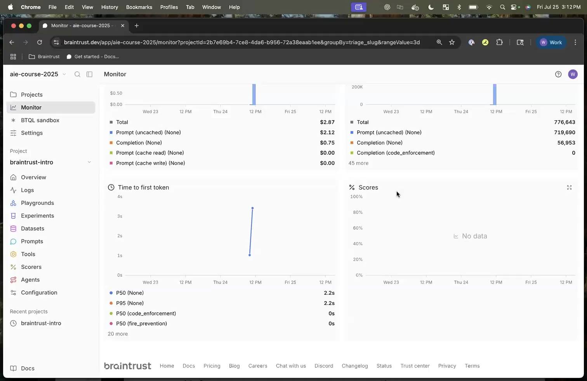
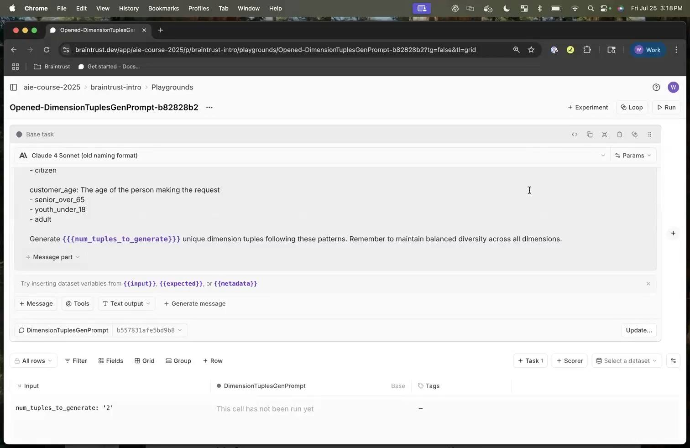
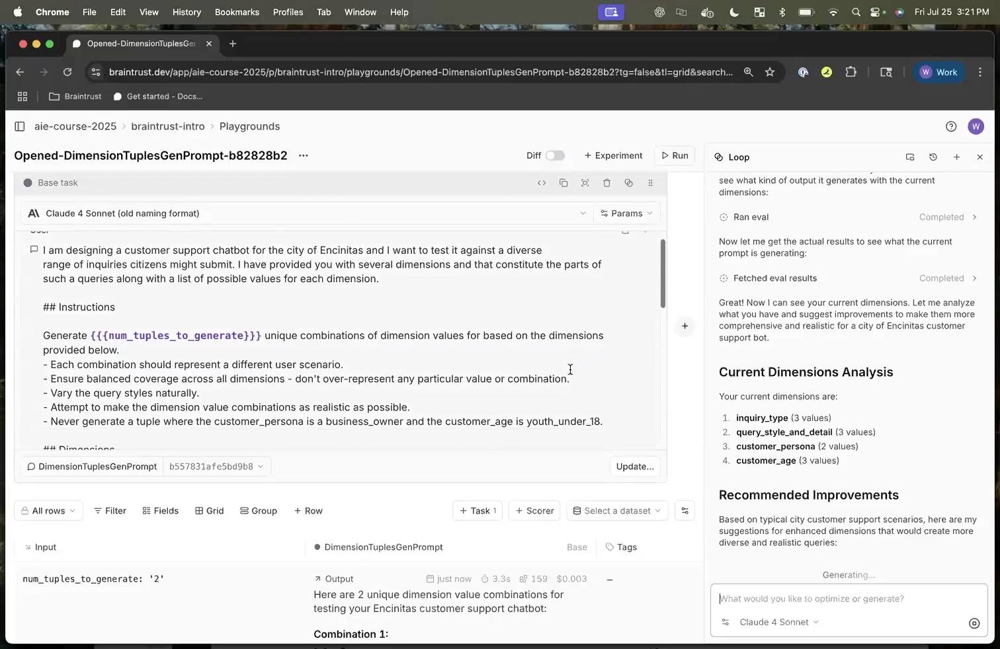
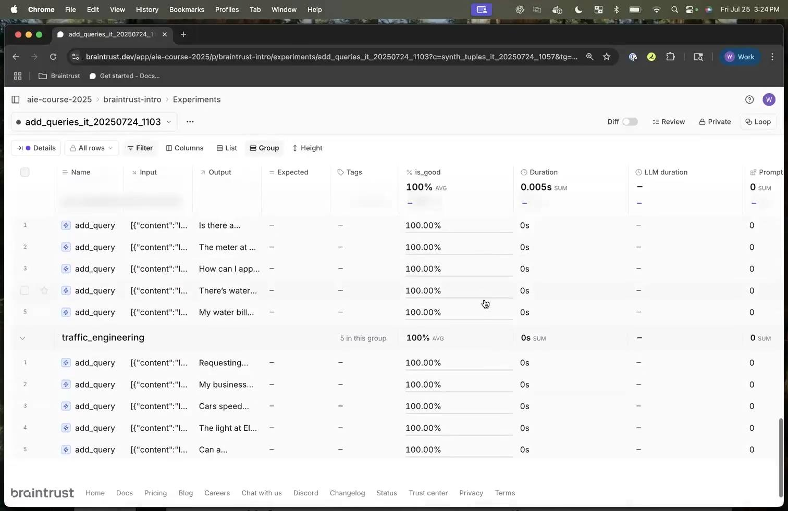
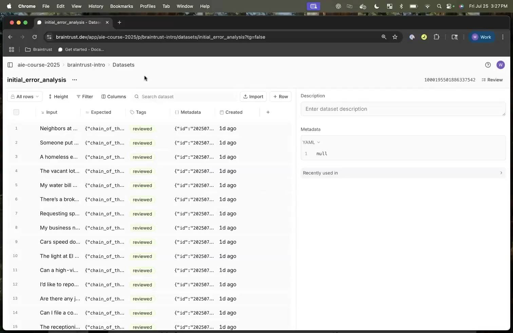
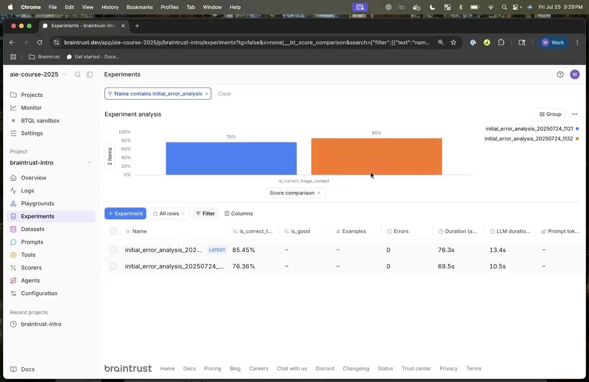
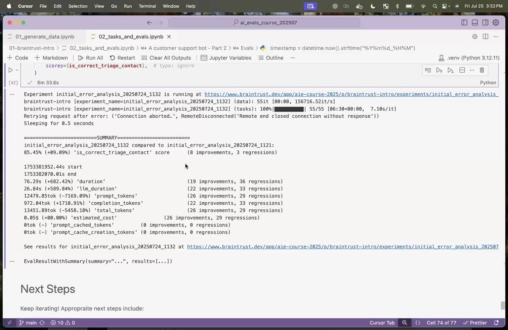

# AI Evals for Engineers & PMs（P3）：用 BrainTrust 跑通「客服 Bot」评测闭环

> 课程：BV1FwTE6gEky ｜ 覆盖 P3（00:00–43:01）｜ 主讲：Wade Gilliam（BrainTrust AI Developer Advocate）
> 本节性质：**产品实操演示课**。讲师在 BrainTrust 界面里完整走了一遍「从零到有 eval」的流程，但没有在逐字稿中给出任何可复制的命令行或完整源码（只在最后翻到 notebook 上展示了代码画面）。因此本文第 4 节按「纯讲解课」规则处理：把讲师的操作序列落成**设计决策表 / 组件职责表 / 数据模型草案 / 规模估算表**，并附一段明确标注的**示意伪代码**（课里没有代码）。

---

## 1. 这一节做什么

这一节的目标不是「介绍 BrainTrust 有哪些按钮」，而是回答一个更具体的问题：**一个 AI 产品从「什么 eval 都没有」到「有一套能稳定跑、能看到 76 分变 85.45 分」的评测闭环，中间到底要经历哪些步骤、每一步产出什么文件/对象。**

讲师用一个真实项目贯穿全场：**加州 Encinitas 市的市民客服 Bot（customer support bot for the city of Encinitas）**。这个 Bot 接收市民的求助请求，输出一个**结构化结果**：回答问题、预测是否需要后续跟进、应该被路由到哪个部门、以及是否需要补充位置 / 照片视频 / 联系方式等信息。

按顺序，这一节做完之后你手上会有：

1. 一个 BrainTrust **Organization**（讲师建的叫 `AIE Course 2025`）和其中至少一个 **Project**；
2. 一个组织级 **BrainTrust API Key** + 配置好的 **AI Provider**（模型厂商密钥）；
3. 一个**「维度元组生成」prompt**（Dimension Tuples generation prompt），并且经过了 Playground + Loop 的迭代；
4. 约 **19 条 dimension tuples**，并且经过领域专家（讲师太太 Julie）人工判定，剔掉了不合理的那条；
5. 一份 **165 条**的合成数据集，其中 **55 条**是手写（hand-coded）的「黄金数据」；
6. 一套**人工评审字段**（human review：一个 `comment` + 一个布尔 `is good`）和一套**标签体系**（`needs review` / `reviewed`）；
7. 一个 **error analysis 数据集**（从日志页把 trace「add to data set」加进去的）；
8. 若干次 **experiment**（BrainTrust 里离线 eval 就叫 experiment），跑分从 **76 → 85.45**；
9. 一个自定义 score（讲师读到的名字是 `is correct triage contact`，ASR 原文如此，实际命名以 notebook 为准）。

如果你是从前端转 AI 应用工程师，可以把这一整套东西映射成你熟的东西：**prompt ≈ 你的模板字符串；dataset ≈ 你项目里的 fixture JSONL；experiment ≈ 一次带版本号的 A/B 跑批；diff 视图 ≈ `git diff`，只不过 diff 的对象是「这次跑批 vs 上次跑批」的每条样本结果；metadata ≈ 你打日志时挂在事件上的 context 对象。** 这个映射后面还会反复用到。

---

## 2. 讲师原话

下面这些是本节最关键的判断，按出现顺序翻译成中文。技术产品名（BrainTrust、BrainStore、BTQL、Loop、Playground、OpenTelemetry 类名词）保留英文。

> "作为开发者，这一切都让我很有共鸣——UI 里的开发者体验，以及用 Python SDK 上手、真正开始把这个产品的价值最大化，都非常直观。"
> —— p003 [01:57]

> "有效的 eval 会让**整个团队**参与进来。不只是开发，还包括你的 PM、你的领域专家（SME）、你的 C-level，都要参与进构建 eval 的过程。"
> —— p003 [05:18]

> "你需要优化**整个闭环**。构建好的 AI 基础设施不只是写出好的 prompt，还包括通过 tool call 或输出结构来保证好的上下文，包括策划好的数据集去识别那些值得调查、值得为它建 eval 的失败模式，也包括构建和改进 score。"
> —— p003 [06:44]

> "今天我们看到的情况是，trace 的体积在疯狂增长。以前只是问一个问题、拿一段文本回复，那个时代已经过去了。现在你要处理多模态内容——音频文件、视频、巨大的 PDF——还有那种有很多步骤的 agentic 工作流。"
> —— p003 [07:42]

> "在 BrainTrust 我们自己做了一个数据库叫 BrainStore，它的设计目标就是处理 LLM 形态的数据：多模态内容，以及复杂的、半结构化的 JSON。我们努力让它能通过一种类 SQL 的查询语法 BTQL 高效地取到任意数据元素，同时也能高效地过滤、分组。"
> —— p003 [08:12]

> "我们有一个 score 的概念，它本质上是一种 reference-free（不需要标准答案）的评分机制，通常以 LLM as a judge 的形式出现，不需要 ground truth，你的 trace 流过来，它就能在上面跑。"
> —— p003 [12:02]

> "你可以这样建一个 score：只在它看到 thumbs down（点踩）指标时才运行。跑完之后，把结果不好的那些拿出来，接到一个反馈闭环里，让人参与进来，看看、策划数据集、建 eval，然后继续迭代。"
> —— p003 [12:59]

> "推荐的起点是：创建这些**维度（dimensions）和元组（tuples）**，它们代表一组组特征的唯一组合，而这些组合要能代表你的系统将来会遇到的、多样且真实的查询。"
> —— p003 [16:15]

> "Loop 是我们的 AI 助手，专门用来构建 eval，它把这些年我们作为一家 eval 基础设施公司、跟真正在做高质量 eval 的客户交流中学到的最佳实践都融进去了。它能拿到你需要的全部上下文：你的 prompt、你的数据集、你的 score。"
> —— p003 [18:39]

> "**所有的 eval 都需要数据、一个把数据跑起来的 task、以及一个衡量 task 结果的 score。**"
> —— p003 [31:52]

> "我们回过头把这些 trace 都过了一遍，发现有相当一部分是**手工标注的数据本身标错了**。所以我们进去把数据集修好，又跑了一次 eval，分数从 76 提到了 85.45。"
> —— p003 [29:30]

> "不是只能在高层次上看整体做得好不好，还要能**钻到具体样本里**，知道哪些地方变好了、哪些地方退步了。"
> —— p003 [30:08]

> "你的作业是：登录 BrainTrust，把 notebook 跑一遍，看看能不能把一切跑通。如果能跑通，试着自己写一个 score。然后跑你的第一次 eval。"
> —— p003 [33:49]

> "我们看到有些人，尤其是在早期，几乎就是把 BrainTrust 当成一个数据库来用，往里打 trace。我觉得这本身就是一个值得早早考虑这类平台的理由——我花了很多很多小时去想：OpenAI 的 trace 怎么写、Anthropic 的又怎么写？我想试新的模型怎么办？这些巨大的 PDF 和音频怎么管？这些带复杂 JSON 的结构化输出怎么管？怎么查？"
> —— p003 [36:14]

> "免费层的云端部署，工作方式和付费客户是一样的。但如果你是付费客户，你还可以自托管。我们有一个混合方案，可以让你把机密数据留在企业防火墙后面，同时还能构建 eval、在 Playground 里工作。这个能力叫 Remote Evals。"
> —— p003 [41:00]

---

## 3. 从零复现

> 本节没有任何命令行。讲师全程在 BrainTrust Web UI 里操作，代码只在最后以 notebook 的形式一闪而过（截图 p003 33:00 附近），逐字稿没有念出任何一行代码。所以下面复现的是**操作序列 + 每步产出物**，不是 `git clone && npm install`。

### 3.1 注册并创建 Organization

打开 BrainTrust 注册。注册后系统会要求你创建一个 **org（组织）**——可以是你的公司名、团队名，随便什么。讲师为这门课建的组织叫 `AIE Course 2025`。

概念上是三层：

```
Organization（组织中转站，管计费/成员/密钥/模型供应商）
└── Project（一个具体的 AI 工作流 / pipeline，eval 挂在项目下）
    ├── Prompts（可以在 UI 建，也可以在代码里建后 publish 上来）
    ├── Datasets（数据集，可以手工建、可以从日志里"add to data set"）
    ├── Experiments（离线 eval 的一次运行 = 一个 experiment）
    ├── Logs / Traces（线上真实请求打进来的记录）
    ├── Scores（评分器，可离线可在线）
    └── Human review（人工评审字段定义）
```

讲师在组织下建了**两个项目**：一个就是本节要用的客服 Bot，另一个留给后续课程的 recipe bot。**一个 project = 一条你要为它建 eval 的流水线**，这是本节最基础的心智模型。

> **前端类比**：Organization 像 Vercel 的 Team，Project 像一个 Deployment 项目，实验/部署像你每次 `git push` 出来的一次 build。

### 3.2 认识你要用到的五个界面

讲师明确带着过了一遍这几个位置，你复现时一定要先找到它们：

| 位置 | 干什么 | 本节里怎么用 |
|---|---|---|
| 左上角组织设置 | 组织级配置的总入口 | 建 API Key、配 AI Provider |
| Monitor（监控视图） | 看整个组织所有项目的实时表现：cost、latency、score | 建 metadata 字段来做分组分析 |
| BTQL Sandbox | 用类 SQL 语法直接查 BrainStore 里的数据，**内置 IntelliSense** | 调好查询后点按钮生成 TypeScript / Python / REST API 代码片段，粘进 notebook |
| Settings | 密钥与模型供应商 | 建 BrainTrust API key、配 AI Provider |
| 项目内的 Playground / Logs / Datasets / Experiments | 干活的地方 | 见下面各步 |

关于 BTQL Sandbox，讲师特别强调了它的两个价值：一是**能下钻到最细粒度的数据**（他说有客户在跑 TB 级数据、每天打几万到几百万条 trace），二是**调通之后一键导出代码**——支持 TypeScript、Python，或者直接用 REST API。这一段对应截图：



### 3.3 建 API Key 和 AI Provider（这一步漏了后面全废）

在 Settings 里必须做两件事：

1. **创建 BrainTrust API key** —— 让你的代码能跟 BrainTrust 通信。这是硬前提。
2. **配置 AI Providers** —— 就是把各家模型厂商的 key 填进去。讲师说列表里有**一堆云厂商**，你也可以**创建自定义 provider**。

为什么这两件事必须做：讲师明确说了两个依赖它的功能——

- **Loop**（AI eval 助手）会把你配了 key 的那些模型暴露出来给你选；
- **Proxy**（代理）需要这些 key。Proxy 有两个卖点：**支持缓存（caching）**，以及**统一入口**——你只写一次调用代码，就能很方便地切换模型供应商。

> **课里没讲**：具体的环境变量名、SDK 包名、版本号。讲师只说「需要创建一个 BrainTrust API key」。环境变量具体叫什么，请以官方 SDK 文档为准，本文不编造。

### 3.4 写第一版「维度元组生成」prompt

这一步是整个流程的源头。讲师的建议原话是：先创建 **dimension（维度）和 tuple（元组）**，它们代表特征的各种组合，覆盖你的系统将来会遇到的各种真实查询。

BrainTrust 支持两个方向的 prompt 管理：**在 UI 里建 prompt、在代码里 fetch**，或者反过来。本节走的是后者——**在 notebook 代码里创建 prompt，然后 publish 到 BrainTrust**，你在 UI 里看到的就是 `Dimension Tuples generation prompt`，而且能看到它的**第一个版本**以及后续迭代的版本历史。

讲师坦承这个 prompt 的初版「很多初始片段是从作业代码里抄来的」，然后迭代出来的。

### 3.5 进 Playground，用 Loop 迭代 prompt

从 prompt 详情页可以**创建一个 Playground**。讲师对 Playground 的定义值得原样记住：**"Playground 你可以理解成用来构建 eval 的 IDE。"**

在 Playground 里你能做的事（讲师逐条演示）：

- 编辑 prompt；
- **加 tool calling**，做更多的上下文工程；
- **控制输出格式**；
- **在 Playground 里直接建 dataset**，看看这个 prompt 实际表现如何；
- **加多个 prompt 做对比**，看你现在这版和别人/别的思路比怎么样；
- **调用 Loop**。

Loop 的输入上下文是：**你的 prompt、你的数据集、你的 score**。讲师现场给 Loop 的指令（这段可以直接拿来当模板）：

```
I am building a customer support bot for the city of Encinitas,
and I want help on updating the dimensions and dimension values
in my prompt to ensure I can create a diverse and realistic set
of queries. Each dimension should represent a valid characteristic
of a customer support request we might get.
```

Loop 收到之后，会依次去看：prompt → eval 结果（这次没有）→ 指定在测试数据集上跑（这个测试集只有一行）。然后它给出建议，**以 diff 的形式呈现：哪里要删、哪里要加**。你接受之后，可以**保存为数据集/提示词的新版本**。





讲师说得很直白：**「这就是我最终得到那版 dimension tuple prompt 的方式。」**

### 3.6 人工过一遍生成的 dimension tuples

跑完 prompt，得到**大约 19 条** dimension tuple。然后讲师做了一件很关键、但工具替不了的事：**拉着领域专家（他太太 Julie，也就是这个 Bot 的 SME）一条条看。**

他特别强调了这个环节的**上手成本极低**：他只演示了**一到两个例子**怎么翻 trace、怎么看 output，她就能自己判断「这条合理 / 不合理」了。19 条里只有 **1 条**被否掉，理由是：**「一个 18 岁以下的人不太可能带着这些维度来提问。」**

这一步的产出是：一份**确认过合理的 dimension tuple 清单**。它决定了后面所有合成数据长什么样，所以宁可慢。

### 3.7 造合成数据：11 个部门 × 5 条手写 + 批量生成 = 165 条

具体做法（逐字稿里有完整数字，务必照抄）：

1. 和 SME 一起**识别出 11 个左右**「会收到这些客服请求的领域/部门」；
2. 为每个部门**写一段描述**，说明这个部门提供的支持是什么类型；
3. **每个部门手写 5 条 query**；
4. 在此基础上**批量生成**，最后得到**总共 165 条**样本。

11 × 5 = **55 条手写query**，这个数字在后面会反复出现，它就是「黄金数据集」。剩下的 165 − 55 = **110 条**是纯生成出来的。

讲师说明了为什么先做手写这批：为了**快速拿到可信数据、别在造数据上耗太久，早点进入建 eval 的环节**。

### 3.8 把部门信息塞进 metadata，并做覆盖度检查

生成完数据后第一件事不是跑 eval，而是**验证覆盖度**：确保所有可能收到请求的部门都被覆盖到了。

做法是把**部门信息写进 metadata**，然后在 BrainTrust 里按 metadata **分组（group）**，一眼就能看到每个部门各有多少条、请求类型分布如何。



然后**筛选出那 55 条手写数据**——讲师的说法是「我们跟手写的那批数据打交道，因为我们已经知道它大概率是好的」，这 55 条就作为 **golden dataset（黄金数据集）** 起步。

> **前端类比**：metadata 就是你在 `analytics.track()` 里挂的那个 properties 对象；「按 metadata 分组」等于你在看板上 `group by properties.department`。

### 3.9 配人工评审字段（human review score）

在项目配置里进 **Human review**，可以**建任意多个 human review score**，并定义它们怎么工作。本节里用到的两个字段：

- `comment` —— 自由文本备注；
- `is good` —— **布尔值，true / false**。

这两个字段会出现在每条 trace 的 review 页面上。你以后做数据清洗、做「哪些样本可以进黄金集」的判断，靠的就是它们。

### 3.10 打标签（tags）：needs review → reviewed

标签体系设计得很简单，但很关键：

1. 把 55 条（SME 已确认 OK 的）合成 query **跑过客服 Bot**，产生一批 trace；
2. 初始打标 **`needs review`**；
3. 人看过之后，改标 **`reviewed`**；
4. 后面**只用 `reviewed` 的样本**去组数据集、跑 eval。

这套 tag 就是「数据成熟度」的状态机，和前端里 `status: 'draft' | 'reviewed'` 是同一个东西。

### 3.11 在 Logs 页看清 trace 的层级：只关心顶层 task

进 Logs 页，能看到这些 trace 的**层级结构**。讲师点明：`request support` 这个**顶层 task** 才是我们关心的，它下面还有子任务（subtasks）：

1. 先做一次 **web search** 拿上下文；
2. 再对搜索结果做一次 **synthesis（综合）**，产出给用户的答案。

「我们真正关心的只是最外层的 `request support`。」——所以后面的筛选、加数据集、建 score，都作用在顶层 task 上，不要被子任务的 trace 污染。

### 3.12 从日志建 error analysis 数据集

在 Logs 页筛选出手写数据 → 点 **add to data set** → 得到一个叫 **error analysis** 的数据集。讲师说他事先已经做过了，所以这个数据集现成存在。

这个数据集就是「我怀疑这里有失败模式、值得拿来做 eval」的那批真实 trace 的集合。

### 3.13 跑第一次离线 eval（experiment）

在 BrainTrust 里，**离线 eval 就叫 experiment**。用上面那个 error analysis 数据集跑了一两次之后，进 experiment 详情：

- **按 `triage slug` 分组**，看不同部门的路由准确率——哪些部门分对了、哪些分错了，一目了然；
- 发现 **`general` 这一类在往下掉**，于是点进 trace 看具体样本；
- 看到输入（真实的市民请求）和输出（**结构化输出**：给答案、预测是否需要 follow-up、应该路由到哪、是否需要位置/照片视频/联系方式等额外信息）；
- 定位到一个具体案例：手写标注里写的是 `general`，但模型把它路由到了 **Parks and Rec**；
- 讲师和太太复盘后发现——**是手写标注本身标错了**，模型的判断其实是对的。（他原话是「结婚 31 年，第一次听她承认自己错了」。）
- 顺着这条线复查，发现**相当一部分样本存在标注错误**。



### 3.14 修数据 → 重跑 → 76 变 85.45

修正数据集后重跑，分数从 **76** 提到 **85.45**。**注意：这一轮提升完全来自修数据，没有改 prompt、没有改模型。**

然后进最新的 experiment 看 **diff**：

- 可以**只看 regressions（退步的样本）** 并筛选；
- 点进单条 trace，能直接看到**上一次 eval 和这一次 eval 的输出差异**；
- 借此找「还有哪些失败模式是我没捕捉到的」，再回去迭代数据、加 score。



这一步是整节课的方法论落点：**eval 的价值不在那个分数，而在「分数变了之后你能下钻到具体哪条样本、知道为什么」。**

### 3.15 代码侧：三类对象和一个 score

最后讲师翻了 notebook，讲了下面这段结构（这段是本节唯一涉及代码逻辑的部分，但**没有念出任何一行源码**）：

> 所有的 eval 都需要 **数据 + task + score**。

具体到本节：

1. **把上面那个 dataset 拉下来**（拉取方式：可以在 BTQL Sandbox 调通查询后点按钮导出 TypeScript / Python / REST 代码片段，也可以直接在 SDK 里按名字取数据集）；
2. **定义一个 score**，讲师读到的名字是 `is correct triage contact`（ASR 原文，实际命名以 notebook 为准）；
3. **跑 eval**；
4. 给这次 eval 挂 **metadata**——讲师说这是为了「以后 eval 变多了，能快速找到你要的那几次运行」；
5. 修完数据集后**再拉一次**，**再跑一次**；
6. 第二次跑的时候，在 metadata 里额外写了一条 **`what changed`**（我们这次改了什么）——这样实验记录本身就是一份变更日志。



---

## 4. 完整代码

> **本节没有可运行代码。** 逐字稿里讲师没有念出任何一行源码或命令，截图清单也没有提供 OCR 文本。所以按「纯讲解课」规则，这里把讲师的操作落成四张可执行的表；表后附一段**明确标注为示意**的伪代码，帮助你理解数据流，**它不是课程内容，也不能直接运行**。

### 4.1 设计决策表

| # | 决策 | 讲师的做法 | 为什么这么定 | 不这么做会怎样 |
|---|---|---|---|---|
| 1 | 先建维度再写 query | 先做 dimension + tuple，再据此生成 query | 维度是「特征的正交分解」，能保证覆盖面；直接想 query 会想到哪写到哪 | 数据分布严重偏斜，某些部门一条样本都没有 |
| 2 | 维度由 LLM 生成、人只做否决 | Loop 出 diff → SME 逐条判 OK / 不 OK | 人的成本花在「判断」上而不是「创作」上，19 条只需看 19 次 | 让 SME 从零写 19 条，耗时长且不专业 |
| 3 | 每个部门手写 5 条 | 11 部门 × 5 条 = 55 条 | 手写数据可信，能当 golden set；同时给了模型 few-shot 的锚点 | 全靠合成 → 无法判断是模型错还是数据错 |
| 4 | 先只用手写数据建 eval | 165 条里筛出 55 条用 | 讲师原话：早点进 eval，别在造数据上耗太久 | 110 条未验证的合成数据混进来，分数无法解释 |
| 5 | 部门信息进 metadata | 而不是塞进 prompt 或文件名 | metadata 可分组、可过滤、可用于实时监控 | 想看「general 类目表现如何」只能人工翻 |
| 6 | 用 tag 管数据成熟度 | `needs review` → `reviewed` | 数据集是「reviewed 的子集」，天然可追溯 | 无法区分「跑过」和「看过了」 |
| 7 | 只评顶层 task | 只看 `request support`，忽略 web search / synthesis 子任务 | 顶层 task 才是用户可感知的业务结果 | 子任务 trace 混入，score 口径被打散 |
| 8 | 先修数据再改 prompt | 修正标注后重跑，76 → 85.45 | 排除「数据错」这个变量，才知道模型真实水平 | 拿错数据当基准，改 prompt 会越改越偏 |
| 9 | 每次 run 都挂 metadata | 第二次跑额外写 `what changed` | 实验多了以后靠 metadata 才能检索到 | 一个月后回看，不知道哪次改了什么 |
| 10 | score 尽量 reference-free | 用 LLM as a judge，不需要 ground truth | 线上真实 trace 没有标注，只有 reference-free 才能在线跑 | 只能做离线 eval，线上监控无解 |
| 11 | 在线 score 要能定向触发 | 只跑在「thumbs down」的 trace 上 | 全量跑太贵，也没必要 | 成本爆炸，且大量正常样本淹没信号 |

### 4.2 组件职责表

| 组件 | 它负责什么 | 在本节复现流程的哪一步出现 |
|---|---|---|
| Organization | 管项目、成员、密钥、模型供应商 | 3.1 / 3.3 |
| Project | 一条 AI 工作流 = 一个 eval 的边界 | 3.1 |
| Prompt（含版本历史） | 存 prompt，UI 与代码双向同步 | 3.4 / 3.5 |
| Playground | 「构建 eval 的 IDE」：改 prompt、加 tool call、控输出、建 dataset、多 prompt 对比、调 Loop | 3.5 |
| Loop | AI eval 助手，可读 prompt / dataset / score，产出 diff 建议 | 3.5 |
| Dataset | 样本集合，可人工建、可 Playground 建、可从日志 add | 3.12 |
| Logs / Traces | 线上或跑批产生的执行记录，含父子 task 层级 | 3.11 |
| Tags | trace 上的状态标记（`needs review` / `reviewed`） | 3.10 |
| Human review score | 自定义的人工评审字段（`comment`、`is good`） | 3.9 |
| Experiment | 一次离线 eval 运行，可与历史 run 做 diff | 3.13 / 3.14 |
| Score | 评分器，可 reference-free、可在线、可定向触发 | 3.15 / 在线监控 |
| BrainStore | 底层数据库，专为 LLM 形态数据（多模态 + 半结构化 JSON）设计 | 全程 |
| BTQL | 类 SQL 查询语言，Sandbox 里带 IntelliSense，可导出代码 | 3.2 |
| Proxy | 统一模型调用入口，支持缓存、可切厂商 | 3.3 |
| AI Providers | 厂商 key 的集中配置，Loop 与 Proxy 依赖它 | 3.3 |

### 4.3 数据模型草案（字段名以逐字稿出现过的为准）

> 说明：下面所有字段**都是逐字稿里被讲师口头提到过的概念**。讲师没有展示 schema 定义，所以这里只给语义，不给类型定义。「课里没讲」的部分我明确标出来了。

**Prompt：`Dimension Tuples generation prompt`**

| 概念 | 说明 |
|---|---|
| versions | 讲师明确说能看到「这个 prompt 被创建的第一个实例」，说明有版本历史；可以接受 Loop 的建议后「保存为新版本」 |
| dimensions | 一组维度，每个维度有若干 **dimension values** |
| 输出 | 一组 **dimension tuples**（本节生成约 19 条） |

**Dataset row（合成数据）**

| 概念 | 说明 |
|---|---|
| query | 一条市民的客服请求（text） |
| metadata.department | 该请求应路由到的部门（11 个之一） |
| 是否手写 | 决定它是否进 55 条 golden set |
| tags | `needs review` / `reviewed` |

**Trace（`request support` 顶层 task）**

| 概念 | 说明 |
|---|---|
| input | 真实客服请求文本 |
| output（结构化） | ①回答问题 ②是否需 follow-up ③应路由到哪个部门 ④是否需要额外信息（位置 / 照片视频 / 联系方式） |
| subtasks | `web search`（取上下文）→ `synthesis`（综合成答案） |
| triage slug | 用于分组统计路由结果（讲师用它分组看各部门表现） |
| tags | `needs review` / `reviewed` |
| human review | `comment`（文本）、`is good`（布尔） |

**Score：`is correct triage contact`**（逐字稿 ASR 原文，实际命名以 notebook 为准）

| 概念 | 说明 |
|---|---|
| 类型 | reference-free / LLM as a judge |
| 是否需要 ground truth | 不需要 |
| 触发范围 | 可限定在 trace 的**特定部分**；线上可只在 `thumbs down` 时触发 |
| 入参上下文 | prompt、dataset、score 本身（Loop 就是读这些） |

**Experiment**

| 概念 | 说明 |
|---|---|
| dataset | 用哪个数据集跑的（本节先用 error analysis 数据集） |
| score | 挂了哪些评分器 |
| metadata | 任意附加信息；讲师第二次跑时写了 **`what changed`** |
| 对比能力 | 可与上一次 run 做 diff，可单独筛出 regressions |

**课里没讲**：数据库表结构、字段类型、主键设计、JSON schema 定义、SDK 的类名与方法签名。

### 4.4 规模估算表（全部来自逐字稿的数字）

| 指标 | 数量 | 来源 |
|---|---|---|
| 部门数 | 约 11 个 | 讲师与 SME 一起确定 |
| 每部门手写 query | 5 条 | 讲师明确说「hand coded five queries」 |
| 手写总数 | 11 × 5 = **55 条** | 讲师在 UI 里筛选后报出 55 |
| 合成数据总数 | **165 条** | 讲师在数据集里看到的总数 |
| 纯合成（非手写） | 165 − 55 = **110 条** | 推算 |
| 生成的 dimension tuples | 约 **19 条** | 讲师口述「19 or so」 |
| 被 SME 否掉的 tuple | **1 条** | 理由：18 岁以下的人不太可能这样提问 |
| 第一次 eval 分数 | **76** | 讲师口述 |
| 修数据后分数 | **85.45** | 讲师口述 |
| 提分来源 | **100% 来自修数据** | 讲师明确说没改 prompt |

### 4.5 示意伪代码（⚠️ 课里没有代码，以下为示意）

> **重要声明**：下面这段**不是**课程内容，讲师没有在逐字稿里给出任何源码；BrainTrust SDK 的真实函数名、参数名、返回结构**课里没讲**，本文不编造。这段仅用于帮你理解「数据 → task → score」这条链路是怎么串起来的。**照抄无法运行，请以官方文档为准。**

```text
# ===== 课里没有代码，以下为示意，函数名均为占位 =====

# 1) 建 prompt 并 publish 到 BrainTrust（讲师是在 notebook 里建、在 UI 里看的）
prompt = create_prompt(name="Dimension Tuples generation prompt", template=TEMPLATE)
prompt.publish()

# 2) 拉取数据集（对应讲师说的"grab that dataset"）
#    数据集来源二选一：a) UI 里 add to data set 建好的 error analysis 数据集
#                       b) BTQL Sandbox 调通后导出的查询代码
dataset = get_dataset(name="error_analysis")

# 3) 定义 task：把每条样本跑过客服 Bot，产出结构化输出
def task(row):
    return support_bot(
        query      = row.query,
        # 输出需要包含：答案 / 是否需 follow-up / 路由部门 / 是否需要位置、照片视频、联系方式
    )

# 4) 定义 score：reference-free，用 LLM as a judge 判"路由是否正确"
#    讲师读到的名字是 is correct triage contact，实际命名以 notebook 为准
score = llm_judge(name="is_correct_triage", reference_free=True)

# 5) 跑 eval —— 所有的 eval 都需要：数据 + task + score
run = run_eval(
    dataset  = dataset,
    task     = task,
    scores   = [score],
    metadata = {"note": "first run"},        # 第一次
    # metadata = {"what_changed": "fixed mislabeled rows"},  # 第二次（讲师做法）
)

# 6) 看结果 → 下钻到具体样本 → 修数据 → 重跑 → 比 diff
print(run.score)        # 第一次约 76
print(run.score)        # 修数据后约 85.45
```

---

## 5. 逐行解释

**为什么必须先做 dimension 和 tuple，而不是直接写 query？**
因为 query 是「点」，维度是「坐标轴」。讲师的定义是：tuple 是「特征的唯一组合」。你一旦把「市民身份 / 问题类型 / 紧急程度 / 是否需要附件」这些维度列出来，就能机械地组合出覆盖所有象限的查询，而不会出现「11 个部门里 8 个部门一条样本都没有」。这是**采样式思考（sampling）而不是灵感式思考（prompting）**——跟你做前端表单校验时先列字段矩阵、而不是想到哪测到哪是一个道理。

**为什么让 LLM 生成维度、让人只做否决？**
成本结构决定的。Loop 生成 19 条 + diff 的成本是几次模型调用；SME 从零写 19 条的成本是一整个下午。讲师现场演示了 SME 的上手成本有多低——**教了一两个例子她就能独立判断**。所以流程被设计成「机器提案 + 人签字」，而不是「人提案 + 机器执行」。

**为什么每个部门要手写 5 条，而不是全合成？**
手写数据提供的是**可信锚点**。你看后面发生了什么：模型把一条标着 `general` 的请求路由到了 `Parks and Rec`，讲师和 SME 复盘后发现**是标注错了**。这个结论只有在「标注是人写的、且人敢承认自己错」的前提下才推得出来。如果 165 条全是机器生成的，你永远无法区分「模型错」和「数据错」。

**为什么先只用手写的 55 条建 eval？**
讲师原话是「为了加速、不要花太多时间、尽快进入构建 eval 的环节」。这是一个**节奏决策**，不是技术决策。先用手写数据跑出第一个分数（76），你就有了一个可动的基线；基线有了，后面每改一次东西（修数据、改 prompt、加 score）都能看出影响。

**为什么部门信息要放 metadata，而不是放 prompt 或文件名？**
因为 metadata 是**唯一既能在 UI 里分组、又能在代码里过滤、还能在实时监控里聚合**的载体。讲师在 Monitor 视图里明确说「你可以用 metadata 字段来放对实时性能监控有帮助的信息」。放 prompt 里会被模型看到（污染输入），放文件名里无法聚合。

**为什么 tag 要分 `needs review` 和 `reviewed` 两级？**
因为「跑过」和「人看过」是两种完全不同的状态。数据集是从 **reviewed** 的子集里组出来的，这个设计保证了：任何进入 eval 的样本，都有人签过字。这相当于给你的数据加了一条 `status` 状态机，和前端里 `draft → published` 是同构的。

**为什么只评顶层的 `request support`，不评子任务？**
因为子任务（web search、synthesis）是实现细节，而顶层 task 才是业务结果。如果你把子任务的 trace 也拿去跑 score，同一个用户请求会被计多次分，分母就脏了。顺带说一句，讲师后面预告「最后两次 homework 会讲怎么评 agentic 系统的中间步骤」——也就是说**子任务评估不是不做，是后面单独做**。

**为什么发现错误后先修数据、而不是先改 prompt？**
因为第一次 eval 的 76 分里，混着「模型错」和「标注错」两种噪声。不把标注错清掉，你改 prompt 就是在给噪声做优化——改好了是运气，改坏了你还以为方向错了。修完数据后 76 → 85.45 这个涨幅，**证明了那 9.45 分的差距本来就是标注噪声**，跟模型能力没关系。这是一次干净的变量隔离。

**为什么每次 run 都要挂 metadata，第二次还要专门写 `what changed`？**
因为 experiment 会越积越多，而人类记忆不会。讲师的原话是「有了 metadata 就很容易拿到你期望的那几次 run」。`what changed` 这个字段本质上是在**给实验写 commit message**——你一个月后回看，能立刻知道 85.45 那次是因为修了数据，而不是因为换了模型。

**为什么 score 要 reference-free？**
因为线上真实 trace **没有 ground truth**。用户发来一个请求，没人告诉你正确答案是什么。如果 score 必须有标准答案，那它就只能离线跑，线上监控就断了。用 LLM as a judge 的最大好处是：**同一条 score 定义，既能跑离线 experiment，也能跑线上实时 trace。**

**为什么在线 score 要能「只在 thumbs down 时触发」？**
两个原因：**成本**和**信噪比**。全量跑 judge 模型的费用会随流量线性涨；而绝大部分 trace 是正常的，跑出来的高分是噪声。讲师举的例子很具体：每个聊天机器人都有👍👎，那就让 score 只在看到 👎 时才跑，跑完把差的结果送进人工复核队列。这是一个**漏斗设计**，不是评分设计。

**为什么 Playground 被叫做「eval 的 IDE」？**
因为它把构建 eval 需要的四样东西放在了一个界面里：**prompt、dataset、score、对比**。你在里面改 prompt、加 tool call、控输出、建 dataset、调 Loop、跑对比——全在一个屏幕上，不用来回切。讲师说它的目标是「让不熟悉代码或 JSONL 文件的人也能参与」，这就是为什么它必须是 UI 而不是 SDK。

**为什么 Loop 要先配 AI Provider 才能用？**
因为 Loop 本身就是一个 agent，它要调模型。你能用哪些模型，取决于你在组织设置里配了哪些厂商的 key。同理，Proxy 也需要这些 key。这是本节唯一一个「配置错了后面全废」的前置条件。

**为什么 BTQL 要带 IntelliSense、还要能一键导出代码？**
因为它的定位是「**探索 → 固化**」的两段式：先在 Sandbox 里交互式地把查询调对（IntelliSense 降低试错成本），确认能跑通之后再导出成 TypeScript / Python / REST 粘进代码。这样就避免了「在 notebook 里反复改字符串、反复重跑」的低效循环。

**关于 Q&A 里那个「notebook 还是平台」的问题——讲师的判断是什么？**
他不否认 notebook 能做数据分析，但他给了一个很实际的观察：**很多人就是把 BrainTrust 当数据库用，只往里打 trace**，而这本身就值回票价。理由是那些「脏活」——OpenAI 的 trace 怎么写、Anthropic 的怎么写、想换新模型怎么办、大 PDF 和音频怎么存、复杂 JSON 怎么查——这些每家都要重复造一遍。他把这称为「值得早早引入 eval 基础设施」的理由。

**JS/Node 视角补充一句**：本节没有出现任何锁、事务、并发问题。唯一有点「并发」味道的是**在线 score 跑在流式进来的 trace 上**——在你熟悉的 Node 里，这相当于一个消费消息队列的 worker：trace 进来 → 判断是否满足触发条件（比如 `thumbs down`）→ 满足才调 judge 模型 → 结果写回。它不阻塞主请求链路。

---

## 6. 复现检查清单

按顺序打勾，任一项没完成不要往下走：

**环境**
- [ ] 已注册 BrainTrust，并创建了 Organization（讲师用 `AIE Course 2025`）
- [ ] Organization 下已创建 Project（一条工作流 = 一个 project）
- [ ] 已在 Settings 中创建 **BrainTrust API key**
- [ ] 已在 Settings 中配置至少一个 **AI Provider**（否则 Loop 和 Proxy 都用不了）
- [ ] 已确认 BTQL Sandbox 能打开，且输入时有 IntelliSense 提示

**Prompt 与维度**
- [ ] 已创建 `Dimension Tuples generation prompt`（可在代码里建后 publish，也可在 UI 里建）
- [ ] 已从该 prompt 创建 Playground
- [ ] 在 Playground 里试过至少一次 Loop，并看到 **diff 形式的增删建议**
- [ ] 已拿到约 **19 条** dimension tuples
- [ ] 已请领域专家逐条判定，并记录被否掉的那条及理由（例：18 岁以下不太可能这样提问）

**数据**
- [ ] 已确认约 **11 个**部门，并写下每个部门的支持内容描述
- [ ] 每个部门已手写 **5 条** query（合计 **55 条**）
- [ ] 已批量生成，数据集总数达到 **165 条**
- [ ] 每条样本的 **metadata 里已写入部门信息**
- [ ] 已在 UI 里按部门分组，确认**没有部门是 0 条**
- [ ] 已筛选出 **55 条**手写数据，标记为 golden set

**人工评审与标签**
- [ ] 项目配置 → Human review 里已建好评审字段，至少包含 `comment`（文本）与 `is good`（布尔）
- [ ] 55 条已跑过 Bot，产生 trace
- [ ] trace 初始已打标 **`needs review`**
- [ ] 复核后已改标 **`reviewed`**

**数据集与实验**
- [ ] Logs 页已确认 trace 层级：顶层 `request support` → 子任务 `web search` / `synthesis`
- [ ] 已确认所有筛选/加数据集操作都作用在**顶层 task** 上
- [ ] 已从 Logs 页 **add to data set**，生成 `error analysis` 数据集
- [ ] 已跑第一次 experiment，并**按 `triage slug` 分组**查看各部门表现
- [ ] 已定位至少一条错例，并确认它是「模型错」还是「标注错」
- [ ] 已修正数据集中的错误标注
- [ ] 已重跑 experiment，分数应出现提升（讲师的数据：**76 → 85.45**）
- [ ] 已在 experiment diff 视图里**筛选 regressions**，逐条看过
- [ ] 第一次 run 的 metadata 至少写了备注；第二次 run 的 metadata 写了 **`what changed`**

**代码侧**
- [ ] 已把数据集拉进 notebook（方式：BTQL 导出 or SDK 取）
- [ ] 已定义自己的 score（讲师的定义为 reference-free / LLM as a judge）
- [ ] 已跑通「数据 + task + score」的最小 eval 链路
- [ ] （作业要求）已尝试**自己写一个新的 score**，并跑第一次 eval

---

## 7. 课里没讲但你会撞上的

1. **SDK 安装、版本号、环境变量名——课里没讲。** 讲师全程没念任何一行命令，只说「用 Python SDK 上手」。你实际动手时会卡在 `pip install` 什么包、环境变量叫什么。这些请以官方文档为准；本节不编造。

2. **notebook 在哪里、怎么拿——课里没讲具体链接。** 讲师多次说「这两个 notebook 我会分享」「repo 会给你们」，但逐字稿里没有出现 URL。你需要去课程 Discord 或课程资料页找。

3. **110 条纯合成的数据怎么处理——课里没讲。** 讲师只说了「总共 165 条，我们先用 55 条手写的」。剩下 110 条是丢弃、还是等手写数据跑顺之后再逐步纳入，他没有说。合理做法是**先冻结、等 score 稳定后再分批放进来观察回归**，但这是我的建议，不是课程内容。

4. **标注者一致性——课里没讲。** 本节只有一个标注者（讲师太太）。真实团队里多人标注同一批数据时，你需要一致性检验，否则 golden set 本身不可信。讲师用「她自己承认标错了」这个轶事间接说明了标注会错，但没给流程。

5. **Loop 的成本和调用上限——课里没讲。** Loop 是 agent，会调模型，会花钱。讲师没提计费方式或额度。

6. **Proxy 缓存的具体策略（TTL、命中条件、key 规则）——课里没讲。** 只说了「支持缓存」这一个事实。

7. **BTQL 语法本身——课里没讲。** 只说了它「类 SQL」、支持 IntelliSense、能查 experiments / logs / datasets。具体关键字、聚合函数、JOIN 能力，全部未知。

8. **在线 score 的延迟预算——课里没讲。** 用 LLM as a judge 跑实时 trace 会引入额外延迟。讲师强调了「只在 thumbs down 时触发」这个降本手段，但没讨论它对 P99 的影响。你是前端出身，这一点要特别注意：**别把 judge 调用放在用户请求的同步路径上**。

9. **self-host / hybrid / Remote Evals 的具体部署方式——课里没讲。** 讲师只说了「付费客户可以自托管」「有混合方案把机密数据留在企业防火墙内」「这个能力叫 Remote Evals，目前支持 TypeScript，Python 马上支持」。落地细节一概没有。

10. **GDPR 合规问题——讲师明确说自己答不准。** 现场有同学问「免费层能不能做 GDPR 合规的原型」，讲师的原话大意是：这个问题更适合放到 Discord，他会去问更懂的人再回答。他补充了两条事实：免费层的云端部署和付费客户**工作方式一样**；并且 BrainTrust 是 **SOC 2 Type 2** 合规。**但「免费层 + GDPR」这个组合他没有给出结论**，你别把 SOC 2 当成 GDPR 的等价物。

11. **AWS Bedrock 的接入细节——课里只说了「支持」。** 有同学问在 Bedrock/Claude 上怎么用，讲师回答：Bedrock 是 AI Providers 里支持的云厂商之一；可以用 Proxy + 兼容 OpenAI SDK 的 SDK；Python 和 TypeScript 都行。**具体到 Bedrock 的鉴权配置、region 参数，课里没讲。**

12. **后续四节课的内容只给了标题——课里没展开。** 讲师预告的顺序是：①人工评审 + error analysis；②LLM as a judge 并对齐人工反馈；③评估 retrieval 任务；④评估 agentic 系统的中间步骤。其中第 ④ 项和本节「只评顶层 task」正好互补——本节刻意不评子任务，是留给后面讲的。