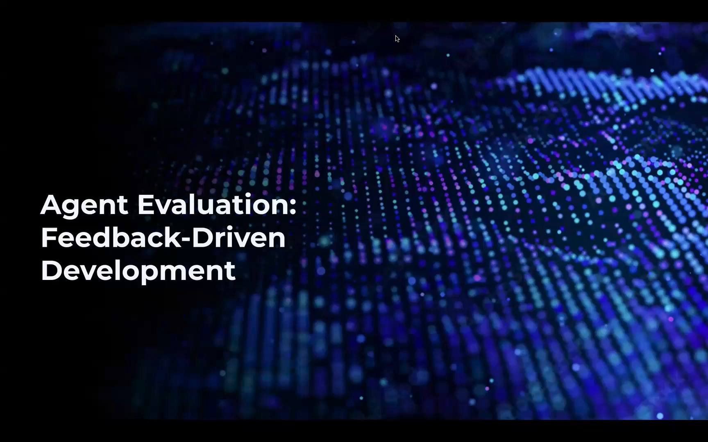
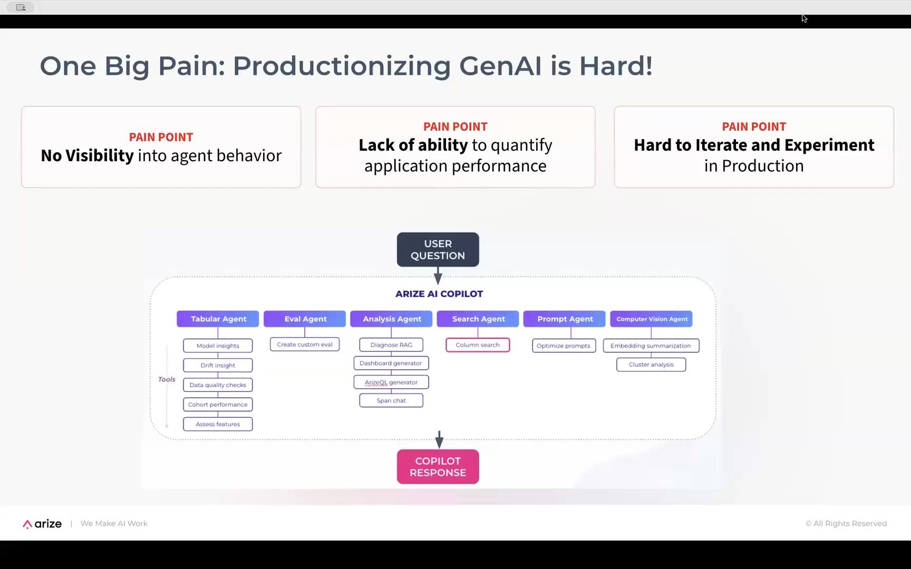
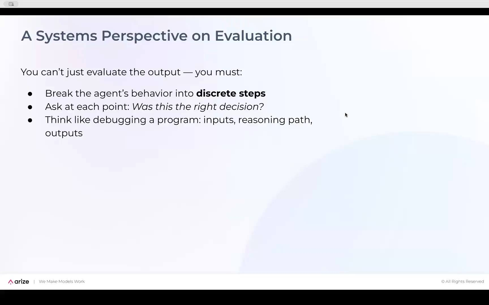
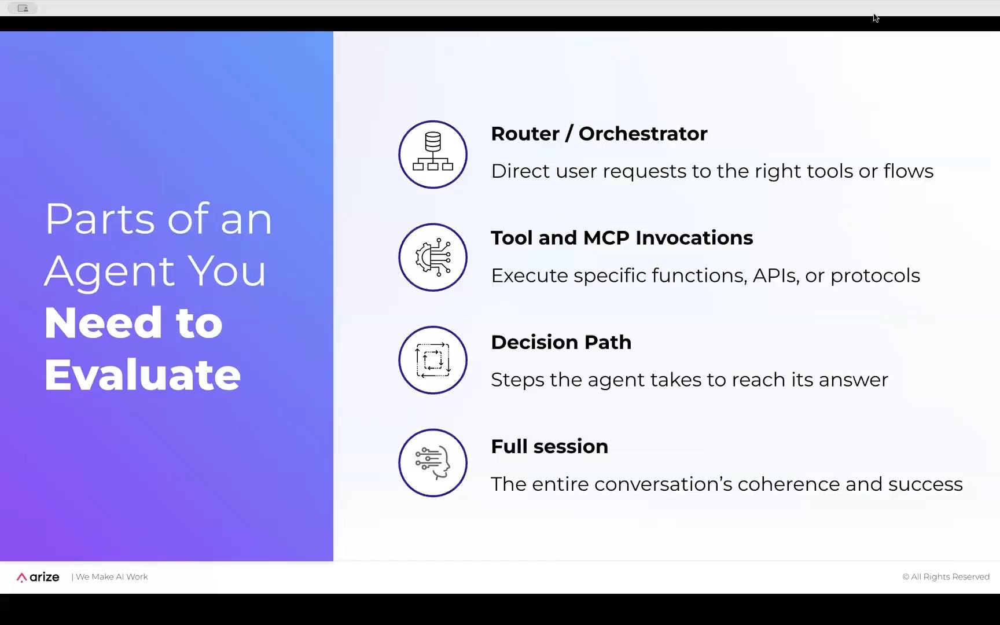
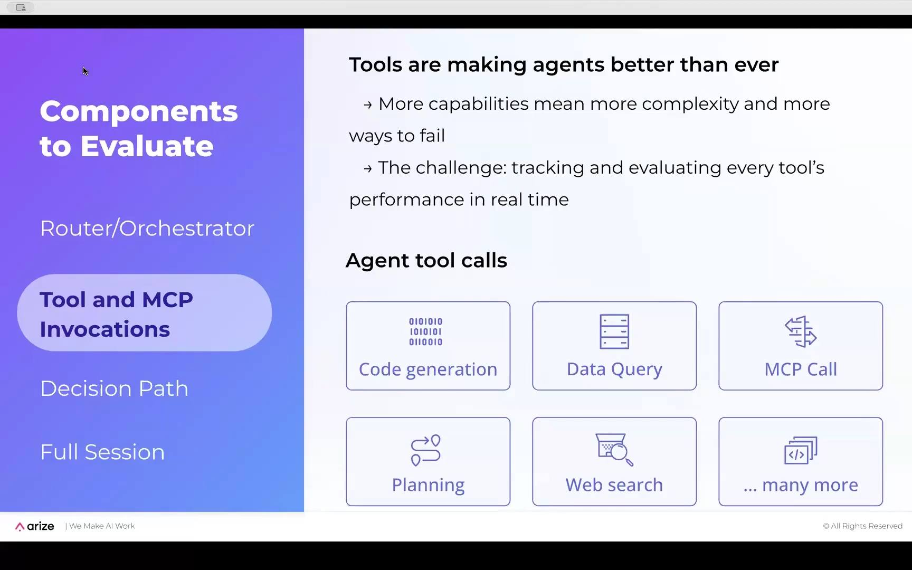
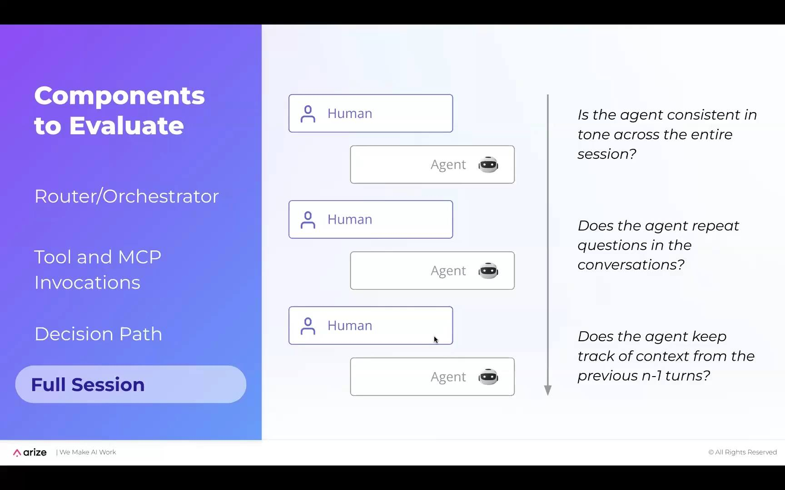
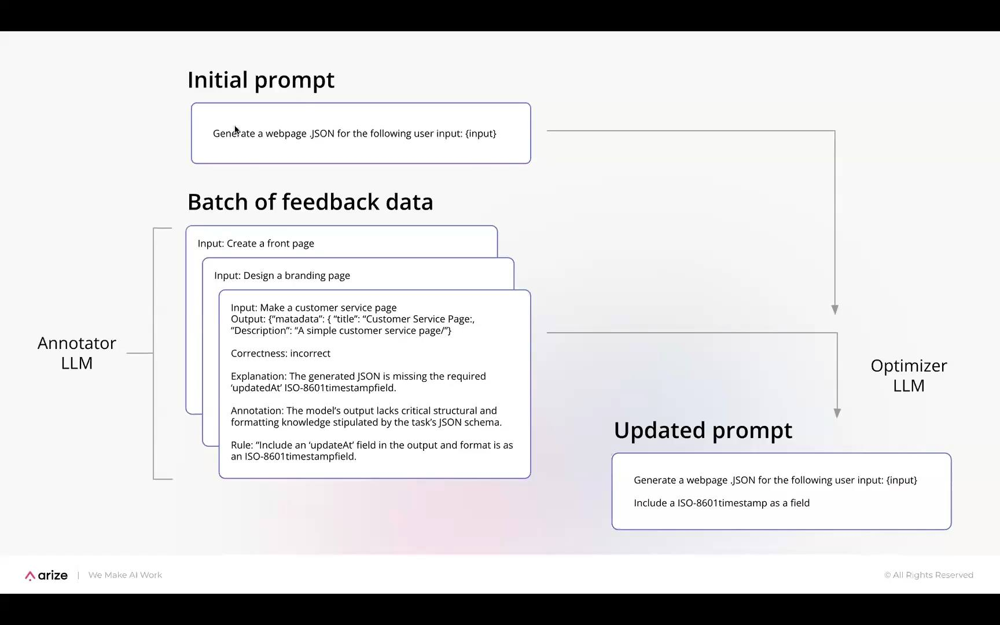
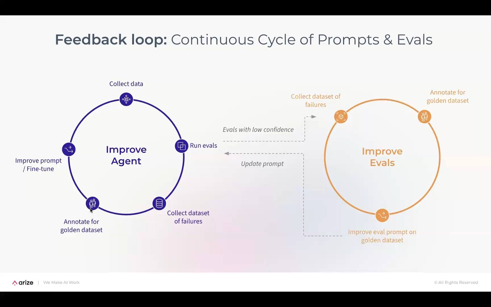
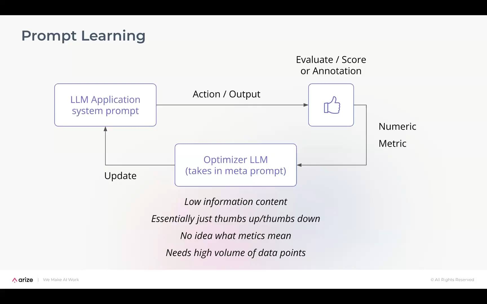
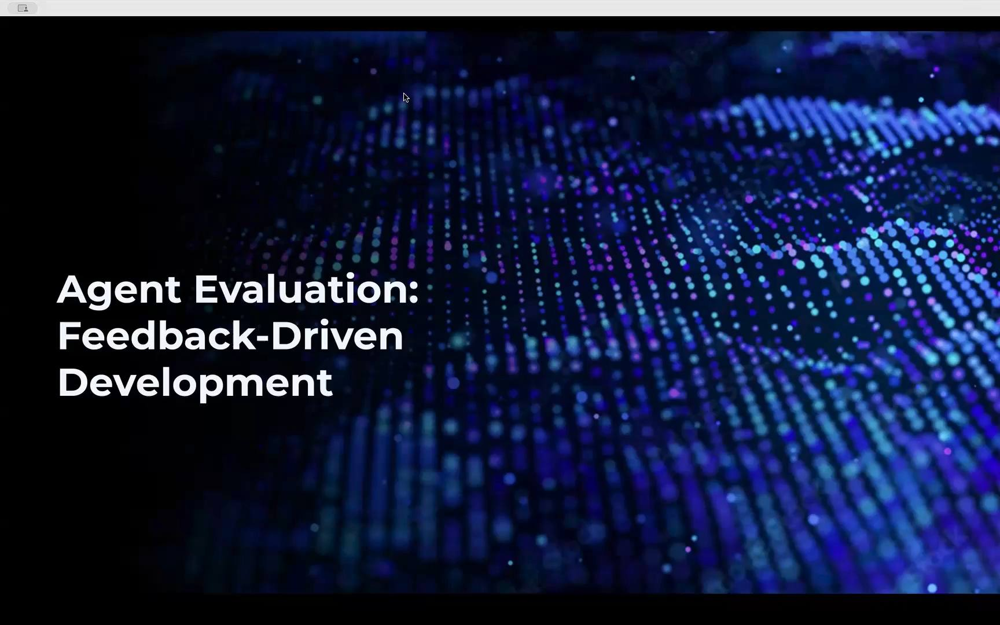

# AI Evals For Engineers & PMs（Agent 评测）· P030 单节复现文档

> 本节是整门课的嘉宾分享课：Arize 产品负责人 Sally Ann 用 30 分钟讲「agent 评测的框架」。**这一节没有代码、没有命令、讲师也没有现场操作平台**（她后面有客户电话，demo 改成会后录视频发到 Discord / Maven）。所以本文档按「纯讲解课」的要求组织：第 3 节复现她的推导链条（需求 → 约束 → 估算 → 方案 → 取舍），第 4 节把框架落成可直接拿去用的表、数据模型和一段可运行的示意代码。

---

## 1. 这一节做什么

这一节要解决的问题是：**agent 很复杂（多 handoff、多步骤、多工具），你到底怎么评测它？** 讲师的答案不是「上一个准确率指标」，而是三层结构 + 两条循环：

1. **三层评测**：span 级（router / orchestrator、tool / MCP 调用）、trace 级（decision path / trajectory，也就是一次完整工作单元）、session 级（整段对话的连贯性、是否成功、是否记得住上下文）。
2. **三类反馈**：gradient（滑尺 / 数值 / 多标签）、binary（是/否、对/错、好/坏）、annotation（人工标注，用来对齐 eval、做 golden set）。
3. **两条共同演化的循环（two co-evolving loops）**：一条用 eval 找失败样本 → 人工标注 → metaprompt optimizer 改 prompt；另一条反过来用人工标注去校准 eval 本身（judge prompt / label / explanation）。两条都要跑，因为**「这个 flow 只有在 eval 质量很高时才成立」**。

复现这件事需要你手上已经有四样东西（课里没讲怎么装，只说「平台今天就能跑」）：能采到 trace 的可观测性工具（Arize 平台或开源 Phoenix）、一个 LLM-as-judge 形式的 eval、一个能让人写标注的地方、一个能把「输入 + 输出 + explanation + annotation」喂进去的 prompt 优化器。你要交付的产物是：一张三层评测矩阵、一张组件职责表、一个反馈记录数据模型、一份成本/人力估算表，以及一段能跑通「收集失败 → 标注 → 优化 → 实验」的骨架代码。

课前花絮两条，不影响复现：讲师让主持人先在 Zoom 的 **video and effects** 里确认 **HD 已打开**（并建议退出重进以确保生效）；提问走 **Discord 频道**，不要占用会议聊天。



---

## 2. 讲师原话

**为什么这一节只讲框架**

> "今天最后如果有时间我们会做一次现场 demo，但我其实更想聚焦在框架上，聚焦我们在 Arize 是怎么思考 agent 评测的。"
> —— p030 [04:59]

> "我们有两个工具：Phoenix 和 Arize，缩写是 PX 和 AX。很多人都在想一个问题：你到底怎么评测 agent？agent 真的很复杂——有很多 handoff、很多步骤、很多东西要跟踪。"
> —— p030 [04:15]

> "如果今天大家只带走一件事，那就是：确保你在 eval 上花时间。eval 不只是性能信号，它是我们真正能把系统改好的一个巨大解锁。"
> —— p030 [31:45]

**生产里到底坏在哪**

> "工程团队在生产环境构建时常见的痛点是什么？第一，AI 系统极其复杂。我们这里看的是一条 trace，而且还不是完整的 trace，只是其中的 span——你能看出来它真的非常非常复杂，不是那种容易一眼看懂的东西。"
> —— p030 [06:38]

> "第二是很难 pinpoint 应用到底在哪里坏掉了。如果我只是盯着这个看，就像大海捞针。span 越多、应用越复杂，trace 就越复杂，越难定位问题在哪。"
> —— p030 [07:00]

> "第三点我们看到的很多：完全没有可见性去知道下游、或者说 prompt 的改动会怎样影响下游。我写了一个新 prompt，测了一下，挺好——但那只是一个片段，它对这个应用的整个流程有什么影响？"
> —— p030 [07:00]



> "上生产很难。在 notebook 里做个 POC 非常容易，『哦它跑得挺好』——那是简单的那部分。但当你真的要规模化、真的要上生产，这就非常难。"
> —— p030 [07:30]

> "我们有自己的 copilot、自己的 agent，以及平台，Alex。所以我们第一手就知道：理解 agent 的行为可以非常难。我们没有对 agent 行为的可见性；缺乏量化应用性能的能力；在生产里做迭代和实验非常难。"
> —— p030 [07:51]

> "当 agent 跑偏（go off script）会发生什么？没有好事。几周前不知道大家有没有看到那个帖子，Replit 的一个工具有一个重大缺陷——它删掉了一整个生产数据库。它知道自己做错了，非常抱歉，但基本上就是『已经没办法了』。"
> —— p030 [08:23]

> "你想象一下你有一个旅行规划器，用户来问去旧金山的航班，结果它给人洛杉矶的酒店——这是非常糟糕的用户体验。如果你不给用户好的体验，他们不会回来用你的应用，也不会有采用率，这有一堆下游影响。"
> —— p030 [08:51]

**先把「成功」定义清楚**

> "你需要先学会定义成功，才能谈该跑哪些 eval。evals 是我们观察性能的镜头，它不只是准确率检查。当然准确率可能是其中一部分，但我们还要理解决策正确性、工具使用模式、推理的连贯性、最终结果的质量。"
> —— p030 [09:16]

> "每个决策点都应该被评测。你要把它想成：不只是评输出（当然输出很重要，我的最终答案好不好），我们到最终输出之前走了很多步。所以我们把 agent 的行为拆成一个个离散步骤，然后在每一步问：这个决策对吗？可以把它想成调试一个程序，一样的道理：我们有输入、有推理路径、有输出。"
> —— p030 [09:45]



**四个要评的组件**

> "agent 有很多不同的组件，这些是我认为你需要评测的关键部分。第一是 router 和 orchestrator：我要确保 router 把用户请求导向正确的工具或流程。这通常就是 tool calling eval 或者 tool correctness eval、router 正确性，你可以用几种角度看它。"
> —— p030 [10:43]

> "然后是工具和 MCP 调用：执行具体的函数、API 或协议。这里不只是『选对了函数』，而是这个工具是否真的正确执行了？它本来要完成的任务是否真的完成了？所以这是再加一层。"
> —— p030 [11:12]

> "然后是决策路径：agent 为了得到答案所走的步骤。前面两个是单个工作单元——router 的活是选工具，它选对了吗；工具也一样，它该做这件事，做成了吗。到了决策路径，我们开始说：这一连串决策放在一起，整条路径是不是正确的那条？你可以把它想成轨迹（trajectory）。"
> —— p030 [11:41]

> "还有一整类 eval 我们可以在 trace 层做。然后是 session，我觉得 session 变得越来越重要，因为我们要理解在整个对话里，agent 是否连贯、是否成功。"
> —— p030 [12:10]

> "我敢说在座各位都有过这种体验：跟 agent 聊天，它一直问你同一个问题，你越来越烦、越来越烦。这个信息非常重要：我的用户是不是每次对话都越来越烦？还是我的应用真的记得它该记得的东西、记得用户告诉它的东西，并在中间找到平衡。"
> —— p030 [12:38]



> "不同部分还有不同的 stakeholder。前两个、甚至前三个，可能是你的 AI 工程师，他们关心技术实现。但 session 这一层，有时候是只关心用户体验的人。作为产品人，我非常关心 Alex 的用户体验。"
> —— p030 [13:02]

**钻到 span 级看细节：工具是新的失败面**

> "回到 router / orchestrator 这里，我们可能有不同的 agent 要 handoff 给、不同的工具要选，所以这是 span 级：在 router span 或 orchestrator span 上判断 handoff 是否正确完成、正确工具是否被正确选中。"
> —— p030 [13:30]

> "工具让 agent 比以往更强。能力更多，但也意味着复杂度更高，意味着更多地方可能失败。每次我们增加复杂度都在让它更好，但这是一个取舍：更多地方会失败。"
> —— p030 [13:59]

> "真正的挑战是实时追踪和评测每一个工具的表现。我们的 agent 用一组工具去完成复杂任务。你可以这样想：agent 的强度取决于它最弱的那个工具。如果有一个工具一直失败，最终它做这件事就是做不好。"
> —— p030 [14:25]

> "所以要确保工具被正确选中（前面讲过），但现在是：它是否真的生成了好代码？是否做了正确的查询？是否发起了正确的调用？是否做了正确的计划？这些都要单独追踪，然后你才会得到更大的图景，也就是 trace 层的轨迹。"
> —— p030 [14:54]



> "往下钻，你可以看底层数据：『它没执行正确的计划，为什么？哦，是因为这个工具在它的任务上失败了，造成了下游影响。』这样我们开始把东西串起来，得到更大的图景，而不是只看一个孤立组件。这又是在 trace 层做的。"
> —— p030 [15:21]

**会话层三个具体检查点**

> "session 这一层：我们有来来回回的对话，几个关键点你要注意。一致的语气很重要，它又回到一致的体验。另外两个我认为跟上下文管理和记忆有关：agent 会不会重复问它已经拿到答案的问题？如果会，说明它处理上下文和记忆的方式有点问题。还有：它能不能在若干轮之后继续记得？也许 1 到 5 轮很好，到第 6 轮就开始忘事。长会话在某些领域是常态，所以你要确保上下文增长时 agent 真的还抓得住。"
> —— p030 [15:48]

> "TLDR 是：我们不只是做 span 级评测，也不只做一个 span 级评测，而是做一堆不同的 span 级评测；然后在 trace 层评测，覆盖整个工作单元；然后还要在对话、session 层评测。这才是我们看待 agent 评测的方式：不是一个东西，是一堆东西。"
> —— p030 [16:46]



**三类反馈**

> "第一种是 gradient（梯度式）。你可以把它想成一个滑动刻度，也可能是数值，还可能是多标签，比如超级负面、负面、中性、正面。"
> —— p030 [17:11]

> "然后就是 binary：是/否、正确/不正确、好/坏。我觉得这是最常见的一类 eval。gradient、尤其是多标签我觉得正在起来，但 binary 是最简单的反馈应用。"
> —— p030 [17:40]

> "然后是 annotation（标注），非常重要。这门课里已经展示过，你可以用各种方式对齐你的 eval、创建 golden set。这也是我们接下来要讲的流程里用得很多的东西。我认为我们还没到可以完全只用 LLM 当裁判、或者只用 LLM 自我改进的地步。如果你能标注一些数据、得到一些高质量的——我就叫它训练集——那非常有价值。"
> —— p030 [18:08]

> "为什么这些重要？这些不同类型的反馈可以解锁 prompt learning 这件事。不只是知道我有问题，而是我该怎么改进？现在很多时候就是通过改进 prompt。"
> —— p030 [18:34]

**prompt learning 的流程**

> "我们有应用的 system prompt，跑出某种评测分数，再用它拿到反馈。举个例子，我就用最朴素的 hallucination 当裁判，我会得到一个 label：hallucinated / not hallucinated。假设我把所有 hallucinated 的输出拿给标注员复审——这个人通常是领域专家（SME），也可能是非常熟悉这个用例、知道应用该怎么回答的产品人。我们收集这些反馈和标注，把它作为 metaprompt optimizer 的输入。"
> —— p030 [19:31]

> "市面上有几个 prompt 优化器，DSPy 大概是大家最常提的。我们走的是稍微不同的路线：我们用 LLM 来做优化。原因是有很多有用的信息——当你只用数值指标时，信息量是很低的。只是一个赞或踩、一个好或坏，或者我只是朝某个指标优化，我们觉得那里丢了太多信息。我们不知道这些指标意味着什么，LLM 当然也不知道，而且你需要很多数据点才能做成这件事。"
> —— p030 [20:51]

> "我们拿一批反馈数据，你能看到它不只包含 label 和 input，还包含 explanation 和 annotation。也就是说我们把给 LLM 的数据做了增强，再让它去优化 prompt。我们发现这样得到的优化后 prompt 要好得多。"
> —— p030 [21:19]



**两个共同演化的循环**

> "实际的做法是：有两个共同演化的循环（two co-evolving loops），我觉得这非常重要。很多人以为拿到一个 eval 就可以设置完、忘掉它，以为所有人的 eval 都一样、你永远该用和别人一样的 eval——这是常见的误解。"
> —— p030 [22:15]

> "做法是这样的：我们在收集数据，你可以把它想成 trace——生产 trace 进来，然后 eval 在跑。Arize 有 online jobs，eval 会持续地在你的数据上跑；或者你想批量送过来也行。思路是收集那些失败，就像刚才说的 hallucination 例子，把 hallucination 抓出来。如果你用 online jobs，我们可以设置逻辑，自动把这些数据点排队。"
> —— p030 [22:40]

> "explanation 是为什么给出这个 label。比如拿工具调用举例：工具选错了，因为用户要的是这个，本该调用这个工具，却没有，调用了另一个。然后 annotation 是人类专家给出的正确输出是什么。所以我们交给优化器的是：原始输入、原始输出、按标注它本该说的话，再加上 explanation 和评测数据。"
> —— p030 [23:10]



**eval 从哪来：先见人，再见模板**

> "我的理想建议是：花时间和 stakeholder 在一起，而不是套模板。但我们也提供了一些让它变容易的东西。一是我们有一大堆现成的 evaluator 可以选，比如 QA correctness、tool trajectory、hallucination——我们有常见 eval 的完整清单。二是我们有 Alex，就是我前面提到的 copilot，它可以帮你写 eval。你先做完『这是我的全部标准』这一步，然后跟 Alex 说：给我写一个 tool trajectory 的 eval，或者 toxicity 的，它会把模板写出来。"
> —— p030 [24:07]

> "所以 eval 从哪来：和 stakeholder 开会，定义成功长什么样，然后把它转成 LLM-as-judge 的 prompt 模板、或者转成代码、或者对齐到我们已经有的现成 evaluator。"
> —— p030 [24:36]

> "对这门课的同学来说，语境是：你做完错误分析（逐字稿写作 "axle coding"，应为 error analysis）、走完拿到 LLM-as-judge 的整个流程之后，那就是你的 eval 所在的位置。是的，把这些标准拿过来转换成 eval，跟大作业三里把标准做成『饮食依从性（dietary adherence）』那个 prompt 非常像。只是这里规模更大一些，因为会有多个 eval——前面说过，你不只需要一个，你需要完整覆盖。"
> —— p030 [25:05]

> "这个做法是借来的：如果有人熟悉自动驾驶领域，这和那个方法非常像——我们不断用 eval 识别失败点，再用它去优化 prompt，然后这个过程继续。"
> —— p030 [25:33]

> "今天我们是静态指令加动态变量，我们看到的未来是走向动态指令——由这个反馈闭环建出来的动态指令。现在还有点手动，人类在环（human in the loop）非常重要，你要去发起任务；我认为这会越来越连续、越来越自动，但眼下还是会有一点滞后。"
> —— p030 [26:02]


**和 DSPy 到底差在哪**

> "DSPy 真正优化的是『prompt 指令 + 示例』的最佳组合，来优化你定义的一个指标。回到那张图，那个指标可能就简单到『正确率百分比』这样，我们只是在数值指标上做优化。我们的区别是：我们把 explanation 和 annotation 里的文本信息拿过来，交给 LLM 去做优化。"
> —— p030 [26:30]

> "为什么我们认为这重要：我们和 LLM 处在同一个模态。它处理的是文本，而我们通过标注、通过解释拥有这些丰富的文本信息。所以我们说的是：你看这些信息，然后去优化，以提高得到它给出的那个 golden answer 的可能性。"
> —— p030 [26:58]

> "explanation 来自 LLM，是应用 correctness eval 之后给出的——它是『为什么 LLM 给了这个错误输出』。而 annotation 是人的复审，它可以是几种形式：这个例子里的 annotation 是『哪里做错了』；也可以写『正确答案是什么』。取决于你手上有什么数据、有没有领域专家、应用是什么。主要区别是：annotation 来自人，是人的上下文；explanation 是 LLM 驱动的，和 LLM 裁判给出的 label 直接相关。"
> —— p030 [27:26]

> "在优化器这一步，你至少需要其中一个：要么 explanation 加 annotation，最好的情况是两个都有。你能给的信息越多越好。而且我们发现在数据量上你并不需要很多。"
> —— p030 [28:23]

> "explanation 的投入更小，因为可以让 LLM 来做，不需要人花时间复审并给出全部反馈。理想情况下，我觉得现在人类在环里越多，结果越好。所以我的回答是：最少要有 explanation，能拿到 annotation 就拿，两个都有最理想。"
> —— p030 [28:50]

> "当我关注 agent 改进这一侧时，多数时候我手上的 annotation 就是正确答案、或者应用本该回答什么。我会要求它尽量对齐期望输出。在 meta prompt 里我通常会把 annotation 标成 ground truth 或者 reference output，然后说『朝这个优化』。这可能包括 few-shot 示例，也可能只是指令。"
> —— p030 [29:49]

> "而循环的另一侧是改进 eval。做 eval 时，annotation 是围绕『eval 的正确答案』，那种情况下我更多是在谈改进 explanation，或者改进 label。所以有一点细微差别，取决于我们在跑哪个循环。你真的两种 prompt 优化都要做，因为**这个 flow 只有在 eval 质量很高时才成立**。如果我随便拿一个 eval、不测它、不用人工反馈对齐它，我就不能靠它去优化我的 agent。"
> —— p030 [30:47]

**收尾：demo 挪到会后**

> "我 10 分钟内有个硬性截止，所以做现场 demo 我有点犹豫。我会录一段视频发到频道里。我想让你们看到它在 Arize 里实际怎么跑，也提一下我们还有 Phoenix。"
> —— p030 [31:16]

> "我们有 online tasks，可以在平台里今天就跑 span 级，也能跑 trace 级和 session 级。然后我可以展示我们有一个 prompt optimization task：把这些数据插进去，拿到一个新 prompt，对它跑 experiment，在 Arize UI 里拿到指标，甚至对新的模板、或者对你的 eval 模板跑 eval。视频我也会直接上传到 Maven。"
> —— p030 [32:14]

> "最后再提一句：我今天讲的是 Arize，你们也见过开源的 Phoenix。上周你们听了 Mickey O（逐字稿写法，指做 Phoenix demo 的同事）的分享，也做过作业，所以我知道你们有这个方案。"
> —— p030 [32:42]

---

## 3. 从零复现

这一节没有可执行命令，所以「复现」= 按讲师的推导顺序，把一套能落地的 agent 评测方案推出来。每一步都标注哪些是她说的、哪些是本文档为了让框架可执行而补的。

### 步骤 0：确认你复现的对象是什么（一次 30 分钟的框架分享，不是一次完整实操）

讲师明确说 demo 挪到会后录视频（[31:16]）。所以本次要复现的是**决策与结构**，不是某个产品的点击流。你要先接受这个前提：第 4 节的表和数据模型是你的交付物，平台里的按钮位置课里没讲。

### 步骤 1：需求——写下你要防的具体事故

不要从「我要一个准确率指标」开始。讲师从两个真实事故切入：

- **Replit 的工具缺陷删掉整个生产数据库**，agent 自己知道做错了、道歉了，但「没有可挽回的」[08:23]。
- **旅行规划器**：用户问旧金山航班，它给洛杉矶酒店 [08:51]。

由此推出三条需求（讲师原话三条痛点 [06:38]–[07:00]，[07:59]）：

| 需求 | 对应痛点 | 复现动作 |
|---|---|---|
| R1 能看懂发生了什么 | AI 系统极其复杂，一条 trace 里 span 一堆，还只是片段 | 采全量 trace，按 span 组织 |
| R2 能定位坏在哪 | 大海捞针，越复杂越难定位 | 每个 span / decision point 单独评分 |
| R3 能知道改动影响下游 | 换了新 prompt 只测了片段，不知道整条链路影响 | trace 级 + session 级回归 |

再加两条「上生产」的隐含需求（[07:51]）：**可见性**（agent 行为是否可观测）、**可量化**（性能能不能算成分数）、**可实验**（在生产里能不能做迭代）。

### 步骤 2：约束——五条必须遵守的边界

1. **不能只用输出评分**：到最终输出之前有很多步，每一步都要问「这个决策对吗」[09:45]。
2. **不能只做一个 eval**：需要「一堆不同的 span 级评测 + trace 级 + session 级」[16:46]。
3. **不能只靠 LLM 自评**：目前还没到能完全只用 LLM 当裁判、或让 LLM 自我改进的阶段 [18:08]。
4. **不能只优化数值指标**：数值指标信息量低，「我们不知道这些指标意味着什么，LLM 当然也不知道」，而且需要很多数据点 [20:51]。
5. **eval 质量是硬前置**：eval 没对齐人工反馈，就不能用它优化 agent [30:47]。

### 步骤 3：估算（以下算式是本文档为「照着做」补的，课里没给任何公式或数字）

讲师只说了两句定性的话：优化「你并不需要很多数据」[28:23]，以及一次任务会有「很多 span、很多步骤」。所以要定量，必须先说明假设——下面每个假设都可以按你的真实系统替换。

**A. 每会话需要跑多少次评分**

设一次 agent 任务（一个 turn）有：router span 1 个 + 工具调用 5 个 + 决策路径合并评分 1 个 + 最终回答 1 个 = **8 个 span 级评分点**；再加 trace 级 trajectory 1 个；整段会话末尾 session 级 1 个。

```
每次评分点/会话 = 1(router) + 5(tool) + 1(路径) + 1(最终回答) = 8 (span 级)
总评分点/会话     = 8 + 1(trace) + 1(session) = 10
```

对照讲师那句「不是只做一次 span 级评测，而是做一堆」——这里的「一堆」在数量上就是 8，而单点评测只有 1，**覆盖面差 10 倍**。

**B. 日评分量**

```
日评分次数 = 日会话数 × 10
若日会话 2,000 → 日评分 20,000 次
```

**C. 评分成本（judge 调用费）**

设单次 judge 调用：输入 900 tokens（模板 + 输入 + 必要上下文），输出 150 tokens（label + explanation）；价格按 $5 / 百万输入 token、$15 / 百万输出 token 计算（示例价，实际价必须换成你用的模型价目表）：

```
输入 token/天 = 20,000 × 900  = 18,000,000 = 18.0M → 18.0 × 5  = $90
输出 token/天 = 20,000 × 150  =  3,000,000 =  3.0M →  3.0 × 15 = $45
合计 ≈ $135/天 ≈ $4,050/月（按 30 天）
```

**D. 采样**

全量太贵就采样。10% 采样：

```
日评分 2,000 次 → $13.5/天 ≈ $
$13.5/天 ≈ $405/月（按 30 天）。所以「全量」和「10% 采样」之间是 10 倍成本差，而覆盖面只掉 90% 的尾部——这就是为什么业内普遍先采样跑在线评测、再把失败样本全量抓出来标注。

**E. 标注人力**

设 hallucination 一类的失败在会话中占 5%：

```
失败会话/天 = 2,000 × 5% = 100
每条标注 3 分钟（SME 审 + 写「正确输出是什么」/「哪里错了」）
标注工时/天 = 100 × 3 = 300 分钟 = 5 小时
→ 约 1 名兼职 SME 的半天（按 8 小时工作制）
```

**F. 每一轮 prompt 优化需要多少样本**

讲师只说「你并不需要很多数据」[28:23]，没给数。按 30 条做算例（示意，不是课里的数）：

```
优化器输入 tokens ≈ 30 × (900 输入 + 150 输出) = 30 × 1050 = 31,500
按上面同一价目：31,500 ≈ 31.5K → 输入部分 ≈ 27K × $5/M = $0.135，输出 ≈ 4.5K × $15/M ≈ $0.068
单轮优化 ≈ $0.2 量级
```

对比：**改一次 prompt 的成本是几毛钱，跑一天全量评测是几百美元。** 这就解释了为什么讲师说「eval 是解锁」——贵的是评测，便宜的是改进，所以瓶颈必然落在「能不能持续拿到高质量 eval」上。

**G. 两条循环的节拍（示意）**

```
日循环：生产 trace 进来 → 在线 eval 跑（采样 10%）→ 失败入队 → SME 标注 100 条
周循环：用上周累积的标注批次（30 条起）跑一次 metaprompt 优化 → 得到 candidate prompt
每次上线前：candidate vs current 在同一批输入上跑 experiment，比较通过率
```

### 步骤 4：方案——三层评测矩阵

把讲师 [10:43]–[16:46] 的四个组件 × 三个层级摊成一张表，每个格子写「评什么、判据从哪来、谁负责」。这张表就是你项目的评测总纲，缺格子就等于缺覆盖面。

| 层级 | 组件 | 评什么（讲师原话依据） | 判据来源 | 主要读者 |
|---|---|---|---|---|
| span | router / orchestrator | 用户请求是否被导向正确的工具或流程；handoff 是否正确完成 [10:43][13:30] | 和 stakeholder 定义的成功标准 → LLM-as-judge 模板 | AI 工程师 |
| span | tool / MCP 调用 | 不只是「选对函数」，而是工具是否真的执行成功、要完成的任务是否真的完成 [11:12]；是否生成了好代码、做了正确查询、发起了正确调用、做了正确计划 [14:54] | 工具契约 + 期望参数 | AI 工程师 |
| span | 最终回答 | 最终答案好不好 [09:45] | 期望输出（annotation 可直接当 reference） | 全员 |
| trace | decision path / trajectory | 一整串决策放在一起，整条路径是不是对的那条 [11:41]；是否做了正确的计划、是否按正确顺序执行了正确的函数 [14:54] | 期望轨迹（工具序列、顺序） | AI 工程师 |
| session | 一致语气 | 语气是否一致，最终回到一致的体验 [15:48] | 风格准则 + 人工抽检 | 产品 / UX |
| session | 上下文与记忆 | 是否重复问已经拿到答案的问题；多轮之后是否还记得（1–5 轮好、第 6 轮开始忘）[15:48] | 会话记录对比 + 人工抽检 | 产品 / UX |
| session | 整体成功 | 整段对话是否连贯、是否成功 [12:10] | 任务完成定义 | 产品 / PM |



### 步骤 5：取舍——每条路为什么不选另一条

| 决策点 | 讲师的选择 | 被否掉的方案 | 否掉的理由（讲师原话依据） |
|---|---|---|---|
| 评测粒度 | span + trace + session 三层都做 | 只评最终输出 | 「不只是评输出」[09:45]；只看输出等于放弃每一步的决策正确性 |
| span 数量 | 一堆 span 级 eval | 一个 span 级 eval | 「不只做一个，而是做一堆」[16:46] |
| 反馈类型 | binary 作基础 + gradient/多标签 + annotation | 只用 binary | binary 最简单最常用，但单靠它信息量低 [17:40][20:51]；annotation 目前不可替代 [18:08] |
| 优化信号 | 文本（explanation + annotation） | 只用数值指标（DSPy 路线） | 「数值指标信息量低，我们不知道这些指标意味着什么，LLM 当然也不知道」[20:51]；且「你需要很多数据点」 |
| 优化模态 | 用 LLM 在文本模态里优化 | 用组合搜索找「指令 + 示例」最优组合 | 「我们和 LLM 处在同一个模态」[26:58] |
| 数据来源 | 先和 stakeholder 定义成功再转 eval | 直接套现成模板 | 「我的理想建议是花时间和 stakeholder 在一起，而不是套模板」[24:07] |
| 循环 | 两条共同演化 | 一条（只改 prompt） | 「这个 flow 只有在 eval 质量很高时才成立」[30:47]，eval 自己也要被优化 |
| 自动化程度 | 人类在环 + 手动发起 | 全自动自优化 | 「现在还有点手动，human in the loop 非常重要」[26:02]；「还没到能完全只用 LLM 当裁判」[18:08] |

**最小可行起点**（这是本文档的建议，不是讲师说的）：先做 span 级 router + tool 两个 eval（binary/多标签），加一个 trace 级 trajectory，session 级先只做「重复提问」这一条——因为它最容易从会话记录里机械检测，不需要 judge。

---

## 4. 完整代码

**先说清楚：课里没有代码。** P030 全程 33 分钟，逐字稿里没有一条命令、一行代码、一个配置文件，讲师也明确说 demo 挪到会后录视频（[31:16]）。所以本节按「纯讲解课」的做法，先把讲师的框架落成四张可直接用于项目的表，再补一段**示意代码**，把「收集失败 → 标注 → 优化 prompt → 跑实验」这条循环做成能跑通的最小骨架。代码里的函数名、字段名、目录结构都是本文档为可执行性设计的，**不是 Arize / Phoenix 的真实 API**；如果你接真平台，替换 `src/llm.js` 与 `src/collectFailures.js` 的数据来源即可。

### 4.1 设计决策表

| 编号 | 决策 | 取值 | 来源 | 不改会怎样 |
|---|---|---|---|---|
| D1 | 评测层级 | span / trace / session 三层 | [16:46] | 只评一层，失败原因无法归因 |
| D2 | span 级评测点 | router、tool、decision_path、final_answer | [10:43][11:12][11:41] | 漏掉工具执行层，就会出现「选对了工具但工具失败」的盲区 |
| D3 | 反馈类型 | binary / gradient / annotation 三种并存 | [17:11][17:40][18:08] | 只有 binary 无法表达「多坏」；没有 annotation 无法对齐 judge |
| D4 | judge 输出 | `label` + `explanation` 成对返回 | [23:10] | 只有 label，优化器就没东西可读 |
| D5 | 优化器输入 | input + output + annotation(标为 ground truth) + explanation | [21:19][29:49] | 退化成数值优化，数据需求暴涨 |
| D6 | 循环数量 | 两条（改 prompt / 改 eval） | [30:47] | 单循环会漂移：eval 错了却一直在优化 agent |
| D7 | 执行方式 | 在线持续跑（online jobs）或批量送 | [22:40] | 只能事后复盘，无法持续积累失败样本 |
| D8 | 自动化程度 | 人工触发优化 + 人工标注 | [26:02][28:50] | 全自动在 judge 未对齐时会自我强化错误 |

### 4.2 组件职责表

| 组件 | 职责 | 输入 | 输出 | 出错时的表现 |
|---|---|---|---|---|
| Trace 采集 | 记录一次完整工作单元的所有 span | agent 运行时事件 | trace（含 spans） | 没有 trace，R1「看懂发生了什么」直接不成立 |
| Span 评测器 | 单点判分：router 选择、工具执行、最终答案 | 单个 span + 期望 | label + explanation | 单点误判会污染失败队列 |
| Trace 评测器 | 判整条决策路径 / 轨迹 | trace + 期望轨迹 | label + explanation | 无法发现「顺序错但每步都对」 |
| Session 评测器 | 判语气一致、重复提问、长上下文记忆 | 整段会话 | label + annotation | 用户体验退化无声发生 |
| 失败队列 | 按 label 过滤并排队等人标注 | 反馈记录 | annotation-queue | 队列爆掉 = 采样率过高 |
| 标注员（SME/PM） | 给出正确输出或「哪里错了」 | 输入 + 输出 + explanation | annotation | annotation 错，优化器会朝错的方向优化 |
| Metaprompt 优化器 | 用文本反馈改写 system prompt | 当前 prompt + 一批带标注样本 | candidate prompt | 过拟合小样本 |
| 实验器 | candidate vs current 同批输入对比 | 两个 prompt + 输入集 | 通过率对比 | 直接上线等于拿生产做实验 |

### 4.3 接口 / 数据模型草案

**反馈记录（一行 = 一个评分点）**，字段名取自讲师强调的四类信息 [21:19][23:10]：

```
recordId      string   唯一 id
traceId       string   所属 trace
sessionId     string   所属会话（多轮对话聚合用）
spanId        string|null  span 级才有
level         "span" | "trace" | "session"
spanKind      "router" | "tool" | "decision_path" | "final_answer" | null
evaluatorId   string   哪个评测器给的
feedbackType  "binary" | "gradient" | "annotation"
input         string   原始输入
output        string   原始输出
label         string|null  binary: pass/fail；gradient: 标签
score         number|null  gradient 数值，0–1
explanation   string|null  LLM 给的「为什么是这个 label」
annotation    string|null  人给的「正确输出是什么」或「哪里错了」
annotatedBy   string|null
createdAt     ISO string
```

**优化器请求体（示意）**：

```
{
  "currentPrompt": "<现行 system prompt>",
  "samples": [
    { "input": "...", "output": "...", "referenceOutput": "...", "explanation": "..." }
  ]
}
```

**实验记录**：

```
{
  "experimentId": "...",
  "promptA": "current", "promptB": "candidate",
  "caseCount": 30,
  "passRateA": 0.70, "passRateB": 0.83
}
```

### 4.4 容量估算表

（假设全部来自第 3 节步骤 3，可按你的系统替换；课里没有给任何数字）

| 项 | 假设 | 算式 | 结果 |
|---|---|---|---|
| 评分点/会话 | 1 router + 5 tool + 1 路径 + 1 回答 + 1 trace + 1 session | 8 + 2 | 10 |
| 日评分次数 | 2,000 会话/天 | 2,000 × 10 | 20,000 |
| 全量 judge 成本 | 900 in / 150 out tokens，$5 / $15 每百万 | 18.0M×5 + 3.0M×15 | ≈ $135/天，≈ $4,050/月 |
| 10% 采样成本 | 同上 | 2,000 次/天 | ≈ $13.5/天，≈ $405/月 |
| 日失败样本 | 失败率 5% | 2,000 × 5% | 100 条/天 |
| 标注工时 | 3 分钟/条 | 100 × 3 | 5 小时/天（≈1 名兼职 SME 半天） |
| 单轮优化样本 | 30 条 | 30 × 1050 tokens | ≈ $0.2/轮 |
| 优化节拍 | 每周一次 | 4 次/月 | 4 × $0.2 ≈ $0.8/月 |

### 4.5 示意代码（课里没有代码，以下为示意）

目录结构：

```
agent-evals/
├── .env.example
├── package.json
├── README.md
├── data/
│   ├── traces.json
│   ├── prompt.current.txt
│   └── (运行时生成) feedback.jsonl / annotation-queue.jsonl / prompt.candidate.txt
└── src/
    ├── schema.js
    ├── llm.js
    ├── evaluators.js
    ├── collectFailures.js
    ├── optimizePrompt.js
    └── runExperiment.js
```

零第三方依赖，只用 Node 18+ 自带的 `fetch`、`node:fs`、`node:path`。**如果你要用 OpenAI 兼容之外的服务，改 `src/llm.js` 一处即可。**

**`.env.example`**

```
# 示意值：换成你自己账号里可用的 key / 网关 / 模型名
LLM_API_KEY=sk-replace-me
LLM_BASE_URL=https://api.openai.com/v1
JUDGE_MODEL=gpt-4o-mini
OPTIMIZER_MODEL=gpt-4o
```

**`package.json`**

```json
{
  "name": "agent-evals-framework",
  "version": "0.0.1",
  "private": true,
  "type": "module",
  "engines": { "node": ">=18" },
  "scripts": {
    "collect": "node src/collectFailures.js",
    "optimize": "node src/optimizePrompt.js",
    "experiment": "node src/runExperiment.js"
  }
}
```

**`src/schema.js`**

```js
// 反馈记录的统一形状。四类核心字段来自 P030：label / input / explanation / annotation
export const LEVELS = ["span", "trace", "session"];
export const SPAN_KINDS = ["router", "tool", "decision_path", "final_answer"];
export const FEEDBACK_TYPES = ["binary", "gradient", "annotation"];

const REQUIRED = [
  "recordId", "traceId", "sessionId", "level",
  "evaluatorId", "feedbackType", "input", "output"
];

export function createFeedbackRecord(raw) {
  for (const key of REQUIRED) {
    if (raw[key] === undefined || raw[key] === null || raw[key] === "") {
      throw new Error(`反馈记录缺少必填字段: ${key}`);
    }
  }
  if (!LEVELS.includes(raw.level)) {
    throw new Error(`未知 level: ${raw.level}（只允许 ${LEVELS.join(" / ")}）`);
  }
  if (!FEEDBACK_TYPES.includes(raw.feedbackType)) {
    throw new Error(`未知 feedbackType: ${raw.feedbackType}`);
  }
  if (raw.level === "span" && !SPAN_KINDS.includes(raw.spanKind)) {
    throw new Error(`span 级记录必须带合法 spanKind，收到: ${raw.spanKind}`);
  }
  return {
    recordId: raw.recordId,
    traceId: raw.traceId,
    sessionId: raw.sessionId,
    spanId: raw.spanId ?? null,
    level: raw.level,
    spanKind: raw.spanKind ?? null,
    evaluatorId: raw.evaluatorId,
    feedbackType: raw.feedbackType,
    input: raw.input,
    output: raw.output,
    label: raw.label ?? null,
    score: raw.score ?? null,
    explanation: raw.explanation ?? null,
    annotation: raw.annotation ?? null,
    annotatedBy: raw.annotatedBy ?? null,
    createdAt: raw.createdAt ?? new Date().toISOString()
  };
}

// 失败判定：binary 看 label，gradient 看阈值。
// 0.5 这个阈值是本示意代码的设定，课里没给任何阈值。
export function isFailure(record) {
  if (record.label === "fail" || record.label === "incorrect") return true;
  if (typeof record.score === "number" && record.score < 0.5) return true;
  return false;
}

export function groupByLevel(records) {
  const out = { span: 0, trace: 0, session: 0 };
  for (const r of records) out[r.level] += 1;
  return out;
}
```

**`src/llm.js`**

```js
// 课里没讲用哪个 SDK。这里用 Node 18+ 内置 fetch 直接调 OpenAI 兼容的 /chat/completions。
const BASE_URL = process.env.LLM_BASE_URL ?? "https://api.openai.com/v1";
const API_KEY = process.env.LLM_API_KEY;

export async function callLLM({ model, system, user, temperature = 0, maxTokens = 600 }) {
  if (!API_KEY) throw new Error("缺少环境变量 LLM_API_KEY，请复制 .env.example 为 .env 并填写");
  const res = await fetch(`${BASE_URL}/chat/completions`, {
    method: "POST",
    headers: {
      "content-type": "application/json",
      authorization: `Bearer ${API_KEY}`
    },
    body: JSON.stringify({
      model,
      temperature,
      max_tokens: maxTokens,
      messages: [
        { role: "system", content: system },
        { role: "user", content: user }
      ]
    })
  });
  if (!res.ok) {
    const body = await res.text();
    throw new Error(`LLM 调用失败 HTTP ${res.status}: ${body.slice(0, 300)}`);
  }
  const json = await res.json();
  const content = json?.choices?.[0]?.message?.content;
  if (typeof content !== "string") {
    throw new Error("LLM 返回结构不符合预期，请先 console.log 原始响应再排查");
  }
  return content;
}

// 从裁判输出里取出 { label, explanation }。
// 模型有时会包 ```json 或加前后说明，所以按花括号截取，不假设是纯 JSON。
export function parseJudgeJson(text) {
  const start = text.indexOf("{");
  const end = text.lastIndexOf("}");
  if (start === -1 || end <= start) {
    throw new Error(`裁判输出里找不到 JSON 对象: ${text.slice(0, 200)}`);
  }
  const obj = JSON.parse(text.slice(start, end + 1));
  if (typeof obj.label !== "string" || obj.label.length === 0) {
    throw new Error(`裁判输出缺少 label 字段: ${text.slice(0, 200)}`);
  }
  return {
    label: obj.label,
    score: typeof obj.score === "number" ? obj.score : null,
    explanation: typeof obj.explanation === "string" ? obj.explanation : null
  };
}
```

**`src/evaluators.js`**

```js
// 评测器清单。层级与组件的对应关系来自 P030 的四组件划分。
export const EVALUATORS = [
  {
    id: "router_correctness",
    level: "span",
    spanKind: "router",
    feedbackType: "gradient",
    build(span) {
      return {
        system:
          "你是 agent 路由的裁判。只判断「这个用户请求是否被导向了正确的工具或流程」，" +
          "不要评价工具执行结果。必须返回 JSON：{\"label\":\"correct|wrong_target|unclear\", \"score\":0到1, \"explanation\":\"中文说明\"}",
        user: [
          `用户请求：${span.input}`,
          `实际选择：${span.output}`,
          `期望：${span.expectation ?? "（未提供期望，按常识判断）"}`,
          "请给出 label、score、explanation。"
        ].join("\n")
      };
    }
  },
  {
    id: "tool_execution",
    level: "span",
    spanKind: "tool",
    feedbackType: "gradient",
    build(span) {
      return {
        system:
          "你是工具执行的裁判。判断工具是否真的正确执行、它本来要完成的任务是否真的完成了。" +
          "必须返回 JSON：{\"label\":\"success|partial|failed\", \"score\":0到1, \"explanation\":\"中文说明\"}",
        user: [
          `工具名：${span.name}`,
          `入参：${span.input}`,
          `出参：${span.output}`,
          `期望：${span.expectation ?? "（未提供期望，按出参自洽性判断）"}`
        ].join("\n")
      };
    }
  },
  {
    id: "tool_trajectory",
    level: "trace",
    feedbackType: "gradient",
    build(trace) {
      const toolSpans = trace.spans.filter((s) => s.kind === "tool");
      return {
        system:
          "你是轨迹裁判。判断整条决策路径是否为正确的那条：工具序列、顺序、每步目的。" +
          "必须返回 JSON：{\"label\":\"correct_trajectory|wrong_order|wrong_tools\", \"score\":0到1, \"explanation\":\"中文说明\"}",
        user: [
          `用户目标：${trace.userInput}`,
          `实际调用序列：${toolSpans.map((s) => s.name).join(" -> ")}`,
          `最终输出：${trace.finalOutput}`,
          `期望轨迹：${trace.expectation ?? "（未提供期望轨迹，按目标达成度判断）"}`
        ].join("\n")
      };
    }
  },
  {
    id: "session_memory",
    level: "session",
    feedbackType: "gradient",
    build(session) {
      return {
        system:
          "你是会话级裁判。只检查两件事：1) 是否重复问用户已经回答过的问题；2) 上下文变长后是否还记得关键信息。" +
          "必须返回 JSON：{\"label\":\"coherent|repeat_question|context_loss\", \"score\":0到1, \"explanation\":\"中文说明\"}",
        user: `会话记录：\n${session.transcript}`
      };
    }
  },
  {
    id: "final_answer_correctness",
    level: "span",
    spanKind: "final_answer",
    feedbackType: "binary",
    build(span) {
      return {
        system:
          "你是回答正确性裁判。必须返回 JSON：{\"label\":\"pass|fail\", \"score\":0或1, \"explanation\":\"中文说明\"}",
        user: [
          `用户请求：${span.input}`,
          `实际回答：${span.output}`,
          `参考输出：${span.annotation ?? span.expectation ?? "（未提供，按用户请求判断）"}`
        ].join("\n")
      };
    }
  }
];

export function findEvaluator(level, spanKindOrNull) {
  return EVALUATORS.find(
    (e) => e.level === level && (level !== "span" || e.spanKind === spanKindOrNull)
  ) ?? null;
}
```

**`data/traces.json`**

```json
{
  "traces": [
    {
      "traceId": "t-001",
      "sessionId": "s-001",
      "userInput": "帮我订一张下周去旧金山的机票",
      "finalOutput": "已为您预订洛杉矶的酒店，祝您旅途愉快。",
      "expectation": "搜索旧金山航班并完成机票预订，不涉及酒店",
      "spans": [
        {
          "spanId": "sp-001",
          "kind": "router",
          "name": "router",
          "input": "帮我订一张下周去旧金山的机票",
          "output": "book_hotel",
          "expectation": "应选择 search_flights"
        },
        {
          "spanId": "sp-002",
          "kind": "tool",
          "name": "book_hotel",
          "input": "{\"city\":\"Los Angeles\"}",
          "output": "{\"ok\":true,\"orderId\":\"H-8821\"}",
          "expectation": "工具应接收旧金山，且不应在用户只要机票时订酒店"
        },
        {
          "spanId": "sp-003",
          "kind": "decision_path",
          "name": "plan",
          "input": "帮我订一张下周去旧金山的机票",
          "output": "1) 选酒店工具 2) 订洛杉矶酒店 3) 回复用户",
          "expectation": "1) 选航班搜索 2) 拿候选航班 3) 确认后预订"
        },
        {
          "spanId": "sp-004",
          "kind": "final_answer",
          "name": "final_answer",
          "input": "帮我订一张下周去旧金山的机票",
          "output": "已为您预订洛杉矶的酒店，祝您旅途愉快。",
          "expectation": "应说明旧金山航班的预订结果"
        }
      ]
    },
    {
      "traceId": "t-002",
      "sessionId": "s-002",
      "userInput": "我的订单 H-7701 现在到哪了？",
      "finalOutput": "您的订单 H-7701 已发货，预计 2 天后送达。",
      "expectation": "查询订单 H-7701 的物流状态",
      "spans": [
        {
          "spanId": "sp-005",
          "kind": "router",
          "name": "router",
          "input": "我的订单 H-7701 现在到哪了？",
          "output": "query_order_status",
          "expectation": "应选择 query_order_status"
        },
        {
          "spanId": "sp-006",
          "kind": "tool",
          "name": "query_order_status",
          "input": "{\"orderId\":\"H-7701\"}",
          "output": "{\"status\":\"shipped\",\"etaDays\":2}",
          "expectation": "返回 shipped 且 etaDays 为数字"
        },
        {
          "spanId": "sp-007",
          "kind": "final_answer",
          "name": "final_answer",
          "input": "我的订单 H-7701 现在到哪了？",
          "output": "您的订单 H-7701 已发货，预计 2 天后送达。",
          "expectation": "说明已发货和预计 2 天"
        }
      ]
    }
  ],
  "sessions": [
    {
      "sessionId": "s-001",
      "transcript": "用户：帮我订一张下周去旧金山的机票\n助手：请问您从哪个城市出发？\n用户：北京\n助手：好的，正在为您查询。\n助手：已为您预订洛杉矶的酒店，祝您旅途愉快。"
    }
  ]
}
```

**`data/prompt.current.txt`**

```
你是旅行与订单助手。你可以调用工具查询航班、预订机票、查询订单状态。
要求：
1. 只回答用户问到的事情，不要额外安排酒店、租车等用户没有提出的服务。
2. 调用工具前先确认必要参数（出发城市、日期）。
3. 回答要说明实际执行结果，不要编造未返回的信息。
```

**`src/collectFailures.js`**

```js
// 第 1 步：把 trace 拆成评分点，逐个跑 eval，失败的进标注队列。
import fs from "node:fs";
import path from "node:path";
import { createFeedbackRecord, groupByLevel, isFailure } from "./schema.js";
import { findEvaluator } from "./evaluators.js";
import { callLLM, parseJudgeJson } from "./llm.js";

const TRACES = path.resolve("data/traces.json");
const OUT = path.resolve("data/feedback.jsonl");
const QUEUE = path.resolve("data/annotation-queue.jsonl");
const JUDGE_MODEL = process.env.JUDGE_MODEL ?? "gpt-4o-mini";

function judgeOnce(e
```js
async function judgeOnce(evaluator, payload, ids) {
  const { system, user } = evaluator.build(payload);
  const text = await callLLM({ model: JUDGE_MODEL, system, user });
  const parsed = parseJudgeJson(text);
  return createFeedbackRecord({
    recordId: `r-${ids.traceId}-${ids.spanId ?? evaluator.id}`,
    traceId: ids.traceId,
    sessionId: ids.sessionId,
    spanId: ids.spanId ?? null,
    level: evaluator.level,
    spanKind: evaluator.spanKind ?? null,
    evaluatorId: evaluator.id,
    feedbackType: evaluator.feedbackType,
    input: payload.input ?? payload.userInput ?? "",
    output: payload.output ?? payload.finalOutput ?? "",
    label: parsed.label,
    score: parsed.score,
    explanation: parsed.explanation
  });
}

async function main() {
  const raw = JSON.parse(fs.readFileSync(TRACES, "utf8"));
  const records = [];

  for (const trace of raw.traces) {
    for (const span of trace.spans) {
      // decision_path 不在这里评：它归 trace 级轨迹评测器统一处理，避免同一件事计两次分
      if (span.kind === "decision_path") continue;
      const evaluator = findEvaluator("span", span.kind);
      if (!evaluator) {
        console.warn(`[skip] 没有匹配的 span 评测器: ${span.kind}`);
        continue;
      }
      records.push(
        await judgeOnce(evaluator, span, {
          traceId: trace.traceId,
          sessionId: trace.sessionId,
          spanId: span.spanId
        })
      );
    }

    const traceEval = findEvaluator("trace", null);
    if (traceEval) {
      records.push(
        await judgeOnce(traceEval, trace, {
          traceId: trace.traceId,
          sessionId: trace.sessionId,
          spanId: null
        })
      );
    }
  }

  for (const session of raw.sessions ?? []) {
    const sessionEval = findEvaluator("session", null);
    if (!sessionEval) continue;
    records.push(
      await judgeOnce(sessionEval, session, {
        traceId: "n/a",
        sessionId: session.sessionId,
        spanId: null
      })
    );
  }

  fs.writeFileSync(OUT, records.map((r) => JSON.stringify(r)).join("\n") + "\n", "utf8");
  const failures = records.filter(isFailure);
  fs.writeFileSync(QUEUE, failures.map((r) => JSON.stringify(r)).join("\n") + "\n", "utf8");

  console.log("评分点总数:", records.length);
  console.log("按层级分布:", groupByLevel(records));
  console.log("失败数（进入标注队列）:", failures.length);
  console.log(`已写入 ${OUT}`);
  console.log(`已写入 ${QUEUE}`);
}

main().catch((err) => {
  console.error("collect 失败:", err.message);
  process.exit(1);
});
```

**`src/optimizePrompt.js`**

```js
// 第 2 步：把「当前 prompt + 一批带 explanation / annotation 的失败样本」交给 LLM，产出候选 prompt。
// 对应讲师讲的 metaprompt optimizer：输入不只是数值指标，还有文本信息。
import fs from "node:fs";
import path from "node:path";
import { callLLM } from "./llm.js";

const CURRENT = path.resolve("data/prompt.current.txt");
const FEEDBACK = path.resolve("data/feedback.jsonl");
const CANDIDATE = path.resolve("data/prompt.candidate.txt");
const OPTIMIZER_MODEL = process.env.OPTIMIZER_MODEL ?? "gpt-4o";

// 课里没给任何样本数量。这里只做一条保护：别用一两条就优化 prompt。
const MIN_SAMPLES = 3;

function readSamples() {
  if (!fs.existsSync(FEEDBACK)) {
    throw new Error(`找不到 ${FEEDBACK}，请先运行 npm run collect`);
  }
  const lines = fs.readFileSync(FEEDBACK, "utf8").split("\n").filter(Boolean);
  return lines
    .map((line) => JSON.parse(line))
    .filter((r) => r.annotation || r.explanation)
    .map((r) => ({
      input: r.input,
      output: r.output,
      referenceOutput: r.annotation ?? null,
      explanation: r.explanation ?? null
    }));
}

async function main() {
  const currentPrompt = fs.readFileSync(CURRENT, "utf8");
  const samples = readSamples();

  if (samples.length < MIN_SAMPLES) {
    throw new Error(
      `可用样本只有 ${samples.length} 条，少于 ${MIN_SAMPLES} 条。先积累标注再优化，否则改出来的 prompt 没有代表性。`
    );
  }

  const system =
    "你是 prompt 优化器。你会收到当前 system prompt 和一批真实失败样本。" +
    "每条样本包含 input、output（错误输出）、referenceOutput（标注者给出的正确输出，标为 ground truth）、" +
    "explanation（裁判给出的为什么错）。" +
    "请朝 referenceOutput 对齐，只输出优化后的完整 system prompt 正文，" +
    "不要输出解释、不要输出代码块标记。";

  const user = [
    "当前 system prompt：",
    currentPrompt,
    "",
    "失败样本（referenceOutput 即 ground truth）：",
    JSON.stringify(samples, null, 2)
  ].join("\n");

  const candidate = await callLLM({
    model: OPTIMIZER_MODEL,
    system,
    user,
    temperature: 0.2,
    maxTokens: 1200
  });

  fs.writeFileSync(CANDIDATE, candidate.trim() + "\n", "utf8");

  console.log(`样本数 ${samples.length}，候选 prompt 已写入 ${CANDIDATE}`);
  console.log("---- 候选 prompt 预览 ----");
  console.log(candidate.slice(0, 400));
}

main().catch((err) => {
  console.error("optimize 失败:", err.message);
  process.exit(1);
});
```

**`src/runExperiment.js`**

```js
// 第 3 步：同一批输入上对比 current 与 candidate 的通过率。
// 对应讲师说的：拿到新 prompt 之后，要跑 experiment、拿指标，而不是直接上线。
import fs from "node:fs";
import path from "node:path";
import { callLLM } from "./llm.js";

const TRACES = path.resolve("data/traces.json");
const CURRENT = path.resolve("data/prompt.current.txt");
const CANDIDATE = path.resolve("data/prompt.candidate.txt");
const AGENT_MODEL = process.env.JUDGE_MODEL ?? "gpt-4o-mini";

async function answer(prompt, userInput) {
  return callLLM({ model: AGENT_MODEL, system: prompt, user: userInput, temperature: 0 });
}

// 示意判定：期望描述里的关键词被回答命中，就算通过。
// 真实项目必须换成 LLM-as-judge 或人工抽检，否则通过率不可信。
function looksCorrect(answerText, expectation) {
  const keys = expectation.split(/[，,、\s]+/).filter((w) => w.length >= 2);
  if (keys.length === 0) return false;
  return keys.some((k) => answerText.includes(k));
}

async function passRate(prompt, traces) {
  let pass = 0;
  for (const t of traces) {
    const text = await answer(prompt, t.userInput);
    if (looksCorrect(text, t.expectation)) pass += 1;
  }
  return { pass, total: traces.length, rate: traces.length ? pass / traces.length : 0 };
}

async function main() {
  if (!fs.existsSync(CANDIDATE)) {
    throw new Error(`找不到 ${CANDIDATE}，请先运行 npm run optimize`);
  }
  const traces = JSON.parse(fs.readFileSync(TRACES, "utf8")).traces;
  const currentPrompt = fs.readFileSync(CURRENT, "utf8");
  const candidatePrompt = fs.readFileSync(CANDIDATE, "utf8");

  const a = await passRate(currentPrompt, traces);
  const b = await passRate(candidatePrompt, traces);

  const report = {
    experimentId: `exp-${Date.now()}`,
    caseCount: traces.length,
    passRateA: Number(a.rate.toFixed(2)),
    passRateB: Number(b.rate.toFixed(2)),
    delta: Number((b.rate - a.rate).toFixed(2))
  };

  console.log(JSON.stringify(report, null, 2));
  if (report.delta <= 0) {
    console.log("候选 prompt 没有超过现状，不要上线；先检查样本是否有代表性。");
  }
}

main().catch((err) => {
  console.error("experiment 失败:", err.message);
  process.exit(1);
});
```

**`README.md`**

```markdown
# agent-evals-framework

按 P030「agent 评测框架」搭的最小骨架：span 级 / trace 级 / session 级三层评分，
失败样本进入标注队列，带 explanation + annotation 的批次喂给 prompt 优化器，
新 prompt 先跑 experiment 再上线。

> 这是示意实现，不是 Arize / Phoenix 官方 API。接真平台时替换 src/collectFailures.js 的数据来源即可。

## 环境
- Node.js >= 18（只用内置 fetch、node:fs、node:path，无第三方依赖）
- 一个 OpenAI 兼容的 /chat/completions 接口

## 准备
cp .env.example .env
# 填写 LLM_API_KEY / LLM_BASE_URL / JUDGE_MODEL / OPTIMIZER_MODEL

## 运行
Node >= 20.6 可直接加载 .env：

node --env-file=.env src/collectFailures.js
node --env-file=.env src/optimizePrompt.js
node --env-file=.env src/runExperiment.js

或先手动导出环境变量再走 npm scripts：

export LLM_API_KEY=sk-...
npm run collect
npm run optimize
npm run experiment

## 产物
- data/feedback.jsonl          每个评分点一行
- data/annotation-queue.jsonl  只含失败样本，等着人补 annotation
- data/prompt.candidate.txt    优化器产出的候选 prompt
- 终端输出                     current vs candidate 的通过率对比

## 人工标注怎么做
打开 data/annotation-queue.jsonl，给每条补上 annotation（正确输出是什么，或哪里做错了）
和 annotatedBy，然后把这些行合并回 data/feedback.jsonl，再跑 optimize。
```

---

## 5. 逐行解释

这一节把第 4 节的决策表和示意代码逐条拆开，说明每个取值、每行关键逻辑**为什么这样定**，以及不这样会怎样。顺序跟第 3 节的推导和 4.1 的决策编号一致。

### 5.1 为什么先定义成功，再选 eval（D1、D3 的前提）

讲师把顺序讲得很死：「你需要先学会定义成功，才能谈该跑哪些 eval」[09:16]。这不只是流程洁癖。如果你的「成功」定义是「最终答案正确」，那么你只能写出 `final_answer_correctness` 一个评测器——也就是她的反面例子：只评输出，放弃每一步的决策正确性。反过来，如果你先把成功拆成「router 选对目标」「工具执行成功」「路径顺序正确」「会话不重复提问」，那么评测器的数量就是**从成功定义里长出来的**，而不是拍脑袋加的。

对应的代码事实：`src/evaluators.js` 里 `EVALUATORS` 数组有 5 个条目，正好覆盖 4.2 组件职责表里除「Trace 采集」以外的所有角色。少任何一个，4.1 决策表里对应的那一行就变成「不改会怎样」里的失败模式：

- 少了 `router_correctness`，你只能看到最终答案错，看不到「路由就错了」。而讲师说 router 的活就是选工具 [10:43]，这是最便宜、最容易修的一层。
- 少了 `tool_execution`，你会掉进她点名的盲区：「不只是选对了函数，而是这个工具是否真的正确执行了」[11:12]。选对工具但工具失败，在只有 router 评测时看起来是全对的。
- 少了 `tool_trajectory`，你发现不了「每步都对、顺序错」——而讲师明确说 trace 级要看「整条路径是不是正确的那条」[11:41]。
- 少了 `session_memory`，重复提问、第 6 轮开始忘事这两类退化完全无声 [15:48]。
- 少了 `final_answer_correctness`，你连最基本的输出质量都没有。

### 5.2 为什么 `level` / `spanKind` 要强校验

`createFeedbackRecord` 里对 `level` 和 `spanKind` 都做了白名单校验，非法值直接抛错。理由来自讲师的三层结构 [16:46]：三层不是三个可选项，而是一个**必须齐套的覆盖关系**。如果允许随便写 `level: "agent"` 这种值，你的统计脚本 `groupByLevel` 就会得到 `{span: 8, trace: 1, session: 1, agent: undefined}` 这种静默错误——数字看着有，实际上漏了一层，而且不会有人发现。

`spanKind` 的校验只在 `level === "span"` 时生效，因为 trace 级和 session 级本来就没有 span 概念。如果无条件校验，`trace` 记录会被迫填一个假的 `spanKind`，反而污染数据。

### 5.3 为什么 `isFailure` 的阈值是 0.5，以及这个数字不能当真

代码里写的是：

```js
if (typeof record.score === "number" && record.score < 0.5) return true;
```

`0.5` 是本文档为了让示例能跑而设的**示意阈值，课里没给任何阈值**。讲师只说「收集那些失败」[22:40]，没说她怎么划线。真实项目里这个阈值必须由你根据业务容忍度来定：一个删库类工具的 `tool_execution` 失败，阈值应该收到「只要不是 `success` 就算失败」；而一个语气一致性的评分，0.5 以下才进队列可能就够了。

更要紧的是 `isFailure` 对 binary 的处理：`label === "fail" || label === "incorrect"` 两个值都算失败。这是把讲师说的 binary 反馈（是/否、对/错、好/坏 [17:40]）里最常见的几种写法都兼容进来。如果你的评测器标签体系不同，这一行必须跟着改，否则失败队列会永远是空的。

### 5.4 为什么 judge 必须同时返回 `label` 和 `explanation`

`src/evaluators.js` 里每个评测器的 system prompt 都以「必须返回 JSON：`{"label":..., "score":..., "explanation":...}`」结尾。这不是格式洁癖，这是整个闭环能转起来的前提。

讲师的原话是：explanation「是为什么给出这个 label」[23:10]。她还举了工具调用的具体例子：工具选错了，因为用户要的是这个，本该调用这个工具，却没有，调用了另一个。这句话里的「因为」就是 explanation。**如果 judge 只返回 label，你就只有 0/1，优化器拿到的输入就退化成 DSPy 那种数值指标路线**——而讲师明确否掉了这条路：「数值指标信息量低，我们不知道这些指标意味着什么，LLM 当然也不知道」[20:51]。

对应的下游代码是 `optimizePrompt.js` 里的 `.filter((r) => r.annotation || r.explanation)`：只有带文本信息的记录才会进优化批次。如果你把 judge 改成只返回 label，这个 filter 会把所有记录都筛掉，然后 `MIN_SAMPLES` 检查会抛错——这是设计上的连锁保护，不是 bug。

### 5.5 为什么 `parseJudgeJson` 要容错

```js
const start = text.indexOf("{");
const end = text.lastIndexOf("}");
```

模型输出 JSON 时经常包一层 ```` ```json ```` 或者前后加一句「好的，以下是判断结果」。如果直接 `JSON.parse(text)`，就会在真实流量里随机崩。这里按花括号截取，容忍前后噪声，但仍然严格要求解析出来的对象有非空 `label`——**容错要放在格式上，不能放在语义上**。label 缺失就是评测器坏了，必须抛错让人看到，而不是默认一个 `pass` 混过去。

`throw` 里带上 `text.slice(0, 200)` 是为了让你能直接从日志看到模型到底吐了什么，不用重跑。

### 5.6 为什么 `decision_path` 在 `collectFailures` 里被 `continue` 掉

`data/traces.json` 里 `sp-003` 是 `kind: "decision_path"`，但 `src/evaluators.js` 里没有对应 `spanKind: "decision_path"` 的评测器，而 `collectFailures.js` 里有一行：

```js
if (span.kind === "decision_path") continue;
```

原因是架构上的：讲师的四组件里，decision path「不是单个工作单元」，而是「一整串决策放在一起」[11:41]。它天然属于 trace 级，由 `tool_trajectory` 统一评一次。如果既在 span 循环里评一次、又在 trace 级评一次，同一个失败会被计两遍分，失败率被放大，标注队列里出现重复条目，SME 会标到烦。

如果你想保留 span 级的「计划质量」评分（讲师确实提到「是否做了正确的计划」[14:54]），正确做法是给 `decision_path` 单独加一个评测器并改名为 `plan_quality`，同时保证 trace 级那个评测器不再重复评计划——**二选一，不能都做**。

### 5.7 为什么 session 级评测用整段 `transcript`

`session_memory` 评测器的 user 消息是 `会话记录：\n${session.transcript}`，喂的是整段对话，而不是最后一轮。这是直接从讲师的两条判据来的：

- 「agent 会不会重复问它已经拿到答案的问题」——只有看全程才知道它问过没问过。
- 「1 到 5 轮很好，到第 6 轮就开始忘事」——这是一个**轮次相关**的退化，单轮输入里根本不存在这个信号。

如果你的 transcript 很长，会撞上上下文窗口限制，处理方式见第 7 节。这里要记住一点：**session 级评测的成本天然比 span 级高一个量级**，所以它更适合低采样率 + 高风险场景（长会话、客服、多轮下单），不适合每轮都跑。

### 5.8 为什么优化器要求 `referenceOutput` 标成 ground truth

`optimizePrompt.js` 的 system prompt 里写了两句关键指令：

- 「referenceOutput（标注者给出的正确输出，标为 ground truth）」
- 「请朝 referenceOutput 对齐」

这直接对应讲师的做法：「在 meta prompt 里我通常会把 annotation 标成 ground truth 或者 reference output，然后说『朝这个优化』」[29:49]。她在回答「annotation 和 explanation 怎么被使用」时还说过：多数时候我手上的 annotation 就是正确答案、或者应用本该回答什么 [29:49]。

为什么必须显式标注？因为模型看到一批样本时，会默认「output 就是标准答案」然后学着复现错误。你必须用一个明确的字段名（`referenceOutput`）和一句明确的指令（「朝它对齐」）把「这是错的」和「这是对的」区分开。

### 5.9 为什么 `MIN_SAMPLES = 3`，以及为什么不能把它当成真实门槛

讲师说「你并不需要很多数据」[28:23]，但没有给数字。代码里的 `3` 只是防止「用一条样本改 prompt」这种明显荒谬的操作，**不是有效样本量的建议值**。第 3 节步骤 3 的估算里用的是 30 条（也是示意）。

真正的门槛不在条数上，而在**覆盖度**上：如果 3 条样本全是同一个 tool 的失败，你优化出来的 prompt 会专门修那个 tool，同时可能把其他路径搞坏。所以 `readSamples()` 只做数量检查是不够的——真实项目应该再加一条按 `evaluatorId` 分组的检查，确保每个评测器至少贡献了 N 条样本。课里没讲这条，这是本文档补的。

### 5.10 为什么 experiment 要同批输入对比，而不是直接上线

`runExperiment.js` 的核心是 `passRate(currentPrompt, traces)` 和 `passRate(candidatePrompt, traces)` 用**同一个 `traces` 数组**跑两遍。这对应讲师收尾时描述的动作：「拿到一个新 prompt，对它跑 experiment，在 Arize UI 里拿指标」[32:14]。

如果两次跑用不同的输入集，通过率差异里就混进了「题目难度不同」这个变量，delta 完全不可信。这也是为什么代码里 `report` 里同时记录 `caseCount`——样本量太小的时候，`delta = 0.13` 可能只是两条样本的随机波动。

`if (report.delta <= 0)` 那句提示是刻意的保守：**没有提升就不上线**。讲师整场的立场是「eval 不只是信号，是解锁」[31:45]，而这个解锁的前提是你真的会因为信号不好而**停下来**。

### 5.11 为什么 `looksCorrect` 只是关键词命中，而且必须被替换

```js
return keys.some((k) => answerText.includes(k));
```

这是全文最弱的一行，必须说清楚：**这是为了让示例在没有 judge 的情况下也能跑通，不是可用的判定逻辑**。关键词命中会把「已为您预订洛杉矶的酒店」判成通过（因为期望里有「洛杉矶」以外的词吗？不一定），也会把一段完全跑偏但恰好提到关键词的回答判成通过。

真实项目里这一行应该换成第 4 节已经写好的 `final_answer_correctness` 评测器：把 `answerText` 和 `expectation` 一起喂给 judge，拿 `label`。也就是说，**experiment 的判定和线上评测应该共用同一套 judge**，否则你优化的是一个指标、上线看的是另一个指标。

### 5.12 为什么 `AGENT_MODEL` 复用 `JUDGE_MODEL` 是错的

```js
const AGENT_MODEL = process.env.JUDGE_MODEL ?? "gpt-4o-mini";
```

这一行加注释说明了「示意：agent 与 judge 用同一模型，真实项目要拆开」。原因不是成本，而是**自我偏好**：同一个模型给自己的输出打分，倾向于给高分。你会在 experiment 里看到 candidate prompt 通过率虚高，上线后真实用户反馈却更差。

正确做法是加一个独立的环境变量（比如 `AGENT_MODEL`），并且尽量让 judge 用不同家族的模型。课里没讲这一点，这是本文档补的注意事项，写进第 7 节。

### 5.13 为什么用 JSONL 而不是一个 JSON 数组

`feedback.jsonl` 和 `annotation-queue.jsonl` 都是一行一条记录。三个实际理由：

1. **追加写安全**。在线评测是持续写的，JSON 数组要读全文、改、再写回，中途崩了就整个文件损坏；JSONL 追加一行就行。
2. **人工标注友好**。SME 打开 `annotation-queue.jsonl`，一行一条，补 `annotation` 字段，不需要理解嵌套结构。
3. **流式处理**。优化器只要读前 N 条就能开跑，不用等整个文件加载完。

代价是文件里没有「总条数」这个元信息，所以 `collectFailures.js` 最后要 `console.log` 条数和分层分布——这是给人看的校验点，见第 6 节。



---

## 6. 复现检查清单

按顺序勾。每一步都有可验证的产出，不要跳步。

### A. 环境与文件

- [ ] Node 版本 ≥ 18：`node -v` 输出 `v18.x` 或更高
- [ ] 目录结构完整：`src/` 下 6 个 `.js` 文件，`data/` 下 `traces.json` 和 `prompt.current.txt`
- [ ] `.env` 已从 `.env.example` 复制，且 `LLM_API_KEY` 已填真实值（不是 `sk-replace-me`）
- [ ] `LLM_BASE_URL` 指向你可用的 OpenAI 兼容网关，末尾不要多写 `/chat/completions`（代码里会拼）
- [ ] 没有任何第三方依赖需要 `npm install`——如果你手动加了依赖，确认 `package.json` 里已声明

### B. 第一步：跑通评测（`collect`）

- [ ] `node --env-file=.env src/collectFailures.js` 正常退出，没有 `缺少环境变量 LLM_API_KEY` 报错
- [ ] 终端输出里 `评分点总数` 等于 **10**（按 `data/traces.json` 的样例：t-001 有 3 个可评 span + 1 个 trace = 4，t-002 有 2 个 span + 1 个 trace = 3，加 1 条 session = 8……如果你改了样例数据，这个数字会变，以你自己数据为准）
- [ ] 终端输出里 `按层级分布` 三个 key 都非零：`{ span: n, trace: n, session: n }`。**任何一个为 0 就说明三层里漏了一层**，回到 5.1 检查
- [ ] `data/feedback.jsonl` 存在，行数等于上面的总数
- [ ] 随便打开 `feedback.jsonl` 里的一行，确认 `label` 和 `explanation` **都不为 null**。如果 `explanation` 是 null，说明 judge 的输出格式没被正确解析，回 5.5
- [ ] `data/annotation-queue.jsonl` 存在且**非空**。样例数据里 t-001 是故意做坏的（订机票却订了洛杉矶酒店），它必须出现在队列里；如果队列是空的，说明 `isFailure` 的判定和你的 label 体系对不上，回 5.3

### C. 第二步：人工标注（课里没给工具，手工做）

- [ ] 打开 `annotation-queue.jsonl`，至少给 3 条记录补上 `annotation`（正确输出是什么，或哪里做错了）和 `annotatedBy`
- [ ] 把这些行合并回 `data/feedback.jsonl`
- [ ] 确认合并后 `feedback.jsonl` 里至少 3 条记录的 `annotation` 非 null

### D. 第三步：跑优化（`optimize`）

- [ ] `node --env-file=.env src/optimizePrompt.js` 正常退出
- [ ] 没有触发 `可用样本只有 N 条，少于 3 条` 的报错（触发了就回 C 多标几条）
- [ ] `data/prompt.candidate.txt` 生成，且内容是**纯 prompt 正文**，没有 ``` 代码块标记、没有「好的，以下是优化后的 prompt」这种前后缀
- [ ] 人工读一遍候选 prompt：新加的要求是否对应你标注里的失败原因？如果候选 prompt 和原 prompt 一字不差，说明样本里没有可用的文本信号，回 5.4

### E. 第四步：跑实验（`experiment`）

- [ ] `node --env-file=.env src/runExperiment.js` 正常退出
- [ ] 输出里有 `experimentId`、`caseCount`、`passRateA`、`passRateB`、`delta` 五个字段
- [ ] `caseCount` 等于你的 trace 数量。**如果 `caseCount` 小于 10，不要相信 `delta`**，见 5.10
- [ ] 如果 `delta <= 0`，终端会打印「候选 prompt 没有超过现状，不要上线」——这是正常行为，不是失败

### F. 框架完整性自检（不看代码，只看表）

- [ ] 4.2 组件职责表里 8 个组件，每个都能在你的系统里指到具体实现或明确标注「本项目没有」
- [ ] 三层的评测器各自**至少有一个**：span 级有 router 或 tool，trace 级有 trajectory，session 级有 memory
- [ ] 你能说清楚每个评测器的 `feedbackType` 是 binary、gradient 还是 annotation，以及为什么
- [ ] 你能说清楚「哪条循环改 prompt，哪条循环改 eval」，以及各自用哪些字段（对应 5.8 和第 3 节末尾）

---

## 7. 课里没讲但你会撞上的

这一节全部是本文档补的。**凡是没有标注来源的，都是课里没讲**——讲师在 30 分钟里聚焦框架，明确跳过了实现细节和 demo [31:16]。

### 7.1 成本从哪来：采样率是你唯一真正的旋钮

第 3 节估算出的「全量 $135/天 vs 10% 采样 $13.5/天」是示意价。真实场景里你会撞上的是：**你不可能全量跑 session 级评测**，因为一段长会话的 token 数是单 span 的十几倍。合理分层是 span 级高采样（30–100%）、trace 级中采样（10–30%）、session 级低采样（1–5%）+ 高风险会话全量。课里没给任何采样建议。

### 7.2 judge 和 agent 用同一个模型会自我偏好

见 5.12。这条在课里没提，但它是「eval 质量决定优化质量」[30:47] 的直接推论。如果你的 judge 和 agent 同模型，你优化的其实是「这个模型的自我偏好」，不是真实质量。

### 7.3 标注一致性（inter-annotator agreement）没人管

讲师说 annotation 来自 SME 或产品人 [19:56]，但没讲**两个人标同一条不一致怎么办**。你会撞上：两个 SME 对「什么算 hallucination」理解不同，导致 `feedback.jsonl` 里的 annotation 自相矛盾，优化器学出一个四不像的 prompt。最低成本的做法是：先让两个人在 20 条上独立标，比对一致率，低于某个门槛就先对齐标准再大规模标。课里没讲这个流程。

### 7.4 长会话会撞上下文窗口

`session_memory` 把整段 `transcript` 塞进 user 消息。一个 30 轮的客服会话很容易超窗口。处理方式有三种，课里都没讲：截断到最近 N 轮（但会丢掉「第 6 轮忘事」这个信号）、分段评再汇总、或者只评关键轮次。选择取决于你要抓的是「重复提问」还是「长程记忆」，前者可以只看最近几轮，后者必须看全程。

### 7.5 traceId 和 sessionId 的关联容易断

代码里 session 级记录的 `traceId` 是 `"n/a"`，因为一个 session 可能包含多条 trace。真实系统里你必须保证每条 trace 都带 `sessionId`，否则无法从「某条 trace 失败」回溯到「这个会话整体是否成功」。这是一个数据模型约束，课里没讲，但讲师反复强调 session 层的重要性 [12:38]，不打通就等于白采。

### 7.6 工具日志里有敏感数据

`tool_execution` 评测器把 `span.input` 和 `span.output` 原样发给 judge。如果工具参数里带用户手机号、地址、订单金额，你就把 PII 发出去了。上线前必须加脱敏层。课里完全没提这件事。

### 7.7 小样本过拟合

`MIN_SAMPLES = 3` 只是防荒谬。真实风险是：用 20 条全是「订票场景」的失败样本优化出来的 prompt，会在「查订单场景」上退化。**每次优化后必须跑全量 trace 的 experiment，而不是只跑失败样本**——`runExperiment.js` 里用的是全量 `traces`，就是为了防这个。课里没讲这一点，但它是「eval 质量是硬前置」[30:47] 的另一面。

### 7.8 两条循环的节拍怎么定

讲师说现在是半手动、human in the loop 非常重要 [26:02]，但没给节拍建议。第 3 节估算里写的「日循环收集 + 周循环优化」是示意。真实系统里你会撞上：优化太频繁，prompt 一直在变，实验做不出结论；优化太慢，失败样本积压，SME 标的是两周前的场景。一个可用的起点是「每次累积到 N 条新标注就跑一轮」，N 由你的标注产能决定。

### 7.9 Arize 平台的具体操作没讲

讲师提到 online jobs、prompt optimization task、experiment、Arize UI [22:40][32:14]，但**一个按钮都没演示**，demo 改成会后录视频发到 Discord / Maven [31:16][32:42]。所以本文档第 4 节全部是自建骨架，不是平台操作手册。如果你要用平台，那些 API 名称、任务配置项、UI 路径，课里没讲，得看她的录屏或官方文档。

### 7.10 Phoenix 和 Arize 怎么选，课里没说

讲师只提了一句「你们也见过开源的 Phoenix」[32:42] 和「我们有两个工具：Phoenix 和 Arize，缩写 PX 和 AX」[04:15]。什么场景用开源、什么场景用托管，课里没讲。

### 7.11 讲师提到但没展开的两份资源

- 「prompt learning 的博客」，她说会发到 Discord [19:03][32:42]，课里没给链接。
- 会后录的 demo 视频，会传 Discord 和 Maven [31:16][32:42]，课里没有。
- 还有一个「关于 prompt optimization 研究」的说明，她说「博客里写得很细，包括你不需要很多数据这件事」[28:23]，同样没有链接。

这三样都不在本文档可复现范围内。

### 7.12 术语对照：逐字稿里的两个疑似识别错误

- `[25:05]` 的 "axle coding"，从上下文（「这门课前面讲过的、用来找弱点的流程」）判断应为 **error analysis**（错误分析）。
- `[32:42]` 的 "Mickey O"，指做 Phoenix demo 的那位同事，具体拼写课里没确认。

其余技术名词（Arize、Phoenix、DSPy、MCP、Alex、Replit）在逐字稿里出现的形式已经足够明确，本文档按原样保留。