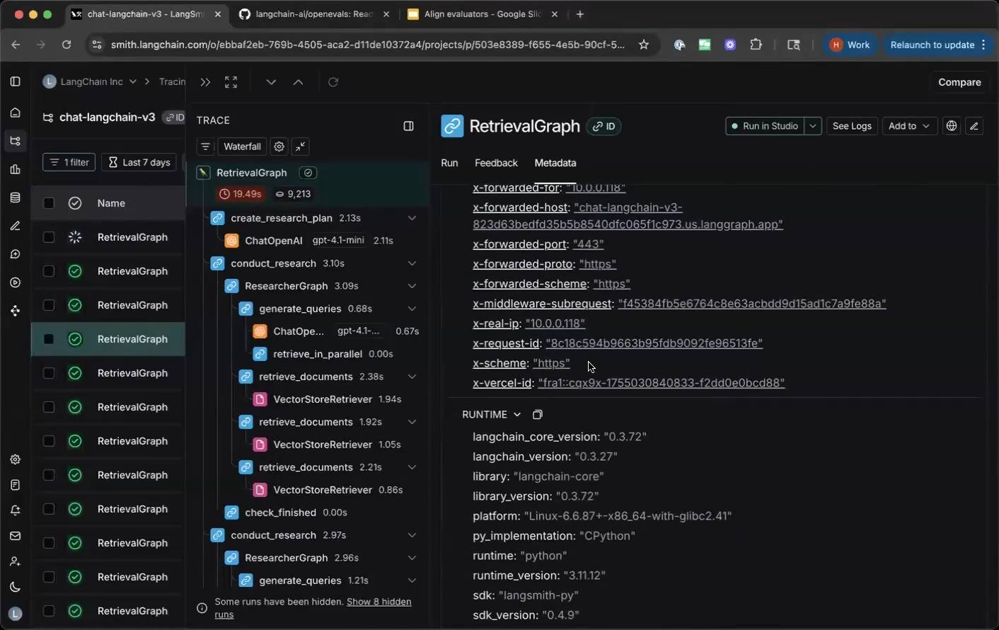
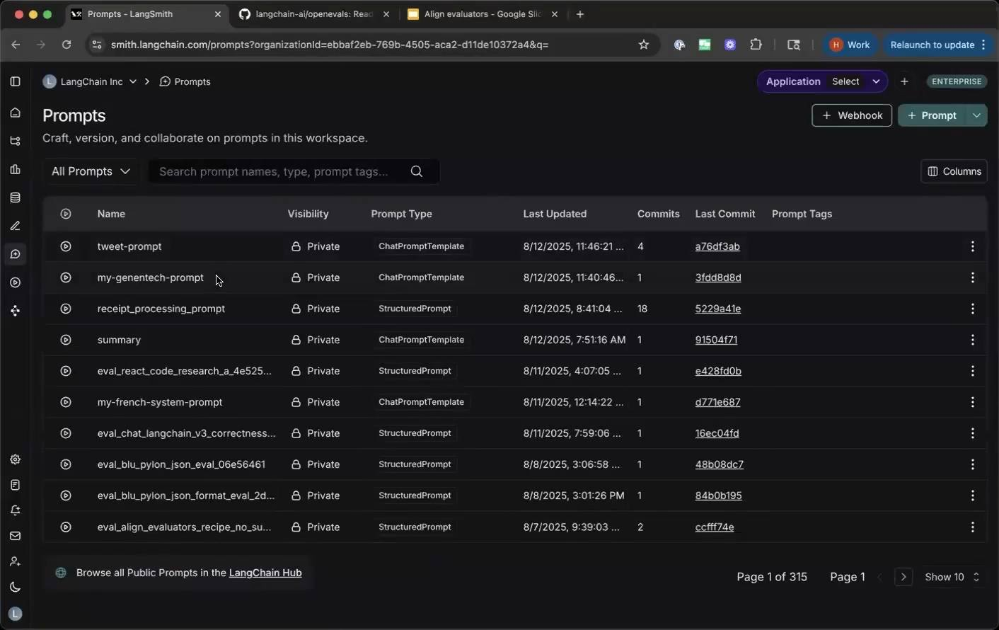
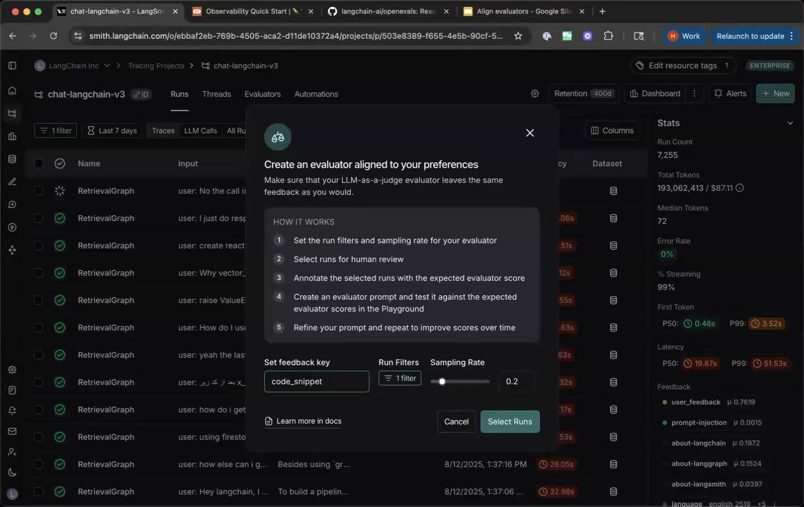
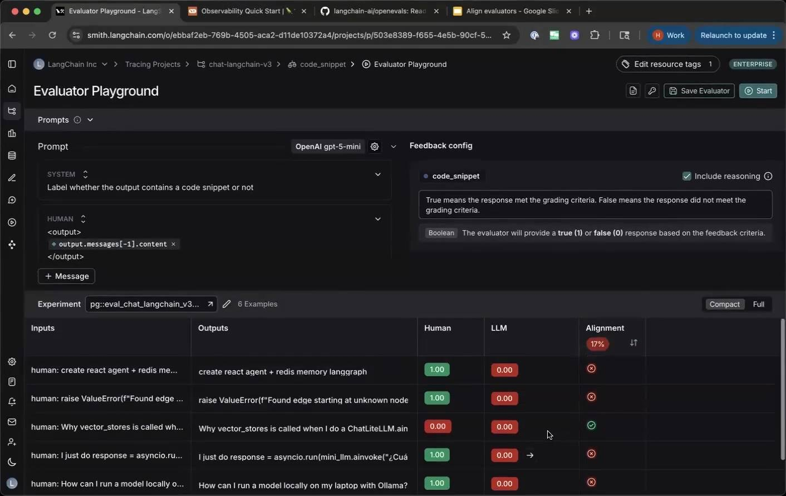
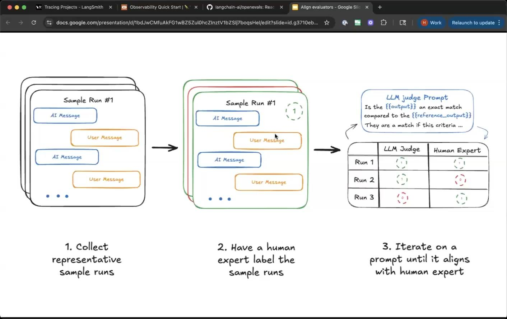
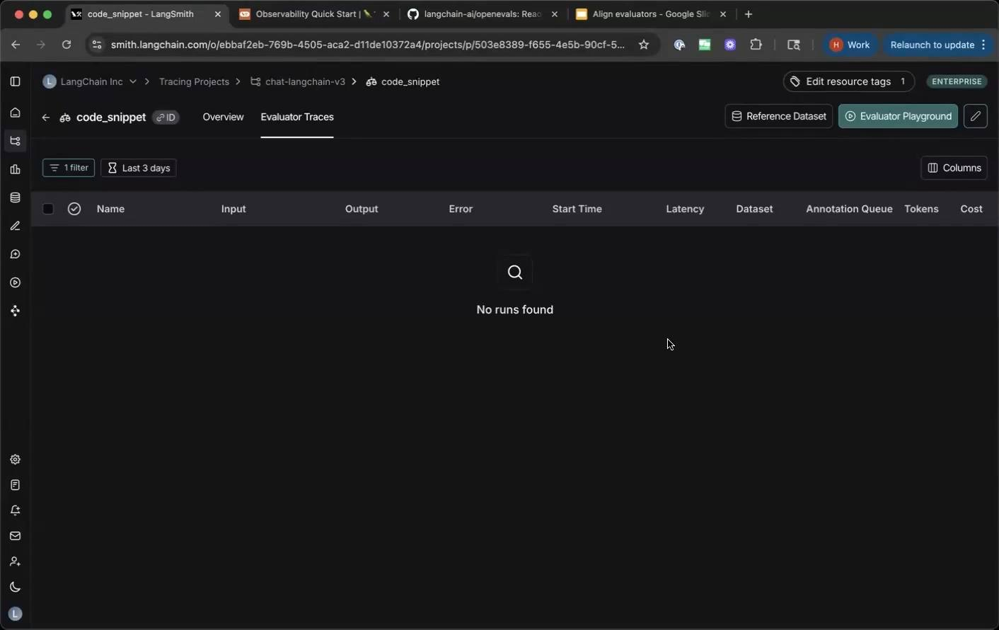
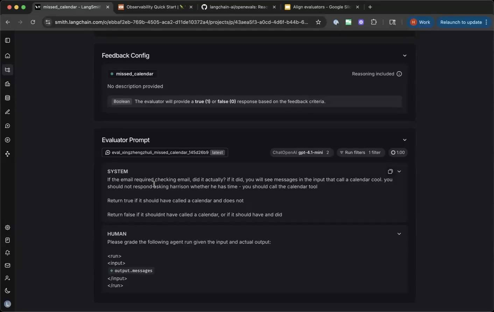
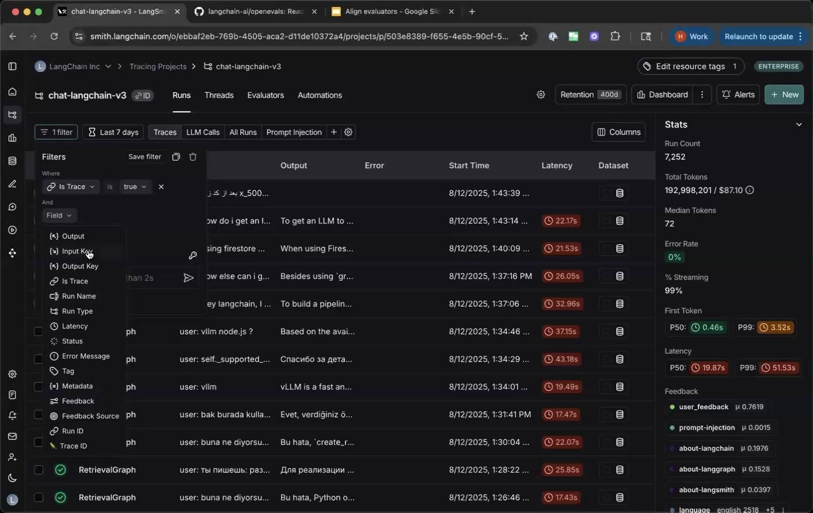

# AI Evals for Engineers & PMs · P031：LangSmith 全景巡览与 Align Evals 实战

> 本讲是**纯讲解 + 产品现场演示**课：讲师 Harrison（LangChain CEO）在 LangSmith 界面里边讲边点，逐字稿里没有任何本地项目脚手架、没有贴完整代码文件，OCR 也没有抓到屏幕上的代码。因此本文的「完整代码」一节不编造讲师没写过的实现，而是把讲师口头描述的东西（traceable 装饰器、二分类 LLM judge、pytest / vitest 形态的 agent eval）落成**明确标注为示意**的可运行产物，并把讲师给出的所有配置项、字段路径、判断标准原样整理成表。

---

## 1. 这一节做什么

这一讲要解决的是一个很具体的问题：**你的 agent 出错了，你怎么知道错在哪、怎么证明改动之后变好了。**

讲师给的答案是「context engineering」这个词。他认为 agent 出错，绝大多数情况不是模型本身不行，而是**送进 LLM 的那段上下文不对**——可能上下文太多、可能上下文里有干扰项、可能相关上下文不够、也可能是你没给它对的工具（他强调工具本身就是上下文的一部分）。LangSmith 这一整套产品，本质上就是围绕「怎么对上下文做工程」建起来的工具链。

所以这一讲的产品主线是两条工作流：

1. **AI 工程流（开发期）**：tracing 调试 → 建 dataset → 跑 experiment / eval → prompt hub 版本管理 → playground 试验；
2. **AI 可观测流（生产期）**：tracing 项目 + monitoring dashboard，在成千上万条 trace 里按延迟、反馈、元数据、输入输出过滤，做「轻量版 A/B 测试」。

按项目实现逻辑，这一讲要交付的产物清单是：

| # | 产物 | 载体 | 对应动作 |
|---|---|---|---|
| 1 | 一个 tracing project（带 tags 与 metadata） | LangSmith | 接上 SDK / 加 traceable 装饰器，跑一次 notebook 或脚本 |
| 2 | 一个 annotation queue | LangSmith | 把 run 加进队列，人工打标 |
| 3 | 一个 dataset + examples（含 1 条多模态：收据图片） | LangSmith | 从标注队列「修正 ground truth 后加入 dataset」 |
| 4 | 一个 LLM-as-judge evaluator（1–10 分版） | LangSmith | 写 correctness prompt |
| 5 | 一个二分类 align evaluator（对齐到 100%） | LangSmith | New evaluator → Create from labeled data |
| 6 | 一张 monitoring dashboard（按 response_model 分组） | LangSmith | 自动生成后改 group by |
| 7 | 一个 pytest / vitest 形态的 agent eval | 本地仓库 | 每个数据点写不同断言，日志回写 LangSmith |
| 8 |（可选）LangGraph 里的 in-the-loop verifier 节点 | 你的应用 | agent 出结果后过 verifier，不通过就带反馈重跑 |

第 8 项要特别注意：**讲师明确说这件事不要在 LangSmith 里做**，LangSmith 是日志/评测平台，verifier 必须跑在你应用的热路径上。这是本文第 3.12 节要复现的重点。

---

## 2. 讲师原话

### 2.1 关于 context engineering 的定义与为什么它是核心

> "我觉得 context engineering 是一个新词，人们用它来描述的是这样一件事：为最终送进 LLM 的内容构建上下文的那部分工程工作。"
> —— p031 [02:20]

> "当你构建 agent 的时候，agent 出错的主要原因，是那次对 LLM 的调用出错了。而一次 LLM 调用出错大概有两个原因：一是 LLM 本身不行，或者不够好，你可能用了小模型，或者这类问题当前的 LLM 就是搞不定。二是更大的原因——你传给 LLM 的上下文本身就是错的，或者以某种方式很糟糕。可能是上下文太多，可能是上下文中干扰信息太多，可能是相关上下文不够，也可能是你没给它对的工具，而工具绝对是上下文的一部分。"
> —— p031 [03:13]

> "我们两年半前开始做 LangSmith 的时候，context engineering 显然还不是一个词，prompting 才刚刚开始被当作一个词，agents 也才刚刚开始被当作一个词。但我们当时建的大部分东西，本质上就是用来对复杂系统做 context engineering 的工具。"
> —— p031 [03:41]

### 2.2 关于两条工作流与 eval 的作用

> "数据集里包含数据点，这些数据点可以理解为一段段不同切片的上下文。而因为 LLM 不是确定性系统，所以对它做评估看起来会有点不一样。当你对 context engineering 的流程做改动时，你需要度量这些改动到底做得怎么样。所以 eval 本质上就是一种把 context engineering 的改动**量化**的方式。"
> —— p031 [04:34]

> "Prompt engineering 绝对是 context engineering 的一大部分。我不知道这些词的正式定义，我怀疑也没人知道。但我们有 prompt hub 用来存和试，有 prompt playground 让你去试验不同的 prompt，这又回到 context engineering 上。"
> —— p031 [05:02]

> "然后是另一条工作流，我们认为是 AI observability：你在生产系统里大规模地跑，那问题是，你怎么**批量地**调试 context engineering 的错误？这就是我们建那一堆 dashboard 的原因。"
> —— p031 [05:26]

### 2.3 关于 LangSmith 的独立性

> "这就是 LangSmith。如果你还没注册，你应该已经注册了。注册免费。你可以配 LangChain 用，也可以完全不用我们的任何开源项目，它是独立的。"
> —— p031 [05:54]

### 2.4 关于调试顺序：先质量、再速度、再成本

> "有一个我挺喜欢的视图是这个 waterfall（瀑布图），用来调试延迟。我觉得这些事情的顺序通常是：先让质量足够高，然后让它足够快，最后让它足够便宜——这大概是我们普遍看到的顺序。便宜和快其实差不多是并列的，但质量得先过关。"
> —— p031 [07:21]

### 2.5 关于 annotation queue 是「最有特色的功能之一」

> "我可能会先讲 annotation queue，我觉得这是我们比较有特色的功能之一。它们就是一个专门用来查看和标注数据的视图。"
> —— p031 [08:15]

> "我可以看到整段对话的输入和输出。我这里没有设置 instructions，但我可以把说明放在这里；我也没有 feedback，但我可以在这里配置，或者我也可以留下自然语言备注。我还可以选择性地把它加入数据集。所以如果我想修正标准答案，我可以在这里改，然后加入数据集，开始把数据集积累成 examples。"
> —— p031 [08:45]

### 2.6 关于 eval flywheel（评测飞轮）

> "我们很想强调的一点，是在 playground、dataset、traces、annotation queue 之间来回切换。我们想建起来的东西，很大程度上是一个 evaluation flywheel（评测飞轮）。而要得到这个飞轮，我认为你需要把这些部件都连起来。"
> —— p031 [10:37]

### 2.7 关于生产环境必须能过滤

> "如果是在生产环境跑，你会有成千上万甚至几十亿条 trace，你就需要能够过滤进去：按延迟过滤、按你拿到的 feedback 过滤（自动的或来自用户的）、按 metadata 过滤。我们往上送的东西之一就是所用的 LLM，所以你可能会想按不同 LLM 调用做追踪。也可以按输入输出过滤，我们支持全文检索。这里有大量高级过滤能力。"
> —— p031 [13:55]

### 2.8 关于 project 与 metadata 的组织策略

> "一般来说我们的建议是一个应用一个 tracing project。如果你有不同环境，那也建议把它们分开。这里上面有 tags，用这些 tag 可以过滤出带某个 application tag 的 tracing project，然后你还可以加别的 tag，比如 prod、dev 之类的。把这些分开的主要原因之一是，我们路线图上很快就要上的 attribute-based access control（基于属性的访问控制），你可以规定只有这些人能访问生产环境的 trace。"
> —— p031 [18:03]

> "而在一个 project 内部，我们一般建议用 metadata 去打标签，比如模型，或者任何你想要拿来切片分析的元数据。"
> —— p031 [19:30]

### 2.9 关于最低门槛：先把 tracing 打开

> "我认为单个最有影响力的事情，就是先把 tracing 搭起来。还是那句话——你得去看你的数据。而 tracing 是看真正流进来的数据的一个非常好的方式。我基本上一直开着它。你可能只有 5% 的时间会用到它，但那 5% 的时候它极其有用。它非常容易搭。它和 OTel 集成，和 LangChain、LangGraph 集成。如果你不用这些，基本上你只需要加一个 traceable 装饰器，超级简单。"
> —— p031 [21:39]

> "用软件工程来类比：调试是第一步，然后你可能会写单元测试，然后等你上线了，你可能会打开生产监控之类的东西。所以我说，第一步就是给你的 agent 装一个好的 debugger。"
> —— p031 [23:01]

### 2.10 关于 evals 的两个难点与 align evals 的三步

> "Evals 非常重要。Evals 有两个难点：一个是建数据集，另一个是建评估器。常用的一类评估器是 LLM as a judge，就是用一个 LLM 去给某些 run 打分。这些评估器配置起来挺烦的，因为你现在得对另一个东西做 prompt engineering——你得去给这个当裁判的 LLM 写 prompt，让它来给你的输出打分。"
> —— p031 [23:57]

> "所以它怎么工作呢？第一步，你收集一些 run；第二步，你标注这些 run；第三步，你不断迭代，直到它和你的预期对齐。这为什么有用？第一，因为——不是我想重复那句话，但你真的得去看你的数据。当你在想「我的应用应该用什么评估器」时，你必须去看你应用的实际输出，然后想你会怎么判它。看着它们、真的去标它们，是强迫自己做这件事的好办法。第二，当你在迭代 prompt 时，你现在有了一个可以对比的 baseline。所以这基本上就是「给你的评估器做评估」。有点元，但它从一开始就给了你一个 baseline 数据集，让你可以快速迭代、快速爬山。"
> —— p031 [24:48]

> "我们目前把它限制在二分类。所以你标的是「这个对不对」。然后你让一个 LLM 去预测它。有研究表明，这比让它输出 1 到 10 分或者一个分类标签更准。"
> —— p031 [26:11]

### 2.11 关于 LLM judge 的一致性

> "首先我会建议做二分类，而不是数值打分。以我的经验，这有助于一致性。拿到一个布尔的是/否，比拿到「这个在 1 到 10 分里该打几分」要容易。即便这样，我认为还是会有一些波动。这就是「评估你的评估器」要发挥作用的地方。就像你建的 LLM 应用本身大概也不是 100% 一致的，你的 LLM as a judge 评估器很可能也拿不到 100% 的一致性。你当然可以通过迭代让它们更一致，跑一些这样的基准来确保它们是校准过的。"
> —— p031 [32:54]

> "我会说这基本上就是 prompt engineering，而 prompt engineering 的一部分就是选择要产出什么输出 schema、以及要判什么。在这方面我宁可选择二分类，而不是数值打分。"
> —— p031 [33:54]

### 2.12 关于把 eval 当产品洞察用

> "一个有意思的事情是，很多人用评估器其实更多是为了产品洞察，而不是为了评估本身。我的意思是，当我设置「输出里是否包含代码」这样的评估器时，它严格来说并不是一个评估器，但它能帮我感知用户是怎么用我的产品的，也能帮我指导过滤。所以我认为这其实是一个被低估的部分——LLM as a judge 不一定要当评估器才能提供价值。"
> —— p031 [34:18]

> "我有个邮件助手。我注意到它有些地方会先问我有没有空，而不是去查我的日历。所以这个评估器评估的是 agent 的整条轨迹。你可以看到我传的是 output.messages，因为它用的是 ReAct agent，我把整个消息列表传进去。所以这一类轨迹评估器……而且这是一个我早就知道的失败模式。"
> —— p031 [35:38]

> "一旦你知道这个失败模式存在，这就是一个具体的评估器例子：如果这封邮件需要查日历，它到底查了没有？基本上就是看着它然后判一下。"
> —— p031 [36:07]

### 2.13 关于 judge 的模型与温度

> "我不怎么去调 temperature。我确实会试不同的模型。其实有一次我在跑一个 eval——可能就是这个课的家庭作业——它怎么都做不对，就是因为模型本身太差。然后我换了模型，它就开始做对了。我一般会从 mini 那一档的模型开始，先做一堆 context engineering 把它调好，如果它明显还在犯很低级的错误，再换更强的模型。"
> —— p031 [37:04]

### 2.14 关于 open evals / agent evals / pytest 与 vitest

> "大多数人都在自己定义评估器。我们有一些开箱即用的，但我们经常看到人们在定义自己的。这里有个有意思的张力：我们是给人开箱即用的指标，还是让人自己定义？没有标准答案，而这个包大概就是我们的交集点。它包含了一系列开箱即用的、以及可定制的、我们常见的打分模式。"
> —— p031 [37:58]

> "有些评估器你其实不需要 ground truth 就能跑。我们觉得这有意思的原因是，你可以把这些评估器直接加进 agent 内部。所以有离线 eval（建数据集）、有在线 eval（跑生产 trace），然后还有我们所说的 in the loop evals，就是把评估器加进 agent 自己的循环里，让它自我纠正。"
> —— p031 [39:51]

> "有一个单独的包叫 agent evals，它主要聚焦在轨迹上。你可以用很多不同方式评估轨迹：你可以看严格匹配——它是不是按正确顺序做了所有工具调用；你可以看有序匹配——它是不是做了所有工具调用，不管顺序；然后是超集和子集，用来对着测。当你判这些工具调用时，比较参数的方式也有好几种，所以那里没那么简单。你也可以把整个东西丢给一个 LLM as a judge。然后还有 graph 那个，是专门给 LangGraph 用的。"
> —— p031 [40:21]

> "LangSmith 里跑 eval 有两种模式。一种很简单，就是循环：把你的目标函数跑遍数据集里所有数据，再跑过所有评估器。更有意思的是我们有 PyTest 和 Vitest 的集成。我觉得这对 agent eval 特别有意思，因为 agent 的输出往往很复杂——可能是一整篇文章，可能是一整个你生成的 repo。所以你想怎么评估这个数据点，可能每个数据点都不一样。你可能想跑不同的断言、不同的单元测试。那你就不能按循环跑了，因为它们不是可以互换的。这就是 pytest 好用的地方。如果你在 JS 那边，vitest 也很好用。"
> —— p031 [41:14]

> "你可以用很传统的方式搭起来，就像你平时测试一个普通应用那样。但你会把东西 log 到 LangSmith。为什么 log 到 LangSmith？为了更容易调试、为了长期追踪、为了和之前的运行对比。所以它给了你比 evaluate 函数更多的灵活性，而我认为这种灵活性对 agent eval 特别重要。"
> —— p031 [42:08]

### 2.15 关于 in-the-loop eval 不要放在 LangSmith 里

> "我其实不会在 LangSmith 里跑它，因为我认为 LangSmith 基本上是一个日志平台。如果你要做 in the loop，你要在你跑应用的地方做，要在它的热路径上做。我会把它作为 LangGraph 的一部分来跑。LangGraph 是我们的 agent 框架，是另一个东西，但它非常可控；我们把它做得这么可控，部分原因就是你需要做这种事：跑这些检查，如果检查通过就返回给用户，如果没通过就回到 agent 里。所以我不在 LangSmith 里跑。"
> —— p031 [43:03]

> "我也不会把 guardrails 放在这种工具里跑。guardrails 应该在你的应用里。出于延迟原因，它们需要离热路径近得多。"
> —— p031 [43:57]

> "什么时候做、什么时候不做？主要就是看你能不能做 reference-free 的 eval，也就是你不需要 ground truth。因为很明显，如果你需要 ground truth，运行时你根本没有。所以最难的部分就是设计出无参考的评估器。这和 RL 里 verifier 的概念非常像，100% 相关。"
> —— p031 [44:24]

> "你会有一个 agent，然后你设一个单独的节点：agent 回复之后，总是走到这个节点；这个节点跑那个 verifier，然后根据 verifier 的结果，你要么结束这次 agent run，要么带着反馈重新调用 agent，比如「嘿，你这条单元测试没过，再试一次」。"
> —— p031 [44:51]

### 2.16 关于多次运行、投票与 fan-out/fan-in

> "我不太确定 majority vote 具体指什么，但我们有一个概念是：因为 LLM 本身有方差，所以把 eval 跑多次，然后聚合统计，而不是给每个数据点一个 pass/fail。你会对每个数据点跑五次，然后得到「它通过了 80%」这样的结果。"
> —— p031 [45:49]

> "我们没怎么看到人们给 judge 的输出做 ensemble。我们看到的是另一种挺有意思的模式，我知道有两三个在生产里这么干的人：他们会启动 agent，同时启动 agent 的多个版本——可能用不同模型，也可能只是因为随机性、用不同 temperature——跑 n 步之后，拿到 m 个答案，然后挑最好的那个。这依赖你有一个 reward function。然后他们要么把最好的那个作为最终答案，要么干脆从那里继续跑，把它当成一个 checkpoint。所以我见过这种 fan out 再 fan in 的做法，但那是用在跑 agent 本身，不是用在 judge 上。"
> —— p031 [46:18]

> "我觉得这么干的条件是：你得有某种 verifier，而且任务价值足够高，高到你愿意烧那个钱。"
> —— p031 [47:44]

---

## 3. 从零复现

> 本节按「你会照着点什么按钮」的顺序写。凡是讲师没说的配置项，我标「课里没讲」。

### 3.0 前置准备

1. 注册 LangSmith 账号（讲师说免费）。**不需要**安装 LangChain / LangGraph，LangSmith 是独立的。
2. 准备一个能跑 notebook 或脚本的环境（讲师演示时是用 Jupyter notebook 实时跑的，run 会实时打到平台上）。
3. 准备你要评测的应用。讲师没有规定语言，只提到三条接入路径：
   - 用 OTel（讲师口语说的是 "Hotel"，指的是 OpenTelemetry）；
   - 用 LangChain / LangGraph；
   - 以上都不用，就**加一个 traceable 装饰器**。
4. 环境变量：讲师现场因为「最近换了 OpenAI API key」导致 evaluator 跑出 authentication error（认证错误），所以请先把 key 配好再开始。


### 3.1 建 tracing project，把 run 打上来

1. 进入 LangSmith，找到 **Tracing Projects**。讲师说这是大多数人入门的地方——它做的事就是「把来自你应用或调试环境的数据记录到这里」。
2. 一个应用一个 project；有 dev / prod 就各建一个（理由见 2.8 的 ABAC）。
3. 给 project 加 tags（例如 `application`、`prod`、`dev`），后续用 tag 过滤 project 列表。
4. 跑你的 notebook / 脚本，确认 run 出现在列表里。

### 3.2 读一条 trace

点进任意一条 run，你能看到（讲师逐个点了这些）：

- 所有在拿到某段上下文**之前**跑过的步骤；
- 它当时拥有的**确切上下文**：它有哪些 **tools**、**input**、**output**；
- **waterfall（瀑布图）**视图，用来调试延迟；
- 挂在这次 run 上的 **feedback** 和 **metadata**（讲师说「我们在这里挂了一大堆信息」）。

调试顺序按讲师的经验：**质量够高 → 够快 → 够便宜**。



### 3.3 在 playground 里就地改

在 trace 详情页里「open in playground」：

- 改 system prompt；
- 试不同模型（验证「换个更大的模型会不会就好了」）；
- 加 **output schema**；
- 加 **tools**；
- 在这里反复迭代。

讲师强调这个调试流「我几乎一直开着」。

### 3.4 建 annotation queue 并打标

1. 在 trace 详情页把 run **add to annotation queue**，或直接进 **Annotation Queues** 页面。
2. 队列里逐条看：整段对话的 **input / output**。
3. 可选配置：
   - **instructions**：给标注者的说明（讲师演示时没设，但说可以放）；
   - **feedback**：结构化反馈项；
   - **自然语言备注（notes）**。
4. 打标快捷键：讲师用的是 **Cmd + Enter** 提交并跳到下一条。
5. 如果标准答案错了，就在这里**修正 ground truth**，然后 **add to dataset**，把标注结果沉淀成 examples。

讲师演示时队列里有 **9000 多条 run**，那不是手动加的——是 **automation 规则**自动送进来的（见 3.9）。

### 3.5 建 dataset 与 examples

1. 进 **Datasets & Experiments**。
2. 一个 dataset 里是 **examples**，本质是 **input-output 对**。
3. 讲师演示的 dataset 是**多模态**的：input 是一张**收据图片**，任务是抽取若干字段。所以 example 的 input 可以不是纯文本。


### 3.6 建 evaluator（1–10 分版，即「老办法」）

1. 在 dataset 里建 **evaluator**，选 **LLM as a judge**。
2. 写 prompt。讲师演示的那条是 **correctness，1 到 10 分**：
   - 10 分：输出在事实上准确……
   - 1 分：所有字段都缺信息。
3. 除 user prompt 外，还有 **system prompt** 部分可以写。

这条 evaluator 存在的意义就是让你看清「老办法为什么烦」——你得对裁判模型再做一次 prompt engineering。

### 3.7 跑 experiment 并跨时间对比

- experiment 会拿 dataset 里的 examples 跑你的应用，并用各 evaluator 打分。
- 启动入口有三个：**playground**、**SDK**、**agent studio**（想测 agent 就用最后一个）。
- 结果可以**跨时间追踪**，看改动是变好还是变坏。



### 3.8 Prompt Hub 做版本管理

1. 进 **Prompt Hub**，存 prompt。
2. 每次改动会形成 **commit**，可以写 **comment**。
3. 讲师挑了一个「有好几个版本」的 prompt 来演示 commit 列表。

### 3.9 看 monitoring dashboard（自动生成）

每个 tracing project 会自动得到一张 dashboard，开箱即用地画这些指标：

| 指标组 | 具体内容 |
|---|---|
| 总量 | trace 总数 |
| 延迟 | latency |
| LLM | LLM 调用次数 |
| 成本 | costs、tokens |
| 工具 | 工具调用次数、**每个工具的延迟**、**每个工具的错误率**（讲师演示的那个 agent 没调工具，所以这里是空的） |
| 路径 | run types——看 agent 走了哪条分支 |
| 反馈 | feedback scores 随时间变化（讲师演示里有 groundedness、language） |

讲师还演示了两个「往下钻」的动作：

**动作 A：点图钻到具体 run。** 在 language 分布图上点「Russian」，就自动过滤出所有被标为俄语的 run。讲师说他不讲俄语，但看起来像俄语。

**动作 B：按 metadata 分组。** 在分组里选 metadata → 搜 `response model` → 按它分组。于是同一张图被拆成按模型分开的多条线。讲师读出来的结论：

- **Anthropic 延迟最高，Google 延迟最低**；
- **OpenAI 成本最高——但这是因为用得最多**；
- 有用性（helpfulness）随时间：紫色那条最高，Google 最低但抖动大，Anthropic 稳定地落后于 OpenAI。

他说这就是**轻量版 A/B 测试**。

### 3.10 复现 Align Evals（本讲重点，逐步照做）

这是讲师现场从头点一遍的流程，我按他的点击顺序记：

1. 进 **Chat LangChain** 这个 project（讲师演示用的项目）。
2. **Add evaluator → New → New evaluator**。
3. 选 **Create from labeled data**（从标注数据创建）。页面上会有一段说明它是怎么工作的。
4. 设置这个 evaluator 的 **run filters** 和 **sampling rate**（采样率）——这决定了 evaluator 上线后会对哪些 run 生效。
5. 设一个 **feedback key**。讲师现场临时决定要判的是：**输出里是否包含代码片段**。他特别说明：这既可以当评估，也可以当**探索数据**的手段。
6. filter 选 **all runs**。
7. **选择一批 run 加入 annotation queue**。讲师只加了几条，怕演示太久。
8. 开始人工标注，每条只判一个二分类：
   - 第一条：长回答，明显有代码片段 → `code snippet = 是`；
   - 第二条：看最终答案 → 有；
   - 第三条：有；
   - 第四条：**没有代码片段**（讲师说「有意思，我以为每条都会有」）；
   - 第五条：有。
   每条按 **Cmd + Enter** 进下一条。
9. 标注完进 **evaluator playground**。这里左边是人类打的标签，上面是待写的 judge prompt。
10. 写 system prompt：`label whether the output contains a code snippet or not`。
11. 只保留 **output** 这一个输入变量。
12. 取文本的路径，讲师第一次写的是：`output.messages[-1].content`（output → messages → 最后一条 → content）。
13. 勾上 **include reasoning**——这样 judge 判错时你能看到它为什么错。
14. 点运行。**第一次报 authentication error**（认证错误），原因是讲师最近换了 OpenAI API key。他停止共享屏幕、改完 key、重新共享、重跑。
15. 重跑后**对齐极差**：judge 基本在预测「没有代码片段」。
16. 排查：点进 evaluator 的那次 run，看到**它是空的**——说明第 12 步设的路径根本没取到值。
17. 把路径改成 **`output.answer`**，重跑。
18. 结果 **100% 对齐**（讲师说这任务本来也简单，「它开箱就命中了」）。
19. **Save evaluator**。保存成功。
20. 讲师说明：这些规则**每 5 到 10 分钟跑一次**，所以要到课程结束时才能回来看新产生的 trace 上这个 evaluator 的表现。







### 3.11 配 automation 规则（那 9000 条 run 是怎么来的）

1. 在 tracing project 里进 **Automations**。
2. 一个 automation = **规则（filter）** + **动作（action）**。讲师演示里很多动作是「送到 annotation queue」。
3. 规则示例（讲师现场念的）：
   - 当某个 feedback key 的打分为 1 时（他的例子是 `lang_graph` 相关的一个 key）——也就是「只要出现关于 LangGraph 的问题」；
   - 或者：当树里任意一个 **sub run** 的 `groundedness` 得分为 0 时。
   满足就送进 annotation queue。
4. **Evaluators & automation** 里还能配置 evaluator 的自动运行：点 **Edit** 可以设 **sampling rate（采样率）** 和 **filters（过滤器）**——evaluator 只会对采到的那部分日志跑。

### 3.12 把 in-the-loop eval 放进 LangGraph（不是 LangSmith）

讲师明确：**不要在 LangSmith 里跑 in-the-loop eval，也不要在这里跑 guardrails。**

在 LangGraph 里的搭法（讲师口述的结构，课里没给代码）：

```
[agent 节点] --(总是)--> [verifier 节点] --通过--> [返回用户 / 结束]
                                |
                                +--不通过--> 带反馈回到 [agent 节点]
```

约束条件：

- 只能用 **reference-free** 的评估器（运行时你没有 ground truth）；
- 概念上等价于 RL 里的 **verifier**；
- 原因是延迟：guardrails 和 verifier 都必须离热路径足够近。

### 3.13 用 pytest / vitest 做 agent eval

讲师认为这是 agent eval 的**关键形态**，理由是 agent 的输出不像普通函数返回值：可能是一整篇论文、一整个生成的 repo，**每个数据点的评估方式都可能不一样**（不同断言、不同单测），不能用一个 `for` 循环 + 一套 evaluator 糊过去。

做法就是「传统测试 + 日志回写」：

- Python 用 **pytest**；
- JS 用 **vitest**；
- 断言写在测试里，跑完把结果 **log 到 LangSmith**，好处是：更容易调试、能长期追踪、能和历史运行对比。







---

## 4. 完整代码

> **重要声明**：这一讲是产品演示课，讲师**没有展示任何代码文件**，逐字稿里只提到「加一个 traceable 装饰器」和「用 pytest / vitest」。OCR 也没有抓到屏幕代码。因此本节的表全部来自讲师口述的**配置与决策**，代码块是**按讲师描述写出的最小可运行示意**，函数名/参数名请以官方文档为准。课里没讲的 SDK 具体 API 名，我在下面统一写「以官方文档为准」。

### 4.1 目录结构（示意仓库）

```
agent-evals-demo/
├── .env                          # OPENAI_API_KEY=...  (讲师演示时就是用 OpenAI 的 key)
├── data/
│   ├── dataset.jsonl             # 复刻 LangSmith dataset 的 examples
│   └── labeled_runs.json         # 复刻 annotation queue 里人工标注的 run
├── evals/
│   ├── judge.py                  # 二分类 LLM judge（复刻 align eval 中那个 judge）
│   ├── align.py                  # 算 judge 与人工标签的对齐率（复刻 evaluator playground）
│   ├── aggregate.py              # 同一数据点跑 N 次再聚合（复刻「跑 5 次得 80% 通过」）
│   └── test_trajectory.py        # pytest 形态的 agent eval
├── src/
│   └── agent.mjs                 # 被评测的 agent（示意）
└── evals/
    └── agent.test.mjs            # vitest 形态的 agent eval
```

### 4.2 设计决策表（全部来自讲师口述）

| 决策点 | 讲师的选择 | 理由 |
|---|---|---|
| project 划分 | 一个应用一个 project，环境再拆 | 未来上 ABAC，生产 trace 只给部分人看 |
| project 内部打标签 | 用 **metadata** 打 model 等字段 | 为了能切片分析、按 response model 分组 |
| project 之间打标签 | 用 **tags**（application / prod / dev） | 过滤 project 列表 |
| 先做哪件事 | **先开 tracing** | 成本最低、收益最大；「5% 的时间用到，但那 5% 极其有用」 |
| 调试顺序 | 质量 → 延迟 → 成本 | 讲师观察到的普遍顺序 |
| 标注产物放哪 | 从 annotation queue → **add to dataset**，修 ground truth | 让标注直接沉淀成 examples |
| judge 的输出形态 | **二分类**（是/否），不用 1–10 | 一致性更好；有研究表明更准 |
| judge 的输入范围 | 只要能判的那部分（讲师只留 output） | 减少干扰上下文 |
| judge 的可解释性 | 打开 **include reasoning** | judge 判错时能看到为什么错 |
| judge 的模型 | 从 **mini 档**开始，明显犯低级错再换更强的 | 省钱，先靠 context engineering 补 |
| judge 的 temperature | **不怎么调** | 讲师原话 |
| evaluator 上线方式 | 设 **filter + sampling rate**，每 5–10 分钟跑一次 | 采样控制成本 |
| 复杂 agent 的评测形态 | **pytest / vitest**，不是 for 循环 | 每个数据点断言不同，不可互换 |
| in-the-loop eval 放哪 | **应用热路径（LangGraph 节点）**，不放 LangSmith | LangSmith 是日志平台，延迟不允许 |
| in-the-loop 的前提 | 必须 **reference-free** | 运行时没有 ground truth |
| judge 多次跑 | 跑多次后**聚合统计**（如跑 5 次、80% 通过） | LLM 有方差 |

### 4.3 组件职责表

| 组件 | 职责 | 讲师强调的点 |
|---|---|---|
| Tracing Project | 收集应用日志，展示 trace 树 | 独立于 LangChain，可用 OTel / traceable 装饰器接入 |
| Trace 详情 + waterfall | 看每一步的 tools / input / output、看延迟 | 调试 context engineering 的主战场 |
| Playground | 就地改 system prompt / 换模型 / 加 output schema / 加 tools | 调试流「几乎一直开着」 |
| Annotation Queue | 专用的人工标注视图 | instructions / feedback / notes / 修 ground truth / add to dataset |
| Dataset + Examples | input-output 对，可多模态 | 数据点 = 不同切片的上下文 |
| Evaluator | LLM as judge 或代码断言 | 老的 1–10 分 vs 新的二分类对齐流 |
| Experiment | 跑 dataset × evaluator，跨时间追踪 | 入口：playground / SDK / agent studio |
| Prompt Hub | prompt 存储 + 版本 + commit + comment | — |
| Dashboard | trace 总量、延迟、LLM 调用、成本、token、工具、run types、feedback 趋势 | 可按 metadata 分组做「轻量 A/B」 |
| Automations | 规则（filter）+ 动作（送 annotation queue） | 9000 条标注数据就是这么来的 |
| open evals（开源包） | LLM judge / extraction & tool calling / RAG / sandbox code（类型检查） | 部分评估器**不需要 ground truth**，因此能塞进 agent 内部 |
| agent evals（开源包） | 轨迹评估：严格匹配、有序匹配、超集/子集、参数比较、LLM judge、graph | 专治「工具调用判得乱」 |
| LangGraph | agent 框架，承载 in-the-loop verifier 节点 | 可控性就是为这件事做的 |

### 4.4 数据模型草案（示意）

**dataset.jsonl** —— 复刻 dataset 里的 examples（讲师演示的是多模态：input 是收据图片）：

```jsonl
{"id":"ex-001","inputs":{"question":"这段代码是做什么的？"},"outputs":{"answer":"它把数组按 key 分组：\n\n```js\nconst g = arr.reduce((m,x)=>((m[x.k]??=[]).push(x),m),{});\n```"}}
{"id":"ex-002","inputs":{"question":"解释一下什么是向量检索"},"outputs":{"answer":"向量检索是把文本编码成向量，再按相似度近邻搜索。"}}
{"id":"ex-003","inputs":{"receipt_image":"file://./data/receipt-001.jpg"},"outputs":{"merchant":"...","total":"...","date":"..."}}
```

**labeled_runs.json** —— 复刻 annotaion queue 里人工打好的二分类标签（`code_snippet` 是讲师现场定的 feedback key）：

```json
[
  {"run_id": "r-001", "outputs": {"answer": "用 reduce 就行：\n```js\narr.reduce(...)\n```"}, "human_label": true},
  {"run_id": "r-002", "outputs": {"answer": "向量检索就是把文本编码成向量再做近邻搜索。"}, "human_label": false},
  {"run_id": "r-003", "outputs": {"messages": [{"role": "assistant", "content": "可以这样写：\n```py\nprint(1)\n```"}]}, "human_label": true}
]
```

### 4.5 `evals/judge.py`（示意，可运行）

```python
# evals/judge.py
# 【课里没有代码，以下为示意】
# 复刻讲师演示的二分类 LLM judge：
#   system prompt = "label whether the output contains a code snippet or not"
#   只取 output 一个变量；打开 include reasoning，判错时能看到原因。
import json
import os

from openai import OpenAI

client = OpenAI(api_key=os.environ["OPENAI_API_KEY"])
JUDGE_MODEL = os.environ.get("JUDGE_MODEL", "gpt-4o-mini")

SYSTEM_PROMPT = (
    "你是一个严格的标注员。判断给定的回答内容里是否包含代码片段。\n"
    "只输出一个 JSON 对象，形如 {\"label\": true} 或 {\"label\": false}，"
    "不要输出任何其它文字。\n"
    "同时在 reasoning 字段里用一句话说明你为什么这么判。\n"
    "输出格式：{\"reasoning\": \"...\", \"label\": true/false}"
)


def get_output_text(run: dict) -> str:
    """复刻讲师在 evaluator playground 里修路径的过程。

    他先用了 output.messages[-1].content，结果取到空值，对齐极差；
    改成 output.answer 之后 100% 对齐。这里把这个 fallback 顺序固化下来。
    """
    outputs = run.get("outputs", {}) or {}

    # 讲师最终采用的那条路径
    answer = outputs.get("answer")
    if isinstance(answer, str) and answer.strip():
        return answer

    # 讲师第一次尝试的那条路径（ReAct agent 的 output.messages 形态）
    messages = outputs.get("messages") or []
    if messages:
        last = messages[-1]
        if isinstance(last, dict):
            return last.get("content", "") or ""
        return str(last)

    return ""


def judge(output_text: str) -> dict:
    """返回 {"reasoning": str, "label": bool}"""
    if not output_text.strip():
        # 路径取空时要显式暴露出来，而不是静默判 false
        return {"reasoning": "output 路径取到空值，检查 output.answer / output.messages", "label": False}

    resp = client.chat.completions.create(
        model=JUDGE_MODEL,
        temperature=0,  # 讲师说他不怎么调 temperature，这里固定 0
        response_format={"type": "json_object"},
        messages=[
            {"role": "system", "content": SYSTEM_PROMPT},
            {"role": "user", "content": output_text},
        ],
    )
    raw = resp.choices[0].message.content
    parsed = json.loads(raw)
    return {"reasoning": parsed.get("reasoning", ""), "label": bool(parsed["label"])}
```

### 4.6 `evals/align.py`（示意，可运行）

```python
# evals/align.py
# 【课里没有代码，以下为示意】
# 复刻 evaluator playground 里那个「对齐率」：拿人工标签当基准，
# 看 judge 判对了多少条。讲师第一次跑对齐极差，改完路径后 100%。
import json
import sys

from evals.judge import get_output_text, judge


def main(path: str = "data/labeled_runs.json") -> None:
    with open(path, "r", encoding="utf-8") as f:
        runs = json.load(f)

    if not runs:
        print("没有标注数据，先去做标注（对应 annotation queue 那一步）")
        sys.exit(1)

    hits = 0
    for r in runs:
        text = get_output_text(r)
        pred = judge(text)
        ok = pred["label"] == r["human_label"]
        hits += int(ok)
        print(
            f'{r["run_id"]}  human={r["human_label"]}  judge={pred["label"]}  '
            f'{"OK" if ok else "MISS"}  reason={pred["reasoning"]}'
        )

    rate = hits / len(runs)
    print(f"\n对齐率 = {hits}/{len(runs)} = {rate:.1%}")
    if rate < 1.0:
        # 讲师的做法：点进 evaluator 的那次 run，看它实际拿到了什么
        print("对齐率不足 100%：先看 judge 实际拿到的 output 文本是不是空/错路径，再改 prompt。")


if __name__ == "__main__":
    main()
```

### 4.7 `evals/aggregate.py`（示意，可运行）

```python
# evals/aggregate.py
# 【课里没有代码，以下为示意】
# 复刻讲师说的「因为 LLM 有方差，所以每个数据点跑多次再聚合统计」：
# 跑 5 次，输出「通过率 80%」而不是一次 pass/fail。
import json

from evals.judge import get_output_text, judge

N = 5


def main(path: str = "data/labeled_runs.json") -> None:
    with open(path, "r", encoding="utf-8") as f:
        runs = json.load(f)

    for r in runs:
        text = get_output_text(r)
        results = [judge(text)["label"] for _ in range(N)]
        pass_rate = sum(results) / N
        print(f'{r["run_id"]}: {results} -> pass_rate={pass_rate:.0%}')


if __name__ == "__main__":
    main()
```

### 4.8 `evals/test_trajectory.py`（示意，
### 4.8 `evals/test_trajectory.py`（示意，可运行）

```python
# evals/test_trajectory.py
# 【课里没有代码，以下为示意】
# 复刻讲师说的「PyTest / Vitest 集成」形态的 agent eval：
#   每个数据点写自己的断言 —— 有的断言输出里有代码块，有的断言工具调用顺序，
#   有的断言「该查日历时真的查了」（讲师那个邮件助手的 example）。
# 跑完把结果 log 回 LangSmith，好处是：更好调试、能长期追踪、能和历史运行对比。
#
# 运行：
#   pip install pytest langsmith openai
#   python -m pytest evals/test_trajectory.py -v
#
# 注：langsmith 的 traceable 装饰器 / 测试集成具体函数名以官方文档为准，
# 课里讲师只说了「加一个 traceable 装饰器」「有 PyTest 和 ViTest 集成」，
# 没有念任何 API 名。
import json
import os

import pytest
from openai import OpenAI

client = OpenAI(api_key=os.environ["OPENAI_API_KEY"])
AGENT_MODEL = os.environ.get("AGENT_MODEL", "gpt-4o-mini")

DATA_PATH = os.path.join(os.path.dirname(__file__), "..", "data", "dataset.jsonl")


def load_cases() -> list[dict]:
    if not os.path.exists(DATA_PATH):
        return []
    cases = []
    with open(DATA_PATH, "r", encoding="utf-8") as f:
        for line in f:
            line = line.strip()
            if line:
                cases.append(json.loads(line))
    return cases


CASES = load_cases()


def run_agent(question: str) -> dict:
    """示意：一个最小的 ReAct 风格 agent（不接真实工具，只为把轨迹结构演示出来）。

    真实项目里这一段就是你的 LangGraph / 自研 agent。
    """
    resp = client.chat.completions.create(
        model=AGENT_MODEL,
        messages=[
            {"role": "system", "content": "你是一个助理。需要查日历或发邮件时，先说明你要调用哪个工具。"},
            {"role": "user", "content": question},
        ],
    )
    text = resp.choices[0].message.content or ""
    # 把「轨迹」显式建模出来：messages 是完整消息列表，tool_calls 是抽取出的工具名序列
    return {
        "answer": text,
        "messages": [{"role": "assistant", "content": text}],
        "tool_calls": [],  # 演示用，空表示这次没调工具
    }


# ---------- 轨迹评估的四种匹配档位（对应 agent evals 包里的概念） ----------

def strict_match(actual: list[str], expected: list[str]) -> bool:
    """严格匹配：工具调用完全一致且顺序一致"""
    return actual == expected


def ordered_match(actual: list[str], expected: list[str]) -> bool:
    """有序匹配：做了哪些工具一致，顺序可以不同"""
    return sorted(actual) == sorted(expected)


def superset_match(actual: list[str], expected: list[str]) -> bool:
    """超集：实际调用包含期望的全部工具（允许多调）"""
    return set(expected).issubset(set(actual))


def subset_match(actual: list[str], expected: list[str]) -> bool:
    """子集：实际调用全都在期望范围内（允许多期望、不许乱调）"""
    return set(actual).issubset(set(expected))


# ---------- 每个数据点一个测试：断言可以完全不一样 ----------

@pytest.mark.skipif(not CASES, reason="data/dataset.jsonl 为空，先按 3.5 建数据集")
def test_each_case_has_own_assertion() -> None:
    """同一批数据，逐条用不同的断言判 —— 这正是讲师说不能用 for 循环的原因。"""
    failures = []
    for case in CASES:
        q = case["inputs"].get("question")
        if not q:
            continue
        out = run_agent(q)
        answer = out["answer"]

        if case["id"] == "ex-001":
            # 这一类问题要求回答里带代码块
            if "```" not in answer:
                failures.append(f'{case["id"]}: 缺少代码块')
        elif case["id"] == "ex-002":
            # 这一类只要求非空、且提到了关键概念
            if not answer.strip() or "向量" not in answer:
                failures.append(f'{case["id"]}: 回答没命中关键概念')
        else:
            # 多模态那条只要求能返回结构化字段（课里演示的是收据抽取）
            if not answer.strip():
                failures.append(f'{case["id"]}: 空输出')

    assert not failures, "以下数据点未通过：" + "; ".join(failures)


def test_calendar_tool_was_actually_called() -> None:
    """复刻讲师那个邮件助手的评估器：如果问题需要查日历，它到底查了没有。

    讲师原话的意思是：这类评估器看的是 agent 的整条轨迹，
    他把整个 output.messages 传进去让 judge 判 —— 因为用的是 ReAct agent。
    """
    out = run_agent("我明天下午三点有空吗？")
    # 演示断言：轨迹里必须出现「查日历」意图的证据（这里用关键词模拟真实工具调用）
    called = any("calendar" in m.get("content", "").lower() for m in out["messages"])
    expected = ["calendar"]
    assert superset_match(out["tool_calls"], expected) or called, (
        "失败模式复现：agent 直接问用户有没有空，而没有真的去查日历。"
        f"实际轨迹：{out['messages']}"
    )
```

### 4.9 `evals/agent.test.mjs`（示意，可运行，JS 侧）

```js
// evals/agent.test.mjs
// 【课里没有代码，以下为示意】
// 复刻讲师说的「如果你在 JS 那边，vitest 也很好用」。
// 运行：
//   npm i -D vitest
//   npx vitest run evals/agent.test.mjs
import { describe, it, expect } from "vitest";

// 真实项目里这里 import 你的 agent（可能是 LangGraph.js，也可能自研）
async function runAgent(question) {
  return {
    answer: "你可以用 reduce 实现：\n```js\narr.reduce((m,x)=>((m[x.k]??=[]).push(x),m),{})\n```",
    messages: [{ role: "assistant", content: "..." }],
    toolCalls: [],
  };
}

describe("agent trajectory evals", () => {
  it("ex-001：回答里必须带代码块", async () => {
    const out = await runAgent("这段代码是做什么的？");
    expect(out.answer).toContain("```");
  });

  it("ex-002：回答必须非空", async () => {
    const out = await runAgent("解释一下什么是向量检索");
    expect(out.answer.trim().length).toBeGreaterThan(0);
  });

  it("轨迹：需要查日历时必须真的查（讲师那个邮件助手失败模式）", async () => {
    const out = await runAgent("我明天下午三点有空吗？");
    // 严格匹配 / 有序匹配 / 超集 / 子集 四种档位任选其一，按业务严格度定
    expect(out.toolCalls).toContain("calendar");
  });
});
```

> 关于「在 JS/Node 里对应什么」：pytest 对应 vitest（或 jest），`assert` 对应 `expect(...).toBe/toEqual/contain`；`pytest.mark.skipif` 对应 `it.skipIf(cond)`。两者都是「测试框架 + 把结果 log 回 LangSmith」这一套，没有语言差异，只是生态不同。

### 4.10 LangGraph 里的 in-the-loop verifier（示意，伪代码级）

```python
# 【课里没有代码，以下为示意】
# 复刻讲师口述的结构：
#   agent 回复后「总是」走到 verifier 节点；通过就结束，不通过就带着反馈回到 agent。
# 讲师强调三件事：
#   1) 这一段必须跑在你的应用热路径上，不能跑在 LangSmith 里；
#   2) 评估器必须 reference-free（运行时没有 ground truth）；
#   3) 概念上等价于 RL 里的 verifier。
# 节点名 / 状态字段请以 LangGraph 官方文档为准，这里只表达控制流。

from typing import TypedDict

from langgraph.graph import StateGraph, END


class State(TypedDict, total=False):
    messages: list
    answer: str
    verifier_feedback: str
    attempts: int


MAX_ATTEMPTS = 2


def verifier_node(state: State) -> State:
    """无参考评估：只看答案本身，不看 ground truth。"""
    answer = state.get("answer", "")

    # 示例 1：格式类硬约束（reference-free）
    if "```" not in answer:
        return {**state, "verifier_feedback": "答案里没有代码块，请补上可运行示例。"}

    # 示例 2：轨迹类（reference-free）—— 需要查日历时是否真的查了
    called_calendar = any("calendar" in str(m).lower() for m in state.get("messages", []))
    if needs_calendar(state) and not called_calendar:
        return {**state, "verifier_feedback": "你没有查日历就直接回答了，请先调用日历工具。"}

    return {**state, "verifier_feedback": ""}


def needs_calendar(state: State) -> bool:
    return any("有空" in str(m) for m in state.get("messages", []))


def route_after_verifier(state: State) -> str:
    if not state.get("verifier_feedback"):
        return "end"
    if state.get("attempts", 0) >= MAX_ATTEMPTS:
        return "end"  # 防死循环
    return "agent"


graph = StateGraph(State)
graph.add_node("agent", agent_node)              # 你的 agent
graph.add_node("verifier", verifier_node)
graph.set_entry_point("agent")
graph.add_edge("agent", "verifier")              # 讲师原话：总是走到这个节点
graph.add_conditional_edges("verifier", route_after_verifier, {"agent": "agent", "end": END})
app = graph.compile()
```

### 4.11 `.env` 与启动命令

```bash
# .env —— 讲师现场就是因为换了 OpenAI 的 key 没同步，导致 evaluator 报 authentication error
OPENAI_API_KEY=sk-...
# 讲师没说他用哪个模型当 judge，只说他一般从 mini 那一档开始。
# 这里写成 mini 档是复刻他的默认习惯，具体模型名以你账号可用的为准。
JUDGE_MODEL=gpt-4o-mini
AGENT_MODEL=gpt-4o-mini

# 走 LangSmith 时的环境变量：名称请以 LangSmith 官方文档为准（课里没讲具体变量名）
LANGCHAIN_TRACING_V2=true
LANGCHAIN_API_KEY=lsv2_...
LANGCHAIN_PROJECT=agent-evals-demo
```

```bash
# 一键复现顺序
python -m venv .venv && source .venv/bin/activate      # Windows: .venv\Scripts\activate
pip install openai pytest langsmith
set -a && source .env && set +a

python -m evals.align              # 1) 看 judge 与人工标签的对齐率
python -m evals.aggregate          # 2) 每个数据点跑 5 次看通过率
python -m pytest evals/test_trajectory.py -v   # 3) pytest 形态的 agent eval
npx vitest run evals/agent.test.mjs            # 4) JS 侧同一套思路
```

---

## 5. 逐行解释

这一节解释上面每个决策为什么这么定、不这么定会怎样。所有判断的依据都是讲师在 p031 里的原话。

### 5.1 为什么 `get_output_text` 要写成 fallback 顺序，而不是一条路径写死

这是整讲的**现场事故点**，也是最值得抄下来的一段。讲师在 evaluator playground 里写的是：

```
output → messages → messages 减一 → content
```

也就是 `output.messages[-1].content`。他当时的假设是「这是个 ReAct agent，输出在最后一条 message 里」。跑出来**对齐极差**，judge 几乎一律预测「没有代码片段」。他没有去改 prompt，而是**点进 evaluator 的那次 run 里看它实际拿到了什么**——发现是**空的**。于是他换成 `output.answer`，重跑，**100% 对齐**。

所以代码里的 fallback 顺序不是「更健壮」的锦上添花，而是把讲师这次排查的结论固化下来：**先试最终路径 `answer`，再退到 ReAct 的 `messages[-1].content`**。如果只写死其中一条，你会在换一个 agent 实现（比如把 ReAct 换成别的图结构）时莫名其妙地掉到 0% 对齐。在 JS/Node 里对应的是 `outputs?.answer ?? outputs?.messages?.at(-1)?.content ?? ""`，`at(-1)` 比 `[len-1]` 更安全。

### 5.2 为什么路径取空时要显式返回一句 reasoning，而不是静默判 `false`

因为**静默 false 会把「管道断了」伪装成「模型判错了」**。讲师现场看到的症状就是「它基本在预测没有代码片段」——如果你只看聚合指标，会以为是 judge 太笨、要换更强的模型、要重写 prompt，在一个根本不该修的地方花时间。加一句 `"output 路径取到空值"` 到 reasoning 里，配合**打开 include reasoning**（讲师第 13 步专门勾的这个），下一次对齐崩掉时你一眼就知道是取值问题还是判断问题。这是「评估你的评估器」的最小实践形态。

### 5.3 为什么 `temperature=0`

讲师原话是「我不怎么去调 temperature」，但他同时说**一致性**是 LLM judge 最大的痛点，且推荐用「评估你的评估器」去校准。所以 `temperature=0` 是把他「不调」和「要一致」两句话落地的最小选择：不在温度上花时间，但也不能让它随机漂。真正带来波动的部分他明确说了消不掉——「就像你建的 LLM 应用本身大概也不是 100% 一致的，你的 LLM as a judge 评估器很可能也拿不到 100% 一致性」，所以要用**多次跑 + 聚合**（5.6 节）去吸收剩余方差。

### 5.4 为什么 judge 输出 `{"label": bool}` 而不是 1–10 分

讲师给了两条独立理由，都在 p031：

1. **一致性**：「拿到一个布尔的是/否，比拿到『这个在 1 到 10 分里该打几分』要容易」；「有研究表明，这比让它输出 1 到 10 分或者一个分类标签更准」。
2. **可优化性**：他明确说 align evals 限制在二分类，是「一个非常适合 prompt optimizer 进场的地方」。

也就是说，二分类不只是「现在更好用」，还是**为未来接自动 prompt 优化预留的接口**——二分类有明确的正确率可以优化，1–10 分的「7 分算对还是算错」需要你额外定义阈值。他演示的那个 1–10 分的 correctness evaluator 是**老办法的标本**，用来对比说明「你得对裁判模型再做一次 prompt engineering」有多烦。

### 5.5 为什么 `align.py` 要逐条打印而不是只打印一个对齐率

对齐率是一个**聚合数**，讲师现场正是因为只看聚合（「它基本在预测没有代码片段」）而误判了方向。逐条打印 `human / judge / OK|MISS / reason` 才是可行动的：你能立刻看出「是全部判 false（大概率路径取空）」还是「只有边界 case 判错（该改 prompt）」。这对应他在 annotation queue 里做的事——他不是看统计，他是**一条一条看输出的实际内容**，才发现了「我以为每条都会有代码片段，结果这一条没有」。

### 5.6 为什么 `aggregate.py` 跑 5 次而不是 1 次

讲师原话：「因为 LLM 有方差，所以把 eval 跑多次，然后聚合统计，而不是给每个数据点一个 pass/fail。你会对每个数据点跑五次，然后得到『它通过了 80%』这样的结果。」

注意这里的**单位**：不是「整轮 eval 跑 5 次取平均」，而是**每个数据点各跑 5 次**，得到每个数据点自己的 pass rate。原因是方差是**逐样本**的：有些样本模型很稳（5/5），有些样本在边界上抖（3/5）。如果你只跑一次，那个 3/5 的样本可能这次过了、下次不过，你的实验对比就会在噪声里打转。`N=5` 是讲师给的具体数字，不是理论最优，先把流程跑通更重要。

### 5.7 为什么 agent eval 要用 pytest，而不是 for 循环 + 一套 evaluator

这是讲师对 agent eval 最核心的判断，完整逻辑链是：

1. LangSmith 里有**两种**跑 eval 的模式。一种是简单循环：「把你的目标函数跑遍数据集里所有数据，再跑过所有评估器」。
2. 但 agent 的输出**不是可互换的**：「可能是一整篇文章，可能是一整个你生成的 repo」。
3. 所以「你想怎么评估这个数据点，可能每个数据点都不一样。你可能想跑不同的断言、不同的单元测试」。
4. 结论：「那你就不能按循环跑了，因为它们不是可以互换的」→「这就是 pytest 好用的地方」。

对照 4.8 的代码：`test_each_case_has_own_assertion` 里那个 `if case["id"] == "ex-001" / elif "ex-002" / else` 的写法，单看很丑，但它正是这个判断的直译——**每个数据点有自己的判据**。如果你把它改成一个统一的 `for` 循环调用同一个 LLM judge，你就丢掉了「ex-001 要代码块、ex-002 只要命中关键词」这种差异化，评测结果会变得无法解释。

另外三个 pytest 带来的好处，讲师逐条说了：**更容易调试、能长期追踪、能和之前的运行对比**——而这三条的前提是「你会把东西 log 到 LangSmith」。所以正确姿势不是「用 pytest 就不用 LangSmith 了」，而是**pytest 做断言、LangSmith 做记录**。

### 5.8 为什么 verifier 节点要「总是」走，而且不能放 LangSmith

两个约束叠在一起：

**约束一：位置。** 讲师说得很硬：「我其实不会在 LangSmith 里跑它，因为我认为 LangSmith 基本上是一个日志平台。如果你要做 in the loop，你要在你跑应用的地方做，要在它的热路径上做。」同一条理由他也用在了 guardrails 上：「我也不会把 guardrails 放在这种工具里跑，guardrails 应该在你的应用里……出于延迟原因，它们需要离热路径近得多。」推理很直白：日志是**异步旁路**，一次网络往返几百毫秒没关系；verifier 在**同步关键路径**上，它的延迟直接加在用户等待时间里。放在 LangSmith 里意味着每次 agent 回答都要多等一次跨服务调用，用户体验直接崩。

**约束二：能力。** 「主要就是看你能不能做 reference-free 的 eval，也就是你不需要 ground truth。因为很明显，如果你需要 ground truth，运行时你根本没有。」这句话是整个 in-the-loop 方案的天花板——它能做的是格式约束、工具轨迹约束、自洽性检查这类**不需要标准答案**的判断；凡是需要「和正确答案比对」的，只能放离线 eval。

至于「总是走」，是因为如果 verifier 是可选的，agent 就可能绕过它直接返回，那这道闸门就等于没有。

### 5.9 为什么标注完要「修 ground truth 再 add to dataset」

讲师在 annotation queue 里说的：「如果我想修正标准答案，我可以在这里改，然后加入数据集，开始把数据集积累成 examples。」这是**评测飞轮的闭环动作**：生产 trace → 人工标注 → 修正后的标准答案 → dataset example → 下一轮 experiment。少了最后这步，你标了几千条数据，它们就永远停在队列里，不产生任何回归价值。讲师演示时队列里有 9000 多条 run（由 automation 自动送来），这个量级说明**送进来的动作必须自动化**，但**修答案的动作只能是人的**。

### 5.10 为什么「一个应用一个 project」，环境再拆

讲师给了两个层次的理由：

- **可过滤**：project 上面有 tags，可以用 `application` 之类的 tag 过滤，「然后你还可以加别的 tag，比如 prod、dev」。
- **权限**：这是更硬的理由。「我们路线图上很快就要上的 attribute-based access control（基于属性的访问控制），你可以规定只有这些人能访问生产环境的 trace。」他还描述了现实场景：「每个人都应该能访问 dev，但到了生产环境，只有特定的一些人有访问权限。」

也就是说，**现在拆是为了以后能上权限**。如果你把 prod 和 dev 混在一个 project 里，等 ABAC 上线那天你没法只给 prod 加锁，只能重建 project、迁数据。

### 5.11 为什么 project 内部用 metadata，而不是继续用 tag

讲师的分工很明确：「在一个 project 内部，我们一般建议用 **metadata** 去打标签，比如模型，或者任何你想要拿来切片分析的元数据。」

原因是这两者的**使用方式不同**：tag 用来**筛 project 列表**（粗粒度、少数量），metadata 用来**在 dashboard 上分组**（细粒度、每条 run 都带、组合爆炸）。讲师现场演示的正是后者：在分组里搜 `response model`、按它分组，于是**同一条延迟曲线被拆成按模型分开的多条线**，他据此读出「Anthropic 延迟最高，Google 延迟最低」「OpenAI 成本最高但这是因为用得最多」。这个「轻量 A/B 测试」的能力，完全建立在「每条 run 都带 model metadata」之上。

### 5.12 为什么讲师只加了几条 run、用 Cmd+Enter 提交

「我，我只是加几条，因为我不想这个演示花太久。」以及他没核对每一条的完整性，只判**一个二分类维度**（有没有代码片段）。这两点在工程上都是刻意的取舍：**标注成本必须极低，否则没人会做**。判一个布尔值 + 一个快捷键，单条成本大约 1 秒；如果每条要填 5 个维度的 1–10 分，同样的 9000 条队列就没人碰了。这也是他推荐二分类的第三条隐藏理由。

### 5.13 为什么 open evals 里有些评估器「不需要 ground truth」

讲师说「有些评估器你其实不需要 ground truth 就能跑」，然后立刻给出了为什么这很重要：「你可以把这些评估器直接加进 agent 内部。」逻辑链是：有 ground truth 的评估器 → 只能离线跑（运行时没有答案）→ 进不了热路径；无 ground truth 的评估器 → 可以离线、可以在线、还可以 in-the-loop。所以「是否需要 ground truth」这个属性，决定了这个评估器**能被放在流程的哪一段**。他举的具体例子是 `sandbox code` 那类——「有些评估器会对生成的代码做类型检查」，类型检查显然不需要标准答案。

### 5.14 为什么轨迹评估要分严格 / 有序 / 超集 / 子集四档

讲师原话：「你可以看严格匹配——它是不是按正确顺序做了所有工具调用；你可以看有序匹配——它是不是做了所有工具调用，不管顺序；然后是超集和子集，用来对着测。」

四档对应**四种业务严格度**：

| 档位 | 判定 | 适用 |
|---|---|---|
| 严格匹配 | 工具序列完全一致 | 有固定 SOP 的流程（如必须先鉴权再查询） |
| 有序匹配 | 工具集合一致、顺序任意 | 允许多种执行顺序，但工具不能多也不能少 |
| 超集 | 实际 ⊇ 期望 | 「至少必须做到这些」，允许多做（如必须查日历，顺带查了时区也行） |
| 子集 | 实际 ⊆ 期望 | 「只许做这些」，防越权/多调工具 |

讲师还补了一点很容易被忽略的坑：「当你判这些工具调用时，比较参数的方式也有好几种，所以那里没那么简单。」这句话的意思是——**光比工具名不够**，`search("A")` 和 `search("B")` 工具名一样但语义天差地别。所以他又给了兜底方案：「你也可以把整个东西丢给一个 LLM as a judge。」以及一个特例：「然后还有 graph 那个，是专门给 LangGraph 用的。」

### 5.15 为什么「质量 → 延迟 → 成本」是这个顺序

讲师的原话已经解释了：「先让质量足够高，然后让它足够快，最后让它足够便宜——这大概是我们普遍看到的顺序。便宜和快其实差不多是并列的，但质量得先过关。」

逻辑上其实是**前置条件**关系，不是优先级排序：质量不过关，快和便宜都没有意义（一个错误的答案返回得再快也是零分）；而质量过关之后，快和便宜才开始互相权衡。「便宜和快并列」也说明这两者经常是同一个动作的两个侧面——比如换成小模型，既便宜又快，只是质量会掉，所以必须先把质量基线守住。

### 5.16 为什么 fan-out / fan-in 只在「有 verifier 且任务值钱」时才成立

讲师描述的生产模式：「他们会启动 agent，同时启动 agent 的多个版本——可能用不同模型，也可能只是因为随机性、用不同 temperature——跑 n 步之后，拿到 m 个答案，然后挑最好的那个。」

然后他给了两个前提条件：「这依赖你有一个 reward function」，以及「你得有某种 verifier，而且任务价值足够高，高到你愿意烧那个钱」。

翻译成工程判断：这个模式的成本是 **m 倍**（m 个并发 agent），收益是「挑到更好的那个」，而这个「更好」必须能被**自动判定**。没有 verifier，你挑不出来，m 倍成本全是浪费。所以它只出现在「任务高价值 + 可自动验证」的交叉区间，比如金融分析这类「跑 Gemini 和 O3 并行然后挑最好的」的场景。

同时要注意讲师划的边界：**他们没见过人们给 judge 做 ensemble**。也就是说 fan-out/fan-in 用在**生成侧**（跑 agent）是有人这么干的，用在**评判侧**（多个 judge 投票）他没见到实践中有人做。这个区分很重要，别把两件事混起来。

---

## 6. 复现检查清单

按顺序勾。打 ※ 的是讲师现场踩过坑、最容易卡住的点。

**A. 账号与接入**

- [ ] LangSmith 账号已注册（免费，不需要 LangChain / LangGraph）
- [ ] 至少有一个 tracing project，命名为你的应用名
- [ ] project 上打了 tags：`application`、`prod` / `dev`
- [ ] 跑过一次 notebook 或脚本，**能在平台上看到这条 run**
- [ ] 接入方式三选一已确认：OTel / LangChain-LangGraph / traceable 装饰器
- [ ] ※ API key 是当前有效的（讲师就是因为换了 OpenAI key 没同步，evaluator 直接认证失败）

**B. 读一条 trace**

- [ ] 能看到 trace 树里「拿到每段上下文之前跑过的所有步骤」
- [ ] 能看到这次 run 的 **tools / input / output**
- [ ] 打开过 **waterfall** 视图看延迟
- [ ] 能看到挂在 run 上的 **feedback** 和 **metadata**
- [ ] 确认 metadata 里带了**response model**（后面 dashboard 分组要用）
- [ ] 从 trace 打开过 playground，改过 system prompt、换过模型、加过 output schema 和 tools

**C. Annotation Queue**

- [ ] 建了一个 queue
- [ ] 从 trace 详情页把 run 加了进去
- [ ] 看过一条 run 的完整 input / output
- [ ] 配置了 feedback 项（或至少试过自然语言 notes / instructions）
- [ ] 用 Cmd + Enter 连续提交过
- [ ] ※ 至少遇到过一次「我以为都有，结果这条没有」的情况（讲师就是这样发现数据分布和他的假设不一样）
- [ ] 修正过一条 ground truth 并 **add to dataset**

**D. Dataset 与 Evaluator**

- [ ] 有一个 dataset，里面至少 3 条 examples
- [ ] 知道 examples 是 input-output 对
- [ ] （可选）试过一条**多模态** example：input 是收据图片
- [ ] 建过一个 LLM-as-judge evaluator
- [ ] 看到过那条 1–10 分 correctness prompt 的结构（10 分 = 事实准确，1 分 = 字段全缺；另有 system prompt 段）
- [ ] 从 playground / SDK / agent studio 之一启动过 experiment
- [ ] 两次 experiment 能跨时间对比

**E. Align Evals（本讲重点，逐步对）**

- [ ] New evaluator → **Create from labeled data**
- [ ] 设置了 **run filters**（我选的是 all runs）
- [ ] 设置了 **sampling rate**
- [ ] 设了 **feedback key**（讲师用的是「输出是否含代码片段」）
- [ ] 挑了若干 run 进 annotation queue 并逐条打二分类
- [ ] 在 evaluator playground 写了 system prompt：`label whether the output contains a code snippet or not`
- [ ] 只保留 **output** 一个输入变量
- [ ] ※ 打开 **include reasoning**
- [ ] ※ 第一次跑，先确认取的路径对不对（讲师第一次 `output.messages[-1].content` 取到空值 → 对齐极差）
- [ ] ※ 点进 evaluator 的那次 run，**亲眼看它拿到的内容**
- [ ] 改成 `output.answer` 后重跑，看到对齐率
- [ ] Save evaluator
- [ ] ※ 知道这些规则**每 5–10 分钟跑一次**，不是立刻生效

**F. Monitoring Dashboard**

- [ ] 确认 dashboard 是自动生成的，不需要配
- [ ] 能看到：trace 总数、latency、LLM 调用数、costs、tokens
- [ ] 能看到 tools 维度：调用次数、**每个工具的延迟**、**每个工具的错误率**
- [ ] 能看到 run types（agent 走了哪条分支）
- [ ] 能看到 feedback scores 随时间变化（如 groundedness、language）
- [ ] 在某张分布图上点一个分组，**成功钻取到具体 run**
- [ ] 在 grouping 里搜 **response model** 并按它分组
- [ ] 读出了「哪个模型延迟最高 / 最低、哪个最贵」

**G. Automation**

- [ ] 建了一个 automation = 规则（filter）+ 动作（送 annotation queue）
- [ ] 试过按 feedback 分数触发（如某 key 得分为 1）
- [ ] 试过按 sub run 的分数触发（如 groundedness = 0）
- [ ] 在 evaluator 的 Edit 里看到过 sampling rate 和 filters
- [ ] 能解释「那 9000 条标注数据是怎么来的」

**H. Agent Eval（pytest / vitest）**

- [ ] pytest 里每条数据点写了**自己的断言**，不是一个统一循环
- [ ] 试过轨迹四种档位中的至少一种：严格 / 有序 / 超集 / 子集
- [ ] 试过把**整条 messages 列表**传给 judge（轨迹评估）
- [ ] 写过「如果问题需要查日历，它到底查了没有」这类评估器
- [ ] 测试结果 log 回了 LangSmith
- [ ] JS 侧有对应的 vitest 版本

**I. In-the-loop（可选，进阶）**

- [ ] verifier 节点在**你自己的应用**里，不在 LangSmith 里
- [ ] 控制流是：agent → **总是** → verifier → 通过则结束 / 不通过带反馈回 agent
- [ ] 有最大重试次数（防死循环）
- [ ] 确认这个 verifier 是 **reference-free** 的
- [ ] guardrails 也没放在 LangSmith 里

---

## 7. 课里没讲但你会撞上的

这一节写实操里大概率会踩、但讲师在 p031 没有交代的东西。凡是我无法从逐字稿确认的，都明确标出来。

**7.1 LangSmith 的具体环境变量名和 SDK 函数名，课里没讲**

讲师只说了「加一个 traceable 装饰器」和「有 PyTest / ViTest 集成」，从头到尾没念过任何变量名或函数名。本文 4.11 里那三个 `LANGCHAIN_*` 变量是常见写法，**请以你安装的那个版本的官方文档为准**。不要照抄后就认定不对是文档错了——这一讲真的没覆盖这层。

**7.2 多模态 dataset 怎么上传，课里没讲**

讲师在 dataset 演示里展示了「input 是一张收据图片」并且要抽取多个字段，但**没有演示上传过程**：图片是 base64、是 URL、是 file 引用、还是附件上传，逐字稿里完全没有信息。如果你的场景要多模态，这块得自己查文档。

**7.3 「每 5 到 10 分钟跑一次」意味着你不能立刻验证**

讲师自己说：「我可能会在最后回来看它，我记得那些规则是每五到十分钟跑一次。」所以保存 evaluator 之后**不要立刻刷页面找结果**，你会以为没生效。同理，你改完 prompt 之后的对齐率是靠 playground 里的即时运行看的，而生产 trace 上的效果是延迟的。

**7.4 「对齐率 100%」不等于评估器好用**

讲师那次 100% 对齐，他自己也说了：「我觉得这是个挺简单的任务，看起来它开箱就命中了 100% 对齐」。一个只判「有没有代码块」的评估器，本来就不难。真正的难度在于你手上的业务判据（比如「这封邮件该不该查日历」）模糊得多。**别拿简单 task 的 100% 当作方法论验证成功。**

**7.5 空数组返回是空的，但你的代码可能崩**

讲师演示的那个 agent 没调任何工具，所以 tools 面板是空的。如果你的 agent 在某些分支下不产生 tool call，而你的 evaluator 直接读 `output.tool_calls[0].name`，就会抛异常而不是「判 false」。参考 4.8 里 `superset_match` 的写法：**先判存在、再判内容**。

**7.6 judge 的 `response_format=json_object` 不是所有模型都支持**

4.5 里用了 JSON 模式来保证结构化输出。讲师没提这件事，他只说「选择要产出什么输出 schema 是 prompt engineering 的一部分」。如果你换成一个小模型不走 JSON 模式，就要自己做解析容错——否则 judge 输出一个带 markdown 代码围栏的 JSON，`json.loads` 直接炸。

**7.7 温度固定了，judge 还是会漂**

讲师说得很清楚：「即便这样，我认为还是会有一些波动……你很可能拿不到 100% 的一致性。」所以对齐率不会是稳定值，同一条数据跑两次可能 100% 和 92%。**不要为了让数字好看去反复重跑挑最好的那次**——那是在给自己造假基线。正确做法是 4.7 那种多次跑 + 聚合。

**7.8 换模型是排查手段，不是第一反应**

讲师给了明确顺序：「我一般会从 mini 那一档的模型开始，先做一堆 context engineering 把它调好，如果它明显还在犯很低级的错误，再换更强的模型。」他的亲身例子是「怎么都做不对，就是因为模型本身太差，换了模型就开始做对了」——注意他是**先怀疑模型、后验证**，而不是先换模型。因为换模型会同时改变成本和延迟，你会失去「到底是什么变了」的归因能力。

**7.9 in-the-loop 有死循环风险**

讲师描述的控制流是「不通过就带着反馈重新调用 agent」，但**没有提重试上限**。4.10 里我加的 `MAX_ATTEMPTS = 2` 是必要的工程防御，不是讲师讲的：一个永远通不过的 verifier + 一个永远改不对的 agent = 无限循环 + 无限账单。这一点在做前端时你会很熟悉——和 React 的 `useEffect` 依赖写错导致无限重渲染是同一类 bug。

**7.10 pytest 里跑异步 agent 会卡住**

4.8 那个 `run_agent` 是同步的，所以你直接 `pytest` 能跑。真实的 agent 大概率是异步的（`async def`），这时 pytest 需要 `pytest-asyncio` 加 `@pytest.mark.asyncio`，或者改成同步 wrapper。在 JS 侧 vitest 原生支持 async 测试（4.9 里的 `async () => {}` 就是），所以从 vitest 转 pytest 的人最容易在这里卡。

**7.11 日志回写会让测试变慢**

「把东西 log 到 LangSmith」意味着每个测试都多一次网络请求。数据点几百条时可能还行，上千条就很明显。讲师强调了这个收益（更容易调试、能长期追踪、能和历史对比），但没提成本。实践上通常用环境变量控制：本地全开，CI 里只在主分支开。

**7.12 「majority vote」这个词讲师自己都没确认**

提问者用了 majority vote，讲师原话是：「我不太确定 majority vote 具体指什么，但我们有一个概念是……把 eval 跑多次然后聚合统计。」所以**不要**把这个词当成 LangSmith 的某个具体功能去找。他确认存在的是「跑 N 次 → 聚合出 pass rate」；他确认**不存在**（至少没见过实践）的是「多个 judge 投票做 ensemble」。

**7.13 三种 eval 的位置关系，讲师讲清了，但很容易记串**

最后统一钉一遍，这是全讲最容易搞混的地方：

| 类型 | 在哪跑 | 用什么数据 | 讲师的态度 |
|---|---|---|---|
| 离线 eval | LangSmith（dataset + experiment） | ground truth | 主力，飞轮的终点 |
| 在线 eval | LangSmith（evaluator + filter + sampling，每 5–10 分钟） | 生产 trace，采样 | 规模化调试用 |
| in-the-loop eval | **你的应用热路径（LangGraph 节点）** | 只能 reference-free | 「我不会在 LangSmith 里跑它」 |

再加一条边界：**guardrails 也不放 LangSmith**，理由是延迟。

**7.14 最后一句讲师重复了两遍的话，值得单独记下来**

「不是我想重复那句话，但你真的得去看你的数据。」他在开场说了一遍（「如果我说『去看你的数据』，那我就是在打那匹死马」），在讲 align evals 时又说了一遍。他给的具体做法是：**一条一条看你的实际输出，并且真的动手标**——因为「当你在想『我的应用应该用什么评估器』时，你必须去看你应用的实际输出，然后想你会怎么判它。看着它们、真的去标它们，是强迫自己做这件事的好办法」。这一句没有任何工具依赖，也不需要 LangSmith，是这一讲最便宜、也最容易被跳过的一步。