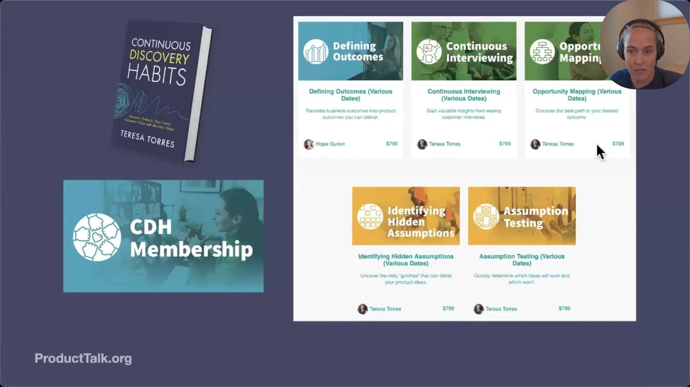
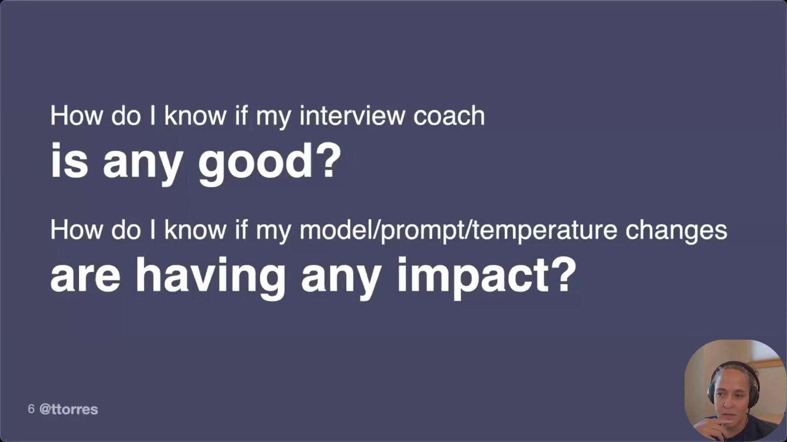
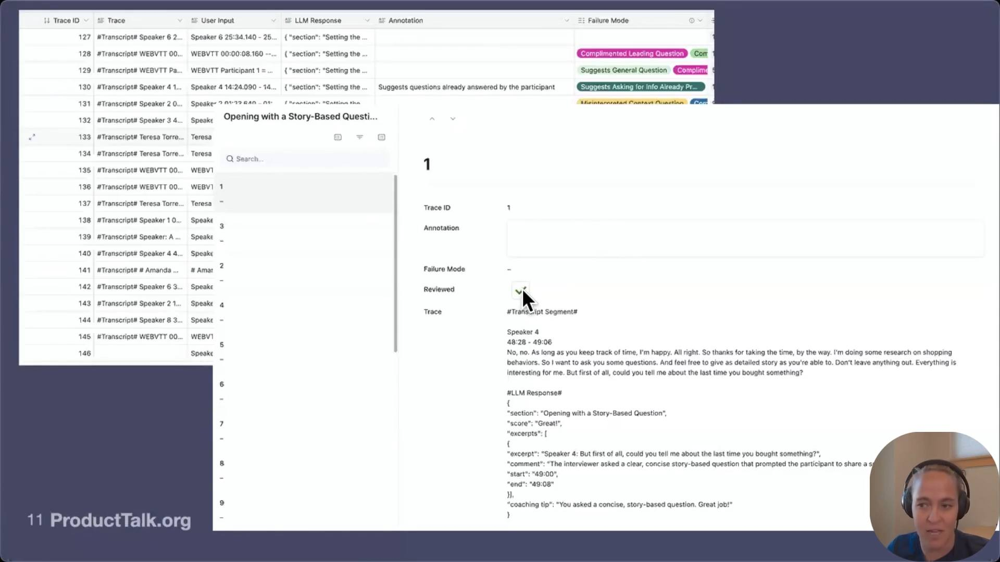
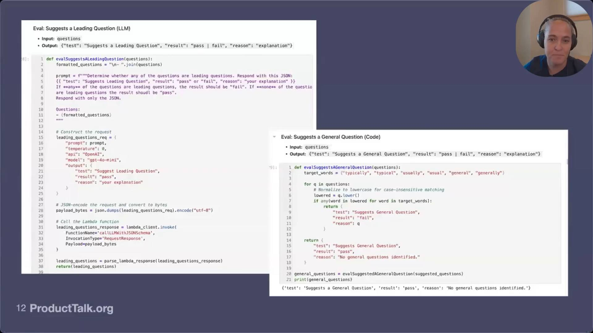
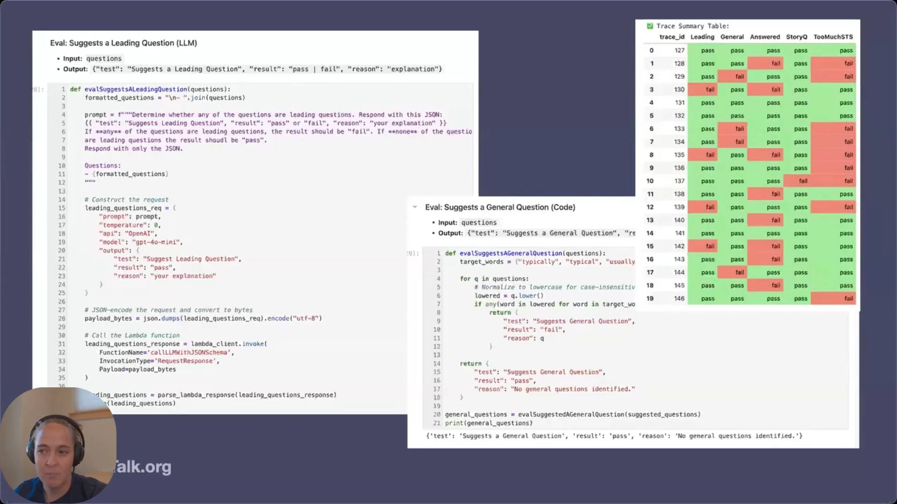
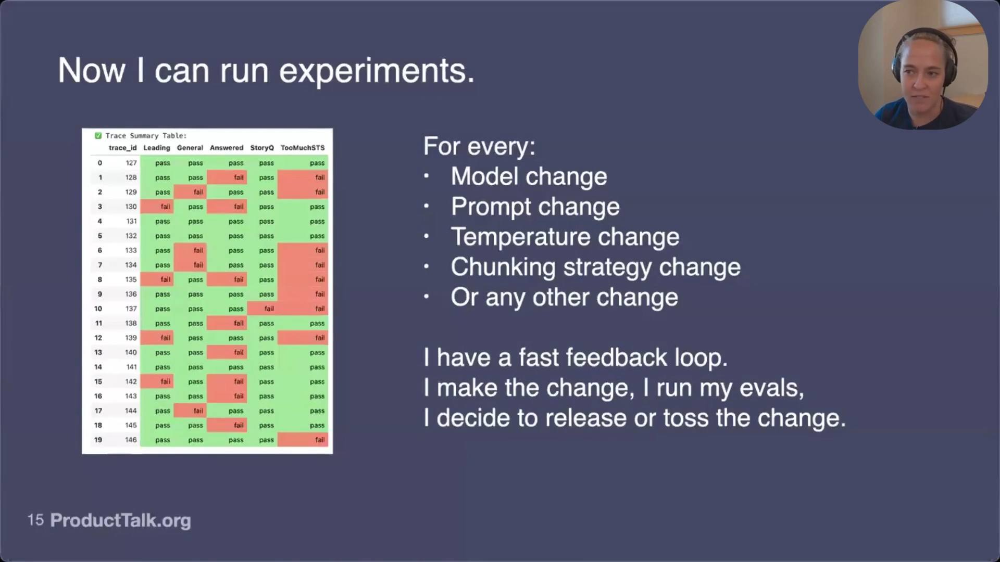
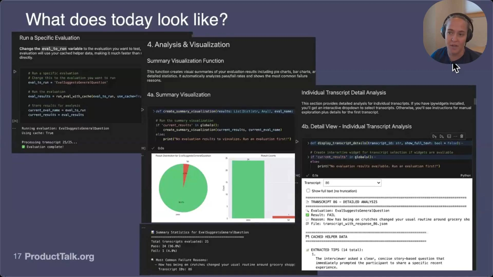
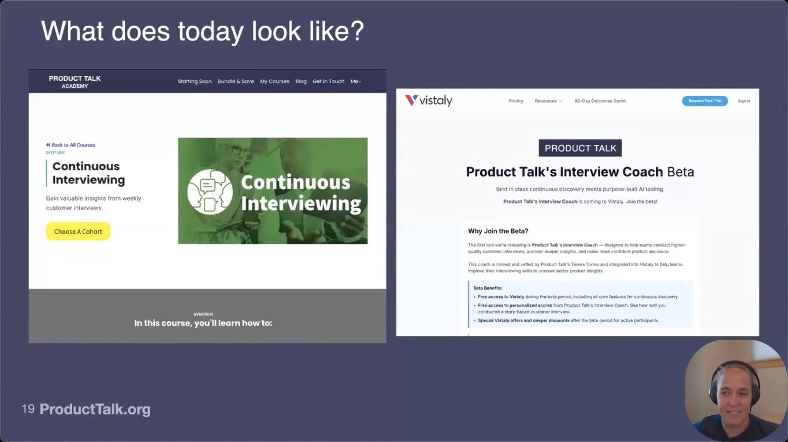
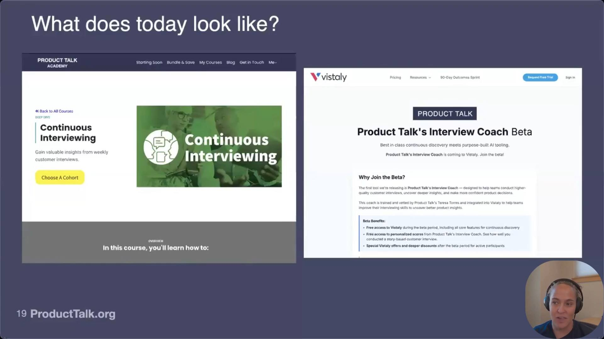
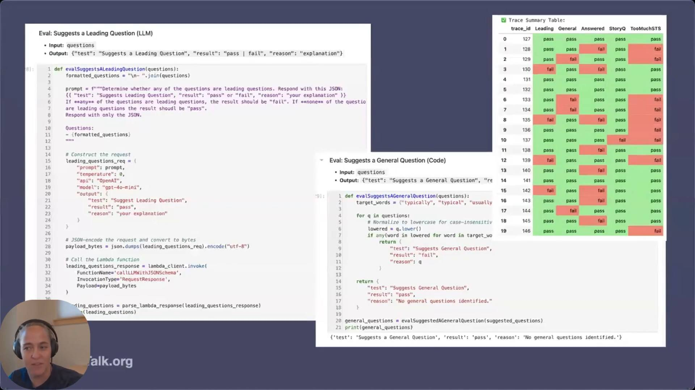

# AI Evals for Engineers & PMs（P032）：Teresa Torres 的 interview coach 评测工作流

> 本节是访谈式分享，不是编码教学。屏幕上没有 OCR 可提取的代码（本段 OCR 结果为空），所以第 4 节的代码是**按讲师口述逻辑还原的示意实现**，每一段都标注了「课里没有代码，以下为示意」。凡是讲师原话里出现过的字段名、命令、参数，都在文中保留；讲师没说的，标为「课里没讲」。

---

## 1. 这一节做什么

这一节是课程主讲人对 Teresa Torres 的访谈。Teresa 是产品发现（product discovery）领域的教练，著有 *Continuous Discovery Habits*，平时做的是教产品团队「怎么把产品决策做得更好」。她不是每天写代码的工程师——但在这节课开课前后的大约四个月里，她从「几乎不知道 eval 是什么」一路做到把 AI 功能推上 beta 生产环境。

她做的东西叫 **interview coach**（访谈教练）：学生把**客户访谈**（不是求职面试）的逐字稿提交上来，coach 按课堂 rubric 的四个维度给出详细反馈，反馈形如「原文片段 + 建议」的成对结构，每个维度给一个档位分（`keep practicing` / `getting it` / `great`）。

这一节真正要复现的，是她在做这个产品时**建立起来的评测工作流**：

1. 用自己最熟的工具（Airtable）收 traces、做第一版标注；
2. 在 Jupyter notebook 里写第一批 evals（一个 LLM as judge、一个纯代码断言）；
3. 用 helper function 把昂贵的 LLM 调用前置并缓存，让 eval 本身变轻；
4. 跑出「traces × evals」的结果表，逐条深挖失败原因；
5. 算 eval 与人工标注的对齐率，反推 eval 设计和 rubric 本身的问题；
6. 把 evals 变成每次改动都跑的回归测试（AB test runner）；
7. 把 evals 搬进生产仓库，按一定比例在线上做 guardrail；
8. 因为标注太慢，用 Claude Code 自建了半打标注工具。

你要照着这份文档复现出来的，不是「Teresa 的产品」，而是**这套能让你在自己的 AI 功能上从零起步的评测流水线**。她的原话是：

> "如果这门课里你只能带走一件事，那就是：你不必会做这里面任何一件事，因为 LLM 是非常好的向导。但我也 vibe code 过，我要告诉你的是，一定要确保你理解它做了什么。因为每次我给 Claude Code 稍微长一点的绳子，事情就会糟糕地跑偏。"
> —— p032 [33:53]



---

## 2. 讲师原话

### 2.1 起点：她当时连 eval 是什么都不知道

> "我忘了第一期 cohort 是什么时候开始的，大概是六月，也许是五月。那时我几乎不知道 eval 是什么。"
> —— p032 [01:24]

> "我开始问自己一个问题：生成式 AI 到底让什么变得可能？我是在我们课程的情境里问这个问题的。"
> —— p032 [02:22]

她锁定的课程是 **continuous interviewing**（持续访谈）：学生学的是**客户访谈**，不是求职面试。这门课要求学员练习主动倾听、学会提问，并且教的是一种很具体的访谈方式——请受访者讲一段**过去行为的具体故事**，因为这是收集可靠反馈的方式。

> "这是一种收集可靠反馈的方式。……我们所有的课都非常强调实践。比如这门课，学生会来到课堂上互相访谈。我们会给他们一份评分标准（rubric），用来互相给反馈。"
> —— p032 [03:17]

问题就出在这里：学生互相给反馈，但学生不是专家，给不出专家级反馈。

> "我想解决的问题是：我们能不能帮学生在练习访谈中给彼此更好的反馈？这就引出了一个问题：我们能不能把「好反馈」长什么样建模出来？"
> —— p032 [03:45]

### 2.2 产品的评测维度：四个维度 + 三档分数

coach 评的就是课堂 rubric 里的四个维度：

> "我们在评的是：他们有没有问出基于故事的问题？他们有没有请受访者把场景设定出来？还有一个维度是构建时间线。他们让受访者把故事讲出来的效果如何？然后是他们有没有做好把泛化拉回具体的动作。"
> —— p032 [04:40]

分数的三档：

> "你可以看到，每个维度他们都会拿到一个分数。分数可以是「继续练」「上道了」或者「很棒」。"
> —— p032 [05:07]

四个维度各自在考什么，她在回答提问时讲得很清楚：

> "我们在逐字稿里找的是：他们有没有请受访者分享一个故事。我们教他们要让受访者设定场景，因为这有助于记忆提取。这是一个认知技巧，帮他们拿到更可靠的故事。然后构建时间线这个维度，是他们有没有帮受访者一步一步走过自己的故事，从而弄清楚真正发生了什么。最后一个维度是，如果我让你讲讲你上一次看 Netflix 是什么时候，你可能会开始泛泛而谈你平时看 Netflix 都干什么。那么我作为访谈者的工作，就是把你拉回到你这段故事的具体细节上。这就是我们评的第四个维度。"
> —— p032 [05:33]



coach 的技术形态也在演进：

> "我的第一个原型是在一个 Claude 项目里。我就是往 Claude 里传了一堆文件，然后说：这是一份访谈逐字稿，给我反馈。它显然从那里开始迭代、演化了很多。"
> —— p032 [06:58]

> "它一开始是一条 prompt，现在根据内容、上下文和我们发现的错误，它大概是 5 到 9 次 LLM 调用。所以它是一个相当复杂的工作流。"
> —— p032 [07:27]

她也讲了自己想要的下一步（**还没做**）：

> "我很想做的，是把一个学生的学习历史接进来，然后根据这个学生处在他学习旅程的哪个位置来调整反馈，并把 coach 往更 agent 的形态推——让它根据学生的历史自己选择要评哪些维度。但我还没走到那一步。"
> —— p032 [07:27]

### 2.3 从「肉眼 vibe check」到系统化评测

> "我在搭 interview coach 的时候，真的就是靠肉眼去 vibe check coach 的回复。有些看起来不错，有些有问题，然后我就开始担心：我怎么知道我的 interview coach 到底好不好？"
> —— p032 [06:28]

> "我开始做的时候根本不知道 temperature 是什么。所以我一边调，一边看到有些地方变好、有些地方变差。我就想：这太荒唐了。产品发现讲的就是反馈回路，这恰恰是我在教的东西。"
> —— p032 [08:23]

> "我当时想，天哪，我的反馈回路是什么？我需要一种更系统的方式来评它。你们都在 eval 课上，所以你们已经知道答案就是 evals。但我卡住了，你们可能能理解为什么。"
> —— p032 [08:49]

她卡在哪：网上讲 evals 的材料一上来就是「一堆输入数据」，而她没有一堆逐字稿；想合成生成逐字稿，试过之后——

> "它 sucks（太糟了）。所以我继续找，然后我找到了一个 Python 包。它开始讲 evals 的代码，我觉得有意思。然后我看到 Amon Khan 发在 Lenny's newsletter 上的博客，我想：哦，原来 eval 有不同的类型。然后我就被吸进去了。"
> —— p032 [09:19]

> "这门课第一次上课、讲到这个模型的时候，我脑子里灯泡就亮了，因为这就是科学方法。我教的就是科学方法，所以我想：好，我进来了。"
> —— p032 [09:46]



### 2.4 第一步：用最熟的工具收 traces

> "所以我是从在 Airtable 里收集 traces 开始的。为什么用 Airtable？因为这是我熟悉的工具。我本来就有很多东西要学，这一点会成为这场分享的一个主题。"
> —— p032 [10:09]

> "我尽量限制每一步里我必须学的新东西，这样我才不会崩掉。……大家都在追工具，但一开始，留在你舒服的地方，肯定是对的。"
> —— p032 [10:36]

数据量她记得很清楚：

> "我大概有 15 份我自己做的访谈。然后大概有 10 份是我的讲师们做的访谈。然后大概有 10 份是我们的校友让我拿来玩的。所以是很小的数据集。"
> —— p032 [11:03]

标注界面就是 Airtable 的表格视图：

> "我其实把 Airtable 的界面当成我第一个标注工具。如果你不熟悉 Airtable，它基本上就是个数据库。然后它给你这些界面，让你搭出各种视图。你可以看到这里，最下面有一条 trace，有一个标注框，我有我的失败模式，然后我可以把它标成已审阅，这样它就不会再出现在我的标注工具里。简单到不行，对吧？"
> —— p032 [11:31]

> "我回头看的时候，能看到我已经标了一堆 trace。我有一堆失败模式。这些截图是我做这件事的第一轮。……我看到这么多失败模式的时候，我想：天哪，我的 coach 太烂了。好笑的是，我之前只是肉眼 vibe check 的时候还觉得它挺好的。我当时是有点尴尬的。"
> —— p032 [12:01]

### 2.5 第一个周日晚上：两个 eval，一个 judge、一个代码断言

先补一段她的技术底子，因为这直接影响她后面所有技术决策：

> "我本科上过一些计算机科学的课。我读的是认知科学方向的项目，计算机科学是其中很大一块。我最早那几份工作里，我也是前端开发，所以我在还没有任何框架的年代写过 JavaScript。然后我有 15 年、可能更久没写代码。大约三年前，我又开始写代码，为了自动化我大量的业务逻辑。"
> —— p032 [12:27]

> "我并不真的是个工程师。我从没在 IDE 里工作过。我没有 dev 环境和 prod 环境的区分。我不知道怎么做这些真正的事情。所以我选择了 AWS 的 serverless 环境，因为我不想管 EC2 实例。我只想执行代码、把数据从一个应用搬到另一个应用。于是我开始写 Node.js 的 Lambda 函数，然后用 Step Functions 把它们编排起来。"
> —— p032 [13:25]

> "不管什么时候写代码，我总是从伪代码开始。我就是在一个文本文档里开始。我真的就是在 Apple Notes 里写 JSON。不知道你们用没用过 Apple Notes，它会把引号变成智能引号，这会弄坏你的代码。"
> —— p032 [13:52]

> "我丈夫说：你为什么不用 Jupyter notebook？我说：什么？什么是 Jupyter Notebook？所以我真的去问 ChatGPT：我是个彻底的初学者，什么是 Jupyter Notebook？"
> —— p032 [14:22]

Notebook 为什么好用，她说得很具体：

> "对于某一个 eval，我可能对怎么实现它有三种不同想法。我可以在不同的 cell block 里把三种都写出来，跑一遍，然后比较它们的输出。"
> —— p032 [14:52]

现在进入两个 eval。先讲失败模式是怎么来的。coach 有时会建议学生去问一个问题，而这些建议有时候是错的。有两个失败模式：

> "有一个失败模式是，coach 会让你去问一个引导性问题。如果你不熟悉这个概念，引导性问题就是那种暗示了答案的问题。就像你在引导证人。"
> —— p032 [15:48]

> "另一个让我很担心的失败模式是，coach 有时候会建议一个泛化的问题。它可能会说：你应该问『讲讲你典型的一天早上都干什么』。我们不教这个，因为这会导致非常不可靠的回答。我们教的是：讲讲你今天早上做了什么。要具体，不要泛化。"
> —— p032 [16:17]

> "这两个错误案例——coach 建议引导性问题、coach 建议泛化问题——对我这个老师来说是灾难性的。这是学生真的会挣扎的两件事，我绝对不想让 coach 去强化它们。"
> —— p032 [17:15]

第一个 eval 的形态，她讲得很直接：

> "这里发生的是：这是一条 prompt，我在向 LLM 解释什么是引导性问题。然后它会被送进一个问题的列表。它被告知：如果这些问题里任何一个是有引导性的，就让测试 fail。如果没有任何一个是引导性的，就让测试 pass。下面这些代码全都只是在用 Python 调用一个生产环境的 Lambda 函数。所以你可以忽略那一整块。这就是一个 LLM as judge。"
> —— p032 [17:44]

她对这个 judge 做了大量迭代：

> "我在这上面迭代了很多。我试过一次性把所有问题都送进去。我试过一次只送一个问题。我试过送完整的 coach 回复，也试过只送问题。这就是我说的『尝试不同策略』——我怎样才能让这个 eval 和我的真人标注完全对齐。"
> —— p032 [18:09]

第二个 eval 反而不走 LLM：

> "这个泛化问题的 eval，我一开始绞尽脑汁：我怎么教 LLM 什么叫泛化问题？我是不是要给它一个具体故事的完整上下文，再讲人类泛化的倾向？然后我意识到，其实只有一小组关键词，往往就标识了一个泛化问题。这就变成了一个代码断言。我就是在 coach 建议的问题里找红旗词。"
> —— p032 [18:39]

> "随时间推移，我扩展了这个关键词列表。但这个非常初级的 eval 好笑的地方在于，它的对齐率非常高。它从来没有假阳性，而且几乎抓到了我抓到的所有东西。"
> —— p032 [19:05]

主讲人在这里点出了这件事的关键性质：

> "你抓到了这一点，因为做 eval 你想要的是正确的性价比（cost benefit）。而你能有这个直觉——嘿，这个可以做成代码 eval——说实话很多人会漏掉。他们会说，哦我不知道，让 LM 来做吧。你这个把它做成代码 eval 的洞察很好。"
> —— p032 [19:05]

Teresa 接着讲了她为什么能做这个判断：

> "我之所以能识别出这个洞察，是因为我教这个东西教了好多年，我看到学生犯的错。这需要领域专业知识。所以如果我把它交给一个不是我本人的工程师，我不觉得这件事会发生。"
> —— p032 [19:34]

> "不是每个产品经理都会像我这样写代码。但我认为他们需要参与到 eval 的设计里。"
> —— p032 [20:03]

### 2.6 helper function：把昂贵调用前置并缓存

> "这两个 eval 其实并不吃整份逐字稿。我实际上会先做一步逐字稿处理，让我的 eval 更高效。我注意到，我的很多失败模式都和 coach 建议的问题有关。所以我有一个 helper function，它就是纯代码，把 coach 返回的 JSON 响应拿进来，抽出所有 coaching tips。"
> —— p032 [22:18]

> "然后我还有另一个 helper function，我记得是 LLM，把 tips 里所有的问题抽出来。这样我的 eval——尤其是 LLM as judge 那些——就不必吃巨大的输入 token。我只是把上下文约束到那个 eval 真正需要评估的东西上。"
> —— p032 [22:48]

> "这实际上给我省了一大笔钱，也让我的 eval 非常快。因为我在测试和迭代的时候，可以把所有 helper function 对所有逐字稿只跑一次；之后我改 eval 时，输入数据没变，我就不用重跑那些 helper。而那些 helper 才是昂贵的 LLM 调用，我的 eval 反而变得轻量、便宜很多。"
> —— p032 [23:16]

主讲人把这件事命名为业界术语：

> "而且你还让 eval 变得更好了，因为你在把上下文约束到它只需要知道的东西。这是相当高级的动作。人们会把这叫做「context engineering」，那你从一开始就在做 context engineering 了，非常棒。"
> —— p032 [23:46]

Teresa 说她最初只是当「分解」来做：

> "好笑的是，我最初做这件事只是当作分解。我想：哦，这个 eval 和这个 eval 需要同样的东西，我要把它拆成自己的函数。它就只是 notebook 里一个单独的 cell block。然后我意识到，这让我能跑不同的实验。比如：如果我给这个 eval 完整的 coach 输出会怎样？只给它问题会怎样？一次给它一个问题会怎样？这才真正让我能调、能找出哪种策略和我的真人标注最对齐。"
> —— p032 [24:15]

### 2.7 结果表与深挖：四类原因



> "在那个 code block 里，我问 ChatGPT：我有 evals，我有 CSV 文件，我怎么把所有的 evals 跑在所有的 traces 上？它帮我写了一个 code block 来做这件事。那个 block 输出了你现在看到的这个东西。这基本上就是我的 eval 结果。这是我的第一次跑。"
> —— p032 [24:45]

> "所以我有 1、2、3、4、5 个 evals。traces 是行。你一眼就能开始看出我做得怎么样。那两个我最担心的错误案例，它们出现得还挺频繁的，我觉得大概 20% 到 25% 的时候会发生。"
> —— p032 [25:12]

> "然后你能看到中间这个，看起来像是它一直在失败。右边这个看起来像是个巨大的问题。但随着我往里挖，我开始意识到一些很有意思的事。"
> —— p032 [25:12]

第一个发现：**维度在「贪心」**。

> "右边这个 eval 是这样的：我有四个维度，对吧？有时候一个维度是贪心的。它期望访谈里的每一个问题都是关于它这个维度的。所以我的「设定场景」维度的反馈会说：这个设定场景的问题很糟——但它其实是一个很好的「构建时间线」的问题。访谈者没做错任何事。所以这个错误模式是它过度期望「设定场景」。他们问了很好的设定场景问题，然后就转向构建时间线了，而 coach 在批评他们问了构建时间线的问题。"
> —— p032 [25:41]

第二个发现：**是人工标签错了，不是 eval 错了**。

> "我在最后一列发现，这其实是我的人工标签的问题。我的 eval 比我的真人判断更好。原因是：要写出针对这个错误模式的具体 eval，我必须把「我在评什么」想得更清楚。我把它写进了代码，但我没有把它写进我的人工标注 rubric。所以这是一个代码比我还好的案例。于是我不得不改变我做人工标注的方式。"
> —— p032 [27:04]

第三个发现：**helper function 有 bug**。

> "另一个冒出来的事情是，中间这个之所以失败这么多，是因为我的某个 helper function 里有 bug。所以看到数据真的能暴露出「你在做的事可能没有按你预期的方式工作」，这也很意思。"
> —— p032 [28:26]

第四个发现：**这四天的产出本身**。

> "到这一步为止，这是那个周日到周四。我在四天里做完了所有这些，同时还在上课。我对自己能走这么远真的很惊讶。这很大程度上是因为我非常重度地把 ChatGPT 当成思考伙伴。"
> —— p032 [28:55]

她把这些收益列了一遍：

> "这两个错误案例是我最担心的，它真的帮我给问题定了规模——这个问题到底有多大。这很让人安心，因为我知道，当我能测量一件事，我就能改进它。它帮我找到了 bug，这个我刚讲过。它还帮我更清晰地理解了我的 rubric。"
> —— p032 [29:54]

> "现在我有了一种非常有结构的方式来问：我的改动到底有没有效果？而且真的是每一次模型改动、prompt 改动、temperature 改动、chunking 策略改动——现在还包括工作流改动——我都有了一个快速反馈回路。"
> —— p032 [30:22]

> "我基本上就是：做出改动，在我的 dev set 上跑我的 evals；这个 dev set 是基于生产数据建的。然后我看这张表。它从来不是完全变好或者完全变坏。总是这些 eval 好了一点，那个 eval 差了一点。我必须做一个判断：这对产品是不是更好，我要不要发。"
> —— p032 [30:22]

> "我真的怎么强调都不为过：作为一个教快速反馈回路的人，这感觉太神奇了。我想，哦，我真的能测量一个非确定性的产品。这很酷。"
> —— p032 [30:49]

### 2.8 今天的样子：VS Code + Claude Code + 从 notebook 毕业

> "今天我是在 VS Code 里工作。我换到 VS Code 的原因是我是一个重度 Claude Code 用户。我很珍惜我和 Claude Code 一起用 Opus 的时间，因为它什么都替我设计。"
> —— p032 [30:49]

> "我要澄清一下，因为现场有非工程师：我不是在拿 Claude Code 瞎 vibe coding。我不是让 Claude Code 直接产出一大堆我看都不看的代码。那会吓死我。我还有一个信条：如果我要执行这段代码，我最好理解它。所以我是和 Claude Code 结对编程。"
> —— p032 [31:17]

> "当然，Claude Code 可能写了我大部分代码，但对我来说，理解其中每一行很重要。我马上会讲为什么。"
> —— p032 [31:43]

目录结构：

> "你能看到这里，我不知道看不看得清，我项目里有整个 evals 目录。我会跑实验，所以我有不同的目录对应我在跑的不同实验。我让 Claude Code 写了我的 AB test runner，它基本上就是把所有 traces 跑一遍，对比生产里的版本和我的改动。我有跨维度的 evals，也有单维度的 evals。所以它正在长成一个很难缠的怪兽，但我爱它。"
> —— p032 [32:09]

> "右边你看到的是我的 notebook。这是我当前工作用的 notebook。这张截图里，这个 notebook 是个小工具，我可以选一条逐字稿，它给我看 helper function 抽出了什么，然后每个 eval 返回了什么。所以这就是我的魔法诊断工具——「这条 trace 到底哪里出问题了」。"
> —— p032 [32:37]



关于 notebook 里的自建小组件：

> "还有一件很棒的事是，你不光用 notebook 做数据分析，你还在 notebook 里做出了你自己的小组件和小型用户界面，这是相当高级的做法。很多人不知道你可以这么干。"
> —— p032 [33:07]

> "我不知道我可以这么干。是 Claude Code 替我做的。我很擅长——我真的很擅长描述我想要什么。比如：我在一条 trace 里看到了这个错误，但你没告诉我 trace 编号，我怎么去查？它就会说，哦，让我加上 trace 编号。我说，好，我有 trace 编号了，但我不想去 Airtable 里查它。而且我有一个带 helper function 的缓存，你让我能看缓存，但把它们全都放到一个地方。所以我就直接对 Claude Code 提要求，我们一起做。"
> —— p032 [33:31]

她给了一个很硬的警告：

> "如果这场分享里你只能带走一件事，那就是：你不必会做这里面任何一件事，因为 LLM 是非常好的向导。但我也 vibe code 过，我要告诉你的是，一定要确保你理解它做了什么。因为每次我给 Claude Code 稍微长一点的绳子，事情就会糟糕地跑偏。所以我是和 Claude Code 结对编程，不是让它替我生成一堆代码。"
> —— p032 [33:53]

主讲人补了一句对比：

> "这很好。因为我觉得很多人试的时候吃太多了——他们想直接把 LLM 堆上去、eval 所有东西，却不看数据。你有一种感觉：好，让我和 AI 一起把问题理解深，而不是让它看我的 traces、替我做 evals。很多人就是这么试的，而且不奏效。"
> —— p032 [34:22]

Teresa 说自己为什么坚持自己搭：

> "这门课有些东西在我 core 层面产生了共鸣，我就是想把它学得非常好。这也是为什么我不想用一个现成的 eval 工具——我想，如果我自己搭，我就能把它里里外外都搞懂。即使到现在，我在看第二期 cohort 的 eval 视频，我还是觉得它看起来比我这套更复杂，而我这套是能跑的，所以我要继续用它。"
> —— p032 [34:49]



**架构上最重要的一次重构**：

> "今天不同的另一点是，我的 notebook 毕业了。以前在我第一个 notebook 里，所有 eval 代码和数据分析工具都在一个 notebook 里。现在我的 evals 是我正常仓库的一部分，因为我把其中一些作为 guardrail 在生产里跑。我在一定比例的 traces 上跑它们。所以现在我的 notebook 只是一个数据分析工具，它可以执行我的 evals，但执行的是我的生产代码。它们不再混在一起了。"
> —— p032 [35:17]

> "在 notebook 里，我有一些工具：第一件事是让我跑所有 helper function 并缓存结果。那些是昂贵的调用。我可以对 dev set 只跑一次。因为 dev set 不常变，唯一需要重跑的时候是我改了某个 helper function。这帮了大忙。然后我可以重跑指定的 eval，我可以直接从 notebook 重跑所有 evals。我在 notebook 里做分析和可视化。"
> —— p032 [35:46]

她展示了一次前一天的运行结果：

> "这是我昨天跑的一次。这是我目前在「建议一个泛化问题」这个错误上的表现。你可以看到，这个错误几乎不存在了。实际上当它出现的时候，是因为有一些歧义——比如受访者一开始问了一个具体问题，然后又退回到一个泛化问题。但真的，能拿到这些数据和可视化，让我能迭代地把 interview coach 里的错误大幅降下来。"
> —— p032 [36:16]

> "notebook 里还有诊断工具。好，这条失败的 trace 到底怎么了？我能去看它为什么失败吗？是某个 helper function 的问题？是 eval 本身的问题？还是这条 trace 本身就是真失败？这些我都能在 notebook 里做。"
> —— p032 [36:45]

> "notebook 里还有一件事我没截图，一部分原因是其中一块现在坏了、我需要修：它可以把我的人工标注拉进来，然后和我的 evals 对比，然后给任何 LLM as judge 打分。我刚改了标注输出格式，所以 notebook 那部分现在是坏的。我需要修它，但把这一切放在一个地方真的很好。"
> —— p032 [37:12]

她强调 notebook 的组织方式不是审美问题：

> "这些 notebook 组织得非常好。它们有分节，有文档。这不只是好看。这在用 AI 的时候真的有帮助。"
> —— p032 [37:41]

> "我要说，这个 notebook 是 Claude Code 替我建的。正因为是它建的、而我又得自己一点点理解它，我会经常更新 Markdown，因为我不信任「不是我写的」这件事——我怕我记不住。所以很多文档其实是写给我自己的。因为我回到 notebook 时会想：我要跑哪些 cell 才能跑一个 eval？缓存是怎么回事？"
> —— p032 [38:07]

> "我最大的收获之一是——我用 Claude Code 大概三周、也许四周了——我最喜欢做的一件事是说：好，我们建一个 README 文件。好，你从这段对话里学到了什么？我们把它记下来。因为所有写代码的人都知道，最难的事情之一就是把所有上下文都装在脑子里，以及重新回到状态。所以我在用 LLM 帮我解决这个问题。"
> —— p032 [38:36]

主讲人点出 notebook 的独特价值
> "这真的很有力量，而且很独特。notebook 有一个独特的方面：你可以有这种「上下文内学习」，让散文和代码交错在一起。我发现这真的能帮到语言模型，尤其是因为你在用你自己的理解去更新它——你不是放任它，你是在非常小心地打理它。"
> —— p032 [38:36]

### 2.9 自建标注工具：让标注快到不构成借口



> "还有一件事也变了：我现在让 Claude Code 给我搭了一个自定义的标注工具。你能看到这里，它遵循了这门课里你学到的所有东西。顶部有进度条。这是我要标的 trace，颜色和视觉做得很好，帮我理解我在哪一节。我有一个标注框，我有失败模式，我有 next 和 back。所有东西都绑了键，所以我可以用键盘快速操作。"
> —— p032 [39:06]

> "我实际上有大约半打（六个左右）自定义标注工具。因为有时候我标注的是整条 trace，有时候我标注的是单个问题——那我就把一大堆问题加载进工具里。每当我做一个 eval、标注需求变了，我就直接让 Claude Code 干：我喜欢这个标注工具的界面，但现在我有了新的输入或新的输出格式，再给我搭一个工具。它两分钟就做出来，太快了。所以这些都是 vibe code 的，我甚至没法告诉你它是怎么实现的。我只测输入和输出，确认它能用。"
> —— p032 [40:05]

这段她说得很坦白，值得原文记住：

> "这些是 vibe 出来的，我甚至没法告诉你它是怎么实现的。我只测输入和输出，确认它能用。"
> —— p032 [40:32]

### 2.10 从教学工具到 beta 生产产品

> "然后这里有一件让我很兴奋的事：我开始这个项目是为了做一个教学工具，我在我的课上用它。我的 cohort 是 20 到 50 个学生，量不大。如果哪里出错了，我会收到一封邮件，然后重跑一遍就行。但在这个项目的过程中，我开始和一家叫 Vistaly 的公司聊。Vistaly 是一个做产品发现的软件产品，他们有一整套客户访谈的流程，帮你综合你的客户访谈、做机会解决方案树。实际上，我们正在把 interview coach 作为 Vistaly 内的 beta 功能推出。"
> —— p032 [41:01]

> "而这件事让我觉得疯狂的地方是：两周前，我从没在 IDE 里工作过。两周前，我从来没有 dev 环境和 prod 环境。突然之间，我得写生产质量的代码。所以过去两周我一直在不停地干，学习怎么当一个真正的软件工程师。我一直在和 Opus 和 O3 一起搞：来，带我走一遍错误处理，给我往死里打，哪里会失败？现在我相当有信心，我有一个还不错的生产产品。这周我们要向 beta 客户推出，看看怎么样，但我祈祷我真有一个做得相当不错的真实 AI 应用。"
> —— p032 [41:56]

> "作为一个产品人、设计师、半吊子工程师，能发布一个真正由我亲手做了每一个环节的产品，感觉真的很好。这非常有赋能感。而且，没有 LLM 我做不到。"
> —— p032 [42:25]

主讲人对这个产品的评价：

> "这可能是我见过的、生产环境里最好的 eval 产品。现在如果有人问我：给我一个真正好的 eval 产品的例子，就是它。"
> —— p032 [42:25]

### 2.11 81% → 3%：一次跨 LLM 调用的错误模式



> "有一个故事，我每次想起来都忍不住笑。我现在这么开心，是因为我已经到这一步了。几周前我在七月跑了两期 continuous interviewing 的 cohort，这意味着我拿到的 traces 比以前多得多。第一周之后，我开始看到一个从没见过的错误。这个错误是摘录会在不同维度之间重复。比如在开场故事问题和设定场景里，coach 会说：这是一个很好的设定场景问题。然后在构建时间线里，出现了一模一样的摘录，然后说：这是一个很糟的构建时间线问题。这对学生来说非常困惑。"
> —— p032 [42:54]

> "而且这是我第一次看到一种跨越 LLM 调用的错误模式。一开始我想：哦，我怎么修它？我第一个想法是，我需要一个 question classifier（问题分类器），然后我只把每个维度相关的问题发给它。"
> —— p032 [43:22]

> "我花了一天半做这个 question classifier，它糟透了——太模糊、太难，我没有很多问题样本，就是越搞越难缠。我停下来休息，我在吃饭的时候和我丈夫聊这件事，我说：哦，如果我只是把已经用过的摘录列表发给每个后续调用，告诉它不要再用这些，会怎么样？"
> —— p032 [43:50]

> "我从一个在 81% 的逐字稿里都会出现的错误模式，变成只有 3% 的逐字稿里出现的错误模式。"
> —— p032 [44:18]

> "特别好玩的是，我一开始甚至不知道怎么检测这个错误，因为那些摘录并不是完全相同的。所以我首先得搞清楚：我怎么写出一个能检测出这个错误的 eval？然后我得搞清楚：好，这不是 prompt 改动，这其实是工作流改动。那我要怎么对一个工作流改动做 A/B 测试？然后它全都跑通了。我三天之内就做完了。"
> —— p032 [44:18]

> "那一刻我想：好，我觉得我现在是个 AI 工程师了。"
> —— p032 [44:47]

主讲人在这里强调了「先测量再改」这件事有多罕见：

> "我真的很喜欢你总是在改进之前先测量。外面很少有人真的愿意下功夫、有主动性去写个自动评估器之类的东西，确保自己先量出 81%，然后才实现修复，然后说变成 3%。"
> —— p032 [45:16]

Teresa 说这套方法论是从她本行迁移过来的：

> "这里面很多东西都是因为我在另一个领域教一模一样的东西。在产品发现里，我们讲从结果开始：你想达成什么？如果你不知道那是什么、也没法测量它，那就别开始乱改。所以有太多类比了。就连 Campbell 反复强调的「看你的数据」，我这一行的对应物就是「去和你的客户聊」。所以有太多相似之处，我觉得我有一个很强的心理模型，可以把这些东西一层层叠上去。"
> —— p032 [45:16]

### 2.12 产品经理和工程师怎么分工：她还没有答案

> "我希望能有个好答案。我一直在很努力地想这件事。我天生是个老师。所以我开始想：好，产品团队显然必须做很多这类工作。如果他们想让这件事做好，那该是什么样？谁做什么？我有一些半熟的想法，因为我确实想了很多，但我还没有清晰的图景。"
> —— p032 [46:37]

> "我的半熟想法之一是：我把 eval 代码和数据分析分开了。部分原因是为了复用代码，但其中一个好处是：现在有人可以进来做数据分析，而不必看代码。这对我来说很重要，因为我想做 20 个这样的教学工具。我有 7 门不同的课，而这只是其中一门。我对教学工具有太多想法了，但我不可能亲自对很多工具做这种迭代工作。"
> —— p032 [47:06]

> "所以我想让我的讲师们参与进来帮忙。也许我是工程师，但讲师做分析和演化。我不知道。我有个想法是，也许 notebook 能帮上忙，因为我觉得 notebook 很好：你可以把一部分代码「糊掉」（obfuscate），但仍然让人在 notebook 里执行它、拿到可视化。"
> —— p032 [47:36]

> "我觉得有一个新技能，我们所有人都得学，就是：好，我想做一个 interview coach，第一天我完全不知道怎么弄，但我先迈出第一步、试了点什么。然后我卡住了，我学会怎么用 LLM 解脱卡点。然后我在过去四个月里，把这个模式重复了大概 4000 次。"
> —— p032 [48:04]

> "我认为这就是一种能力：你怎么找出你需要学的最小的那一块？然后你怎么和 LLM 一起把那块学会？然后从那里迭代。"
> —— p032 [48:04]

主讲人接着点出「能动性」这件事：

> "有一点特别打动我：你的能动性（agency）非常高，你主动向 LLM 求助的量也很惊人。我觉得很多人就是在这里失败的。你觉得这个能教吗？"
> —— p032 [49:28]

> "我不知道。我其实一直在想这个问题。就在昨天我开始认真想，因为昨天我收到的很多问题都是：那你到底跟 ChatGPT 说了什么？我说，好，忘掉你所有关于 prompt engineering 的知识，那不重要。我真的就是这么对 ChatGPT 说的，我不是开玩笑，这就是我的起点：我想学怎么用 Jupyter notebook，我是彻底的初学者，我该怎么做？"
> —— p032 [49:28]

> "哦对了，我用的是 Mac。所以我开始的时候，Mac 上连开发环境都没配。我就是彻底的初学者。但关键是，你可以向 LLM 问所有蠢问题，因为它不在乎。"
> —— p032 [49:57]

她讲了一段大学经历，这段解释了为什么她觉得 LLM 改变了游戏规则：

> "我记得我在大学上计算机课的时候，卡住了就很挫败。我得去找助教，或者去找另一个聪明到爆的斯坦福同学。我会因为要问这种蠢问题而觉得尴尬，所以我从来没问。我就交了一份跑不起来的作业。所以我在大学时是个很糟的程序员。我很擅长 CS 理论——这也是我能毕业的原因。但我编程真的很差，因为我不知道怎么解脱卡点。而现在，LLM 你可以问一个真的很蠢的问题，它不在乎。"
> —— p032 [49:57]

> "我觉得当你处在一个对话流里——比如在 Claude 的网页应用或者 chatgpt.com 里——prompt engineering 根本不重要，因为你可以来回迭代。你可以就抛一个半熟的问题出去，它回你一堆，你说，不，你说的我一个字都不懂。我真的会复制粘贴一行，然后问：你这里是什么意思？所以这里面有一部分就是耐心，一点点抠下去，并且知道只要时间够，你就能搞明白。"
> —— p032 [50:50]

### 2.13 第十一小时的事故：Step Functions 的错误处理

> "这一周，我们处在发布 interview coach 进 Vistaly 的最后一刻。我在跑我所有的集成测试，其中一个集成测试抓到了我某个 Step Function 里一个没被捕获的错误。而且它并没有真的捕获错误，是测试失败了，同时有一个未捕获的错误。我想：哇，我一直在死磕我的错误处理，怎么还有未捕获的错误？"
> —— p032 [50:50]

> "原因是我不知道——接下来这段会非常技术，就一小会儿——我不知道 Step Function 里的 JSON path 错误是不可捕获的，也不可重试的。它们就是直接把 Step Function 弄失败。我写的子 Step Function 是把错误放在 payload 里返回的。你不能这么做。它必须抛出异常，父 Step Function 才能捕获它。我在第十一小时才意识到，我 Step Function 和 Step Function 调用之间的所有错误处理都是错的。"
> —— p032 [51:48]

> "上面这些你要是没听懂，你只需要知道：这是一件非常尴尬的、最后一刻才发现的事，它让我意识到我这个「很可靠的应用」并不那么可靠。这是上周二的事。我慌了。然后我想：好，你知道该怎么做。去和 Claude 和 ChatGPT 聊。"
> —— p032 [52:15]

> "我把 Opus 和 O3 都摆上来，说：这是我的测试模式。现有模式有哪些？最佳实践是什么？我怎么修？我们讨论了 Step Functions 之间三到四种不同的错误处理模式。我说：告诉我每一种的利弊。然后我们选了一个。然后我说：好，现在看我的代码库，我们要改多少处？我们怎么做项目计划？"
> —— p032 [52:15]

> "而且我是在 planning mode 里做这件事的。我不想在我们还在争论怎么做的时候让 Claude 碰我的代码。然后我们写了一份非常详细、我看过的项目计划。然后我们就一步一步实现它。在周三到周五之间，我重新架构了 interview coach 里所有的错误处理，并在周一早上发布了。"
> —— p032 [53:10]

> "然后 ChatGPT5 出来了，我就真的开始问 ChatGPT5：来，往死里打我的错误处理。它说：哇，你的错误处理真的非常健壮。我说：是的。"
> —— p032 [53:10]

（技术注释：上面这段是 AWS Step Functions 的语义——子工作流必须抛出异常，父工作流才能用 Catch 捕获；以 payload 形式返回的错误不会被捕获。**知道即可**，用不到就别深究。在 Node.js 里的对应物是：`await` 一个函数时，只有 `throw` 出来的错误才会被 `try/catch` 接住；如果你写成 `return { error: ... }`，那它只是一个普通返回值，不会被 catch——你必须在调用方自己检查。这就是她踩的那个坑的一般形态。）

### 2.14 为什么必须和 Vistaly 合作：敏感数据



> "我没有分享的故事的另一部分是：当我在我的课程里发布这个工具时，我以为学生会提交他们的练习访谈。他们确实提交了，但他们也开始提交真实客户访谈。这很可怕，因为我就把这些东西放进了 Airtable。我肯定不是 SOC2 合规的。而人们在把敏感的客户数据发给我。我想：哦，我不知道该怎么处理这个。"
> —— p032 [53:56]

> "于是我开始研究，然后我想：对，这事不能这么干。所以我们和 Vistaly 合作得到的是：这是一个产品团队已经用来存放客户访谈的工具。他们是 SOC2 合规的，他们遵守所有数据管理法规。"
> —— p032 [54:07]

> "所以很遗憾，现在只有两种方式可以试它：一是通过我们的 continuous interviewing 课程，二是通过 Vistaly。"
> —— p032 [54:36]

> "我在开始思考，能不能做一个 coach 的轻量版本、免费开放。实际上它就是基于那两个 eval：我至少能不能免费给人反馈——你有没有问引导性问题、有没有问泛化问题。所以我会再加一些公开可用的东西，大概在接下来几周里，至少让人能玩。"
> —— p032 [55:05]

> "我写博客在 producttalk.org。我在 LinkedIn 和 X 上。最近 LinkedIn 是我的主要社交网络，但我每天都会看 X。这大概是最好的两个地方。然后我会在 Discord 里。"
> —— p032 [55:34]

### 2.15 问答一：客户反馈回路与合成数据的维度

> "Robert，我们其实在 Twitter 上讨论过这个，我忘了我本来要讲这个。我特别兴奋的一件事是：这一切里的客户反馈回路是什么？因为这是我的拿手好戏。"
> —— p032 [55:59]

> "有这么几个地方是我在课里学到、很想做实验的。一个是，你们学了通过定义维度来生成合成数据。我其实认为那些维度应该来自客户需求和客户痛点。"
> —— p032 [55:59]

> "比如那个食谱机器人（recipe bot），如果你和人们聊过他们怎么规划自己的餐食、你知道他们的用例是什么，那你会得到好得多的输入，用来决定维度应该是什么、以及你事先会有哪些类型的变体。所以这是一个很清晰的领域，我能看到传统发现工作和「怎么生成有代表性的合成数据」这个很早期的阶段之间的连接。"
> —— p032 [56:27]

> "另一个领域是：几乎每个 AI 产品都有大拇指/踩一下、有没有帮助。我在 interview coach 里确实做了这个。在 Vistaly 里，我还在想在我们课程里怎么做，因为它是通过邮件发出去的。"
> —— p032 [56:27]

> "我很想做实验的是 UX 模式：我们怎么能让客户传达更细粒度的错误反馈？如果他们对我整条回复给反馈——「有没有帮助」——那很好，它告诉我该去查那条 trace。如果他们给一句原话说明为什么，那更有帮助。但我很想到达这一步：不，是这一段摘录、是这一段摘录上的建议错了。"
> —— p032 [57:19]

> "最终，我们的产品只有在客户那里有用才算有用。作为产品经理，你可以做客户的代理，但我一直在找：怎么让客户更靠近问题。我还没有答案。我一直在埋头搞构建、准备 Vistaly 的 beta，我最近就只是个工程师。但我会把我的产品管理、产品发现帽子戴回去，开始跑那些实验。"
> —— p032 [57:46]

### 2.16 问答二：不会编程能不能做这些

> "几十年来，产品管理界一直在争论：产品经理该不该学写代码？"
> —— p032 [58:09]

> "我很高兴我在大学学了编程。我小时候也在 Apple IIe 上用 BASIC 写过代码，但我真正学编程是在大学。因为学编程给我的一项技能是：解决问题的、debug 的、把大问题拆成小块的技能。然后还有对细节的注意力，我觉得你在别的任何地方都得不到这个。"
> —— p032 [58:39]

> "所以我认为有些从编程里学到的技能可以迁移到其他领域。而且我认为编程是学这些技能最好的方式之一。所以有一部分的我倾向于：每个人——即使 vibe coding 成了现实——编程也许应该像读写能力一样，成为一种基本素养。我就是觉得它教的问题解决能力太好了。"
> —— p032 [59:07]

> "如果没有那个背景，我还能做到这些吗？好，我本科读的是 symbolic systems（符号系统）。了解斯坦福的人知道，它是一个跨学科、多学科的项目，聚焦人类和机器怎么处理信息。这也正是现在世界围绕 AI 在发生的事情。"
> —— p032 [59:35]

> "我得上计算机科学的课、语言学的分析侧（就是语言的底层结构）、分析哲学（比如心智-大脑哲学），还有认知心理学。所以它真的是：我们怎么从四个不同领域去理解信息处理？我从那个项目里真正带走的是批判性思维和问题解决。"
> —— p032 [60:03]

> "理想情况下每个项目都在教这个，但我认为，当你看到四个不同领域在解决非常相似的问题时，你就会开始看到一种模式——对我来说，我看到一种可以叫做问题解决/批判性思维的模式。我认为那段经历帮我擅长这类事。我觉得我在整个过程里擅长的地方，就是批判性思维那一部分。"
> —— p032 [60:33]

> "不过编程是学批判性思维的唯一方式吗？我确信在听的人里有很多很好的批判性思考者、很好的问题解决者，他们一行代码都没写过。但我认为编程是学它的非常好的方式。"
> —— p032 [61:00]

### 2.17 问答三：要不要教产品经理写代码

> "这对我来说真的是个难题。我在试着判断，什么是只有我能提供的。现在 AI 竞赛太疯狂了。Amon Khan 在他最近一期 Maven 课的 cohort 里做了很酷的事，他有 30 个人——非技术的人——在用 Cursor，这很棒。那是对的路吗？我不知道。我觉得现在是对的路，长期是不是，不知道。"
> —— p032 [61:27]

> "我是用 notebook 工作的，我爱 notebook，但 notebook 相—当—技术。我真的要去教所有讲师怎么在 Mac 上配开发环境吗？而且如果他们用 Windows，我帮不上忙。我这种工作方式在迁移给别人时，有一些真实的挑战。"
> —— p032 [61:55]

> "某种程度上，我希望我还在一个跨职能团队里，因为我有点想和工程师搭档、一起玩这些想法。那这些交接该是什么样？"
> —— p032 [61:55]

> "我要做的一件事——给你们偷偷看一眼——我在录一些播客节目。我九月要推一个新播客，我在访谈跨职能的产品团队，聊他们是怎么搭他们的 AI 产品的。所以它不是那种「我怎么在日常工作流里用 AI」的播客，而是：我今天做了什么、这里有一个 AI 产品的故事、它是怎么成形的。我最想在那些故事里覆盖的是：谁做了什么，我们怎么协作。因为我认为这是一个真正开放的问题。我还不确定该教什么。但我确实想帮忙。作为一个教育者，我会在这个领域做一些事，我只是还在想清那个正确的「一些事」是什么。"
> —— p032 [62:24]

### 2.18 问答四：关键决策点

**决策一：一条巨型 prompt → 拆成四次 LLM 调用。**

> "最大的一个决策点是：我一开始把 interview coach 做成一条 prompt，就是这条怪物 prompt。我看到的问题是，在 coaching 回复里，我最大的失败模式之一是 coach 会针对一个维度给反馈，但用的是另一个维度的判断标准。也就是它把不同维度的规则搞混了。"
> —— p032 [63:21]

> "大概就在那个时候，我学到了工作流（workflow），我想：哦，也许这应该是一串 LLM 调用。所以我把它拆成了四次 LLM 调用。但接着这引入了新问题。比如设定场景这个调用，它就过度强调设定场景了。设定场景不知道构建时间线的存在，而它是在拿「设定场景」这一个维度去评整场访谈。"
> —— p032 [63:50]

> "所以这个改动影响很大：我拆开 LLM 调用之后，整体质量上去了，但它引入了新的错误模式。我想这件事大概很常见：不存在什么魔法改动能让所有东西都变好。一个改动会改进一些东西，也可能引入一些新错误。"
> —— p032 [64:16]

**决策二：评单次 LLM 调用，还是评整条回复？**

> "然后我从四次 LLM 调用往上走，我真的卡住了。我甚至在 Discord 里问过：我是给每个 LLM 调用都做 eval，还是给整个回复做 eval？"
> —— p032 [64:45]

> "我一开始是一个维度一个维度地做，然后就变得非常压垮人，因为我感觉我这辈子都要在做 eval 了。然后我意识到，一个维度一个维度做的时候，我确实找到很多错误，但很多并不是关键错误。"
> —— p032 [65:11]

> "所以后来我想：哦，也许我其实应该对整条 trace 做 eval、对整条 trace 做分析标注。因为这样我仍然能找到维度特定的错误，但我是在把它们互相之间做优先级排序。这其实带来了很大不同。"
> —— p032 [65:11]

> "直到现在，当我做一个针对某维度的 eval 时，我仍然会做单维度标注。但我的错误分析和失败模式优先级排序是在整条 trace 上做的，因为那才是影响我客户的东西。"
> —— p032 [65:38]

> "这是我真正挣扎过的一个模式：正确做法是什么？我花了很多时间标注一些我根本不需要标注的东西。对我来说，结论是：我应该从客户体验开始。客户拿到的是完整的 trace。那我就看整条 trace，这帮我更好地排优先级。那是一个关键决策点。"
> —— p032 [66:06]

**决策三：从 Airtable 界面换到自建标注工具。**

> "从 Airtable 界面换到我自己的标注工具，这也是一个关键决策点。课上我们学了『自己搭标注工具』，我当时想，我用 Airtable 就行了——但真的自己搭一个之后……我会在标注的时候，标到第四条 trace 就想（我今天早上开会前就真的在标注）：我为什么要在失败模式上面加这些小胶囊（pills）？在这个集合里，一旦我用过一个错误模式，它就应该变成一个胶囊，这样我就不用回去、再去想那个该死的失败模式叫什么。"
> —— p032 [66:32]

> "所以我一直在想怎么让标注更快。然后我真的会停下来正在做的事，说：Claude，你能把这个加到标注工具里吗？我是强迫自己这么做的，因为你在课上会学到：标注太重要了。如果它不轻松、不快，你就是不会标够量。"
> —— p032 [67:25]

> "而且我的标注很难，那个 coach 的回复文本量很大，所以我的标注很慢。"
> —— p032 [67:25]

> "做全 trace 标注的时候，我还用了另一种标注方式：做 question classifier 的时候，我其实是让 Claude 帮我标注的。我给它一串问题，用 Claude Code 说：一次只给我看一个，我告诉你失败模式。我们就这样在一百条 traces 上跑了不到 10 分钟。我想：哇，我刚用我的 LLM 当了一个很酷的标注界面。所以我认为，总是要想：眼下这一刻，正确的工具是什么。"
> —— p032 [67:50]

> "然后另一个我学到的大东西是——听起来太显然了——就是休息，走开。因为我肯定有过死磕某个东西的时候，然后我去吃个饭、去散个步，回来之后一个简单得多的方案就冒出来了。这是一般的解决问题技巧，但即使用知道，我也经常忘。"
> —— p032 [68:18]

> "我真的在享受我整个职业生涯里大概最快乐的时光，我现在很上头，我整天写代码。我丈夫开玩笑说，我为了 Claude 和他分手了。所以我真的得管住。我现在在手表上设了定时器，提醒我起来、走开，因为它太好玩了。感觉像 90 年代，像互联网早期，大家都在 geek out 学这些东西，大家互相分享，感觉真的很像，也很好玩。"
> —— p032 [68:18]

### 2.19 收尾

> "对课上的人来说：如果你们在一个跨职能产品团队里、正在搭一个 AI 产品，联系我，因为我肯定在找团队做访谈。而且你不需要是专家。我在播客里部分想展示的，是我们所有人都在摸索。我不做大师那一套了，我现在只想进入「我们做个社区，互相分享」。"
> —— p032 [69:15]

> "我真的很喜欢这门课，也明显从中学到了很多。"
> —— p032 [70:14]

---

## 3. 从零复现

下面这个流程是**按她口述的顺序复现的**。每一步都标了「她用的工具」和「你照着做的等价物」。

### 步骤 0：环境准备（她的第 0 步是「问 LLM 什么是 Jupyter Notebook」）

她当时的原话起点就是：**"我想学怎么用 Jupyter notebook，我是彻底的初学者，我该怎么做？"**（p032 [49:28]）。你不需要先学完 Python 再开始。

```bash
# 建项目目录（她的仓库里有一个 evals/ 目录和若干个实验目录）
mkdir -p interview-coach-evals && cd interview-coach-evals

# Python 环境（版本课里没讲，这里用 3.11，任意 3.10+ 均可用）
python3 -m venv .venv
source .venv/bin/activate          # Windows: .venv\Scripts\activate

pip install -r requirements.txt
pip install jupyterlab              # notebook 是她的主战场
```

`requirements.txt`（**课里没讲具体版本号**，以下是可跑通的最小集合；版本请以 `pip freeze` 实际输出为准）：

```
pandas
jupyterlab
requests
python-dotenv
```

### 步骤 1：先用你最熟的工具收 traces（她用的是 Airtable）

她明确说：不要一上来就去吞那些 eval 工具，**先停在舒服的地方**（p032 [10:36]）。

在 Airtable（或飞书多维表 / Notion 数据库，任选你最熟的）建一张表，字段照她的标注界面来：

| 字段名 | 类型 | 说明 |
|---|---|---|
| `trace_id` | 文本（主键） | 一条访谈 trace 的编号 |
| `transcript` | 长文本 | 完整访谈逐字稿 |
| `coach_response` | 长文本（JSON） | coach 的原始返回 |
| `failure_modes` | 多选 | 失败模式标签 |
| `human_label` | 单选 | 该 trace 是否命中你正在评的那个错误（pass / fail） |
| `reviewed` | 复选框 | 勾上后不再出现在标注视图里 |

她的数据量：**自己做的约 15 份 + 讲师做的约 10 份 + 校友提供的约 10 份**（p032 [11:03]）。你起步用 10–20 条就够。

> 注：上表字段名是**照她口述的界面元素还原的**（trace、标注框、失败模式、已审阅），逐字稿没有逐字念出字段名。

### 步骤 2：导出 CSV，在 notebook 里用 pandas 看

```python
import pandas as pd
traces = pd.read_csv("data/traces.csv")
traces.shape
traces.iloc[0]["transcript"][:2000]
```

### 步骤 3：写第一个 helper —— 纯代码，从 coach 的 JSON 里抽 tips

她：「我有一个 helper function，它就是纯代码，把 coach 返回的 JSON 响应拿进来，抽出所有 coaching tips」（p032 [22:18]）。这一步是她「省钱 + 提速 + 让 eval 变好」的地基。

### 步骤 4：写第二个 helper —— LLM，从 tips 里抽 questions

她：「然后我还有另一个 helper function，我记得是 LLM，把 tips 里所有的问题抽出来」（p032 [22:48]）。

### 步骤 5：缓存 helper 结果

她：「我可以把所有 helper function 对所有逐字稿只跑一次；之后我改 eval 时，输入数据没变，我就不用重跑那些 helper」（p032 [23:16]）。

### 步骤 6：写第一个 eval —— LLM as judge（引导性问题）

她：「这是一条 prompt，我在向 LLM 解释什么是引导性问题。然后它会被送进一个问题的列表。它被告知：如果这些问题里任何一个是有引导性的，就让测试 fail。如果没有任何一个是引导性的，就让测试 pass」（p032 [17:44]）。

### 步骤 7：写第二个 eval —— 纯代码断言（泛化问题）

她：「只有一小组关键词，往往就标识了一个泛化问题。这就变成了一个代码断言。我就是在 coach 建议的问题里找红旗词」（p032 [18:39]）。

### 步骤 8：跑 traces × evals，输出结果表

> "它帮我写了一个 code block 来做这件事。那个 block 输出了你现在看到的这个东西。这基本上就是我的 eval 结果。这是我的第一次跑。"（p032 [24:45]）



### 步骤 9：算对齐率（eval vs 人工标签）

她：「我问 ChatGPT 给我写一个 Python 函数，比较我的人工标签和我的 evals」（p032 [28:55]）。

### 步骤 10：深挖每一条失败，判四类原因

她的四条结论直接拿来当检查项用：

1. 是不是**维度贪心**（评 A 维度却在批评 B 维度的问题）（p032 [25:41]）；
2. 是不是**人工标签错了**（表现为 eval 比人更准）（p032 [27:04]）；
3. 是不是**helper function 有 bug**（p032 [28:26]）；
4. 是不是**真的模型失败**。

### 步骤 11：加「跨调用」的两个 eval（工作流改动必须能测）

- **重复摘录** eval：摘录在不同维度间重复出现（p032 [42:54]）。注意她说「那些摘录并不是完全相同的」（p032 [44:18]），所以要用归一化 + 相似度，不能用 `==`。
- **维度贪心** eval：某维度的反馈在批评不属于它的问题（p032 [25:41]）。

### 步骤 12：notebook 毕业 —— 把 evals 搬进仓库当生产 guardrail

> "现在我的 evals 是我正常仓库的一部分，因为我把其中一些作为 guardrail 在生产里跑。我在一定比例的 traces 上跑它们。所以现在我的 notebook 只是一个数据分析工具，它可以执行我的 evals，但执行的是我的生产代码。"（p032 [35:17]）


### 步骤 13：写 AB test runner

她：「我让 Claude Code 写了我的 AB test runner，它基本上就是把所有 traces 跑一遍，对比生产里的版本和我的改动」（p032 [32:09]）。

### 步骤 14：自建标注工具（半打就够用了）

她：「我实际上有大约半打自定义标注工具」（p032 [40:05]）。必备元素：**进度条、失败模式胶囊、next/back、键盘快捷键、标注框**。

### 步骤 15：上线前的错误处理审查

她：「来，带我走一遍错误处理，给我往死里打。哪里会失败？」（p032 [41:56]）。以及那个 Step Functions 的坑：**子调用必须 throw，不能 return 错误 payload**（p032 [51:48]）。

---

## 4. 完整代码

> **重要声明：课里没有给出任何代码。** 逐字稿里提到她「有一条 prompt」「有一个 helper function」「有一个 code block」，但没有一行被念出来，截图清单里也没有 OCR 文本。下面全部是**按她口述的逻辑还原的示意实现**，目的是让你能真的跑起来；文件是完整的、可直接保存运行的。

### 4.1 目录结构

```
interview-coach-evals/
├── .env
├── requirements.txt
├── llm_client.py            # 极简 LLM 调用封装
├── coach_client.py          # 调生产 coach（课里是一个 Lambda，这里示意为 HTTP）
├── cache.py                 # helper 结果磁盘缓存
├── helpers.py               # helper 1（纯代码抽 tips）+ helper 2（LLM 抽 questions）
├── evals/
│   ├── __init__.py          # EVALS 注册表
│   ├── leading_question.py  # eval 1：LLM as judge
│   ├── general_question.py  # eval 2：关键词代码断言
│   ├── greedy_dimension.py  # eval 3：维度贪心
│   └── duplicate_excerpt.py # eval 4：跨维度重复摘录
├── run_evals.py             # traces × evals 结果表
├── align.py                 # eval vs 人工标签 对齐率
├── ab_runner.py             # 生产 vs 改动 AB 对比
├── data/
│   └── traces.csv
└── annotation/
    └── index.html           # 自建标注工具（单文件）
```

### 4.2 `.env`

```bash
# 课里没讲她具体用哪个模型供应商，以下变量名是示意
OPENAI_API_KEY=sk-xxx
OPENAI_BASE_URL=https://api.openai.com/v1
OPENAI_MODEL=gpt-4o-mini
# coach 的生产端点（课里是一个 Lambda 函数，这里示意为 HTTP 入口）
COACH_ENDPOINT=https://your-coach-endpoint.example.com/coach
```

### 4.3 `llm_client.py`

```python
import os
import time
import requests
from dotenv import load_dotenv

load_dotenv()

BASE_URL = os.environ["OPENAI_BASE_URL"].rstrip("/")
API_KEY = os.environ["OPENAI_API_KEY"]
MODEL = os.environ.get("OPENAI_MODEL", "gpt-4o-mini")


def call_llm(prompt: str, system: str = None, temperature: float = 0.0,
             max_retries: int = 3) -> str:
    """极简 chat completion 封装。她强调过 temperature 是她会调的参数之一。"""
    messages = []
    if system:
        messages.append({"role": "system", "content": system})
    messages.append({"role": "user", "content": prompt})

    payload = {"model": MODEL, "messages": messages, "temperature": temperature}

    last_err = None
    for attempt in range(max_retries):
        try:
            r = requests.post(
                f"{BASE_URL}/chat/completions",
                headers={"Authorization": f"Bearer {API_KEY}",
                         "Content-Type": "application/json"},
                json=payload,
                timeout=180,
            )
            r.raise_for_status()
            return r.json()["choices"][0]["message"]["content"]
        except Exception as e:          # 网络/限流/5xx 一律重试
            last_err = e
            time.sleep(2 ** attempt)
    raise RuntimeError(f"call_llm failed after {max_retries} retries: {last_err}")
```

### 4.4 `coach_client.py`

```python
import os
import requests


def run_coach(transcript: str, endpoint: str = None) -> dict:
    """调用生产 coach，返回完整 JSON（四维度的 excerpt + tip + score）。

    课里这个函数是「用 Python 调用一个生产环境的 Lambda 函数」
    （p032 [17:44]），这里用 HTTP 端点示意，替换成你自己的调用即可。
    """
    endpoint = endpoint or os.environ["COACH_ENDPOINT"]
    r = requests.post(endpoint, json={"transcript": transcript}, timeout=300)
    r.raise_for_status()
    return r.json()


DIMENSIONS = [
    "opening_story_question",   # 有没有问出基于故事的问题
    "setting_the_scene",        # 有没有请受访者设定场景
    "building_the_timeline",    # 有没有一步步还原故事
    "redirecting_generalizations",  # 有没有把泛化拉回具体
]


def iter_items(coach_response: dict):
    """遍历响应里的 (维度, 摘录, 建议, 分数)。

    课里没讲 coach 返回 JSON 的确切结构，这里按她口述的
    「excerpt, tip, excerpt, tip」形态定义，字段名以你实际接口为准。
    """
    for dim in DIMENSIONS:
        block = coach_response.get(dim) or {}
        for item in block.get("items", []):
            yield {
                "dimension": dim,
                "excerpt": item.get("excerpt", ""),
                "tip": item.get("tip", ""),
                "score": block.get("score", ""),
            }
```

### 4.5 `cache.py`

```python
import json
import hashlib
from pathlib import Path

CACHE_DIR = Path(".cache")
CACHE_DIR.mkdir(exist_ok=True)


def _key(namespace: str, payload: str) -> str:
    h = hashlib.sha256(payload.encode("utf-8")).hexdigest()[:16]
    return f"{namespace}_{h}.json"


def get_or_compute(namespace: str, payload: str, fn):
    """她这块的目标：昂贵的 LLM 调用对 dev set 只跑一次，
    只有改了 helper function 才需要重跑（p032 [35:46]）。"""
    path = CACHE_DIR / _key(namespace, payload)
    if path.exists():
        return json.loads(path.read_text(encoding="utf-8"))
    value = fn(payload)
    path.write_text(json.dumps(value, ensure_ascii=False, indent=2), encoding="utf-8")
    return value
```

### 4.6 `helpers.py`

```python
import json
import re
from llm_client import call_llm
from coach_client import iter_items
from cache import get_or_compute


# ---------- helper 1：纯代码，把 coach 的 JSON 抽成 tips ----------
def extract_tips(transcript: str, coach_response: dict):
    """她原话：「它就是纯代码，把 coach 返回的 JSON 响应拿进来，
    抽出所有 coaching tips」（p032 [22:18]）。"""
    tips = []
    for it in iter_items(coach_response):
        if not it["tip"]:
            continue
        tips.append({
            "dimension": it["dimension"],
            "excerpt": it["excerpt"],
            "tip": it["tip
```python
        })
    return tips


# ---------- helper 2：LLM，从 tips 里把所有问题抽出来 ----------
QUESTION_FROM_TIP_PROMPT = """下面是一条访谈教练给学生的建议（tip）。

请你只做一件事：把这条建议里「教练推荐学生去问的那个问题」原样抽出来。
- 如果这条建议里没有推荐任何新问题（例如只是表扬、只是描述现象），返回空字符串。
- 不要改写问题，不要补充，不要解释。

建议：
{tip}

只输出严格 JSON：{{"question": "..."}}
"""


def _extract_question(tip: str) -> str:
    raw = call_llm(QUESTION_FROM_TIP_PROMPT.format(tip=tip), temperature=0.0)
    try:
        return json.loads(raw).get("question", "") or ""
    except json.JSONDecodeError:
        m = re.search(r'"question"\s*:\s*"([^"]*)"', raw)
        return m.group(1) if m else ""


def extract_questions(transcript: str, coach_response: dict):
    """她把这一步交给 LLM：「另一个 helper function，我记得是 LLM，
    把 tips 里所有的问题抽出来」（p032 [22:48]）。"""
    tips = extract_tips(transcript, coach_response)
    questions = []
    for t in tips:
        q = get_or_compute("extract_question", t["tip"], _extract_question)
        if not q:
            continue
        questions.append({
            "dimension": t["dimension"],
            "excerpt": t["excerpt"],
            "tip": t["tip"],
            "question": q,
        })
    return questions


# ---------- 组合 helper：一次算好、缓存下来 ----------
def prepare_trace(transcript: str, coach_response: dict):
    """把两个 helper 的结果一次算好。notebook 里「先跑所有 helper 并缓存」
    跑的就是这个（p032 [35:46]）。"""
    return {
        "tips": extract_tips(transcript, coach_response),
        "questions": extract_questions(transcript, coach_response),
    }
```

> 注意：`QUESTION_FROM_TIP_PROMPT` 用到 `.format()`，所以 JSON 示例里的花括号写成了 `{{` `}}`。这是 Python `str.format` 的语法，和 JS 里的模板字符串不是一回事——在 Node 里你只要 `${}` 就够了。**这是 Python 语法细节，知道即可。**

### 4.7 `evals/__init__.py`

```python
from evals.leading_question import eval_leading_question
from evals.general_question import eval_general_question
from evals.greedy_dimension import eval_greedy_dimension
from evals.duplicate_excerpt import eval_duplicate_excerpt

# 注册表的顺序 = 结果表的列顺序。
# 前两个就是她写下的头两个 eval（p032 [20:32]），她说它们
#「还在生产里跑，仍然很有价值」。
EVALS = [
    ("leading_question", eval_leading_question),
    ("general_question", eval_general_question),
    ("greedy_dimension", eval_greedy_dimension),
    ("duplicate_excerpt", eval_duplicate_excerpt),
]
```

### 4.8 `evals/leading_question.py`（LLM as judge）

```python
import json
from llm_client import call_llm


LEADING_SYSTEM = "你是一个严格的研究方法评审员。你只判断给出的问题是否为引导性问题。"

LEADING_PROMPT = """一个「引导性问题」（leading question）是那种本身已经暗示了答案的问题。
例：「你觉得那个功能是不是特别难用？」——暗示了「难用」。
反例：「上次你用那个功能的时候，具体发生了什么？」——没有暗示任何答案。

下面这些问题全部来自同一场客户访谈的教练建议。请逐个判断。

questions:
{questions}

只要其中任何一个属于引导性问题，就把 pass 置为 false。
如果全部都不是引导性问题，把 pass 置为 true。

只输出严格 JSON：
{{"pass": true|false, "offending": ["..."], "reason": "..."}}
"""


def eval_leading_question(trace, strategy="all_at_once"):
    """LLM as judge（p032 [17:44]）。

    strategy 就是她说的「试过一次性把所有问题都送进去 / 一次只送一个问题 /
    送完整的 coach 回复 vs 只送问题」（p032 [18:09]）。
    这里实现前两种；第三种只需把下面的 questions 换成
    trace["tips"] 里的 tip 文本即可。
    """
    questions = [q["question"] for q in trace["questions"]]

    if strategy == "one_at_a_time":
        for q in questions:
            v = _judge([q])
            if not v.get("pass", True):
                return {
                    "pass": False,
                    "offending": v.get("offending") or [q],
                    "reason": v.get("reason", ""),
                    "strategy": strategy,
                }
        return {"pass": True, "offending": [], "reason": "", "strategy": strategy}

    return {**_judge(questions), "strategy": strategy}


def _judge(questions):
    if not questions:
        return {"pass": True, "offending": [], "reason": "无建议问题"}
    raw = call_llm(
        LEADING_PROMPT.format(questions=json.dumps(questions, ensure_ascii=False)),
        system=LEADING_SYSTEM,
        temperature=0.0,
    )
    try:
        return json.loads(raw)
    except json.JSONDecodeError:
        # judge 输出不是 JSON 时不要炸掉整轮跑批：当成「未判定」记录原因
        return {"pass": True, "offending": [], "reason": f"解析失败: {raw[:120]}"}
```

### 4.9 `evals/general_question.py`（纯代码断言）

```python
import re

# 她原话：只有「一小组关键词」往往就标识一个泛化问题，
# 「随时间推移，我扩展了这个关键词列表」（p032 [18:39] / [19:05]）。
# 下面这个词表是示意：课里没有念出她具体用了哪些词。
RED_FLAG_WORDS = [
    "typically", "usually", "generally", "normally", "in general",
    "most of the time", "always", "never", "every time", "on average",
    "a typical", "your typical", "people tend to", "do you usually",
]

_PATTERNS = [re.compile(rf"\b{re.escape(w)}\b", re.IGNORECASE) for w in RED_FLAG_WORDS]


def eval_general_question(trace, **_):
    """纯代码断言（p032 [18:39]）。

    她说它「从来没有假阳性，而且几乎抓到了我抓到的所有东西」
    （p032 [19:05]）。这段代码就是那句话的直接实现：
    没命中关键词就 pass，命中就 fail 并列出命中的问题。
    """
    offending = []
    for q in trace["questions"]:
        if any(p.search(q["question"]) for p in _PATTERNS):
            offending.append(q["question"])

    return {
        "pass": len(offending) == 0,
        "offending": offending,
        "reason": "命中泛化关键词" if offending else "",
    }
```

### 4.10 `evals/greedy_dimension.py`（维度贪心）

```python
# 四个维度各自关心什么。术语取自她口述的维度定义
# （p032 [04:40] / [05:33]）。这是示意词表。
DIMENSION_TERMS = {
    "opening_story_question": ["story", "last time", "tell me about a time"],
    "setting_the_scene": ["set the scene", "where were you", "when was this", "who was there"],
    "building_the_timeline": ["timeline", "step by step", "what happened next", "then what"],
    "redirecting_generalizations": ["specific", "just that time", "that day", "you mentioned earlier"],
}

NEGATIVE_MARKERS = ["should have", "could have", "next time", "missed", "you did not", "you didn't"]


def eval_greedy_dimension(trace, **_):
    """「有时候一个维度是贪心的。它期望访谈里的每一个问题都是关于它这个维度的」
    （p032 [25:41]）。

    检测逻辑：某维度的反馈在抱怨「这不够贴合我」，而抱怨里引用的是
    另一个维度的用语 —— 那就是贪心，不是访谈者真的做错了。
    """
    offending = []
    for tip in trace["tips"]:
        text = tip["tip"].lower()
        if not any(m in text for m in NEGATIVE_MARKERS):
            continue  # 只看负面反馈

        own = DIMENSION_TERMS.get(tip["dimension"], [])
        if any(t in text for t in own):
            continue  # 它在抱怨自己的维度，不算贪心

        for other_dim, terms in DIMENSION_TERMS.items():
            if other_dim == tip["dimension"]:
                continue
            if any(t in text for t in terms):
                offending.append({
                    "dimension": tip["dimension"],
                    "matched_other_dimension": other_dim,
                    "tip": tip["tip"][:200],
                })
                break

    return {
        "pass": len(offending) == 0,
        "offending": offending,
        "reason": "维度贪心" if offending else "",
    }
```

### 4.11 `evals/duplicate_excerpt.py`（跨维度重复摘录）

```python
import re
from difflib import SequenceMatcher

PUNCT = re.compile(r"[^\w\s]")


def _norm(s: str) -> str:
    """她明确说过那些重复摘录「并不是完全相同的」（p032 [44:18]），
    所以必须先归一化再比相似度，绝不能用 ==。"""
    s = PUNCT.sub(" ", (s or "").lower())
    return re.sub(r"\s+", " ", s).strip()


def _similar(a: str, b: str, threshold: float = 0.85) -> bool:
    a, b = _norm(a), _norm(b)
    if not a or not b:
        return False
    if a == b:
        return True
    return SequenceMatcher(None, a, b).ratio() >= threshold


def eval_duplicate_excerpt(trace, **_):
    """跨维度重复摘录。这是她说的「第一次看到一种跨越 LLM 调用的错误模式」
    （p032 [42:54]），修复前 81%、修复后 3%（p032 [44:18]）。

    注意：这个 eval 是用来「先量出 81%」的，没有它就没法证明
    后面那句「把已用摘录列表传给后续调用」真的有效。
    """
    by_dim = {}
    for tip in trace["tips"]:
        by_dim.setdefault(tip["dimension"], []).append(tip["excerpt"])

    offending = []
    dims = list(by_dim)
    for i, d1 in enumerate(dims):
        for d2 in dims[i + 1:]:
            for e1 in by_dim[d1]:
                for e2 in by_dim[d2]:
                    if _similar(e1, e2):
                        offending.append({"a": d1, "b": d2, "excerpt": e1[:200]})

    return {
        "pass": len(offending) == 0,
        "offending": offending,
        "reason": "摘录跨维度重复" if offending else "",
    }
```

### 4.12 `run_evals.py`（traces × evals 结果表）

```python
import json
import pandas as pd

from coach_client import run_coach
from helpers import prepare_trace
from cache import get_or_compute
from evals import EVALS


def load_traces(csv_path="data/traces.csv"):
    return pd.read_csv(csv_path)


def build_trace(row):
    """每条 trace 只算一次 helper（贵的那部分），结果落盘到 .cache/。"""
    coach_response = get_or_compute(
        "coach_response",
        row["transcript"],
        lambda t: json.dumps(run_coach(t), ensure_ascii=False),
    )
    if isinstance(coach_response, str):
        coach_response = json.loads(coach_response)

    prepared = prepare_trace(row["transcript"], coach_response)
    return {
        "trace_id": row["trace_id"],
        **prepared,
        "coach_response": coach_response,
        "human_label": row.get("human_label"),
    }


def run_all(csv_path="data/traces.csv"):
    df = load_traces(csv_path)
    rows = []

    for _, row in df.iterrows():
        trace = build_trace(row.to_dict())
        result = {"trace_id": trace["trace_id"]}

        for name, fn in EVALS:
            try:
                r = fn(trace)
            except Exception as e:
                r = {"pass": None, "offending": [], "reason": f"ERROR: {e}"}
            result[name] = r["pass"]
            result[f"{name}__detail"] = r

        result["human_label"] = trace["human_label"]
        rows.append(result)

    out = pd.DataFrame(rows)
    # 这就是她第一次跑出来的那张表：traces 是行、evals 是列（p032 [24:45]）
    display_cols = ["trace_id"] + [n for n, _ in EVALS] + ["human_label"]
    print(out[display_cols].to_string(index=False))

    out.to_csv("data/eval_results.csv", index=False)
    return out


if __name__ == "__main__":
    run_all()
```

### 4.13 `align.py`（eval 与人工标签的对齐率）

```python
import pandas as pd
from evals import EVALS


def score_all(results_path="data/eval_results.csv"):
    """「我问 ChatGPT 给我写一个 Python 函数，比较我的人工标签和我的 evals」
    （p032 [28:55]）。

    这一步是她强调的「先测量再改」的基础设施（p032 [45:16]）：
    没有它，就拿不出 81% → 3% 这种说法。
    """
    df = pd.read_csv(results_path)
    df = df.dropna(subset=["human_label"])

    rows = []
    for name, _ in EVALS:
        tp = ((df[name] == False) & (df["human_label"] == "fail")).sum()
        fp = ((df[name] == False) & (df["human_label"] == "pass")).sum()
        fn = ((df[name] == True) & (df["human_label"] == "fail")).sum()
        tn = ((df[name] == True) & (df["human_label"] == "pass")).sum()

        total = tp + fp + fn + tn
        rows.append({
            "eval": name,
            "n": int(total),
            "agreement": round((tp + tn) / total, 3) if total else None,
            "false_positive": int(fp),   # eval 说 fail，人说是 pass
            "false_negative": int(fn),   # eval 说 pass，人说是 fail
        })

    table = pd.DataFrame(rows)
    print(table.to_string(index=False))
    return table


if __name__ == "__main__":
    score_all()
```

### 4.14 `ab_runner.py`（生产 vs 改动的 A/B 对比）

```python
import pandas as pd

from evals import EVALS
from run_evals import build_trace, load_traces


def run_variant(csv_path, coach_call=None):
    """对同一个 dev set 跑全部 evals。
    coach_call 为 None 表示用生产端点；传入一个函数表示用你的改动版。"""
    df = load_traces(csv_path)
    rows = []

    for _, row in df.iterrows():
        trace = build_trace(row.to_dict())
        if coach_call is not None:
            trace["coach_response"] = coach_call(row["transcript"])

        res = {"trace_id": trace["trace_id"]}
        for name, fn in EVALS:
            try:
                res[name] = fn(trace)["pass"]
            except Exception:
                res[name] = None
        rows.append(res)

    return pd.DataFrame(rows)


def ab_compare(csv_path="data/traces.csv", a_call=None, b_call=None):
    """她让 Claude Code 写的 AB test runner：把所有 traces 跑一遍，
    对比生产里的版本和我的改动（p032 [32:09]）。

    她强调结果「从来不是完全变好或者完全变坏。总是这些 eval 好了一点，
    那个 eval 差了一点」（p032 [30:49]）。所以输出是逐 eval 的 pass 率
    和差值，而不是一个总分——总分会把这种取舍掩盖掉。
    """
    a = run_variant(csv_path, a_call)
    b = run_variant(csv_path, b_call)

    rows = []
    for name, _ in EVALS:
        a_pass = a[name].sum() / len(a)
        b_pass = b[name].sum() / len(b)
        rows.append({
            "eval": name,
            "production_pass_rate": round(a_pass, 3),
            "change_pass_rate": round(b_pass, 3),
            "delta": round(b_pass - a_pass, 3),
        })

    table = pd.DataFrame(rows)
    print(table.to_string(index=False))
    return table


if __name__ == "__main__":
    # 真实的用法：b_call 指向你改过的 coach 工作流
    ab_compare()
```

### 4.15 `data/traces.csv`（表头 + 一行示例）

```csv
trace_id,transcript,coach_response,human_label
t001,"访谈者：讲讲你上一次看 Netflix 是什么时候？受访者：我通常会……","{""opening_story_question"":{""score"":""getting it"",""items"":[{""excerpt"":""讲讲你上一次看 Netflix 是什么时候"",""tip"":""很好，这是一个基于故事的问题。""}]},""setting_the_scene"":{""score"":""keep practicing"",""items"":[{""excerpt"":""讲讲你上一次看 Netflix 是什么时候"",""tip"":""下次可以先请对方把场景设定出来。""}]},""building_the_timeline"":{""score"":""keep practicing"",""items"":[]},""redirecting_generalizations"":{""score"":""getting it"",""items"":[]}}",fail
```

> CSV 里嵌 JSON 很折磨人，这是她踩过的同类坑（她在 Apple Notes 里手写 JSON 被智能引号弄坏，p032 [13:52]）。真跑起来建议把 `coach_response` 单独存 `.json` 文件，CSV 只留 `trace_id / transcript 路径 / human_label`。

### 4.16 `export_traces.py`（把 CSV 转成标注工具读的 JSON）

```python
import json
import pandas as pd

df = pd.read_csv("data/traces.csv")

df["coach_response"] = df["coach_response"].apply(
    lambda s: json.loads(s) if isinstance(s, str) and s.strip().startswith("{") else {}
)

df[["trace_id", "transcript", "coach_response"]].to_json(
    "data/traces.json", orient="records", force_ascii=False, indent=2
)
```

### 4.17 `annotation/index.html`（自建标注工具，单文件）

> 她把标注工具的整体设计说得很清楚：「顶部有进度条，这是我要标的 trace，颜色和视觉做得很好……我有一个标注框，我有失败模式，我有 next 和 back，所有东西都绑了键」（p032 [39:06]）。下面这个单文件实现覆盖了那五项，并且做了她后来加的那件事——**用过的失败模式变成胶囊**（p032 [66:32]）。

```html
<!DOCTYPE html>
<html lang="zh">
<head>
<meta charset="utf-8" />
<title>Trace 标注工具</title>
<style>
  :root { --bg:#0f1115; --fg:#e6e6e6; --dim:#8a8f98; --accent:#4f9cf9; --bad:#e5534b; }
  * { box-sizing: border-box; }
  body { margin:0; background:var(--bg); color:var(--fg);
         font:14px/1.6 -apple-system, "Segoe UI", Arial, sans-serif; }
  header { position:sticky; top:0; background:#151821; border-bottom:1px solid #252a35;
           padding:10px 16px; z-index:2; }
  #bar { height:6px; background:#252a35; border-radius:3px; overflow:hidden; margin-top:8px; }
  #bar > i { display:block; height:100%; width:0; background:var(--accent); transition:width .2s; }
  main { display:grid; grid-template-columns:1fr 340px; gap:16px;
         padding:16px; max-width:1280px; margin:0 auto; }
  .card { background:#151821; border:1px solid #252a35; border-radius:8px; padding:14px; }
  .dim { border-left:3px solid #3b4252; padding-left:10px; margin:14px 0; }
  .dim[data-dim="opening_story_question"] { border-color:#4f9cf9; }
  .dim[data-dim="setting_the_scene"] { border-color:#59c98a; }
  .dim[data-dim="building_the_timeline"] { border-color:#c9a959; }
  .dim[data-dim="redirecting_generalizations"] { border-color:#b07ef2; }
  .excerpt { color:#cfd6e4; font-style:italic; white-space:pre-wrap; }
  .tip { color:var(--fg); white-space:pre-wrap; }
  .score { display:inline-block; font-size:12px; padding:1px 8px;
           border:1px solid #3b4252; border-radius:10px; color:var(--dim); }
  #pills { display:flex; flex-wrap:wrap; gap:8px; margin:10px 0; }
  .pill { padding:4px 10px; border-radius:12px; border:1px solid #3