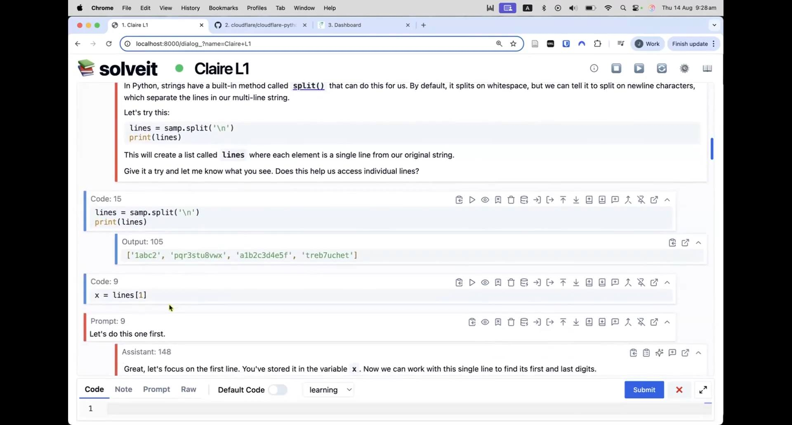
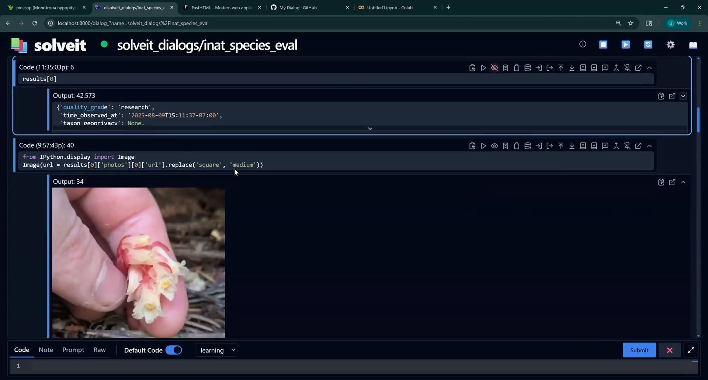
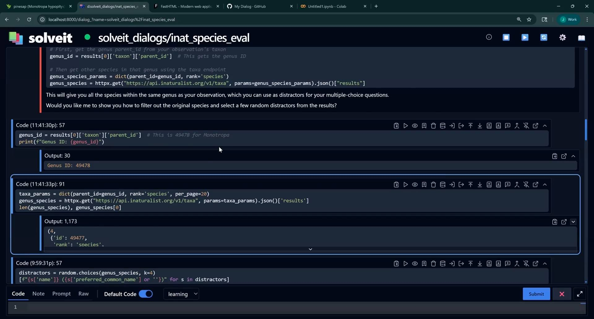

# AI Evals for Engineers & PMs · P033：用 Solveit 方法从零搭一个多模态评测


## 1. 这一节做什么

这一节是一场客座讲座，讲者是 **Jeremy Howard**（fast.ai 创始人，现 Answer.AI 联合创始人）和 **John "Jono" Ovedeker**（Answer.AI），由 Hamel 主持。

它不讲评测指标的数学定义，也不讲某个评测框架的 API。它讲的是**做评测的工作方法**，然后用这个方法现场从零搭出一个真实的多模态评测。

最终产物是一条可以跑起来的流水线：

1. 从 **iNaturalist**（一个全球性的野生动植物观察记录平台）拉取自己账号下的 **research grade**（研究级，即已被其他专家确认过鉴定）的观察记录；
2. 把每条记录转成一道**物种级四选一多选题**，三个干扰项取自**同一个属**的近缘物种，尽量把题出难；
3. 把图片 + 题目喂给前沿的多模态模型，看它们在物种级识别上到底行不行；
4. 同时让讲者本人做一遍，得到**人类基线**，用来判断模型分数是高是低；
5. 全程小批量：一次只对**一条**样本端到端跑通，再封装成函数，再放大到 50 题。

这节课的真正主张可以一句话概括：**不要 vibe coding，要小批量、人是 agent、每 1–2 行代码就看输出、把过程写成可读的 literate notebook。**

对读者（前端转 AI 应用工程师）来说，这一节的价值在于：你会得到一个"如何从零造一个自己领域内的评测集"的可复用流程，而不是又一份跑不通的 demo。第 4 节给出的代码是完整文件，可以保存后直接运行。

---

## 2. 讲师原话

### 2.1 为什么反对 vibe coding

Jeremy 先交代了背景：Answer.AI 在过去一年多里把"agentic AI 推到极限"，结果发现收益有限。

> "这种小批量做事的方式，让人和组织都能更高效地运转。有意思的是，我们在过去一年里大量这么做之后发现，它也让 LLM 变得更聪明、跟我们配合得更好。"
> —— p033 [08:07]

> "vibe coding 在两个方向上都搞错了：它既没让人利用上小批量这件事的优势，也没让 LLM 利用上小批量的优势。"
> —— p033 [08:34]

他把这件事抬到了学科层面：

> "软件工程这门学科，研究的是如何构建能随时间持续改进的非平凡系统。没有任何一种方法论是和 vibe coding 兼容的。"
> —— p033 [13:22]

以及那个著名的"解药"说法——注意这里的 agent 指向谁：

> "我们提出的解药是这样一个系统：不是让计算机当 agent，而是让整个系统具备 agent 性——你自己才是那个 agent，你是那个作为 agent 的人。整个系统的设计目标是让你每用一天都更有能力。"
> —— p033 [15:17]

> "这也很有利于心理健康，因为你每一小时都能感到并看到自己在进步，而不是被越来越多的代码、越来越多你搞不懂的概念越埋越深。"
> —— p033 [15:46]


### 2.2 循环：理解 → 策略 → 耐心实现 → 回看

Solveit 这个名字来自波利亚（Polya）1940 年代那本讲数学解题的经典《How to Solve It》。Jeremy 指出这条流程和空战里的 OODA 循环、丰田流水线的快速迭代、Eric Ries 的精益创业，是同一个东西：

> "我们最后都走到了同一个地方，就是建立这个循环：你先把问题认真想清楚。"
> —— p033 [18:38]

> "你不能让 AI 替你读题然后告诉你题在说什么。你自己读，然后你复述一遍，再问 AI：这样看对吗？我漏了什么吗？"
> —— p033 [19:36]

> "这跟那种'让 Claude Code 来吧'的做法截然不同——你要小心地、不慌不忙地执行每一步。这可能比你直接让 AI 写慢十倍，但也许是 10 分钟对 100 分钟。你想想那 100 分钟里你拿到了多少东西——日复一日下来，你积累出的是一套极其强大的技能和代码库。"
> —— p033 [21:31]

Jono 补了最常见的翻车姿势，这条对做评测的人尤其致命：

> "我们课上的学生最常见的失败模式，恰恰是想用 AI 走得太远、太快。他们把一大堆 trace 全扔给 LLM 说：你直接告诉我这个应用哪里有问题不就行了？我们一直在说：不行，这是通往灾难的配方。"
> —— p033 [22:24]

> "我倾向于认为它也是一路向下贯穿的，是分形的。我要为整个要解决的问题做一个计划，但每一个单步——比如从 API 响应里抽出这一部分——本身也可以套同一个循环：我要做什么？小心实现、检查输出、反思它是不是真的做到了我想要的，然后一圈一圈地转，从一周的尺度到十秒的尺度。"
> —— p033 [23:20]


### 2.3 Literate programming：代码、文档、测试在一个地方

> "你不想跟代码保持一臂之遥……静态 IDE 里代码就在那儿，老实说这会阻碍你去玩代码，尤其当代码是 LLM 生成的时候——你会想，我拿它怎么办？复制粘贴到别的地方去吗？"
> —— p033 [24:17]

Jeremy 展示了 Claudette 库：那个网页本身就是源码。

> "这是一个我写的库，叫 Claudette，我认为它是目前与 Anthropic 的 Claude API 交互最好的库。你会看到这一页就是源码——它字面上就是这个库的源码。而你读它的时候，也会学到 Anthropic 的 SDK 是怎么工作的。"
> —— p033 [25:14]

> "文档是从它导出的，模块是从它导出的，测试也写在里面。全都在一个地方。"
> —— p033 [27:35]

### 2.4 现场演示里的关键判断

选定任务时的动机：

> "我想拿一些我自己在 iNaturalist 上的观察记录……把这些图片喂给语言模型——这些视觉语言模型、多模态模型——看看它们识别得怎么样。"
> —— p033 [34:16]

> "我的粗略计划是出 50 道题，先做小规模：这些模型到底行不行？大概有多好？那我自己又有多好？人类基线是什么？"
> —— p033 [35:12]

拉数据时的约束：

> "单次请求最多可以拿到 200 条观察记录。"
> —— p033 [36:11]

工具怎么找到 API：

> "Solveit 默认就有网页搜索和读取 URL 的能力。所以我可以给它一个 API 文档的链接说：你去读这个页面，然后告诉我怎么做；或者它自己直接去搜。"
> —— p033 [44:12]

自己抓到的 bug：

> "我作为会犯错的人类，用了 `random.choices`，而我真正想要的可能是 `random.sample`。我在这里看了下签名，它写的是有放回地取。那我要无放回怎么办？`random.sample`。"
> —— p033 [45:11]

小批量的具体操作规范：

> "每次一到两行代码之后，就输出结果。这确实意味着如果你在跑十万条样本，那是不行的。所以我们总是这样做：先 `x = samples[0]`，然后在 x 上把全流程端到端跑一遍，print、print、print。"
> —— p033 [46:04]

礼貌调用第三方 API：

> "我已经对 iNaturalist 发了很多 API 调用。我知道他们是非营利组织，我不想把人家打爆。所以我加了一个 `time.sleep`。"
> —— p033 [47:57]

最强的一条规矩：

> "任何时候 AI 给你展示了一个你不太熟悉的函数、库或 API，你都应该停下来，去读它的文档，然后回头找 Solveit 说：我想把这个彻底搞懂。然后你应该试几个不同的输入、看看输出，让 Solveit 帮你理解细节，之后才允许自己往下走。"
> —— p033 [48:49]

### 2.5 自回归的那个坑（本节最反直觉的一段）

> "语言模型是自回归的，也就是说它们在预测下一个最可能的词。所以当它们自己的回复里出现了你期望格式的示例时，这是让它将来更可能那样输出的最强信号。"
> —— p033 [41:30]

> "这就是为什么很多人掉进一个大陷阱：模型犯了个蠢错，然后你回复说'这是个蠢错误，理由一二三，现在改好'。它又错了。你说'太糟了，再改'。你每一次试图让语言模型修正一个错误，你都在让它将来更可能犯这一类错误。因为自回归地看，在一段充满了错误的对话里，下一个词更可能还是错误。"
> —— p033 [42:30]

正确做法是**编辑模型的回复本身**，把它改成正确答案，让整段对话的自回归流向变成"正确的样子"。

---

## 3. 从零复现

下面按"你实际要敲什么"的顺序写。每一步都对应课程里的一次演示动作。

### 第 0 步：环境准备

```bash
mkdir eval-inaturalist && cd eval-inaturalist
python -m venv .venv
source .venv/bin/activate        # Windows: .venv\Scripts\activate
python -V                        # 需要 3.9 以上（代码用了 list[dict] 风格标注）
```

装依赖：

```bash
pip install -r requirements.txt
```

`requirements.txt` 内容见第 4 节。**课里没讲任何依赖版本号**，第 4 节给的是写作时可用的版本，装不上就 `pip install httpx` 取最新版即可，本项目的代码只用到了最基础的 `httpx.get`。

准备环境变量文件 `.env.example` → 复制成 `.env`：

```bash
cp .env.example .env
```

里面有 `INAT_USER_ID`（你的 iNaturalist 数字用户 ID）、`OPENAI_API_KEY`、`OPENAI_BASE_URL`、`VLM_MODEL`。

**注意**：课里没有演示任何认证步骤，iNaturalist 的公开读接口在讲解时也没有提到 API key。如果你拉取时报 401/403，去 iNaturalist 账号设置里申请一个 personal API token，加到请求头上——这一点课里没讲，属于第 7 节的内容。

### 第 1 步：先把问题陈述写下来（不写代码）

这是 Solveit 循环的第一步，也是 Jeremy 反复强调"必须由人先做"的一步。在他自己的 notebook 里，这一段是用 Markdown 写的，不是代码：

- **目标**：测试当前最强的一批多模态模型，在一个**难**任务上表现如何——从照片识别到**物种级**（species level）。
- **需要什么**：从 iNaturalist 拿图片，转成多选题。
- **规模**：约 50 题，小规模先跑通，回答"它们到底能不能做、大概多好"。
- **还要一个对照**：人类基线。讲者自己对这些物种熟悉，所以由他本人做一遍。
- **为什么用自己的观察记录**：因为他熟悉这些物种，更容易一眼看出错误（"那株幽灵草是我这个周末刚拍的"）。

在你的 notebook（或 `NOTES.md`）里把上面五条写下来，然后再往下走。**如果你跳过这一步直接让 AI 写代码，你就已经掉进 Jono 说的那个失败模式了。**

### 第 2 步：拉数据

课程里的动作是：先问"有没有 API、能不能搜到我的观察记录"，拿到示例代码，**先只发一次请求**，然后立刻检查 `results[0]` 长什么样。

对应命令：

```bash
python fetch_observations.py --user-id "$INAT_USER_ID" --limit 50
```

它会做三件事：

1. 按 `per_page` 分页请求 `/v1/observations`，直到凑够 `limit` 条；
2. 只保留 `quality_grade=research` 的记录（课程里明确要求"只要研究级的"）；
3. 把原始 JSON 存到 `data/observations_raw.json`，**同时打印第一条**，让你像 Jono 一样肉眼检查那个"巨大的 JSON 块"里有什么：观察时间、地点、鉴定是否一致、`photos` 数组等等。

跑完之后，终端里应该能看到类似的结构（字段名以实际返回为准）：

```
共拿到 50 条
第一条的键：['id', 'observed_on', 'place_guess', 'quality_grade', 'taxon', 'photos', ...]
photos 数量：2
第一张照片 url：https://.../square.jpg
```

**这一步不要急着往下走。** 按课程里的节奏，你要盯着这条输出确认：`photos` 在不在、`taxon.name` 是不是物种名、`taxon.ancestors` 里能不能找到 `rank == "genus"` 的那一级。

### 第 3 步：把 square.jpg 换成能看清的尺寸

课程里 Jono 明确说：这个 API 的照片 URL 有 `small` / `medium` / `large` / `square` 几种，他拿到的是 `square.jpg`，但喂给模型显然要用更大的。因为变量是活的，他直接在 notebook 里改字符串就行，不用重跑整个下载。

代码里对应的就是 `to_size(url, "medium")` 这个函数。命令行里你可以这样验证：

```bash
python -c "
import json
from fetch_observations import to_size
obs = json.load(open('data/observations_raw.json'))
url = obs[0]['photos'][0]['url']
print('原始:', url)
print('中等:', to_size(url, 'medium'))
"
```

### 第 4 步：造干扰项（distractors）

课程里的原话是"我要让模型觉得难，所以要同属的近缘物种，最好是同一个 genus"。他用的是 iNaturalist 的 **taxa API**，输入是属的 ID。

```bash
python build_questions.py --limit 50
```

它做四件事：

1. 对每条观察，从 `taxon.ancestors` 里找出 `rank == "genus"` 的节点，拿到 `genus_id`；
2. 调 taxa API 拿这个属下的所有 species 级分类单元；
3. **去重、并排除正确答案本身**；
4. 用 `random.sample`（无放回）取 3 个当干扰项，和正确答案一起打乱顺序，输出四选一。

结果写到 `data/questions.json`。

**这里就是课程里那个 bug 的发生地。** Jono 第一次用的是 `random.choices`，结果输出里出现了重复选项，而且正确答案本身也混进了干扰项里。你要在自己的输出里检查这两件事——这正是"每 1–2 行就看输出"的意义。

### 第 5 步：先在一条样本上端到端跑通，再封装成函数

这是 Jeremy 讲得最具体的一条工程规范：

```python
x = samples[0]        # 只取一条
# 然后在 x 上把全流程走一遍：取图 → 取同属 → 抽干扰 → 组题 → print
```

在 Jupyter/Solveit 里，最后一行表达式会自动打印，不用写 `print`。等这五六行、分五六次消息都验证过了，再合并成一个函数 `build_question(obs)`，然后**立刻用一条真实数据测这个函数**。

`build_questions.py` 就是这一步的产物。

### 第 6 步：加限速 + 缓存

课程里 Jono 特别提到 iNaturalist 是非营利组织，不想 hammer 他们，所以加了 `time.sleep`；同时把结果存成 JSON，下次直接 `json.load`，不再重新请求。

这两件事在 `fetch_observations.py` 和 `build_questions.py` 里都已经内置：

- 每发一次 HTTP 请求 `time.sleep(REQUEST_INTERVAL)`；
- 属级物种列表缓存在 `data/genus_species_cache.json`；
- 原始观察缓存在 `data/observations_raw.json`；
- 加 `--force` 参数可以强制重拉。

在 JS/Node 里，`time.sleep(1)` 对应的是 `await new Promise(r => setTimeout(r, 1000))`——Node 没有同步 sleep，只能 await。

### 第 7 步：跑模型，算分

```bash
python run_eval.py --questions data/questions.json --model "$VLM_MODEL"
```

它逐题调多模态模型，解析出 A/B/C/D，和正确答案比对，输出：

- 每个模型的总体准确率；
- 每题的对错明细（存 `results/scores.json`）；
- 如果 `human_baseline.json` 存在，一并算出人类基线准确率。

**课里没有指定具体用哪个模型、哪个 SDK、哪个 endpoint**，第 4 节用的是 OpenAI 兼容的 chat/completions 格式（图片走 `image_url`），你换成任何支持图片输入的服务都可以，只改 `.env` 里的三个变量。

### 第 8 步：回看（look back）

课程里这一步是循环的收口，也是最容易被跳过的一步。落到操作上：

- 打开 `results/scores.json`，看模型错在哪几题；
- 看错的题是不是干扰项出得太刁钻（比如两个物种中文俗名一样）；
- 看有没有题目本身就有歧义（照片模糊、多个个体）；
- 把结论写回你的 `NOTES.md`，然后再决定要不要扩到 200 题。


---

## 4. 完整代码

目录结构：

```
eval-inaturalist/
├── requirements.txt
├── .env.example
├── fetch_observations.py
├── build_questions.py
├── run_eval.py
├── literate_demo.py
├── data/                      # 运行后自动生成
│   ├── observations_raw.json
│   ├── genus_species_cache.json
│   └── questions.json
├── results/                   # 运行后自动生成
│   └── scores.json
└── human_baseline.json        # 可选，你自己做题的答案
```

### 4.1 `requirements.txt`

```
httpx==0.27.2
python-dotenv==1.0.1
```

> 课里没讲版本号，以上为写作时可用的版本；装不上就退化成 `pip install httpx python-dotenv`。

### 4.2 `.env.example`

```
# 你的 iNaturalist 数字用户 ID（打开自己主页，URL 里 /users/ 后面那串）
INAT_USER_ID=0000000

# 多模态模型服务（课里没指定具体服务商，这里是 OpenAI 兼容格式的占位）
OPENAI_API_KEY=sk-xxxxxxxx
OPENAI_BASE_URL=https://api.openai.com/v1
VLM_MODEL=your-multimodal-model-name
```

### 4.3 `fetch_observations.py`

```python
"""第 2 步：从 iNaturalist 拉取指定用户的 research grade 观察记录并缓存。

课程出处：p033 [36:11] 讲师现场用 httpx 请求 iNaturalist API，
单次请求最多 200 条，只取 research grade。
课里没给完整 endpoint 与参数名，以下按 iNaturalist 公开 v1 API 补全，
字段名请以你实际拿到的 JSON 为准。
"""
from __future__ import annotations

import argparse
import json
import os
import time
from pathlib import Path

import httpx
from dotenv import load_dotenv

load_dotenv()

INAT_API = "https://api.inaturalist.org/v1"
PER_PAGE_MAX = 200          # p033 [36:11] 单次请求最多 200 条
REQUEST_INTERVAL = 1.0      # p033 [47:57] 讲师：不想把非营利组织打爆
DATA_DIR = Path("data")
RAW_PATH = DATA_DIR / "observations_raw.json"


def to_size(url: str, size: str = "medium") -> str:
    """把 iNaturalist 照片 URL 里的 square/small/medium/large 换掉。

    课程出处：p033 [38:05] 讲师说这个 API 的照片有 small/medium/large/square，
    他拿到的是 square.jpg，但喂模型显然要更大的。
    """
    for s in ("square", "small", "medium", "large"):
        if f"/{s}." in url:
            return url.replace(f"/{s}.", f"/{size}.")
    return url


def fetch_page(client: httpx.Client, user_id: str, page: int, per_page: int) -> list[dict]:
    resp = client.get(
        f"{INAT_API}/observations",
        params={
            "user_id": user_id,
            "quality_grade": "research",   # p033 [36:11] 只要研究级
            "per_page": per_page,
            "page": page,
            "order_by": "observed_on",
            "order": "desc",
        },
        timeout=30.0,
    )
    resp.raise_for_status()
    return resp.json().get("results", [])


def fetch_observations(user_id: str, limit: int = 50, per_page: int = 100) -> list[dict]:
    per_page = min(per_page, PER_PAGE_MAX)
    out: list[dict] = []
    page = 1
    with httpx.Client(headers={"User-Agent": "eval-inaturalist/0.1"}) as client:
        while len(out) < limit:
            batch = fetch_page(client, user_id, page, per_page)
            if not batch:
                break
            out.extend(batch)
            page += 1
            time.sleep(REQUEST_INTERVAL)   # 礼貌调用
    return out[:limit]


def main() -> None:
    parser = argparse.ArgumentParser()
    parser.add_argument("--user-id", default=os.getenv("INAT_USER_ID"))
    parser.add_argument("--limit", type=int, default=50)   # p033 [35:12] 先做 50 题
    parser.add_argument("--per-page", type=int, default=100)
    parser.add_argument("--force", action="store_true", help="忽略缓存，强制重拉")
    args = parser.parse_args()

    if not args.user_id:
        raise SystemExit("缺少 --user-id 或环境变量 INAT_USER_ID")

    DATA_DIR.mkdir(exist_ok=True)

    if RAW_PATH.exists() and not args.force:
        data = json.loads(RAW_PATH.read_text(encoding="utf-8"))
        print(f"复用缓存 {RAW_PATH}，共 {len(data)} 条（加 --force 可重拉）")
    else:
        data = fetch_observations(args.user_id, args.limit, args.per_page)
        RAW_PATH.write_text(json.dumps(data, ensure_ascii=False, indent=2), encoding="utf-8")
        print(f"共拿到 {len(data)} 条，已写入 {RAW_PATH}")

    # p033 [37:08] 讲师：立刻检查 results[0] 长什么样
    first = data[0]
    print("第一条的键：", list(first.keys()))
    print("photos 数量：", len(first.get("photos", [])))
    if first.get("photos"):
        url = first["photos"][0]["url"]
        print("原始照片 url：", url)
        print("换 medium 后：", to_size(url, "medium"))


if __name__ == "__main__":
    main()
```

### 4.4 `build_questions.py`

```python
"""第 4–5 步：把观察记录转成物种级四选一多选题。

课程出处：
- p033 [40:02] 讲师要同属的近缘物种当干扰项，让题变难
- p033 [44:42] 用 taxa API 拿同属物种列表
- p033 [45:11] 讲师抓到自己用错 random.choices，改成 random.sample
- p033 [46:58] 先在一条样本上跑通，再封装成函数
课里没给完整的 taxa API 参数名，以下按公开 v1 API 补全，请以实际返回为准。
"""
from __future__ import annotations

import argparse
import json
import random
import time
from pathlib import Path

import httpx

INAT_API = "https://api.inaturalist.org/v1"
REQUEST_INTERVAL = 1.0
DATA_DIR = Path("data")
RAW_PATH = DATA_DIR / "observations_raw.json"
GENUS_CACHE = DATA_DIR / "genus_species_cache.json"
QUESTIONS_PATH = DATA_DIR / "questions.json"
N_OPTIONS = 4          # 四选一
N_DISTRACTORS = N_OPTIONS - 1


def find_genus(taxon: dict) -> dict | None:
    """从 taxon.ancestors 里找 rank == 'genus' 的那一级。"""
    for anc in taxon.get("ancestors", []) or []:
        if anc.get("rank") == "genus":
            return anc
    return None


def fetch_genus_species(genus_id: int, cache: dict) -> list[str]:
    """拿某个属下的所有 species 级分类单元名字。带缓存。"""
    key = str(genus_id)
    if key in cache:
        return cache[key]

    resp = httpx.get(
        f"{INAT_API}/taxa",
        params={"parent_id": genus_id, "rank": "species", "per_page": 200},
        headers={"User-Agent": "eval-inaturalist/0.1"},
        timeout=30.0,
    )
    resp.raise_for_status()
    names = []
    for t in resp.json().get("results", []):
        name = t.get("name")
        if name:
            names.append(name)
    cache[key] = names
    time.sleep(REQUEST_INTERVAL)
    return names


def pick_distractors(correct_name: str, candidates: list[str], k: int = N_DISTRACTORS) -> list[str]:
    """无放回抽 k 个干扰项，并排除正确答案本身。

    p033 [45:11] 讲师：random.choices 是有放回，会出现重复；
    要无放回请用 random.sample。这里先把正确答案剔掉再 sample。
    """
    pool = sorted({c for c in candidates if c and c != correct_name})
    if len(pool) < k:
        return []
    return random.sample(pool, k)


def build_question(obs: dict, cache: dict) -> dict | None:
    """把一条观察记录转成一道题。返回 None 表示这条不可用。"""
    taxon = obs.get("taxon") or {}
    correct = taxon.get("name")
    if not correct:
        return None

    photos = obs.get("photos") or []
    if not photos:
        return None
    image_url = photos[0].get("url", "").replace("/square.", "/medium.")

    genus = find_genus(taxon)
    if not genus:
        return None
    species_names = fetch_genus_species(genus["id"], cache)
    distractors = pick_distractors(correct, species_names)
    if len(distractors) < N_DISTRACTORS:
        return None

    options = [correct] + distractors
    random.shuffle(options)
    return {
        "id": f"q{obs.get('id')}",
        "observation_id": obs.get("id"),
        "image_url": image_url,
        "observed_on": obs.get("observed_on"),
        "place_guess": obs.get("place_guess"),
        "genus": genus.get("name"),
        "question": "这张照片里的生物属于下面哪一个物种？",
        "options": options,
        "answer": "ABCD"[options.index(correct)],
        "answer_text": correct,
    }


def main() -> None:
    parser = argparse.ArgumentParser()
    parser.add_argument("--limit", type=int, default=50)
    parser.add_argument("--seed", type=int, default=42, help="固定随机种子，保证可复现")
    args = parser.parse_args()

    random.seed(args.seed)
    DATA_DIR.mkdir(exist_ok=True)

    raw = json.loads(RAW_PATH.read_text(encoding="utf-8"))
    cache = json.loads(GENUS_CACHE.read_text(encoding="utf-8")) if GENUS_CACHE.exists() else {}

    questions: list[dict] = []
    for obs in raw:
        if len(questions) >= args.limit:
            break
        q = build_question(obs, cache)
        if q:
            questions.append(q)
            print(q["id"], "|", q["genus"], "|", q["options"], "| 答案", q["answer"])

    GENUS_CACHE.write_text(json.dumps(cache, ensure_ascii=False, indent=2), encoding="utf-8")
    QUESTIONS_PATH.write_text(json.dumps(questions, ensure_ascii=False, indent=2), encoding="utf-8")
    print(f"\n共生成 {len(questions)} 道题 → {QUESTIONS_PATH}")

    # p033 [46:04] 检查输出：不许有重复选项，不许答案混进干扰项
    for q in questions:
        assert len(set(q["options"])) == N_OPTIONS, f"{q['id']} 有重复选项"
        assert q["options"].count(q["answer_text"]) == 1, f"{q['id']} 正确答案重复"


if __name__ == "__main__":
    main()
```

### 4.5 `run_eval.py`

```python
"""第 7 步：把题目喂给多模态模型，算准确率，并和人类基线对比。

课里没指定具体模型、SDK 与 endpoint。下面用 OpenAI 兼容的
chat/completions 格式（图片走 image_url），换成任何支持图片输入的服务都行，
只改 .env 里的三个变量。
"""
from __future__ import annotations

import argparse
import json
import os
import time
from pathlib import Path

import httpx
from dotenv import load_dotenv

load_dotenv()

BASE_URL = os.getenv("OPENAI_BASE_URL", "https://api.openai.com/v1").rstrip("/")
API_KEY = os.getenv("OPENAI_API_KEY", "")
MODEL = os.getenv("VLM_MODEL", "")
REQUEST_INTERVAL = 1.0
RESULTS_DIR = Path("results")
HUMAN_PATH = Path("human_baseline.json")


def format_options(options: list[str]) -> str:
    lines = [f"{'ABCD'[i]}. {opt}" for i, opt in enumerate(options)]
    return "\n".join(lines)


def parse_letter(text: str) -> str:
    """从模型回复里抠出 A/B/C/D。抠不到返回空串。"""
    for ch in text.strip().upper():
        if ch in "ABCD":
            return ch
    return ""


def call_model(image_url: str, question: str, options: list[str], model: str) -> str:
    payload = {
        "model": model,
        "temperature": 0,          # 评测要尽量可复现；课里没讲温度设置
        "max_tokens": 20,
        "messages": [
            {
                "role": "user",
                "content": [
                    {
                        "type": "text",
                        "text": (
                            f"{question}\n\n{format_options(options)}\n\n"
                            "只回答一个字母（A/B/C/D），不要解释。"
                        ),
                    },
                    {"type": "image_url", "image_url": {"url": image_url}},
                ],
            }
        ],
    }
    resp = httpx.post(
        f"{BASE_URL}/chat/completions",
        headers={"Authorization": f"Bearer {API_KEY}"},
        json=payload,
        timeout=120.0,
    )
    resp.raise_for_status()
    return resp.json()["choices"][0]["message"]["content"]


def main() -> None:
    parser = argparse.ArgumentParser()
    parser.add_argument("--questions", default="data/questions.json")
    parser.add_argument("--model", default=MODEL)
    parser.add_argument("--limit", type=int, default=50)
    args = parser.parse_args()

    if not args.model:
        raise SystemExit("缺少 --model 或环境变量 VLM_MODEL")

    questions = json.loads(Path(args.questions).read_text(encoding="utf-8"))[: args.limit]
    human = json.loads(HUMAN_PATH.read_text(encoding="utf-8")) if HUMAN_PATH.exists() else {}

    RESULTS_DIR.mkdir(exist_ok=True)
    rows = []
    correct = 0
    human_correct = 0
    human_answered = 0

    for q in questions:
        try:
            raw = call_model(q["image_url"], q["question"], q["options"], args.model)
        except Exception as e:                     # 单题失败不中断整轮评测
            raw = f"<error: {e}>"
        pred = parse_letter(raw)
        ok = pred == q["answer"]
        correct += int(ok)

        h = human.get(q["id"])
        if h:
            human_answered += 1
            human_correct += int(h == q["answer"])

        rows.append({"id": q["id"], "pred": pred, "answer": q["answer"], "ok": ok, "raw": raw})
        print(f"{q['id']}  预测={pred or '?'}  答案={q['answer']}  {'✓' if ok else '✗'}")
        time.sleep(REQUEST_INTERVAL)

    acc = correct / len(questions) if questions else 0
    human_acc = human_correct / human_answered if human_answered else None

    summary = {
        "model": args.model,
        "n": len(questions),
        "correct": correct,
        "accuracy": round(acc, 4),
        "human_n": human_answered,
        "human_correct": human_correct,
        "human_accuracy": round(human_acc, 4) if human_acc is not None else None,
        "rows": rows,
    }
    (RESULTS_DIR / "scores.json").write_text(
        json.dumps(summary, ensure_ascii=False, indent=2), encoding="utf-8"
    )

    print(f"\n模型 {args.model}：{correct}/{len(questions)} = {acc:.1%}")
    if human_acc is not None:
        print(f"人类基线：{human_correct}/{human_answered} = {human_acc:.1%}")


if __name__ == "__main__":
    main()
```

`human_baseline.json` 的格式（你自己做题后填）：

```json
{
  "q1234567": "B",
  "q1234568": "C"
}
```

### 4.6 `literate_demo.py`（附：Claudette 式 literate programming 的最小骨架）

课程里 Jeremy 展示了 `find_block`、`contents`、`_repr_markdown_`（他念作 "reprimarkdown"）三个函数，以及给对象加 `total` 属性的做法。**函数体课里没给**，以下只是把那个思路落成可运行的最小示意。

```python
"""课里没有给完整实现，以下为按讲师描述写的示意。

课程出处：
- p033 [26:08] find_block：让 Claude 的输出更好读
- p033 [26:37] contents：取出内容
- p033 [26:37] _repr_markdown_：Jupyter 用它把对象渲染成 Markdown
- p033 [27:07] 给对象加 total 之类的属性，建好立刻展示怎么用
"""


class Block:
    def __init__(self, kind: str, text: str):
        self.kind = kind
        self.text = text

    def _repr_markdown_(self) -> str:
        return f"**{self.kind}**\n\n```text\n{self.text}\n```"


class Usage:
    def __init__(self, input_tokens: int = 0, output_tokens: int = 0):
        self.input_tokens = input_tokens
        self.output_tokens = output_tokens

    @property
    def total(self) -> int:
        return self.input_tokens + self.output_tokens

    def _repr_markdown_(self) -> str:
        return (
            f"| input | output | total |\n"
            f"|---|---|---|\n"
            f"| {self.input_tokens} | {self.output_tokens} | {self.total} |"
        )


def find_block(text: str, tag: str) -> Block | None:
    """从一段文本里抓出被 <tag>...</tag> 包住的块。"""
    start, end = f"<{tag}>", f"</{tag}>"
    i, j = text.find(start), text.find(end)
    if i == -1 or j == -1:
        return None
    return Block(tag, text[i + len(start): j])


def contents(text: str) -> str:
    """取出内容部分（去掉标签）。"""
    while "<" in text and ">" in text:
        i, j = text.find("<"), text.find(">")
        text = text[:i] + text[j + 1:]
    return text.strip()


if __name__ == "__main__":
    u = Usage(120, 34)
    print(u.total)          # 154
    b = find_block("<answer>B</answer>", "answer")
    print(contents(b.text)) # B
```

---

## 5. 逐行解释

**为什么 `per_page=100` 而不是 200？** 课程里说单次最多 200 条（p033 [36:11]），但你自己评估 50 题时一次拿 100 条就够了，拿多了既浪费别人的带宽，也让你更难一眼看完。上限 200 是约束，不是目标。

**为什么 `quality_grade=research`？** 课程里的原话是"这些是别的专家进来确认过的记录"。对评测来说这非常重要：如果标签本身可能是错的，你测出来的就不是模型能力，而是标注噪声。

**为什么先打印 `results[0]` 的键？** 因为 iNaturalist 返回的 JSON 很大，Jono 的原话就是"我们拿回来这一大块 JSON"。你不能凭想象写 `obs["species"]`，必须先看真实字段名。这一步省掉，后面全部会错。

**为什么 `to_size(url, "medium")` 要做成函数？** 因为课程里的做法是"这是一个活变量，我随时能改"，而写成函数是为了让 `build_questions.py` 和以后的新脚本共用同一套替换逻辑。课程里也提到 API 有 small/medium/large/square 几个尺寸，`square` 是方形缩略图，喂给多模态模型会损失细节。

**为什么 `find_genus` 要去翻 `ancestors`？** 课程里说"这个 genus ID 是目标物种所属的更高层分组"。分类学是树，species 挂在 genus 下，而观察记录直接给你的是 species，所以必须往上找一层。找不到就返回 `None`，让这条记录被跳过——这是刻意的，宁可少几题，也不要出结构不对的题。

**为什么 `pick_distractors` 里先 `set` 再去掉正确答案？** 因为课程里 Jono 撞到的那个 bug 有两个症状：**选项重复**和**正确答案自己出现在干扰项里**。`set` 解决前者，`c != correct_name` 解决后者。两个都做了，才敢往下跑。

**为什么必须是 `random.sample` 而不是 `random.choices`？** 这是本节最重要的一行。`random.choices` 是**有放回**采样，抽 3 次可能抽到同一个物种两次，于是四个选项里出现两个一模一样的名字——模型再聪明也没法选。`random.sample` 是**无放回**，天然保证不重复。课程里讲师是现场看输出发现的（"等一下，这里有个重复"），然后去查签名才确认的。在 JS/Node 里对应的是 lodash 的 `_.sampleSize(arr, 3)`；原生 JS 没有内置的无放回采样，得自己洗牌后 `slice`。

**为什么 `random.seed(42)`？** 课程里没讲。但评测要可复现，同一批数据每次生成的题目应该一样，否则你无法判断分数变化是模型变了还是题变了。

**为什么 `build_question` 返回 `None` 而不是抛异常？** 因为真实数据一定会有残缺（没照片、没有属级祖先、同属物种太少）。一条坏数据不应该让 50 题全部失败。

**为什么 `random.shuffle(options)` 之后才定 `answer`？** 顺序是随机打的，正确答案落在哪个字母上就记哪个字母。如果先定 A 再 shuffle，`answer` 就错了。

**为什么 `run_eval.py` 里 `temperature=0`？** 课程里没讲温度。但既然你要比较模型，就得把随机性压到最低。这一条属于"课里没讲但你必须自己定"的决策。

**为什么单题异常要 `try/except` 包起来？** 因为跑 50 题要花几分钟到几十分钟，第 37 题网络超时不应该让前 36 题白跑。这是工程常识，课程里没提。

**为什么要有 `human_baseline.json`？** 课程里 Jono 明确说"我自己又有多好？人类基线是什么？"。一个 45% 的模型分数，在人类能到 90% 的任务上是灾难，在人类只有 50% 的任务上是奇迹。没有基线，分数没有意义。

**为什么 `time.sleep(REQUEST_INTERVAL)`？** 课程原话："我知道他们是非营利组织，我不想把人家打爆。" 在 Node 里就是 `await new Promise(r => setTimeout(r, 1000))`，Node 没有同步 sleep。

**为什么要把结果缓存成 JSON？** 课程里 Jono 说"把结果存 JSON、下次再 load 回来"这类代码他很乐意让 AI 代劳，因为纯粹是省打字。缓存的意义在于：调参、改组题逻辑、换模型时，不需要重新打别人的 API。



**关于"编辑模型回复"这件事。** 课程里有一段非常具体的操作：Jono 觉得 AI 给的代码示例太长太啰
嗦"、"太啰嗦"，就**直接编辑了模型那条回复**，把它给的示例替换成自己更喜欢的紧凑写法，然后点那个小星星按钮重跑同一个问题。Jeremy 的判断是："我猜它会跟着那个更简洁的语法走，那恰好是我偏好的风格。有时候行，有时候你得先问一次、再让它展示一次。"

这段操作背后是他那段自回归的解释：模型自己的回复里一旦出现你想要的格式，那对它后续输出就是**最强的引导信号**；反过来，在一段充满"你错了、这很蠢、再改"的对话里，下一个词更可能还是错误。所以要改的是**历史**，不是继续抱怨。他也点了名，Teresa 早上那场分享里"每个 AI 生成的 markdown cell 她都自己重写一遍"，其实无意中就是在做这件事——她未必知道原理，但她的工作流因此变好了（p033 [43:26]）。

**关于 `_repr_markdown_` 这个名字。** Jeremy 在课里念成 "reprimarkdown"，实际是 Python 的魔法方法 `_repr_markdown_`，Jupyter 在对一个对象求值时如果发现它实现了这个方法，就用返回的 Markdown 字符串来渲染，而不是打印 `<Block object at 0x...>`。这就是 `literate_demo.py` 里 `Block` 和 `Usage` 两个类都实现它的原因——`Usage(120, 34)` 在 notebook 里回车，你会直接看到一张表，而不是一个对象地址。前端同学可以类比成 React 组件的 `render`，或者更准确地说，是 `toString()` 被赋予了富文本能力。

**关于"建好一个小东西就立刻展示它怎么用"。** 课程里 Jeremy 描述 Claudette 的写法是：定义一个函数 → 马上展示调用它的结果 → 再加一个属性 → 再展示。`literate_demo.py` 末尾的 `__main__` 就是照这个节奏写的：先 `print(u.total)` 证明属性有效，再 `find_block` + `contents` 证明组合有效。这不是测试框架，但它承担了测试的功能，而且**读文档的人一眼就能看到输出**。

**关于 Solveit 里的按键。** 这部分是工具交互，不是代码，但复现时你会需要：`W` 键把 AI 给出的代码弹到当前 cell；`Alt+Enter`（或 `Option+Enter`）提交并新建一行，`Cmd+Enter` 提交但停留在当前行；`Option/Alt` + 回车在纯 prompt 模式下相当于 ChatGPT 的发消息。课程里 Jono 还提到右侧面板可以看变量、跳转到定义、按标题跳章节——`Cmd+Shift+V` 打开变量面板（他念作 "control shift V"，Mac 上是 Cmd）。

**关于"AI 给了你不熟的库就停下来读文档"。** 这条规矩在代码里的体现，是 `literate_demo.py` 里那些注释：每个函数都注明"课程出处"和"课里没给的部分是我补的"。你自己的项目里也应该这么干——尤其是 `httpx` 的 `params` / `timeout`、`Path.write_text` 的 `encoding` 参数这类"看起来会用但其实有坑"的地方。

---

## 6. 复现检查清单

按顺序打勾。每一项都给了**怎么验**和**不对时先看哪里**。

### 环境

- [ ] `python -V` 输出 ≥ 3.9。低于 3.9 会因为 `list[dict]` 和 `dict | None` 语法直接报 `TypeError`。
- [ ] `pip install -r requirements.txt` 成功；`python -c "import httpx, dotenv; print(httpx.__version__)"` 能打印版本。
- [ ] `.env` 已从 `.env.example` 复制并填好 `INAT_USER_ID`；`python -c "import os;from dotenv import load_dotenv;load_dotenv();print(os.getenv('INAT_USER_ID'))"` 打印出你的数字 ID，不是 `0000000`。

### 第 2 步：拉数据

- [ ] `python fetch_observations.py --user-id "$INAT_USER_ID" --limit 50` 输出"共拿到 50 条"。
  - 拿到 0 条：先确认 `INAT_USER_ID` 是**数字 ID**（不是用户名），再确认你的观察记录里有 research grade 的。
  - 拿到 403/429：见第 7 节，你可能需要 token 或降低频率。
- [ ] `data/observations_raw.json` 存在，`python -c "import json;d=json.load(open('data/observations_raw.json'));print(len(d), list(d[0].keys()))"` 打印条数和键名。
- [ ] 终端里打印出"photos 数量"，且 ≥ 1。为 0 说明这条记录是多感官记录（只有声音没有照片），会被 `build_question` 跳过。
- [ ] 打印出的"换 medium 后"URL 里已经不含 `/square.`。
- [ ] 重跑同一条命令，输出变成"复用缓存……"，说明缓存生效。
- [ ] 加 `--force` 能强制重拉。

### 第 4、5 步：造题

- [ ] `python build_questions.py --limit 50` 逐行打印题目，最后打印"共生成 N 道题"；N 可能小于 50，这是正常的（有些记录同属物种不足 3 个）。
- [ ] **肉眼检查每一行打印出来的 `options` 列表**：四个元素互不相同。这是课程里 Jono 抓到 bug 的那一步，别跳。
- [ ] **肉眼检查 `answer_text` 不在干扰项里**。就算 `assert` 通过了也再看一眼——`assert` 只检查"出现一次"，不检查"语义上是不是同一个东西"（比如 `Genus species` 和 `Genus species subsp. xxx`）。
- [ ] `data/questions.json` 里的题数 = 终端打印的 N。
- [ ] `data/genus_species_cache.json` 存在且非空；删掉它重跑，结果里的题目应该**完全一样**（因为 `--seed 42`）。不一样说明你把 `random.seed` 放错位置了。
- [ ] 抽一道题，把 `image_url` 贴进浏览器，能看到图，且图**确实是你自己的那条记录**。

### 第 6、7 步：跑评测

- [ ] `python run_eval.py --limit 3` 先跑 3 题，确认 API key、base url、模型名三者都对。
  - 报 404：`OPENAI_BASE_URL` 结尾多了或少了 `/v1`；代码里已经 `rstrip("/")` 再拼 `/chat/completions`。
  - 报 400 且提到 image：模型不支持图片输入，或者你的服务要求 `image_url` 里传 base64 而不是 URL。
  - 报 401：key 不对。
- [ ] 3 题都打印出 `预测=X 答案=Y`，且 `pred` 不是空字符串。如果 `pred` 一直是 `?`，说明模型在回答"以上都不对"之类的话，`parse_letter` 抠不到字母——去 `results/scores.json` 的 `raw` 字段看它到底说了什么。
- [ ] `results/scores.json` 生成，`rows` 长度 = 题数。
- [ ] 放一份 `human_baseline.json`（哪怕只有 3 条），重跑，终端最后会多打印一行"人类基线"。
- [ ] 全量跑 `python run_eval.py`，记下准确率，然后**把 `raw` 字段里所有 `ok: false` 的行拉出来逐条看**——这是第 8 步"回看"的原料。

### 回看（第 8 步）

- [ ] 至少写下三条结论，例如"错题里有 2 题是同属两个物种外观几乎一样，我自己也分不清"、"有 1 题照片太糊，属于题目质量问题，应剔除"、"模型在只给叶片特写时明显更差"。
- [ ] 判断这批评测**够不够支撑一个结论**。Jono 的原话是先做小规模回答"这些模型到底行不行、大概有多好"，如果连 50 题都到不了 60%，就别急着扩到 200 题，先把题出对。



---

## 7. 课里没讲但你会撞上的

这一节全部是**课程没覆盖、但你照着第 3 节做一定会遇到**的东西。逐条给出现象、原因和处置方式。

### 7.1 iNaturalist 的认证与配额

课程里全程没提 API key。iNaturalist 的公开读接口在多数情况下允许匿名访问，但**匿名请求配额更低**。你连续重跑十几次 `--force` 之后大概率会收到 `429 Too Many Requests`。处置：

- 去账号设置里生成 personal API token，加到请求头 `Authorization: Bearer <token>`；
- 把 `REQUEST_INTERVAL` 从 `1.0` 调到 `2.0` 甚至 `3.0`；
- 老老实实用缓存，别动不动 `--force`。

如果你真的被限流了，`resp.raise_for_status()` 会抛 `httpx.HTTPStatusError`，终端里能看到状态码。响应头里通常带 `Retry-After`，课里没讲怎么读它，但你可以在 `except` 里 `time.sleep(int(resp.headers.get("Retry-After", 5)))` 再重试。

### 7.2 `taxon.ancestors` 不总是包含 genus

分类学里有些记录只到科（family）或只到属，甚至只有"生命"这一级。`find_genus` 找不到时就跳过，这是设计如此。但你会看到**跳过率比想象中高**，尤其昆虫和真菌。解决办法：把 `--limit` 设成 80 再生成 50 题，让跳过的部分被补上。课里没讲这一点，但它直接决定你能不能凑满 50 题。

### 7.3 同属物种不足 3 个

有些小属全世界只有两三个种。这时 `pick_distractors` 返回空列表，整条记录被跳过。如果你发现某个类群的题一直出不来，就往**科**一级退（把 `rank == "genus"` 换成 `rank == "family"`），但注意这会**显著降低题目难度**——课程里 Jono 特意选同属就是为了出难题，退到科就等于换了一个评测。

### 7.4 中文名 vs 学名

代码里 `taxon.name` 拿到的通常是**学名**（拉丁双名，如 `Monotropa uniflora`）。课程里 Jono 提到的"某些物种有 common name（俗名）"是个真实问题：如果你把俗名混进选项，会出现"两个选项其实是同一种东西"。当前代码只用学名，绕开了这个问题，但如果你想做中文评测，必须**统一只用一个命名体系**。

另外，学名里的 `×`（杂交种）、`sp.`（未定种）、`subsp.` 会污染选项。建议在 `pick_distractors` 里加一条过滤：`if " " not in c` 或者 `if c.endswith("sp.")` 就丢掉。

### 7.5 图片尺寸与 token 成本

课程里只说了"有 small/medium/large/square"。实际上多模态模型的图片会被切成 tile 计费，`large` 一张图可能比 `square` 贵十几倍，而准确率提升未必明显。**这是你要自己 A/B 的一件事**：把 `to_size` 的默认值改成 `large` 跑一遍，和 `medium` 比准确率。课里没做这个对比。

### 7.6 模型拒答与格式不稳

`parse_letter` 是"取第一个出现的 A/B/C/D"。这在模型回"答案是 **B**"时工作良好，但在下面几种情况会错：

- 模型回 "Answer: The correct option is not listed" —— 里面 `A`、`C`、`D` 都出现了，抠出来的是错的；
- 模型回中文"选 B"——能抠对；
- 模型回了整段推理，中间提到 "A 和 C 都不像"——抠到 A，错。

更稳的做法是用结构化输出（JSON schema / function calling）让模型返回 `{"answer": "B"}`，或者干脆把 `max_tokens` 调大、要求它先输出 `<answer>B</answer>`，再用课程里 `find_block` 的思路去抓。**课里没讲怎么加固解析**，但这在生产评测里是必做项。

### 7.7 评测本身的非确定性

即使 `temperature=0`，多模态模型也可能因为服务端的批处理、量化、版本更新而给出不同结果。所以：

- 把 `model` 的**完整版本号**写进 `scores.json`（现在的代码是原样记录的）；
- 记录跑评测的日期；
- 同一批题跑两次，看看有多少题翻转——翻转率本身就是个有用的指标。

课里没讲这个，但你要拿这个分数去跟人汇报，就必须知道它的波动范围。

### 7.8 图片版权与使用许可

这一条课里**完全没提**，但你一定会撞上：iNaturalist 上的照片由用户上传，各自带 CC 许可（有些是 CC-BY-NC，有些保留所有权利）。你把图片 URL 直接发给第三方模型服务，等于让对方服务器去抓这张图。做内部实验一般没问题，**但如果你要把评测集公开、或者把图片打包进仓库，就必须逐张检查许可**。最省事的做法是只记录 URL、不下载图片，并在文档里注明来源。

### 7.9 "人类基线"其实很难做对

课程里 Jono 说"我自己又有多好"，但他有个隐含优势：**这些照片是他自己拍的，他当时就在现场**。这会让基线偏高。严格做的话应该：

- 你自己不出现在测试集里（用别人的观察记录）；
- 或者至少把"我记得这张照片"的题目标记出来剔除；
- 并且**只看图、不看 `place_guess` 和 `observed_on`**——这两项现在是写在 `questions.json` 里的，如果你把它们也喂给模型，模型会靠地理分布猜答案，那就不是在测视觉识别了。

### 7.10 前端视角的对应关系

你是前端出身，这几处可以直接类比：

- **`literate_demo.py` 的 `_repr_markdown_`** ≈ 组件的 `render()`；Jupyter 是那个"框架"，负责把对象渲染出来。
- **`random.sample` vs `random.choices`** ≈ lodash 的 `_.sampleSize` vs 手写 `Array.from({length:3}, () => arr[Math.floor(Math.random()*arr.length)])`。后者会重复。
- **`time.sleep(1)`** ≈ `await new Promise(r => setTimeout(r, 1000))`；Node 没有同步 sleep。
- **`Path.write_text(..., encoding="utf-8")`** ≈ `fs.writeFileSync(p, s, 'utf8')`；不写 encoding 在 Windows 上会出 GBK 乱码。
- **`try/except` 包住单题请求** ≈ `Promise.allSettled` 而不是 `Promise.all`；一个失败不该让整批失败。
- **缓存 JSON** ≈ 本地 `localStorage` 缓存，只不过这里缓的是别人的 API 响应，目的是"不打爆人家"。

最后一条，也是课程里最值得带走的一句判断，Jono 在开场就说了：**不要把所有 trace 一股脑扔给 LLM 问"哪里有问题"**。那不是评测，那是祈祷。评测是你先定义什么叫对、造出题、拿到基线、看见错在哪、再改。

