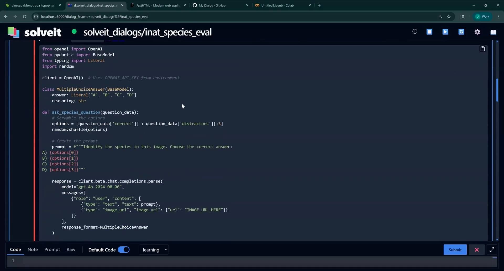
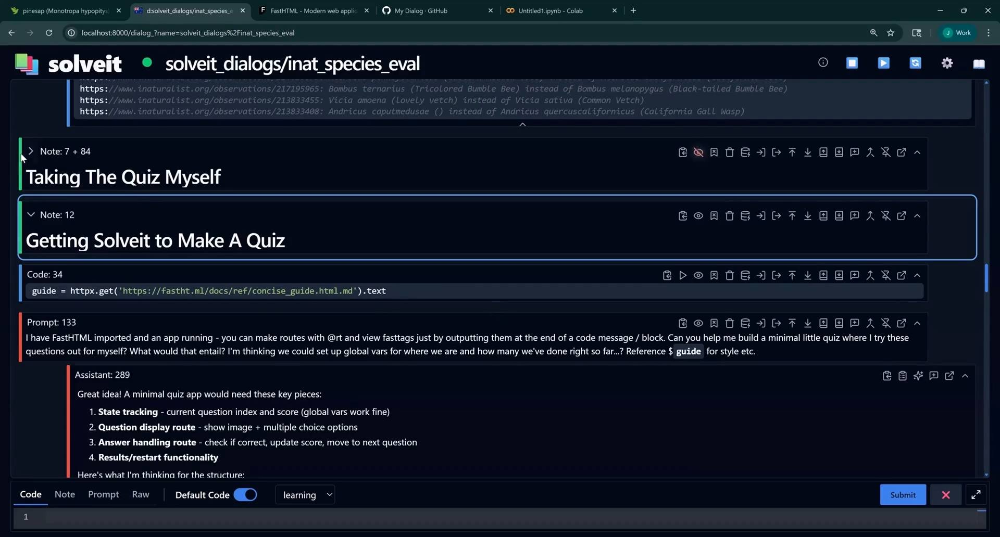
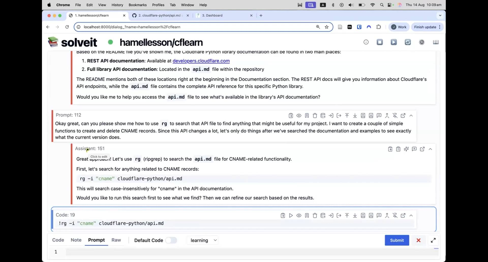
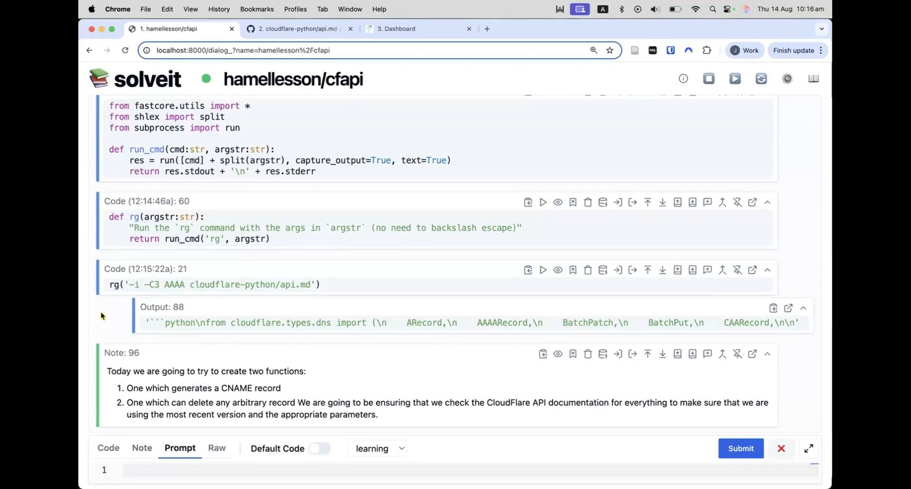
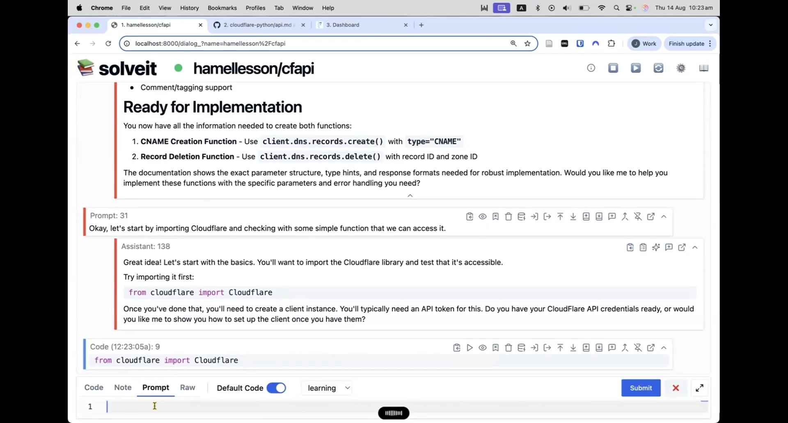
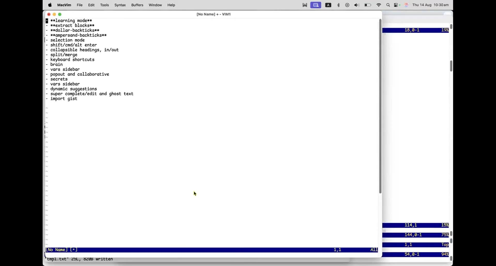

# AI Evals For Engineers & PMs —— 用 Solver 笔记本做「物种识别」评测与 Cloudflare API 工具化

> 说明：本段（p033，49:18–102:25）是整门课的第二半段，讲师在 Solver 笔记本里现场演示了两件事：① 把「物种识别多选题」这个 eval 从零跑通（构造选项 → 拼 prompt → 调模型 → 比对答案 → 看错题）；② 把任意 Python 函数变成 LLM 可调用的工具（`&` + 反引号），用 `rg`/`sed` 搜 Cloudflare API 文档并生成 CNAME 记录函数。本段**没有 OCR 结果**，所以第 4 节「完整代码」里的代码全部来自逐字稿中讲师口述/屏幕上被念出的片段，凡是逐字稿没念全的地方我都标注了「课里没讲全，需按实际输出补」。

---

## 1. 这一节做什么

这一节的目标不是讲概念，而是**把两个可运行的东西做出来**：

1. **一个物种识别 eval**：从「一堆观测数据」里抽出图片、选项、正确答案，打乱选项顺序，拼成一道多选题 prompt，发给多模态模型，强制它从选项里选一个，然后把模型答案和正确答案比对，得到「比随机猜好」的初步分数，最后把错题打印出来人工看。
2. **一个「函数即工具」的 agent 工作流**：在 Solver 笔记本里写普通 Python 函数（`run_command`、`rg`、`sed`），用 `&` + 反引号把它们标记成工具，让模型自己决定调用顺序去搜 Cloudflare API 文档，最后生成「创建 CNAME 记录」和「删除任意记录」两个函数，并在真实域名上建一条测试记录验证。

贯穿这两件事的，是讲师反复强调的三个判断：

- **小步走**：先看 prompt 长什么样、再看响应长什么样、最后才把整条链路拼起来跑全量。
- **模型只看得见「你也能看见的东西」**：prompt 里模型能看到的，就是你在对话里能看到的；被折叠（`...` 截断）的细节它看不到，所以要让模型先写摘要。
- **学习模式优先**：默认不主动给补全，逼你自己敲代码；补全要靠快捷键主动触发。

---

## 2. 讲师原话

> "接下来这一节，就是把这些题目拿去问 AI。"
> —— p033 [49:18]

> "我可以把到目前为止拿到的所有观测数据都折叠起来……我想把这份数据变成发给语言模型的东西。我要把这张图、这些选项、还有正确选项全部混在一起给它，然后拿回一个响应，强制它从这些选项里选一个。"
> —— p033 [49:47]

> "所以我知道有 function calling、structured outputs、JSON mode 这些，各家 API 这些年一直在变。另一个很好的用法是说：你能不能搜一下、拿到最新版本？做过『用 LLM 写调用 LLM 的代码』的人都知道，如果没有联网搜索或 grounding，你经常会拿到过时的 OpenAI API 版本。"
> —— p033 [50:15]

> "这里的用法稍微不一样：我不打算马上把这段代码全用上，我只想看到相当于文档示例的东西。我本来也可以自己打开这个 URL，我只是想看看『怎么把数据发给 API、拿回结构化输出』的大致结构。但让 Solver 去读那些文档、带着『我要发一张图、我要产出我的数据』这个上下文来生成，是非常舒服的。"
> —— p033 [50:44]

> "我可以看我的问题，把选项打乱，然后拼出我的 prompt 并直接打印出来。我知道你们一直在做各种花哨的 eval，这大概算 prompt engineering 里最低的那一档。但能直接看、直接读，还是很好的。"
> —— p033 [51:13]

> "所以你可以慢慢往上搭：好，我能把这个发出去吗？响应长什么样？在我把东西抽出来之前，我先看看响应——第一个是多项选择答案，然后是内容。你可以探索、挖进这些部分，慢慢抽出『我真正想要的是多项选择里的物种』，再看看它和问题是不是一致。只有等我对这一切都满意了，才回到代码。"
> —— p033 [52:11]

> "然后马上，我就能跑那个函数，看：这是模型答案，这是正确答案，模型答案等于正确答案吗？等于。所以每一块我们都试过了，然后把它们拼起来。终于可以准备把它们全部过一遍模型，拿到一个至少第一眼看上去还行的分数：好，我比较放心 prompt 是按我希望的格式拼的，模型能比随机猜做得好，那它可能确实在做点什么。"
> —— p033 [52:41]

> "理想情况下，下一步应该是看所有错误：因为我已经有了猜测和问题，就把做错的那些打印出来，人工检查数据——这个我们下一节再看。"
> —— p033 [53:08]

> "这些笔记块也是 Solver 生成的吗，还是你自己写的？不，大部分是我自己写的。我们有一些原语，可以给 Solver 工具去添加消息，比如『给我的对话加更多解释』，我可以回去补额外笔记。但这些全是我给自己写的笔记，同时也是给这节课写的笔记。"
> —— p033 [53:32]

> "你往这个共享对话里塞的信息越多，对话里的其他参与者——也就是计算机、AI、还有未来的你——就越有可能都做出贡献。"
> —— p033 [53:59]

> "有一点要提，Solver 一个很重要的主题是：语言模型只能看到当前消息**以上**的内容。"
> —— p033 [54:28]

> "现在 Jono 可以按 command shift 句号，它会看整个对话来自动填充他的列表。它能看到当前消息里它上面的所有内容、当前消息里它下面的内容，以及之前的所有消息，但看不到后面的消息。"
> —— p033 [54:56]

> "如果你先选中了某些东西再按 command shift 句号，它会弹出一个 prompt。现在你可以输入『把我们已经见过的 bug 列成一个 markdown 列表』之类的话。"
> —— p033 [55:26]

> "我们有这些特性：你可以做笔记单元格、代码单元格，任何地方都行。你甚至可以在 prompt 响应里放一个『你希望这个 prompt 本该生成的响应』，把它自动生成出来，让它进入正确的心智状态。"
> —— p033 [55:56]

> "我们有所有常规的东西，比如 ghost text 或者这种补全，但它们默认是隐藏的，要等一会儿才出现，而且不总是出现。你可以按 stop。这是最小的、普通的、我可以接受的 ghost text。但如果你在学习模式——我们尽量把它设为默认并鼓励大家用——你就不会主动得到它。我可以用快捷键触发它，但如果不按，我就会被鼓励自己敲代码、自己多想一点。"
> —— p033 [56:25]

> "我们大多数人到现在都独立发现：当我们用 Cursor 这类东西、依赖 tab 补全时，长期来看这会损害我们做高质量工作的能力。光靠意志力去『不按 tab』是不够的，因为每按一次都在消耗你的能量。所以我们试着让自然、轻松、舒服的流程，正好就是能产出高质量工作和高质量学习的那个流程，形成一个你和代码都越来越好的正反馈循环。"
> —— p033 [56:52]

> "看看你的数据——『Hamel 福音』。我们肯定该做一个小控件来自己试这个 eval，看看它合不合理、有没有 bug。"
> —— p033 [57:49]

> "我做了一个版本，是我自己用 FastHTML 写的，那是我们的库。……你可以看到我把我的版本对 AI 隐藏了。我想看看：如果我真的很依赖 Solver，能不能把它推得更远一点——我不看代码、不理解它，更接近 vibe coding，因为这只是个附带任务，而且这个 eval 本身已经有点玩票性质了。"
> —— p033 [58:16]

> "我加载 FastHTML 的文档，我们有一份简明指南，写着『这是我们喜欢写 FastHTML 的方式』。我说：我已经 import 了 FastHTML，你能做 routes 和 fast tags 吗？顺便说一句，FastHTML 是我们做的用来写 Web 应用的框架，很好用。你现在看到的一切都是用 FastHTML 写的。事实上，你现在看到的一切都是用 FastHTML 在笔记本里写的。而且我们越来越多地用 Solver 来写 Solver 本身。所以如果你在想『能不能做出完整生产系统』，答案是非常可以。"
> —— p033 [58:43]

> "我最喜欢的一个特性就在这里：你在 prompt 里用那个变量，很神奇。据我所知没有别的工具能做到。你可以创建它，之后再注入到 prompt 里，比如从你的代码里拿点东西。"
> —— p033 [59:41]

> "我们有一套系统，可以把所有工具的语法给它，也可以把变量的内容连同语法一起给它，然后它就能把它当文本读、回答关于它的问题。这是拉入上下文非常非常有用的方式。说清楚一点，它不是把变量插值进字符串，而是一个更小心的做法：我不需要提供全部细节，但基本上它建立了一个系统，让它能访问它所谓的 context，里面包含这些变量，它可以回头引用。"
> —— p033 [60:10]

> "所以这些特性都是带着很强的想法做出来的，去利用语言模型擅长的地方，比如和 KV cache、attention 的工作方式配合得很好。"
> —— p033 [60:39]

> "这不是 FastHTML 教程，但你可以看到我很快搭了个小控件，我可以用它自己来做测试。这很疯狂对吧？你刚在一条消息里写了个 Web 应用。"
> —— p033 [61:08]

> "要知道，这不是什么 high-py 控件之类的东西。往上滚看那个 Web 应用——它是真的 Web 应用。"
> —— p033 [61:38]

> "我们有 HTML 的所有原语：标题、段落、图片等等。我们还有 HTMX，它让你能做到：按钮被点击时，向某个路由发一个 POST 请求。然后 FastHTML 让我们定义这些路由。比如这个 answer 路由，当它收到某人点按钮传来的选择时，会去检查选择对不对，对了就更新分数，移到下一题，然后显示那道题。你可以看到这个 Web 应用在跑，我们在同一个环境里。因为我点了五次按钮、五题全对，我能看到它在做什么。我可以改这些变量，想重来就把当前题号设回 0。所以这就是同一个实时环境。我不是把它编译成 Web 应用、存到磁盘、在另一个服务器上跑、再去交互。就是同一个实时环境。"
> —— p033 [62:08]

> "你可以看到，这是这个正反馈循环在起作用的好例子。我们现在可以在 Solver 里写 Solver。我们构建 Solver 时自己也受益。Solver 是用 FastHTML 写的，而 FastHTML 是我们为了让写 Web 应用更容易而做的。FastHTML 又用 Monster UI，那是我们开发的 CSS 框架，为了让写 Web 应用更容易。就是一层又一层，我们不断构建东西，让我们构建东西更容易。我觉得这就是你该有的心态：怎么让我们的工作越来越好玩、越来越快、越来越容易。"
> —— p033 [63:03]

> "Jono 展示的这个 Web 应用，我要指出它不是只能在 Solver 里跑。这是一个真正的 Web 框架，你可以把这段代码抽出来在任何地方跑。只是恰好你也能在这个实时环境里跑它。"
> —— p033 [63:30]

> "我们有长期运行的应用，它们是一个 Solver 实例，慢慢迭代地构建应用然后提供服务，然后就一直在那跑着，我们拿到 URL 就能访问。"
> —— p033 [63:57]

> "你还可以做一件事：点 prompt answer 里、抱歉是 output 里右侧那个弹出按钮。你可以把任何东西变成一个可用的应用，点那个按钮，然后把 URL 发给任何人，让他们独立使用这个应用。"
> —— p033 [64:26]

> "所以过一遍这个测验挺好玩。像 Argyllis Bora 这种，我认不出来，得发给专家。我注意到模型也做错了这一题。过一遍它做错的题，看起来都是特别刁钻的。Torrent Sculpin，我知道它是 Torrent Sculpin 的唯一原因是我在淡水溪流里见过它，而模型没有这个信息。从『我的 eval 到底好不好』的角度看，检查错误、自己动手做，非常有用。而且至少在我自己的观测上赢过模型，很有成就感。"
> —— p033 [64:54]

> "我觉得我这边差不多了。唯一新奇的点是：你完全没有上下文切换。你在写代码，也能写 prose；你能把代码里的东西带进 prose；然后你能做 Web 应用；你能玩你的 Web 应用。没有别的编程环境能让你把这些混在一起做。"
> —— p033 [65:24]

> "而且它甚至不只是编程环境。Eric Reese 一直在里面写他的新书，我们在里面写很多博客文章，我们做各种各样的事。我们有个律所客户，Hamel 你听了会高兴，最近开始在里面起草法律合同。"
> —— p033 [65:53]

> "我再展示一个我很喜欢用它做的事：用 SaaS API、在线 API 之类。有一个过去特别难用、不过最近在改进的，就是 Cloudflare API。"
> —— p033 [66:22]

> "我可能会跳过一些东西，不展示你在 Claude Code 里可能会做的事，来展示这种更交互的方式为什么有用。你可以在东西前面弹一个解释块，用 bash 命令。"
> —— p033 [66:51]

> "对于我不想再跑的东西——已经 clone 过了——我倾向于直接注释掉。command 斜杠就是注释。如果你想在对话末尾加东西，按正斜杠键，你会看到它从那里开始。有大量这类快捷键，几乎全都值得学。"
> —— p033 [67:19]

> "如果我想开始用它，我可以自己先探索一下。你能看到路径和符号的小建议会出现。如果我按 Tab，它就会把那个建议填上。好处不只是我能看到，模型也能看到。"
> —— p033 [67:49]

> "每个都有快捷键，J，配合 command shift 或 control shift。我可以说：哦 cool，有个 readme，那我们看看。"
> —— p033 [68:18]

> "哎呀，我不小心进了 prompt 模式，它会搞混。我把它改回 code。好，这种情况下要读的东西挺多。读一读大概不是坏主意，但如果我赶时间——我现在就赶——你可以按 O 折叠输出，看它变小了，按 I 折叠输入。我可以直接让它替我读。"
> —— p033 [68:45]

> "你能告诉我这个库的文档大概在哪吗？好，它告诉我了，省了我一点时间。好，你能用 RG 搜一下那个 API 文件，找出对我项目可能有用的东西吗？我的项目是：我想创建一个简单的函数来创建和删除 CNAME 记录。其实，先给我看看怎么用。"
> —— p033 [69:14]

> "因为这个 API 变得很多，我们只在搜过文档和示例、看清当前版本到底怎么做之后才动手。这就是我用 Cloudflare API 遇到的问题：它变得很多，文档很差。事实上你看，它说『用这个 API.md』。好，这是我们的文档，简直离谱。这才走了四分之一，而且那些根本不是文档，只是一堆东西的列表。所以这相当难。"
> —— p033 [70:09]

> "我忘了说『给我看看怎么用』。你觉得他们的意图是什么？他们是想做 llms.txt 但做砸了？不，这东西存在很久了，他们就是一直没顾上写文档。"
> —— p033 [71:02]

> "现在我可以按这个按钮，或者直接按 W，它会把任何代码块抽出来、变成这里的单元格/消息。你看它知道这是 bash 的，自动在前面加了个感叹号。它这里做得不太好。我觉得也许我们该搜更广一点，理解怎么充分利用 DNS API，也许还展示一些结果周围的上下文。你能告诉我怎么做，并建议一些严谨的做法吗？RG 是个很好用的、基于 grep 的工具。"
> —— p033 [71:32]

> "Cool，这里有不少例子。好，那很好。你能把那四个例子分别放进独立的 fenced block 吗？它不一定知道 fenced block 才是我真正想要的，我得点这里。看起来不错。你能把那四个例子分别放进独立的 fenced block 吗？所以你得教它怎么让你的生活更轻松。"
> —— p033 [72:26]

> "这真的很酷。我们得按 W，现在我有四个能跑的东西，然后我能看它们跑得怎么样。你按 W，它就会抓代码放进 code。我也能看到每个输出里有多少 token，这样你不会在不知情的情况下把上下文撑爆。"
> —— p033 [72:55]

> "然后有些我会修，比如任何带大写 A 的都贵六倍多，还有 `-i` 也挺蠢的。所以挺好，你能抓到它在干蠢事。"
> —— p033 [73:25]

> "这时候我倾向于说：好，你觉得我们现在信息够了吗，还是还有要查的？我在这加快了点，但我会倾向于仔细读。如果你不知道 `-C` 大写，那是个非常有用的技巧：它会打印每个搜索结果前后几行，很棒。"
> —— p033 [73:51]

> "好，它觉得信息够了，我们可以开始动手了。这是一种方法。"
> —— p033 [74:20]

> "还有另一种我也很喜欢的方法：写你自己的工具。这种情况下，因为对话里我们看到的东西和 LLM 看到的是同一个东西，任何时候都完全透明。但如果你想更 agentic 一点，用 Solver 的方式看，创建你自己的完整 agent 框架、精确做你想做的事——不多不少——是多么容易，这很有意思。"
> —— p033 [74:49]

> "这里我有个很喜欢用的小函数叫 `run_command`。它用 `subprocess.run`，就是 Python 里跑任意二进制的那个东西。它会跑一个特定命令，你把整个参数传进去。"
> —— p033 [75:16]

> "这样我就能创建一个叫 `rg` 的函数，现在它是个 Python 函数了，签名是 `arg: str -> str`。用 `arg` 里的参数跑 `rg` 命令。"
> —— p033 [75:43]

> "返回 `run_command`。这里也许我按 option 句号，让它替我把剩下的敲完。"
> —— p033 [76:09]

> "现在我给你看点真正有意思的。我们可以试试：`rg -i -C3`，引号 example，先确认它能跑。哦，还得说在哪跑，我们在 `cloudflare_python` 里跑。哦，我大概想要 `cloudflare_python/api.md`。好，看起来能跑。"
> —— p033 [76:38]

> "现在好玩的来了。我经常做的是，粘一些像『Polya 解题策略』的东西，用我自己的话重述问题。这里我可能加个笔记说：今天我们试着创建两个函数，一个生成 CNAME 记录，一个删除任意记录。我们要确保查 Cloudflare API 文档，确保用的是最新版本和合适的参数。"
> —— p033 [77:08]

> "然后我们说：你能用 RG 帮我搜文档，找出对完成今天项目可能有帮助的一切吗？你也可以找例子，同时检查 API.md 文件。等你找到你认为我们需要的东西后，创建一份完整详细的清单和文档，写清我们需要知道的一切，方便你和我以后构建这些函数时参考。现在就用我提供的 RG 命令把所需研究都做了。"
> —— p033 [78:29]

> "它会怎么做呢？诀窍是：你可以把任何函数变成工具，方法是输入 `&` 并在外面加反引号。一旦这么做，你就允许 Solver 随意 agentically 调用它。事实上我们还能做更多，还有个技巧你们可能不知道：我得说，复制一份这个，把这个叫 `sed`。这个对读文件的一段特别有用。比如 `sed` 能读一堆行号。如果你发现可能有用的段落，也可以用 `&` 反引号 `sed` 去读那些段落。"
> —— p033 [79:26]

> "所以我给了它两个工具，一个搜 `cloudflare_python`。我应该提一下，让我看看 `cloudflare_python`。好，它现在要去做了。你可能在想：哦，这像 MCP 吗，怎么回事？不，你不需要 MCP，你不需要 cloud text in an API，你什么都不需要。哦，那个可能太大了。尽量控制信息量，别把上下文窗口撑爆。再来一次。对，你真正需要的就只是写函数，你写的任何 Python 函数现在都是你的 LLM 能调用的工具，同时你也在调用它。"
> —— p033 [81:22]

> "这真的很神奇。而且没有间接层：你就写你的代码，不用去别的地方插。你不用建任何脚手架、schema、服务器。就这样。你可以在一个对话里定义工具，导入到另一个对话。我觉得不用太深入讲导出导入，但很容易分享：嘿各位，这是一个带了我为这个写的工具的 guest，然后很容易导入使用，作为列表喂进去说『你想用哪个就用哪个』。所以原型开发很好玩。它有点像 MCP 那类东西，但更显式、更容易，而且你不依赖别人——只要你会写 Python。"
> —— p033 [82:21]

> "这是它做的。你能在详情里看到，它跑了 `rg` 搜 CNAME，然后基于结果跑了 `rg` 搜 delete。你看它用了我们学到的 context 那个东西。检查这些细节挺好，看它怎么做、有没有你不知道的做法。然后它想：好，还能做什么？它跑了 `rg` 搜 def delete，然后想：好，去 tests 里查。它找到了这个例子、那个例子。记住，我们 prompt 里的 LLM 只能看到我们看到的。实际上它看不到这些详情区里的任何东西。所以你会看到那个 `...`，它们在这里被截断了。"
> —— p033 [82:50]

> "所以用这种方法时，重要的是告诉它去创建摘要。现在我们可以说：好，你能帮我们写个函数吗——其实先别。我们先 import Cloudflare，用个简单函数检查我们能访问它。"
> —— p033 [84:14]

> "所以小步走真的很好。我按回车。现在我要提一下 default code 这个想法，保持开启很好，因为我们的想法是尽量自己多写代码。如果你说 default code，那么之后不管你是做 prompt 还是做笔记还是别的，它总是把你放回 code。我有一些凭证，那我们创建对象、做点简单测试确认它能用。"
> —— p033 [84:42]

> "好，现在我按 W。其实，与其传 token，你可以用 Solver 里叫 Secrets 的东西。你把需要的都倒进去。我看到你有很多不同的 API key，你能把模型切到 Gemini、Grok 什么的吗，怎么工作？不，这些是给我用的。"
> —— p033 [85:10]

> "通过代码。当你在 prompt 里做事时，用我们的 API key。这个我也该展示一下：你还可以用一个特殊的 `MaxThinkTokens`，打开对 Claude Opus 4.1 的访问。如果你这么做，你会多一个 brain 按钮。按它就会用推理模式。所以我填 4096，表示最多用 4096 token 推理。别设太高，否则会崩。2048 或 4096 挺好。这种情况下，我已经把 Cloudflare API 放进 secrets 了，它会自动变成环境变量。所以你回去后得重跑单元格。"
> —— p033 [86:08]

> "Cool，它拿到了我们所有的 zone。那我们现在可以说：好，看起来能用了。你能给我们展示怎么创建一个能创建 CNAME 记录的函数，然后我们在我们拥有的 fast.ai 域名里建一条测试记录来测它。哦，把那些重跑一下。你总是可以点 run all 重跑一切。所以如果你跑一个 prompt、而里面有些 `&` 反引号的东西不可用，你会收到这条消息。现在它可用了。"
> —— p033 [87:03]

> "我可以重跑。我觉得这个 API 如果改成传 zone 名字、你帮我们查，会更顺手。"
> —— p033 [88:03]

> "所以它又在鼓励我们自己动手，通常我会建议这么做。但现在我就说：行，你帮我实现吧，我今天有点赶。"
> —— p033 [88:32]

> "我们有很多很有用的快捷键。这种风格里重要的一点是别占太多垂直空间，你想在对话里看到尽可能多。常规做法是这些很高很高的东西，没利用上宽屏。一个有用的就是 Control J，它把当前行和下一行、或选中的行连起来。"
> —— p033 [89:01]

> "这其实是个很烂的实现，如果我有更多时间，我会让它去查文档，看有没有不用这个 for 循环、按名字拿 zone 的办法——其实有。"
> —— p033 [89:30]

> "你看它为测试单独建了一个。哦 cool，看起来成功了。好，我们收尾。快速给我看看现在删除这条 CNAME 记录所需的那行代码。"
> —— p033 [89:57]

> "这就像我看 Jeremy 写代码。这差不多就是我们用任何东西的流程。如果我们要用 Cloudflare 建记录，我们就会用一个很顺手的、在某个笔记本里建好的 create CNAME record 函数。不是『这只是 demo』，这基本上就是我们写代码的方式。试试。"
> —— p033 [90:21]

> "好。这里我们甚至可以抓这个，按 command shift 句号（美国人说 period），把它替换成用 API 直接按名字查，而不是用循环。Cool，好多了。"
> —— p033 [90:51]

> "我们这还有别的模式。学习模式是我们建议你用的。但如果你想超快，去 concise 模式，它会尽快用非常简洁、有针对性的代码把活干完。然后 standard 基本上关掉，给你更标准的、普通的、有缺陷的 prompt。我从来不用，我觉得不太好。"
> —— p033 [91:43]

> "你可以全用键盘，按上下选东西，然后这里所有按钮你都能看到它们干什么。比如有个按钮复制输入，另一个复制输出。你看这里，我们有这些的快捷键。能作用于输入或输出的，我们倾向于放一起。左边逗号是输入，右边句号是输出。比如这个被选中时，我按句号就复制输出，然后我可以粘到那里。"
> —— p033 [92:12]

> "我们有很多这种设计，超级符合人体工学。如果我已经在打字，复制会立刻把焦点放到底部。这样我很容易一路说：对我要这个、对我要这个。有很多这种小东西让一切超快。你还会看到可以最大化编辑器，但同样，我们有这些小东西引导你进入正确心态：我们不希望你写这么多代码，我们希望写这么点代码。你一开始写它就会给你加新行，但我们真的想让你脑子进入 Eric Reese 说的『小批量』。一开始会觉得很怪，因为和你习惯的很不一样，但试着接受它。"
> —— p033 [93:08]

> "如我所说，我们有这个 brain 按钮，它会花更久，用 Opus 4.1 做推理模式。你不该经常用它。理想情况是你用自己的脑子想。如果你在点这个按钮，那是个不太好的信号。"
> —— p033 [94:02]

> "现在注册 Solver 的人，token 会收费吗？是包月吗？现在我们免费提供给今年注册的整个社区，免费用一整年，因为我们第一优先级是让人用起来、给我们反馈。所以我们有一个非常有活力的社区。比如每个 Advent of Code 的日子都有完整讨论，2023、2024 都有，很多人聊他们用这些技术的体验。我们一周有几次 office hours，也不断讨论平台新功能。"
> —— p033 [94:31]

> "有个专门给编程新手准备的频道。社区真的很活跃，有人在聊甚至不是 Solver 的东西，就是他们做的有趣项目。"
> —— p033 [95:28]

> "有人问我们的 eval 长什么样，Solver 有没有花哨的自动化 eval？答案其实是：我们的 eval 就是像我们和社区这样，看什么有用。这在现在的公司里可能是异端，但小批量地试单个东西、看人们对功能或改动的反应、拿到快速即时的明显反馈，是极有价值且有用的信号。这也是为什么——没有比这更好的 eval 了：『嘿，这对写作好用吗？』那就让 Eric Reese 用它写本书。『对 Web 开发好用吗？』那就试着建个大的新 Web 应用。『对博客文章好用吗？』那就把所有博客文章都用它写。"
> —— p033 [95:58]

> "Jeremy，你觉得什么样的人该试 Solver？你是个程序员，看这个可能想：嗯我不知道，我习惯这种编程方式，可能对编程有很多先入为主的观念。你能聊聊吗？老实说，它似乎最适合真正刚学编程的人，或者有 20 年以上经验的人，就是中间那 3 到 20 年这段，往往是那些以为自己很懂编程、但还没意识到自己其实不懂的人。20 年以上经验的人意识到自己还有很多要学，往往会说：天哪，这解决了我过去 20 年发现的很多问题。不到三年经验的人还在『我有很多要学、我该试试新东西』的心态里。但它是一种如此不同的工作方式，对中等经验的人来说，几乎会感到被冒犯：等等，这不是关于 CI/CD、单元测试、20 个文件每个文件一个函数的项目。这是对 AI 编程、乃至对编程本身的整套新思考方式。"
> —— p033 [96:25]

> "这些年来时不时有人想用我们这套更探索式的方法合作，但他们弹开了，因为『这不是写代码的方式』。所以我觉得它能帮所有人，但你要么得非常初级、要么得非常资深、要么得非常开放。我觉得开放心态可能更重要，因为越来越多人意识到过去一两年的承诺没怎么兑现，所以现在可能有更多人在想：还有别的办法吗？答案是有的，这是另一种办法，而且对我们很有效。"
> —— p033 [97:54]

> "我确实觉得你需要成为社区的一部分才能受益，去分享你的失败和成功。Solver 社区里很多人聊他们的失败、求助怎么跨过去，很多人跨过去了。我们现在有几百条用户证言说这是他们经历过的最改变人生的事情之一，这我们没预料到。我们本来觉得大家说『哦这个还不错』我们就挺高兴了。但这很难，不是打开 app 就改变人生，是你投入练习才改变人生。尽管比如我可以把同一个 eval 用 prompt 丢给 IDE 里的 agent，它也能高高兴兴全做完。但我认为如果你能顶住那个『闪亮新东西』的诱惑，投入时间去真的敲代码、真的理解它，遇到像 Jeremy 说的不懂的地方就停下来——是那些坚持下来、保持活跃、真的去练的人，回来跟你说：哇，那种刻意练习、花的时间，才是关键，而不是闪亮的第一印象。"
> —— p033 [98:50]

> "今天展示的是不是只是冰山一角？我觉得还有很多可以做，包括——可能不明显——把东西投入生产。你还可以把截图粘进 Solver，LLM 能看到截图。其实有个快捷键，你可以创建 Web 组件，如果你想让 CSS 对，Solver 能看到你浏览器里渲染出来的组件。"
> —— p033 [100:12]

> "你可以创建 Web 应用。是啊，这就是为什么我们有 30 小时课程，而那还只覆盖了一年前的 Solver。我们大概几个月后会出一门新课程走得更远。但这是一整片领域，是对软件工程完全不同的一种思考方式。它不只是游乐场，我们可以用它写真正的软件。"
> —— p033 [101:08]

> "我鼓励大家都试试。我体验过这种方式的几种风味很久了，我觉得这是一种很棒的编程方式。我鼓励大家去探索。谢谢你来做演示。你在我上次见你之后的六个月里进步了很多。谢谢大家参加。"
> —— p033 [102:03]

---

## 3. 从零复现

> 前置说明：本段演示全部在 **Solver 笔记本**（一个「对话 + 可执行单元格」的实时环境）里完成。Solver 是讲师团队的产品，课里没讲它的安装方式；如果你没有 Solver，下面每一步我都给了「等价的最小复现路径」（普通 Jupyter/Node 脚本），但**工具化那一步（`&` + 反引号）是 Solver 独有语法，课里没讲它在别处怎么实现**，只能用普通函数调用模拟。

### 3.1 准备：把「观测数据」变成一道多选题

1. 打开你的笔记本，把已经收集到的观测数据（每条含：一张图、若干候选物种、一个正确物种）放在一个单元格里。课里没讲这份数据的具体来源和字段名，只讲了它包含「图片、选项、正确选项」三样东西。
2. 写一个函数，把每条观测的选项**打乱**（shuffle），保证正确答案混在其中。讲师原话是「把这张图、这些选项、还有正确选项全部混在一起给它」。
3. 拼 prompt：形如「识别这张图里的物种，选出正确答案」，下面列出 5 个选项。讲师现场打印出来读了一遍，确认格式对。
4. **先打印 prompt，不要先调模型**。这是讲师反复强调的「最低一档但很有用」的检查：`print(prompt)`，肉眼读一遍。

### 3.2 先看响应长什么样，再抽字段

5. 调一次多模态模型（讲师用的是带 structured output / JSON mode 的 API；课里没讲具体是哪家、哪个模型名）。讲师说各家 API 这些年一直在变（function calling、structured outputs、JSON mode），所以**建议让 Solver 联网搜最新文档**再写调用代码。
6. 拿到响应后，**先打印整个响应**，看结构：讲师现场看到「第一个是多项选择答案，然后是内容」。确认你要的字段（多项选择里的物种）在哪一层。
7. 写抽取函数：从响应里取出「模型选的物种」，和「正确答案」比对，返回布尔。

### 3.3 拼成完整链路，跑全量，拿初步分数

8. 把 3.1–3.2 的函数串起来：对每条观测 → 拼 prompt → 调模型 → 抽答案 → 比对。
9. 跑全量，得到一个分数。讲师的判断标准是：**「比随机猜好」就说明 prompt 格式对了、模型在做点什么**（5 选 1 的随机基线是 20%）。
10. 打印出所有做错的题（模型猜测 + 原题），留待人工检查。讲师说这一步「下一节再看」。

### 3.4 用「函数即工具」让模型自己去搜 Cloudflare 文档

11. 写一个通用执行器 `run_command`，内部用 `subprocess.run` 跑任意二进制，把整个命令字符串传进去。
12. 基于它写两个薄封装：
    - `rg(arg: str) -> str`：跑 `rg` 命令（ripgrep，基于 grep 的搜索工具）。
    - `sed(...)`：用来读文件的某一段（讲师说「对读文件的一段特别有用，比如读一堆行号」）。
13. 在对话里用 **`&` + 反引号** 把函数包起来（如 `` &`rg` ``），这一步把普通 Python 函数变成 LLM 可 agentically 调用的工具。讲师强调：**不需要 MCP、不需要 schema、不需要服务器、不需要脚手架**。
14. 写一段「Polya 解题策略」式的笔记，用自己的话重述任务：创建两个函数，一个生成 CNAME 记录，一个删除任意记录；必须查 Cloudflare API 文档确认最新版本和参数。
15. 给模型的指令：用 RG 搜文档和例子、检查 `api.md`，找到后**创建一份完整详细的清单/文档**供后续参考，现在就做完全部研究。
16. 观察模型的工具调用链（讲师现场看到：`rg` 搜 CNAME → `rg` 搜 delete → `rg` 搜 `def delete` → 去 tests 里找例子）。**注意：详情区里的内容模型看不到（被 `...` 截断），所以第 15 步「让它写摘要」是必须的。**
17. 小步验证：先 `import Cloudflare`、建对象、跑一个简单调用确认能访问（拿到所有 zone）。
18. 再让它写「创建 CNAME 记录」的函数，在自有域名（讲师用 `fast.ai`）里建一条测试记录验证。
19. 改进：让函数接收 **zone 名字**而不是 zone id，内部自己查（讲师指出原来的 for 循环实现很烂，正确做法是查文档找「按名字拿 zone」的 API）。
20. 最后让它给出「删除这条 CNAME 记录」的那一行代码，跑通。

### 3.5 环境与依赖（课里能确定的 + 课里没讲的）

- **运行环境**：Solver 笔记本（实时环境，代码、prompt、Web 应用同处一个进程）。
- **Python 依赖**：`subprocess`（标准库）；`rg`（ripgrep 二进制，需在 PATH 里）；`sed`（Unix 工具）；Cloudflare 的 Python 客户端（课里只说了「import Cloudflare」，**具体包名和版本课里没讲**）。
- **凭证**：放在 Solver 的 **Secrets** 里，会自动变成环境变量；改完 secrets 要**重跑单元格**。课里没讲环境变量的具体名字。
- **可选**：`MaxThinkTokens` 设为 `2048` 或 `4096` 可开启 Claude Opus 4.1 推理模式（多一个 brain 按钮）；讲师警告「别设太高否则会崩」。
- **Web 应用部分**：FastHTML + Monster UI + HTMX（讲师团队自研/使用的栈），课里没讲安装命令。

---

## 4. 完整代码

> 再次说明：本段**无 OCR**，以下代码全部来自逐字稿中被念出/描述的部分。凡是讲师只说了「大概是这样」而没念全的，我按语义补全并标注 `# 课里没讲全，按语义补全`。Solver 专有语法（`&` 反引号、`command shift 句号`）无法在普通环境运行，已注明。

### 4.1 物种识别 eval（普通 Python 可跑的最小骨架）

```python
# eval_species.py
# 说明：课里没给完整源码，以下按讲师口述的流程重建。
# 数据字段名课里没讲，这里用 image / options / correct 三个占位名。
import random
import json

# 课里没讲数据从哪来，这里假设已有一个 list[dict]
observations = [
    # {"image": <图片或图片URL>, "options": ["...", ...], "correct": "California tortoise shell"},
]

def build_options(obs, seed=None):
    """把正确选项混进候选里并打乱。讲师原话：把图、选项、正确选项全部混在一起。"""
    opts = list(obs["options"])
    if obs["correct"] not in opts:
        opts.append(obs["correct"])
    rng = random.Random(seed)
    rng.shuffle(opts)
    return opts

def build_prompt(obs, options):
    """拼多选题 prompt。讲师现场打印出来读过：'identify the species in this image, choose the correct answer' + 5 个选项。"""
    lines = ["Identify the species in this image. Choose the correct answer."]
    for i, o in enumerate(options):
        lines.append(f"{chr(65+i)}. {o}")
    return "\n".join(lines)

def call_model(image, prompt):
    """调多模态模型，要求结构化输出，强制从选项里选一个。
    课里没讲具体用哪家 API、哪个模型名、structured output 的具体 schema。
    讲师建议：让 Solver 联网搜最新文档再写这段，避免拿到过时的 API 版本。"""
    raise NotImplementedError("课里没讲具体 API 调用，需按你所用模型的最新文档补")

def extract_choice(response):
    """从响应里抽『多项选择答案』。
    讲师现场看到响应结构是：第一个是 multiple choice answer，然后是 content。
    字段名课里没讲，以实际输出为准。"""
    # 例：return response["multiple_choice"]
    raise NotImplementedError("字段名请以实际响应为准")

def score_one(obs, seed=None):
    options = build_options(obs, seed=seed)
    prompt = build_prompt(obs, options)
    # 第 4 步：先打印，肉眼确认格式
    print(prompt)
    response = call_model(obs["image"], prompt)
    # 第 6 步：先打印整个响应看结构
    print(response)
    guess = extract_choice(response)
    return guess == obs["correct"], guess

def run_eval():
    results = []
    for obs in observations:
        ok, guess = score_one(obs)
        results.append({"correct": obs["correct"], "guess": guess, "ok": ok})
    score = sum(r["ok"] for r in results) / len(results)
    print(f"score = {score:.2%}")  # 5 选 1 随机基线 20%，比它好说明模型在做点什么
    # 打印错题，留待人工检查（讲师说下一节再看）
    for r in results:
        if not r["ok"]:
            print("MISTAKE:", r)
    return results

if __name__ == "__main__":
    run_eval()
```

### 4.2 函数即工具：`run_command` / `rg` / `sed`

```python
# tools.py
# 讲师原话：run_command 用 subprocess.run，跑任意二进制，把整个参数传进去。
import subprocess

def run_command(command: str) -> str:
    """跑一个 shell 命令，返回输出。课里没讲是否捕获 stderr、超时、编码，按需补。"""
    result = subprocess.run(command, shell=True, capture_output=True, text=True)
    return result.stdout  # 课里没讲 stderr 怎么处理

def rg(arg: str) -> str:
    """rg 的薄封装。讲师签名：arg: str -> str。"""
    return run_command(f"rg {arg}")

def sed(arg: str) -> str:
    """sed 的薄封装，用来读文件某一段（讲师：'对读文件的一段特别有用，比如读一堆行号'）。
    课里没讲 sed 的具体参数拼法，以下为语义补全。"""
    return run_command(f"sed {arg}")
```

在 Solver 对话里，把函数变成工具（**Solver 专有语法，普通 Python 跑不了**）：

```
&`rg`
&`sed`
```

讲师原话：输入 `&` 并在外面加反引号，就允许 Solver 随意 agentically 调用它。

### 4.3 给模型的「Polya 式」任务笔记 + 指令

```markdown
# 笔记（讲师用 Solver 的 note 单元格写，内容为讲师原话转述）

今天我们要试着创建两个函数：
1. 一个生成 CNAME 记录
2. 一个删除任意记录

我们要确保查 Cloudflare API 文档，确保用的是最新版本和合适的参数。

# 给模型的 prompt

你能用 RG 帮我搜文档，找出对完成今天项目可能有帮助的一切吗？
你也可以找例子，同时检查 api.md 文件。
等你找到你认为我们需要的东西后，创建一份完整详细的清单和文档，
写清我们需要知道的一切，方便你和我以后构建这些函数时参考。
现在就用我提供的 RG 命令把所需研究都做了。
```

### 4.4 Cloudflare 客户端初始化（小步验证）

```python
# cloudflare_init.py
# 讲师：先 import Cloudflare，用个简单函数检查我们能访问它。
# 课里没讲包名/版本，也没讲环境变量名；讲师把 key 放在 Solver 的 Secrets 里，自动变成环境变量。
import os
from cloudflare import Cloudflare  # 课里没讲确切包名，以实际文档为准

client = Cloudflare(api_token=os.environ["CLOUDFLARE_API_TOKEN"])  # 环境变量名课里没讲

# 讲师现场：'它拿到了我们所有的 zone'
zones = client.zones.list()
print(zones)
```

### 4.5 创建 / 删除 CNAME（讲师最终形态的语义重建）

```python
# cname.py
# 课里没给最终完整源码；以下按讲师口述的两次迭代重建：
# 第一版用 for 循环按名字找 zone（讲师自评'很烂'），第二版改成 API 直接按名字查。

def get_zone_by_name(name: str):
    """第二版：用 API 直接按名字查 zone，不用 for 循环。
    课里没讲具体 API 方法名，以 Cloudflare 文档为准。"""
    zones = client.zones.list(name=name)  # 方法名/参数名课里没讲
    return zones[0] if zones else None

def create_cname(zone_name: str, record_name: str, target: str):
    """创建 CNAME 记录。讲师：'这个 API 如果改成传 zone 名字、你帮我们查，会更顺手。'"""
    zone = get_zone_by_name(zone_name)
    return client.dns.records.create(
        zone_id=zone.id,
        type="CNAME",
        name=record_name,
        content=target,
    )  # 参数名课里没讲，以实际文档为准

def delete_record(record_id: str):
    """删除任意记录。讲师最后只要求'快速给我看看删除这条 CNAME 记录所需的那行代码'。"""
    return client.dns.records.delete(record_id)  # 方法名课里没讲
```

### 4.6 FastHTML 小测验 Web 应用（讲师现场写的，课里没念全）

```python
# quiz_app.py
# 讲师：'这不是 FastHTML 教程'，只演示了结构。以下按口述重建，课里没念全。
# 依赖：python-fasthtml、Monster UI、HTMX（安装命令课里没讲）
from fasthtml.common import *
from monsterui.all import *

app, rt = fast_app()

score = {"value": 0}
current = {"index": 0}

@rt("/")
def get():
    q = observations[current["index"]]
    options = build_options(q)
    # 每个选项一个按钮，点击向 /answer 发 POST（HTMX）
    buttons = [Button(o, hx_post="/answer", hx_vals={"choice": o}) for o in options]
    return Titled("Species Quiz", *buttons, P(f"Score: {score['value']}"))

@rt("/answer")
def post(choice: str):
    q = observations[current["index"]]
    if choice == q["correct"]:
        score["value"] += 1
    current["index"] += 1
    return RedirectResponse("/", status_code=303)

serve()
```

> 讲师强调：这是**真的 Web 应用**，可以把代码抽出来在任何地方跑；点 output 右侧的弹出按钮还能把它变成一个独立 URL 分享给别人。

---

## 5. 逐行解释

**`build_options` 里的 shuffle**：讲师的核心动作是「把正确选项混进候选里打乱」，目的是防止模型靠位置猜。在 JS/Node 里对应 `array.sort(() => Math.random() - 0.5)`（不推荐）或 Fisher-Yates；Python 的 `random.shuffle` 就是 Fisher-Yates。

**`print(prompt)` 这一行**：讲师把它称为「prompt engineering 里最低的那一档」，但坚持要做——因为你能直接读、直接确认格式。不做这一步，后面模型答错你分不清是「模型不行」还是「prompt 拼错了」。

**`print(response)` 这一行**：讲师现场看到响应结构是「先 multiple choice answer，再 content」，才决定抽哪个字段。跳过这步直接写 `response["answer"]` 很容易 KeyError。

**「比随机猜好」这个判断**：5 选 1 随机基线 20%。讲师说「模型能比随机猜做得好，那它可能确实在做点什么」——这是**最低限度的 sanity check**，不是最终结论。真正的信号来自第 10 步打印错题、人工看。

**`run_command` 用 `subprocess.run`**：讲师原话「就是 Python 里跑任意二进制的那个东西」。注意 `shell=True` 是我补的（课里没讲），生产环境要小心注入；在 Node 里对应 `child_process.execSync`。

**`&` + 反引号**：这是 Solver 的**工具标记语法**，不是 Python 语法。讲师反复强调「不需要 MCP、不需要 schema、不需要服务器、不需要脚手架」——对比之下，MCP 需要写 server、定义 tool schema、配 transport，这里全省了。代价是**只能在 Solver 里用**，课里没讲怎么把这套搬到别的环境。

**「模型看不到详情区」**：讲师说「LLM 在 prompt 里只能看到我们看到的，它看不到这些 detail sections 里的任何东西，那个 `...` 是截断」。所以工具调用的原始输出不会自动进上下文，**必须显式让它写摘要**——这就是 4.3 里那句「创建一份完整详细的清单和文档」的作用。不做这步，模型会基于被截断的信息瞎编。

**`get_zone_by_name` 的第二版**：讲师自评第一版 for 循环「很烂」，正确做法是查文档找「按名字拿 zone」的 API。这体现了他反复说的「小步走 + 查文档」：先跑通，再优化，优化前先查文档确认有没有现成方法。

**`MaxThinkTokens = 4096`**：开启 Claude Opus 4.1 推理模式，多一个 brain 按钮。讲师警告「别设太高否则会崩，2048 或 4096 挺好」。他还说「如果你在点这个按钮，那是个不太好的信号」——理想是你自己用脑子想。

**学习模式 vs concise vs standard**：学习模式默认不给主动补全，逼你自己敲；concise 尽快用简洁代码干完；standard 讲师「从来不用，觉得不太好」。

**`command shift 句号`（美国人说 period）**：两个用途——① 光标在列表里时，看整个对话自动填充列表；② 先选中内容再按，弹出 prompt 让你输入指令（如「把见过的 bug 列成 markdown 列表」）。**注意模型只能看到当前消息以上的内容**，看不到后面的消息。

**`O` / `I` / `W` / `Control J`**：`O` 折叠输出、`I` 折叠输入、`W` 把代码块抽成可执行单元格（bash 会自动加 `!`）、`Control J` 合并当前行和下一行（省垂直空间）。讲师说「几乎全都值得学」。

**`-C` 大写**：`rg -C3` 打印每个搜索结果前后 3 行，讲师说「非常有用」。他还吐槽 `-i`（忽略大小写）在某些场景「挺蠢」，以及「任何带大写 A 的都贵六倍多」——这是他在看 token 成本。

---

## 6. 复现检查清单

- [ ] 观测数据里每条都有：图片、候选选项、正确选项（字段名自定）
- [ ] `build_options` 打乱后，正确选项确实在列表里
- [ ] `print(prompt)` 输出格式正确：一句指令 + 5 个带字母的选项
- [ ] 调模型前，先单独跑一次、`print(response)` 看清结构
- [ ] 抽取函数能稳定拿到「模型选的物种」
- [ ] 全量跑完，分数 > 20%（5 选 1 随机基线）
- [ ] 错题被打印出来（模型猜测 + 原题）
- [ ] `run_command("rg --version")` 能跑通（rg 在 PATH 里）
- [ ] `rg("example cloudflare_python/api.md")` 能返回结果
- [ ] 在 Solver 里用 `` &`rg` `` 和 `` &`sed` `` 标记工具后，模型能自主调用
- [ ] 给模型的指令里**明确要求写摘要/清单**（因为详情区它看不到）
- [ ] `import Cloudflare` + 建 client + `zones.list()` 能拿到 zone
- [ ] Secrets 里放了 Cloudflare token，改完**重跑了单元格**
- [ ] `create_cname` 在测试域名上建记录成功
- [ ] `delete_record` 能把刚建的记录删掉
- [ ] （可选）`MaxThinkTokens=4096` 后出现 brain 按钮
- [ ] （可选）FastHTML 小测验能点按钮、分数递增、题号前进

---

## 7. 课里没讲但你会撞上的

1. **Solver 怎么装、怎么注册**：课里只说了「今年注册的社区免费一年」，没讲安装步骤、系统要求、定价细节。没有 Solver，4.2 的 `&` 反引号语法和 4.6 的实时 Web 应用都跑不了。
2. **多模态 API 的具体选型**：课里只说「function calling / structured outputs / JSON mode 各家都在变」，没说是 OpenAI、Gemini 还是别的，也没给模型名和 schema。你得自己查最新文档——讲师也正是这么建议的。
3. **Cloudflare Python 包名、版本、方法名、参数名**：课里只念了 `import Cloudflare`、`zones.list()`、`dns.records.create/delete` 的大意，**具体签名以官方文档为准**。讲师自己都说这个 API「变得很多、文档很差」。
4. **环境变量名**：Secrets 自动变环境变量，但变量名叫什么课里没讲。你得自己在 Secrets 里定，代码里对上。
5. **`subprocess.run` 的安全问题**：`shell=True` + 拼接字符串有命令注入风险，课里没讨论。生产环境建议 `shell=False` + 参数列表。
6. **FastHTML / Monster UI / HTMX 的安装与版本**：课里明确说「这不是 FastHTML 教程」，只演示了结构。想复现 4.6 得自己看 FastHTML 文档。
7. **「详情区截断」的具体规则**：讲师说 `...` 是截断、模型看不到，但没讲截断阈值是多少 token、怎么调。你只能靠「让它写摘要」这个习惯规避。
8. **eval 的统计严谨性**：讲师只要求「比随机猜好」，没讲置信区间、样本量、多次采样降方差。5 选 1、样本几十条时，分数波动会很大。
9. **错题分析的具体方法**：讲师说「下一节再看」，本节没展开。你打印出错题后怎么归类、怎么归因到 prompt/模型/数据，得自己设计。
10. **把 Solver 工具搬到生产**：讲师说「可以导出导入工具、作为列表喂进去」，但没讲跨对话导入的具体语法，也没讲怎么在没有 Solver 的环境复刻这套 agent 循环（那就得自己写 tool-calling loop 了）。

---














