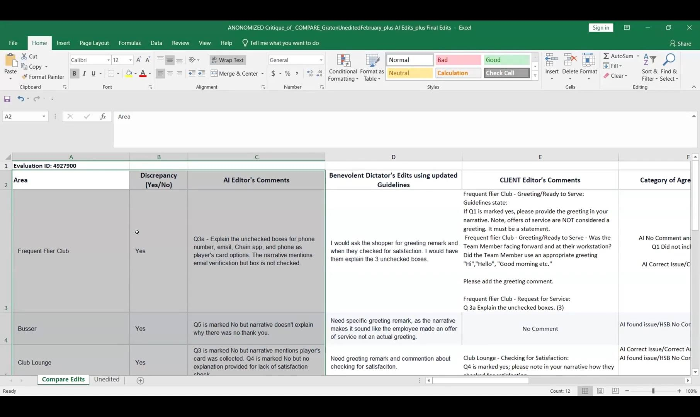
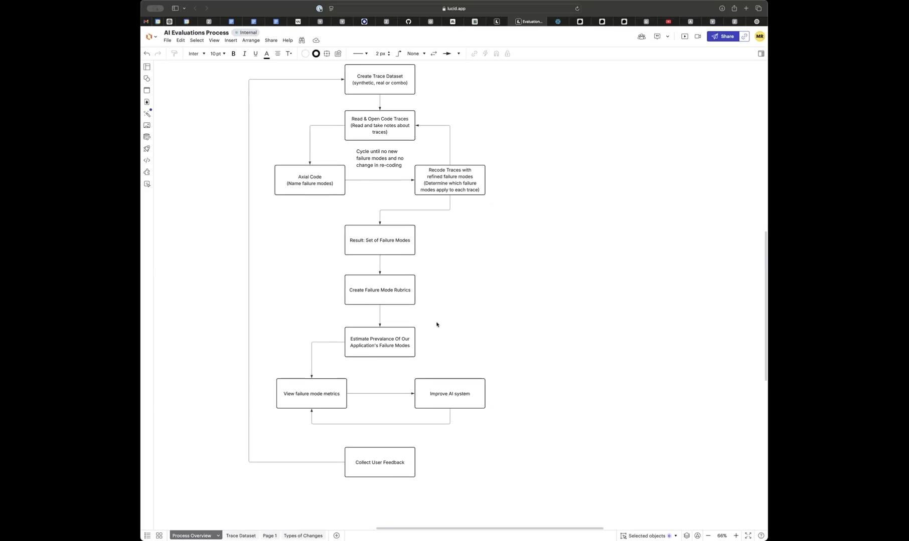
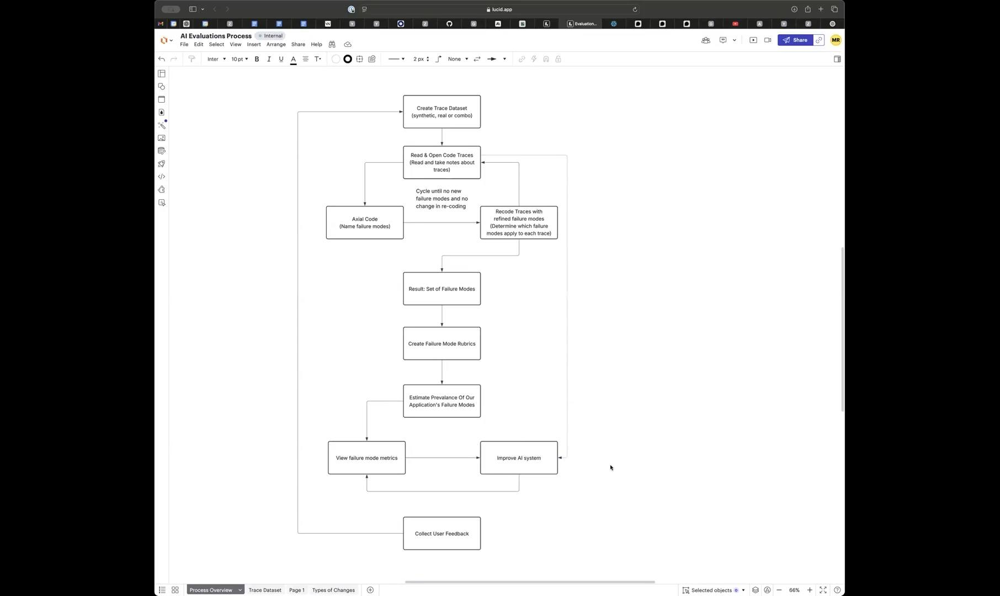
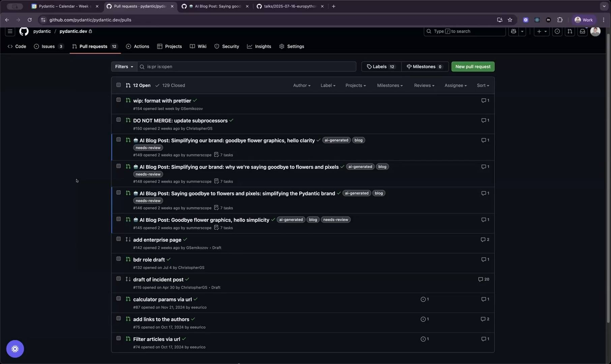
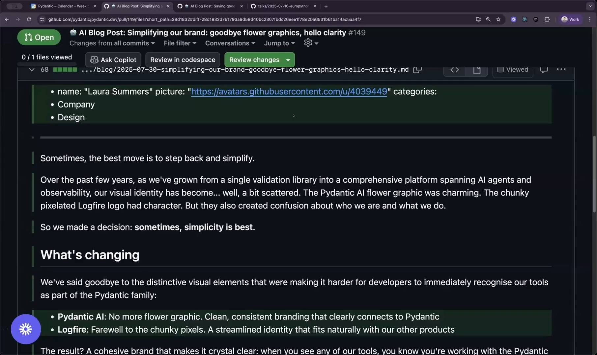

# AI Evals For Engineers & PMs —— P036 答疑课复现文档

> 课程：AI Evals For Engineers & PMs（Agent 评测），BV1FwTE6gEky
> 覆盖：P036（单集，约 66 分钟，答疑 / Office Hours 形式）
> 读者：前端转 AI 应用工程师

---

## 1. 这一节做什么

P036 不是一节"从零写代码"的课，而是一节**答疑课（Office Hours）**。讲师（Hamel、Shreya，以及参与讨论的学员）围绕学员带来的真实项目，把前面几十集讲的评测方法论落到具体场景里。这一节的核心产出不是某个可运行的程序，而是**一套可以直接照做的评测工作流**，以及围绕它的若干工程决策。

这一节要解决的具体问题有：

1. **非聊天类应用怎么做评测**：学员 Lucinda 做的是"神秘顾客（Mystery Shopper）"报告一致性检查，输入是几百到几千列的 CSV，输出是"某区域有无不一致 + 评论"。讲师给出如何把这种非 chat 输出做成可视化标注界面的方法。
2. **多模型对比怎么自动化**：学员 Dustin 想比较 4.1 和 5 两个模型，讲师给出 pairwise / k-way 对比 + 人类偏好 + LLM judge 的完整方案。
3. **Prompt 管理用什么工具**：答案是文本文件 + git。
4. **什么时候该微调 / RL**：讲师的判断是"永远不要停止 error analysis"，RL 只是叠在评测之上的一层。
5. **如何在组织里推动 eval 文化**：lead by example、用结果说话、把 eval 产物做成可追踪的 artifact。
6. **长输出（代码 + 校准值 + 推理链）怎么做错误修正**：用 AST 抽取人类必须核对的最小片段，再在界面上呈现。
7. **评测流程的整体心智模型**：学员画了一张流程图，讲师给出两条修正意见（"改进"应独立成节点并回连；迭代时可以跳过部分箭头）。
8. **失败模式优先级怎么和 PM 沟通**：不是所有失败等价，按业务影响而非纯计数排序。
9. **AI 写作系统怎么做 error taxonomy、怎么统一团队文风**：in-context 示例、先出大纲再逐节编辑、语音转文字降低摩擦。

因为这一节几乎没有讲师现场敲的代码，第 3、4 节我会把讲师给出的**方案落成可直接照做的产物**：目录结构、prompt 文件、评测脚本骨架、对比界面、AST 抽取脚本、优先级表。凡是我补的示意代码都会明确标注「课里没有代码，以下为示意」。

---

## 2. 讲师原话

下面按主题摘录讲师在 P036 里的关键判断（英文已译为中文，产品名保留英文）。

关于非聊天应用的可视化：

> "你可以照样做一个自定义界面。只不过大多数东西最后都是聊天，所以大家默认可视化就是聊天。但如果你做的是非聊天应用，你完全可以做一个为你的应用量身定制的可视化。"
> —— p036 [05:05]

> "我喜欢设计这类仪表盘的方式是：想象人类在表格里正在编辑的那一个单元格。他们编辑这个单元格、或者编辑一行里的多个单元格时，需要哪些信息？"
> —— p036 [08:19]

关于多模型对比：

> "如果你有定义得非常清楚的实验，想比较方法 A 和方法 B，那就做成对比较（pairwise comparison）。做一个界面，把两个回答并排展示，让人标出他更偏好哪个。Chatbot Arena 就是这么做的。"
> —— p036 [10:13]

> "你甚至可以做成 k 路比较，同时比较 k 个不同的模型。但只有当你这些 trace 之间唯一的差别真的就是模型时才能这么做。"
> —— p036 [10:43]

> "你也可以用一个 judge 模型来替代人类做这个偏好任务……但不要告诉它这是哪个模型，只说这是 trace 一、trace 二、trace 三，哪个最好。不过我总觉得用 LLM 做成对偏好，可能和你们自己的偏好不一致。LLM 有奇怪的偏见，有时候它特别偏爱啰嗦的表达。"
> —— p036 [11:11]

> "你甚至不需要做那么多次比较。100 次比较大概就能给你非常可靠的排名。"
> —— p036 [11:38]

关于 prompt 管理：

> "文本文件加 git。我不在乎它是不是文本文件。我所有 prompt 都用通用模板，但一定进 git。"
> —— p036 [12:32]

> "你可以用程序把 prompt 拉进代码里。你的 prompt 可能在 YAML 文件里，也可能在 Python 文件里。"
> —— p036 [12:58]

关于微调与 RL：

> "我一直发现，只要我有一个足够好的规格说明、做多轮 error analysis，我就能让 O3 这类需要推理或调用工具来解决我任务的模型表现相当好。"
> —— p036 [13:53]

> "如果是一条很简单的流水线、不需要多个工具，那我一般用 GPT 4.1 Nano 或 GPT 4.1 交替。分类用 4.1 Nano，抽取用 4.1。"
> —— p036 [14:21]

> "你永远不会停止做 error analysis。不存在你该停下来的场景。"
> —— p036 [15:19]

> "你需要为 reward engineering 做 error analysis，对吧？你怎么设计 reward？这百分之百、百分之二百都是 error analysis。而且 RL 也需要 evals，因为你得衡量 RL 到底有没有起作用。所以 RL 只是叠在我们教的东西之上的一层。"
> —— p036 [15:47]

关于在组织里推动 eval：

> "我的建议是以身作则，从你能想到的最简单的事情开始，先在你的工作流里跑起来。"
> —— p036 [17:12]

> "所谓以身作则，不是你去讲 evals，而是你直接给大家看你的结果：这是我做的，这些是我修掉的 bug，这是我怎么改进应用的，这是我开始时的错误率，这是我结束时的错误率。"
> —— p036 [17:41]

> "很多组织里，你必须造出 artifact 来证明你的产出。作为工程师，你写代码、提交代码、有 commit，你就知道自己有产出。但人们不会为 evals 造 artifact。你能不能建一个 repo，把你所有的 open code、axial code 放进去，数一数 commit？"
> —— p036 [20:29]

> "我会更进一步：把 artifact 写成一个叙事，定期发布。这些是我这周修的东西，这些是我这周抓到的错误，这是我学到的。他们甚至不知道 evals 这个词，这个词根本不出现。"
> —— p036 [21:26]

关于长输出与代码评测：

> "评测代码非常难。不幸的是，我们知道的评测代码的最好办法就是在某个环境里把它跑起来。我们就是这样抓 bug 的：跑起来，看输出是不是期望的输出。你甚至可以用 LLM judge 去看输出再判断。"
> —— p036 [24:49]

> "你可以做的一件事是：取 Python 代码的 AST（抽象语法树），然后用程序检查树里有没有节点是温度、压力这些你知道人类必须核对的东西。把这些最小化地抽出来，呈现在仪表盘或界面上让人审阅。"
> —— p036 [27:11]

> "把你所有的输出按类别或子集拆开。比如你有代码，你大概还有代码之前的推理链。你能不能把它格式化成 markdown，或者指示 LLM 格式化成人类非常容易审阅的样子？"
> —— p036 [28:00]

> "如果你能把这些东西抽出来给人审阅，光是这一点大概就能显著提升你的系统。甚至你可以强制 LLM 在生成完整输出之前先生成这部分。"
> —— p036 [28:29]

关于评测流程心智模型：

> "改进 AI 系统大概可以单独成为一个节点。它可以是改 prompt，也可以是做任务分解；而改进又可以回到估计失败率，也可以回到 open coding，因为你现在有了新 trace。"
> —— p036 [34:31]

> "有些箭头在第二、第三或第 n 次迭代时可以跳过，或者只是轻量地走一下。比如第一次做 open coding 很重要，但如果你有了新 trace 或用户反馈，也许可以跳过 open coding，直接回到应用 axial code。这需要你的判断。"
> —— p036 [35:23]

> "有一个心智模型是好事，但要知道它是个非常流动的过程。我经常直接从这一步跳到那一步。比如我觉得这是低垂的果实、根本不需要 eval，因为它就是个规格说明问题。"
> —— p036 [36:22]

> "重要的不是你给我看的这个 artifact，而是你为了造出这个 artifact 所经历的过程——这个过程把信息固化在你脑子里。"
> —— p036 [37:41]

关于失败模式优先级：

> "也许按计数是合理的，但不是所有失败都是平等的，它们的业务影响不一样。有些失败你可能要换个方式看，说这个虽然只发生 10%、5%，但它太糟了，所以哪怕另一个错误发生 15%，我们也要先修这个。"
> —— p036 [41:13]

> "你不需要搞得太复杂，去给每个错误赋权重、乘数字。希望你不必走到那一步，你只要知道这个更重要就行。因为你不希望在流程、代码或人身上引入复杂度。"
> —— p036 [41:39]

> "不是所有功能都是平等的。PM 上线的每个功能都是一个实验。你修的每个错误也一样，它应该被衡量、被庆祝，就像功能一样。"
> —— p036 [42:39]

> "还有很多人觉得 AI 没法改进，从 LLM 拿到的开箱结果就是那样，你能做的只有等下一个 GPT。你、我、这里所有人都知道这绝对不对。"
> —— p036 [43:08]

> "AI 不像其他软件 API。它的好坏取决于你投入多少努力去用它。"
> —— p036 [43:35]

> "你提到聚焦用户标记的错误做 error analysis，要确保那只是冰山一角。不要只盯着那些。始终保持怀疑，读 trace 的时候想：这里有没有别的出问题的线索？顺着味道追下去。"
> —— p036 [44:05]

关于 AI 写作系统：

> "说到 in-context 示例，这非常重要。我总是会带进一些我以前写过的博客文章，而且我得仔细挑选：我现在想要哪种风格？"
> —— p036 [49:12]

> "我总是确保先生成大纲，然后仔细审阅大纲：它讲得通吗？我几乎总要改点什么。如果你完全不用改大纲，那本身就是一个坏味道。"
> —— p036 [50:03]

> "在 AI 写作环境里，你真正想要的是能编辑输出。所以你要一次写一节。先让它给你一个计划，然后你编辑这个计划。"
> —— p036 [55:07]

> "编辑输出之所以重要，是因为等你写到第三节时，它已经牢牢锚定在你前进的方向上了。"
> —— p036 [55:36]

> "如果你想把人脑子里的东西掏出来，摩擦点就在于'我得坐下来写'。那就让人用语音转文字，给大家演示一个工作流。"
> —— p036 [51:47]

> "我有 transcript 到 blog post 的成对示例放在 in-context 示例里，这样 AI 能看到 transcript 和成稿之间的对应关系。"
> —— p036 [53:40]

关于用 Claude Code 学习课程内容（学员 Vladimir 分享，讲师认可）：

> "我把 Claude Code 连到你的代码上，然后说：用最高层次描述一下它是做什么的、为什么。……然后我说：现在深入讲 BM25，公式怎么算、分数怎么算。……然后说：考我，看我有没有概念性理解。"
> —— p036 [60:53]

> "Claude Code 有学习模式（learning mode），好像今天刚上线。你打开学习模式，它会在某些时刻暂停，让你自己动手做。"
> —— p036 [62:18]

---

## 3. 从零复现

这一节没有讲师现场敲的代码，所以"复现"指的是**把讲师给出的方案按步骤搭出来**。下面按学员问题分块，每块给出可照做的步骤。所有代码在第 4 节给完整文件。

### 3.1 复现 A：非聊天应用的标注界面（Lucinda 的神秘顾客场景）

**目标**：把"AI 对某区域有无不一致的判断 + 评论"和"人类编辑的判断 + 评论"放在同一个界面里，让编辑能快速核对，而不是在几千列的表格里翻。

**步骤**：

1. **确定数据来源**。Lucinda 的原始数据是从神秘顾客应用的 API 拉下来的 CSV，列数在 300 到 5800 之间。列的组织方式是：每个类别（frequent flyer club、busser、club lounge 等）下有一组问题列 + 一个叙述（narrative）列。
2. **确定 AI 输出结构**。AI 读叙述 + 问题答案，判断该类别是否存在不一致。输出两列：`discrepancy`（yes / no）和 `comment`（有则写具体问题，无则写 no comment）。
3. **确定人类输出结构**。编辑（editor）和"仁慈的独裁者"（benevolent dictator，编辑的上级）各自独立做 open coding，各自给出 comment 和 critique。
4. **确定比对口径**（讲师和 Lucinda 一起梳理的混淆矩阵）：
   - 真阳性：AI 说 no comment，编辑也说 no comment；或 AI 识别出正确问题，编辑也识别出正确问题。
   - AI 找到问题但编辑没找到：可能是 AI 太挑剔，也可能是 AI 更完整。
   - AI 找到的问题不完全对，但落在正确的区域。
   - AI 说 no comment，但编辑找到了问题。
5. **设计界面**。讲师的关键设计原则：**想象人类正在编辑的那一个单元格**，把这个单元格所需的所有信息放在一屏。所以界面按类别分屏：一屏只显示 frequent flyer club 的问题 + 叙述 + AI 评论 + 人类评论输入框，按"下一项"进入 busser，再进入 club lounge。不要把所有类别塞进同一屏。
6. **简化列**。Lucinda 自己提出：`discrepancy` 列其实可以去掉，只保留 `area` + `comment`，`no comment` 本身就表示该区域无不一致。讲师认可这个简化。

### 3.2 复现 B：多模型 pairwise / k-way 对比（Dustin 的场景）

**目标**：在 4.1 和 5 之间做自动化对比，且不想让 5 去评 5 和 4.1。

**步骤**：

1. **固定输入**。讲师强调的前提：**只有当你这些 trace 之间唯一的差别真的就是模型时**，才能做对比。不同输入之间不能直接比。
2. **跑 pipeline**。对同一批输入，分别用模型 A 和模型 B 跑完整 pipeline，得到成对的 trace。
3. **做人类偏好界面**。并排展示两个回答，让人标出偏好。这就是 Chatbot Arena 的做法。
4. **可扩展到 k 路**。同时展示 k 个模型的回答，让人选最好的。
5. **可选：用 LLM judge 替代人类**。把 trace 匿名成"trace 一、trace 二、trace 三"，不告诉 judge 是哪个模型，让它选最好的。讲师提醒：LLM 有偏见（偏爱啰嗦），可能和你的偏好不一致，所以人类偏好优先。
6. **控制样本量**。讲师给的数字：**100 次比较大概就能给出非常可靠的排名**。
7. **Dustin 的补充**：他们的输出最多两句话，不是完整 chat trace，所以人类比较很快。

### 3.3 复现 C：Prompt 管理

**步骤**：

1. 所有 prompt 存成文本文件（YAML / Python 文件都行），放进 git。
2. 用通用模板（general templating）。
3. 用程序把 prompt 从文件拉进代码，不要复制粘贴。
4. 讲师原话：文本文件 + git，不在乎具体格式。

### 3.4 复现 D：长输出（代码 + 校准值 + 推理链）的错误修正（Thomas 的场景）

**目标**：LLM 输出一段很长的 Python 代码（驱动移液机器人）+ 校准计算 + 实验推理，需要人类核对其中关键值。

**步骤**：

1. **拆分输出类别**。讲师建议把输出按子集拆开：代码、代码之前的推理链、校准值。
2. **代码部分先跑**。评测代码的最好办法是在环境里跑，看输出是否符合预期；可以再用 LLM judge 看输出。
3. **用 AST 抽取人类必须核对的最小片段**。取 Python 代码的抽象语法树，程序化检查树里是否有节点对应温度、压力等人类必须核对的值，把这些节点最小化地抽出来。
4. **在界面上呈现**。把抽出的片段放到仪表盘 / 界面里给人审阅。
5. **格式化推理链**。把代码之前的推理链格式化成 markdown 或步骤列表，让人类容易读。
6. **反向利用**。讲师指出：如果你能把这些抽出来给人看，光是这一点就能显著提升系统；甚至可以**强制 LLM 在生成完整输出之前先生成这部分**，这样它也会帮 LLM 自己想清楚。

### 3.5 复现 E：评测流程心智模型（学员画的流程图 + 讲师两条修正）

学员画的流程（讲师说第一部分直接取自讲师的图）：

1. 收集 trace
2. 对 trace 做笔记（open coding）
3. 给失败模式命名（axial coding），过程中如果失败模式的语言说不通就修正它
4. 得到一组失败模式
5. 为每个失败模式写 rubric，用来更自动化地判断它是否发生
6. 做人工评测，或写基于代码 / 基于 LLM 的自动评测器，估计失败模式的发生率（prevalence）
7. 可视化
8. 据此排优先级
9. 攻克最高优先级的失败模式，做改动
10. 重跑相关环节拿最新指标
11. 旁路：收集用户反馈，回流到第 1 步

讲师的两条修正：

- **修正一**："改进 AI 系统"应独立成一个节点，可以细分为改 prompt、做任务分解；改进要回连到"估计发生率"，也要回连到"open coding"（因为有了新 trace），还可以回连到"构建 trace 数据集"。
- **修正二**：迭代到第二、三次以后，有些箭头可以跳过或只轻量走一下。比如第一次 open coding 很重要，但有了新 trace 或用户反馈后，可以跳过 open coding 直接做 axial coding。这需要判断力。

讲师补充：心智模型要有，但过程非常流动，他经常直接从某一步跳到另一步；比如低垂的果实、本质是规格说明的问题，根本不需要 eval。

### 3.6 复现 F：失败模式优先级与 PM 沟通

**步骤**：

1. 用失败模式的发生率 × 对应的负面反馈数量来量化。
2. **不要纯按计数排序**。讲师：不是所有失败平等，业务影响不同；有的失败只发生 5%–10%，但太严重，要优先修。
3. **不要过度工程化**。不需要给每个错误赋权重、乘数字，只要团队知道"这个更重要"即可，避免在流程、代码、人身上引入复杂度。
4. **把修复当功能对待**。每个修复都应被衡量、被庆祝，像 PM 上线的功能一样。
5. **造 artifact**。做仪表盘、做 repo、数 commit，让不可见的改进变得可见。
6. **纠正"AI 无法改进"的误解**。AI 不像其他软件 API，它的好坏取决于你投入多少努力。
7. **保持怀疑**。用户标记的错误只是冰山一角，读 trace 时要顺着味道追其他问题。

### 3.7 复现 G：AI 写作系统的 error taxonomy 与团队文风统一（Laura 的场景）

**步骤**：

1. **输入端约束**。Laura 已经在做：要求用户输入 JSON 或 YAML 结构，而不是一句话 prompt。讲师认可这有帮助。
2. **in-context 示例**。讲师：至少放 3–4 个以前的例子；Laura 的做法是系统 prompt 里放一个正面示例，团队成员再各自叠加自己的示例。
3. **先出大纲，再逐节写**。讲师：总是先生成大纲，仔细审阅并修改；如果完全不用改大纲，那是坏味道。
4. **逐节编辑输出**。一次写一节，编辑完再写下一节；写到第三节时输出已经锚定在方向上。
5. **transcript → blog post 成对示例**。讲师自己的做法：用语音转文字 App（他用的是 Voice Pal，iOS）边走边讲，App 会追问；然后把 transcript 和成稿作为成对 in-context 示例。
6. **降低摩擦**。让工程师去散步、口述，而不是坐下来写。
7. **关于"每个人有自己的声音"**：Laura 问是否该给每个人一个版本（品牌规范 + 个性化）。讲师没有直接否定，而是强调 in-context 示例由各人自己挑选，这天然实现了个性化。
8. **关于 IDE vs 专用写作界面**：讲师认为纯写作任务，IDE 不一定是最合适的界面；但他自己也承认，因为生活是多维的（代码、播客、消息、课程材料都在一个 repo 里），最终还是会回到 Cursor 这类 coding agent，因为它能遍历整个 repo。他展示了自己的 repo 结构：lightning lessons、consulting 法务、tools、evals、抓 Discord 消息的脚本，根目录有 CLAUDE.md。

### 3.8 环境与依赖（本节复现用）

课里没有指定版本。以下是复现第 4 节示意代码所需的最小环境，版本号为写作时可用版本，**课里没讲具体版本**：

```
Python 3.11+
pytest 8.x
pydantic 2.x
pyyaml 6.x
```

前端部分（对比界面）用纯 HTML + 原生 JS，无需构建工具，直接用浏览器打开即可，符合"前端转 AI 应用工程师"的背景。

目录结构：

```
evals-p036/
├── prompts/
│   ├── mystery_shopper_consistency.yaml
│   └── blog_writer_outline.yaml
├── data/
│   ├── traces.jsonl
│   └── preferences.jsonl
├── src/
│   ├── load_prompts.py
│   ├── pairwise_compare.py
│   ├── ast_extract.py
│   └── priority.py
├── ui/
│   ├── annotation.html
│   └── pairwise.html
└── tests/
    └── test_ast_extract.py
```

---

## 4. 完整代码

> 说明：P036 是答疑课，讲师没有在屏幕上敲代码，本节也没有 OCR 结果。以下文件是**按讲师口述方案落成的示意实现**，每个文件开头标注「课里没有代码，以下为示意」。它们可以直接保存运行，用来复现第 3 节的流程。

### 4.1 `prompts/mystery_shopper_consistency.yaml`

```yaml
# 课里没有代码，以下为示意。
# 对应 3.1：神秘顾客报告一致性检查的 prompt。
# 讲师强调 prompt 存文本文件 + git（p036 [12:32]）。
name: mystery_shopper_consistency
version: 1
template: |
  你是一名神秘顾客报告的一致性审核员。

  下面是某个门店区域的问题答案与叙述。请判断二者之间是否存在不一致。

  区域：{area}
  问题与答案：
  {qa_block}
  叙述：
  {narrative}

  输出要求：
  - 如果不一致，第一行写 yes，第二行开始写具体哪一题标记了但没有解释、或与叙述矛盾。
  - 如果没有不一致，第一行写 no comment。
  只输出上述内容，不要额外解释。
```

### 4.2 `prompts/blog_writer_outline.yaml`

```yaml
# 课里没有代码，以下为示意。
# 对应 3.7：先出大纲、再逐节写。
name: blog_writer_outline
version: 1
template: |
  你是一名技术博客写作助手。风格参考以下 in-context 示例（transcript 与成稿的对应关系）：

  {in_context_pairs}

  现在根据下面的口述 transcript，先只输出一份大纲，不要写正文。
  大纲要求：3 到 6 节，每节一句话说明这一节要讲什么。

  transcript:
  {transcript}
```

### 4.3 `src/load_prompts.py`

```python
# 课里没有代码，以下为示意。
# 对应 3.3：用程序把 prompt 从 YAML 拉进代码，不复制粘贴。
import yaml
from pathlib import Path

PROMPT_DIR = Path(__file__).resolve().parent.parent / "prompts"


def load_prompt(name: str) -> dict:
    path = PROMPT_DIR / f"{name}.yaml"
    with path.open("r", encoding="utf-8") as f:
        return yaml.safe_load(f)


def render(name: str, **kwargs) -> str:
    spec = load_prompt(name)
    return spec["template"].format(**kwargs)


if __name__ == "__main__":
    text = render(
        "mystery_shopper_consistency",
        area="frequent flyer club",
        qa_block="Q4: yes\nQ5: yes",
        narrative="顾客描述了前台问候，但未提及任何具体问题。",
    )
    print(text)
```

### 4.4 `src/pairwise_compare.py`

```python
# 课里没有代码，以下为示意。
# 对应 3.2：同一输入跑两个模型，产出成对 trace 供人类偏好比较。
# 讲师强调：只有 trace 之间唯一差别是模型时才能比（p036 [10:43]）。
import json
import random
from pathlib import Path

DATA = Path(__file__).resolve().parent.parent / "data"


def run_model(model: str, user_input: str) -> str:
    # 课里没讲具体 SDK 调用；这里留一个桩，替换成你的真实调用。
    raise NotImplementedError("替换成你的模型调用")


def build_pairs(inputs: list[str], model_a: str, model_b: str) -> list[dict]:
    pairs = []
    for i, user_input in enumerate(inputs):
        out_a = run_model(model_a, user_input)
        out_b = run_model(model_b, user_input)
        # 随机左右，避免位置偏见
        if random.random() < 0.5:
            left, right, left_model, right_model = out_a, out_b, model_a, model_b
        else:
            left, right, left_model, right_model = out_b, out_a, model_b, model_a
        pairs.append({
            "pair_id": i,
            "input": user_input,
            "left": left,
            "right": right,
            "left_model": left_model,
            "right_model": right_model,
        })
    return pairs


def write_pairs(pairs: list[dict], path: Path) -> None:
    with path.open("w", encoding="utf-8") as f:
        for p in pairs:
            f.write(json.dumps(p, ensure_ascii=False) + "\n")


if __name__ == "__main__":
    # 课里没讲输入从哪来；这里假设你已有一批固定输入。
    inputs = ["示例输入一", "示例输入二"]
    pairs = build_pairs(inputs, model_a="model-a", model_b="model-b")
    write_pairs(pairs, DATA / "preferences.jsonl")
    print(f"写出 {len(pairs)} 对，讲师建议约 100 对即可得到可靠排名。")
```

### 4.5 `ui/pairwise.html`

```html
<!-- 课里没有代码，以下为示意。 -->
<!-- 对应 3.2：并排展示两个回答，人类标偏好。Chatbot Arena 式界面。 -->
<!DOCTYPE html>
<html lang="zh">
<head>
  <meta charset="utf-8" />
  <title>Pairwise 偏好标注</title>
  <style>
    body { font-family: system-ui, sans-serif; margin: 24px; }
    .row { display: flex; gap: 16px; }
    .col { flex: 1; border: 1px solid #ccc; padding: 12px; border-radius: 8px; }
    .input { background: #f6f6f6; padding: 12px; border-radius: 8px; margin-bottom: 16px; }
    button { padding: 8px 16px; margin-right: 8px; cursor: pointer; }
  </style>
</head>
<body>
  <h2>哪一边更好？</h2>
  <div class="input" id="input"></div>
  <div class="row">
    <div class="col" id="left"></div>
    <div class="col" id="right"></div>
  </div>
  <p>
    <button onclick="vote('left')">左边更好</button>
    <button onclick="vote('right')">右边更好</button>
    <button onclick="vote('tie')">平局</button>
  </p>
  <pre id="log"></pre>

  <script>
    // 课里没讲数据加载方式；这里用 fetch 读同目录下的 preferences.jsonl。
    let pairs = [];
    let idx = 0;
    const votes = [];

    async function load() {
      const res = await fetch("../data/preferences.jsonl");
      const text = await res.text();
      pairs = text.trim().split("\n").map((l) => JSON.parse(l));
      render();
    }

    function render() {
      if (idx >= pairs.length) {
        document.getElementById("input").textContent = "全部完成";
        document.getElementById("left").textContent = "";
        document.getElementById("right").textContent = "";
        return;
      }
      const p = pairs[idx];
      document.getElementById("input").textContent = p.input;
      document.getElementById("left").textContent = p.left;
      document.getElementById("right").textContent = p.right;
    }

    function vote(side) {
      const p = pairs[idx];
      votes.push({ pair_id: p.pair_id, choice: side });
      document.getElementById("log").textContent = JSON.stringify(votes, null, 2);
      idx += 1;
      render();
    }

    load();
  </script>
</body>
</html>
```

### 4.6 `src/ast_extract.py`

```python
# 课里没有代码，以下为示意。
# 对应 3.4：用 AST 抽取人类必须核对的最小片段（温度、压力等）。
# 讲师原话见 p036 [27:11]。
import ast
from pathlib import Path

# 课里没讲具体要抽哪些名字；这里按讲师举例的温度、压力给出可配置集合。
SENSITIVE_NAMES = {"temperature", "pressure", "volume", "speed"}


class SensitiveVisitor(ast.NodeVisitor):
    def __init__(self):
        self.hits = []

    def visit_Call(self, node: ast.Call):
        func_name = ""
        if isinstance(node.func, ast.Attribute):
            func_name = node.func.attr
        elif isinstance(node.func, ast.Name):
            func_name = node.func.id
        if func_name in SENSITIVE_NAMES:
            self.hits.append({
                "line": node.lineno,
                "call": func_name,
                "source": ast.get_source_segment(self.source, node),
            })
        self.generic_visit(node)


def extract_sensitive(code: str) -> list[dict]:
    tree = ast.parse(code)
    visitor = SensitiveVisitor()
    visitor.source = code
    visitor.visit(tree)
    return visitor.hits


if __name__ == "__main__":
    sample = Path("sample_robot.py").read_text(encoding="utf-8")
    for hit in extract_sensitive(sample):
        print(hit)
```

### 4.7 `tests/test_ast_extract.py`

```python
# 课里没有代码，以下为示意。
from src.ast_extract import extract_sensitive


def test_extract_temperature():
    code = "robot.set_temperature(37)\nrobot.aspirate(100)\n"
    hits = extract_sensitive(code)
    assert len(hits) == 1
    assert hits[0]["call"] == "temperature"
```

### 4.8 `src/priority.py`

```python
# 课里没有代码，以下为示意。
# 对应 3.6：失败模式优先级。讲师强调不要纯按计数，也不要过度赋权重。
# 这里用"发生率 + 严重度标签"两列，严重度由人判断，不乘数字。
FAILURE_MODES = [
    {"name": "outdated_content", "prevalence": 0.15, "severity": "high"},
    {"name": "missing_greeting", "prevalence": 0.40, "severity": "low"},
    {"name": "wrong_calibration_value", "prevalence": 0.05, "severity": "catastrophic"},
]

SEVERITY_ORDER = {"catastrophic": 0, "high": 1, "low": 2}


def rank(modes: list[dict]) -> list[dict]:
    # 先按严重度，再按发生率；不引入加权乘法。
    return sorted(modes, key=lambda m: (SEVERITY_ORDER[m["severity"]], -m["prevalence"]))


if __name__ == "__main__":
    for m in rank(FAILURE_MODES):
        print(m)
```

### 4.9 `ui/annotation.html`

```html
<!-- 课里没有代码，以下为示意。 -->
<!-- 对应 3.1：按类别分屏的标注界面。一屏只处理一个区域。 -->
<!DOCTYPE html>
<html lang="zh">
<head>
  <meta charset="utf-8" />
  <title>神秘顾客一致性标注</title>
  <style>
    body { font-family: system-ui, sans-serif; margin: 24px; max-width: 900px; }
    .block { border: 1px solid #ccc; padding: 12px; border-radius: 8px; margin-bottom: 12px; }
    textarea { width: 100%; min-height: 80px; }
  </style>
</head>
<body>
  <h2 id="area"></h2>
  <div class="block"><strong>问题与答案</strong><pre id="qa"></pre></div>
  <div class="block"><strong>叙述</strong><pre id="narrative"></pre></div>
  <div class="block"><strong>AI 评论</strong><pre id="ai"></pre></div>
  <div class="block">
    <strong>你的评论</strong>
    <textarea id="human"></textarea>
  </div>
  <button onclick="next()">下一项</button>

  <script>
    // 课里没讲数据格式；这里假设每个区域一条记录。
    const items = [
      { area: "frequent flyer club", qa: "Q4: yes\nQ5: yes", narrative: "……", ai: "yes\nQ4 标记了但没有解释。" },
      { area: "busser", qa: "Q1: no", narrative: "……", ai: "no comment" },
    ];
    let i = 0;
    function render() {
      const it = items[i];
      document.getElementById("area").textContent = it.area;
      document.getElementById("qa").textContent = it.qa;
      document.getElementById("narrative").textContent = it.narrative;
      document.getElementById("ai").textContent = it.ai;
      document.getElementById("human").value = "";
    }
    function next() { i = Math.min(i + 1, items.length - 1); render(); }
    render();
  </script>
</body>
</html>
```

### 4.10 `data/traces.jsonl`（示例结构）

```jsonl
{"trace_id": "t1", "area": "frequent flyer club", "qa": "Q4: yes\nQ5: yes", "narrative": "顾客描述了前台问候，但未提及任何具体问题。", "ai_comment": "yes\nQ4 标记了但没有解释。", "human_comment": "yes\nQ4 确实缺解释。"}
{"trace_id": "t2", "area": "busser", "qa": "Q1: no", "narrative": "桌面干净，无人清理。", "ai_comment": "no comment", "human_comment": "no comment"}
```

---

## 5. 逐行解释

### 5.1 `load_prompts.py`

- `PROMPT_DIR = Path(__file__).resolve().parent.parent / "prompts"`：从脚本位置反推项目根，再定位 `prompts/`。这样无论从哪个目录运行都能找到 prompt。对应讲师"用程序把 prompt 拉进代码"（p036 [12:58]）。
- `yaml.safe_load`：用 safe_load 而不是 load，避免执行任意 YAML 标签。课里没讲这个细节，是安全默认。
- `render` 用 `str.format`：简单够用。课里没讲模板引擎选型，讲师只说"通用模板"。
- 为什么存 YAML 而不是硬编码：讲师说 prompt 要进 git、要能 diff。YAML 文件在 git 里 diff 清晰，改一行 prompt 就是一次 commit，天然成为"artifact"（p036 [20:29]）。

### 5.2 `pairwise_compare.py`

- `run_model` 留 `NotImplementedError`：课里没讲具体 SDK，我不编造。你替换成自己的调用即可。
- `random.random() < 0.5` 随机左右：这是为了消除位置偏见。课里没讲这个细节，但讲师提到 LLM judge 有"奇怪偏见"（p036 [11:11]），人类同样有位置偏见，所以随机化是合理默认。
- `left_model` / `right_model` 记录在数据里但**不展示给标注者**：对应讲师说的"不要告诉它这是哪个模型"（p036 [11:11]）。标注界面只显示内容，模型名留在数据里供事后统计。
- 讲师给的样本量：100 次比较（p036 [11:38]）。脚本里打印这句提醒，避免你跑 5000 对浪费时间。
- 前提检查：讲师强调"只有 trace 之间唯一差别是模型时才能比"（p036 [10:43]）。脚本没有强制检查这一点，因为程序无法自动判断；这是**人的责任**，在文档里明确写出。

### 5.3 `pairwise.html`

- 用 `fetch` 读 `../data/preferences.jsonl`：纯静态，无需后端。前端背景的读者可以直接双击打开（注意：部分浏览器对 `file://` 下的 fetch 有限制，需要起一个静态服务器，例如 `python -m http.server`）。
- `vote` 把选择 push 进数组并实时打印：方便你复制结果。课里没讲结果怎么存，这是最简做法。
- 为什么不做成 chat 界面：讲师明确说"大多数东西最后都是聊天，但非聊天应用可以做定制可视化"（p036 [05:05]）。这里刻意做成并排文本，不是聊天气泡。

### 5.4 `ast_extract.py`

- `SENSITIVE_NAMES`：讲师举例是温度、压力（p036 [27:11]）。我加了 volume、speed 作为可配置项，**这四个名字是示意，不是讲师原话**。你应按自己领域替换。
- `visit_Call`：只检查函数调用节点。讲师说"检查树里有没有节点是温度、压力"，函数调用是最直接的对应。如果校准值是赋值语句（`temp = 37`），需要再加 `visit_Assign`，课里没讲这种情况。
- `ast.get_source_segment`：把命中的源码片段原样取出，方便在界面上展示。课里没讲这个 API，是实现细节。
- 为什么用 AST 而不是正则：正则会被字符串、注释误伤；AST 只看语法结构。课里没讲为什么，但这是讲师方案能"程序化检查"的前提。
- 输出 `line` 字段：让人能跳回原代码对应行，符合"最小化抽取给人类审阅"的目标。

### 5.5 `priority.py`

- `SEVERITY_ORDER` 用字符串排序而不是数字权重：直接对应讲师"不要赋权重、乘数字，只要知道这个更重要"（p036 [41:39]）。
- 排序键是 `(严重度, -发生率)`：先严重度后发生率。讲师的原话是"有的失败只发生 5% 但太糟了，要优先修"（p036 [41:13]），所以严重度优先。
- `catastrophic` 这个词是我加的标签，课里讲师说的是"catastrophic"这个英文词（p036 [41:13] 原话里有），所以保留。
- 没有乘法：如果写成 `prevalence * weight`，就违背了讲师"不要引入复杂度"的告诫。

### 5.6 `annotation.html`

- 按区域分屏：直接对应讲师"一屏只聚焦 frequent flyer club，编辑写完按下一项去 busser"（p036 [08:19]）。
- 四个区块（问题答案、叙述、AI 评论、人类评论）：对应讲师"想象人类正在编辑的那一个单元格，需要哪些信息"（p036 [08:19]）。
- 去掉了 `discrepancy` 列：Lucinda 自己提出可以去掉，只留 area + comment，`no comment` 即表示无不一致（p036 [07:27]）。界面里 `ai` 字段直接显示 yes/no comment + 评论，就是这个简化后的结构。

### 5.7 关于"在 JS/Node 里对应什么"

这一节涉及并发的地方很少，但有两处值得对照：

- `pairwise_compare.py` 里对每个输入串行跑两个模型。在 Node 里对应 `for...of` + `await`；如果要并发，用 `Promise.all`，但要注意 API 限流。课里没讲并发。
- `priority.py` 的排序在 JS 里对应 `Array.prototype.sort` 配比较函数，注意 JS 的 sort 是稳定的（现代引擎），Python 的 `sorted` 也是稳定的，所以同严重度内按发生率排的结果一致。

---

## 6. 复现检查清单

按顺序打勾，全部通过说明你把 P036 的方案跑通了。

**环境**

- [ ] Python 3.11+ 可用，`pip install pyyaml pytest pydantic` 成功
- [ ] 目录结构按 3.8 建好：`prompts/`、`data/`、`src/`、`ui/`、`tests/`
- [ ] `python src/load_prompts.py` 能打印出渲染后的 prompt

**A. 非聊天标注界面**

- [ ] `data/traces.jsonl` 至少两条记录，字段含 `area`、`qa`、`narrative`、`ai_comment`、`human_comment`
- [ ] 起静态服务器（`python -m http.server`），打开 `ui/annotation.html`
- [ ] 一屏只显示一个区域，点"下一项"切换
- [ ] 确认界面里没有 `discrepancy` 列（按 Lucinda 的简化）

**B. 多模型对比**

- [ ] 把 `run_model` 替换成真实模型调用
- [ ] 跑 `python src/pairwise_compare.py`，生成 `data/preferences.jsonl`
- [ ] 打开 `ui/pairwise.html`，能并排看到两个回答
- [ ] 标注时看不到模型名（只有内容）
- [ ] 标注约 100 对后能算出偏好比例

**C. Prompt 管理**

- [ ] 所有 prompt 在 `prompts/*.yaml`，没有硬编码在 Python 里
- [ ] `git log` 能看到 prompt 的修改历史

**D. AST 抽取**

- [ ] 准备一个 `sample_robot.py`，含 `set_temperature(...)` 调用
- [ ] `python src/ast_extract.py` 能打印出命中的行号和源码片段
- [ ] `pytest tests/` 通过

**E. 流程心智模型**

- [ ] 你能画出 3.5 的 11 步流程，并标出"改进"节点的三条回连箭头
- [ ] 你能说出至少两个"迭代时可以跳过"的箭头

**F. 优先级**

- [ ] `python src/priority.py` 输出排序，`catastrophic` 排在最前
- [ ] 确认代码里没有 `prevalence * weight` 这类乘法

**G. 写作系统**

- [ ] `prompts/blog_writer_outline.yaml` 能渲染
- [ ] 你准备了至少 3 对 transcript → 成稿示例
- [ ] 流程是"先大纲 → 人工改大纲 → 逐节写 → 逐节改"

---

## 7. 课里没讲但你会撞上的

1. **`file://` 下 fetch 被拦**。`ui/pairwise.html` 用 fetch 读 jsonl，直接双击打开在 Chrome 里会报 CORS。课里没讲，解决方法是 `python -m http.server 8000` 后访问 `http://localhost:8000/ui/pairwise.html`。

2. **YAML 里的 `{}` 和 `str.format` 冲突**。如果你的 prompt 里出现 JSON 示例（含 `{}`），`str.format` 会把它当占位符报 KeyError。课里没讲，解决方法是把 JSON 示例里的花括号写成 `{{` `}}`，或改用 Jinja2。

3. **AST 抽取漏掉赋值语句**。`ast_extract.py` 只处理 `visit_Call`。如果校准值是 `temp = 37` 这种赋值，需要补 `visit_Assign`。课里没讲，因为讲师只说了"检查节点"。

4. **pairwise 的位置偏见**。脚本随机了左右，但如果你事后统计时忘了把 `left_model` / `right_model` 还原，偏好率会算反。课里没讲统计细节。

5. **100 次比较的置信区间**。讲师说 100 次"大概"够（p036 [11:38]），但没说置信区间。如果你要对外报告，建议用 bootstrap 算区间。课里没讲。

6. **LLM judge 的偏见**。讲师明确说 LLM 偏爱啰嗦（p036 [11:11]），但没给校准方法。实践中要拿一批人类标注做对照，算 judge 与人类的一致率。课里没讲具体做法。

7. **"仁慈的独裁者"这个角色**。Lucinda 场景里 editor 和 benevolent dictator 是两个人独立做 open coding（p036 [03:39]）。课里没讲这个角色在别的组织怎么设，只在这个案例里出现。

8. **Claude Code 学习模式**。讲师提到"好像今天刚上线"（p036 [62:18]），课里没讲具体怎么开。以你实际版本的文档为准。

9. **`CLAUDE.md` 的位置**。讲师展示他的 repo 根目录有 `CLAUDE.md`（p036 [57:31]），但没讲里面写什么。这是 Claude Code 的项目级指令文件，具体格式以官方文档为准。

10. **Ruler 工具**。讲师提到 Eleanor 写的 `ruler`，能把规则编译到 Claude Code、Cursor 等多个 agent（p036 [58:59]）。课里没讲安装和使用，只提到名字。

11. **Voice Pal**。讲师用的 iOS 语音转文字 App（p036 [53:13]），课里没讲替代品。任何能"边走边讲 + 追问"的语音 App 都行。

12. **Perplexity Labs 生成教学 Web App**。学员 Vladimir 分享用它给女儿做扑克教程（p036 [64:43]），课里没讲具体 prompt。这是一个独立工具用法，和评测主线关系不大。

---

## 附：本节关键截图


上图对应 3.1：Lucinda 展示的匿名化报告，各区域（frequent flyer club、busser、club lounge 等）下是 AI 评论、编辑评论、客户编辑评论与一致性类别。



上图对应 3.1 第 1 步：原始 CSV 有 300 到 5800 列，这是"表格地狱"的根源，也是为什么要做定制标注界面。


上图对应 3.2：讲师解释成对比较、k 路比较，以及"trace 之间唯一差别必须是模型"这个前提。


上图对应 3.4 与讲师原话"你永远不会停止做 error analysis"：RL 的 reward engineering 本身就是 error analysis，RL 也需要 evals。


上图对应 3.4 第 2 步：评测代码的最好办法是在环境里跑，看输出是否符合预期，可再用 LLM judge。


上图对应 3.4 第 3 步与 `ast_extract.py`：取 Python AST，程序化检查温度、压力等节点，最小化抽出给人类审阅。



上图对应 3.5：学员画的 11 步流程图，从收集 trace 到排优先级、改进、重跑，旁路是用户反馈回流。



上图对应 3.5 的两条修正：改进应独立成节点并回连；迭代时可跳过部分箭头。


上图对应 3.6：不是所有失败平等，按业务影响排序，不要过度赋权重；每个修复应像功能一样被衡量和庆祝。



上图对应 3.7：Laura 的写作系统，输入端要求用户给 JSON/YAML，输出 markdown，工具调用推 PR。



上图对应 3.7 第 5 步：讲师展示 transcript → blog post 的成对 in-context 示例，以及"先大纲、逐节编辑"的工作流。