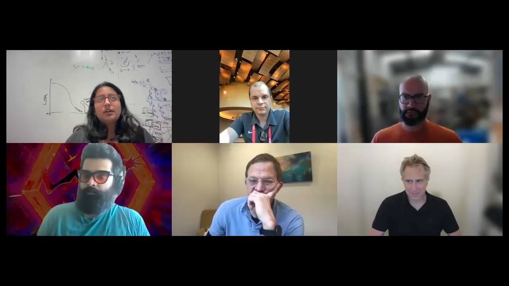

# AI Evals 答疑课（P037）：把评测落到可复现的工程

> **本节性质说明**：P037 是《AI Evals For Engineers & PMs》的直播答疑（office hours）专场，全长约 65 分钟。全程**没有安装命令、没有屏幕共享的代码、没有 PPT 代码页**，讲师是在 Zoom 里逐个回答学员问题。因此本文按「纯讲解课」的写法组织：第 3 节把讲师的判断还原成一条可以照着走的实施路径，第 4 节把讲师口述的方案落成决策表、组件职责表、数据模型草案和容量估算表，并附上**明确标注为示意**的代码，帮你在自己的仓库里落地。逐字稿与截图里都没出现的内容，一律标注「课里没讲」。

---

## 1. 这一节做什么

这一节不教新工具，它解决的是一个很具体的问题：**你已经学完了 error analysis、二元评估、LLM as a judge、标注界面这些东西，回到自己的项目里，仍然会遇到一堆"课上没直接对着我的场景讲"的决策**。讲师用一小时，把这些决策一个个拍板下来。

本节出现的问题，按主题可以归成五组，本文第 3 节就是按这五组重新组织的：

**第一组：微调与模型选型**
- 做完了 error analysis、也改了 prompt，还是有 edge case 过不去，要不要上 LoRA 微调？什么时候该上、代价是什么？
- 医疗账单这种「一次判断错就是 6 千到 2 万美元」的场景，模型该从贵的往下试，还是从便宜的往上试？

**第二组：RAG 的检索层**
- 单份文档 800 页到几千页、知识库几个 TB、还会持续增长，检索性能肉眼可见地退化，怎么办？
- 合同、变更单、图纸、规范之间互相冲突，文档优先级/修改/冲突的逻辑应该放在检索阶段还是生成阶段？
- 一个"暴力两遍扫描"的做法（先扫全文找目标、压缩成摘要塞进上下文、第二遍再让 LLM 找相关段落）值不值得，怎么评？
- 近 10 万份文档 + 大量客服转录，问题明显出在检索阶段，第一步评什么？

**第三组：LLM as a judge 的形式**
- 厂商发了一篇论文，用 1–5 分的 Likert 量表做 rubric，还让 LLM judge 跑七次取中位数，再算人机一致性（ICC）。这个做法能不能照抄？
- 二元评估 vs 分级评估，二元会不会丢信号？要不要同一个 eval 跑五次取多数？

**第四组：标注、反馈与基础设施**
- 想从用户那里拿到比"赞/踩"更细的反馈，怎么设计？
- 想要长期记忆，但不知道从哪下手，也不想因为"该记什么该忘什么"引入一堆 bug。
- trace 用什么工具采（Datadog / Braintrust / LangSmith），采完怎么导进自己的标注工具，标注结果存哪？
- 多轮对话、一轮里多次 LLM 调用，trace 该怎么建模？
- eval 想并行化、想在线上做监控和告警、甚至想用 agent 自动改 prompt，能做到哪一步？

**第五组：组织与合规**
- 大企业横跨 Azure、AWS Bedrock、Copilot Studio、低代码/专业代码，哪些 eval 实践可以中央统一推，哪些必须放给各业务线的 SME？
- 一个连数据管道都没有的小团队，该不该接这个活？怎么带他们入门？
- 怎么判断别人家的 AI 产品值不值得买？
- 引用（citation）和视觉定位（visual grounding）怎么在「摘要的摘要」里一路传下去？

这一节的产出**不是**一个能 `npm run dev` 起来的项目，而是一套**决策 + 数据模型 + 流程**。第 4 节会把它落成可以直接抄进仓库的表格和文件。

---

## 2. 讲师原话（带出处）

### 2.1 关于微调与 LoRA

> "LoRA 是一种做微调的方式，不要把它当成一个独立的类别。"
> —— p037 [02:20]

> "如果你要微调一个开源模型，那一定要用 LoRA，因为它能帮你在推理服务上省钱。但总的来说我不建议做微调，因为你必须考虑服务成本；对相当一部分流量来说，你自己起服务的成本其实比直接付钱给 OpenAI 买 completion（哪怕是微调后的 completion）更低，因为你得一直把服务器开着。"
> —— p037 [02:46]

> "而且每当基础模型更新、或者你的数据变化，你还需要重新训练；而训练这些 LoRA 也不便宜，如果你做得极其高效，SFT 的成本大概在 50 美元这个量级。"
> —— p037 [03:16]



> "大多数团队、甚至大多数组织都会有一个专门做微调的团队，或者一个小的 AI 推理 / AI 平台组。所以要把养这些人的成本、把基础设施和维护的成本都算进去——这真的比直接付钱给 OpenAI、或者用一个更贵的模型更划算吗？这由你决定。"
> —— p037 [03:40]

> "有一家创业公司叫 OpenPipe，他们基于你的数据样本和数据集来训练你的 LoRA。我觉得 OpenPipe 现在更正往强化学习方向走。"
> —— p037 [04:08]

> "你确实可以用强化学习来训练 LoRA。但除了那些大实验室，我没怎么见到有人在生产环境里用 RL 训模型。更常见的做法是所谓的监督微调，也就是 SFT，如果你到处看到这个缩写的话。"
> —— p037 [04:38]

### 2.2 关于长文档、文档链接与冲突

> "你提到的根本问题在于：文档之间是互相链接的，即使它们看起来并不明显相关。我之前在一家创业公司时，解决方案是投入去建这些表——对每一份文档，弄清楚所有可能影响它、或与它相关的文档，然后存在某个地方。"
> —— p037 [07:56]

> "当你的检索系统检索到某一份文档时，你在生成阶段其实应该把它所有的链接也一起检索出来，一起喂给 LLM。这是他们做的基线方案。我说，如果这不管用，再考虑更高级的做法，比如试着总结变更、或者把相关片段带上。"
> —— p037 [08:24]

> "在长上下文模型下，至少在那个医疗场景里，一个具体的账单案例或事件，关联文档不超过 10 份。所以你可以把它们全放进长上下文 prompt 里，或者让一个 agent 在上面推理、挑出相关的片段，再喂给 LLM 做最终生成。这个做法我见过，是行得通的。"
> —— p037 [08:53]

> "所以我会投资去建那样一张表：对每份文档，它链接到哪些文档、哪些文档可能影响它。维护这张表本身肯定是一个独立的数据处理任务，但值得做。"
> —— p037 [08:53]

> "可以考虑做一个项目本体（ontology）：从文档视角看它们是怎么连起来的，再从用户视角看——谁会问这个问题、谁需要这份文档。"
> —— p037 [09:20]


### 2.3 关于 LLM as a judge 的形式：二元优先，别自找复杂

> "首先，我从没听过 ICC 这个指标，我听过的是 IRR，也就是评分者间信度。这个我得去查一下。你可以在 Discord 上发一下，也许别人有看法。"
> —— p037 [12:36]

> "一般来说，我不觉得给 LLM judge 用 Likert 量表有多糟，我只是觉得要让一个 Likert 量表的 judge 对齐，工作量更大。那你为什么要把问题变难呢，明明可以从更简单的开始？事实证明，如果你把能试的都试了、二元分类还是做不出来，那才轮到增加复杂度。至少这是我们试图教的原则：一开始就搞太复杂，最后没人能做出一个好的 LLM judge。"
> —— p037 [13:03]

> "第二点是，这个中位数分数来自七次 LLM as a judge 的迭代，而且他们用的是 o3-mini。这里的成本可能高到对大多数人根本不可行。理想情况下，你的 LLM judge 只需要跑一次，不需要取中位数或者多数投票。"
> —— p037 [13:54]

> "还有人的因素。很难说清楚这整件事——到底用了多少人力、多少资源。它给我的感觉是：如果他们花了这么多钱、用了这么多人力，这不是最高效的做法。"
> —— p037 [14:21]

> "现在我看到大多数人卡住的地方是：rubric 得从零开始自己造。这些 rubric 是你在自己的应用里发现的、判定为错误的那些标准，没有人给你准备好一份完全对应的 rubric。你得一边把它造出来，一边还要让它和你的 judge 对齐。"
> —— p037 [16:14]

> "但如果这些 rubric 是某个领域里众所周知的，那我不会惊讶——OpenAI 和其他前沿模型很可能就是拿这些 rubric 训练的。"
> —— p037 [16:40]

> "所以，去做那个最不复杂的方案，尤其是在所有组件都得你自己发明的时候，然后在此基础上逐步增加复杂度。"
> —— p037 [17:10]

> "这个（1–5 分每一档都有定义的 rubric）已经比我看过的很多 Likert 量表 prompt 写得好多了。大多数 prompt 里，人们只会说'给这个输出按 1 到 5 打分'，甚至不会给每个数字一个定义。"
> —— p037 [17:39]


### 2.4 关于检索评测与两遍扫描

> "我觉得大多数人在做的就是你描述的事情，但他们尽量把能放到离线索引阶段的东西都放进去。比如，如果你已经有文档了，摘要就不需要实时做；基于摘要的检索也不需要实时做；再比如，如果你有某种本体、知道哪些文档互相影响，这些全都可以离线算好。"
> —— p037 [20:49]

> "所以我会说：对你 pipeline 里的每一步，都试着围绕它设计一个 eval——每一个 retriever 步骤，以及生成步骤。就像课程读本第七章说的那样：对检索，先造一些你明确知道 ground truth 落在文档哪里的 query、并且知道哪些文档是相互链接的，然后用检索指标去评。我会从那里开始。"
> —— p037 [21:44]

> "我暂时不会去担心生成阶段。我觉得你在检索那里大概就会学到很多东西。"
> —— p037 [22:14]


### 2.5 关于反馈粒度、记忆与「让用户自己引用」

> "我觉得你在做一个特定领域的产品，这非常好，因为现在你可以给他们做一个小表单，让他们想给更多反馈时填一下，而且极其简单。比如：话题对不对？是/否。所以我会先试着做一个三题的是非反馈表单，在每次点踩的时候出现，看看用户的接受度如何。"
> —— p037 [30:04]

> "而且这三个问题一定是你们领域专属的。我认识一个人给一个 AI 时尚应用做过，那个应用是推荐穿什么的。三个问题里有一个是：我们天气取对了吗？其他两个我记不清了，但非常、非常领域特定。这带来了很大的提升。"
> —— p037 [30:30]

> "二元反馈非常有用的另一个原因是，它可以直接喂给训练集：你现在所有的 trace 上就已经有 0/1 标签，可以直接拿去训练 LLM judge，不需要再做更多的开放编码或者 error analysis 才能到这一步。"
> —— p037 [30:56]

> "我觉得大多数 LLM 应用在没有记忆的情况下都跑得很差。所以对我来说，加记忆这件事：先把你其他的问题修好，然后再去看怎么把记忆做好。"
> —— p037 [31:22]

> "在 UI/UX 上，像 Cursor 这样的编码应用已经想明白了：让你在提交查询时引用其他文件。比如我输入一个 @ 某个文件，AI 就能把它当作参考。我觉得记忆也可以做得很类似：允许用户用 @ 符号在当前会话里引用之前的会话。这基本是一种'假'的做法。"
> —— p037 [31:51]

> "你其实不想走到那一步——不得不去决定记忆里该留什么、该扔什么，因为那会引入更多 bug。但如果用户真的很想要记忆，那可以让他们自己去引用之前的会话。这会是你需要多做的功能，但至少出错的锅不在你身上。"
> —— p037 [32:17]


### 2.6 关于自动化改进、重复跑 eval 与 prompt 优化器

> "如果你把自己限制在某一种特定类型的改进上，那你大概能搭出一个 agent 系统。比如，如果你知道存在某种错误模式，而且你知道你想通过改 prompt 来解决它，那你就可以用现成的 prompt 优化工具，或者自己搭一个 prompt 优化器：它提出一个 prompt 改动、在你的 evals 上跑一遍、看新的指标是多少，然后一直循环，直到它想不出更好的 prompt。我见过有人这么做。"
> —— p037 [34:38]

> "Prompt 优化器是存在的，也有像 Arise 这样的公司时不时做点小 demo，展示他们做的 prompt 优化器。"
> —— p037 [35:02]

> "但如果你想的是'改进我的应用'这个无限大的空间——比如加一个 RAG 组件，或者，我也不知道，把任务拆成更小的任务——这些我还没见到有人成功地用 agent 自动化，因为它定义得不够清楚。所以我的简短回答是：如果你知道你想自动化什么，就挑某一类改进，看看能不能为它搭一个 agent 系统。"
> —— p037 [35:29]

> "Omar 做了 DSPy（逐字稿里被识别成 DS Pi / DSPU），他明天有一场分享，是客座讲座，你完全可以去听。我觉得那是最常用的 prompt 优化工具。然后你直接 Google 'prompt optimizer'，看看别人都怎么做的，应该能搜到很多东西。"
> —— p037 [35:58]

> "我们没怎么聊过重复跑 evaluator 这件事。当你做二元评估时，如果它定义得足够清楚，你跑五次往往会得到同样的答案。但如果你做的是 Likert 量表评估、或者有更多的输出类别，那多次运行之间的方差会更大，多跑几次是有好处的。说实话，在生产环境或者自动化的 eval 任务里，我没怎么见到有人用同一个模型跑多次 eval 然后取多数。"
> —— p037 [37:26]

> "理想情况是：把东西做简单，然后相信 LLM 会变好、你的 prompt 会变好、对齐做得不错，于是你的 evals 就可以保持不变。当然，你想给应用增加多少复杂度，由你决定。我和 Hamel 从来不想公开主张'尽可能复杂'。"
> —— p037 [37:55]


### 2.7 关于引用与行号传播

> "我见过有效的做法——听起来会非常简单，但我确实见过它有效——就是在你的摘要 prompt 里，要求它为每个句子给出**行号引用**。然后拿到这些行号后，回到你的文档里，把那些行号对应的上下文取出来，比如起始行和行区间。这样你的摘要就等于：LLM 生成的摘要 + 那些行号对应的原文内容。而且随着你做摘要的摘要，你就一路把这个传下去。"
> —— p037 [39:48]

> "拿到原始出处的办法，就是永远向 LLM 要行号。如果你的文档没有行号，那你可以重新组织这份文档：在词边界上，每 80 个字符人为地换一行，然后给文档里每一行加上行号前缀。我在文档处理任务里经常这么做，这样我总能把行号拿出来。"
> —— p037 [40:43]

> "如果主要是 PDF，那就难了。我通常用 Azure 的 OCR 模型对我的 PDF 做 OCR，只是因为我觉得用起来更顺手。不是所有模型提供商都支持 PDF 处理；如果我想尝试不同的模型，手里有 OCR 出来的文本会很有帮助。Azure 对我的场景来说通常够用，即使格式有点奇怪。"
> —— p037 [41:12]

> "不过如果 PDF 里的数据你根本改不了，那要确保什么都很困难，这一点我完全理解。"
> —— p037 [41:41]

### 2.8 关于模型分层选型

> "每当我接到一个任务，我首先会想：这个任务里有哪些组件是彼此相当独立的。所以听起来可能'数字抽取'是一个任务，'文档摘要'是另一个任务。我会在心里记住：如果我想把准确率拉满、同时把成本压到最低，我很可能需要**每个子任务用不同的模型**。"
> —— p037 [43:08]

> "如果我知道这是一个非常非常难的推理任务或子任务，我会先用 o4.1 和现在的第五代模型（讲师自己也说记不清编号）去试。然后再往下走：如果我发现有哪个模型准确率很好，那也许就换成 4.1 mini。基本就是一路往下，降到满足我约束的最便宜的那个模型。"
> —— p037 [43:37]

> "如果我知道这个任务很简单，比如分类，那我就会用一个更便宜的模型，最便宜的那种，mini 级别或者 nano 级别，然后看它够不够好。这就是我随时间逐渐打磨出来的判断方式：这件事到底是一个推理任务，还是一个只要输出一两个词的分类任务。"
> —— p037 [44:05]

### 2.9 关于「怎么评估别人家的 AI 产品」

> "我没法想出有哪家公司在做完整的 eval 生命周期。这也是为什么……"
> —— p037 [46:58]

> "而且我觉得很多人的成功，是因为基础模型本身就太好了，根本不需要做 eval。真的就是这样：他们不需要做 eval，因为基础模型直接替他们做掉了。"
> —— p037 [47:27]

> "所以我会说，你现在做的很可能是对的：你问他们 eval 怎么做，他们大概只会聚焦其中很小一部分。他们可能会说'我们用 Braintrust 做 evals'，然后你就只能说，好吧，这除了告诉我你们至少把数据记下来了之外，什么也没告诉我。这是个很好的第一步，但也就到此为止了。"
> —— p037 [47:49]

> "这里是我的启发式：如果我觉得他们做的事我在 Claude Code 里也能做，那我就不会用他们的产品。就这样。"
> —— p037 [48:46]

> "参考 Teresa Torres 之前那场分享：这个班里任何一个人能做出她做的事吗？当然能。但别人拿不到她所有的访谈录像和转录稿。所以真正成为专有资产的是她投入的那个标注和反馈闭环的工作。这就是很多方案未来的差异化所在。"
> —— p037 [49:15]

> "百分之百。我觉得对每一个 AI 产品来说，差异就是他们的数据，以及他们有没有在做 eval 生命周期。因为如果他们在把自己的品味编码进产品里，那是看得出来的；否则，产品就是没有品味的。"
> —— p037 [49:45]


### 2.10 关于组织落地、工具选型与数据模型

> "我的启发式是：如果这个组织里没有一个稍微懂点数据的人，那我这个阶段就不想跟他们合作，因为那我就得变成那个人，我就得一头扎进他们的业务逻辑里，而我没有那个时间。"
> —— p037 [51:28]

> "你可以先想清楚：我愿意在这件事里扎多深？我有时间吗？我能基本上当他们的全职员工吗？如果只是一个月或两个月，那我得告诉他们：嘿，你们需要找一个在我离开后接手的人。"
> —— p037 [52:23]

> "我会把这件事表述成：先让他们进入一种心态——永远看你的数据，一开始永远对 LLM 保持怀疑，永远去看 AI 的输出。然后你根本不需要说出 'evals' 这个词，等到他们自己问出'我怎么把这个我已经在做的看数据的过程自动化起来'的时候，你再告诉他们：好，现在开始做开放编码、主轴编码，你可以围绕这个给他们搭一整套系统、搭一个界面。"
> —— p037 [53:21]

> "Teresa 今天早些时候的分享也是这样，对吧？她不是一开始就把所有东西都做齐了。她是用了好几个月，一步步把课程里讲的东西实现出来的：最开始用 Airtable 做某件事，后来发现有摩擦、想投入更多，就在上面又搭了一个界面，再后来她有了多个标注界面。她是随着时间推移逐步增加复杂度的。我觉得这在哪里都一样。"
> —— p037 [53:51]

> "这取决于你们组织有多成熟、有多大。比如，如果你已经有 Datadog、或者已经有软件可观测性工具，那就告诉大家也往那儿打一份日志，因为你需要的其实就是那些 trace。"
> —— p037 [56:13]

> "我一直觉得，如果你没有别的可观测性工具或供应商、想要一站式的 error analysis 加上 LLM 应用的产品分析这类东西，那 LangSmith 是不错的。我只想说，选一个 provider 一直用下去，尽量不要分散。这些供应商现在其实水平差不多，都不太行——大家在标注 app 这件事上都没有什么好策略。但你可以在把日志导出到标注 app 的这条管道上投入。"
> —— p037 [56:41]

> "如果标注 app 只有我一个人用，我总是在本地跑。如果要给领域专家或其他团队成员用，那我就会托管它——Modal 的人在这里做过一场分享，所以我用 Modal 托管一个 FastAPI + React 的标注应用，非常简单直接。然后所有标注结果都写回去，变成 LangSmith 里新的 metadata 列；或者我用 Postgres，可能我有点老派，但总之选一个地方用数据库存起来，然后做好和它的集成。"
> —— p037 [57:09]

> "我一直觉得 Braintrust 是往里放数据非常容易、用它们的界面也相对容易，但要把东西拿出来或者编辑，就很难。Datadog 当然成熟得多，但我没用过。LangSmith 相当不错，他们有一个非常简单的 API 可以拉数据出来，也可以调用 API 去编辑。"
> —— p037 [58:04]

> "我用 Postgres 数据库，因为我懂数据库，那些是最容易用的东西。"
> —— p037 [58:33]

> "Supabase 大概是现在 Postgres 数据库的领先/现代供应商吧。你连上去，我每个应用的库里都有一张 `traces` 表，一行一条记录，然后我会加上 metadata 列。"
> —— p037 [59:03]

> "我会把一条 trace 当成一行，而一条 trace 本身就是一个 JSON blob。我之所以用这个数据模型，是因为在我做过的所有应用里，人们都是在 trace 这个层级上做标注的，所以这样更省事。每个人的标注就是一个列。"
> —— p037 [59:32]

> "所以你会有一个 ID、一个 trace 的 JSON blob，然后每一列是某个人的某条标注。就这么简单。"
> —— p037 [60:01]

### 2.11 关于大企业集中推行 eval 与合规

> "我们设计整门课程时就尽量做到工具无关、供应商无关。但你不至于要给每个人开一个月的 eval 课。"
> —— p037 [61:20]

> "我觉得 eval 生命周期本身就是与工具无关的：分析、度量、改进。关键是让大家脑子里有'看自己的数据'这个习惯，至少教会他们 error analysis，然后也许再准备一些 FAQ。"
> —— p037 [61:48]

> "有件事我们这门课里没讲，但它不是 eval 专有的：如果你的数据因为监管原因必须隔离，那你就得确保你整个 AI 应用栈都建在那个特定区域里。比如你在欧盟，你就得确保用某个特定的供应商之类的。除此之外，从流程上说，哪里都差不多。"
> —— p037 [63:44]

> "真正会变的我看到的就是隐私。还有就是：这个应用需要多准？有些场景里 AI 需要比其他场景更准。你的组织要对这一点有清晰认识，并且知道，在某些领域，除非你已经建立了这样的准则——你造了合成数据、你为它们做了 evals，否则不要直接发 POC（概念验证）。"
> —— p037 [64:13]

> "我在没提前定义可接受错误率这件事上犯过错：深入一个项目之后，才发现他们其实是在要求生成式 AI 做到 0% 错误率。"
> —— p037 [64:43]


---

## 3. 从零复现：把这场答疑变成可执行的十步

这是一门纯答疑课，没有代码可以跑。所以「复现」在这里的含义是：**照着讲师给出的推导顺序，把一个从零开始的评测系统搭出来**。下面每一步都按「需求 → 约束 → 估算 → 方案 → 取舍」写。凡是没有明确交代的地方，我会标出来。

### S0 需求与约束盘点（先写下来，再动手）

从这场答疑里能抽出来的约束一共五类，你必须先把自己的答案写在一张纸上：

1. **成本约束**：微调要养服务、要养人、要重训（p037 [03:16]–[03:40]）；七次 judge 迭代会直接把成本乘七（p037 [13:30]）。讲师反复强调的一点是：先算钱，再决定复杂度。
2. **准确率约束**：不同场景要求不同（p037 [64:13]）。医疗账单场景里，一次判断错就是 6 千到 2 万美元（这是学员给的数字，出自 p037 [42:10]），因此在这里「0% 错误率」是幻想——讲师自己就吃过这个亏（p037 [64:43]）。
3. **可追溯约束**：医疗场景里，引用的准确性甚至比摘要本身更重要，还想要视觉定位（p037 [39:21]）。
4. **合规约束**：数据因监管而隔离时，整个 AI 应用栈要建在同一个区域内，比如欧盟（p037 [63:44]）。
5. **组织成熟度约束**：如果团队里没有哪怕一个稍微懂数据的人，讲师这个阶段不接（p037 [51:28]）。

**取舍**：这五条里任何一条不清楚，后面所有技术选择都是瞎猜。尤其第 2 条——先定「可接受的错误率是多少」，再谈 eval 设计。

### S1 先做 error analysis，再谈 LLM judge

顺序不能反。讲师说的路径是：先做 error analysis，把你在自己应用里发现的失败模式整理出来，**这些失败模式本身就是 rubric 的雏形**。他原话是「这些 rubric 是你在自己的应用里发现的、判定为错误的那些标准」（p037 [16:14]）。

**为什么不能跳**：因为没有人会给你一份跟你业务完全对应的 rubric。厂商论文里的 rubric（比如那个 PDSQI）可能已经被前沿模型训练过了，所以看起来效果不错，但那不会自动迁移到你的数据上。

**取舍**：第 5 题（Lucinda）正好是这个阶段——她已经到了「必须有一个标注员来帮忙拿反馈」的节点。讲师给的答案是：明天的上半场会讲，另外有一段约 45 分钟的 error analysis 视频（他把链接贴进了 Zoom 聊天）。这一段具体怎么录的，**课里没讲**。

### S2 把 judge 的输出形式定成二元（0/1）

**需求**：判断一条模型输出对不对。
**约束**：人力有限，且你还没有任何已验证的 judge。
**估算**：一个定义良好的二元 judge，跑一次就够了，不需要多数投票（p037 [37:26]）。如果用 Likert 量表，你得给 1/2/3/4/5 每一档写定义（讲师说很多 prompt 连这个都没有，p037 [17:39]），然后还得处理跑多次的方差。

**方案**：先写一个二元的 rubric：一个明确的判定标准 + 通过/不通过。
**升级条件**：只有当你把能试的都试了、二元分类确实做不出来时，才增加复杂度（p037 [13:03]、[17:10]）。这是整场答疑里被强调最多的一条原则。

**取舍**：二元会丢信号——有学员当场就问了「要不要跑五次，只要有一次是负面就当作有问题的信号」。讲师的回应很直接：如果二元 eval 定义得够清楚，五次往往给出同一个答案，白白多花五倍钱；只有在 Likert 或多输出类别、方差明显
算，**只有在这种方差明显的情况下才值得重复跑**。生产环境里，他没怎么见过「同一个模型跑多次取多数」的做法（p037 [37:55]）。在 JS/Node 里，如果你真要做，就是 `Promise.all` 并发发 N 次再 reduce 去重——但这属于你没被建议做的事，不是被建议做的。

> "当你做二元评估时，如果它定义得够清楚，你跑五次往往会得到同样的答案。但如果你做的是 Likert 量表评估、或者有更多的输出类别，那多次运行之间的方差会更大，多跑几次是有好处的。"
> —— p037 [37:26]

---

接着 S2 往下，把剩下的决策一步步推完。

### S3 给 pipeline 的每一步配一个 eval，且先评检索

**需求**：RAG 出问题时，你到底该改检索还是改生成？
**约束**：近 10 万份文档、大量客服转录，学员自己已经判断「大部分问题在检索阶段」（p037 [28:17]）。
**方案**：按照讲师说的，**为 pipeline 里的每一个 retriever 步骤和生成步骤各设计一个 eval**（p037 [21:44]）。具体到检索这一步的方法，他给了明确做法：先造一批 query，你**明确知道 ground truth 落在文档的哪里、也知道哪些文档是互相关联的**，然后用检索指标去评。
**顺序**：讲师明确说「我暂时不会去担心生成阶段，你在检索那里大概就会学到很多东西」（p037 [22:14]）。
**取舍**：为什么先评检索？因为检索一旦错了，生成阶段的 eval 失败你根本不知道是模型的问题还是没喂到正确上下文——你会把检索的 bug 算到 prompt 头上，然后开始无意义地改 prompt。


### S4 长文档互相冲突：把「文档链接表」做成离线数据资产

这是 P037 里信息密度最高的一段，来自建筑行业那位学员的问题：单份文档 800 页到几千页，知识库几个 TB，还会继续长；一份「定制橱柜的工作范围」写在合同里，但变更单里改了范围，图纸、规范、合同之间还可能互相矛盾。他的问题很精准：**文档优先级/修改/冲突的逻辑，应该放在检索阶段还是生成阶段？**

讲师的回答可以拆成四层，必须按顺序做：

**第 1 层（基线方案）**：建一张「文档 → 受它影响/与它相关的文档」的表。检索到某份文档时，把它所有链接的文档**一起**检索出来，一起喂给 LLM（p037 [07:56]、[08:24]）。
- 为什么这是根问题：文档即使在表面上不相关，实质上也常常是互链的（p037 [07:56]）。
- 这张表谁维护：它本身是一个独立的数据处理任务，需要持续更新，但值得做（p037 [08:53]）。
- 讲师在医疗 billing 场景里见过同样的问题：用药文档、更新版本、可能影响报销的病情条件，本质是一模一样的。

**第 2 层（长上下文直接兜）**：在关联文档数量不大时（医疗场景是「不超过 10 份」），直接把它们全塞进长上下文 prompt（p037 [08:53]）。

**第 3 层（agent 挑片段）**：或者让一个 agent 在这些文档上推理，**先独立地挑出相关片段，再喂给 LLM 做最终生成**（p037 [08:53]）。

**第 4 层（本体视角）**：再往上可以做「项目本体」——从文档视角看它们怎么连，再从用户视角看：谁会问这个问题、谁需要这份文档（p037 [09:20]）。

**冲突逻辑放哪？** 讲师的方案实际上把冲突解决**前置到了索引期**（第 1 层就是在编码「谁影响谁」），把「到底谁覆盖谁」的判断留给长上下文里的 LLM 去做（第 2/3 层）。他没有建议在检索期写一套硬编码的优先级规则引擎。这一点很重要：**规则引擎在文档数上万、变更频繁时会立刻腐烂**，而「链接表 + 长上下文推理」的维护成本是线性的。

**两遍扫描的做法怎么评？** 学员 Mitja 描述了自己那套「先扫全文找目标 → 做成摘要塞进上下文 → 第二遍让 LLM 找其他相关段落」的暴力做法，老实说「我还没做 eval，当然更贵、更慢，但价值高，所以我觉得不是问题」。讲师的回应是**架构性**的：

> "我觉得大多数人在做的就是你描述的事情，但他们尽量把能放到离线索引阶段的东西都放进去。比如，如果你已经有文档了，摘要就不需要实时做；基于摘要的检索也不需要实时做；再比如，如果你有某种本体、知道哪些文档互相影响，这些全都可以离线算好。"
> —— p037 [20:49]

也就是说：**做法本身不算错，错的是把它放在在线链路里**。摘要、链接表、本体，全部搬到离线索引阶段，线上只做查找。


### S5 没有 ground truth 时，反过来生成 ground truth

学员 Vlad 在做「把交易策略的文本描述翻译成代码」。他发现一个很有意思的失败模式：让模型生成代码，看起来完全符合描述；然后让它自我批判（critique），它自己会说「哦对，你漏了这点，你不该在这个点买入，方向搞反了」。

**讲师的解法是反向生成**，而且他说这在 text-to-SQL 里是常规操作：

> "我们一直用这个策略来做 text-to-SQL 应用。很多时候为了生成训练数据，我们会拿已经存在的 SQL 查询——比如 BI 工具里的——让一个 o3 级别的模型生成一个它认为能代表这条查询的自然语言提问。而且我们经常会指示它：这里加点歧义，或者把某个列名拼错，好真正贴近真实世界里人们的样子。然后我们用这个作为 eval 的 ground truth。"
> —— p037 [25:58]

**迁移到 Vlad 的场景**：你手里已经有真实的策略代码（ground truth 的代码），流程就是——
1. 代码 → 让 LLM 生成「策略的自然语言描述」；
2. 用这段描述喂给你的正向生成器 → 产出代码；
3. 拿产出的代码和你手里真实的代码做比对，这就是可量化的 eval。
4. 加分项：让第 1 步故意注入真实世界里的噪声（歧义表述、术语错位），模拟用户真实输入。

**取舍**：这条路只能覆盖「你已有代码的那部分策略」，覆盖不到全新策略；但它能在零标注成本下给你一批确定可判的样本，用来验证「文本→代码」这一步的准确率。

### S6 引用不能只在最后一层做，要一路传播行号

医疗场景的学员（Thilo）提出了全场最具体的工程需求：他们做的是摘要任务，而且是**摘要的摘要**，引用必须准，最好还能视觉定位（visual grounding）。讲师给的方案简单到有点反直觉，但他强调「我见过它有效」：

1. 在摘要 prompt 里，**要求它为每一句话给出行号引用**。
2. 拿到行号后，回到原文里，把那些行号对应的上下文（起始行、行区间）取出来。
3. 你的「摘要」从此等于两部分：LLM 生成的摘要文本 + 那些行号对应的原文。
4. 做「摘要的摘要」时，把这个结构原样传下去。

> "拿到原始出处的办法，就是永远向 LLM 要行号。如果你的文档没有行号，那你可以重新组织这份文档：在词边界上，每 80 个字符人为地换一行，然后给文档里每一行加上行号前缀。我在文档处理任务里经常这么做，这样我总能把行号拿出来。"
> —— p037 [40:43]

**PDF 怎么办**：讲师自己通常对 PDF 做 OCR，用的是 Azure 的 OCR 模型，理由是「用起来更顺手」，而且不是所有模型提供商都支持 PDF 处理——如果他想换模型试，手里有 OCR 出来的文本会方便很多。他承认 Azure 出来的格式有时奇怪，但对他够用。同时他也承认：**如果 PDF 本身不允许你改动数据，那要保证什么都很困难**（p037 [41:12]、[41:41]）。

**注意**：「每 80 字符换行」是一个具体参数，不是随口举例——他明确说这是他自己在文档处理任务里的常用做法。

### S7 模型分层的思路：按子任务路由，不是一个模型打天下

**需求**：医疗 billing，一次错 6 千到 2 万美元，不能乱省钱；但也不能全部用最贵的模型。
**方法**（p037 [43:08]）：先把任务拆成**彼此独立的子任务**。讲师举的例子是：数字抽取是一个任务，文档摘要是另一个任务。
**规则**：
- 难的推理任务/子任务：**先用最贵的推理模型**打底（他提到 o4.1 和「现在的第五代」，同时自己也说记不清编号了），然后**往下走**，直到找到满足约束的最便宜模型。
- 简单的分类任务（输出一两个词）：**从最便宜的 mini / nano 级模型往上试**，看够不够好。

**取舍**：这是一个「双向逼近」策略——难任务自顶向下降级，易任务自底向上确认。讲师明确说这是他自己随时间打磨出来的判断（p037 [44:05]），不是行业标准。

**注意**：逐字稿里模型编号被语音识别弄乱了（「404.1 和现在第五」「5.1 mini，抱歉，4.1 mini」）。**具体型号请以你实际可用的模型列表为准，课里没给出确定编号。**


### S8 先选一个 provider 采 trace，别再想第二个

**需求**：要能做 error analysis、能做标注、能上生产监控告警。
**方案**：
- 如果公司**已经有** Datadog 或别的软件可观测性工具：让他们也往那儿打日志，**因为你需要的其实就是那些 trace**（p037 [56:13]）。
- 如果什么都没有、想要一站式：LangSmith 是可选项（p037 [56:41]）。
- **最重要的那句**：「选一个 provider 一直用下去，尽量不要分散。」（p037 [56:41]）

**他对各家的评价**（原样保留，不做加工）：
- 这些供应商「水平其实差不多，都不太行」，大家在标注 app 这件事上都没有好策略。
- Braintrust：往里放数据非常容易，用它们的界面也相对容易，但**要把东西拿出来或者编辑就很难**。讲师说他自己在往外拉数据时确实遇到过麻烦。
- LangSmith：有非常简单的 API 可以拉数据出来，也可以调 API 去编辑。
- Datadog：成熟得多，但**他没实际用过**。

**取舍**：他的建议本质是「把复杂度预算花在导出管道上，而不是花在选型上」。

### S9 标注数据模型：一行一条 trace，一个人一列

这是全场最可以直接抄进代码库的一段。

> "我会把一条 trace 当成一行，而一条 trace 本身就是一个 JSON blob。我之所以用这个数据模型，是因为在我做过的所有应用里，人们都是在 trace 这个层级上做标注的，所以这样更省事。每个人的标注就是一个列。"
> —— p037 [59:32]

要解决的场景是学员问的：**一个用户回合里可能有多轮、多次 LLM 调用，trace 怎么结构化？** 讲师的答案就是上面这句——不管内部多少次调用，全部塞进那一个 JSON blob；标注粒度固定在 trace 这一行。

数据存放：
- 用 **Postgres**（p037 [58:33]）；他提到 Supabase 是现在 Postgres 比较主流的托管方（p037 [59:03]）。
- 表名他给的是 **`traces`**，一行一条记录，然后加 metadata 列（p037 [59:03]）。
- 标注结果两条去向：写回 LangSmith 作为新的 metadata 列，**或者**直接落在 Postgres 里（p037 [57:09]）。

标注 app 怎么托管：
- 只有自己用 → **本地跑**。
- 要给领域专家或团队成员用 → 托管。他用 **Modal** 托管一个 **FastAPI + React** 的标注 app，评价是「非常简单直接」（p037 [57:09]）。

**取舍**：为什么不用「一次 LLM 调用一行」？因为**标注的人是在 trace 这一层看完整对话的**，你按调用切碎，标注员就得自己在脑子里拼回一次交互，Annotation 的质量会掉。

### S10 用户端反馈：三题是非，领域专属

**需求**：用户只有赞/踩，太粗；他们想表达「这个话题对我有效，但这个具体方案不适用」。
**方案**（p037 [30:04]、[30:30]）：
1. 在用户点**踩**的时候弹一个**三题的是非表单**。
2. 三题必须**领域专属**。
3. 讲师举的例：某 AI 穿搭推荐的三个问题是「我们天气取对了吗？」加另外两个（他记不清了），效果是「带来了很大的提升」。
4. **变现路径**：这些 0/1 标签直接就是训练 LLM judge 的数据集——你不需要再做开放编码才能到那一步（p037 [30:56]）。

**取舍**：不做长表单、不做 Likert，因为用户不会填。三题是非是「拿得到数据」和「用户愿意填」之间的最小公倍数。

关于「AI 能不能从反馈里学、下次别再给我同样的答案」：逐字稿里讲师**没有**回答这一半问题，他在 [30:04] 开头说「这是两个问题，我先回答第一个」。**第二个（系统自动学习）课里没讲。**

### S11 长期记忆：先修别的问题，再用「假记忆」兜

**讲师的立场非常明确**：

> "我觉得大多数 LLM 应用在没有记忆的情况下都跑得很差。所以对我来说，加记忆这件事：先把你其他的问题修好，然后再去看怎么把记忆做好。"
> —— p037 [31:22]

**他推荐的 UX 方案**（借 Cursor 的做法）：让用户在查询里用 `@` 引用**之前的会话**，而不是系统自己决定记什么。原话是「你其实不想走到那一步——不得不去决定记忆里该留什么、该扔什么，因为那会引入更多 bug」（p037 [32:17]）。

**他坦承自己不懂这一块**：

> "说实话，我从没真正做过记忆，也没做过需要记忆的应用。"
> —— p037 [26:53]

他提到 Berkeley 一个 lab 里的人在专门做记忆、写了很多博客，并说「前身是 MGPT」（语音识别如此，**具体名字以他当时贴在 Zoom 聊天里的为准，课里没给准确拼写**），并建议去 Discord 里问别人。

### S12 自动化改进：只在「你知道要改什么」的窄轨道上做 agent

学员 Daniel 的设想是最激进的：eval 失败 → 通知 eval owner → owner 回去改 prompt 或改 eval 或忽略 → 希望这套循环最终被 agent 自动化。

**讲师划的边界**：
- **可以自动化**：如果你已经知道存在某种错误模式，并且确定要通过**改 prompt** 解决它，那就可以用现成的 prompt 优化工具，或自己搭一个循环：**提出 prompt 改动 → 跑 evals → 看新指标 → 继续循环，直到想不出更好的 prompt**（p037 [34:38]）。
- **不能自动化**：如果是「改进我的应用」这个无限空间——加 RAG、拆任务——他没见过有人成功用 agent 自动化，因为「它定义得不够清楚」（p037 [35:29]）。
- **工具**：他点名 **DSPy**（逐字稿识别为 DS Pi / DSPU，作者 Omar，第二天有客座分享），说是最常用的 prompt 优化工具；其余的直接 Google "prompt optimizer"（p037 [35:58]）。

还有一个衔接细节值得抄下来：学员问能不能把「deep eval 输出的失败理由」直接 pipe 进 prompt 优化器——讲师说「酷，谢谢」（p037 [36:27]），也就是**这是可行的接口设计**：eval 不只输出 0/1，还输出判定理由，理由作为优化器的输入。

### S13 组织推行与合规：中央统流程，业务线留 SME

学员 Tim 的处境：大企业，横跨 **Azure、AWS Bedrock、Copilot Studio、低代码/专业代码**，想引入 LangSmith 这类工具，问哪些能中央统一。

**讲师给的可统一 / 不可统一清单**：
- **可统一**：eval 生命周期本身——**分析、度量、改进**（p037 [61:48]）。这是工具无关、供应商无关的流程。
- **可统一的抓手**：教 error analysis；准备 FAQ；Hamel 正在写一个 **17 天的邮件通讯**，从整门课里挑最重要的东西，可以作为推行结构（p037 [61:20]、[61:48]）。
- **不可统一**：「人类独裁者」——也就是各业务线自己的领域专家。那必须按功能领域分开（p037 [63:14]）。
- **陷阱**：
  - **数据隔离**：如果数据因监管必须留在某区域（比如欧盟），整个 AI 应用栈（不只是模型）都得建在那个区域（p037 [63:44]）。
  - **准确率要求不同**：有的领域必须比其他领域更准，组织要对此有清晰认识；某些领域**在没建立准则前不要发 POC**——准则包括：造了合成数据、为它们做了 evals（p037 [64:13]）。
  - **讲师自己踩过的坑**：「我在没提前定义可接受错误率这件事上犯过错：深入一个项目之后，才发现他们其实是在要求生成式 AI 做到 0% 错误率。」（p037 [64:43]）

**关于小团队没有数据底子**（学员 Pastore 的问题）：如果组织里没有一个稍微懂数据的人，讲师这个阶段不接，因为「那我就得变成那个人」，而他没这个时间（p037 [51:28]）。他的建议是：先讲清楚你愿意扎多深、能不能当两三个月的全职员工，并且要求对方**在你离开后招人接手**（p037 [52:23]）。带入门的方式是**不出现「evals」这个词**，先让他们形成「永远看数据、永远怀疑 LLM、永远看输出」的习惯，等他们自己问「怎么自动化这个过程」，再教开放编码、主轴编码（p037 [53:21]）。

### S14 采购别人的 AI 产品时怎么评

讲师的启发式只有一句：**「如果我觉得他们做的事我在 Claude Code 里也能做，那我就不会用他们的产品。」**（p037 [48:46]）

但他马上补了例外：这个班任何人都能做 Teresa Torres 做的事，但别人拿不到她的访谈录像和转录稿。**差异化不在能力，在那份专有数据和那个标注/反馈闭环**（p037 [49:15]）。

他还提醒一个语义陷阱：你去问供应商「你们的 evals 怎么做」，对方很可能把 evals 等同于「LLM as a judge，实时在环」——而完全没做失败模式分析。如果他们说「我们用 Braintrust 做 evals」，那只说明他们至少把数据记下来了（p037 [47:49]）。

---

## 4. 完整代码

> **重要声明**：P037 是纯答疑，**课里没有出现任何代码、命令、配置文件，也没有 OCR 结果**。下面 4.3–4.6 的全部内容都是把这节课口述的方案落成可保存的产物，**属于本文的示意实现**，每一段都单独标注。表 4.1、4.2、4.7 是对讲师判断的整理，不是讲师给的表格。

### 4.1 设计决策表（讲师在每个岔路口的取舍）

| # | 决策点 | 讲师的选择 | 不这样会怎样 | 出处 |
|---|---|---|---|---|
| 1 | 微调 vs 继续调 prompt | 优先不建议微调；如果一定要微调开源模型，用 LoRA 降推理成本 | 要常驻服务、要养人、基础模型更新和数据变化要重训，SFT 本身约 50 美元量级 | [02:46] [03:16] [03:40] |
| 2 | 训练方式 | 用 SFT（监督微调）；RL 只在大实验室的生产里见过 | 走偏门，成本不可控 | [04:38] |
| 3 | judge 输出形式 | **二元 0/1** | Likert 要写五档定义、还要跑多次处理方差 | [13:03] [17:39] |
| 4 | judge 跑几次 | **一次**（二元定义清楚时） | 跑五次大约就是五倍成本换同一个答案 | [37:26] [37:55] |
| 5 | rubric 从哪来 | 从**自己应用的 error analysis** 里长出来 | 抄论文 rubric，未必对得上你的数据 | [16:14] |
| 6 | 文档冲突逻辑放哪 | 索引期建「文档→相关/受影响文档」链接表；生成期用长上下文推理 | 检索期硬编码优先级规则，文档一变就腐烂 | [07:56] [08:24] |
| 7 | 摘要/链接/本体在线上还是离线 | **全部离线算好** | 线上多一遍扫描，延迟和成本都翻倍 | [20:49] |
| 8 | 先评检索还是先评生成 | **先评检索** | 检索错会被误算成 prompt 问题 | [21:44] [22:14] |
| 9 | 没有 ground truth 怎么办 | **反向生成**：代码→自然语言→再生成→比对 | 只能靠人肉标注 | [25:58] |
| 10 | 引用怎么保真 | 摘要 prompt 要**逐句行号**，回溯原文，逐层传播 | 到最后没法定位原句 | [39:48] [40:43] |
| 11 | 无行号的文档怎么处理 | 每 80 字符在词边界换行 + 行号前缀 | 拿不到行号，引用链断掉 | [40:43] |
| 12 | 模型怎么选 | **按子任务分模型**；难任务自顶向下降级，易任务自底向上确认 | 一个贵模型打天下，成本失控 | [43:08] [43:37] [44:05] |
| 13 | trace 数据模型 | **一行一条 trace，trace 是 JSON blob，一个人的标注一列** | 按 LLM 调用切行，标注员看不到完整交互 | [59:32] [60:01] |
| 14 | 观测工具 | **只选一个** provider，投入建导出管道 | 多处分散，出问题时没有单一真相 | [56:41] |
| 15 | 标注 app 托管 | 自己用→本地；给别人用→Modal + FastAPI + React | 只做本地版，SME 用不上 | [57:09] |
| 16 | 用户反馈形式 | **三题领域专属的是非表单**，点踩时弹 | 长表单没人填，赞/踩又太粗 | [30:04] [30:30] |
| 17 | 记忆 | 先修别的问题；用 `@` 引用历史会话的「假记忆」 | 自己决定记什么/忘什么，引入 bug | [31:22] [32:17] |
| 18 | 自动化改进 | 只自动化**已知错误模式→改 prompt** 这一窄轨 | 想用 agent 改进整个应用，目标不明确，做不出来 | [34:38] [35:29] |
| 19 | 组织推行 | 统一**生命周期流程**，SME 留给业务线 | 强行统一领域判断，专家价值被抹掉 | [61:48] [63:14] |
| 20 | 上线门槛 | 先定义**可接受错误率**，某些领域没准则不发 POC | 项目做到一半才发现对方要 0% 错误率 | [64:43] |

### 4.2 组件职责表（谁负责什么）

| 组件 | 职责 | 输入 | 输出 | 讲师对它的态度 |
|---|---|---|---|---|
| Error analysis（人工） | 发现失败模式，长出 rubric | 真实 trace | 失败模式清单、候选 rubric | **一切从这里开始**，不可跳 |
| 二元 judge | 对单条 trace 判 pass/fail | trace + rubric | `0` 或 `1`（可附理由） | 首选，跑一次 |
| 检索 eval | 判断 ground truth 文档是否被取回 | query + 已知答案所在文档 | 检索指标 | **先评这个** |
| 文档链接表 | 每份文档 → 相关/受影响文档 | 文档集合 | 文档 → 文档 映射 | 离线数据处理任务，值得投入 |
| 行号化器 | 给文档加行号 | 原始文档 / PDF OCR 文本 | 每行带行号的文本 | 80 字符词边界换行 |
| 引用传播器 | 把行号沿「摘要的摘要」一路带下去 | 摘要 + 行号 | 摘要 + 原文片段 | 逐层传播 |
| 模型路由器 | 按子任务选模型 | 子任务类型 | 模型名 | 难→自顶向下，易→自底向上 |
| Trace 采集 | 打日志 | 应用调用 | trace | 只选一个 provider |
| 标注 app | 给人打标 | trace 行 | 标注列 | 本地 / Modal 托管 |
| 反馈表单 | 收用户细粒度信号 | 用户点踩 | 三条 0/1 | 领域专属三题 |
| Prompt 优化器 | 循环改 prompt 提升指标 | eval 指标 + 失败理由 | 新 prompt | 只在这条窄轨上做 agent |

### 4.3 数据模型草案（Postgres）

> **课里没有代码，以下为示意。** 表名 `traces` 和「一行一 trace、JSON blob、一人一列」的结构来自讲师原话 [59:03]–[60:01]；具体列名、类型、索引是本文为可执行而补的，不是讲师给的。

```sql
-- 示意：课里没有代码。
-- 讲师原话的结构：一行 = 一条 trace；trace 本身是 JSON blob；每个人的标注是一列。

CREATE TABLE traces (
  id           BIGSERIAL PRIMARY KEY,
  created_at   TIMESTAMPTZ NOT NULL DEFAULT now(),
  app          TEXT        NOT NULL,          -- 多应用共库时用来区分
  trace        JSONB       NOT NULL,          -- 整条 trace：一个用户回合内的全部 LLM 调用
  -- 下面是"每个人的标注就是一个列"的落地：先给三位标注员各一列
  annot_alice  SMALLINT,                      -- 0/1，二元判定
  annot_bob    SMALLINT,
  annot_carol  SMALLINT,
  -- 二元判定不够用时才加的辅助字段（讲师建议：先别加）
  annot_note   JSONB                         -- 可选：{"alice": "理由", ...}
);

-- 标注 app 最常见的查询：还没被某人标过的
CREATE INDEX traces_unannotated_alice
  ON traces (created_at)
  WHERE annot_alice IS NULL;

-- 需要按 trace 内部字段查询时（可选）
CREATE INDEX traces_gin ON traces USING GIN (trace jsonb_path_ops);
```

> 关于「多轮对话怎么放」：讲师的答案是**不用拆表**，全部进 `trace` 这个 JSONB。所以上面故意没有 `spans` 表——**课里没讲 span 级建模**。

### 4.4 行号化 + 引用传播（示意脚本）

> **课里没有代码，以下为示意。** 「每 80 字符在词边界换行 + 行号前缀」「摘要 prompt 要行号」「拿到行号回溯原文」「逐层传播」这四件事都出自讲师原话 [39:48]–[40:43]；函数实现是本文补的。

```javascript
// lineate.js —— 示意：课里没有代码。
// 目标：让任意文档都带行号，这样 LLM 永远能给出可回溯的行号引用。

const LINE_WIDTH = 80; // 讲师给的参数：80 字符

/**
 * 把一段文本按"词边界 + 每 80 字符"切行，并加上行号前缀。
 * 输出形如：
 *   1 | The scope of work includes custom cabinets.
 *   2 | Change order #12 modifies cabinet finish only.
 */
function lineate(rawText, width = LINE_WIDTH) {
  const words = rawText.replace(/\s+/g, ' ').trim().split(' ');
  const lines = [];
  let cur = '';
  for (const w of words) {
    if (cur.length === 0) {
      cur = w;
    } else if (cur.length + 1 + w.length <= width) {
      cur += ' ' + w;
    } else {
      lines.push(cur);
      cur = w;
    }
  }
  if (cur) lines.push(cur);
  return lines.map((l, i) => `${i + 1} | ${l}`).join('\n');
}

/**
 * 从 LLM 返回里抽出它引用的行号。
 * 约定让模型在句末输出 [L12] 或 [L12-L15]。
 */
function extractLineRefs(llmSummary) {
  const refs = [];
  const re = /\[L(\d+)(?:-L(\d+))?\]/g;
  let m;
  while ((m = re.exec(llmSummary)) !== null) {
    const start = Number(m[1]);
    const end = m[2] ? Number(m[2]) : start;
    refs.push({ start, end });
  }
  return refs;
}

/**
 * 拿行号回到原文取片段 —— 这就是讲师说的"摘要 = LLM 摘要 + 行号对应的原文"。
 */
function resolveRefs(lineatedText, refs) {
  const lines = lineatedText.split('\n');
  return refs.map(({ start, end }) => ({
    start,
    end,
    text: lines.slice(start - 1, end).join('\n'),
  }));
}

/**
 * 摘要的摘要：把上一层的 (summary + 引用的原文) 一起当作下一层的输入，
 * 让引用一路传下去。
 */
function buildSummaryPrompt({ lineatedText, previousLayer }) {
  const contextBlock = previousLayer
    ? previousLayer
        .map((s) => `摘要：${s.summary}\n原文片段：\n${s.evidence}`)
        .join('\n\n')
    : lineatedText;

  return [
    '你是一个严格的文档摘要器。',
    '规则：',
    '1. 每写一句话，句末必须用 [L起始行] 或 [L起始行-L结束行] 标注它依据的行号。',
    '2. 不允许写下没有行号依据的句子。',
    '3. 如果上下文互相冲突，请指出冲突双方各自的行号，不要自行裁决。',
    '',
    '待摘要内容：',
    contextBlock,
  ].join('\n');
}

module.exports = { lineate, extractLineRefs, resolveRefs, buildSummaryPrompt };
```

> 说明：`[L12-L15]` 这个标记格式是本文约定的，**课里没规定格式**，讲师只说要「向 LLM 要行号」。你可以换成 `[12-15]` 或 JSON 输出。

### 4.5 二元 judge 的 rubric 模板

> **课里没有代码，以下为示意。** 「先二元」「每档要有定义」「rubric 来自你自己的 error analysis」出自 [13:03]、[17:39]、[16:14]。

```json
{
  "name": "billing_code_matches_contract",
  "version": 3,
  "type": "binary",
  "created_from": "error_analysis_2025_xx（课里没给日期，此处占位）",
  "definition": {
    "pass": "输出中的计费代码与合同条款一致；若存在变更单（change order），以变更单为准；且引用的行号能在原文中定位到对应条款。",
    "fail": "出现以下任一情况即判 fail：(a) 计费代码与合同或变更单不一致；(b) 遗漏了某份通过链接表关联的文档中的修改；(c) 没有给出可定位的行号引用。"
  },
  "judge_prompt": "你将看到一条 trace 和一份 rubric 定义。请只输出 JSON：{\"result\": 0 或 1, \"reason\": \"一句话说明\"}。不要输出分数区间，不要输出 1-5 分。",
  "runs": 1,
  "notes": "先跑一次。只有当二元定义清楚后仍出现明显方差时，才考虑增加 runs。"
}
```

### 4.6 三题领域专属反馈表单定义

> **课里没有代码，以下为示意。** 「点踩时弹三题是非表单」「题目必须领域专属」出自 [30:04]、[30:30]；穿搭应用的例子（「我们天气取对了吗」）是讲师转述别人的案例。

```json
{
  "trigger": "thumbs_down",
  "questions": [
    { "id": "right_topic",    "type": "boolean", "text": "我们命中的是你要问的那个话题吗？" },
    { "id": "right_solution", "type": "boolean", "text": "这个具体方案适用于你的情况吗？" },
    { "id": "actionable",     "type": "boolean", "text": "你能照着这个答案去操作吗？" }
  ],
  "storage": "每条回答写成一个独立的 0/1 列，和 trace 同表（见 4.3）",
  "why": "0/1 标签可以直接拿去训练 LLM judge，不需要额外的开放编码"
}
```

> 注意：上面三题是本文按讲师的「话题对不对 / 方案适不适用」翻译成的占位题目，**讲师只给出了穿搭应用的天气例子**，工程行业的具体题目要你自己按领域写。

### 4.7 容量估算表（写算式，价格用你自己账单里的数字）

课里**没有给任何单价**，所以下表全部用符号，你把真实单价代进去。

| 项目 | 算式 | 代入示例（占位符） | 结论 |
|---|---|---|---|
| 单条 trace 的 judge 成本 | `(输入 token × 输入单价) + (输出 token × 输出单价)` | 输入 2000 tok、输出 50 tok | 记为 `C` |
| 每日 judge 成本（二元，跑 1 次） | `N × C` | N = 10000 条/天 | `10000C` |
| 每日 judge 成本（Likert，跑 7 次取中位数） | `N × C × 7` | 同上 | `70000C` ← 讲师说这在大多数场景不可行 |
| 一条 trace 的 judge 成本（跑 5 次取多数） | `C × 5` | — | 五次 `5C`，二元时常与 `C` 同结论 |
| LoRA SFT 一次性成本 | 讲师给的是约 **50 美元**量级（做得极高效时） | `≈ $50` | [03:16] |
| 微调后的常驻服务成本 | `实例数 × 实例小时单价 × 730 小时/月` | 课里没给实例规格 | 这是「不建议微调」的主因 [02:46] |
| 微调重训成本 | `SFT 成本 × 数据变化次数 × 基础模型更新次数` | 课里没给频率 | 持续支出 [03:16] |
| 人工标注成本 | `待标 trace 数 × 单条分钟数 / 60 × 小时人力单价` | 讲师：关联文档「不超过 10 份」，长上下文可一次塞入 | 评检索优先，能省掉大量生成侧标注 |
| 两遍扫描 vs 离线索引 | 线上：`2 × 全量扫描成本`；离线：`1 × 全量扫描成本` 摊销 | — | 讲师明确要求搬到离线 [20:49] |

---

## 5. 逐行解释：每个决策为什么这样定

**决策 1–2（微调 vs prompt）**：讲师不是反对微调，他反对的是**没算总账**。判断一个微调决定是否成立，需要三项之和小于「直接付 API 的钱」
成立。三项是：一次性 SFT/训练成本、常驻推理服务的月度成本、以及因数据变化和基础模型更新带来的重训成本。讲师给的 SFT 数字是「50 美元量级」，但那个 50 美元只是**训练**那一下的钱，不含服务、不含人。他在 [03:40] 里明确说还要算「养这些人的成本、基础设施和维护的成本」。所以在 JS/Node 语境下理解这件事很直接：一次性训练成本相当于 `npm run build` 的耗时成本，**服务成本相当于你 24 小时挂着的容器**——后者是按月计费的固定支出，不会因为你流量小就变少。小流量场景下，"常驻一个 GPU 实例" 的钱往往比"按 token 付 API" 加起来还多，这就是他不建议微调的算术原因。另外还有一条容易被忽略的：基础模型一更新、数据一变化就得重训，这是一个**随时间的重复项**，不是一次性支出。

**决策 3–5（judge 形式）**：这三条是一根链条。先二元，是因为二元的判定边界最短——你只需要写清楚"什么算过、什么算不过"，而 Likert 需要你为 1/2/3/4/5 **每一档**写定义（讲师原话是很多 prompt 连这个都不做，[17:39]）。定义越多的档位，对齐成本越高，而人类标注员和 LLM judge 之间的分歧点也越多。跑一次的结论，是建立在"二元定义清楚时方差很小"这个经验上的：他说如果定义够清楚，「跑五次往往会得到同样的答案」[37:26]，那多跑四次就是纯烧钱。什么情况下才需要加复杂度？他给的触发条件是**"你把能试的都试了、二元还是做不出来"**[13:03]，不是"我想做得更精细"。rubric 从哪来这一条尤其值得记：厂商论文里那些 1–5 分的量表（他提到那个 PDSQI）之所以看起来工作得不错，很可能是因为**它已经在互联网上、已经被前沿模型训练过了**[16:40]——这意味着它在你的私有数据上不一定成立，你不能拿它当基线，只能当起点。

**决策 6–9（RAG 架构）**：这四条其实是同一个架构主张的四个面——**把能离线做的都离线做**。文档链接表放在索引期，是因为它是一份「谁影响谁」的静态关系，线上每次查询都重算一遍毫无意义。冲突逻辑不写规则引擎，是因为文档数和变更频率决定了规则会腐烂；而"把相关文档和它们的链接一起塞进长上下文让模型去裁决"这条路，维护成本随文档线性增长、不随规则组合爆炸。讲师在 [08:53] 给的量级很关键：医疗场景里一个案例关联文档「不超过 10 份」——**这是长上下文方案能成立的前提**。如果你自己的场景里一个案例关联 80 份文档，那就不该照搬，得先做第 3 层的 agent 挑片段。先评检索的原因在 [22:14]：检索一旦错，生成阶段的 eval 失败就无法归因，你会把检索 bug 算成 prompt 问题。反向生成（决策 9）是一条零标注成本的路子，但它有明确的适用边界：**只覆盖你已有答案的那部分输入**。讲师在 [25:58] 说他们会故意让模型在生成的 query 里「加点歧义，或者把某个列名拼错」，这个细节的价值在于：它让合成的 eval 数据带上真实世界的噪声分布，否则你会得到一个"eval 上 99 分、线上一塌糊涂"的系统。

**决策 10–11（引用保真）**：行号方案之所以有效，是因为它把"引用"从一个**语义问题**降级成了一个**字符串问题**：你要的不是模型说"这几句来自合同"，而是它给出 `[L42-L47]`，然后你自己去原文里把那六行抠出来。前者没法验证，后者可以逐字比对。80 字符在词边界换行这个参数，本质是**给没有行号的文档人工造出行号**——它不追求排版美观，只追求"每一行都有一个稳定、可复现的编号"。这里有个隐含要求：行号化必须是**确定性**的。同一份文档今天切出 1200 行、明天切出 1198 行，那所有历史引用全部失效。所以这个函数不能有任何随机性或依赖当前时间。

**决策 12（模型选型）**：自顶向下的理由是**避免在难任务上浪费迭代时间**：如果你先用便宜模型试，它失败了，你无法区分"任务太难"还是"模型太弱"，你会反复调 prompt 而永远不知道瓶颈在哪。先用强模型把"这个任务本身能不能做到"确认下来，再往下换，每一次降级都是一个干净的对照实验。自底向上的理由是**避免为简单任务付溢价**：一个只输出"是/否"的分类任务，用最强的推理模型不会更准，只会更贵更慢。这套逻辑在 Node 里落地就是一张路由表——`switch (taskType) { case 'extract': return cheapModel; case 'reason': return strongModel; }`，不要写成全局一个模型常量。

**决策 13–15（基础设施）**：一行一条 trace 这个数据模型，唯一目的就是**让标注员的认知负担最小**。标注是在 trace 层做的，所以存储也必须以 trace 为最小单位；如果你按 span 或按单次 LLM 调用切行，标注员要么得在脑子里把碎片拼回去，要么得写 join 把它们拼回来——两种都是浪费。JSONB 而非拆表的取舍是：**牺牲可查询性换写入简单**。你确实不能用普通索引高效查 trace 内部的深层字段，但讲师的选择是"先别管这个"。只选一个 provider、把精力投在导出管道上，是因为他判断这些工具"水平差不多，都不太行"[56:41]——在供应商能力趋同的阶段，选型没有边际收益，**能把数据搬出来**才有。

**决策 16–17（反馈与记忆）**：三题是非表单的设计约束是"用户愿意填完"。做长表单、做 Likert、做开放式输入，都会把填写率打到接近零。而三条 0/1 的边际价值极高：它们直接就是 judge 的训练集，省掉了从原始 trace 到标注数据之间的开放编码阶段[30:56]。记忆用 `@` 引用历史会话，本质是**把"记什么、忘什么"的决策权转移给用户**。讲师说得很直接：系统自己做这个决定「会引入更多 bug」[32:17]。这是个典型的风险转移设计——功能变弱了（不是自动记忆），但错误的责任边界变清晰了。

**决策 18（自动化）**：可以自动化的窄轨是"已知错误模式 → 改 prompt → 跑 eval → 看指标 → 循环"，因为它有**明确的搜索空间**（prompt 文本）和**明确的适应度函数**（eval 指标）。不可自动化的是"改进我的应用"，因为搜索空间无限大、适应度函数不明确[35:29]。他在 [36:27] 对"把 eval 的失败理由 pipe 进优化器"这个提议表示认可，说明**eval 的输出设计成"0/1 + 理由"而不只是"0/1"**是有必要的——理由就是优化器的输入梯度。

**决策 19–20（组织与门槛）**：可统一的（分析、度量、改进的流程）之所以可统一，是因为它**不依赖领域知识**；不可统一的（谁是"人类独裁者"）之所以不可统一，是因为它**完全依赖领域知识**。把这两者混在一起推，结果是业务线觉得你在瞎指挥、你觉得业务线不配合。上线门槛那一条是全场最痛的教训：讲师自己「深入一个项目之后，才发现他们其实是在要求生成式 AI 做到 0% 错误率」[64:43]。这个信息如果不在项目第一天问出来，你后面所有的 eval 设计都会指向一个不可能达成的目标。

#### 5.10 逐行解释 4.3 的 SQL

- `CREATE TABLE traces`：表名来自讲师原话，他说的就是「每个应用的库里都有一张 `traces` 表」[59:03]。
- `id BIGSERIAL PRIMARY KEY`：讲师说「你会有一个 ID」[60:01]。
- `trace JSONB NOT NULL`：这一列是整个设计的核心，对应「一条 trace 本身就是一个 JSON blob」[59:32]。用 `JSONB` 而不是 `JSON`，是因为前者支持 GIN 索引和路径查询；用 `TEXT` 存 JSON 字符串则完全查不了内部字段。
- 三个 `annot_* SMALLINT`：对应「每个人的标注就是一个列」[60:01]。用 `SMALLINT` 存 0/1 而不是 `BOOLEAN`，是为了留出"未标注"这个第三态——`NULL` 表示没人标过，`0` 表示判 fail，`1` 表示判 pass。如果直接用 `BOOLEAN`，`NULL`/`FALSE` 的区分经常在 ORM 层被吃掉。
- `annot_note JSONB`：**这是本文补的、不是讲师要求的**。他只说二元。加这一列是因为他后来在 [36:27] 认可了"把失败理由传给优化器"这条路，而理由必须有地方存。
- `CREATE INDEX ... WHERE annot_alice IS NULL`：部分索引（partial index）。标注 app 打开时第一条查询永远是"给我一条我还没标过的"，这个索引直接服务那条查询。不加索引，10 万行扫描会明显卡。
- `CREATE INDEX ... USING GIN (trace jsonb_path_ops)`：**可选**。只有当你确实需要按 trace 内部某个字段筛选时才建。讲师没说要做这个，所以标了「可选」。

在并发上补一句：多个标注员同时打开同一批未标注 trace 时，两个人都可能拿到同一条。Postgres 里通常用 `SELECT ... FOR UPDATE SKIP LOCKED` 解决；在 JS/Node 里没有语言级的锁原语，`async`/`await` 看起来是串行的，但两个独立的 HTTP 请求依然是并发的——所以这件事必须在 SQL 层解决，不能靠 Node 里加个 `let isLocked = false` 的变量。**课里没讲并发标注的处理**，这里只是提醒你它会撞上。

#### 5.11 逐行解释 4.4 的脚本

- `const LINE_WIDTH = 80`：这个参数直接来自讲师[40:43]，他说的是"每 80 个字符在词边界上换一行"。
- `rawText.replace(/\s+/g, ' ').trim().split(' ')`：把所有空白折叠成单空格再切词。这样做的代价是**丢失原始排版**（换行、缩进、段落），目的是让行号切分只由"词数 × 词长"决定，**保证同一份输入永远切出同一个结果**。如果你需要保留段落结构，得改成按段落分别 lineate、并维护段落偏移量——**课里没讲这种变体**。
- `if (cur.length + 1 + w.length <= width)`：贪心装填。注意这里的宽度是**字符数**不是字节数；中文文档里一个汉字算一个字符，但显示宽度相当于两个西文字符，80 字符的中文行看起来会比 80 字符的英文行长一倍。**课里没讨论中文场景的宽度**，如果你处理中文，这个值可能需要调小。
- `lines.map((l, i) => \`${i + 1} | ${l}\`)`：行号从 1 开始，并加 ` | ` 分隔符。分隔符的作用是让模型在引用时不会把行号误当成正文内容——**这个分隔符是本文加的，课里没规定格式**。
- `extractLineRefs` 里的正则 `/\[L(\d+)(?:-L(\d+))?\]/g`：支持单行和区间两种形式。这里有个真实的坑：如果模型输出 `[L12-L9]`（倒序），`slice(start - 1, end)` 会返回空数组。**课里没讲怎么处理倒序或越界引用**，但你在生产里一定会遇到，所以要么在 prompt 里禁止，要么在 `resolveRefs` 里加 `Math.min` / `Math.max` 纠正。
- `resolveRefs` 里 `lines.slice(start - 1, end)`：`start` 是 1-based，数组是 0-based，所以减 1；`end` 在 `slice` 里是**开区间**但语义上应该是**闭区间**，所以直接用 `end` 而不是 `end - 1` 恰好正确。这两处差一错误是最容易写错的地方。
- `buildSummaryPrompt` 里的三条规则：第 1 条强制逐句行号；第 2 条禁止无依据的句子；第 3 条要求**指出冲突而不是裁决冲突**。第 3 条是本文根据讲师"文档会互相冲突"这个上下文补的，**课里没有给出这条 prompt 规则**——但考虑到建筑行业那个问题（合同说 A、变更单说 B），让模型标注冲突双方的行号、由人来裁决，比让它自己选一个更安全。
- `previousLayer.map(...)`：这是"摘要的摘要"的实现——上一层传下去的不是纯摘要文本，而是**摘要 + 它引用的原文片段**。这是讲师 [40:16] 说"keep propagating that"的具体含义。
- `module.exports`：因为这是给前端转 AI 的读者，用 CommonJS 写最不用配置；如果你的项目是 ESM，改成 `export { ... }` 即可。

#### 5.12 逐行解释 4.5 与 4.6

`4.5` 里 `"type": "binary"` 是硬约束，`"runs": 1` 是默认值，`"judge_prompt"` 里那句「不要输出分数区间，不要输出 1-5 分」是防止模型自作主张给分——这是一个真实存在的失败模式：你要求二元，模型回你「3 分，倾向于通过」。`"definition"` 拆成 pass/fail 两块而不是写一段描述，是因为**否定条件（fail）往往比肯定条件更容易写清楚**，而且二元判决必须有完备的覆盖（不能有既不属于 pass 也不属于 fail 的情况，否则 judge 会随机选一边）。`"created_from"` 那个字段是在提醒你：**每一版 rubric 都要能追溯到它是从哪次 error analysis 长出来的**，否则半年后你没法解释为什么有这么一条判定标准。

`4.6` 里 `"trigger": "thumbs_down"` 表示只在用户主动点踩时弹，不打扰正常用户。三条问题的 id 是英文、文案是中文，这是为了入库时不出现中文列名。`"storage"` 那一行是关键：它把反馈和 4.3 的 `traces` 表连起来了——三条回答就是三个人工 0/1 列，和标注员的列**同构**。这种同构有个额外好处：你训练 judge 时可以把"用户反馈"和"专家标注"当作同一种信号喂进去，只是权重不同。

---

## 6. 复现检查清单

这是一门纯答疑课，没有"跑起来"的验收标准，但有"想清楚了吗"的验收标准。下面这份清单，**每条都能用是/否回答**。全"是"才算听完这节课。

### 6.1 项目启动前（必须先答）

- [ ] 我写下了一个**具体的**可接受错误率（比如"每 1000 条里最多 3 条判错"），而不是"越准越好"。
- [ ] 我知道这个错误率如果达不到，业务后果是什么（金额、合规、还是用户体验）。
- [ ] 我确认了数据是否有区域/合规限制；如果有，我的**整个栈**（不只模型）都在那个区域内。
- [ ] 我没有把"要生成式 AI 做到 0% 错误率"当成目标——如果需求方这么要求，我已经和他们对齐过。
- [ ] 我确认了团队里至少有一个稍微懂数据的人；如果没有，我评估过自己愿不愿意当那个人、能当几个月。

### 6.2 Error analysis 阶段

- [ ] 我拿到的是**真实 trace**，不是自己编的例子。
- [ ] 我把失败模式写成了一份清单，每条都能指到具体 trace。
- [ ] 这份清单已经能直接翻译成 rubric（即每条失败模式都是一个可判定的"是/否"）。
- [ ] 我没有先去看厂商论文的 rubric 然后照着改——我看过，但只当参考。

### 6.3 judge 设计阶段

- [ ] 我的 judge 输出是 `0` 或 `1`，**不是** 1–5 分。
- [ ] 如果有人坚持要量表，我能说出每一档的定义（说不出来就说明该退回二元）。
- [ ] 我的 judge 默认只跑一次。
- [ ] 我记录了一个"什么条件下会考虑跑多次"的触发条件（比如"同一批样本上 judge 自身一致率低于 X"）。
- [ ] 我的 judge 输出带理由，不只是 0/1。

### 6.4 检索阶段

- [ ] 我有至少 20 条 query，且**明确知道** ground truth 落在哪份文档、哪一行。
- [ ] 这些 query 里包含"需要跨文档才能答对"的类型（不是全部单文档可答）。
- [ ] 我在评生成之前，先评了检索。
- [ ] 我的文档链接表是离线算好的，不在线上链路里。
- [ ] 我检查过一个案例平均关联多少份文档；如果远超 10 份，我没有直接照搬长上下文方案。

### 6.5 引用阶段

- [ ] 我的文档有行号，且行号化是确定性的（同一输入两次切分结果相同）。
- [ ] 我的摘要 prompt 明确要求逐句给行号。
- [ ] 我能从模型返回里解析出行号，并回到原文取出对应片段。
- [ ] 做"摘要的摘要"时，我传下去的是「摘要 + 原文片段」，不是纯摘要文本。
- [ ] PDF 我做了 OCR；我知道 OCR 出来的格式可能变形，且我接受这个代价。

### 6.6 模型选型阶段

- [ ] 我把任务拆成了彼此独立的子任务，并且每个子任务单独选模型。
- [ ] 对难任务，我是从最贵的模型往下试的。
- [ ] 对简单分类任务，我是从最便宜的模型往上试的。
- [ ] 我记录了自己到底用的哪个型号——因为逐字稿里的型号被识别乱了，我只能信我自己的账单。

### 6.7 数据与工具阶段

- [ ] 我只选了一个 trace provider。
- [ ] 我验证过"能把数据从这个 provider 里导出来"——不只是能写进去。
- [ ] 我的标注存储是一行一条 trace，trace 是 JSON blob。
- [ ] 每个标注员有一个独立列。
- [ ] 标注 app 如果是给自己用，是本地跑的；如果要给 SME 用，我评估过托管方案（讲师用的是 Modal + FastAPI + React）。
- [ ] 我没有在 trace 层以下做标注粒度。

### 6.8 用户反馈阶段

- [ ] 我的反馈表单是三道是非题。
- [ ] 这三道题是领域专属的，不是"这个回答有帮助吗"这种通用题。
- [ ] 这些反馈能落成 0/1 列，和 trace 同表。
- [ ] 我知道这些 0/1 可以直接拿去训练 judge，不需要额外编码。

### 6.9 自动化与组织

- [ ] 如果我要自动化，我限定在"已知错误模式 → 改 prompt"这一条轨道上。
- [ ] 我没有试图用 agent 自动化"改进整个应用"。
- [ ] 我准备好了一套与工具无关的流程（分析 → 度量 → 改进），能在不同技术栈上复用。
- [ ] 我明确了哪些判断必须留给业务线的领域专家。
- [ ] 我知道某些领域在没建立 eval 准则（合成数据 + evals）之前不该发 POC。

---

## 7. 课里没讲但你会撞上的

以下每一条都是这节课的口述方案落到真实工程里会立刻遇到的，但**逐字稿里讲师没有回答**。列在这里是为了让你不至于以为"课里说了所以一定有解"。

**1. 行号化之后，文档一改版，所有历史引用全部失效。** 讲师说"永远向 LLM 要行号"、"拿到行号回溯原文"，但没有讨论文档更新后的版本管理。你只要改了一个词，后面所有行的编号都可能平移。真实做法通常是把「文档版本 ID + 行号」作为复合引用，本课**没讲**。同理，"摘要的摘要"里如果底层文档改了，上层摘要的引用会指向错误内容——这一层失效传播课里**没讲**。

**2. 中文文档的 80 字符宽度不合适。** 讲师说"每 80 个字符在词边界上换一行"，这个数字是从英文文档处理经验里来的。中文没有词边界（空格分隔），按空格切词会得到超长的"词"，`lineate` 函数会退化。如果你处理中文，需要一个分词器或按字符切分的变体。课里**没讲**中文场景。

**3. 长上下文方案的 token 上限你没有算过。** 讲师说医疗场景"不超过 10 份"关联文档可以直接塞进长上下文。但 10 份文档如果是 10 份 800 页的合同，那就不是"塞得进"的问题了。**课里没给任何 token 估算方法**，你得自己按"每份文档平均页数 × 每页平均 token × 关联文档数"算一遍，再和模型上下文窗口对比。

**4. 文档链接表怎么构建，课里完全没讲。** 讲师反复强调这张表值得投资、必须是独立的数据处理任务，但**怎么建**——是人工标、是用 LLM 抽取、是用引用关系自动推——一个字都没提。他也提到了"项目本体（ontology）"这个更高级的形态，同样没给构建方法。这是本节最大的空白。

**5. 三题是非表单的题目怎么定，课里只给了一个别人的例子。** 讲师举的是 AI 穿搭应用的"我们天气取对了吗"。你要把它迁移到自己的领域，需要做一轮小规模用户访谈或者自己作为用户去点几十次踩、看失败模式——这个流程课里**没讲**。

**6. 讲师对你问的"系统能不能从反馈里学、下次别再给同样的答案"，没有回答。** 他在 [30:04] 明确说"这是两个问题，我先回答第一个"，然后只回答了怎么收细粒度反馈。第二个问题（在线学习 / 反馈驱动的自动改进）课里**没讲**。

**7. 长期记忆这一整块，讲师自己说不懂。** 他说"我从没真正做过记忆，也没做过需要记忆的应用"[26:53]，推荐了一个 Berkeley 的 lab（名字在语音识别里失真，**具体拼写以他当时贴在 Zoom 聊天里的为准**）和去 Discord 问。所以如果你想做长期记忆，这节课**给不了你方案**，只能给你一个"先修别的问题"的排序建议。

**8. Braintrust 的导出到底难在哪，课里没说细节。** 讲师说"往里放数据非常容易……但要把东西拿出来或者编辑就很难"[58:04]，这是他的体感，不是可复现的结论。你要是准备选 Braintrust，得自己先做一次导出验证。

**9. Modal 托管标注 app 的成本和配置，课里没讲。** 他只说"用 Modal 托管一个 FastAPI + React 的标注应用，非常简单直接"[57:09]，没给部署配置、没给冷启动时间、没给按需实例和常驻实例的取舍。如果你照着做，这部分要自己查 Modal 文档。

**10. Postgres 里 JSONB 大了之后的性能，课里没讲。** 一条 trace 如果包含几十轮对话、每轮多个 LLM 调用，JSONB 可能到几百 KB。行数上到百万级后，`traces` 表会膨胀得很快，`VACUUM` 和备份都会变慢。讲师的选择是"简单优先"，但**规模上限在哪他没说**。一个自然的扩展是给 trace 单独分区或把大的 blob 挪到对象存储、表里只留引用——**课里没讲**。

**11. 多个标注员标同一条 trace 时的一致性问题，课里没讲。** 讲师的数据模型是"一人一列"，但没说要标多少条重叠样本才能算评分者间信度（他提到过 IRR 这个术语，但是用来吐槽学员说的 ICC 的，没有展开怎么算）。如果你要做 judge 对齐，你需要知道 judge 和人类的一致率——这个计算方法课里**没讲**。

**12. 并发标注的抢单问题，课里没讲。** 见 5.10 的说明。Postgres 里用 `FOR UPDATE SKIP LOCKED`，Node 层面无法解决。

**13. 模型编号是不可靠的。** 逐字稿里出现了"404.1"、"5.1 mini，抱歉，4.1 mini"、"第五代"这类明显被语音识别弄乱、讲师自己也承认记不清的表述。**不要把任何具体型号写进你的架构文档**，写成"当前可用的最强推理模型 / 当前最便宜的 mini 级模型"这种相对描述，才能真正跟着模型迭代走。

**14. Prompt 优化器会过拟合你的 eval 集。** 讲师描述的那个循环（提改动 → 跑 eval → 看指标 → 继续）在数学上就是一个搜索过程，搜索的适应度函数是你的 eval 指标。如果你的 eval 集只有 30 条，优化器很快就能把它们全"背"下来，指标涨到 1.0，而线上毫无改善。**课里没讲训练/验证集切分**，但你一定会遇到。最小做法是把 eval 集切一份不参与优化循环的 holdout。

**15. "先评检索、别管生成"这条建议有边界。** 讲师说"我暂时不会去担心生成阶段"[22:14]，前提是你的检索确实是主要瓶颈。如果你的检索指标已经很高但用户还是不满意，那瓶颈就在生成或 prompt 上，这时候继续死磕检索是浪费。**课里没给"什么时候该转到生成"的判据**。

**16. 数据隔离不只是选区域。** 讲师说"整个 AI 应用栈都建在那个区域"[63:44]，但没说日志、trace、标注数据、备份算不算"栈的一部分"。按最保守的理解，它们全算——意味着你的 trace provider 也必须有对应区域的部署。**课里没展开**。

**17. "每 80 字符换行"和 PDF 原始排版之间的关系没人处理。** OCR 出来的文本往往带表格、页眉页脚、乱序的分栏。80 字符硬切之后，语义单元会被打断。讲师承认"格式有点奇怪"[41:12] 但说对他够用——**够用的前提是你的任务不依赖版面结构**。如果你的任务里"表格中的某一列"是关键信息，这个方案会失准。

**18. 讲师提到的那个 17 天邮件通讯和 FAQ，内容不在本课里。** 他在 [61:20] 和 [61:48] 说 Hamel 正在写、并会把链接贴进 Zoom 聊天。这些内容**不在逐字稿里**，如果你要拿它们当组织推行的材料，需要另外去找。同理，他在 [24:02] 提到的那段约 45 分钟的 error analysis 视频，链接只存在于当时的聊天记录里，**逐字稿里没有**。

**19. "评估别人家的 AI 产品"的启发式有一个隐含前提。** 讲师的判据是"我在 Claude Code 里能不能做出来"[48:46]。这个判据只对**你自己有能力复现**的任务成立；对你不熟的领域（比如你不懂医疗编码），你根本判断不了"能不能做出来"。这时候他的补充条件（对方是否有专有数据、是否在做 eval 生命周期）才是可用的判据——但**怎么验证对方"是否在做 eval 生命周期"，课里没给方法**，你能做的只有问、以及看他们的产品在边界案例上的表现。

**20. 整场答疑没有出现任何一条命令。** 这是本文最需要坦白的一点：你不能照着这节课"跑起来"任何东西。它能给你的是**顺序**（先 error analysis → 再二元 judge → 先评检索 → 再评生成 → 再谈自动化）和**取舍**（每一项都有"不这样做会怎样"）。真正要跑起来，得回到课程正文里那些有代码的章节——而本节负责的是让你在岔路口不选错。