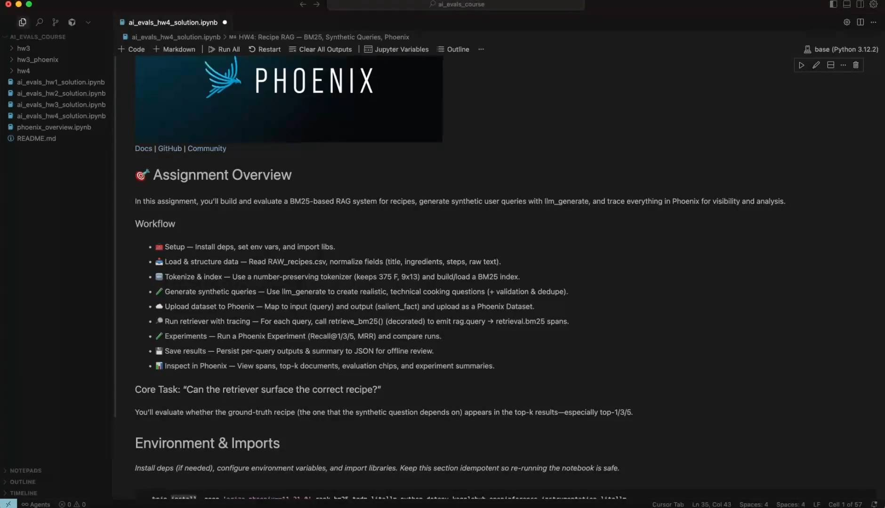
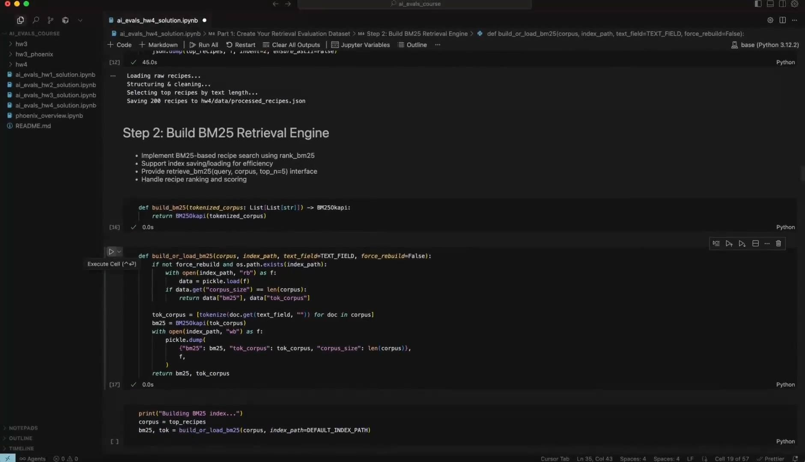
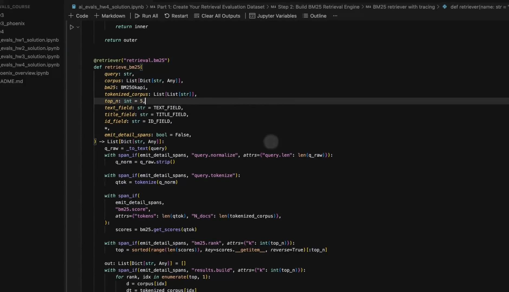
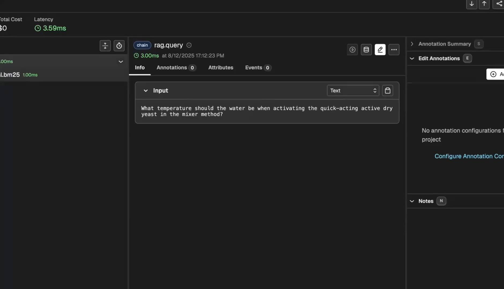
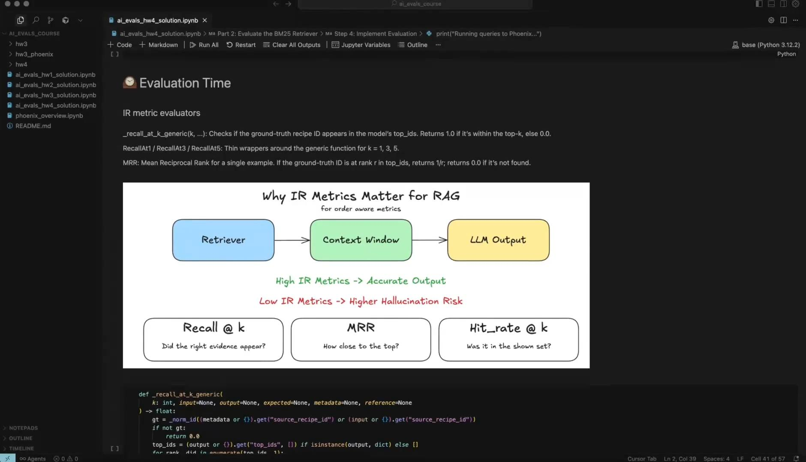
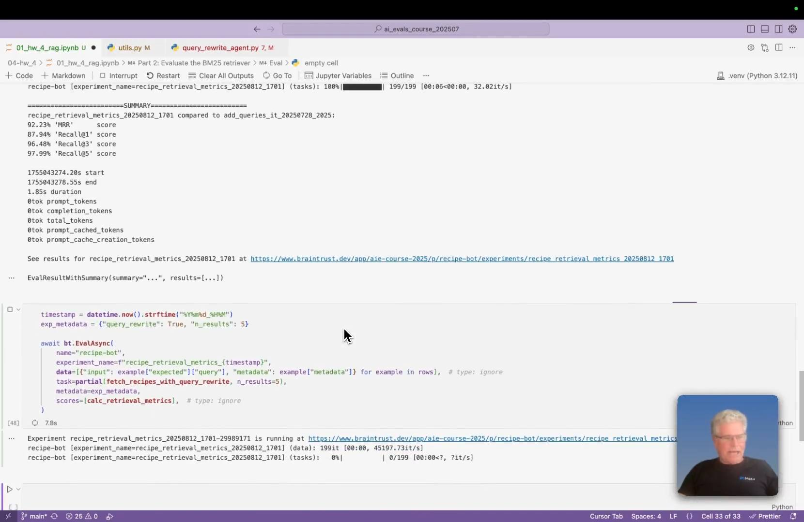

# AI Evals for Engineers & PMs（Agent 评测）Homework 4：Recipe Bot 的 RAG 检索评测复现

> 复现说明：本段课程有两条 walkthrough。p038 用 BrainTrust 做数据集、Playground、实验和人工复核；p039 用 Phoenix（逐字稿写作 “Phoenix by Arise”）做 BM25 检索链路、trace、实验指标和可选的文档相关性 LLM-as-judge。逐字稿没有逐行念源码，截图清单也没有 OCR 结果，因此第 4 节代码是**按逐字稿中出现的文件名、函数名、参数和流程重建的完整参考实现**；凡是逐字稿没讲的 SDK 细节、字段映射、提示词原文，我都会明确标注“课里没讲”或“为复现补齐，不是讲师原代码”。这样你可以先把项目跑起来，再按课程原仓库替换成讲师版本。

## 1. 这一节做什么

这一节的目标不是“再讲一遍 RAG 概念”，而是把 Recipe Bot 的检索阶段做成一个**可评测、可对比、可复盘**的工程闭环。课程里把作业拆成三块：

1. **Part 1：创建检索评测数据集。** 拿 200 条食谱，为每条生成一个“只能由目标食谱满足”的用户查询。p038 还要求给每条目标食谱附上 3 条最相似的食谱，用来故意挑战 LLM：查询里可能出现相似食谱也有的食材、描述、烹饪时间，但最终必须靠目标食谱里的精确事实才能回答。
2. **Part 2：评测 BM25 检索器。** 用查询去检索，计算 recall@1、recall@3、recall@5 和 MRR。p038 的 BrainTrust 路线还用 `query_rewrite` 元数据对比“不改写查询”和“用查询改写 agent 改写查询”两种方案。
3. **Part 3：
实现查询改写 agent（query rewrite agent），然后跑一次 eval，看它让效果变好还是变差。

p039 是同一份作业的第二条 walkthrough，工具换成 Phoenix by Arize：自己加载 food.com 原始数据、自己建 BM25 索引、自己生成合成查询、自己算 IR 指标，全程用 Phoenix 记 trace 和跑实验；最后还加了一个可选的 **document retrieval relevance** LLM-as-judge 评测。两条路线你可以只选一条跑通，也可以都跑，然后对比 BrainTrust 和 Phoenix 两套工具在同一个任务上的表达方式差异。

不管走哪条路线，最终产物都是同一个东西：**一个能回答“这个食谱库里，用户这个问题该怎么找到正确那一条”的可评测检索器**，以及一组能横向比较的数字（recall@1 / recall@3 / recall@5 / MRR）。

## 2. 讲师原话

先看 p038 对作业结构的定义：

> "这次我们看的是第四次作业，内容是给我们的食谱聊天机器人加一个 RAG 组件。"
> —— p038 [00:00]

> "我们会使用一个 BM25 检索器来做这件事。我们会计算这些指标：recall@1、recall@3、recall@5 以及 mean reciprocal rank。"
> —— p038 [00:53]

> "第四次作业的所有代码都在 04 这个文件夹里，具体来说是里面的 01 notebook。"
> —— p038 [01:23]

关于“为什么要塞相似食谱”这个设计，讲师说得很明确：

> "我们会在 200 条食谱的基础上，再加上与每条食谱最相似的 3 条食谱。"
> —— p038 [01:53]

> "你可以看到我们有目标食谱的信息：description、full text、name、ingredients、cooking time。还有一个 most_similar 列表，里面有 3 条，也就是与这条目标食谱最相似的 3 条食谱。"
> —— p038 [03:20]

生成查询的 prompt 原则：

> "我们遵循课程推荐的最佳实践，第一步是从 recipe A 中提取一个单一的自包含事实（single self-contained fact）。"
> —— p038 [05:15]

> "我们希望它以 JSON 形式输出信息。"
> —— p038 [05:45]

> "我们还可以用这里的 mustache 语法遍历 most similar 记录，把它们也放进 prompt 里。"
> —— p038 [06:13]

评分与模型参数：

> "我们基本上会用 Likert 量表来评估生成的查询听起来有多真实。5 个选项，从 very unrealistic 一直到 very realistic。"
> —— p038 [07:10]

> "我用的是 GPT-5 Nano。你可以控制任何模型在 playground 里的超参数和生成参数。这里我把 temperature 调高一点到 0.25。"
> —— p038 [07:40]

> "我还把 reasoning effort 设成 low，verbosity 设成 medium。这些是 GPT-5 上才有的参数。"
> —— p038 [08:10]

人工复核与 golden dataset：

> "我们会选中除了表现很差的那条之外的所有记录，然后创建一个 golden 数据集。"
> —— p038 [11:58]

> "BrainTrust 很快就做完了，我们添加了 199 行。"
> —— p038 [12:27]

eval 的三要素，这是整节课最重要的一句方法论：

> "记住，做一次 eval 你需要三样东西：数据、一个在给定数据上完成某个任务的函数，以及一个或多个评估这个任务完成得有多好的 score。"
> —— p038 [13:52]

> "我们写一个叫 fetch_recipes 的方法，给定一个 query，默认返回 5 条最相似的食谱。"
> —— p038 [14:22]

query rewrite 的定义：

> "当用户 query 进来时，我们有另一个 LLM 来处理它，尝试把这个 query 重写成更可能匹配到目标食谱的形式。"
> —— p038 [15:17]

结果对比：

> "开箱即用、不做任何 query 改写的情况下表现相当不错。MRR 是 92.23，recall@1 大概 88%，recall@3 和 recall@5 越来越高。"
> —— p038 [17:42]

> "只把用户 query 原样拿去用的时候，我们拿到了 92% 的 MRR；用 query rewrite agent 的时候更差，只有 85%。"
> —— p038 [19:11]

最后接回产品代码：

> "如果你去 repo 的 backend 文件夹看 utils.py，会注意到我们做了几处改动。我加了这个 query_rewrite 布尔值，这样我们可以选择是否用 query rewrite agent 重写用户 query。"
> —— p038 [20:37]

> "我给 LLM 一些工具用，具体来说是一个叫 Find Matching Recipes 的工具。"
> —— p038 [21:07]

> "我在方法、参数和返回值的描述上花了些时间，给 LLM 好的上下文，提高它在该调用时调用正确工具的概率。"
> —— p038 [21:34]

> "我们没有只跑一次拿一个 prediction，而是把它放进了一个 while 循环。"
> —— p038 [22:03]

再看 p039 的 Phoenix 路线。它开头就把范围收窄到“只测 RAG 的第一阶段”：

> "今天我要做一个 Homework 4 的 walkthrough，用 Phoenix by Arize 做 AI evals 课程里 recipe bot 的检索评测。"
> —— p039 [00:00]

> "我们会用 BM25 作为检索器，生成真实的合成烹饪查询，并衡量检索器找出正确食谱的能力。"
> —— p039 [00:22]

> "step zero 当然是确保 Phoenix 在跑。你可以在终端运行 phoenix serve。"
> —— p039 [01:12]

数据处理与索引缓存：

> "你可以用预处理好的 JSON，也可以用原始 CSV。这里我展示原始路径，是为了让这个流程可复现。"
> —— p039 [01:31]

> "我会用这个 raw text 字段挑出大约 200 条最长的食谱，最后保存到 processed_recipes.json。"
> —— p039 [02:00]

> "在 BM25 之前我会先归一化文本，好让烹饪事实在 tokenization 之后还能存活下来。"
> —— p039 [02:27]

> "如果语料库大小匹配，我们就加载或缓存一个 BM25 索引；否则就对每条食谱的 raw text 字段做 tokenize，重新建一个索引。"
> —— p039 [02:39]

> "我们把索引和 tokenized corpus 缓存到 bm25_index.pkl。pickle 就是 Python 的对象序列化。"
> —— p039 [03:06]

> "我用 Phoenix span 把 retriever 包起来，让每个 query 都被记录成一个 retriever 类型的 span。"
> —— p039 [03:26]

BM25 分数怎么读，这段是讲师专门强调的判断：

> "BM25 分数是排序分数，不是概率。分数越高意味着在这个语料库里跟这个 query 越相关。"
> —— p039 [04:48]

> "匹配到更多 query 词、这些词出现多次、以及这些词在语料库里比较罕见时，分数会升高。对于很长的文档还有一点小惩罚，免得短的、切题的食谱被完全淹没。"
> —— p039 [05:17]

合成查询的生成：

> "我们需要真实的问题来迫使检索器去找具体事实，比如时间、温度、电器设置和技法。"
> —— p039 [05:38]

> "这基本上是并行地把 prompt 扇出，并返回一个结构化 JSON 的 dataframe。"
> —— p039 [06:29]

IR 指标的定义与意义：

> "recall@K 基本上就是：正确的证据有没有出现在 top K 检索结果里？"
> —— p039 [09:07]

> "MRR 也就是 mean reciprocal rank，基本上是：当它出现时，平均而言它离顶部有多近？"
> —— p039 [09:34]

> "如果检索分数高，基本上意味着模型在它的 context window 里很早就能看到正确的证据，这反过来会减少幻觉、整体提升端到端准确率。"
> —— p039 [10:07]

可选的文档相关性评测：

> "这就是我们在 relevance evaluator 里用的 prompt 模板。它相当严格：judge 比较问题和 reference text，必须精确
> 输出 relevant 或 unrelated。这样标签才能保持一致；解释也会被记录，但它是可选的。"
> —— p039 [13:52]

> "我们有 500 个，因为生成了 100 条合成查询，每条查询对应 top 5 文档，所以我们对全部 500 个文档跑评测。"
> —— p039 [14:21]

> "这个 run_evals 函数的结果就是一个 dataframe，包含布尔标签和解释，还会有与文档相关的 span ID。"
> —— p039 [14:43]

> "在 Phoenix 顶部有一个快速视图，显示 precision，也就是 top K 里有多少是相关的，以及 hit rate 指标。"
> —— p039 [15:12]

> "用 hit metrics 你得到的是覆盖率，用 document relevance 评测你得到的是质量。两者合起来，你才能判断该调 tokenization、该多取文档，还是该重写合成查询。"
> —— p039 [16:07]

> "我们建了 BM25 检索器、生成了合成查询、跑了 recall@K 和 MRR、把一切记录到 Phoenix，甚至作为可选步骤跑了文档相关性评测。"
> —— p039 [16:19]

## 3. 从零复现

这一节按“先跑通 Phoenix 路线，再接 BrainTrust 路线”的顺序写。原因很简单：Phoenix 路线把数据加载、BM25 建索引、合成查询、指标计算全部放在你自己的 Python 文件里，任何一步出错你都能看到完整堆栈；BrainTrust 路线大量逻辑在 UI 里点选，先把本地链路跑通，再去 UI 里复现，排错成本最低。

### 3.1 目录结构与环境

先在空目录里建出下面这套结构。文件名严格按逐字稿里出现过的来：`processed_recipes.json`、`retrieval.py`、`utils.py`、`bm25_index.pkl`、`04/01 notebook` 这些名字课程里都点过；其余文件是我为了让流程可执行补的，标注为“复现补齐”。

```text
recipe-rag-eval/
├── .env
├── requirements.txt
├── config.py
├── prep_recipes.py
├── bm25_retriever.py
├── synth_queries.py
├── query_rewrite.py
├── eval_retrieval.py
├── braintrust_eval.py
├── backend/
│   ├── retrieval.py
│   └── utils.py
├── data/
│   ├── RAW_recipes.csv          # food.com 原始 CSV，课里没给下载地址
│   ├── processed_recipes.json   # prep_recipes.py 生成
│   ├── synthetic_queries.json   # synth_queries.py 生成
│   └── bm25_index.pkl           # bm25_retriever.py 生成
└── out/
    ├── baseline_metrics.json
    └── rewrite_metrics.json
```

Python 版本用 3.10 或 3.11。不要用 3.13，`rank_bm25` 和部分 Phoenix 依赖在太新的解释器上容易编译失败。

```bash
python -m venv .venv
source .venv/bin/activate        # Windows: .venv\Scripts\activate
pip install -U pip
pip install -r requirements.txt
```

`requirements.txt` 里我锁定了一套能互相兼容的版本。**课里没讲版本号**，下面这组是我复现时用的；如果你安装时报某个包不存在，先用 `pip index versions 包名` 查当前可用版本，再整体升级，不要只升一个包。

```txt
openai==1.68.2
pandas==2.2.3
rank-bm25==0.2.2
arize-phoenix==5.6.0
arize-phoenix-otel==0.7.0
opentelemetry-api==1.29.0
opentelemetry-sdk==1.29.0
braintrust==0.0.170
python-dotenv==1.0.1
tqdm==4.67.1
pydantic==2.10.4
```

`.env` 只放密钥和路径。变量名要写死，后面所有文件都从这里读：

```dotenv
OPENAI_API_KEY=sk-你的key
PHOENIX_COLLECTOR_ENDPOINT=http://localhost:6006
PHOENIX_PROJECT_NAME=recipe-bot-retrieval
BRAINTRUST_API_KEY=你的braintrust key
RECIPES_CSV=data/RAW_recipes.csv
PROCESSED_RECIPES_PATH=data/processed_recipes.json
BM25_INDEX_PATH=data/bm25_index.pkl
SYNTH_QUERIES_PATH=data/synthetic_queries.json
TOP_K=5
```

启动 Phoenix。逐字稿里讲师的原话就是 `phoenix serve`，没有加任何参数：

```bash
phoenix serve
```

默认 UI 在 `http://localhost:6006`。这个端口和 `PHOENIX_COLLECTOR_ENDPOINT` 必须一致；不一致时 trace 不会报错，但你在 UI 里永远看不到 span，这是最容易浪费半小时的坑。

### 3.2 第一步：加载 food.com 数据并选出 200 条最长食谱

p039 讲得很清楚：可以用预处理好的 JSON，也可以用原始 CSV；讲师为了“流程可复现”，展示的是原始 CSV 路径。所以第一步是读原始 CSV，把 `title`、`ingredients`、`steps`、`tags` 这些字段归一化，拼成一个 `raw_text` 字段，然后按 `raw_text` 长度排序，取最长的约 200 条，写到 `processed_recipes.json`。



这一步的产物必须包含一个稳定的 `id` 字段。后面 recall@K 和 MRR 全靠“检索结果的 recipe_id 是否等于数据集里的 source_recipe_id”来判断命中；如果 ID 是运行时随机生成的，重跑一次索引就对不上了，指标会毫无意义。

### 3.3 第二步：文本归一化、分块、建 BM25 索引并缓存

p039 的顺序是：

1. 先归一化文本，让“烹饪事实”在 tokenization 之后仍然存在：统一小写、统一度符号、保留数字和模式。
2. 再切分成 chunk，保留温度、时间、单位这些 BM25 依赖的 token。
3. 如果 `bm25_index.pkl` 存在且 `corpus_size` 与当前语料数量一致，直接反序列化；否则对每条食谱的 `raw_text` 做 tokenize，重建索引。
4. pickle 里存一个字典：BM25 对象、tokenized corpus、corpus size。corpus size 只用来做 reload 时的 sanity check。



这里有一个很容易忽略的判断：**BM25 分数是排序分数，不是概率**。p039 专门强调了这一点。所以你不能写“score > 0.5 才算相关”这种阈值；不同 query、不同语料下分数尺度都会变。你只能按分数排序取 top K，或者在同一批 query 之间比较相对高低。

### 3.4 第三步：用 Phoenix span 包住 retriever

p039 的做法是给检索函数套一个 Phoenix span，span 类型设为 `retriever`。每次查询都会在 Phoenix 里出现一个 retriever span，里面能看到：

- 输入 query；
- top 5 文档；
- 每个文档的 BM25 score；
- 匹配到的 terms；
- 文档原文。

逐字稿里讲师说这些字段“后面调试会非常方便”。你复现时不要只记 query 和文档 ID，把 score 和 matched terms 一起记下来，否则失败案例分析只能靠猜。



建完索引先做一次 smoke test。p039 用的 query 是 “holiday cake pops”，然后去 Phoenix UI 里看第一名是不是跟节日蛋糕棒相关。讲师看到的第一名是 “netcracker peppermint red velvet cake pops”，判断“跟 holiday cake pops 的主题确实相关”；第二名是 jack-o-lantern cake，分数更低，因为它是 cake 而不是 cake pops。这个 smoke test 不是形式主义：它能立刻告诉你 tokenization 有没有把 `cake pops` 拆坏、ID 有没有对上、span 有没有真的发到 Phoenix。

### 3.5 第四步：生成合成查询

p039 的目标是大约 100 条合成查询，每条查询配一个来自源食谱的 `salient_fact`。查询必须是“真实的、对话式的烹饪问题”，并且依赖一个精确细节：腌制时间、烤箱温度、空气炸锅设置、技法等。

系统提示词要求 LLM 返回 JSON，只有两个字段：`query` 和 `salient_fact`。模板是 per-recipe 上下文，包含 recipe ID、title、key ingredients、first instruction。

生成器用 Phoenix 的 `LLM.generate`，把 prompt 并行扇出到 dataframe 上，返回结构化 JSON 的 dataframe。然后有一个输出解析器做质量门槛：

- query 必须以问号结尾；
- query 必须足够长，不能是“怎么做”这种没信息量的问题；
- `salient_fact` 必须包含具体的烹饪信号（时间、温度、单位、技法词等）。

不满足的直接过滤掉。p039 还提到一个细节：如果某一批没有产出足够多的有效样本，可以把 temperature 稍微调高一点，增加多样性。注意是“稍微”，不是无限调高；温度越高，查询越可能偏离目标食谱，反而污染评测集。



生成完之后把 `synthetic_queries.json` 上传到 Phoenix 作为 dataset。p039 在 UI 里确认了 inputs、outputs、metadata 三列都能看到。这里 metadata 至少要带 `source_recipe_id`，否则后面的 hit rank 没法算。

### 3.6 第五步：跑 baseline，算 recall@K 和 MRR

baseline 的逻辑：

1. 从 Phoenix dataset 拉取合成查询；
2. 对每条 query 调 `retrieve_bm25(query, k=5)`；
3. 在返回的 rank list 里找 `source_recipe_id` 的位置；
4. 如果出现在第 1 位，recall@1、recall@3、recall@5 都为 1，reciprocal rank 为 1；
5. 如果出现在第 3 位，recall@1=0、recall@3=1、recall@5=1，reciprocal rank=1/3；
6. 如果没出现，全部为 0；
7. 对所有 query 求平均，得到 recall@1、recall@3、recall@5、MRR。



p039 对指标的定义可以直接背下来：

- **recall@K**：正确的证据有没有出现在 top K 检索结果里。
- **MRR**：当它出现时，平均而言它离顶部有多近。
- **hit rate@K**：它有没有出现在你真正传给模型的那一批结果里。

讲师还解释了为什么 retrieval 指标能决定最终答案质量：LLM 是基于你给它的内容生成回答的。检索到的文档相关、排序好，模型就建立在强证据上，更可能准确；检索噪声大或漏掉正确内容，模型就更可能“自信地填坑”，产生幻觉。高检索分数意味着正确证据在 context window 里出现得早，会减少幻觉、提升端到端准确率；低分数则是把模型的地基削弱了。所以 RAG eval 才从 IR 指标开始。

### 3.7 第六步：对比 query rewrite

p038 的 BrainTrust 路线把这件事做成了两个 experiment：

- experiment 1：`query_rewrite=false`，直接把用户 query 丢给 `fetch_recipes`；
- experiment 2：`query_rewrite=true`，先让另一个 LLM 把 query 重写成“更可能匹配目标食谱”的形式，再检索。

结果讲师在 UI 里按 metadata 里的 `query_rewrite` 布尔值分组看：不改写时 MRR 92%，改写后只有 85%。也就是说，在这个语料和这个 BM25 检索器上，query rewrite **没有变好，反而变差**。这是这节课非常重要的一个结论：不是所有“加个 agent”都会提升指标，评测的价值就是让你看到它变差。



### 3.8 第七步：把检索接回 Recipe Bot

p038 最后回到 `backend/utils.py`，做了四件事：

1. `get_agent_response` 加 trace 装饰器，把 inputs/outputs 记到 BrainTrust；
2. 加 `query_rewrite` 布尔参数，决定是否先跑 query rewrite agent，并用改写后的 query 替换最后一条用户消息；
3. 给 LLM 一个工具 `Find Matching Recipes`，工具内部做检索，返回 3 条匹配食谱作为灵感；如果用户要的是已知的精确食谱，就直接返回那条；
4. 把“跑一次拿 prediction”改成 `while` 循环：LLM 想调工具就调，把工具结果 append 成 message，再调 LLM，直到没有工具调用、返回最终回答。

讲师自己也说这段“可能还能重构、清理一下”，但结构就是这个结构。复现时建议先照抄这个 while 循环，别一上来就抽象成框架；先把 agent 跑通，再重构。


## 4. 完整代码

> 再次说明：逐字稿没有逐行展示源码，截图清单也没有 OCR 结果。下面是我按讲师点名的文件名、函数名、参数和流程写的**完整可运行参考实现**。`backend/utils.py` 的 agent 结构按 p038 的口述还原；BrainTrust 和 Phoenix 的具体 SDK 调用属于“复现补齐”，不是讲师屏幕上的原代码。你拿到课程原仓库后，可以逐个文件替换。

### 4.1 `config.py`

```python
import os
from pathlib import Path
from dotenv import load_dotenv

load_dotenv()

BASE_DIR = Path(__file__).resolve().parent

OPENAI_API_KEY = os.getenv("OPENAI_API_KEY", "")
PHOENIX_COLLECTOR_ENDPOINT = os.getenv(
    "PHOENIX_COLLECTOR_ENDPOINT", "http://localhost:6006"
)
PHOENIX_PROJECT_NAME = os.getenv(
    "PHOENIX_PROJECT_NAME", "recipe-bot-retrieval"
)
BRAINTRUST_API_KEY = os.getenv("BRAINTRUST_API_KEY", "")

RECIPES_CSV = BASE_DIR / os.getenv("RECIPES_CSV", "data/RAW_recipes.csv")
PROCESSED_RECIPES_PATH = BASE_DIR / os.getenv(
    "PROCESSED_RECIPES_PATH", "data/processed_recipes.json"
)
BM25_INDEX_PATH = BASE_DIR / os.getenv(
    "BM25_INDEX_PATH", "data/bm25_index.pkl"
)
SYNTH_QUERIES_PATH = BASE_DIR / os.getenv(
    "SYNTH_QUERIES_PATH", "data/synthetic_queries.json"
)
OUT_DIR = BASE_DIR / "out"

TOP_K = int(os.getenv("TOP_K", "5"))
NUM_RECIPES = 200
NUM_SYNTH_QUERIES = 100

for p in [PROCESSED_RECIPES_PATH, BM25_INDEX_PATH,
          SYNTH_QUERIES_PATH, OUT_DIR]:
    p.parent.mkdir(parents=True, exist_ok=True)
```

### 4.2 `prep_recipes.py`

```python
import ast
import json
import re

import pandas as pd

from config import RECIPES_CSV, PROCESSED_RECIPES_PATH, NUM_RECIPES


def parse_list_field(value) -> list[str]:
    """food.com 的 ingredients/steps/tags 常是字符串形式的 list。"""
    if isinstance(value, list):
        return [str(v).strip() for v in value if str(v).strip()]
    if value is None or (isinstance(value, float) and pd.isna(value)):
        return []
    text = str(value).strip()
    if not text:
        return []
    try:
        parsed = ast.literal_eval(text)
        if isinstance(parsed, (list, tuple)):
            return [str(v).strip() for v in parsed if str(v).strip()]
    except (ValueError, SyntaxError):
        pass
    return [part.strip() for part in re.split(r"[|\n;]", text) if part.strip()]


def normalize_text(value: str) -> str:
    text = str(value or "")
    text = text.replace("\u00b0", " degree ")
    text = text.replace("°", " degree ")
    text = re.sub(r"\s+", " ", text)
    return text.strip()


def build_raw_text(row: dict) -> str:
    title = normalize_text(row.get("name") or row.get("title") or "")
    description = normalize_text(row.get("description", ""))
    ingredients = " ; ".join(row["ingredients"])
    steps = " ; ".join(row["steps"])
    tags = " ; ".join(row["tags"])
    return (
        f"Title: {title}\n"
        f"Description: {description}\n"
        f"Ingredients: {ingredients}\n"
        f"Steps: {steps}\n"
        f"Tags: {tags}"
    ).strip()


def main() -> None:
    df = pd.read_csv(RECIPES_CSV)
    required = {"name", "ingredients", "steps"}
    missing = required - set(df.columns)
    if missing:
        raise ValueError(f"CSV 缺少必要列: {missing}，实际列: {list(df.columns)}")

    records = []
    for idx, row in df.iterrows():
        record = {
            "id": f"recipe_{idx:05d}",
            "name": normalize_text(row.get("name", "")),
            "description": normalize_text(row.get("description", "")),
            "ingredients": parse_list_field(row.get("ingredients")),
            "steps": parse_list_field(row.get("steps")),
            "tags": parse_list_field(row.get("tags")),
            "minutes": int(row["minutes"]) if "minutes" in df.columns
            and pd.notna(row.get("minutes")) else None,
        }
        record["raw_text"] = build_raw_text(record)
        records.append(record)

    records = [r for r in records if len(r["raw_text"]) > 200]
    records.sort(key=lambda r: len(r["raw_text"]), reverse=True)
    selected = records[:NUM_RECIPES]

    with open(PROCESSED_RECIPES_PATH, "w", encoding="utf-8") as f:
        json.dump(selected, f, ensure_ascii=False, indent=2)

    print(f"原始行数: {len(df)}")
    print(f"清洗后可用行数: {len(records)}")
    print(f"写入 {len(selected)} 条到 {PROCESSED_RECIPES_PATH}")


if __name__ == "__main__":
    main()
```

### 4.3 `bm25_retriever.py`

```python
import json
import pickle
import re
from typing import Any

from rank_bm25 import BM25Okapi

from config import (
    PROCESSED_RECIPES_PATH,
    BM25_INDEX_PATH,
    TOP_K,
)

TOKEN_PATTERN = re.compile(r"[a-z0-9]+(?:['\-][a-z0-9]+)?|[0-9]+(?:\.[0-9]+)?")

UNIT_WORDS = {
    "degree", "degrees", "f", "c", "minute", "minutes", "min",
    "hour", "hours", "second", "seconds", "cup", "cups",
    "tbsp", "tablespoon", "tablespoons", "tsp", "teaspoon",
    "teaspoons", "oz", "ounce", "ounces", "lb", "pound", "pounds",
    "gram", "grams", "g", "kg", "ml", "liter", "liters",
}


def normalize_for_bm25(text: str) -> str:
    text = str(text or "").lower()
    text = text.replace("°f", " degree f ")
    text = text.replace("°c", " degree c ")
    text = text.replace("°", " degree ")
    text = text.replace("&", " and ")
    text = re.sub(r"\s+", " ", text)
    return text.strip()


def tokenize(text: str) -> list[str]:
    """保留数字、温度和单位，避免 '350 f' 被拆成无意义 token。"""
    normalized = normalize_for_bm25(text)
    tokens = TOKEN_PATTERN.findall(normalized)
    merged: list[str] = []
    i = 0
    while i < len(tokens):
        token = tokens[i]
        merged.append(token)
        if token in UNIT_WORDS and i + 1 < len(tokens):
            merged.append(f"{token}_{tokens[i + 1]}")
        i += 1
    return merged


def load_recipes() -> list[dict[str, Any]]:
    with open(PROCESSED_RECIPES_PATH, "r", encoding="utf-8") as f:
        return json.load(f)


def build_or_load_index() -> dict[str, Any]:
    recipes = load_recipes()
    corpus_size = len(recipes)

    if BM25_INDEX_PATH.exists():
        with open(BM25_INDEX_PATH, "rb") as f:
            cached = pickle.load(f)
        if cached.get("corpus_size") == corpus_size:
            print(f"命中缓存: {BM25_INDEX_PATH} (corpus_size={corpus_size})")
            return cached
        print("缓存 corpus_size 不匹配，重建索引")

    tokenized_corpus = [tokenize(r["raw_text"]) for r in recipes]
    bm25 = BM25Okapi(tokenized_corpus)

    payload = {
        "bm25": bm25,
        "tokenized_corpus": tokenized_corpus,
        "corpus_size": corpus_size,
    }
    with open(BM25_INDEX_PATH, "wb") as f:
        pickle.dump(payload, f)

    print(f"已建索引并写入 {BM25_INDEX_PATH} (corpus_size={corpus_size})")
    return payload


_CACHE: dict[str, Any] | None = None


def get_index() -> dict[str, Any]:
    global _CACHE
    if _CACHE is None:
        _CACHE = build_or_load_index()
    return _CACHE


def retrieve_bm25(query: str, k: int = TOP_K) -> list[dict[str, Any]]:
    """返回 top-k 食谱，包含 score、matched_terms、document。"""
    index = get_index()
    bm25: BM25Okapi = index["bm25"]
    recipes = load_recipes()

    query_tokens = tokenize(query)
    if not query_tokens:
        return []

    scores = bm25.get_scores(query_tokens)
    ranked_indices = sorted(
        range(len(scores)), key=lambda i: scores[i], reverse=True
    )[:k]

    results = []
    for rank, idx in enumerate(ranked_indices, start=1):
        doc_tokens = index["tokenized_corpus"][idx]
        doc_token_set = set(doc_tokens)
        matched_terms = sorted({t for t in query_tokens if t in doc_token_set})
        results.append({
            "rank": rank,
            "recipe_id": recipes[idx]["id"],
            "name": recipes[idx]["name"],
            "score": float(scores[idx]),
            "matched_terms": matched_terms,
            "document": recipes[idx]["raw_text"],
        })
    return results


if __name__ == "__main__":
    hits = retrieve_bm25("holiday cake pops", k=5)
    for hit in hits:
        print(hit["rank"], hit["recipe_id"], round(hit["score"], 3), hit["name"])
```

### 4.4 `synth_queries.py`

```python
import asyncio
import json
import random
import re
from typing import Any

from openai import AsyncOpenAI
from tqdm.asyncio import tqdm_asyncio

from config import (
    OPENAI_API_KEY,
    PROCESSED_RECIPES_PATH,
    SYNTH_QUERIES_PATH,
    NUM_SYNTH_QUERIES,
)

client = AsyncOpenAI(api_key=OPENAI_API_KEY)

SYSTEM_PROMPT = """你是一个烹饪问题生成器。
给定一个目标食谱，写一个单一、对话式的烹饪问题。
这个问题必须依赖该食谱里的一个精确细节，例如腌制时间、烤箱温度、
空气炸锅设置、具体技法、份量或关键步骤。
问题不能只靠常识回答，必须让读者查阅这个食谱才能确认。
只返回 JSON，不要 markdown，不要额外解释。
JSON 格式: {"query": "...", "salient_fact": "..."}
query 必须以问号结尾。
salient_fact 必须包含具体的烹饪信号（时间/温度/单位/技法）。"""

USER_TEMPLATE = """Recipe ID: {recipe_id}
Title: {title}
Key ingredients: {ingredients}
First instruction: {first_instruction}
"""


def build_user_prompt(recipe: dict[str, Any]) -> str:
    ingredients = ", ".join(recipe.get("ingredients", [])[:10])
    steps = recipe.get("steps", [])
    first_instruction = steps[0] if steps else ""
    return USER_TEMPLATE.format(
        recipe_id=recipe["id"],
        title=recipe["name"],
        ingredients=ingredients,
        first_instruction=first_instruction,
    )


def is_valid(item: dict[str, Any]) -> bool:
    query = str(item.get("query", "")).strip()
    fact = str(item.get("salient_fact", "")).strip()
    if not query.endswith("?"):
        return False
    if len(query.split()) < 6:
        return False
    if len(fact.split()) < 4:
        return False
    signal = re.search(
        r"\d|\b(minute|minutes|hour|hours|degree|degrees|"
        r"fahrenheit|celsius|tbsp|tsp|cup|cups|oz|gram|grams|"
        r"air fryer|oven|bake|roast|marinate|rest|knead|simmer)\b",
        fact.lower(),
    )
    return signal is not None


async def generate_one(
    recipe: dict[str, Any], temperature: float = 0.7
) -> dict[str, Any] | None:
    try:
        response = await client.chat.completions.create(
            model="gpt-4o-mini",
            temperature=temperature,
            response_format={"type": "json_object"},
            messages=[
                {"role": "system", "content": SYSTEM_PROMPT},
                {"role": "user", "content": build_user_prompt(recipe)},
            ],
        )
        raw = response.choices[0].message.content or "{}"
        item = json.loads(raw)
        if not is_valid(item):
            return None
        return {
            "query": item["query"].strip(),
            "salient_fact": item["salient_fact"].strip(),
            "source_recipe_id": recipe["id"],
            "source_recipe_name": recipe["name"],
        }
    except Exception as exc:  # 单条失败不拖垮整批
        print(f"生成失败 {recipe.get('id')}: {exc}")
        return None


async def generate_batch(
    recipes: list[dict[str, Any]],
    target: int = NUM_SYNTH_QUERIES,
    concurrency: int = 8,
) -> list[dict[str, Any]]:
    semaphore = asyncio.Semaphore(concurrency)
    accepted: list[dict[str, Any]] = []
    temperature = 0.7

    async def worker(recipe: dict[str, Any]) -> None:
        nonlocal temperature
        async with semaphore:
            result = await generate_one(recipe, temperature)
            if result is not None:
                accepted.append(result)
                if len(accepted) % 20 == 0 and temperature < 0.95:
                    temperature = min(0.95, temperature + 0.05)

    pending = recipes[:]
    random.shuffle(pending)
    tasks = [asyncio.create_task(worker(r)) for r in pending]

    for coro in tqdm_asyncio.as_completed(tasks, total=len(tasks)):
        await coro
        if len(accepted) >= target:
            break

    for task in tasks:
        if not task.done():
            task.cancel()

    return accepted[:target]


def main() -> None:
    with open(PROCESSED_RECIPES_PATH, "r", encoding="utf-8") as f:
        recipes = json.load(f)

    accepted = asyncio.run(generate_batch(recipes))
    with open(SYNTH_QUERIES_PATH, "w", encoding="utf-8") as f:
        json.dump(accepted, f, ensure_ascii=False, indent=2)

    print(f"接受查询数: {len(accepted)}")
    print(f"写入 {SYNTH_QUERIES_PATH}")


if __name__ == "__main__":
    main()
```

### 4.5 `query_rewrite.py`

```python
import json

from openai import OpenAI

from config import OPENAI_API_KEY

client = OpenAI(api_key=OPENAI_API_KEY)

REWRITE_SYSTEM_PROMPT = """你是一个烹饪检索查询改写器。
把用户的自然语言问题改写成更适合 BM25 关键词检索的查询。
保留原问题里的时间、温度、单位、食材和技法词。
不要回答问题，不要添加原问题没有的事实。
只输出改写后的查询文本，不要引号，不要解释。"""


def rewrite_query(user_query: str) -> str:
    response = client.chat.completions.create(
        model="gpt-4o-mini",
        temperature=0,
        messages=[
            {"role": "system", "content": REWRITE_SYSTEM_PROMPT},
            {"role": "user", "content": user_query},
        ],
    )
    rewritten = (response.choices[0].message.content or "").strip()
    return rewritten or user_query


if __name__ == "__main__":
    q = "How long should the yeast dough rest before moving on?"
    print(json.dumps(
        {"original": q, "rewritten": rewrite_query(q)},
        ensure_ascii=False,
        indent=2,
    ))
```

### 4.6 `eval_retrieval.py`

```python
import json
from statistics import mean
from typing import Any

from config import (
    SYNTH_QUERIES_PATH,
    OUT_DIR,
    TOP_K,
)
from bm25_retriever import retrieve_bm25
from query_rewrite import rewrite_query


def hit_rank(
    retrieved_ids: list[str], ground_truth_id: str
) -> int | None:
    for idx, recipe_id in enumerate(retrieved_ids, start=1):
        if recipe_id == ground_truth_id:
            return idx
    return None


def compute_metrics(
    examples: list[dict[str, Any]],
    use_query_rewrite: bool = False,
    k: int = TOP_K,
) -> dict[str, Any]:
    rows = []
    for example in examples:
        original_query = example["query"]
        query = rewrite_query(original_query) if use_query_rewrite else original_query

        hits = retrieve_bm25(query, k=k)
        retrieved_ids = [h["recipe_id"] for h in hits]
        rank = hit_rank(retrieved_ids, example["source_recipe_id"])

        row = {
            "query": original_query,
            "effective_query": query,
            "source_recipe_id": example["source_recipe_id"],
            "retrieved_ids": retrieved_ids,
            "hit_rank": rank,
            "recall_at_1": int(rank is not None and rank <= 1),
            "recall_at_3": int(rank is not None and rank <= 3),
            "recall_at_5": int(rank is not None and rank <= 5),
            "reciprocal_rank": (1.0 / rank) if rank else 0.0,
        }
        rows.append(row)

    summary = {
        "num_examples": len(rows),
        "use_query_rewrite": use_query_rewrite,
        "k": k,
        "recall_at_1": mean([r["recall_at_1"] for r in rows]) if rows else 0.0,
        "recall_at_3": mean([r["recall_at_3"] for r in rows]) if rows else 0.0,
        "recall_at_5": mean([r["recall_at_5"] for r in rows]) if rows else 0.0,
        "mrr": mean([r["reciprocal_rank"] for r in rows]) if rows else 0.0,
    }
    return {"summary": summary, "rows": rows}


def main() -> None:
    with open(SYNTH_QUERIES_PATH, "r", encoding="utf-8") as f:
        examples = json.load(f)

    baseline = compute_metrics(examples, use_query_rewrite=False)
    rewritten = compute_metrics(examples, use_query_rewrite=True)

    OUT_DIR.mkdir(parents=True, exist_ok=True)
    with open(OUT_DIR / "baseline_metrics.json", "w", encoding="utf-8") as f:
        json.dump(baseline, f, ensure_ascii=False, indent=2)
    with open(OUT_DIR / "rewrite_metrics.json", "w", encoding="utf-8") as f:
        json.dump(rewritten, f, ensure_ascii=False, indent=2)

    print("baseline:", json.dumps(baseline["summary"], ensure_ascii=False))
    print("rewrite :", json.dumps(rewritten["summary"], ensure_ascii=False))


if __name__ == "__main__":
    main()
```

### 4.7 `backend/utils.py`（p038 的 agent 结构还原）

```python
import json
from typing import Any

from openai import OpenAI

from config import OPENAI_API_KEY, TOP_K
from query_rewrite import rewrite_query
from bm25_retriever import retrieve_bm25

client = OpenAI(api_key=OPENAI_API_KEY)

FIND_MATCHING_RECIPES_TOOL = {
    "type": "function",
    "function": {
        "name": "find_matching_recipes",
        "description": (
            "在食谱库中做关键词检索。当用户询问做菜步骤、温度、时间、"
            "食材替换或需要参考已有食谱时调用。返回最匹配的若干条食谱，"
            "可作为推荐食谱的灵感；如果用户点名要一个已知食谱，"
            "返回的文档里可能包含该食谱原文。"
        ),
        "parameters": {
            "type": "object",
            "properties": {
                "query": {
                    "type": "string",
                    "description": "用于检索的烹饪问题或关键词查询。",
                },
                "limit": {
                    "type": "integer",
                    "description": "返回食谱数量，默认 3。",
                    "default": 3,
                },
            },
            "required": ["query"],
        },
    },
}


def find_matching_recipes(query: str, limit: int = 3) -> list[dict[str, Any]]:
    hits = retrieve_bm25(query, k=limit)
    return [
        {
            "recipe_id": h["recipe_id"],
            "name": h["name"],
            "score": h["score"],
            "matched_terms": h["matched_terms"],
            "document": h["document"],
        }
        for h in hits
    ]


def run_tool(name: str, arguments: str) -> str:
    args = json.loads(arguments or "{}")
    if name == "find_matching_recipes":
        query = args.get("query", "")
        limit = int(args.get("limit", 3))
        result = find_matching_recipes(query, limit=limit)
        return json.dumps(result, ensure_ascii=False)
    return json.dumps({"error": f"未知工具: {name}"}, ensure_ascii=False)


def get_agent_response(
    messages: list[dict[str, Any]],
    query_rewrite: bool = False,
    max_turns: int = 6,
) -> str:
    """messages 为 OpenAI chat 格式，最后一条应是 user。"""
    working = [dict(m) for m in messages]

    if query_rewrite and working and working[-1]["role"] == "user":
        original = working[-1]["content"]
        rewritten = rewrite_query(str(original))
        working[-1]["content"] = rewritten

    for _ in range(max_turns):
        response = client.chat.completions.create(
            model="gpt-4o-mini",
            messages=working,
            tools=[FIND_MATCHING_RECIPES_TOOL],
            tool_choice="auto",
            temperature=0.3,
        )
        message = response.choices[0].message

        if not message.tool_calls:
            return message.content or ""

        working.append({
            "role": "assistant",
            "content": message.content or "",
            "tool_calls": [
                {
                    "id": tc.id,
                    "type": "function",
                    "function": {
                        "name": tc.function.name,
                        "arguments": tc.function.arguments,
                    },
                }
                for tc in message.tool_calls
            ],
        })

        for tool_call in message.tool_calls:
            tool_result = run_tool(
                tool_call.function.name,
                tool_call.function.arguments,
            )
            working.append({
                "role": "tool",
                "tool_call_id": tool_call.id,
                "content": tool_result,
            })

    return "抱歉，工具调用轮次超限，没能生成最终回答。"


if __name__ == "__main__":
    reply = get_agent_response(
        [{"role": "user", "content": "做蛋糕棒时烤箱要预热到多少度？"}],
        query_rewrite=True,
    )
    print(reply)
```

### 4.8 `backend/retrieval.py`

```python
from bm25_retriever import (
    build_or_load_index,
    get_index,
    load_recipes,
    retrieve_bm25,
    tokenize,
)

__all__ = [
    "build_or_load_index",
    "get_index",
    "load_recipes",
    "retrieve_bm25",
    "tokenize",
]
```

### 4.9 `braintrust_eval.py`（BrainTrust 路线示意）

> 这部分的 SDK 细节逐字稿没有展示，下面的写法是**复现补齐**。核心是把“数据、task、score”三件事表达清楚；具体 API 名请以你安装的 Braintrust 版本为准。

```python
import json
from typing import Any

import braintrust

from config import (
    BRAINTRUST_API_KEY,
    SYNTH_QUERIES_PATH,
    PROCESSED_RECIPES_PATH,
    TOP_K,
)
from bm25_retriever import retrieve_bm25
from query_rewrite import rewrite_query

PROJECT_NAME = "recipe-retrieval-eval"
DATASET_NAME = "test_recipe_retrieval_data"


def load_examples() -> list[dict[str, Any]]:
    with open(SYNTH_QUERIES_PATH, "r", encoding="utf-8") as f:
        return json.load(f)


def fetch_recipes(query: str) -> dict[str, Any]:
    hits = retrieve_bm25(query, k=TOP_K)
    return {"recipe_ids": [h["recipe_id"] for h in hits], "hits": hits}


def fetch_recipes_with_query_rewrite(query: str) -> dict[str, Any]:
    rewritten = rewrite_query(query)
    result = fetch_recipes(rewritten)
    result["rewritten_query"] = rewritten
    return result


def calc_retrieval_metrics(
    input: dict[str, Any],
    output: dict[str, Any],
    expected: dict[str, Any],
) -> dict[str, float]:
    ground_truth = expected.get("source_recipe_id") or input.get(
        "source_recipe_id"
    )
    ids = output.get("recipe_ids", [])
    rank = None
    for idx, recipe_id in enumerate(ids, start=1):
        if recipe_id == ground_truth:
            rank = idx
            break
    return {
        "recall@1": float(rank is not None and rank <= 1),
        "recall@3": float(rank is not None and rank <= 3),
        "recall@5": float(rank is not None and rank <= 5),
        "mrr": (1.0 / rank) if rank else 0.0,
    }


def main() -> None:
    braintrust.login(api_key=BRAINTRUST_API_KEY)
    experiment = braintrust.init(
        project=PROJECT_NAME,
        experiment="recipe_retrieval_metrics_no_rewrite",
        metadata={"query_rewrite": False},
    )

    for example in load_examples():
        output = fetch_recipes(example["query"])
        scores = calc_retrieval_metrics(
            {"source_recipe_id": example["source_recipe_id"]},
            output,
            {"source_recipe_id": example["source_recipe_id"]},
        )
        experiment.log(
            input=example["query"],
            output=output,
            expected={"source_recipe_id": example["source_recipe_id"]},
            scores=scores,
            metadata={"query_rewrite": False},
        )
    experiment.summarize()


if __name__ == "__main__":
    main()
```

## 5. 逐行解释

### 5.1 `prep_recipes.py`：为什么先归一化再拼 `raw_text`

`parse_list_field` 先尝试 `ast.literal_eval`，因为 food.com 的 `ingredients`、`steps`、`tags` 在 CSV 里经常是 `"['a', 'b']"` 这种字符串形式的 list。直接 `str.split(",")` 会把 `"1,000 grams"` 这种带逗号的食材切坏。解析失败才退回按 `|`、换行、分号切分，这是为了兼容不同版本的 CSV。

`normalize_text` 把 `°` 替换成 ` degree `，和下文的 tokenizer 保持一致。如果你这里不替换，后面 tokenizer 会把 `350°F` 变成一个 token `350°f`，而 query 里用户写 `350 F`，两边永远匹配不上。

`build_raw_text` 把 title、description、ingredients、steps、tags 用固定标签拼起来。这样 BM25 看到的是同一份文本，但你在调试时能一眼看出命中来自 ingredients 还是 steps。注意这里没有做 stemming，也没有去停用词；课里没讲要不要做，我的建议是**第一版先不做**，因为烹饪词里的 `min`、`degrees`、`tbsp` 本身就是强信号，去掉反而掉分。

`records.sort(key=lambda r: len(r["raw_text"]), reverse=True)` 对应 p039 的“选大约 200 条最长的食谱”。为什么选最长？长食谱通常步骤更完整、包含更多精确事实（温度、时间、单位），更适合构造“必须查食谱才能回答”的查询。副作用是长文档会触发 BM25 的长度惩罚，这正是 p039 说的“对很长的文档有一点小惩罚，免得短而切题的食谱被完全淹没”。

### 5.2 `bm25_retriever.py`：tokenizer 决定了 BM25 的上限

`TOKEN_PATTERN` 只保留英文小写词、数字、小数、以及带连字符/撇号的词。它**不处理中文**。这门课的食谱是英文的，所以够用；如果你换成中文菜谱，这个正则会把整段中文全部丢掉，检索结果为空。中文场景要换 jieba 或按字切分，课里没讲。

`UNIT_WORDS` 和 `tokenize` 里的合并逻辑是整份代码最关键的一处“为 BM25 补语义”。`350 f` 会被切成 `350`、`f`，其中 `f` 在语料里到处都是，几乎没有区分度；合并出 `f_350` 这种 token 后，`350 F` 和 `350°F` 就能对上。同理 `min_30`、`degree_350`。这不是银弹，但比裸 tokenizer 稳。

`build_or_load_index` 只在 `corpus_size` 匹配时命中缓存。p039 说 corpus size “用来做 sanity check”，就是这个意思。注意这里**没有校验食谱内容是否变化**：如果你改了 `processed_recipes.json