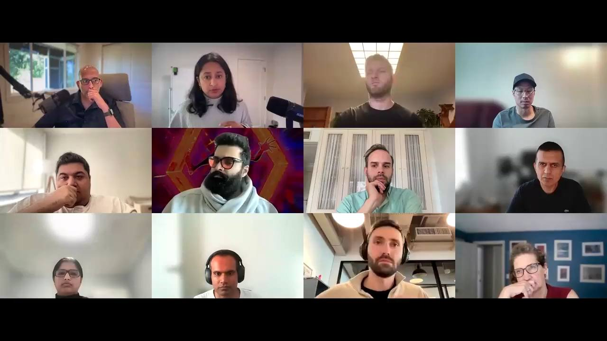
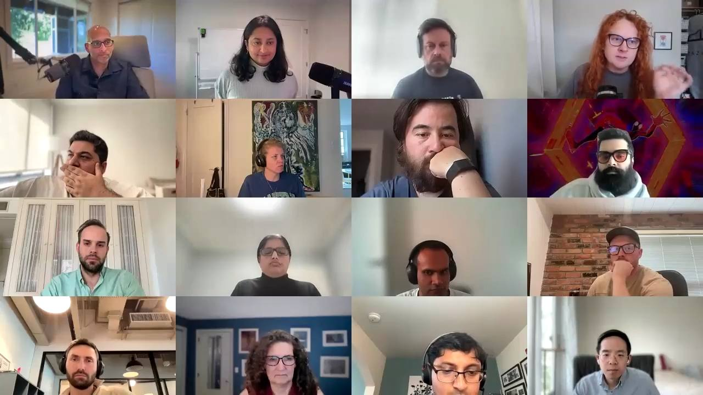
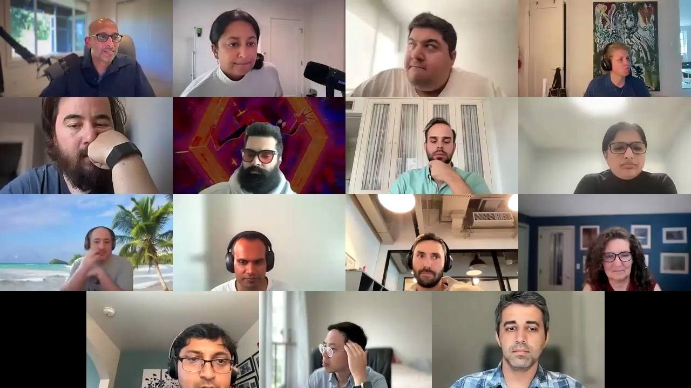
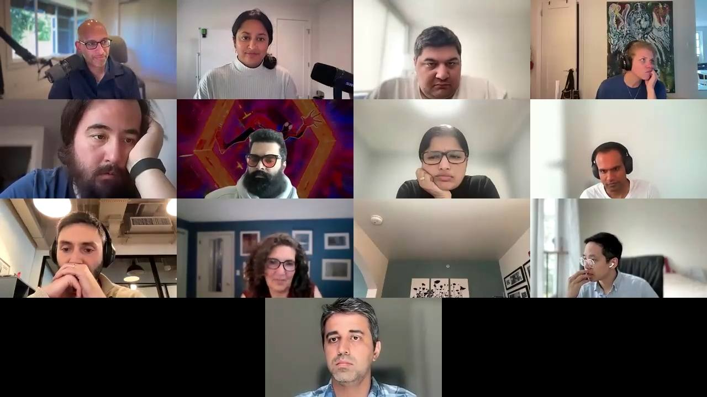
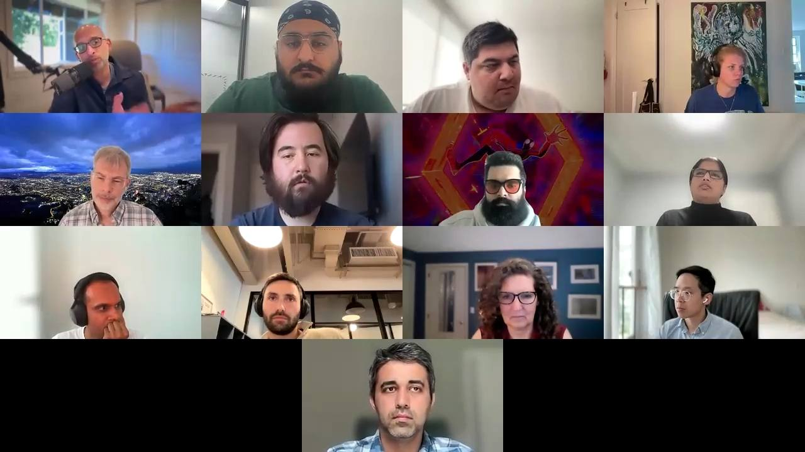
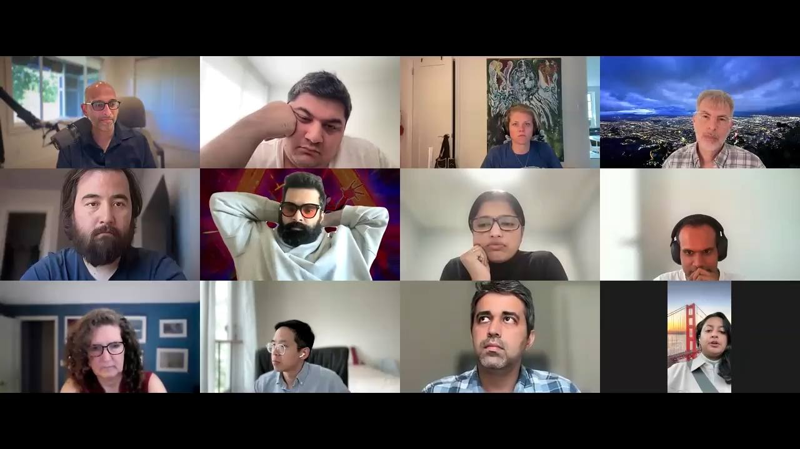
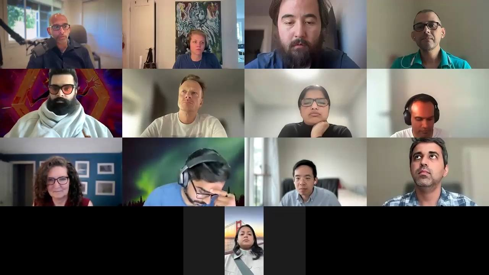

# AI Evals for Engineers & PMs —— 第 4 讲（Office Hours 答疑）复现文档

> 说明：本讲是**纯答疑课（Office Hours）**，逐字稿里没有出现任何代码、命令、配置文件，截图 OCR 也为空。因此本文档按「纯讲解课」的七段结构来写：第 3 节把讲师的推导过程按步骤复现，第 4 节把讲师给出的方法论落成可直接使用的产物（决策表、检查清单、数据模型草案），第 5 节逐条解释每个决策为什么这样定。凡逐字稿没讲的内容，一律标注「课里没讲」。

---

## 1. 这一节做什么

这一讲不是新知识讲授，而是两位讲师（Hamel 与 Shreya）对前两节课内容的**答疑与落地指导**。学员来自不同背景——有做多智能体系统的、有做大型复杂产品（100+ 工具调用）的、有做教师自定义聊天机器人导师的、有做学术论文检索多轮对话的、有做神秘顾客调研问卷编辑的、有做企业工程 Copilot 的、有做定制 GPT 给 PM 用的——他们提出的问题高度集中在同一个核心矛盾上：

**「我知道要做 eval，但我的系统太大 / 太复杂 / 没有真实用户 / 没有 trace / 没有预算，我到底从哪儿下手？」**

这一讲给出的答案可以浓缩成一条主线：

1. **先评估整个系统，不要一上来就拆解到每个 agent**（多智能体场景）；
2. **用 error analysis（错误分析）来收敛范围**，因为可评估的面是无限的，而 error analysis 让你只盯「实际坏掉的东西」；
3. **先判断结果对错（pass / fail 二元判断），再谈根因**，不要在做 open coding 时就开始推测「AI 是不是没搞清用户是谁」；
4. **trace 是端到端的完整旅程**，多智能体、人工 handoff、工具调用全都算在同一条 trace 里；
5. **eval 是资产，不是一次性脚本**，模型换版本不应该把你的 eval 全打翻；
6. **没有真实数据就先拿真实用户/种子查询**，合成数据是 stopgap，不是替代品；
7. **把 error analysis 的产出量化成指标向上汇报**，这是让组织接受「eval 要花时间」的唯一可行路径。

这一讲还顺带交代了课程后续安排：会有工具工作坊（BrainTrust、Phoenix、LangSmith 三家），会有一个「厂商用自家工具做作业、讲师做 Mystery Science Theater 式点评」的友好竞赛环节，以及一份针对「怎么向管理层推销 evals」的 FAQ。

---

## 2. 讲师原话

> "trace 在多智能体系统里，仍然是从用户提问到最终返回什么答案、然后会话结束的端到端旅程。你可以给 trace 里的每一步打标签，标明它来自哪个 agent、这个 agent 说了什么。它也包括工具调用，包括一切。"
> —— p004 [02:24]

> "你仍然用同样的方式对它做 error analysis。你可以找到 failure mode（失败模式）。这也是为什么我们说先不要做诊断，只要先找到 failure mode。你不需要去推理哪个 agent 比另一个更好之类的。先找到 failure mode，后面我们会教你怎么做自动化评估器。"
> —— p004 [02:49]

> "总结一下，先从评估整个系统开始，把整个多智能体系统当成一个整体来评估，这是复杂度最低的做法。把它当成一个单元，然后当你知道里面某处坏了，再去诊断那个具体的东西。"
> —— p004 [03:15]

> "我确实看到过一种 failure mode：人们在还没做过整体系统级评估的情况下，就试图同时评估每一个单独的 agent。这在两年前也许是最佳做法，但现在 LLM 已经相当强了。所以先评估整个系统，然后在观察到 failure mode 时再往下钻。"
> —— p004 [03:44]

> "我的第一反应是去看作业，你可以开始记录你的 trace，作业里我们最终会讲到 trace 记录，你会为此做好准备。我这么说的原因是：如果你对数据有个人连接、有自己的观点可以反应，那会更好。如果你只是看互联网上的数据，它对你可能没有意义，你也可能从中什么也得不到。"
> —— p004 [05:08]

> "error analysis 会是很多问题的答案，你到最后可能会拿它做表情包。但 error analysis 实际上是做它的一个重要理由之一，就是帮你聚焦。因为你可以评估的表面是无限的。"
> —— p004 [07:02]

> "你不想在 eval 练习里前瞻性地去想所有可能出错的东西、然后为它们建 eval，因为那是没有尽头的，你会卡住。eval 做的是帮你扎根于实际坏掉的东西。"
> —— p004 [07:26]

> "如果你对系统做了 error analysis，很可能你会发现一簇集中出现的问题。然后你就只盯那一簇。这就是你驯服所有这些混乱和麻烦的方式。"
> —— p004 [07:55]

> "合成数据不可能覆盖一切。你不可能想到所有会拖慢你上线的东西。所以从你认为最重要的开始，这已经给了你很大的先手优势，因为你在做 error analysis，你能找到 failure mode。"
> —— p004 [08:52]

> "随着你不断往合成数据里加入新的 persona、新的维度，如果你发现加了更多维度却没有在 error analysis 里发现任何新的 failure mode，那说明你的系统对失败变得越来越鲁棒了。不是说它完美，但这可以给你一个信号：也许它可以准备上线了，因为我加了新维度却没看到新失败。"
> —— p004 [09:20]

> "我从来没有刻意去给它计时。这是个好问题。它对我来说已经如此融入开发过程，以至于它不是一个单独的事情。不是『我今天要做 eval』，而更像是『我在开发这个功能，我要去看数据』。如果这个错误需要一条 eval——并不是所有错误都需要——当你做 error analysis 时，你会发现很多东西只是 bug。"
> —— p004 [10:18]

> "模型更新不应该把你的 eval 全部打翻，因为 eval 是你拥有的资产，你应该能一直带着它走。它不应该对这些东西那么脆弱。当然，如果你用 LLM as a judge 之类的东西，而你换了模型，某些东西可能会变。但还是没那么难，因为你会拥有标注数据。"
> —— p004 [11:13]

> "这是一个持续迭代的过程：一直在看数据、嗅出哪里不对、然后修错误。我不想直接类比软件开发，因为有很多差异，但同理，任何软件在任何时刻都要保证质量，总会有 bug 被报上来。AI 系统里也是一样，只是做法略有不同。"
> —— p004 [11:43]

> "我觉得 eval 类似于 CI/CD，你总是要时不时做一些形式的 eval。"
> —— p004 [12:12]

> "对于 AI 系统，你希望一直有某种监控过程在跑，你总是在标注或人工复审线上 trace，比如每周抽样 50 条。就是看看是不是有新用户、新用户行为进入了你的系统，因为这用自动化工具很难发现。"
> —— p004 [12:41]

> "真正必须改变 eval 的情况是：你从根本上建了一个新功能、完全改了你产品的 UI，或者你有了一个全新的人群，但你已有的 eval 应该能保护你免受模型变更或后端各种技术组件变化的影响。它们不应该显著改变你系统的行为，而你的 eval 应该能标记出这是否造成了回归。"
> —— p004 [13:06]

> "你仍然用同样的方式做 error analysis，仍然找你的 failure mode。也许会发生的是，某些 failure mode 在某个特定 system prompt 的 trace 里更占主导。但归根结底，你希望为用户达成的结果是差不多的。把 system prompt 想成某一步的实现，它可能略有不同，但你想要给用户的结果是一样的。"
> —— p004 [14:54]

> "如果你想要给用户的结果非常不同，那我猜这实际上是两个完全不同的产品，那就把它们当成两个独立产品分别做 error analysis。"
> —— p004 [15:22]

> "这里的类比就是今天 nurture boss 例子里我们观察到的那个 handoff 错误——移交给客服代表。不是每个人都想被移交。当你真的被移交时，那里可能有另一个 prompt、另一套东西在跑。但这仍然没问题，当我们对整组 trace 做分析时，这些错误会浮现出来。"
> —— p004 [15:51]

> "在最入门的层面，就是：这条 trace 是通过还是失败？你做一个决定，做一个二元判断，它是 pass 还是 fail。在你的情况里，你说两条都可以。如果你手上还有别的错误要处理，那你可能不太在意路径不同，你会说两条都通过了。"
> —— p004 [18:16]

> "当你走得更远，你说『一切都好，但我想让它更好』，你可能会提高 pass 和 fail 的门槛。那时候那个二元判断可能就变成 fail 了，然后你在 open coding 里写点不一样的东西。"
> —— p004 [18:43]

> "另一件我们还没深入讲的事是：你可以对你的 error analysis 做数据分析。你的产品很可能有 metadata，有维度，比如用户是通过什么渠道联系你的、在什么地理位置等等。你可以对你的 error analysis 做数据分析，也可以对你的 eval 做数据分析。"
> —— p004 [19:13]

> "你可以把它当成一个数据科学问题，在极限情况下就是：好，你怎么分析正在发生什么？"
> —— p004 [19:40]

> "戴上数据科学的帽子。你有一个假设，比如也许随时间推移的编辑会导致更多流失。我甚至不知道假设会是什么，但然后你想去检验这个假设。你可能需要足够的数据量，但我会把这想成一个统计学问题。"
> —— p004 [20:10]

> "我觉得很难去表述『我怎么评估所有我应该评估的东西』这个问题。那就像试图对付未知的未知。必须有什么东西是已知的，它得是一个已知的未知，你才能去测量它。"
> —— p004 [20:39]

> "我一般会说：很容易在『有这么多丰富数据我能做什么』里迷失。我经常看到这种感觉。而且不存在一个世界，让你能最大化地利用一切。"
> —— p004 [21:35]

> "如果你有一个你非常信任的人，基本上你说这个人就是 ground truth，他说什么就是什么。然后你还有其他人，你不太确定，他们在尽力，但你知道……你可以基本上评估他们。某种意义上你是在对这些人做 eval——不是要过度使用这个词——你可以测量他们与你的专家的一致度，然后从中得到感觉：这个人是离谱还是合理？"
> —— p004 [23:45]

> "衡量这个有很多复杂的方法，课程阅读材料里有 Cohen's Kappa 之类的指标，你在思考如何分析那些数据时可能想看看。但这是我首先会想到的。如果你能有一个可信标注者的圈子，当某人通过那个测试，你就可以把他拉进这个圈子。"
> —— p004 [24:14]

> "用你自己的数据。那会好玩得多，那对你会更有意义。如果你有那样的东西，你会学到更多。"
> —— p004 [25:13]

> "会有工具工作坊。我们会给你看 BrainTrust、Phoenix 和 LangSmith。我们对工具是 agnostic 的，我们不是来推广某个特定工具的，你喜欢哪个就用哪个。"
> —— p004 [25:43]

> "这更多是一个根因问题。如果你觉得对话没有按应有的方式结束，一个可能的根因是 AI 没搞清对方是谁。但那本身不一定是问题，那只是可能的根因。我这么说的原因是：我们刚才现场做 error analysis 时，并没有碰巧遇到任何源自『AI 不知道这个人是谁』的错误。"
> —— p004 [27:33]

> "所以你在做 open coding 时，真的要把心思放在观察『什么是错的』，而不是前瞻性地想『什么可能错』或『它没做什么』。先聚焦结果：它对吗，是还是不是？然后从那里，我们再谈根因。"
> —— p004 [28:31]

> "我们还没讲到怎么写 eval、怎么建 eval。这门课目前所处的位置是：如何识别你有哪些问题、你甚至应该写哪些 eval、如何聚焦你的注意力、如何让你的 eval 扎根。你该从哪儿开始？"
> —— p004 [29:26]

> "如果你在和建你产品的工程团队合作，重要的是他们要把这些 trace 正确地记录下来。你可以用不同方式记录。你不一定要用工具。你可以记到 JSON 文件、JSONL 文件、CSV，随便什么。你可以记到 SQL 数据库。这些工具对组织这些数据有用。"
> —— p004 [31:44]

> "我推荐让你的工程团队记录这些并暴露给你。开始的时候，用其中一个工具就够了。你可以逐步过一遍、读它们。这是我推荐的。"
> —— p004 [32:13]

> "我从来不『推销』这个。实际发生的是：人们卡住了，然后来找我说，嘿，我有一个 AI 产品，我有一个原型，我不知道怎么让它更好。"
> —— p004 [33:04]

> "它不是一件单独的事。它是软件开发的一部分，或者说 AI 开发的一部分。你不能在不了解你在建什么的情况下建东西。就像『你在建软件，但你不看软件做什么、你不用这个软件、你不看日志、你不写任何测试』——你永远不会那样开发软件。同理，你永远不会在没有某种最小版本 eval 的情况下开发 AI。"
> —— p004 [33:33]

> "所以它不是一项单独的投入。它就是开发的一个关键部分，发生在你的原型阶段之后。完全合理地，你可以建一个 AI 应用、做 vibe check、确认这是你想建的东西、有个最小版本。但一旦你越过那个阶段，你就很难改进你的 AI 了，因为你只是在猜，只是改 prompt、只是猜。"
> —— p004 [34:02]

> "所以这真的是一个选择。真的是一个根本性的选择：你是否接受靠猜、靠蒙混过关？蒙混过关那部分完全没问题，那其实是你在最开始建东西时应该做的。但它很快就会变得不可持续。"
> —— p004 [34:30]

> "我的一条建议是：把你在 error analysis 里做的所有错误或 open code 都追踪下来，并把它们作为指标汇报。我通过这个过程找到了 100 个 bug。所以你要想办法量化 error analysis 的影响。"
> —— p004 [35:29]

> "这有点奇怪，因为你并不确切知道它是什么，但要估算它。如果你没做 error analysis 就上线了产品，那这 100 个 bug 就会在生产里、负面影响用户。所以我会追踪每一个我能追踪的指标，然后围绕它做报告。"
> —— p004 [35:58]

> "然后把这个过程向上汇报给领导层。对他们来说，他们甚至不知道 error analysis 是什么，他们不理解它是必要的。他们会说，这是我们发现的 failure mode 分类法。通常人们会从中学到东西，这不仅帮他们信任这个过程，也帮他们信任你提出的改进产品的想法。"
> —— p004 [36:26]

> "很难直接比较这些工具，因为它们彼此竞争激烈。此刻，如果我在这通电话上说了什么，它们（厂商）都在这个 call 里，它们就会去加那个功能。竞争就是这么激烈。"
> —— p004 [37:23]

> "LangSmith 是造 LangChain 的人做的。如果你在用 LangChain、LangGraph 之类的东西，那它说得通，你会用它，他们会确保那个产品永远和 LangChain 宇宙兼容。"
> —— p004 [37:52]

> "Phoenix 是开源的，你可以自托管。所以如果你需要为数据隐私自托管某些东西，那你就得用开源的东西。在这些选项里，那就是你该用的。"
> —— p004 [38:21]

> "我们为了帮你回答这个问题，实际上会办一场友好竞赛。我们还没正式宣布，但我们要做的是：这些厂商提交用他们工具做作业的预录视频。然后我、Shreya 和 Brian（我们的一位助教）会做一个类似 Mystery Science Theater 的东西，非常友好地给出我们自己的观察。不一定要把天平压向『这个肯定比那个好』，只是帮你快速对工具有个感觉。"
> —— p004 [38:49]

> "trace 应该记录一切。trace 这个词的意思就是——它是对整个事件序列的可见性，包括所有中间发生的事、工具调用、用户看不到的东西、用户看得到的东西，任何与那次交互执行相关的东西，都应该被记录在 trace 里。"
> —— p004 [45:58]

> "我不知道。这是个很好的厂商问题。所以我会去厂商的场次问。每个厂商在这门课里都有讲座，他们也有 Discord。我一定会去问他们。因为如果我试图回答，可能是错的，我不想代表他们说话。"
> —— p004 [47:26]

---

## 3. 从零复现：把讲师的推导过程按步骤走一遍

这一讲没有可执行代码，但讲师给出的是一条**可操作的决策流程**。下面把它拆成 8 步，你可以直接对着自己的项目走一遍。

### 步骤 0：判断你的系统属于哪一类

先回答三个问题，决定后面走哪条分支：

| 问题 | 如果是「是」 | 如果是「否」 |
|---|---|---|
| 你的系统是多智能体（orchestrator + 多个子 agent）吗？ | 走步骤 1A：整体评估优先 | 走步骤 1B：单系统评估 |
| 你已经有真实用户 / 真实 trace 吗？ | 走步骤 2A：用真实数据 | 走步骤 2B：先拿种子查询，再合成 |
| 你的产品有多个 persona / 多个 system prompt 变体吗？ | 走步骤 3A：按维度切分分析 | 走步骤 3B：单一维度分析 |

### 步骤 1A：多智能体系统——先当「一个东西」评估

讲师的原话是「把整个多智能体系统当成一个整体来评估，这是复杂度最低的做法」。具体做法：

1. **定义 trace 的边界**：从用户 query 进入，到最终答案返回、会话结束。中间所有 agent 的发言、所有工具调用、所有 handoff，全部算在同一条 trace 里。
2. **给 trace 的每一步打 agent 标签**：标明这一步是哪个 agent 产生的。这一步只是**打标签**，不是**归因**——标签是为了后面 drill down 时能定位，不是为了现在就判断谁好谁坏。
3. **对整条 trace 做 open coding**：只记录「这条 trace 哪里不对」，不写「因为 agent B 没理解 agent A 的意图」。
4. **聚类出 failure mode**：把 open code 归成 4–5 类（讲师在 nurture boss 例子里就是 4–5 个 failure mode）。
5. **只在 failure mode 明确指向某个 agent / 某次 handoff 时，才把那个子系统拆出来单独评估**。

讲师明确反对的做法：**在没做整体评估之前，就同时评估每一个单独的 agent**。他的理由是「这在两年前也许是最佳做法，但现在 LLM 已经相当强了」。

### 步骤 1B：单系统——直接进入 error analysis

没有多智能体复杂度时，直接对整条 trace 做 open coding，聚类 failure mode。

### 步骤 2A：有真实数据——用真实数据

讲师对「有没有公开 trace 数据集」这个问题的回答是：**没去搜过，但更推荐用你自己的数据**。理由是「如果你对数据有个人连接、有自己的观点可以反应，那会更好。如果你只是看互联网上的数据，它对你可能没有意义」。

具体做法：
- 从线上 trace 里抽样（讲师给的量级参考：**每周抽 50 条**做人工复审）；
- 抽样时注意覆盖不同 metadata 维度（渠道、地域、用户类型）；
- 对样本做 open coding，聚类 failure mode。

### 步骤 2B：没有真实数据——先拿种子，再合成

讲师对「产品还没上线、只能靠合成数据」这个场景给了两条关键约束：

1. **合成数据不可能覆盖一切**——「你不可能想到所有会拖慢你上线的东西」。所以从你认为最重要的 persona / 场景 / 功能开始。
2. **用理论饱和（theoretical saturation）判断何时可以停**——「如果你发现加了更多维度却没有在 error analysis 里发现任何新的 failure mode，那说明你的系统对失败变得越来越鲁棒了。不是说它完美，但这可以给你一个信号：也许它可以准备上线了」。

对「怎么生成初始 query 集」这个问题（企业工程 Copilot、老员工用术语、新员工用大白话），讲师的建议是：
- **先找真实用户 / 试点用户**——「我从中感觉到的是，你真的很需要用户，这看起来非常模糊。你需要想办法搞到一些测试用户、试点用户」；
- **把真实用户数据扰动、扩展成合成数据**；
- **如果只能用 LLM 生成，就把种子查询 + 产品文档一起喂进 prompt**，并明确要求「聚焦那些极其技术性的术语，然后把这个问题改写成更外行的说法」；
- 讲师原话：「你可以非常有创意地用 LLM 来生成 tuple」。

### 步骤 3A：多 persona / 多 system prompt——按维度切分

讲师对「教师自定义聊天机器人导师」这个场景的回答是：

1. **error analysis 的方式不变**，failure mode 的寻找方式不变；
2. **某些 failure mode 会在某个特定 system prompt 的 trace 里更占主导**——这是正常的，用 metadata 维度切分就能看出来；
3. **判断标准是「你希望给用户的结果是否相同」**：
   - 结果相同 → 当成一个产品评估，system prompt 只是「某一步的实现」；
   - 结果完全不同 → 当成两个独立产品，分别做 error analysis。
4. 讲师举的类比是 nurture boss 里的 handoff 错误：「不是每个人都想被移交。当你真的被移交时，那里可能有另一个 prompt、另一套东西在跑。但这仍然没问题，当我们对整组 trace 做分析时，这些错误会浮现出来。」

### 步骤 4：做二元判断，不要急着做根因

讲师反复强调的顺序：

1. **先判断 pass / fail**——「你做一个决定，做一个二元判断，它是 pass 还是 fail」；
2. **门槛可以后续提高**——「当你走得更远，你说『一切都好，但我想让它更好』，你可能会提高 pass 和 fail 的门槛。那时候那个二元判断可能就变成 fail 了」；
3. **open coding 只写「什么错了」，不写「为什么错」**——「你在做 open coding 时，真的要把心思放在观察『什么是错的』，而不是前瞻性地想『什么可能错』」。

对「多轮对话里 bot 有没有正确收集 first name / last name / email」这类问题，讲师的回答是：这**可能是根因**，但「那本身不一定是问题」；而且「我们刚才现场做 error analysis 时，并没有碰巧遇到任何源自『AI 不知道这个人是谁』的错误」。所以不要预设根因。

### 步骤 5：把 error analysis 当数据科学问题做

讲师给的做法：

1. **给 trace 打 metadata 维度**：渠道、地域、用户类型、system prompt 变体、对话轮数等；
2. **对 error analysis 结果做分组统计**：哪类 failure mode 在哪个维度上更集中；
3. **提出具体假设再检验**：讲师举的例子是「也许随时间推移的编辑会导致更多流失」——「你有一个假设……然后你想去检验这个假设。你可能需要足够的数据量，但我会把这想成一个统计学问题」；
4. **不要试图评估「所有应该评估的东西」**——「那就像试图对付未知的未知。必须有什么东西是已知的，它得是一个已知的未知，你才能去测量它」。

### 步骤 6：建立人工标注的可信度体系

对「有一个 SME 但时间有限、还有一堆水平参差的编辑」这个场景，讲师给的做法：

1. **把 SME 当 ground truth**；
2. **测量其他标注者与 SME 的一致度**——「某种意义上你是在对这些人做 eval……你可以测量他们与你的专家的一致度，然后从中得到感觉：这个人是离谱还是合理？」；
3. **用 Cohen's Kappa 之类的指标**（讲师明确说这在课程阅读材料里）；
4. **建立「可信标注者圈子」**——「当某人通过那个测试，你就可以把他拉进这个圈子」。

### 步骤 7：把 eval 当资产维护，把 error analysis 当指标汇报

**维护侧**：
- eval 是资产，模型换版本不应该把它全打翻；
- 会真正迫使你改 eval 的情况只有三类：**建了全新功能、完全改了 UI、来了全新人群**；
- 模型变更、后端技术组件变更，eval 应该能标记出是否造成回归，而不是被这些变更打翻；
- 持续监控：每周抽 50 条线上 trace 人工复审，捕捉自动化工具发现不了的新用户行为。

**汇报侧**（这是讲师对「怎么向管理层推销 evals」的完整回答）：
- 不「推销」，而是把它当成开发的一部分——「你永远不会在没有某种最小版本 eval 的情况下开发 AI」；
- 追踪每一个 open code / 错误，量化成指标——「我通过这个过程找到了 100 个 bug」；
- 估算影响——「如果你没做 error analysis 就上线了产品，那这 100 个 bug 就会在生产里、负面影响用户」；
- 向上汇报 failure mode 分类法——「通常人们会从中学到东西，这不仅帮他们信任这个过程，也帮他们信任你提出的改进产品的想法」。

### 步骤 8：选工具

讲师给的选型逻辑（不是推荐，是判断依据）：

| 你的情况 | 倾向 |
|---|---|
| 在用 LangChain / LangGraph | LangSmith（同厂，保证兼容） |
| 需要自托管 / 数据隐私合规 | Phoenix（开源、可自托管） |
| 想看不同功能风味和 UX | BrainTrust、Arize 等，自己试 |
| 需要确认某厂商的合规条款 | **去问厂商**——「如果我试图回答，可能是错的，我不想代表他们说话」 |

讲师还提到课程会办一场「厂商用自家工具做作业、讲师 + 助教 Brian 做 Mystery Science Theater 式点评」的友好竞赛，预录视频会先放出。

---

## 4. 完整代码

**课里没有代码。** 这一讲是纯答疑，逐字稿里没有出现任何命令、配置、代码片段，截图 OCR 也为空。因此本节按「纯讲解课」的要求，把讲师给出的方法论落成可直接使用的产物。

> 以下所有产物都是**根据讲师口述整理的结构化模板**，不是讲师屏幕上出现过的内容。凡涉及具体字段名、工具 API 的地方，一律标注「课里没讲」。

### 4.1 设计决策表：多智能体系统该不该拆开评估

| 决策点 | 讲师的判断 | 触发条件 | 反例（讲师明确反对） |
|---|---|---|---|
| trace 边界 | 用户 query → 最终答案 → 会话结束，全算一条 | 永远 | 把每个 agent 的调用当成独立 trace |
| 评估粒度 | 先整体，后 drill down | 永远 | 没做整体评估就同时评估每个 agent |
| 步骤标签 | 给每步打 agent 标签，但不做归因 | 多智能体 | 用标签直接判断「哪个 agent 更差」 |
| 拆分子系统的时机 | failure mode 明确指向某个 agent / handoff 时 | 整体评估完成后 | 一开始就拆 |
| 多 system prompt 的处理 | 结果相同 → 一个产品；结果不同 → 两个产品 | 看「你希望给用户的结果」 | 按 prompt 数量机械拆分 |

### 4.2 组件职责表：一条 trace 里应该记录什么

讲师对 trace 的定义是「对整个过程事件序列的可见性」。据此整理出职责表（**具体字段名课里没讲**，下表是职责层面的整理，不是 schema）：

| 类别 | 是否必须进 trace | 讲师原话依据 |
|---|---|---|
| 用户输入 | 是 | 「从用户 query 到最终答案」 |
| 最终返回给用户的答案 | 是 | 同上 |
| 会话结束事件 | 是 | 「然后会话结束」 |
| 每个 agent 的发言 | 是 | 「这个 agent 说了什么」 |
| 步骤归属（哪个 agent） | 是（打标签） | 「给 trace 里的每一步打标签」 |
| 工具调用 | 是 | 「它也包括工具调用」 |
| 用户看不到的中间过程 | 是 | 「用户看不到的东西」 |
| 用户看得到的东西 | 是 | 「用户看得到的东西」 |
| 人工 handoff | 是 | 「trace 应该记录一切」 |
| 与交互执行相关的任何东西 | 是 | 「任何与那次交互执行相关的东西」 |

### 4.3 数据模型草案：error analysis 的记录结构

讲师没有给出 schema，但给出了必须能支撑的分析动作：按 metadata 维度切分、按 failure mode 聚类、按时间追踪、按标注者统计一致度。据此整理一个**最小可用草案**（字段名为本文档设计，**不是课里出现的**）：

```
TraceRecord
├── trace_id            # 唯一标识
├── session_id          # 会话标识（handoff 后是否延续，课里没讲）
├── started_at          # 开始时间
├── ended_at            # 结束时间
├── metadata            # 维度：渠道、地域、用户类型、system_prompt_variant、persona
├── steps[]             # 有序步骤
│   ├── step_index
│   ├── agent_label     # 哪个 agent 产生
│   ├── type            # 用户输入 / agent 发言 / 工具调用 / handoff / 最终答案
│   ├── payload         # 内容
│   └── visible_to_user # 布尔
└── judgment            # 二元判断
    ├── pass            # true / false
    └── open_codes[]    # 只写「什么错了」，不写「为什么错」
```

### 4.4 容量估算表：合成数据要生成多少、什么时候停

讲师没有给具体数字，但给了**停止条件**（理论饱和）。据此整理成可执行的估算流程：

| 阶段 | 动作 | 判断标准 | 讲师依据 |
|---|---|---|---|
| 第 1 轮 | 用最重要的 persona / 场景 / 功能生成一批 | — | 「从你认为最重要的开始」 |
| 第 2 轮 | 加入新维度（新 persona、新场景类型） | 是否出现**新的** failure mode？ | 「加了更多维度却没发现新 failure mode」 |
| 第 3 轮 | 继续加维度 | 同上 | 同上 |
| 停止 | 连续加维度都不出新 failure mode | 系统对失败变鲁棒，**不是完美** | 「不是说它完美，但这可以给你一个信号」 |

**注意**：讲师明确说「合成数据不可能覆盖一切」，所以这个停止条件只意味着「可以准备上线」，不意味着「覆盖完整」。

### 4.5 人工标注一致度检查表

| 检查项 | 做法 | 讲师依据 |
|---|---|---|
| 确定 ground truth | 指定一位 SME，其判断即真值 | 「这个人就是 ground truth，他说什么就是什么」 |
| 测量一致度 | 其他标注者与 SME 的一致度 | 「测量他们与你的专家的一致度」 |
| 选用指标 | Cohen's Kappa 等（课程阅读材料里有） | 「课程阅读材料里有 Cohen's Kappa 之类的指标」 |
| 分层 | 一致度高 → 拉进「可信标注者圈子」；低 → 视为「离谱」 | 「当某人通过那个测试，你就可以把他拉进这个圈子」 |

### 4.6 工具选型决策表

| 条件 | 选择 | 讲师依据 |
|---|---|---|
| 用 LangChain / LangGraph | LangSmith | 「他们会确保那个产品永远和 LangChain 宇宙兼容」 |
| 需要自托管 / 数据隐私 | Phoenix | 「Phoenix 是开源的，你可以自托管」 |
| 想看不同功能风味 | BrainTrust / Arize 等，自己试 | 「它们有不同的功能风味，UX 也不同」 |
| 问合规条款 | 去厂商场次 / Discord 问 | 「如果我试图回答，可能是错的」 |

### 4.7 向管理层汇报的指标模板

| 指标 | 怎么算 | 讲师依据 |
|---|---|---|
| 发现的 bug 数 | 累计 open code 数 | 「我通过这个过程找到了 100 个 bug」 |
| 避免的生产影响 | 估算：若未做 error analysis 就上线，这些 bug 会进生产 | 「这 100 个 bug 就会在生产里、负面影响用户」 |
| failure mode 分类法 | 聚类后的 failure mode 清单 | 「这是我们发现的 failure mode 分类法」 |
| 人工复审覆盖率 | 每周抽样条数（参考量级 50） | 「每周抽样 50 条」 |

---

## 5. 逐行解释

**为什么 trace 边界要定在「用户 query → 最终答案 → 会话结束」，而不是按 agent 切？**
因为讲师把 trace 定义为「端到端旅程」。如果你按 agent 切，你就失去了「用户最终拿到了什么」这个判断依据——而 eval 的第一步恰恰是判断「用户拿到的东西对不对」。在 JS/Node 里可以类比：这就像你不能只看某个 middleware 的日志，而要看整个 request 从进到出的完整链路。

**为什么给步骤打 agent 标签，但不做归因？**
标签是**为了后面 drill down 时能定位**，归因是**为了现在就下结论**。讲师明确说「你不需要去推理哪个 agent 比另一个更好」。提前归因会让你在 open coding 阶段就带上偏见，漏掉真正的 failure mode。

**为什么先整体后拆解？**
讲师给的理由是复杂度：「把整个多智能体系统当成一个整体来评估，这是复杂度最低的做法」。他还给了时间维度的理由：「这在两年前也许是最佳做法，但现在 LLM 已经相当强了」——意思是模型能力上来了，整体评估的信号已经足够强，不需要靠拆解来降低噪声。

**为什么 error analysis 能「驯服混乱」？**
因为「你可以评估的表面是无限的」。如果你前瞻性地想所有可能出错的东西，你会卡住。error analysis 的作用是「帮你扎根于实际坏掉的东西」——把无限的评估面收敛到「实际观察到的一簇问题」。

**为什么合成数据要用理论饱和来判断停止？**
因为合成数据不可能覆盖一切，你没有一个「覆盖率 100%」的客观标准。理论饱和给了一个**可操作的替代信号**：加新维度不再出新 failure mode。讲师特意补了一句「不是说它完美」——这是防止你把这个信号当成质量保证。

**为什么模型更新不应该打翻 eval？**
因为「eval 是你拥有的资产，你应该能一直带着它走」。如果模型一换 eval 就全红，说明你的 eval 测的是「模型行为」而不是「用户结果」。讲师承认 LLM as a judge 换模型时「某些东西可能会变」，但「没那么难，因为你会拥有标注数据」——有标注数据就能重新校准 judge。

**为什么只有三类变更才真正需要改 eval？**
讲师列的三类——新功能、UI 全改、全新人群——共同点是**用户想要的结果变了**。模型变更、后端组件变更不改变「用户想要什么」，所以 eval 应该能标记回归，而不是被推翻。

**为什么每周抽 50 条？**
讲师的目的是捕捉「新用户、新用户行为」——「因为这用自动化工具很难发现」。50 是一个量级参考，不是硬性标准；关键是**持续**（「一直在标注或人工复审」）。

**为什么多 system prompt 场景下「结果相同就当一个产品」？**
因为 eval 的锚点是「你希望给用户的结果」。system prompt 只是「某一步的实现」，实现可以变，结果不能变。如果结果真的不同，那按讲师的说法「这实际上是两个完全不同的产品」——那就该分开评估，因为它们的成功标准不同。

**为什么 open coding 只写「什么错了」不写「为什么错」？**
讲师用 nurture boss 的现场例子说明：他现场做 error analysis 时，「并没有碰巧遇到任何源自『AI 不知道这个人是谁』的错误」。也就是说，你预设的根因可能根本不存在。先记录现象，根因留到 root cause analysis 阶段——这是讲师明确说的顺序：「先聚焦结果：它对吗，是还是不是？然后从那里，我们再谈根因。」

**为什么二元判断的门槛可以后续提高？**
因为 eval 是迭代的。讲师的原话是「当你走得更远，你说『一切都好，但我想让它更好』，你可能会提高 pass 和 fail 的门槛」。早期用宽门槛快速收敛 failure mode，后期用严门槛做回归防护——这是两个不同阶段的不同需求。

**为什么要把 error analysis 当数据科学问题？**
因为你的产品有 metadata 维度（渠道、地域、用户类型），failure mode 在不同维度上的分布不同。讲师说「你可以对你的 error analysis 做数据分析」。但他也警告不要滑向「评估一切」——「那就像试图对付未知的未知。必须有什么东西是已知的」。所以正确姿势是：**先有具体假设，再检验**。

**为什么人工标注要先测一致度再分层？**
因为你需要知道哪些标注者的判断可以信。讲师的做法是「测量他们与你的专家的一致度」，然后「当某人通过那个测试，你就可以把他拉进这个圈子」。Cohen's Kappa 是用来量化这个一致度的指标（讲师说在课程阅读材料里）。

**为什么「不推销 evals」？**
因为讲师的观察是：推销会失败，而「人们卡住了，然后来找我」会成功。他的论证是类比：「你永远不会那样开发软件」——不看软件做什么、不看日志、不写测试。所以 evals 不是额外投入，是开发的一部分。对管理层，可行的路径不是论证「为什么要做」，而是**量化「不做会怎样」**——「这 100 个 bug 就会在生产里、负面影响用户」。

**为什么工具选型要看「你在用什么生态」和「你有没有自托管需求」？**
因为这两个是硬约束：LangChain 用户选 LangSmith 是为了兼容性保证；需要数据隐私的用户选 Phoenix 是因为它开源可自托管。其余的工具（BrainTrust、Arize）讲师说「它们有不同的功能风味，UX 也不同」——这是软偏好，自己试。合规条款这类问题讲师明确拒绝代答：「如果我试图回答，可能是错的，我不想代表他们说话。」

---

## 6. 复现检查清单

对着你的项目逐项打勾：

**trace 侧**
- [ ] trace 边界定义为「用户 query → 最终答案 → 会话结束」
- [ ] 每个步骤都打了 agent 标签（多智能体场景）
- [ ] 工具调用进了 trace
- [ ] 用户看不到的中间过程进了 trace
- [ ] 人工 handoff 进了 trace
- [ ] trace 有 metadata 维度（渠道 / 地域 / 用户类型 / system prompt 变体）
- [ ] trace 有落盘方式（JSON / JSONL / CSV / SQL，课里说都可以）

**error analysis 侧**
- [ ] 先对整条 trace 做二元 pass / fail 判断
- [ ] open coding 只写「什么错了」，没写「为什么错」
- [ ] failure mode 聚类到 4–5 类（参考 nurture boss 例子的量级）
- [ ] 没有在整体评估前就拆开评估每个 agent
- [ ] 没有预设根因（比如「AI 不知道用户是谁」）

**合成数据侧（如果没真实数据）**
- [ ] 从最重要的 persona / 场景 / 功能开始
- [ ] 生成时用了种子查询 + 产品文档
- [ ] 明确要求 LLM 把技术术语改写成外行说法
- [ ] 用理论饱和判断停止：加新维度不再出新 failure mode
- [ ] 知道「停止 ≠ 覆盖完整」

**eval 维护侧**
- [ ] eval 测的是「用户结果」，不是「模型行为」
- [ ] 模型换版本后 eval 没有大面积失效
- [ ] 每周抽样人工复审线上 trace（参考量级 50 条）
- [ ] 三类变更（新功能 / UI 全改 / 新人群）时才系统性改 eval

**人工标注侧**
- [ ] 指定了一位 SME 作为 ground truth
- [ ] 测量了其他标注者与 SME 的一致度
- [ ] 用了 Cohen's Kappa 或类似指标
- [ ] 建立了「可信标注者圈子」

**汇报侧**
- [ ] 追踪了每一个 open code / 错误
- [ ] 把发现的问题量化成指标（参考「100 个 bug」）
- [ ] 估算了「不做 error analysis 就上线」的影响
- [ ] 向上汇报了 failure mode 分类法

**工具侧**
- [ ] 根据生态（LangChain？）和自托管需求做了初选
- [ ] 合规条款去问了厂商，没有自己猜

---

## 7. 课里没讲但你会撞上的

**1. trace 的 session 边界在 handoff 之后怎么算？**
讲师说「trace 应该记录一切」，但没有明确回答「handoff 给人工之后，trace 是继续还是终止」。有学员问了这个（Vikas 的问题），讲师的回答是「trace 应该记录一切……任何与那次交互执行相关的东西，都应该被记录在 trace 里」——这回答了「记什么」，但没回答「session_id 在 handoff 后是否延续」。**课里没讲**，你需要按自己系统的实际情况定。

**2. 具体的 trace schema 字段名。**
讲师只讲了职责层面（记什么），没给字段名。第 4.3 节的 schema 是本文档设计的草案，不是课里出现的。落地时字段名请以你选的工具（BrainTrust / Phoenix / LangSmith）的实际 schema 为准。

**3. 每周 50 条抽样的统计依据。**
讲师给了「50」这个量级，但没讲这个数字怎么来的、置信区间是多少。**课里没讲**。如果你的 trace 量级差异很大，这个数字需要自己调。

**4. Cohen's Kappa 的具体计算和阈值。**
讲师说「课程阅读材料里有」，但这一讲的逐字稿里没有展开公式，也没给「多少算高」的阈值。**课里没讲**，需要去翻课程阅读材料。

**5. 理论饱和的具体判定规则。**
讲师说「加了新维度却没发现新 failure mode」就可以停，但没给「加几个维度算一轮」「连续几轮不出新 failure mode 才算饱和」。**课里没讲**，这是个判断，不是公式。

**6. 工具的具体接入代码。**
这一讲只讲了选型逻辑，没有任何工具的接入代码、API 调用、配置。讲师明确说工具工作坊会讲（BrainTrust、Phoenix、LangSmith 三家），但**这一讲里没有**。

**7. 厂商的合规条款（GDPR / 数据隐私）。**
讲师明确拒绝代答：「如果我试图回答，可能是错的，我不想代表他们说话。」**课里没讲**，需要去厂商场次或 Discord 问。

**8. LLM as a judge 换模型后的重新校准流程。**
讲师说「没那么难，因为你会拥有标注数据」，但没给具体的重新校准步骤。**课里没讲**。

**9. 多轮对话里「工具调用参数是否正确」的运行时评估。**
有学员问了这个（「怎么确保 bot 从用户输入里正确提取 email 传给工具」），讲师的回答是「我们还没讲到怎么写 eval」——「这门课目前所处的位置是：如何识别你有哪些问题、你甚至应该写哪些 eval」。所以**这一讲没讲**，属于后续课程内容。

**10. 前端转 AI 应用工程师的对应关系。**
讲师没有针对前端背景做任何类比。本文档在第 5 节补了一处 JS/Node 的类比（middleware 日志 vs 完整 request 链路），但那是本文档加的，**不是讲师原话**。涉及并发 / 事务的地方这一讲没有出现，所以不需要补「在 JS/Node 里对应什么」。

---

### 附：本讲涉及的截图

本讲截图清单共 7 张，全部来自 p004，按时间均匀分布（每约 6 分 41 秒一张）。由于逐字稿是纯语音答疑、OCR 为空，这些截图对应的是讲师在答疑过程中的屏幕画面。按硬性要求插入如下，均放在与其时间点最相关的论述旁边：



（对应第 3 节步骤 1A：多智能体先整体评估。讲师在此时间段正在回答 Fred 关于多智能体 trace 的问题。）



（对应第 2 节中「我从来没有刻意去给它计时」那段引用，以及第 3 节步骤 7 的维护侧。）



（对应第 3 节步骤 4：先做二元判断，门槛可后续提高。此时间段正在回答 Ben 关于多步检索对话的问题。）



（对应第 3 节步骤 6 与第 4.5 节一致度检查表。此时间段正在回答 Lucinda 关于 SME 与普通编辑的问题。）



（对应第 2 节中「我们还没讲到怎么写 eval」那段引用，以及第 7 节第 9 条。）



（对应第 3 节步骤 7 的汇报侧与第 4.7 节指标模板。此时间段正在回答 Anu 关于如何向组织推销 evals 的问题。）



（对应第 3 节步骤 2B 与第 4.4 节容量估算表。此时间段正在回答 Nilesh 关于如何生成初始 query 集的问题。）