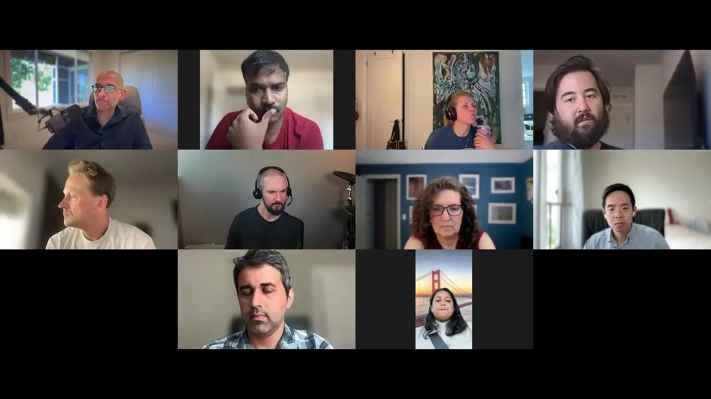
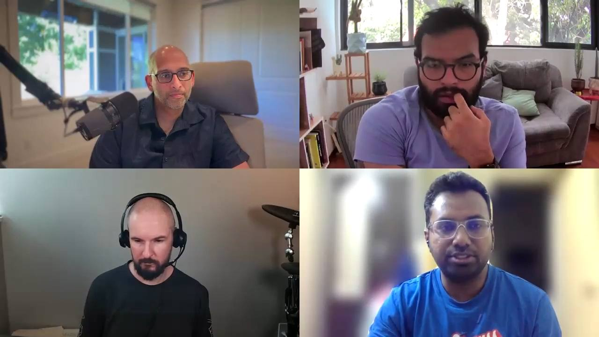

# AI Evals for Engineers & PMs｜P004 后半段（48:22–100:12）现场答疑：把评测流程落到你的项目上

> **关于这一节的特殊性，先说清楚**
>
> P004 的后半段（48:22–100:12）是**现场答疑（office hours）**，不是编码演示。逐字稿里**没有出现任何代码、命令、配置文件或终端输出**，`截图文件清单`对应的 8 张帧也**没有 OCR 结果**。
>
> 所以这一节不能像"克隆仓库→装依赖→起服务"那样跑。它的"可复现产物"是**一套可以直接搬到你自己项目里执行的评测 setup 流程**：trace 怎么切、数据从哪来、谁来标、标什么、评测器怎么条件化、分母怎么算、什么时候不该写 eval。
>
> 下文第 4 节给出的 Schema、表格和代码，凡是**课里没有的**，都会明确标注「课里没有代码，以下为示意」。讲师原话一律翻译成中文引用。

---

## 1. 这一节做什么

这一节是整门课最后的开放提问环节，从 **48:22 持续到 100:12**，一共接了 **12 位听众的提问**。提问者背景很杂：有做法律合同分析的、做芯片设计的、做政府业务案例生成的、做 RPG 游戏角色 AI 的、做企业级客服的。讲师是 Hamel 和 Shreya（Shreya 在约 93:39 处先离场，之后由 Hamel 单独作答）。

这一节回答的**不是"什么是 eval"，而是"我的场景跟课上例子不一样，怎么办"**。所有回答都收敛到同一个方法论内核：

1. **trace 的边界由 pipeline 决定，不由"第一条消息"决定**——system prompt 只是 pipeline 里的一个步骤，甚至可能不是第一条消息。
2. **真实数据永远优先于合成数据**；合成数据的最佳用法是**扰动真实数据**，而不是凭空生成。
3. **高度专业的领域必须由领域专家标注**，而且标注工具要去掉摩擦。
4. **自动评测器可以条件化**（只跑某个子集），但**失败率的分母始终是全集**。
5. **先做最简单的事**：不要一上来就分层评测、不要一上来就微调、不要一上来就写一堆 eval。
6. **评测是持续过程**，不是一次性项目——工具会变、用户会变、世界会变，数据集要持续更新。

对前端转 AI 应用工程师的读者，这一节最值钱的地方在于：它把"评测"从抽象概念变成了**你明天就能在 Notion 表格或 Google Sheet 里开工的流程**。你可以把一条 trace 理解成一次完整的前端会话埋点（session），把"分母用全集"理解成"全站转化率不能用某个渠道的分母算"——逻辑是相通的。

这一节**没有可运行的项目**，所以本文第 3 节写的是「按讲师给的顺序，在你自己的项目上把评测跑起来」的操作步骤，第 4 节写的是「这套流程落成什么样的表结构、目录结构和判定逻辑」。

---

## 2. 讲师原话

### 2.1 关于 system prompt 到底该放什么

讲师在这一段里反复纠正一个常见误解：不要把 system prompt 当成"某个特殊的东西"，而要把它当成**第一个 grounding prompt，装所有全局设定**。

> "你要把 system 或第一条消息想成你这个应用或 agent 的所有全局设置。"
> —— p004 [49:42]

> "对 O 系列模型来说，它其实不是 system prompt，而是 user prompt。但你在心里仍然要把它当成一组全局设定，是 agent 无论后续问什么都始终要带着的。"
> —— p004 [50:08]

他还点了另一个常见毛病：同一份上下文既塞 system prompt 又塞 user prompt，导致职责不清。

> "有时候我会看到人们把上下文同时放在 system prompt 和 user prompt 里。这样就很不清楚——有些放在 user prompt 第二條消息里的东西，本来就该放在 system prompt 或第一条消息里。"
> —— p004 [49:42]

关于"system prompt 是不是 chatbot 最重要的部分"，讲师的态度很明确：他不给硬规则，而是靠实验。

> "我不太会去大改 system prompt。有时候如果是我希望用户无法覆盖的行为，我希望它牢牢锚定在某种行为上，那我就会用 system prompt。但我基本上是靠 evals 和不断实验。所以我脑子里没有一套好的规则。"
> —— p004 [48:51]


### 2.2 关于多轮对话中 system prompt 变了，数据集还稳不稳

提问者（Salozo）的问题很尖锐：如果 agent 本来讲德语，你把 system prompt 改成法语，原来那套数据集是不是就废了？

讲师先纠正了"trace 的第一条就是 system prompt"这个误解：

> "如果你改过 system prompt，那你的 trace 的第一部分其实不是 system prompt。它是用户消息，然后某一步——比如一次工具调用或某段逻辑——把查询路由到德语或法语的 system prompt。所以别把 trace 太字面地理解成第一条消息。它是 pipeline 里进来的第一个东西，也就是进来的查询，然后是到达最终答案之前做出的所有决策：agent、工具、等等。"
> —— p004 [51:29]

然后是这一节最关键的一条工程规则——**条件化评测器 + 全集分母**：

> "自动评测器如果只需要跑在某一小部分 trace 上，比如德语 trace 或法语 trace，它完全可以是有条件的。你可以说，我只对它那个子集运行。这没问题。而我的失败率的分母仍然是整个集合。"
> —— p004 [52:26]

> "我觉得让 prevalence（发生率）针对整个 trace 全集是有用的。如果你想下钻到德语或法语这样的特定簇，那也可以。这取决于你的应用是什么。"
> —— p004 [52:55]

### 2.3 关于"哪些公司 evals 做得好"

讲师的回答很诚实：做得好的公司通常不对外说，因为那是他们的核心竞争力。

> "做得好的时候，他们通常不会告诉你，因为那就像是他们的全部秘诀。"
> —— p004 [53:24]

他举了 Gemini 的例子，这也是"人工逐条看"这件事最直接的一手证据：

> "比如在 Gemini，真的是有人在看每一条被用户点踩的消息，并对它们做 error analysis。我觉得这让他们成为成功案例——他们在构建好的 LLM 聊天机器人上相对算晚的，但现在他们是 state of the art。"
> —— p004 [53:50]

关于 Notion：

> "Notion 讲了很多关于做 evals 的事。我不知道他们做得好不好，因为我没有跟他们深度合作过。但他们确实在讲，这是你可以去找一找的东西。"
> —— p004 [54:20]

讲师还补了一句做这门课的动机：

> "关于 evals 的公开讨论其实不多，这也是我做这门课的动机之一。"
> —— p004 [54:46]

### 2.4 关于高度专业的垂直领域：必须请领域专家

提问者（Gustavo，保险/贵宾服务行业）说他们的应用依赖非常专业的技术信息，开发团队自己都判断不了回答对不对。讲师的第一句话就是：

> "你必须找懂这个主题的领域专家来做标注。而且训练他们这件事非常重要。"
> —— p004 [56:05]

"训练"具体指什么，他拆开讲了：

> "一方面是，确保你给他们暴露了正确的工具，让这个标注工作变得非常容易。你不希望只是把活儿一丢说'你来做吧'。那可能不是对的答案。可能需要你去设计一个东西，把所有摩擦都去掉，让他们能看到他们需要看到的东西。"
> —— p004 [56:34]

> "我们后面有一节课会讲标注工具，课程读本里也有，如果你想提前看的话。"
> —— p004 [57:03]

关于多个标注者：

> "在这种比较高级的场景里，也就是高度专业、连开发者自己都不理解的时候，你可能想要每个样本多个标注者，并且跟踪 intra annotator agreement（标注者之间的一致性）。这取决于复杂度、数据量、你需要标多少。"
> —— p004 [57:28]

> "如果可能的话，先从一个你真正信任的专家开始，把事情推动起来。不要一上来就扎进复杂的深水区。"
> —— p004 [57:57]

他还强调这件事是迭代的，而且**产品/工程的人应该亲自参与标注**：

> "我建议你跟他们一起做这个标注练习，原因有很多：一是你可以学，二是你可以把课上学到的方法引导给他们，三是你能感受到这个流程里哪里有摩擦。"
> —— p004 [58:26]

检索评测在不在课里？讲师确认有：

> "我们会讲。检索有一组非常特定的指标和你要看的东西，我们会在课里 cover。"
> —— p004 [58:53]


### 2.5 关于文档类用例（法律合同）怎么造测试集

提问者（Jen）的场景是：用户上传法律合同，LLM 读取、按若干法律概念分析、在文档上做标注、再把信息呈现给用户。问题是——这种**不是用户查询、而是文档输入**的场景，测试文档集怎么造？而且法律文档的结构（条款怎么表达）本身很重要。

讲师的第一建议是真实数据优先：

> "这类场景如果能用真实数据就尽量用真实数据，我不知道你能不能做到，但从真实数据取材是最省力的。合成生成那样的文档会难得多。"
> —— p004 [60:19]

合成数据也不是不能用，但用法完全不同：

> "如果非要合成，考虑到生成的复杂度，我唯一会主要考虑的是：如果我想对抗性地触发一个我怀疑正在发生的错误，我可能会生成更多对抗性数据，试着用一些数据把我的系统绊倒。但那属于比较高级的玩法。"
> —— p004 [60:45]

然后他给出了这一节里**最具体的一条合成数据方法论**：

> "我会反过来合成地破坏这些文档。就是给 LLM 一份文档，让它返回五六个不同的扰动版本。你可以想象，这些是已有文档的扰动维度，而不是凭空生成文档的维度。"
> —— p004 [61:13]

> "拿尽可能多的已有文档，看你怎么能把系统绊倒，用这种方式生成失败模式——假设它在你预期的地方失败，或者它没在你预期的地方失败、但以某种奇怪的方式失败了，那你就可以继续做后面的 open coding 等等。"
> —— p004 [62:12]

最后他给这件事定了性：

> "这里面有很多侦探式的工作。某种程度上就是侦探心态。你没有任何保证能找全所有错误，但你会通过迭代获得直觉，知道'好，我觉得我应该这样去绊我的系统'。"
> —— p004 [62:41]

### 2.6 关于多轮对话怎么造合成数据

提问者（Mohit）说：单轮可以按维度采样，但多轮对话四层深之后组合爆炸，怎么造？

讲师的第一个方案是模拟用户，但他自己也不掩饰这个方法的不确定性：

> "你可以用 LLM 来模拟用户。这很复杂。我不会说非常复杂，但确实更复杂。有一些供应商专门帮做这件事。某种意义上它是投机性的，因为完整模拟一个用户不是个简单问题——某种程度上接近 AGI。"
> —— p004 [64:08]

> "合成完整的多轮对话很难。如果能把真实 trace 整理出来，那对多轮对话来说就是最好的选择，然后再用有意思的方式去扰动它们。"
> —— p004 [64:37]

Shreya 给了模拟用户的具体做法：

> "把查询的所有维度都放进去，具体地说，在 system prompt 里把 persona 定义得非常清楚，然后让它成为一个你正在模拟的用户。"
> —— p004 [65:06]

第二个方案是"真实 trace → 提炼主题 → 生成更多"：

> "另一个办法是收集一百条真实 trace，也就是有人实际在用系统的例子。做一点 error analysis，甚至不光是 error analysis，而是分析其中的主题，然后用这些主题去生成更多看起来像真实 trace 的合成数据。如果你在真实 trace 里观察到，用户对某类消息会以某种方式反应，那就把这个放进生成合成数据的 system prompt 里。"
> —— p004 [65:35]



### 2.7 关于多轮里"最上游错误"怎么定

提问者追问：多轮里上下文会互相影响，你怎么判断这次失败是上下文组合导致的，还是独立失败？

讲师明确了标注的粒度和边界：

> "我们在课里讲的，是你把整条 trace 作为一个整体来标注，而 trace 包含了所有轮次。所以你要找的是那一串轮次里最上游的错误。再说一次，你并不是在做根因分析——不是去弄清楚到底为什么。你只是看，好，问题是什么？这一串里最上游的问题是什么？然后把它写下来。"
> —— p004 [66:57]

> "可能同时有好几件事在发生。尽力而为，把那个情境下占主导的最上游的问题写下来，然后继续。"
> —— p004 [67:26]

以及为什么用这个启发式：

> "最上游那个错误的推理是：这条 trace 里你最该关注的最重要的问题是什么？你可以陷在任何一条 trace 里出不来，你不希望这样。你想简化这个过程，而这个启发式基本上是在试图从你的 trace 里榨出你可以分析、可以行动的信号。"
> —— p004 [67:26]

### 2.8 关于多智能体 + 外部工具会变

提问者（Sunil）问：多智能体系统重度依赖对外部系统的工具调用，而外部系统本身在变；跑几百条 trace 做 error analysis 的时候工具行为变了，会不会引入漂移？要不要 mock？

> "评测现在是一个持续的过程，不是做一次就完了。我们会在应用的整个生命周期里不断回到这件事上，因为一切都会变——不只是工具调用，是一切。你的用户会变，世界会变，你的应用本身会变，一切都在变。所以你必须持续做这件事。"
> —— p004 [68:49]

> "而且你必须持续整理和更新你的数据集。所以这是一个迭代的过程。"
> —— p004 [69:16]

### 2.9 关于多阶段 / 复杂系统：先做最简单的事

提问者（Nikhil，芯片设计背景）问的是多阶段系统（每个阶段都极复杂、可能是领域专用 LLM）怎么分层做评测，以及 eval 工程师这个角色跟数据科学家、PM、软件工程师什么关系。

讲师的第一原则：

> "不管做什么，我都建议先做最简单的事，再去搞分层评测、多阶段评测、评每一个步骤和组件。试着看看最简单、甚至可能是最笨的办法能不能评测你的系统。"
> —— p004 [71:24]

> "那可能包括一开始只评其中一部分。按你描述的这个非常复杂的、有很多阶段和制造环节的系统，也许就先从前面的阶段开始，先把这套评测流程学会、把这个非常简单的评测流程跑起来，再去想煮沸整个流程的汪洋大海，因为那会让你崩溃。"
> —— p004 [71:53]

关于角色：

> "每个人都能从学评测中受益，因为你要参与一个 AI 团队，就需要理解你的 AI 是怎么工作的。"
> —— p004 [72:22]

> "但当事情变得更复杂时，你会需要做错误的数据分析、跟数据打交道，你必须有很高的数据素养，才能真正克服复杂问题、把它们 debug 出来。所以在极限情况下，它确实看起来像数据科学家。这不代表你现在就必须是。"
> —— p004 [72:51]

> "记住，Shreya 和我都有很强的数据科学训练背景，所以我们是从那个视角出发的。"
> —— p004 [73:17]


### 2.10 关于企业里的隐私恐惧

提问者（Margie，大型企业）说推行 eval 时撞上一堵墙：法务、数据驻留、数据治理、PII 清除，同事认为 eval 是在拦截用户、读取隐私数据。

Shreya 给的方案是"制度化"：

> "从学术界的角度说，我很多合作是跟法学院或者数据很敏感的领域。通常的策略是让一队人接受隐私培训、签一份针对该数据的专门合同。然后突然之间，人们就觉得可以看这些数据了，感觉好多了。"
> —— p004 [74:40]

> "人们对于查看隐私数据的恐惧，在签了合同、有人受过培训之后就消失了。这可能有用。"
> —— p004 [75:08]

Hamel 的补充更现实主义，也更值得前端工程师听：

> "很多时候这非常难，因为你说的是很好的论据。如果你还是推不动——我是在回应你刚才说的非常具体的处境——我能感受到你的挫败，因为我自己经历过几百次。我几乎会让问题先爆炸一下，然后抓住那个时机。"
> —— p004 [75:36]

> "这在某些方面是反效果的，那不是你想要的。但很不幸，我跟你分享的是它实际运作的现实。我们希望这门课能帮助教育人们，让他们知道怎么避免这些事、其实没那么难、而且你应该做。这是一个过程，因为人们就是不知道。他们觉得这是某种无谓的浪费，某种你不需要做的学术玩意儿。"
> —— p004 [76:04]

提问者自己找到了一个当下有效的说法，讲师认可：

> "目前我注意到有效的论据是：我们只会保留这些 trace 一个月然后就清除，再收集新的 trace 再清除。不知道为什么，这个说法好像管用。"
> —— p004 [76:32]


### 2.11 关于多步产品：整条工作流就是一条 trace

提问者（Favaz，政府部门）的场景是"业务案例生成器"：用户先粗描述项目，点一下生成更好的描述，确认后再喂进另一个 prompt，一共六步，最后产出一份完整的 business case。问题是——每一步都测，还是把 100 个场景跑一遍、每步都 open code？

讲师把问题拉回产品视角：

> "你要做的是尽量让它简单。我想象你有一个产品，用户要经过大概 50 个不同步骤才拿到最终结果。如果你觉得你唯一需要看的就是最终结果，而且你很有信心判断它做对了还是做错了，那这是一个可以的起点。如果你想放进表格里做 open coding，那也行。"
> —— p004 [78:57]

然后给了一个非常实用的"省掉仪式"的例子：

> "比如 100 步是不是太多了？这是产品问题。如果确实是 100 步太多了，那好，你可能判定这些是事实上的差。如果只是'100 步太多'这一点、而你知道这一点，你可能根本不需要对它们做 open coding。你直接做点分析、数一下步数，然后说'好，这些是差的'就行了。"
> —— p004 [79:27]

> "所以你不必把一百条全部走一遍去看它。你不需要做那套仪式。"
> —— p004 [79:56]

> "原则是：把它作为一个整体、从用户视角来看，戴上你的产品帽子说，这个用户交互是好还是坏？整个工作流就是一条 trace。那里发生的任何事，行不行？"
> —— p004 [80:26]

> "如果你想给自己简化——如果你非常有信心，你甚至不需要看 trace，第一遍都不需要看。那很好，直接开始看数据就行。你几乎会自动迷上'看数据'这件事。我几乎可以保证你会学到东西。"
> —— p004 [80:55]

### 2.12 关于 context engineering 是不是新东西

提问者的应用非常依赖上下文，问 context engineering 这个趋势是否成立、要不要深入。

> "我们一直在做上下文工程。这不是什么新东西。"
> —— p004 [81:23]

> "你可以检索上下文，你可以把上下文 prompt 进去。检索可以有很多形式——你的工具可以检索信息，你可以有向量数据库，你可以有搜索引擎，以上所有。"
> —— p004 [81:52]

> "context engineering 这个词，是为了强调有好的上下文很重要。它有点像一种品牌包装，让你知道这是一件非常重要、本来就存在的事。"
> —— p004 [82:21]

> "不要只叫它 RAG，因为 RAG 会让你觉得它只是检索。而 context 这个词是更好的品牌，帮你把注意力放在——不管这些上下文是怎么来的，检索也好、不是检索也好，你要关注的是上下文本身。"
> —— p004 [82:47]

### 2.13 关于模型 / 基础设施的前置大决策：局部最优 vs 全局最优

提问者（Kunal）的担忧很典型：模型选型、要不要换供应商、要不要微调，这些是前期投入很大的决策；如果一开始就选错，后面只能在边缘上打补丁，会陷进局部最优。

讲师的回答分两层。第一层是"先做实验"：

> "有很多东西其实不是 eval 特有的，比如怎么架构你的系统、用哪个模型。你必须试。在做 eval 之前你必须先试，做小实验，可以带一点 eval 式的思考，但基本上就是搞清楚什么行、什么不行。"
> —— p004 [85:13]

第二层是"微调是最后一招"：

> "一般来说，先做最简单的事。不要做微调，因为那是一项投资。尽量不动微调、只用 API 调用把事做完。当你撞到平台期，比如你跨不过泛化的鸿沟，而且你已经试过所有这些其他方法，那才可以考虑，好，也许是时候上这个昂贵的方案了。"
> —— p004 [86:05]

> "希望它是被证明合理的——好，这值得做这个昂贵的方案。而且你要用模块化的方式构建，让你可以很容易地把微调应用到任何模型上。就像你有一个好的 harness，你的 evals 都在，很容易把它指向一个新的微调 API。你有一个好的整理数据集的方式，你有一个好的测量微调效果的方式——这其实是微调工作的大部分：把数据集组织好、确保你有好的测量。有了这些，你应该能指向任何东西。"
> —— p004 [87:02]

> "你应该先把便宜的事情试一遍，再走到那一步。"
> —— p004 [87:32]

关于成本，他给了一个很多人忽略的点：

> "微调的成本其实没有服务你那个微调模型（serving）的成本高。如果你支撑不了那个 serving 的 MLOps，那老实说有时候根本就没意义。"
> —— p004 [88:58]

最后一句是本节的元原则：

> "关键是要做大量实验，想办法让你的工作方式能支撑大量实验、并且非常快地拿到反馈。这跟传统软件有点不一样。但这是很多事情的 ключ。"
> —— p004 [88:30]


### 2.14 关于 RPG 游戏角色 AI：超长交互怎么采样

提问者（Mele，小型 RPG 工作室）说他们的场景没有对错，是主观的、以娱乐价值为目标；而且角色 AI 的交互可能持续一个月。

讲师先给了分段：

> "这挺有意思，是超长期的交互。你想把你的 trace 切分一下（segment），这样分析起来才 tractable。"
> —— p004 [90:21]

然后是采样策略：

> "对于这种超长交互，你要看看能不能比随机采样更高效地采样。所以你需要一些信号。因为到那个程度每条 trace 的信息量都太大了——持续一个月——我会说，试着非常高效地采样。"
> —— p004 [90:51]

> "试着想出一些出问题的信号，然后在那些地方采样，在那里做 error analysis。那可以是用户反馈，可以是一些分析或统计上的异常值，可以是任何东西。但那会帮你锁定那些 trace。"
> —— p004 [91:20]

> "我们在课程读本里、以及后面也会讲怎么更有效地采样。这就是我会起步的地方。"
> —— p004 [91:48]

关于"错误"在主观产品里怎么定义，这是本节最锋利的一句：

> "错误的判断方式取决于你的产品。如果工具调用用错了，但你根本不在乎，那就没有错。至少在一开始，你必须最终觉得某件事出错了，它才算错。否则它就不配在众多问题里进入你的雷达。它真的必须是你觉得'这是坏的'。"
> —— p004 [92:44]

> "如果你觉得 LLM 给出的回答没有娱乐价值、或者没有遵守角色扮演，那你就应该标注它们。你应该写笔记，写下它为什么错。"
> —— p004 [93:11]


### 2.15 关于"一次性 prompt / 非对话"场景

提问者（Duncan）管理的应用几乎全是一次性的：不是对话式输入，而是若干"块"（block）影响 prompt 输入，这些块由用户输入或其他来源生成，每次发给模型的 prompt 就是全部，之后没有后续用户回复。

> "完全是同样的方法。对你来说其实容易得多。你仍然要做 error analysis，就像我们今天教的那样，然后走一遍写 eval 的流程。没有任何不同。事实上，容易得多。"
> —— p004 [95:07]

> "甚至作业都是一个 recipe bot，它其实只有一轮。你问一个菜谱，你得到一个菜谱。本质上就一轮。所以是的，所有东西 100% 适用。没有区别。而且它 tractable 得多，这是好事。"
> —— p004 [95:58]

### 2.16 关于"该不该现在就评工具调用"：不要预先写 eval

提问者（Vignesh，质量出身）问：现在是我人工评 agent 的回复，往后想建更好的系统，起步阶段应该只评用户回复、agent 回复，还是要深入评工具集？

> "你应该从做 error analysis 开始，做我们教的那些。你不该用现成的工具，因为它们不会做你想做的事。它们只会给你一堆通用指标，不会有帮助。所以不要聚焦在工具上，聚焦在流程上。并且确保你在看足够多的数据。"
> —— p004 [97:21]

> "评 agent 对用户的回复，这就是你说的数据分析的意思。我强烈建议回顾我们今天课上讲的：open coding、axial coding。确保你在做完整的流程，就像我们描述的那样。从那里起步，我们还没讲到写 eval 的部分，那是后面的一节课，但你应该从 error analysis 开始。"
> —— p004 [97:51]

这是他整节课最反直觉的一条：**eval 是按错误反推出来的，不是提前设计的**。

> "工具调用只是其中一种，你可以为工具调用失败写 eval。你可以为任何东西写 eval。但你不应该预先写 eval。你要基于你看到的错误去写 eval。所以如果你没看到任何工具调用错误，就不要写任何工具调用 eval。这有点反直觉，但你可以 eval 的东西是无限的。"
> —— p004 [98:20]

> "如果你走上'让我为了好玩把所有东西都写一遍 eval、以防万一'这条路，那它就完全没价值了。你的噪音会远远多于信号。"
> —— p004 [98:49]



---

## 3. 从零复现

这一节没有代码可以跑，所以"复现"的含义是：**按讲师给出的顺序，在你自己的项目上把评测 setup 建起来**。下面的步骤按依赖关系排，不能跳步。

### 步骤 0：先确认你的场景归类

讲师在整节里给出了三种场景，处理方式完全不同：

| 场景 | 特征 | 处理要点 |
|---|---|---|
| 单轮 / 一次性 prompt | 一次输入一次输出，没有后续用户回复（Duncan 的场景、课程的 recipe bot 作业） | 方法完全一样，而且更容易 |
| 多轮对话 | 上下文跨轮累积，4 层以上组合爆炸（Mohit 的场景） | 整条多轮 trace 作为一个标注单位 |
| 超长交互 | 持续数周（RPG 角色 AI） | 必须先切分（segment），再用信号化方式采样 |

**先判断你在哪一类，再往下走。** 讲师反复说单轮最容易，如果你是单轮，不要被课上的对话例子吓退。

### 步骤 1：把 trace 的边界定义出来，别从"第一条消息"开始

这是本节最容易做错的一步。讲师在 [51:29] 明确指出：trace 的第一部分**不是** system prompt，而是"进来的查询 + 到达最终答案之前的所有决策"。

所以你要画的是一条完整的 pipeline：

```
用户输入 / 文档上传
   ↓
[路由逻辑] ← system prompt 在这里被选中（德语版 / 法语版 / 不同业务线）
   ↓
[工具调用 / 检索] ← 可能是多次
   ↓
[中间产物] ← 例如法律文档上打的标注
   ↓
最终输出
```

操作上：

1. 打开你线上系统的日志/埋点，挑一条真实请求。
2. 从**用户动作触发点**开始记录，一直到**最终呈现给用户的输出**，这中间所有步骤都算在 trace 里。
3. 如果中间有路由分支（按语种、按业务线、按用户等级选不同 prompt），**把这个分支决策本身也画进 trace 里**，它是 trace 的第一段逻辑。

前端类比：这就像你的一条完整 session 埋点，从用户点击开始，经过路由、多次 API 调用、状态更新，到最后渲染完成——不是只记最后一次请求。

### 步骤 2：把全局设定收敛到第一个 grounding prompt

按讲师 [49:42] 和 [50:08] 的说法：

1. 列出当前散落在 system prompt 和 user prompt 各处的"全局约束"。
2. 凡是**不管用户问什么都成立**的，全部移到第一个 prompt 里。
3. 检查有没有重复：同一份上下文同时出现在 system 和 user 里 —— 这是讲师点名要避免的。
4. 如果用的是 O 系列模型（没有 system role），就把它写进第一条 user message，但**在心里仍然当成全局设定**。

判断标准：如果这条约束换个用户问题就不适用了，它不属于全局，留在 user prompt 里。

### 步骤 3：确定数据来源优先级，不要一上来就合成

讲师在多个提问里给了统一的优先级：

1. **真实数据**（最高优先级）——`[60:19]` "从真实数据取材是最省力的"。
2. **真实数据 + 扰动**——`[61:13]` 给 LLM 一份已有文档，让它返回五六个不同的扰动版本。
3. **从真实 trace 提炼主题，再生成**——`[65:35]` 收 100 条真实 trace，做主题分析，把观察到的用户反应写进生成用的 system prompt。
4. **纯合成 / LLM 模拟用户**（最低优先级，讲师的原话是"投机性的"）——`[64:08]`。

操作上：

- 如果你的产品已经上线：先从日志里捞真实 trace，这是第 1 档。
- 如果没上线或数据不够：准备 20～50 份真实文档/真实问题作为种子，做第 2 档扰动。
- 只有当上面两条都走不通，才考虑第 4 档。

### 步骤 4：找出懂行的人，并且给他造工具

按 `[56:05]`、`[56:34]`、`[57:28]`、`[57:57]` 的说法：

1. **定人**：找一个你真正信任的领域专家。不要一开始就上多个标注者。
2. **培训**：不是把人丢过来就完事，而是要设计工具把所有摩擦去掉，让他能看到该看的东西。
3. **亲自参与**：做产品/工程的人要跟专家一起标，一是学，二是感受摩擦在哪。
4. **再扩展**：如果领域极专业（开发者自己都不懂），再上多标注者 + 一致性跟踪。

这里有个讲师没展开的点：他只说了"intra annotator agreement"（原话如此），从上下文看应指标注者之间的一致性（inter-annotator agreement），具体算法课里没讲。

### 步骤 5：建标注表，整条 trace 作为一个标注单位

按 `[66:57]` 和 `[67:26]`：**一条多轮 trace 是一个标注对象，不是每一轮一个**。标注时只写"最上游的错误"，不做根因分析。

"最上游"的判断标准讲师说得很清楚：**这条 trace 里你最该关注的最重要的问题是什么**。可能有多个问题并存，选占主导的那个，写完就走，不要陷进去。

### 步骤 6：把评测器拆成"条件 + 分母"两部分

这是本节唯一一条可以直接写成代码的规则（详见第 4 节）。按 `[51:58]`、`[52:26]`、`[52:55]`：

- **条件**：这个评测器只对某类 trace 有意义吗？如果是，加一个 scope 条件（例如 `locale === "de"`）。
- **分母**：不管条件多窄，算失败率时分母用**全集**。
- **下钻**：想看德语子集的表现可以，但那是额外的一层，不能替代全集口径。

前端类比：你不能因为只看 iOS 用户的转化率，就把它当成全站转化率。渠道可以下钻，分母不能偷偷换。

### 步骤 7：多阶段系统，先只评一段

按 `[71:24]`、`[71:53]`：

1. 先问：最简单、甚至最笨的评测方式是什么？
2. 只评其中一部分——讲师建议**从开始的阶段评起**，先学会这套流程。
3. 不要一上来就分层评每个组件，那会让你崩溃。

### 步骤 8：主观产品先定义"什么算错"

按 `[92:44]`、`[93:11]`：如果产品目标是娱乐性（RPG 角色 AI），工具调用错了但你不在乎，那就不算错。**先由产品定义什么值得进雷达**，然后写笔记记录"为什么错"。

### 步骤 9：给超长交互加采样信号

按 `[90:51]`、`[91:20]`：不要随机采样。

1. 先把超长 trace 切段，让它可分析。
2. 定义信号：用户反馈、异常的统计量、任何能标记"可能出问题"的东西。
3. 只在信号命中的地方采样做 error analysis。

### 步骤 10：把这件事排进日历

按 `[68:49]`、`[69:16]`：这不是一次性项目。工具会变、用户会变、应用会变。数据集要持续整理和更新。**给"重新采样 + 重新标注"排一个固定周期**，而不是等项目结束。

### 步骤 11：什么时候才写 eval

按 `[98:20]`、`[98:49]`：**从错误反推，不预先设计**。

- 做完 open coding + axial coding，看到某一类错误反复出现 → 为这一类写 eval。
- 没看到工具调用错误 → 不写工具调用 eval。
- 不要"为了以防万一全写一遍"，那会让噪音远大于信号。

---

## 4. 完整代码

> **重要声明**：这一节对应的是答疑环节，**课里没有出现任何代码、命令或配置文件**。下面所有内容分两类：
> - **表格类**：是对讲师口述规则的直接结构化，不含编造成分。
> - **代码类**：均标注「课里没有代码，以下为示意」，是把讲师描述的规则落成可执行骨架，供你起步用，不是讲师提供的实现。

### 4.1 设计决策表（讲师原话 → 决策）

**表 4-1　第一个 grounding prompt 的内容归属**

| 内容类型 | 放哪里 | 依据 |
|---|---|---|
| 不管用户问什么都成立的全局约束 | 第一个 prompt（system 或第一条 user） | [49:42] |
| 用户不应能覆盖的行为锚定 | 第一个 prompt | [48:51] |
| 只对本次输入成立的上下文 | user prompt | [49:42] 反推 |
| 同一份上下文 | **不要同时放两处** | [49:42] 明确点名 |
| O 系列模型 | 写在第一条 user message，但按全局对待 | [50:08] |

**表 4-2　数据来源优先级**

| 优先级 | 做法 | 讲师依据 | 适用条件 |
|---|---|---|---|
| 1 | 真实 trace / 真实文档 | [60:19] | 产品已上线，有日志 |
| 2 | 真实文档 + LLM 生成 5～6 个扰动版本 | [61:13] | 有种子文档，缺失败样本 |
| 3 | 100 条真实 trace → 主题分析 → 按主题生成 | [65:35] | 多轮场景 |
| 4 | LLM 模拟用户（persona 写死在 system prompt） | [64:08]、[65:06] | 前三档都走不通 |

**表 4-3　标注表字段（CSV / Sheet 表头）**

| 字段 | 类型 | 含义 | 依据 |
|---|---|---|---|
| `trace_id` | string | 一条完整 trace 的唯一 ID | [66:57] 整条 trace 为一个标注单位 |
| `segment_id` | string | 超长交互切分后的段 ID；单轮留空 | [90:21] |
| `scope` | string | 条件标签，如 `de` / `fr` / `legal_contract` | [51:58] |
| `input` | text | 用户输入或上传文档引用 | — |
| `upstream_error` | text | 最上游错误的一句话描述 | [66:57]、[67:26] |
| `dominant` | bool | 是否为本条 trace 的主导问题 | [67:26] |
| `why_wrong` | text | 为什么错（主观产品必填） | [93:11] |
| `annotator_id` | string | 标注者 | [57:28] |
| `annotated_at` | datetime | 标注时间 | — |
| `notes` | text | 自由备注 | — |

> 注：上表字段名是**本文设计的**，不是讲师给出的。课里只说了"把最上游的问题写下来""写笔记说明为什么错"，没有规定字段命名。

**表 4-4　条件化评测器的两个概念（讲师明确区分）**

| 概念 | 定义 | 讲师依据 |
|---|---|---|
| evaluator scope（条件） | 这个评测器只跑哪些 trace | [51:58] |
| denominator（分母） | 算失败率时用的总数 = **全集** | [52:26] |
| drill-down（下钻） | 额外看的子集指标，不替代全集口径 | [52:55] |

**表 4-5　多阶段系统起步顺序**

| 顺序 | 动作 | 依据 |
|---|---|---|
| 1 | 只评最终输出，人工判断好坏 | [78:57] |
| 2 | 只评开头阶段，先把流程跑熟 | [71:53] |
| 3 | 用计数等简单分析替代人工逐条看（如"步数过多即判差"） | [79:27]、[79:56] |
| 4 | 再考虑分层 / 逐组件评测 | [71:24] 明确说这是最后才做的 |

**表 4-6　超长交互的采样信号来源**

| 信号来源 | 说明 | 依据 |
|---|---|---|
| 用户反馈 | 点踩、投诉、主动放弃 | [91:20] |
| 统计异常值 | 分析指标上的离群 | [91:20] |
| 其他任何能标记"可能出问题"的信号 | 讲师原话"可以是任何东西" | [91:20] |

### 4.2 目录结构（示意）

> 课里没有代码，以下为示意。目录名可自定，目的是把"原始 trace / 标注表 / 评测器 / 数据集"分开。

```
evals/
├── traces/                  # 原始 trace 导出（JSON，一行一条）
│   ├── raw_2025_03.jsonl
│   └── raw_2025_04.jsonl
├── annotations/
│   ├── open_coding.csv      # 标注表，表头见 4.3
│   └── axial_coding.csv     # 归类后的错误类型
├── evaluators/
│   ├── scope.ts             # 条件判断
│   └── run.ts               # 执行 + 分母计算
├── datasets/
│   ├── real/                # 真实样本
│   └── perturbed/           # 扰动样本
└── reports/
    └── failure_rate.json    # 输出：全集分母 + 子集下钻
```

### 4.3 标注表 Schema（示意代码）

> 课里没有代码，以下为示意。这是把表 4-3 落成 TypeScript 类型，方便你在 Node 侧读写标注数据。

```ts
// evals/annotations/schema.ts
// 课里没有代码，以下为示意：对应第 4.1 节表 4-3 的字段

export type TraceScope = "de" | "fr" | "legal_contract" | "default";

export interface TraceAnnotation {
  /** 一条完整 trace 的唯一 ID；多轮对话整条算一个 */
  trace_id: string;
  /** 超长交互切分后的段 ID；单轮或未切分时留空字符串 */
  segment_id: string;
  /** 条件化评测器使用的范围标签 */
  scope: TraceScope;
  /** 用户输入原文，或上传文档的引用路径 */
  input: string;
  /** 最上游错误的一句话描述；不做根因分析 */
  upstream_error: string;
  /** 是否为本条 trace 中占主导的问题 */
  dominant: boolean;
  /** 为什么错；主观类产品（如角色 AI）必填 */
  why_wrong: string;
  annotator_id: string;
  annotated_at: string; // ISO 8601
  notes: string;
}
```

### 4.4 条件化评测器 + 全集分母（示意代码）

> 课里没有代码，以下为示意。这段只实现讲师在 [51:58]–[52:55] 说的两条规则：**评测器可以有条件地只在子集上运行；失败率分母始终是全集**。

```ts
// evals/evaluators/run.ts
// 课里没有代码，以下为示意

import type { TraceAnnotation, TraceScope } from "../annotations/schema";

export type Verdict = "pass" | "fail" | "skipped";

export interface Evaluator {
  name: string;
  /** 这个评测器只在哪些 scope 上有意义；空数组表示全部 */
  appliesTo: TraceScope[];
  /** 返回 skipped 表示条件不满足，不参与分子也不参与分母的判定 */
  run: (a: TraceAnnotation) => Verdict;
}

export interface FailureReport {
  evaluator: string;
  /** 全集分母：按讲师要求，始终是全部 trace 数 */
  denominator: number;
  /** 分子：在适用子集上判定为 fail 的数量 */
  failures: number;
  /** 条件不满足、未参与判定的数量 */
  skipped: number;
  /** 全集口径的失败率 */
  failureRate: number;
  /** 下钻：各 scope 的内部失败率，仅用于分析，不替代全集口径 */
  byScope: Record<string, { denominator: number; failures: number; failureRate: number }>;
}

export function evaluateAll(
  annotations: TraceAnnotation[],
  evaluators: Evaluator[]
): FailureReport[] {
  const reports: FailureReport[] = [];

  for (const ev of evaluators) {
    let failures = 0;
    let skipped = 0;
    const scopeAgg: Record<string, { denominator: number; failures: number; failureRate: number }> = {};

    for (const a of annotations) {
      const inScope = ev.appliesTo.length === 0 || ev.appliesTo.includes(a.scope);

      // 下钻统计：不管是否在 scope 内，都按 scope 累计分母
      if (!scopeAgg[a.scope]) {
        scopeAgg[a.scope] = { denominator: 0, failures: 0, failureRate: 0 };
      }
      scopeAgg[a.scope].denominator += 1;

      if (!inScope) {
        skipped += 1;
        continue;
      }

      const v = ev.run(a);
      if (v === "fail") {
        failures += 1;
        scopeAgg[a.scope].failures += 1;
      }
    }

    for (const k of Object.keys(scopeAgg)) {
      const s = scopeAgg[k];
      s.failureRate = s.denominator === 0 ? 0 : s.failures / s.denominator;
    }

    // 关键规则：denominator 始终是全集
    const denominator = annotations.length;

    reports.push({
      evaluator: ev.name,
      denominator,
      failures,
      skipped,
      failureRate: denominator === 0 ? 0 : failures / denominator,
      byScope: scopeAgg,
    });
  }

  return reports;
}
```

**这段代码对应的讲师原话**：

> "自动评测器如果只需要跑在某一小部分 trace 上……它完全可以是有条件的。你可以说，我只对它那个子集运行。这没问题。而我的失败率的分母仍然是整个集合。"
> —— p004 [51:58]～[52:26]

### 4.5 扰动生成 prompt 骨架（示意）

> 课里没有代码，以下为示意。讲师在 [61:13] 说"给 LLM 一份文档，让它返回五六个不同的扰动版本"，但没有给出具体 prompt。下面是按这个描述搭的最小骨架。

```text
你是一名测试数据生成助手。下面是一份真实文档。
请基于这份文档生成 {N} 个"扰动版本"，每个版本只改动一个维度，
其余内容与原文保持一致。

扰动维度（从下列中选择，不要重复）：
- 条款顺序调换
- 条款编号引用错位（例如正文引用第 3 条，但实际是第 4 条）
- 数值/日期改动
- 定义术语前后不一致
- 删除某个边界条件
- 插入相互冲突的条款

输出格式：每个扰动版本前用一行说明"改了什么维度"，
然后给出完整文档内容。

原始文档：
---
{DOCUMENT}
---
```

这个骨架只体现"已有文档的扰动维度"，对应讲师原话"这些是已有文档的扰动维度，而不是凭空生成文档的维度"。

### 4.6 课里没有出现的技术清单

为避免误读，明确列出这一节**完全没有**涉及的内容：

- 任何命令行、包管理器命令、安装步骤
- 任何框架、SDK、库的 API
- 任何标注工具的配置或代码（讲师说在后面一节课讲，课程读本里有）
- 任何评测指标的数学定义
- 任何模型调用代码
- 任何数据库或存储结构
- 任何 OCR 内容（本段截图的 OCR 结果为空）

---

## 5. 逐行解释

### 5.1 为什么 trace 不能从"第一条消息"理解

讲师在 [51:29] 的纠正看起来抽象，实际影响很大。如果你把 trace 定义成"第一条消息 + 回复"，那么：

- 改 system prompt 就会让整个数据集失效；
- 路由逻辑产生的差异会被当成噪声；
- 条件化评测器无从下手。

按他的定义（进来的是什么查询 → 经过哪些决策 → 到最终答案），system prompt 只是 pipeline 里一个可能被选中的组件。这样做的好处是：**改 system prompt 时，trace 的结构不变，只是其中某个分支的产出变了**，数据集仍然可用，评测器只需要按 scope 分组看。

前端类比：你不会因为换了一个 UI 组件库就把整条用户旅程埋点丢掉，你只会在埋点里加一个"版本"维度。

### 5.2 为什么评测器可以条件化，但分母必须是全集

这是本节唯一一次讲师把规则说到"可以直接实现"的程度。

- **条件化**解决的问题是：某个评测器只在特定子集上有意义（德语 trace 用德语评测器）。如果强行让它跑全集，大部分样本会被误判。
- **分母用全集**解决的问题是：如果你只用子集算分母，你得到的是"德语 trace 内部的失败率"，不是"系统整体的失败率"。这两者是完全不同的指标，混用会让你误判系统健康状况。

讲师在 [52:55] 说"如果你要下钻到特定簇，那也可以"——注意他说的是**下钻**，是额外一层，不是替代。第 4.4 节代码里 `byScope` 就是这一层，而 `failureRate` 永远用全集分母。

前端类比：全站转化率的分母是全站 UV，不能因为你想看 iOS 就把分母换成 iOS UV。

### 5.3 为什么扰动比凭空生成优先

讲师在 [60:19] 和 [61:13] 的顺序非常明确：先真实数据，再真实数据扰动，最后才是纯合成。原因是：

- 真实文档的结构（条款怎么表达）本身就是被测对象的一部分，凭空生成很难保住这个结构；
- 扰动是"沿着已知维度制造压力"，你能清楚知道自己在测什么；凭空生成是"在未知空间撒点"，很难归因；
- 讲师在 [60:45] 明确说，合成数据最有价值的用法是"对抗性地触发一个我怀疑正在发生的错误"——这仍然是从真实错误假设出发的。

### 5.4 为什么必须由领域专家标注，而且要给他造工具

讲师在 [56:05] 说的是
正是这句话，而不是“找个人随便看看”。讲师把“训练”这个词拆成了三件事，这三件事决定了标注数据能不能用：

1. **工具摩擦**。原话是“确保你给他们暴露了正确的工具，让这个标注工作变得非常容易”。这句话的反面是：如果你把一坨原始 JSON 丢给律师，让他自己在里面翻条款，他标 20 条就会放弃，而且标出来的东西会越来越敷衍。你要做的是把 trace 渲染成他能看懂的样子——文档原文、模型给出的标注、模型引用的条款号，三者并排放在一屏里。
2. **人的选择**。原话是“如果可能的话，先从一个你真正信任的专家开始”。这里的关键词是“一个”。多个标注者是用来算一致性的，不是用来起步的。起步阶段上多个人的后果是：你要同时处理标注分歧和流程不熟两个问题，而这两个问题的解法互相干扰。
3. **你自己必须下场**。原话是“我建议你跟他们一起做这个标注练习，原因有很多：一是你可以学，二是你可以把课上学到的方法引导给他们，三是你能感受到这个流程里哪里有摩擦。” 这一条最容易被跳过。做产品的人如果没亲手标过 50 条，他就不知道“最上游错误”这个字段在真实数据上有多难填——而这个难度会直接决定你后面写 eval 时能不能定义清楚。

至于什么时候才上多标注者，讲师给的触发条件是“高度专业、连开发者自己都不理解”。这个条件本身就说明：多标注者不是质量措施，是**在你无法判断单个人标得对不对时**的兜底措施。

### 5.5 为什么“最上游错误”是启发式，不是根因分析

讲师在 [66:57] 和 [67:26] 两次强调“你不是在做根因分析”，然后马上解释了原因：

> “你可以陷在任何一条 trace 里出不来，你不希望这样。你想简化这个过程。”

这句话点出了标注工作真正的成本结构。标注的成本不在“判断对错”，而在**判断完之后还想继续深挖**。一条多轮 trace 可能有 5 个问题互相纠缠，如果你每一条都追到底，一条 trace 花 20 分钟，100 条就是 33 小时——这还没算标注者疲劳导致的判断质量下滑。

“最上游”这个启发式的作用是给标注者一个**明确的下车点**：写下这条 trace 里最该被关注的那个问题，然后走人。讲师还补了一句“可能同时有好几件事在发生。尽力而为”，意思是这个字段不追求完备性，只追求**能产出可分析、可行动的信号**。

这里的取舍很清楚：

| 做法 | 得到什么 | 失去什么 |
|---|---|---|
| 追根因 | 单条 trace 的完整因果链 | 标不了多少条，没有统计意义 |
| 只标最上游 | 大量可聚合的失败标签 | 单条的因果不完整 |

讲师选后者，因为他要的是**分布**，不是个案。这和前面 5.2 里“分母用全集”是同一条思路的两个面：没有足够大的分母，失败率就没有意义；没有足够多的标注，分母就大不起来。

前端类比：这就像线上报错。你不会每一个 error 都去追到最底层的那一行，你先按 error type 聚合，看哪个 type 占比最高，再去追那一个。

### 5.6 为什么多轮和超长交互的处理方式不一样

讲师对这两种场景给了两套不同的动作，值得分开看。

**多轮对话（Mohit、Salozo 的场景）**：动作是“整条 trace 作为一个标注单位”。讲师在 [66:57] 说“你把整条 trace 作为一个整体来标注，而 trace 包含了所有轮次”。这意味着 5 轮对话产生 **1 条**标注记录，不是 5 条。为什么？因为多轮里的失败往往是上下文累积的结果，你拆成 5 条就把因果关系切断了，而切断之后你标出来的东西无法回答“是不是前一轮埋的雷”。

**超长交互（RPG 角色 AI，持续一个月）**：动作是“先切分，再用信号采样”。讲师在 [90:21] 说“你想把你的 trace 切分一下，这样分析起来才 tractable”，在 [90:51] 说“你要看看能不能比随机采样更高效地采样”。

注意这里的顺序不能反：

1. 先切分（segment）——把一个月切成可分析的小段；
2. 再定义信号——用户反馈、统计异常值、“任何东西”；
3. 只在信号命中的段上采样做 error analysis。

如果反过来，先随机采样再切分，你会得到一大堆“用户和角色正常聊天”的样本，信息量接近零。讲师对这一点说得很直接：“因为到那个程度每条 trace 的信息量都太大了”。

这两个场景的对比说明一件事：**标注单位的大小是由“因果能不能在单位内闭合”决定的**。多轮的因果跨轮闭合，所以整条算一个；一个月的交互因果太长，所以切段，但切完之后必须靠信号来找段。

### 5.7 为什么微调要放到最后：一条成本结构的判断

讲师在 [86:05] 到 [88:58] 这一段给了一个完整的决策顺序，而且每一步都有理由：

**第一步，先做小实验。** 原话是“在做 eval 之前你必须先试，做小实验”。注意他把“试”排在“eval”前面——这不是口误。模型选型这类问题，在你还没有 trace 的时候就得定，所以只能用实验而不是 eval。

**第二步，把不微调的路走到头。** 原话是“尽量不动微调、只用 API 调用把事做完。当你撞到平台期，比如你跨不过泛化的鸿沟，而且你已经试过所有这些其他方法，那才可以考虑”。

**第三步，如果要微调，先保证可移植。** 原话是“你要用模块化的方式构建，让你可以很容易地把微调应用到任何模型上……你的 evals 都在，很容易把它指向一个新的微调 API”。这里他把“eval 存在”当成了微调的前置条件，而不是微调的配套工作。逻辑是：**没有测量能力，你无法判断微调有没有用**，那这笔钱就是盲投。

**第四步，算 serving 成本。** 这一条是很多人漏掉的。原话是“微调的成本其实没有服务你那个微调模型（serving）的成本高。如果你支撑不了那个 serving 的 MLOps，那老实说有时候根本就没意义”。也就是说，微调的账单不是一次性的训练费，而是长期的推理服务 + 运维。对一个前端转过来的工程师，这句话的现实含义是：微调不是一个 API 调用，它是一套你要长期养的基础设施。

讲师还顺带定义了“微调工作的大部分”是什么：“把数据集组织好、确保你有好的测量。” 这跟本节其他部分的主题完全一致——数据集和测量，而不是训练脚本。

### 5.8 为什么不能预先写 eval

这是本节最反直觉的一条，也是讲师说得最重的：

> “你可以为任何东西写 eval。但你不应该预先写 eval。你要基于你看到的错误去写 eval。”

理由他给了：”你可以 eval 的东西是无限的“，所以”为以防万一全写一遍“的后果是”你的噪音会远远多于信号“。

把这句话拆成可执行的判断，就是：

- **输入**：open coding + axial coding 之后的错误类型分布；
- **动作**：只为**已经观察到、且反复出现**的类型写 eval；
- **反例**：没看到工具调用错误，就不写工具调用 eval。

这条规则和 5.2 的分母规则其实是一套的。如果你的 eval 集合里塞满了“以防万一”的评测器，那些评测器大多数时候返回 pass，它们对分母的贡献是“稀释失败率”——你最后算出来的失败率会显著低于真实情况，因为你在为不存在的错误付分母。

### 5.9 为什么单轮场景反而更容易

Duncan 的困惑（“所有例子都是对话式的，我这是一次性的”）在讲师看来不是问题，他连说了两次“容易得多”（[95:07]、[95:58]）。原因可以从本节前面的规则推出来：

- **trace 边界天然清晰**：一次输入一次输出，不需要判断“第一条消息到底是什么”；
- **不需要处理上下文累积**：5.6 里多轮的那个麻烦（失败是前一轮埋的）不存在；
- **标注单位没有歧义**：一条就是一个；
- **分母没有争议**：全集就是全部请求。

讲师还拿课程作业举例：“甚至作业都是一个 recipe bot，它其实只有一轮。” 这句话的作用是打消“我的场景不典型”的顾虑——课上的例子是对话式的，但方法论不依赖对话。

### 5.10 关于隐私：两种应对方式

讲师和 Shreya 给了两条不同的路，都值得记下来。

**Shreya 的路：制度化。** 培训 + 签针对该数据的专门合同。她的观察是“人们对于查看隐私数据的恐惧，在签了合同、有人受过培训之后就消失了”。这条路的特点是把“能不能看”变成一个**有书面依据的流程问题**，而不是靠说服。

**Hamel 的路：现实主义。** 他先承认“你说的是很好的论据”，然后说“如果你还是推不动……我几乎会让问题先爆炸一下，然后抓住那个时机”，并且自己承认“这在某些方面是反效果的，那不是你想要的”。这段的价值不在于它是一个好建议，而在于它描述了一个真实约束：**有些组织里，正确性论证不是通行证**。

提问者自己提供的第三条路，讲师也认可了：只保留一个月然后清除。这条之所以有效，是因为它把“永久留存敏感数据”这个恐惧对象换成了“限期留存、到期清除”，后者在合规上更容易被接受。

### 5.11 context engineering：为什么讲师说它不是新东西

讲师在 [81:23] 到 [82:47] 这一段的论点有三层：

1. **事实层**：“我们一直在做上下文工程。” 检索上下文、把上下文 prompt 进去、工具检索、向量数据库、搜索引擎——这些手段本来就存在。
2. **语义层**：“它有点像一种品牌包装，让你知道这是一件非常重要、本来就存在的事。”
3. **术语层**：“不要只叫它 RAG，因为 RAG 会让你觉得它只是检索。而 context 这个词是更好的品牌，帮你把注意力放在——不管这些上下文是怎么来的。”

第三层是对工程实践最有用的。RAG 这个词内建了一个假设：上下文来自向量检索。而 context 这个词不预设来源，所以当你用工具调用拿数据、用搜索引擎拿数据、或者直接把数据塞进 prompt 时，你仍然在同一个问题域里。**换词的实际收益是：你不会因为“我们没做 RAG”就以为“我们不用管上下文”。**

---

## 6. 复现检查清单

下面每一条都可以当场勾。带 ★ 的是讲师明确强调过的，漏了就等于没做。

### 6.1 场景与边界

- [ ] 已判断自己属于单轮 / 多轮 / 超长交互中的哪一类（对应第 3 节步骤 0）
- [ ] ★ 已画出完整 pipeline：从用户动作触发点 → 路由 → 工具/检索 → 中间产物 → 最终输出
- [ ] ★ 路由分支（按语种、按业务线、按用户等级）已画进 trace 里，而不是当成外部条件
- [ ] ★ 没有把 system prompt 当成 trace 的第一条消息

### 6.2 第一个 grounding prompt

- [ ] 已列出当前散落在 system / user 各处的全局约束
- [ ] ★ 所有“不管用户问什么都成立”的约束已移入第一个 prompt
- [ ] ★ 已检查没有同一份上下文同时出现在 system 和 user 两处
- [ ] 若使用 O 系列模型，全局设定已写入第一条 user message，并在文档里标注“按全局对待”

### 6.3 数据来源

- [ ] ★ 已确认能否拿到真实 trace / 真实文档（第 1 优先级）
- [ ] 若拿不到，已准备 20～50 份种子文档用于扰动（第 2 优先级）
- [ ] 若做多轮，已收约 100 条真实 trace 做主题分析（第 3 优先级）
- [ ] ★ 只有在以上都走不通时，才使用 LLM 模拟用户，并在文档里标注“投机性”
- [ ] 扰动样本从“已有文档的扰动维度”生成，而不是凭空生成文档

### 6.4 标注

- [ ] ★ 只指定了**一个**你信任的领域专家起步（未直接上多个）
- [ ] ★ 给标注者做了工具，trace 渲染成他能看懂的形态（文档 / 标注 / 引用条款并排）
- [ ] ★ 做产品/工程的人亲自参与了至少一轮标注
- [ ] ★ 多轮对话以**整条 trace** 为一个标注记录
- [ ] ★ 超长交互已切分（segment），并定义了采样信号
- [ ] ★ 标注表里有“最上游错误”字段，且填写时**不做根因分析**
- [ ] 主观型产品（如角色 AI）已由产品侧定义“什么算错”，并写入 `why_wrong`
- [ ] 若领域极专业且开发者无法判断，已计划多标注者 + 一致性跟踪

### 6.5 评测器

- [ ] ★ 每个评测器都明确了自己的 scope（只对哪些 trace 有意义）
- [ ] ★ 失败率分母使用**全集**，不是子集
- [ ] 子集指标作为 `byScope` 下钻层存在，未替代全集口径
- [ ] ★ 没有任何“以防万一”的评测器——每个都能对应到一个已观察到的错误类型
- [ ] 尚未观察到工具调用错误时，没有写工具调用 eval

### 6.6 复杂系统

- [ ] ★ 先只评最终输出 / 开头阶段，没有一上来就分层评每个组件
- [ ] 已识别出可以用简单计数替代人工逐条看的判断（如“步数超过阈值即判差”）
- [ ] 未做“把一百条全走一遍”的仪式性工作

### 6.7 持续运行

- [ ] ★ 已给“重新采样 + 重新标注”排了固定周期，而不是当成一次性项目
- [ ] 已明确外部工具行为变化时需要更新数据集
- [ ] 已明确模型版本变化时需要重新基线

### 6.8 前置大决策

- [ ] 已用小实验确定模型选型，未用 eval 替代实验
- [ ] ★ 未在走到平台期之前考虑微调
- [ ] 若考虑微调，已确认：eval 已就位、数据集组织方式已就位、测量方式已就位
- [ ] 已估算 serving 成本与 MLOps 负担，而不只是训练成本

### 6.9 合规（若在企业内推行）

- [ ] 已准备“限期保留 + 到期清除”的方案作为过渡
- [ ] 已考虑标注人员隐私培训 + 针对该数据的专门合同
- [ ] 已把 eval 的定位表述为“AI 分析”而非“拦截用户”

---

## 7. 课里没讲但你会撞上的

下面这些问题在整段答疑里**没有出现**，但只要你照着第 3 节真的动手，大概率会撞上。每一条都写清楚“为什么撞上”和“先怎么处理”，并标注它超出了课程范围。

### 7.1 一条 trace 会因为流式输出和重试被写进多行

**为什么撞上**：前端接流式输出时，一次请求往往先落一条“开始”记录，再多次落 chunk，失败重试还会再落一条。等你按行统计分母时，同一条用户请求会被数成 2～3 条，分母虚高，失败率被稀释。

**先怎么处理**：在导出 trace 时按会话/请求 ID 做一次去重，只保留最终态那一行。这一步在课里没有讲，属于数据工程细节。

**在 JS/Node 里对应什么**：跟你做前端埋点时的“事件幂等”是同一件事——用 `requestId` 作为幂等键，后到的记录覆盖先到的，而不是追加。

### 7.2 多轮 trace 的“整条”到底怎么拼

**为什么撞上**：讲师说“整条 trace 作为一个整体”，但没说多轮在存储上怎么关联。如果你线上是按单次请求存的，你手上就没有“整条”，只有碎片。

**先怎么处理**：在请求里带一个贯穿整个会话的 `sessionId`（前端在会话开始时生成，之后每次请求都带上），导出时按它聚合。课里没讲这个字段怎么设计。

### 7.3 标注表多人同时编辑会互相覆盖

**为什么撞上**：起步阶段用 Google Sheet 或 Notion 表格是最快的，但只要两个人同时标，就会出现“后保存的覆盖先保存的”。

**先怎么处理**：给每一行一个稳定主键（`trace_id` + `segment_id`），每人只编辑分配给自己的行；或者一人一个 sheet，最后按主键合并。

**在 JS/Node 里对应什么**：这就是并发写冲突。前端最接近的场景是两个 tab 同时改同一份表单——你通常靠“最后写入者获胜”糊过去，但标注数据不能糊，因为丢掉的那一行不会有人发现。真要严格，就需要行级锁或版本号（乐观锁）。课里没有涉及任何锁或事务。

### 7.4 一致性指标具体怎么算，课里没给

**为什么撞上**：讲师提到“跟踪 intra annotator agreement”（原话如此，从上下文看应指标注者之间的一致性），但没有给公式，也没有说多少算合格。

**先怎么处理**：先把“两个标注者对同一条 trace 写下的 `upstream_error` 是否能归到同一个错误类型”作为一致性判断，只统计双方都标过的样本。具体用什么系数，课里没讲，需要你按团队情况定。

### 7.5 模型升级后，旧 trace 无法重放

**为什么撞上**：你想验证“新模型是不是比旧模型好”，于是拿旧数据集重跑——但旧 trace 里的工具返回、检索结果、甚至 prompt 模板都已经变了，重跑出来的不是同一个条件。

**先怎么处理**：在 trace 里存下**当次实际送给模型的完整输入**（包括检索到的内容），而不是只存用户问题。这样至少能保证输入可复现。这一条课里没有提。

### 7.6 合成数据污染评测集

**为什么撞上**：你用 50 份真实文档做种子，生成 300 份扰动版本；后来又拿同一批文档去做别的实验。等到评测时，训练/调试用过的样本和评测样本重叠，指标虚高。

**先怎么处理**：在做扰动之前，先把种子文档切成“生成用”和“留出评测用”两堆，后者不参与任何生成。课里没有讲数据划分。

### 7.7 PII 脱敏之后，领域专家反而判断不了

**为什么撞上**：合规要求去掉姓名、身份证号、地址；但这些字段恰好是法律合同、保险理赔里判断对错的关键（比如“这条条款引用的甲方是谁”）。

**先怎么处理**：用**一致性替换**（同一个实体在同一份文档里始终替换成同一个占位符，如 `[PERSON_A]`），保留实体间的指代关系，只去掉真实身份。课里只讲了合规的沟通策略，没有讲脱敏的技术做法。

### 7.8 超长 trace 的标注成本被低估

**为什么撞上**：RPG 那种一个月的交互，即使切段，单段也可能很长。标注者读一段要 10 分钟，标 50 段就是一整天。

**先怎么处理**：这正是讲师说的“信号采样”要解决的问题——但信号的阈值需要调。先跑一轮小样本，量出“每条标注耗时”，再反推你能标多少条，别一开始就定 500 条的目标。

### 7.9 scope 标签缺失会让 skipped 堆积

**为什么撞上**：第 4.4 节的代码里，不在 scope 内的样本会被计入 `skipped`。如果你的 `scope` 字段在历史数据里大量为空，那些样本会全部落进 `default`，条件化评测器形同虚设，而你的全集分母看起来还很正常。

**先怎么处理**：导出时就检查 `scope` 的分布，空值比例过高就先补标签，再跑评测。课里没有讲标签治理。

### 7.10 A/B 实验下“全集分母”会打架

**为什么撞上**：讲师要求分母用全集，但如果你同时在跑 A/B 两个版本，全集里混了两个版本的结果，算出来的失败率既不代表 A 也不代表 B。

**先怎么处理**：把“版本”也做成一个 scope 维度，全集分母仍然保留（用于对外报总体健康度），但比较 A/B 时用各自的 `byScope` 下钻。这个用法是从讲师的规则推出来的，课里没有直接讲 A/B 场景。

### 7.11 “不要预先写 eval”在团队协作里会被误解

**为什么撞上**：讲师的原话是“不预先写 eval”，但如果团队里有人把它理解成“不做测试”，就会走到另一个极端——上线前完全不设门槛。

**先怎么处理**：区分两件事——**探索性的 eval**（按错误反推，这是讲师说的）和**回归性的检查**（防止已修好的问题复发）。后者在课里没有讨论，但工程上通常需要。讲师说的是不要凭空设计 eval，不是不要回归测试。

### 7.12 讲师中途离场，最后一个问题没有回答

逐字稿在 [99:44] 到 [100:12] 记录了一位听众想举手提问，Hamel 说他需要离开一下（“我需要去趟洗手间，下一个环节要开始了”），并建议在 Discord 上继续。**这个问题在课上没有得到回答，内容也没有被记录**。如果你在看录像时发现结尾突然断掉，不是剪辑问题。

---

## 附：本节覆盖的提问清单（便于回查）

| # | 提问者 | 场景 | 核心结论 | 时间 |
|---|---|---|---|---|
| 1 | Salozo | 多轮 + system prompt 变更 | 条件化评测器 + 全集分母 | 50:34 |
| 2 | — | 哪些公司 evals 做得好 | 做得好的不对外说；Gemini 人工看点踩 | 53:24 |
| 3 | Gustavo | 保险/贵宾服务，高度专业 | 领域专家 + 造工具 + 先一个专家 | 55:13 |
| 4 | Jen | 法律合同文档分析 | 真实数据优先；扰动已有文档 | 58:53 |
| 5 | Mohit | 多轮组合爆炸 | LLM 模拟用户；真实 trace 提炼主题 | 63:10 |
| 6 | Mohit（追问） | 多轮里最上游错误怎么定 | 整条 trace 一个标注；不做根因 | 66:02 |
| 7 | Sunil | 多智能体 + 外部工具可变 | 评测是持续过程，数据集持续更新 | 67:55 |
| 8 | Nikhil | 芯片设计，多阶段系统 | 先做最简；eval 角色趋近数据科学家 | 69:38 |
| 9 | Margie | 企业隐私与合规阻力 | 培训+合同；限期保留后清除 | 73:17 |
| 10 | Favaz | 政府业务案例，六步流程 | 整条工作流就是一条 trace | 77:01 |
| 11 | — | context engineering 是否新 | 不是新东西，是更好的品牌 | 80:55 |
| 12 | Kunal | 模型/微调等前置大决策 | 先做便宜实验；微调最后 | 83:17 |
| 13 | Mele | RPG 角色 AI，超长交互 | 切分 + 信号采样；产品定义什么叫错 | 88:58 |
| 14 | Duncan | 一次性 prompt，非对话 | 方法完全一样，而且更容易 | 93:39 |
| 15 | Vignesh | 该不该现在评工具调用 | 不要预先写 eval，从错误反推 | 96:26 |
| 16 | — | 最后一位 | 未回答，转 Discord | 99:44 |