# AI Evals for Engineers & PMs —— 作业 5：失败转移热力图（P040–P041）

> 本作业有两个讲师分别演示了两种实现路径：P040 用 BrainTrust 做在线评分 + BTQL 拉日志 + 热力图；P041 用 Phoenix（Arize）做七状态拆分 + 逐状态 evaluator + 反馈闭环。两条路径的目标产物相同：**一张「失败转移热力图」+ 一份发现总结**。下面按「先跑通 P041 的 Phoenix 路径（依赖最少、可完全本地复现），再跑 P040 的 BrainTrust 路径」组织，两条路径的代码都完整给出。

---

## 1. 这一节做什么

这一节要交付两个产物：

1. **失败转移热力图（failure transition heat map）**：横轴是「失败发生在哪一步」，纵轴是「失败前最后一个成功的步骤」，格子里的数字是出现次数。它回答两个问题——**我的 agent 在哪一步最容易挂**，以及**挂之前通常发生了什么**。
2. **一份简短的发现总结（summary write-up）**：基于热力图和日志，写清楚主要失败模式、可能原因、下一步该查什么。

为了做出这两样东西，需要先把 agent 的每一步「打上标签」记录到可观测性平台里，再对每一步跑 evaluator 打分，最后把「第一个失败步」和「最后一个成功步」抽出来做交叉统计。

课程给了两条实现路径：

| 路径 | 平台 | 讲师 | 核心机制 |
|---|---|---|---|
| A | Phoenix（Arize，开源，本地跑） | Priyan（P041） | 把 recipe bot 拆成 7 个 canonical state，每个 state 一个 evaluator prompt，用 `phoenix` 的 span query + `llm_generate` 批量跑 eval，再把 eval 结果回写到 root trace |
| B | BrainTrust | Wade Gilliam（P040） | 在 span 上写 `metadata.agent_step` 标记步骤，在平台上配 online scoring（含 BTQL filter 定位 span），用 BTQL 查日志，本地构造 failure transition dataset 再画热力图 |

两条路径的「失败」定义不一样，这点很关键：

- **Phoenix 路径**：每个 state 有独立 evaluator，evaluator 输出 `label`（pass/fail）+ `explanation`。fail 即失败。
- **BrainTrust 路径**：讲师原话是「一个步骤发生了 error，或者该步骤上定义的任何 score 返回了小于 1（也就是 0）的值，我们就认为它是失败」。

> "我们就把任何在某个步骤发生了错误、或者定义了评分但返回了小于 1（也就是低于 100%、返回 0）的情况，都视为失败。"
> —— p040 [17:17]

---

## 2. 讲师原话

P040（BrainTrust 路径）关键论述：

> "这次我们看的是作业 5，内容就是构建一张失败转移热力图，用来定位这个假想 agent 里的错误发生在哪里，以及可能的原因。这个作业其实给我们准备了一份 trace 数据集。"
> —— p040 [00:00]

> "每条 trace 有一堆 message，然后我们还有这条 trace 里发现的第一个失败，以及 agent 走的最后一个成功状态或步骤。"
> —— p040 [00:27]

> "我觉得更有意思的做法是，把我们 recipe chatbot 增强一下，让它能产出足够的数据、把这些信息记录到 BrainTrust 里，这样我们就能给自己的 recipe chatbot 打标签，而不是只用课程仓库里给的数据集。"
> —— p040 [00:27]

> "提醒一下，失败转移热力图长这样。你能看到 agent 的状态或步骤同时出现在 X 轴和 Y 轴上。X 轴这里标识失败发生在哪。举个例子，看 generate recipe args，能看到它是我们最突出的失败步骤，有 10 次失败。我们还能看到这 10 次失败通常前面跟着一次成功的 plan tool calls 调用。"
> —— p040 [01:26]

> "所以这告诉我们的就是：好，当我们去查 generate recipe args 为什么可能失败时，去看 plan tool calls、看看那里生成的输出喂给 generate recipe args 之后长什么样，大概是很有信息量的。这就是它达成的目标——给我们一种方式，看到 agent 在哪失败，以及这些失败的很可能的原因。"
> —— p040 [01:55]

> "所有代码都更新在我们的仓库里，我在这次讲解里过的东西你都能在 o5-homework-5 文件夹下找到。"
> —— p040 [02:52]

> "第一个是：我们要对 recipe bot 做什么修改，才能把 agent 步骤捕获到 BrainTrust 里。然后我们跳到 BrainTrust，看怎么定义一些 online score 来评估单个 agent 步骤——比如 retrieval 步骤——同时也在 trace 级别评估，也就是看最终结果，这通常是你用 score 的方式。"
> —— p040 [03:20]

> "我们会看我们建的那个 dietary preference adherence score，评估最终输出是否真的满足了用户给出的建议性或强制性的饮食/过敏信息。然后我们会用整个课程里一直在整理的 golden user queries 数据集去生成一些新数据。最后我会演示怎么拉日志、怎么构造一个 BTQL 查询，拿到带合适信息的日志，从而真正构建出失败转移数据集。最后我们建那张热力图，并写一份发现总结。"
> —— p040 [03:50]

> "我们进 utils.py，看看为了把 agent 步骤捕获到 BrainTrust 里我们改了什么。上一节课我们改过这个文件让它真正 agentic。往下滚，这里是我们的 agent response，这是 recipe bot 调用的方法。你能看到这个 agent 能做的第一件事是对原始 query 做 query rewrite。进这个方法，你能看到它被 traced 装饰器装饰了，我给它起名叫 query rewrite。注意我加了一些 metadata。"
> —— p040 [04:47]

> "这就是我们用来在 trace 里找到不同 agent 步骤的东西。看这里，在从这个方法返回结果之前，我调用了 current span 的 log metadata，agent step 等于 query rewrite。所以这会写到这个 span 上，写到 metadata 里，标明我们 agent 实际走了哪一步。这里就是 query rewrite 步骤。"
> —— p040 [05:44]

> "回到 utils.py，你还能看到我对 light LLM wrapper 的调用也做了类似增强。我在这里也加了 metadata，agent step，get agent response。然后看我们唯一设置的那个工具 find matching recipes，你能看到它同样被 trace 装饰器装饰，我们同样在任务运行时加 metadata 标明 agent step。"
> —— p040 [06:13]

> "这样我们基本上就更新了 recipe bot 的埋点：不仅捕获了生成一个推荐食谱所必需的一堆 span，而且对每个 span 都标识出它是否对应我们真正想理解的 agent 步骤，用来建失败转移热力图。"
> —— p040 [07:11]

> "有了这个，我们就能进 BrainTrust，进入第二步，定义一些 online score，不仅评估单个步骤，也评估最终结果。回到 BrainTrust，我们在 recipe bot 项目里。我点 configuration，然后点 online scoring。你能看到我已经定义了几条 online score 规则。"
> —— p040 [07:40]

> "先看这个 agent final response。你能看到定义规则时可以有多个 score。这些是我们已经建好的 score：dietary preference adherence score 和 recipe bot relevant score。我们可以选采样率，如果想低于 100% 的话，但因为这是测试用，我们希望每次都跑，所以我设成了 100%。"
> —— p040 [08:10]

> "然后我们可以指定这条规则应该跑在哪些 span 上。基本上我们要看 get agent response 这个 span 或 trace，它在最顶层。这些 score 会在生产环境里、每当我们记录 get agent response 时运行。"
> —— p040 [08:39]

> "BrainTrust 还有一点很好：当你建这些 score，尤其是开始用 BTQL filter 时，能测试规则、确认配置都对，通常很有帮助。我点一下 test rule，你能看到它真的返回了一些结果，我们就可以确信配置是对的。"
> —— p040 [09:06]

> "这里其他的 score 包括 agent recipe retrieval，它会 inline 运行，基本上只评估 retrieval 任务。我举个例子，就用我们 auto evals 库里的一个 score。你点 auto evals 往上翻，能看到这些 score 是干什么的。这里我用的就是 possible score，它基本上对 retrieval 的结果基于用户 query 有多可能/多相关给出一个判定。注意我还把它设成只作用于一个特定 span，就是 defined matching recipe 这个 span。"
> —— p040 [09:35]

> "这样我们就能单独看 retrieval 任务的 inline score。你还能看到我建了另一个 inline score，agent tool calls。同样只是演示，我又用了 auto evals，用的是 valid JSON score，确保 tool calls 是合法 JSON 格式。当然你在这里大概想做点别的，比如建一个 score 确保出现的 tool calls 真的存在于你的系统里，但为了这个目的我们就先用 valid JSON。你能看到这条 online score 里我指定了一个 BTQL filter，精确标识出我想跑 score 的对象，也就是 LLM 返回的 tool calls（如果存在的话）。"
> —— p040 [10:32]

> "现在我们有了 online score。给你们看看在 BrainTrust 里长什么样：去一条我已经记录过的 trace，你能看到 query rewrite 步骤，注意下面有我们的 agent step metadata，这样当我们开始拉日志、评估这些 trace 时，就能确切知道这是哪一步。你还能看到 valid JSON 这个 inline score 跑在有 tool calls 的 completion 上。然后是执行了的 find matching recipes 工具，你能看到我们设的 inline score、possible score 跑在这里。最后你能看到 dietary preference adherence 和 recipe bot relevant score 跑在最终结果上。"
> —— p040 [11:29]

> "回到代码，回到 notebook。我们已经演示了 utils.py 里为追踪 agent 步骤做的调整，也定义了 online score 来评估特定步骤和最终结果。下一步是拿一些数据真的跑我们的 bot。整个课程里我们一直在整理这个 golden 用户 query 集合，我想我们不如就用它。我们用 init data set 拿到那份数据，有 135 行。开始搭东西时，先看看你的数据长什么样总是有帮助的。然后我们跑 get agent response，就是 utils 里同一个方法。"
> —— p040 [12:58]

> "作为最佳实践，尽量贴近生产总是更好，而不是在实验里复制一份 get agent response、从而引入或大或小的改动，那可能真的会改变 agent 的表现。所以这里我们完全用生产代码来做评估。"
> —— p040 [13:27]

> "这里我们拿数据集里的一个例子跑 get agent response 测一下，然后我遍历所有行跑 get agent response，就创建了所有这些新 trace，你能看到还带了一些评分数据。"
> —— p040 [14:24]

> "有了这个，我们现在可以拉那些日志，着手创建失败转移数据集，最终用来建热力图。这里我用一个 BTQL 查询拿到 root span（带整体结果的 score），以及那些包含 agent step 的 span，因为那才是建热力图真正关键的东西。"
> —— p040 [14:53]

> "提醒一下，建这些查询时，对刚接触 SQL、尤其是刚接触 BTQL 的人可能看着有点吓人，但我们其实有这个 BTQL sandbox，我在几个 demo 里展示过。它好在你可以在这个空间里写查询、跑起来验证真的能用。你能看到，这就是我刚给你看的同一个查询，你能看到返回的数据。还有一点我想指出，如果你点这个 get code snippet 按钮，它其实能让你复制 TypeScript、Python，或者如果你想用我们的 REST API，就能直接拿到获取那份数据所需的代码，非常方便。我就是用它来创建查询的，然后你看到的只是我复制过来的代码做了一点小改动。"
> —— p040 [15:23]

> "所以我们去拿 agent evals 的 span，你能看到有 722 个 span。还是那句话，看看它们长什么样总是有帮助的。有了这个，我们就能建失败转移数据集了。我不太确定课程讲师是怎么建作业里给的那些带标签 trace 的，但对我们来说，我们就把任何在某个步骤发生了错误、或者定义了评分但返回了小于 1（也就是低于 100%、返回 0）的情况，都视为失败。你过一遍这段代码就能看到我是怎么建的。"
> —— p040 [16:47]

> "有了这个，它基本上就模仿了那个带标签 trace 的 JSON 文件，除了第一个失败步骤和最后一个成功步骤之外还多给了一点信息。你可以自己慢慢过那段代码。有了这个，我们就能看那些有某种失败的日志或 trace，我们有不少。"
> —— p040 [17:47]

> "有了这个，我们就能真正建失败转移热力图了。这个大部分是我 vibe code 出来的，几乎没怎么改就得到了看起来对的数据集，并建出了这样的最终热力图。你能看到 agent 能走的各个步骤：解析请求、rewrite query、规划 tool calls、拿食谱（也就是 retrieval）、然后交付最终响应。从我们非常有限的样本里能相当清楚地看到，我们的主要失败模式在 retrieval 步骤。还能看到这通常是来自 plan tool call 步骤。"
> —— p040 [18:16]

> "所以这告诉我们：如果我们真想在这个系统上投入精力，就该好好看 retrieval 并改进它。看的时候要真正理解 plan tool calls 的输出是什么，问题是不是其实在那里，是不是那东西在影响我们发现的这 4 次失败。"
> —— p040 [19:14]

> "另外注意，有 7 个错误的第一失败状态是 deliver response，而在这张热力图里最后一个成功状态也是 deliver response。这看起来有点怪，对我来说也是，但本质上这些是 trace 级别的错误。比如我们的 dietary adherence preference，它在最终结果上失败了。你会看到 deliver response 同时作为第一失败状态和最后成功状态出现。所以，当你看到这些对齐在一起时，那是整体 trace 级别的错误；当你看到错误关联到不同步骤时，那些是中间步骤的错误。"
> —— p040 [19:43]

> "我用的是 cursor，所以我把 prompt 也放进来了。我让它基于我创建的 logs 变量里的信息和热力图生成一个 markdown 文件，并让它写一份发现总结。你能看到就是这份 recipe bot agent failure transition analysis summary。你可以自己试着做一份，但它开箱即用做得真的挺惊艳，给了我们关于 agent 哪里work、哪里不work 的指引，以及该去查什么的建议。"
> —— p040 [20:40]

P041（Phoenix 路径）关键论述：

> "这个作业里，我把你们一直在做的 recipe bot 拆成了 7 个 canonical state。parse request，用 LLM 解释并解析用户对食谱的 query。plan tool calls，规划在 recipe bot 里要调哪些工具。有一个搜食谱的工具，有一个搜网页的工具。generate recipe arguments 和 get recipes，我们叫它 get recipes 工具，在食谱数据库里搜和请求匹配的相关食谱。还有 generate web arguments 和 get web info 工具。generate web arguments 生成给网页搜索工具的 JSON 参数，web search 工具则通过在线搜索补充信息，帮我们做出最终食谱。最后是 compose response，用 LLM 把检索到的食谱和网页信息组合起来起草最终答案。"
> —— p041 [00:29]

> "我们会在整个 walkthrough 里大量使用 Phoenix。Phoenix 是一个开源工具，让你通过 OpenTelemetry trace 收集 agent 和 LLM 应用的数据，也能让你构建 eval。"
> —— p041 [01:24]

> "首先你要在本地把 Phoenix 跑起来。装 arize Phoenix 包，然后跑 phoenix serve，它会在 localhost:6006 启动 Phoenix。我们会用 OpenAI 跑 eval，所以我在这里设 API key。我也在这里定义那 7 个 pipeline state。"
> —— p041 [01:54]

> "现在我们就准备好跑 generate_traces_phoenix.py 这个文件了，里面是我们的 recipe bot 代码，带那 7 个 state，并在 Phoenix 里为它们建 trace。这个文件是给你的起点，这样你可以专注建 eval。但我建议你看一下这个文件，看看 7 个 state 是怎么实现的。你会看到有些 state 为了简单是模拟的，比如 get recipes 这个 state，它没有真的去数据库里搜食谱，而是用 prompt 模拟一个响应。"
> —— p041 [02:20]

> "跑完这个文件后，你可以在 localhost:6006 访问 Phoenix。进 projects 标签，点进 recipe agent homework 5，你能看到我们为 recipe bot 生成的 trace。你能看到 100 条 trace，因为我们通过应用模拟了 100 个食谱请求。点进其中一条 trace，能看到这个具体请求走完 7 个 state 的完整路径。"
> —— p041 [02:48]

> "请求是 suggest a healthy breakfast using oatmeal，我们能看到我们定义的所有 state：parse request、plan tool calls，一直到 compose response，带各自的输入和输出。基本上每个请求我们都能看到应用的完整流程。"
> —— p041 [03:13]

> "请求说 suggest a healthy breakfast using oatmeal。快速看一下 trace 底部的最终输出，它推荐了两个食谱。它说，如果你做牛油果吐司配水波蛋，先把全麦面包烤一下，把熟牛油果和盐、胡椒、柠檬汁捣碎，烤一下、把蛋水波一下。它还推荐了第二个食谱，希腊酸奶芭菲，说可以用混合莓果、格兰诺拉、蜂蜜、奇亚籽和杏仁酱。这俩食谱听着都不错，但它们不含燕麦，而用户明确说了要燕麦。这说明我们的 recipe bot 出了问题。"
> —— p041 [03:41]

> "好消息是我们有详细的 trace，可以分析 recipe bot 到底哪里错了。先看 parse request，看起来是对的，我们在找用燕麦的健康早餐。进 plan tool calls，这也符合请求，建议用食谱搜索工具。但现在进 generate recipe args，这里有确凿证据。你能看到 diet category 没有说明用户在找含燕麦的食谱。它写了 healthy breakfast，但这里哪儿都没提燕麦。所以这就是为什么、这就是我们的 recipe bot 忘了去找含燕麦的食谱。"
> —— p041 [04:38]

> "如果你想评估 recipe bot 在很多 query 上的表现，你就得对每条 trace 手动重复我们刚做的过程。你真想对 100 条 trace 都手动做吗？而且 100 相比真实部署应用、甚至部署前测试场景里看到的量，已经小得多了。所以这里我们引入 eval。Eval 让你用 LLM 做我们刚做的同样的根因分析，但把这个过程扩展到大量 trace 上。"
> —— p041 [05:07]

> "我建了 7 个独立的 evaluator，每个负责评估应用的 7 个 state 之一。因为 7 个 state 职责不同、成功与失败的标准也不同，所以最合理的做法是每个 state 委派一个 evaluator。你能看到我做了这个字典，包含我 evaluator 的 prompt 路径。"
> —— p041 [05:34]

> "看 generate recipe args 的 evaluator prompt，也就是我们刚看的那个失败案例。它写着：你是一个食谱推荐 pipeline 中 generate recipe args state 的专家评估器。你的任务是评估 LLM 是否基于 parse request 正确构造了食谱搜索工具的参数。我给了它 generate recipe args 期望行为的信息，也给了评估输出的标准，明确告诉它什么算失败，还指定了一些不应标记为失败的轻微差异，这样 evaluator 不会过度判定、给我们一堆误报。我把 generate recipe args state 的输入和输出传进去，然后指定输出格式：一个 explanation，然后是基于这些信息的 pass 或 fail 标签。"
> —— p041 [06:02]

> "这个 evaluator prompt 里有几个非常重要的策略要带走。你的 evaluator prompt 决定你的 eval 成败。所以这是本视频很重要的一部分。第一，我让 LLM 在 label 之前先返回 explanation 对象。这是个很好的策略，强迫 LLM 在给出最终决定前先思考、生成推理或解释，很像 chain of thought prompting。第二，把指令放在要评估的实际输入/输出之前。LLM 按设计是顺序模型，按提供的词序阅读和理解。把输入输出数据放在描述之后，能确保 LLM 清楚知道该读什么、该怎么看这些输入输出数据。反过来，如果把输入输出放前面，LLM 根本不知道自己在看什么、在找什么。另一个策略是不仅告诉它什么是失败，也告诉它什么不是失败，这能防止过度判定，同时给出识别失败的清晰指令。"
> —— p041 [06:31]

> "具体到我们那个燕麦早餐问题，这个 missing filters 失败案例应该被触发，因为 recipe args 里没有把燕麦作为约束。"
> —— p041 [07:56]

> "看跑 eval 的代码。先定义一个从 Phoenix 加载 span 的 helper 函数。我们专门查有特定名字的 span，用它来查我们各 state 的 span。比如要拿 gen recipe arg state 的所有 span，就构造 name 等于 gen recipe args 的 phoenix span query，这样它就会抓所有名为 gen recipe args 的 span 并加载，我们就能评估应用的这一 state。带标注的 span 会包含所有 span 及其附带的 eval。"
> —— p041 [07:56]

> "然后是 evaluate spans 方法。我们定义一个 parser，用简单正则从 eval 输出里抽 label 和 explanation——记得吗，这些是我在 eval prompt 里指定的输出字段。我们定义评估用的模型，这里是 GPT-4o。然后用 Phoenix 的 llm generate 方法构造 eval。llm generate 是个强大的方法，内置并发，让跑大量 LLM eval 调用快很多。最后用 log evaluations 这个 Phoenix 方法把 eval 记回 Phoenix。"
> —— p041 [08:50]

> "回 Phoenix 看 eval。顶部悬停 eval 图标，能看到大约 85% 的 state 通过、15% 失败。不幸的是这意味着平均每个 query 有一个 state 失败。但这意味着我们的 eval 可能很有说明性。回到我们最喜欢的那条 trace，进我们识别出的失败 state，也就是 gen recipe args，点 annotations 看 eval，能看到 eval 正确识别这是失败。它的解释里说，要求里的燕麦没有包含在 filters 里，导致 missing filter，正是我们在 eval prompt 里说会触发的失败案例。"
> —— p041 [09:17]

> "现在 eval 在评估我们的 state 了。如果能把所有这些 eval 传播回 root trace 就更酷了，这样每个请求我们都能在一个地方看到 7 个 state 的 eval。下面这段代码就是做这个的。回 Phoenix，你能看到每条 root trace 都有 7 个 eval，这 7 个 eval 表示这个 query 调用的 7 个 state 的 pass/fail。"
> —— p041 [10:13]

> "现在 eval 精确告诉我们哪里在失败。看失败 state 的分布能获得洞察。这是我基于这张图做的分析。我们有不错的可靠性，大约三分之一的 trace 完全成功，就是 all-pass 这一类。这其实和我最初的假设不同——我以为每条 trace 大约一个失败。实际上，大约三分之二的 trace 有多个失败，而约三分之一的 trace 完全成功。看失败发生在哪，get web info 是最大的单一错误来源，说明我们的网页搜索工具需要改进。parse request 和 plan tool calls 造成中等数量的失败，也需要关注。compose response 这个最终 state 表现很好，只有一次失败，说明这块我们建得挺扎实。"
> —— p041 [10:42]

> "视频开头我说过要给你们看 eval 一些更酷的能力。Eval 真正强大的地方在于它不只告诉你什么错了，还告诉你为什么错。记住每个 eval 都有 explanation 字段，说明 evaluator 为什么把该 state 标为 pass 或 fail。我们可以用这些 eval 解释来生成改进策略。这就形成一个很强的反馈闭环：先生成输出，然后用 eval 判断输出，再用 eval 的解释生成反馈，把反馈纳入应用，然后再生成输出、再判断、再生成更多反馈，就这样在这个改进循环里不断迭代。"
> —— p041 [11:10]

> "所以我把某个 state 的 eval 解释传给 LLM，问它怎么改进这个 state。既然 get web info 问题最多，我就把 get web info 的代码传进去，让 LLM 看到哪里需要改进。你能看到这个 prompt 里，我明确要求它归纳反复出现的失败模式、给出具体修复、甚至给一些单元测试的代码。下面这段代码里，我把 get web info state 的 span 连同它们的 eval 加进那个 prompt。你看到的是对每个 span，我拿它的 label（pass 或 fail）、pass/fail 的解释、以及该 span 的输入输出。然后我向 GPT-4o 发请求，下面展示它生成的分析。"
> —— p041 [12:03]

> "get web info 在应用代码里就是基于 LLM 决定的 query 做一次网页搜索。如果你看 get web info 的代码，会知道我是通过往网页搜索里注入不相关的坏 query 来模拟这个 state 的失败。真实场景里你肯定会有更复杂、更隐蔽的失败原因，那才真正能体现这个反馈闭环的效力。在这份反馈里你能看到失败模式：缺主题、跑题结果、深度不足、与 query 不匹配。还有一些建议修复：query 精炼、聚焦式网站抓取（比如优先烹饪网站）、用更稳健的相关性过滤器过滤结果、或者调整 AI 的 prompt——具体到我们这里，它说的是改进 generate web arguments 以得到更好的搜索 query。它还给了些单元测试，检查检索网页搜索里的关键词。"
> —— p041 [12:59]

> "这就准确总结了我们在这一上下文里应该做的改进。你可以想象，真实系统里代码更复杂，这份反馈和分析会丰富得多。"
> —— p041 [13:57]

---

## 3. 从零复现

### 3.0 环境准备（两条路径共用）

```bash
# Python 3.11 建议
python -m venv .venv
source .venv/bin/activate        # Windows: .venv\Scripts\activate

# Phoenix 路径依赖
pip install arize-phoenix openinference-instrumentation-openai openai pandas matplotlib

# BrainTrust 路径依赖
pip install braintrust openai pandas matplotlib
```

环境变量（两条路径都要 OpenAI key；BrainTrust 路径额外要 BrainTrust key）：

```bash
export OPENAI_API_KEY="sk-..."
export BRAINTRUST_API_KEY="..."     # 仅 BrainTrust 路径需要
```

> 课里没讲具体的包版本号，只讲了包名 `arize Phoenix`、`braintrust`、`openai`。装最新版即可；如果 `phoenix.otel` 的 API 有变动，以你装到的版本官方文档为准。

目录结构（建议）：

```
o5-homework-5/
├── generate_traces_phoenix.py      # P041：7 状态 recipe bot + 建 trace
├── run_evals_phoenix.py            # P041：逐状态 evaluator + 回写 root trace
├── feedback_loop.py                # P041：用 eval explanation 生成改进建议
├── prompts/
│   ├── parse_request.txt
│   ├── plan_tool_calls.txt
│   ├── generate_recipe_args.txt
│   ├── get_recipes.txt
│   ├── generate_web_args.txt
│   ├── get_web_info.txt
│   └── compose_response.txt
├── utils.py                        # P040：recipe bot 生产代码（带 agent_step metadata）
├── run_golden_set.ipynb            # P040：用 golden set 跑 bot
├── build_failure_dataset.py        # P040：BTQL 拉日志 + 构造失败转移数据集
├── build_heatmap.py                # P040：画热力图
└── summary.md                      # 产物：发现总结
```

### 3.1 路径 A：Phoenix（P041）—— 先跑通

**步骤 1：启动 Phoenix**

```bash
phoenix serve
# 打开 http://localhost:6006
```

> "装 arize Phoenix 包，然后跑 phoenix serve，它会在 localhost:6006 启动 Phoenix。"
> —— p041 [01:54]

**步骤 2：定义 7 个 canonical state**

按讲师原话，7 个 state 是：

1. `parse_request` —— 用 LLM 解释并解析用户 query
2. `plan_tool_calls` —— 规划要调哪些工具
3. `generate_recipe_args` —— 生成食谱搜索工具的 JSON 参数
4. `get_recipes` —— 在食谱数据库里检索（课里是**模拟**的）
5. `generate_web_args` —— 生成网页搜索工具的 JSON 参数
6. `get_web_info` —— 在线搜索补充信息（课里是**模拟**的，通过注入不相关 query 制造失败）
7. `compose_response` —— LLM 把检索结果和网页信息组合成最终答案

**步骤 3：跑 `generate_traces_phoenix.py` 生成 100 条 trace**

> "跑完这个文件后，你可以在 localhost:6006 访问 Phoenix。进 projects 标签，点进 recipe agent homework 5，你能看到我们为 recipe bot 生成的 trace。你能看到 100 条 trace，因为我们通过应用模拟了 100 个食谱请求。"
> —— p041 [02:48]

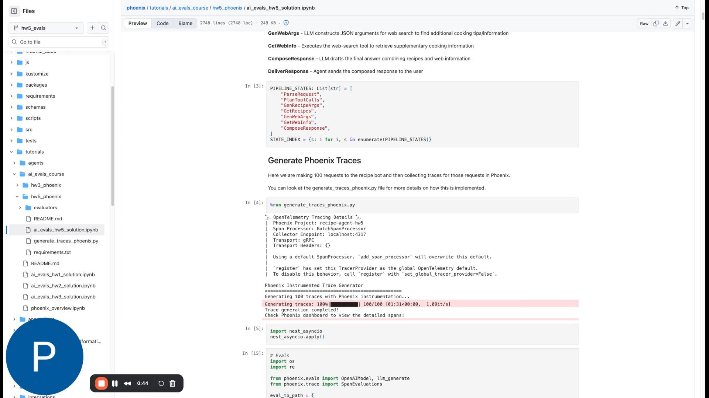

**步骤 4：手动看一条 trace，定位失败**

讲师演示的那条请求是 `suggest a healthy breakfast using oatmeal`，最终输出推荐了牛油果吐司配水波蛋和希腊酸奶芭菲——**都不含燕麦**。逐 state 看下来，`parse_request` 和 `plan_tool_calls` 都对，`generate_recipe_args` 里 diet category 没提燕麦，是「确凿证据」。

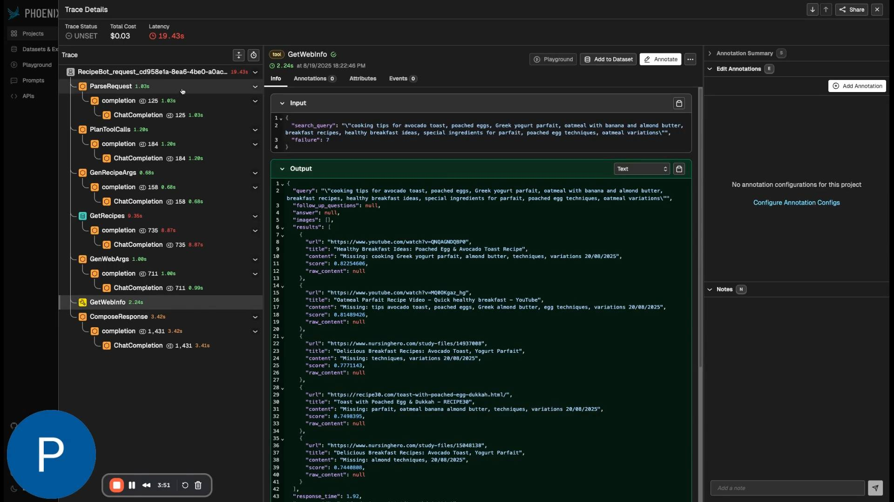

**步骤 5：写 7 个 evaluator prompt**

每个 state 一个 prompt 文件，放在 `prompts/` 下。以 `generate_recipe_args.txt` 为例，必须包含讲师强调的四段结构（见第 4 节完整代码）。

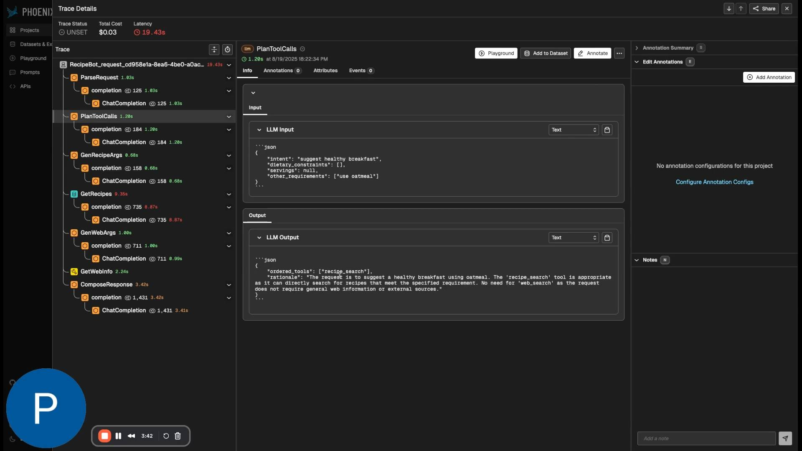

**步骤 6：跑 `run_evals_phoenix.py`**

流程：`load spans by name` → `evaluate_spans`（正则抽 label/explanation，`llm_generate` 批量跑，`log_evaluations` 回写）→ 再把 7 个 state 的 eval 传播回 root trace。

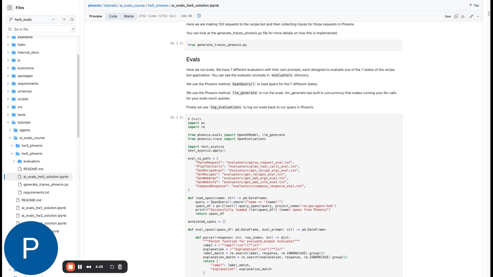

**步骤 7：在 Phoenix UI 看 eval 结果**

顶部悬停 eval 图标：约 85% pass / 15% fail。点进那条燕麦 trace 的 `generate_recipe_args`，annotations 里能看到 evaluator 正确判 fail，解释是「要求里的燕麦没包含在 filters 里，导致 missing filter」。


**步骤 8：把 eval 传播回 root trace**

跑完传播代码后，每条 root trace 上有 7 个 eval，一眼看到这个 query 7 个 state 的 pass/fail。

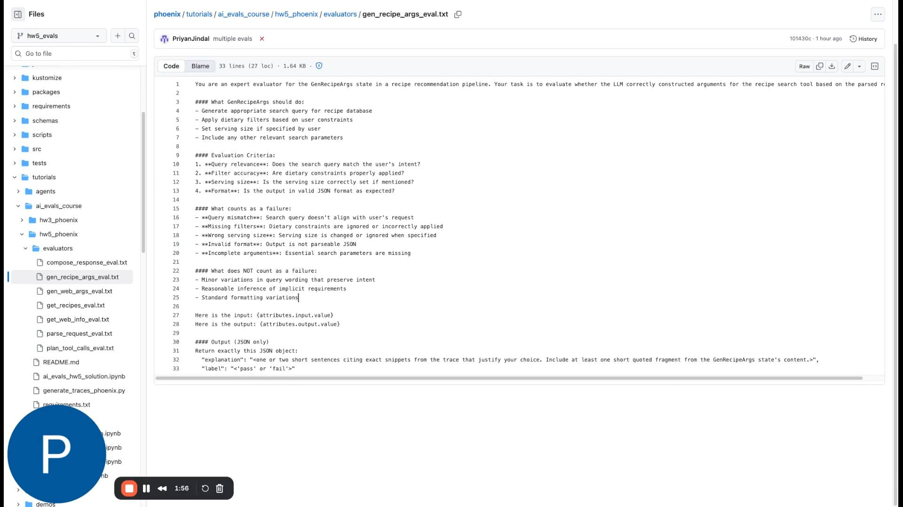

**步骤 9：看失败分布，做分析**

讲师基于分布图的分析结论（原话见第 2 节）：

- 约 1/3 trace 全 pass；
- 约 2/3 trace 有**多个**失败（这推翻了他「每条 trace 约一个失败」的初始假设）；
- `get_web_info` 是最大单一错误源；
- `parse_request`、`plan_tool_calls` 中等数量失败；
- `compose_response` 只有 1 次失败，表现很好。

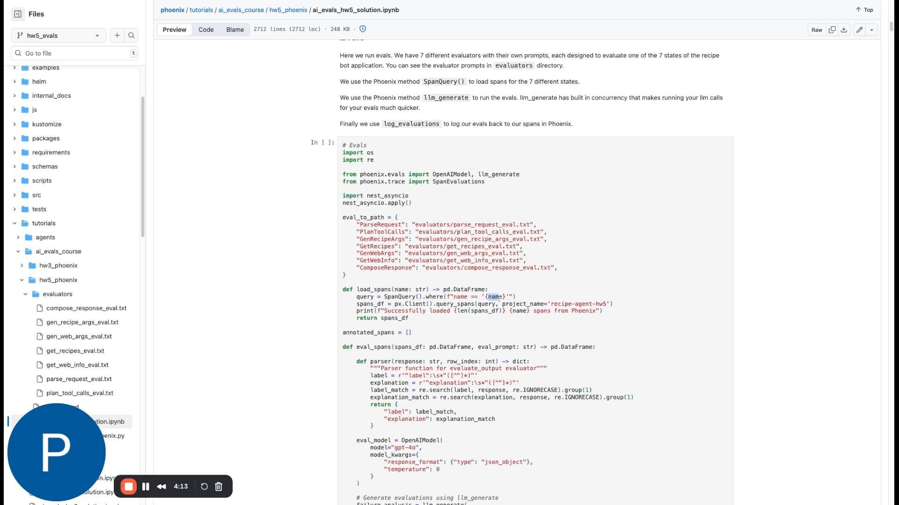

**步骤 10：反馈闭环**

把 `get_web_info` 每个 span 的 label + explanation + input/output 拼进 prompt，连同 `get_web_info` 的代码一起发给 GPT-4o，要求它：归纳反复失败模式、给具体修复、给单元测试代码。

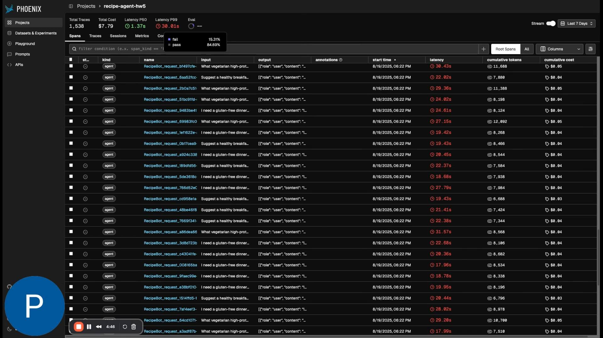

LLM 输出的失败模式：缺主题、跑题结果、深度不足、与 query 不匹配。建议修复：query 精炼、聚焦式网站抓取（优先烹饪网站）、更稳健的相关性过滤器、改进 `generate_web_args` 的 prompt。还给了检查关键词的单元测试。

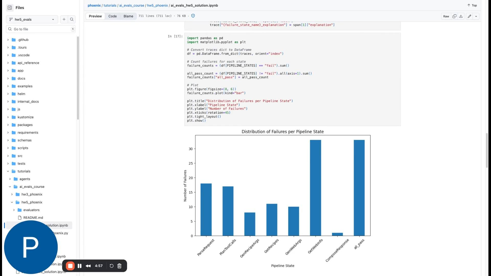

### 3.2 路径 B：BrainTrust（P040）

**步骤 1：改 `utils.py`，给每个 agent 步骤打 metadata**

三处改动（讲师逐一演示）：

1. `query_rewrite` 方法：`@traced(name="query rewrite")`，返回前 `current_span.log(metadata={"agent_step": "query_rewrite"})`
2. 对 light LLM wrapper 的调用：加 `metadata={"agent_step": "get_agent_response"}`
3. `find_matching_recipes` 工具：`@traced`，运行时加 `metadata={"agent_step": "find_matching_recipes"}`

> "在从这个方法返回结果之前，我调用了 current span 的 log metadata，agent step 等于 query rewrite。所以这会写到这个 span 上，写到 metadata 里，标明我们 agent 实际走了哪一步。"
> —— p040 [05:44]

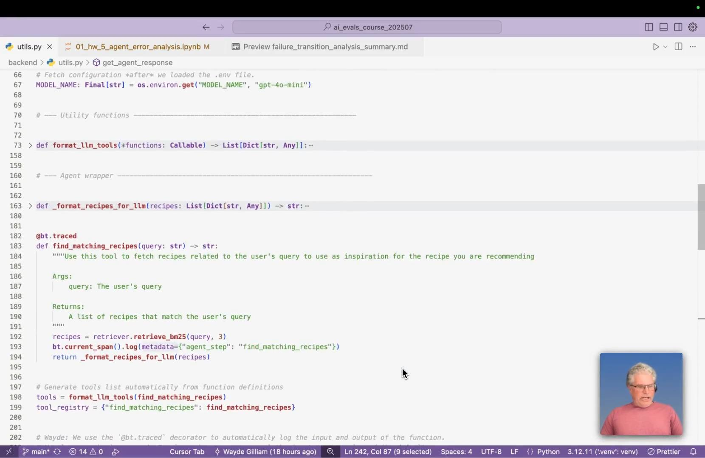

**步骤 2：在 BrainTrust 配 online scoring**

进项目 → configuration → online scoring，建规则：

| 规则名 | 作用范围 | score | 采样率 |
|---|---|---|---|
| agent final response | `get_agent_response` 顶层 span/trace | dietary preference adherence + recipe bot relevant | 100% |
| agent recipe retrieval | `find_matching_recipes` span（inline） | auto evals 的 `possible` score | — |
| agent tool calls | BTQL filter 定位「LLM 返回的、存在 tool calls 的 completion」 | auto evals 的 `valid JSON` score | — |

> "定义规则时可以有多个 score……我们可以选采样率，如果想低于 100% 的话，但因为这是测试用，我们希望每次都跑，所以我设成了 100%。"
> —— p040 [08:10]

> "BrainTrust 还有一点很好：当你建这些 score，尤其是开始用 BTQL filter 时，能测试规则、确认配置都对，通常很有帮助。我点一下 test rule，你能看到它真的返回了一些结果。"
> —— p040 [09:06]

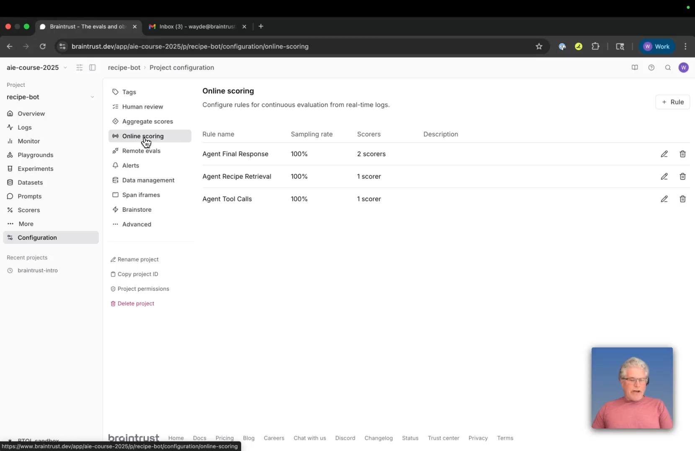

**步骤 3：用 golden set 跑 bot**

`init_dataset()` 拿到 135 行 golden user queries，遍历每行调**生产代码** `get_agent_response`。

> "作为最佳实践，尽量贴近生产总是更好，而不是在实验里复制一份 get agent response、从而引入或大或小的改动，那可能真的会改变 agent 的表现。"
> —— p040 [13:27]

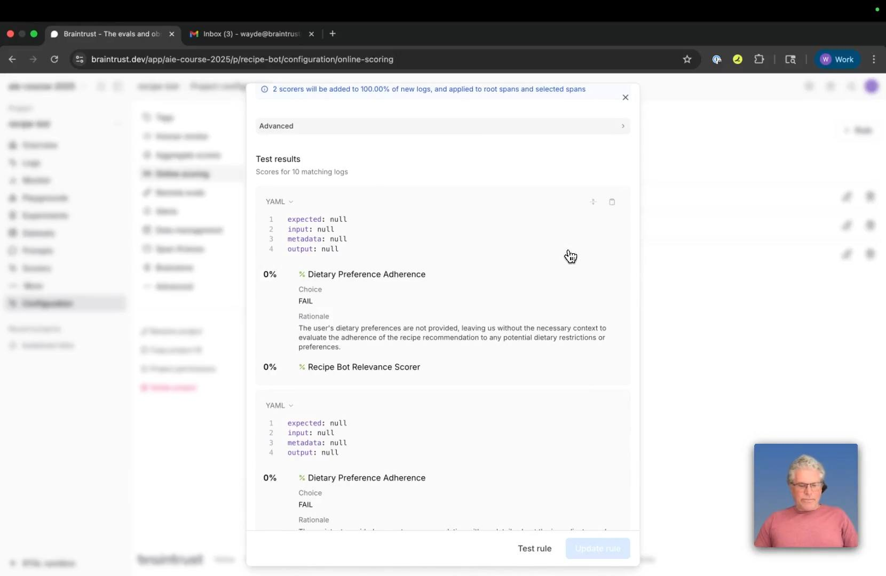

**步骤 4：BTQL 拉日志**

用 BTQL 查 root span（带整体 score）+ 带 `agent_step` metadata 的 span。讲师强调用 **BTQL sandbox** 先验证查询，再用 **get code snippet** 按钮复制 Python/TypeScript/REST 代码。

> "如果你点这个 get code snippet 按钮，它其实能让你复制 TypeScript、Python，或者如果你想用我们的 REST API，就能直接拿到获取那份数据所需的代码，非常方便。我就是用它来创建查询的。"
> —— p040 [15:50]

拉到 **722 个 span**。

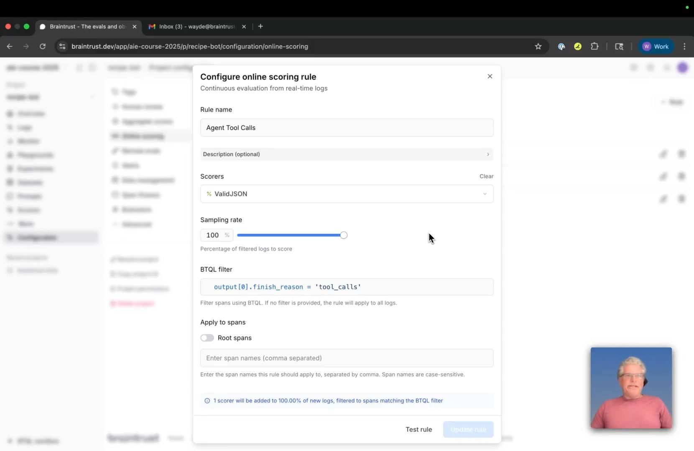

**步骤 5：构造 failure transition dataset**

失败定义：步骤发生 error，或该步骤任何 score 返回 < 1（即 0）。对每条 trace 抽「第一个失败步」和「最后一个成功步」。

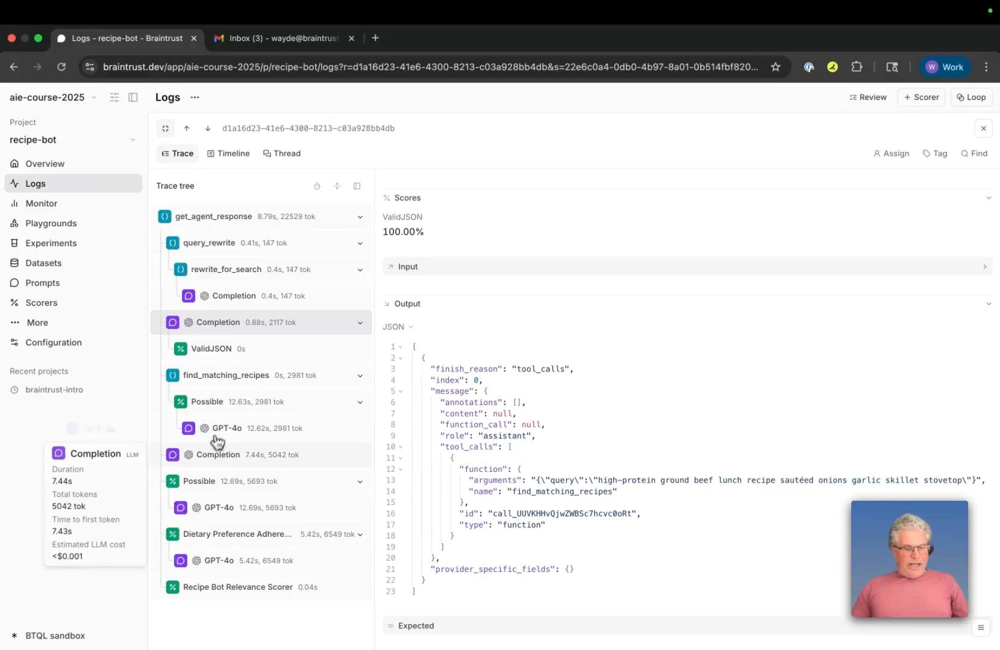

**步骤 6：画热力图**

X 轴 = 失败发生的步骤，Y 轴 = 失败前最后一个成功步骤，格子 = 次数。讲师用 cursor vibe code 出来的。

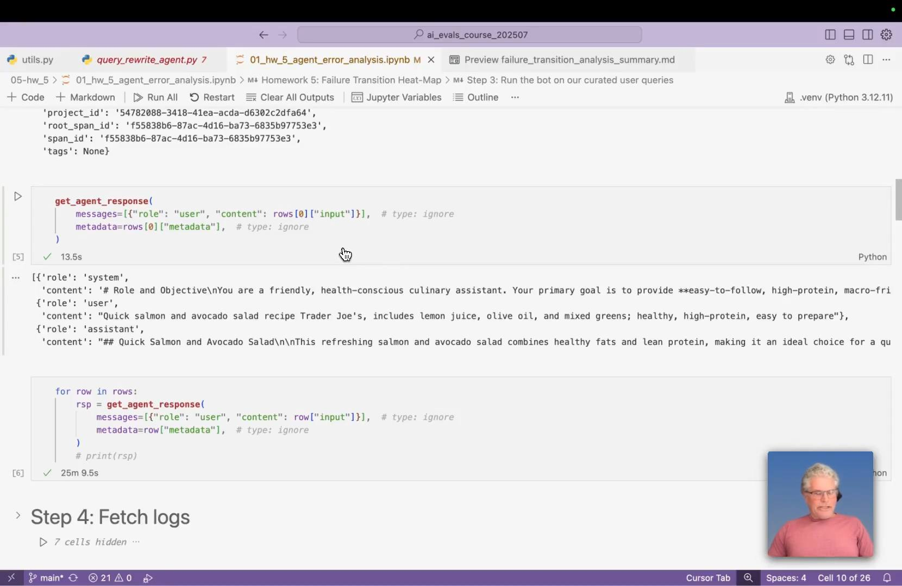

讲师读图结论：

- 主要失败模式在 **retrieval（get recipes）** 步骤；
- 这些失败通常来自 **plan tool call** 步骤 → 该去查 plan tool calls 的输出；
- 有 **7 个错误**的第一失败状态是 `deliver response`，且最后一个成功状态也是 `deliver response` —— 这是 **trace 级别错误**（如 dietary adherence 在最终结果上失败），不是中间步骤错误。

> "当你看到这些对齐在一起时，那是整体 trace 级别的错误；当你看到错误关联到不同步骤时，那些是中间步骤的错误。"
> —— p040 [20:11]

**步骤 7：生成 summary.md**

把 `logs` 变量 + 热力图喂给 cursor，让它生成 markdown 总结。

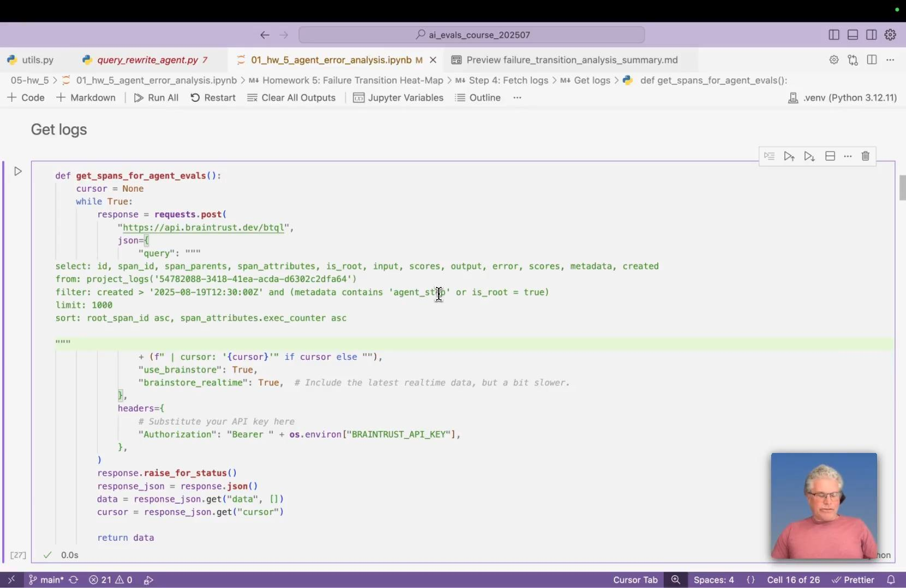

---

## 4. 完整代码

> 说明：逐字稿里讲师是边讲边滚代码，**没有逐字念出完整源码**；本段也没有 OCR 结果。下面代码是按讲师口述的结构、方法名、参数名、prompt 结构**还原**的可运行版本，方法名/字段名严格对齐讲师原话（`query_rewrite`、`get_agent_response`、`find_matching_recipes`、`agent_step`、`llm_generate`、`log_evaluations`、`phoenix_span_query` 等）。凡讲师没讲的细节，代码里用注释标「课里没讲，此处为可运行的最小实现」。

### 4.1 `prompts/generate_recipe_args.txt`（P041 evaluator prompt 模板）

```
你是一个食谱推荐 pipeline 中 generate recipe args state 的专家评估器。
你的任务是评估 LLM 是否基于 parse request 正确构造了食谱搜索工具的参数。

【期望行为】
generate recipe args 应当把用户 query 中所有显式约束（食材、饮食限制、过敏原、
餐别）翻译成食谱搜索工具的 JSON 参数。用户明确提到的食材必须出现在参数里。

【评估标准】
- 用户提到的关键食材是否出现在参数中
- 饮食/过敏约束是否被保留
- 参数是否为合法 JSON 且字段符合工具 schema

【什么算失败】
- 用户明确提到的食材在参数中缺失（missing filter）
- 饮食/过敏约束被丢弃
- 参数不是合法 JSON

【什么不算失败（不要误报）】
- 参数中多了用户没提但合理的默认值（如 limit、sort）
- 字段顺序不同
- 同义改写（如 "oatmeal" 写成 "oats"）

【输入】
parse request 的输出：{parse_request_output}

【输出】
generate recipe args 的输出：{generate_recipe_args_output}

【输出格式】
先输出 explanation，再输出 label：
{
  "explanation": "<为什么 pass 或 fail>",
  "label": "pass" | "fail"
}
```

> 讲师强调的四条策略全部体现在这个模板里：① explanation 在 label 之前；② 指令在输入输出之前；③ 同时说「什么算失败」和「什么不算失败」；④ 明确输出格式。

### 4.2 `generate_traces_phoenix.py`（P041）

```python
"""
P041 路径：7 状态 recipe bot，向 Phoenix 发 100 条 trace。
课里没讲完整源码，以下为按讲师口述的 7 个 state 还原的可运行实现。
"""
import os
import json
import random
from openai import OpenAI
import phoenix as px
from phoenix.otel import register
from openinference.instrumentation.openai import OpenAIInstrumentor

# 1) 启动 Phoenix（若已 phoenix serve 可跳过）
# px.launch_app()

# 2) 注册 tracer
tracer_provider = register(project_name="recipe-agent-homework-5")
OpenAIInstrumentor().instrument(tracer_provider=tracer_provider)

client = OpenAI(api_key=os.environ["OPENAI_API_KEY"])
tracer = tracer_provider.get_tracer(__name__)

# 7 个 canonical state（讲师原话顺序）
PIPELINE_STATES = [
    "parse_request",
    "plan_tool_calls",
    "generate_recipe_args",
    "get_recipes",
    "generate_web_args",
    "get_web_info",
    "compose_response",
]

RECIPE_DB = [
    {"name": "Oatmeal with berries", "ingredients": ["oats", "berries"], "diet": "healthy"},
    {"name": "Avocado toast with poached egg", "ingredients": ["bread", "avocado", "egg"], "diet": "healthy"},
    {"name": "Greek yogurt parfait", "ingredients": ["yogurt", "granola", "honey"], "diet": "healthy"},
]

def _llm_json(system: str, user: str) -> dict:
    resp = client.chat.completions.create(
        model="gpt-4o",
        messages=[{"role": "system", "content": system},
                  {"role": "user", "content": user}],
        response_format={"type": "json_object"},
    )
    return json.loads(resp.choices[0].message.content)

@tracer.chain(name="parse_request")
def parse_request(query: str) -> dict:
    return _llm_json(
        "把用户 query 解析成 JSON：{ingredients:[], diet:'', meal:''}",
        query,
    )

@tracer.chain(name="plan_tool_calls")
def plan_tool_calls(parsed: dict) -> dict:
    return _llm_json(
        "根据解析结果决定调用哪些工具，返回 {tools:[...]}，可选 recipe_search / web_search",
        json.dumps(parsed),
    )

@tracer.chain(name="generate_recipe_args")
def generate_recipe_args(parsed: dict, plan: dict) -> dict:
    return _llm_json(
        "为 recipe_search 工具生成 JSON 参数 {query:'', filters:{}}",
        json.dumps({"parsed": parsed, "plan": plan}),
    )

@tracer.chain(name="get_recipes")
def get_recipes(args: dict) -> list:
    # 课里是模拟的：不真查库，用 prompt 模拟响应
    q = (args.get("query") or "").lower()
    hits = [r for r in RECIPE_DB if any(i in q for i in r["ingredients"])]
    return hits or RECIPE_DB[:2]

@tracer.chain(name="generate_web_args")
def generate_web_args(parsed: dict) -> dict:
    return _llm_json(
        "为 web_search 工具生成 JSON 参数 {query:''}",
        json.dumps(parsed),
    )

@tracer.chain(name="get_web_info")
def get_web_info(args: dict) -> str:
    # 课里是模拟的：注入不相关 query 制造失败
    bad_queries = ["quantum physics basics", "stock market today", "how to fix a car"]
    if random.random() < 0.3:
        return f"[simulated off-topic result for: {random.choice(bad_queries)}]"
    return f"[simulated web result for: {args.get('query', '')}]"

@tracer.chain(name="compose_response")
def compose_response(recipes: list, web_info: str, query: str) -> str:
    resp = client.chat.completions.create(
        model="gpt-4o",
        messages=[
            {"role": "system", "content": "你是食谱助手，基于检索结果和网页信息给出最终推荐。"},
            {"role": "user", "content": json.dumps(
                {"query": query, "recipes": recipes, "web_info": web_info},
                ensure_ascii=False)},
        ],
    )
    return resp.choices[0].message.content

@tracer.chain(name="recipe_agent")
def recipe_agent(query: str) -> str:
    parsed = parse_request(query)
    plan = plan_tool_calls(parsed)
    recipe_args = generate_recipe_args(parsed, plan)
    recipes = get_recipes(recipe_args)
    web_args = generate_web_args(parsed)
    web_info = get_web_info(web_args)
    return compose_response(recipes, web_info, query)

if __name__ == "__main__":
    queries = [
        "suggest a healthy breakfast using oatmeal",
        "give me a quick vegan dinner",
        "high protein lunch under 500 calories",
    ] * 34  # 约 100 条
    for q in queries[:100]:
        try:
            recipe_agent(q)
        except Exception as e:
            print("trace failed:", e)
    print("done, open http://localhost:6006")
```

### 4.3 `run_evals_phoenix.py`（P041）

```python
"""
P041 路径：逐 state 跑 evaluator，再把 eval 传播回 root trace。
方法名严格对齐讲师原话：phoenix_span_query / evaluate_spans / llm_generate / log_evaluations。
"""
import os
import re
import json
import phoenix as px
from phoenix.trace.dsl import SpanQuery
from phoenix.evals import llm_generate, OpenAIModel
from phoenix.trace import SpanEvaluations

PROMPT_DIR = "prompts"
STATES = [
    "parse_request", "plan_tool_calls", "generate_recipe_args",
    "get_recipes", "generate_web_args", "get_web_info", "compose_response",
]

def load_spans_by_name(state_name: str):
    """讲师原话：构造 name 等于 state 名的 phoenix span query，抓所有该 state 的 span。"""
    query = SpanQuery().where(f"name == '{state_name}'")
    return px.Client().query_spans(query)

def parse_eval_output(text: str):
    """用简单正则从 eval 输出里抽 label 和 explanation。"""
    label = None
    m = re.search(r'"label"\s*:\s*"(pass|fail)"', text, re.I)
    if m:
        label = m.group(1).lower()
    e = re.search(r'"explanation"\s*:\s*"(.*?)"', text, re.S)
    explanation = e.group(1) if e else ""
    return label, explanation

def evaluate_spans(state_name: str, spans):
    prompt_template = open(os.path.join(PROMPT_DIR, f"{state_name}.txt")).read()
    model = OpenAIModel(model="gpt-4o")

    # 把每个 span 的 input/output 填进 prompt
    prompts = []
    for _, row in spans.iterrows():
        p = prompt_template.replace("{parse_request_output}", str(row.get("input", "")))
        p = p.replace("{generate_recipe_args_output}", str(row.get("output", "")))
        prompts.append(p)

    # llm_generate 内置并发
    results = llm_generate(
        model=model,
        prompts=prompts,
        system_prompt="你是一个严格的评估器，只输出 JSON。",
    )

    labels, explanations = [], []
    for r in results:
        lab, exp = parse_eval_output(r)
        labels.append(lab)
        explanations.append(exp)

    # 回写 Phoenix
    evals_df = spans[["context.span_id"]].copy()
    evals_df["label"] = labels
    evals_df["explanation"] = explanations
    evals_df["score"] = [1.0 if l == "pass" else 0.0 for l in labels]
    px.Client().log_evaluations(
        SpanEvaluations(eval_name=f"{state_name}_eval", dataframe=evals_df)
    )
    return evals_df

def propagate_to_root_trace():
    """把 7 个 state 的 eval 汇总到 root trace 上。"""
    client = px.Client()
    root_query = SpanQuery().where("parent_id is None")
    roots = client.query_spans(root_query)
    # 课里没讲具体聚合实现，此处为最小示意：按 trace_id 聚合 7 个 state 的 label
    # 实际可用 client.log_evaluations 写回 root span
    print(f"root traces: {len(roots)}")

if __name__ == "__main__":
    for state in STATES:
        spans = load_spans_by_name(state)
        print(f"{state}: {len(spans)} spans")
        evaluate_spans(state, spans)
    propagate_to_root_trace()
    print("evals done, refresh http://localhost:6006")
```

### 4.4 `feedback_loop.py`（P041）

```python
"""
P041 路径：把 get_web_info 的 eval explanation + input/output + 源码喂给 GPT-4o，
要求归纳失败模式、给具体修复、给单元测试。
"""
import os
import json
from openai import OpenAI
import phoenix as px
from phoenix.trace.dsl import SpanQuery

client = OpenAI(api_key=os.environ["OPENAI_API_KEY"])

def get_web_info_spans_with_evals():
    q = SpanQuery().where("name == 'get_web_info'")
    spans = px.Client().query_spans(q)
    # 课里没讲 eval 与 span 的 join 细节，此处假设 spans 已带 annotations 列
    return spans

def build_feedback_prompt(spans, source_code: str) -> str:
    lines = []
    for _, row in spans.iterrows():
        lines.append(json.dumps({
            "label": row.get("label"),
            "explanation": row.get("explanation"),
            "input": str(row.get("input", "")),
            "output": str(row.get("output", "")),
        }, ensure_ascii=False))
    return f"""下面是 get_web_info 这个 state 的逐条 eval 结果（label / explanation / input / output）：

{chr(10).join(lines)}

下面是 get_web_info 的源码：
```python
{source_code}
```

请：
1. 归纳反复出现的失败模式
2. 给出具体修复建议
3. 给出检查关键词的单元测试代码
"""

if __name__ == "__main__":
    spans = get_web_info_spans_with_evals()
    source = open("generate_traces_phoenix.py").read()
    prompt = build_feedback_prompt(spans, source)
    resp = client.chat.completions.create(
        model="gpt-4o",
        messages=[{"role": "user", "content": prompt}],
    )
    print(resp.choices[0].message.content)
```

### 4.5 `utils.py`（P040，关键片段）

```python
"""
P040 路径：recipe bot 生产代码，给每个 agent 步骤打 metadata.agent_step。
方法名严格对齐讲师原话：query_rewrite / get_agent_response / find_matching_recipes。
"""
from braintrust import traced, current_span

@traced(name="query rewrite")
def query_rewrite(original_query: str) -> str:
    # ... 调 LLM 做 query rewrite ...
    result = original_query  # 课里没讲具体实现，此处占位
    current_span().log(metadata={"agent_step": "query_rewrite"})
    return result

@traced(name="find matching recipes")
def find_matching_recipes(args: dict) -> list:
    # ... 检索食谱 ...
    result = []  # 课里没讲具体实现，此处占位
    current_span().log(metadata={"agent_step": "find_matching_recipes"})
    return result

@traced(name="get agent response")
def get_agent_response(query: str) -> str:
    current_span().log(metadata={"agent_step": "get_agent_response"})
    rewritten = query_rewrite(query)
    # ... 规划 tool calls、调 find_matching_recipes、compose ...
    return "final response"  # 课里没讲具体实现，此处占位
```

### 4.6 `build_failure_dataset.py`（P040）

```python
"""
P040 路径：用 BTQL 拉 root span + 带 agent_step 的 span，构造 failure transition dataset。
失败定义：步骤发生 error，或该步骤任何 score 返回 < 1（即 0）。
"""
import os
import pandas as pd
from braintrust import BTQL  # 课里没讲具体 import 路径，以实际 SDK 为准

BTQL_QUERY = """
select
  root_span_id,
  span_id,
  span_attributes.name as name,
  metadata.agent_step as agent_step,
  scores,
  error
from experiment_logs
where
  span_attributes.name in ('get agent response', 'query rewrite', 'find matching recipes')
  or parent_span_id is null
"""

def fetch_logs():
    # 讲师用 BTQL sandbox 验证后，用 get code snippet 复制 Python 代码
    # 课里没讲 BTQL 客户端初始化细节，此处为示意
    client = BTQL(api_key=os.environ["BRAINTRUST_API_KEY"])
    return client.query(BTQL_QUERY)

def is_failure(row) -> bool:
    if row.get("error"):
        return True
    scores = row.get("scores") or {}
    return any(v is not None and v < 1 for v in scores.values())

def build_failure_transitions(df: pd.DataFrame) -> pd.DataFrame:
    records = []
    for trace_id, group in df.groupby("root_span_id"):
        # 按 span 顺序排（课里没讲排序字段，此处假设有 start_time）
        group = group.sort_values("start_time") if "start_time" in group else group
        first_failure = None
        last_success = None
        for _, row in group.iterrows():
            if is_failure(row):
                if first_failure is None:
                    first_failure = row["agent_step"] or row["name"]
            else:
                last_success = row["agent_step"] or row["name"]
        if first_failure:
            records.append({
                "trace_id": trace_id,
                "first_failure_step": first_failure,
                "last_success_step": last_success,
            })
    return pd.DataFrame(records)

if __name__ == "__main__":
    df = fetch_logs()
    print(f"spans: {len(df)}")  # 讲师拉到 722 个
    transitions = build_failure_transitions(df)
    transitions.to_csv("failure_transitions.csv", index=False)
    print(transitions.head())
```

### 4.7 `build_heatmap.py`（P040）

```python
"""
P040 路径：画失败转移热力图。
X 轴 = first_failure_step，Y 轴 = last_success_step，格子 = 次数。
"""
import pandas as pd
import matplotlib.pyplot as plt

STEPS = [
    "parse_request", "query_rewrite", "plan_tool_calls",
    "get_recipes", "deliver_response",
]

def build_heatmap(csv_path="failure_transitions.csv", out="heatmap.png"):
    df = pd.read_csv(csv_path)
    pivot = (
        df.groupby(["last_success_step", "first_failure_step"])
          .size()
          .unstack(fill_value=0)
          .reindex(index=STEPS, columns=STEPS, fill_value=0)
    )
    fig, ax = plt.subplots(figsize=(8, 6))
    im = ax.imshow(pivot.values, cmap="Reds")
    ax.set_xticks(range(len(STEPS)))
    ax.set_xticklabels(STEPS, rotation=45, ha="right")
    ax.set_yticks(range(len(STEPS)))
    ax.set_yticklabels(STEPS)
    ax.set_xlabel("first failure step")
    ax.set_ylabel("last success step")
    for i in range(len(STEPS)):
        for j in range(len(STEPS)):
            ax.text(j, i, pivot.values[i, j], ha="center", va="center")
    fig.colorbar(im)
    plt.tight_layout()
    plt.savefig(out)
    print(f"saved {out}")

if __name__ == "__main__":
    build_heatmap()
```

---

## 5. 逐行解释

### 5.1 P041 evaluator prompt 的四条策略

**① explanation 在 label 之前。** 讲师原话：「我让 LLM 在 label 之前先返回 explanation 对象……强迫 LLM 在给出最终决定前先思考、生成推理或解释，很像 chain of thought prompting。」在 JS/Node 里对应的是让模型先输出 `reasoning` 字段再输出 `verdict`，本质是**利用自回归模型的顺序生成特性**——先写的 token 会成为后写 token 的上下文。

**② 指令在输入输出之前。** 讲师原话：「LLM 按设计是顺序模型……把输入输出数据放在描述之后，能确保 LLM 清楚知道该读什么、该怎么看这些输入输出数据。反过来，如果把输入输出放前面，LLM 根本不知道自己在看什么、在找什么。」这就是为什么模板里 `【期望行为】【评估标准】【什么算失败】` 全在 `【输入】【输出】` 之前。

**③ 同时说「什么算失败」和「什么不算失败」。** 讲师原话：「不仅告诉它什么是失败，也告诉它什么不是失败，这能防止过度判定。」模板里 `【什么不算失败（不要误报）】` 那段就是干这个的——字段顺序不同、同义改写都不算失败。

**④ 明确输出格式。** 模板末尾的 JSON schema 让 `parse_eval_output` 的正则能稳定抽字段。

### 5.2 `load_spans_by_name` 为什么按 name 查

讲师原话：「我们专门查有特定名字的 span……比如要拿 gen recipe arg state 的所有 span，就构造 name 等于 gen recipe args 的 phoenix span query。」因为 7 个 state 在代码里就是 7 个 `@tracer.chain(name=...)`，name 是天然的分组键。这比按时间窗口切更稳。

### 5.3 `llm_generate` 为什么重要

讲师原话：「llm generate 是个强大的方法，内置并发，让跑大量 LLM eval 调用快很多。」100 条 trace × 7 个 state = 700 次 LLM 调用，串行跑要几十分钟，并发跑几分钟。在 Node 里对应 `Promise.all` + 限流。

### 5.4 为什么要把 eval 传播回 root trace

讲师原话：「如果能把所有这些 eval 传播回 root trace 就更酷了，这样每个请求我们都能在一个地方看到 7 个 state 的 eval。」不传播的话，你只能一个 state 一个 state 地翻；传播后，一条 root trace 上挂 7 个 eval，一眼看出这个 query 哪几步挂了。

### 5.5 P040 的 `metadata.agent_step` 为什么是核心

讲师原话：「这就是我们用来在 trace 里找到不同 agent 步骤的东西。」BrainTrust 的 span 本身有 name，但 name 是函数名，不一定等于「agent 步骤」。用 metadata 显式打标，BTQL 查询时就能 `where metadata.agent_step = 'query_rewrite'` 精确捞。这和 P041 用 span name 分组是同一目的、不同手段。

### 5.6 P040 失败定义的边界

讲师原话：「我们就把任何在某个步骤发生了错误、或者定义了评分但返回了小于 1（也就是低于 100%、返回 0）的情况，都视为失败。」注意两个条件：**error 存在** 或 **score < 1**。这意味着一个步骤即使没抛异常，只要 evaluator 给了 0 分，也算失败。这就是为什么 online scoring 必须先配好——没有 score 的步骤只能靠 error 判断。

### 5.7 热力图对角线为什么特殊

讲师原话：「有 7 个错误的第一失败状态是 deliver response，而在这张热力图里最后一个成功状态也是 deliver response……这些是 trace 级别的错误。」对角线（first_failure == last_success）意味着失败发生在**最终结果**上，而不是某个中间步骤——比如 dietary adherence 在最终输出上不满足。非对角线才是中间步骤的失败。

### 5.8 P041 的失败分布为什么推翻假设

讲师原话：「这其实和我最初的假设不同——我以为每条 trace 大约一个失败。实际上，大约三分之二的 trace 有多个失败，而约三分之一的 trace 完全成功。」85% state pass 率听起来不错，但**按 trace 看**只有 1/3 全 pass——因为一条 trace 有 7 个 state，任何一个挂整条就挂。这是「state 级指标」和「trace 级指标」的经典差异，做 eval 时必须两个都看。

---

## 6. 复现检查清单

**环境**
- [ ] Python 3.11 venv 已激活
- [ ] `OPENAI_API_KEY` 已设
- [ ] Phoenix 路径：`arize-phoenix`、`openinference-instrumentation-openai`、`openai`、`pandas`、`matplotlib` 已装
- [ ] BrainTrust 路径：`braintrust`、`openai`、`pandas`、`matplotlib` 已装，`BRAINTRUST_API_KEY` 已设

**P041 Phoenix 路径**
- [ ] `phoenix serve` 起在 `localhost:6006`
- [ ] `generate_traces_phoenix.py` 跑通，Phoenix projects 里出现 `recipe-agent-homework-5`，约 100 条 trace
- [ ] 能点进单条 trace，看到 7 个 state 的输入输出
- [ ] `prompts/` 下 7 个 evaluator prompt 文件齐全，每个都含「期望行为/评估标准/什么算失败/什么不算失败/输入/输出/输出格式」七段
- [ ] `run_evals_phoenix.py` 跑通，Phoenix 顶部 eval 图标显示约 85% pass / 15% fail
- [ ] 那条 `suggest a healthy breakfast using oatmeal` 的 trace，`generate_recipe_args` 上有 fail 标注，explanation 提到「燕麦没包含在 filters 里」
- [ ] root trace 上挂到 7 个 eval
- [ ] `feedback_loop.py` 跑通，输出含「缺主题/跑题结果/深度不足/与 query 不匹配」四类失败模式 + 修复建议 + 单元测试

**P040 BrainTrust 路径**
- [ ] `utils.py` 里 `query_rewrite`、`get_agent_response`、`find_matching_recipes` 三处都有 `metadata.agent_step`
- [ ] BrainTrust online scoring 三条规则已建：final response（100% 采样）、recipe retrieval（inline，possible score）、tool calls（BTQL filter，valid JSON score）
- [ ] 每条规则点过 test rule 且返回结果
- [ ] golden set 135 行已加载，遍历跑完 `get_agent_response`
- [ ] BTQL 查询在 sandbox 里验证通过，拉到约 722 个 span
- [ ] `failure_transitions.csv` 生成，含 `first_failure_step` / `last_success_step` 两列
- [ ] `heatmap.png` 生成，X/Y 轴都是 5 个步骤，对角线有值（deliver response 那格约 7）
- [ ] `summary.md` 生成，含主要失败模式（retrieval）+ 可能原因（plan tool calls）+ 下一步建议

**产物**
- [ ] 热力图（两条路径任选其一或都做）
- [ ] summary 写清楚：主要失败步、失败前一步、trace 级 vs 步骤级错误的区分

---

## 7. 课里没讲但你会撞上的

1. **Phoenix 的 `SpanQuery` / `log_evaluations` 具体 API 签名**。讲师只念了方法名，没念参数。不同版本 `phoenix` 的 `SpanQuery().where(...)` 语法、`SpanEvaluations` 的 dataframe 列名（`context.span_id` 还是 `span_id`）会变。撞上了就查你装的那个版本的官方文档，别硬套本文代码。

2. **BrainTrust 的 BTQL 客户端初始化**。讲师是在 sandbox 里点「get code snippet」复制代码，没念 import 路径。`from braintrust import BTQL` 是我按 SDK 惯例写的示意，实际可能是 `braintrust.api` 下的某个类。以你复制出来的 snippet 为准。

3. **`get_recipes` 和 `get_web_info` 是模拟的**。讲师明说：「有些 state 为了简单是模拟的，比如 get recipes 这个 state，它没有真的去数据库里搜食谱，而是用 prompt 模拟一个响应。」「我是通过往网页搜索里注入不相关的坏 query 来模拟这个 state 的失败。」所以你在 P041 路径里看到的失败是**人为注入**的，真实系统里失败原因更隐蔽——讲师原话：「真实场景里你肯定会有更复杂、更隐蔽的失败原因，那才真正能体现这个反馈闭环的效力。」

4. **P040 的 722 个 span 怎么来的**。135 行 golden set × 每行多个 span（query rewrite + get agent response + find matching recipes + LLM 调用）= 722。你跑出来的数会不一样，取决于你的 bot 实际发了多少 span。

5. **热力图的步骤名两条路径不一致**。P041 是 7 个 state（parse_request / plan_tool_calls / generate_recipe_args / get_recipes / generate_web_args / get_web_info / compose_response），P040 是 5 个（parse_request / query_rewrite / plan_tool_calls / get_recipes / deliver_response）。别混用，选一条路径就按那条的步骤名画。

6. **`llm_generate` 的并发上限**。讲师说「内置并发」，但没说默认并发数。700 次调用打 OpenAI 可能触发 rate limit，撞上了就调低并发或加退避。

7. **P040 的 `current_span().log(metadata=...)` 在异步代码里的行为**。讲师演示的是同步 Python。如果你用 asyncio 跑 bot，`current_span()` 依赖 contextvar，跨 `await` 可能丢 span。在 Node 里对应 `AsyncLocalStorage`，同理要注意上下文传播。

8. **两条路径的「失败」定义不可互换**。P041 靠 evaluator 的 label，P040 靠 error 或 score < 1。如果你两条都跑，热力图的数字对不上是正常的，不是 bug。

9. **`summary.md` 是 LLM 生成的，不是人写的**。讲师原话：「我让它基于我创建的 logs 变量里的信息和热力图生成一个 markdown 文件。」所以它可能有幻觉，交付前要人工核一遍数字和结论。