# AI Evals for Engineers & PMs（P5）：轴向编码、多轮合成数据与协作评测

> 课程：AI Evals For Engineers & PMs（BV1FwTE6gEky）｜覆盖 P5（00:00–59:32）
> 说明：本节是一门**方法论课**，讲师在屏幕上演示的是「Braintrust 标注界面 + ChatGPT/Notebook + 一张 rubric 幻灯片」的工作流，没有出现完整的工程代码。因此第 3 节按「讲师的推导与操作顺序」逐步骤复现，第 4 节把讲师口头给出的 prompt、rubric、字段结构、统计口径落成可直接使用的产物，**凡是我补的示意代码都会明确标注「课里没有代码，以下为示意」**。

---

## 1. 这一节做什么

P5 是「错误分析」这条主线的收尾 + 「协作评测」的开场。它要解决三个具体问题：

1. **怎么把开放编码（open coding）收敛成一张能驱动 eval 的失败模式表**——也就是轴向编码（axial coding）的完整操作：把 Braintrust 里的 trace 导出成 CSV → 让 LLM 从你写的 open code 里抽一份失败模式分类法（taxonomy）→ 你**人工**把分类法逐条贴回每条 trace → 反复迭代到「理论饱和」→ 产出「失败模式 × trace ID」的表，并对失败模式计数。
2. **多轮（multi-turn）trace 的数据从哪来**——讲师给了三条路径：抓真实用户、用 LLM 扮演用户做合成、以及最重要的原则「**把多轮失败尽可能压成单轮来复现**」；再加上 Hamel 的「trace 扰动 / 数据增强」策略（以 Honeycomb 的真实 schema 改写为例）。
3. **多个标注者（stakeholder、领域专家）怎么对齐**——从「仁慈的独裁者（benevolent dictator）」这种单人决策模型，到多人标注流程：先写一版**二值（binary）** rubric → 同一批 trace 分给多人独立标注 → 算 inter-annotator agreement（百分比一致率 / Cohen's Kappa）→ 一致性低就细化标准、加正反例 → 更新 rubric 重新标注 → 一致性够高才去建 LLM judge。

本节**没有新作业**，继续上一周的 homework two：先做合成数据生成，再把重心放到错误分析部分；周四会有新的 coding 作业。

三个必须先记住的结论：

- 一条 trace 的「第一个失败」（first failure / upstream failure）标签就够了，下游错误大多是级联出来的。
- 开放编码 + 轴向编码通常**两轮**就够；一次性投入一两天，之后只需要抽样复查。
- 不要把这个练习里的标注外包给开发者，标注者必须有产品上下文。

---

## 2. 讲师原话

关于「不要凭想象定失败模式」：

> "做开放编码时，我们也许应该继续聚焦在直接从 LLM 输出里看到的失败模式上，而不要过多考虑那些没有被证实的失败模式。"
> —— p005 [01:43]

> "我经常看到这个问题：人们只是假设性地想象自己的应用里会有哪些失败模式。比如幻觉，因为全世界都告诉他们 AI 会幻觉，于是幻觉就成了他们最担心的首要失败模式。但如果你真的做了错误分析或开放编码，并没有发现幻觉，那它也许就没有那么重要。"
> —— p005 [02:11]

关于企业环境下拿不到全量数据：

> "在企业环境里，你并不能总是收集到你想在一条 trace 上收集的所有数据。总的来说，你确实想尽可能多地收集数据、收集任何可能的元数据，即使不是具体的用户画像，只要能被匿名化，那就很好。"
> —— p005 [02:38]

> "有时候我会去谈数据共享协议，或者说只有少数几个人会受训去查看数据，他们必须签合同保证不分享，数据会在 7 天、28 天之后删除。"
> —— p005 [03:00]

关于工具调用有多个评估层次：

> "很多人做错误分析时意识到，评估工具调用有很多层次。最基本的问题是：agent 到底用没用这个工具、有没有选对工具？但即使它选对了工具，还可以再往下走：它生成的参数类型对吗？比如这里需要整数，它却生成了布尔值。再往下：它生成的参数内容真的对吗？"
> —— p005 [03:28]

> "这个例子是，也许 location 应该是字符串，这一点它通过了，但 agent 生成了一长串字符串，而不是工具或 API 期望的邮编、城市+州。这说明工具调用有很多很多层要评估，你做分析时一定要往下钻。为自己的工具做一层工具化检查——解析错误、类型检查——会非常有用。"
> —— p005 [04:26]

关于 trace 的定义：

> "我们在说 trace 时，指的是从用户最初的提问，一直到最终的回复，中间发生的所有事情的完整记录。"
> —— p005 [06:51]

> "它应该尽可能包含一切：工具调用、跨每个 agent 和系统组件的数据检索。"
> —— p005 [06:51]

为什么要按 trace 级别标注，而不是按单轮：

> "当我们做错误分析时，很多错误只有在整条 trace、端到端流程的上下文里才会浮现，或者才有意义。"
> —— p005 [07:18]

> "而且我们发现错误经常会级联。这是很关键的一点：如果 agent 一开始就选错了工具，那么它最后给出正确答案的概率非常低。所以你在开放编码时只标出第一个失败，然后往下走就行了，没必要把每一轮都审一遍。"
> —— p005 [07:18]

Hamel 补充：

> "你只是需要一种方式，把所有信息都放在上下文里。所以当你在讲一个用户会话，里面可能有很多次工具调用、多轮 AI 与用户的来回、检索，还有别的各种事情，你要把所有这些都记录下来，这样你才能调试它们。"
> —— p005 [08:17]

关于「first failure」与「upstream failure」：

> "我们这两个词是互换着用的。前面说过，聚焦第一个失败，因为你标出来的很多下游失败可能都依赖那个第一个失败，这样你在标注过程里能省下时间和精力。"
> —— p005 [08:45]

> "但当你做错误分析更有经验之后——上一期学员也是这样，他们第二、第三次做错误分析时，会对哪些失败模式是相互独立的形成直觉。如果他们在一条 trace 里看到两三个互不相关的失败模式，就会把几个都标上。"
> —— p005 [08:45]

关于用 LLM 生成分类法的提示词：

> "我有一个包含我 AI 系统全部日志的电子表格。每一行里某个地方嵌套着一个叫做 z-note 的字段，里面是我写的开放编码，或者是我在 trace 里发现的错误的看法。你能把所有 z-note 列出来，并给这些失败点建一个分类法（taxonomy）吗？"
> —— p005 [09:45]

> "我设想是五种失败模式，也许更多组。"
> —— p005 [10:41]

> "我记得上一次还有一个问题：这个 agent 是不是在幻觉？通常它其实会把 z-note 原样打印出来，你能看到那些 z-note 是什么。"
> —— p005 [10:41]

关于 LLM 现场翻车（嵌套字段读不到）：

> "这里应该有更多才对。对，检查一下发生了什么，是值得的。就像任何其它 vibe coding 一样，事情确实可能出错。"
> —— p005 [11:39]

> "它在输入里，对，它嵌套在 metadata 字段里。z-note 是嵌套在 metadata 里的。"
> —— p005 [12:05]

关于用什么工具做这件事：

> "我个人的做法——因为我写代码——是在 notebook 里做。我可能会让 Claude Code 帮我 bootstrapping 一个 notebook、把它起个头、补完，这样我就能在里面玩儿。"
> —— p005 [12:34]

> "另外一个我很喜欢的产品，我在第二讲提过，叫 Julius AI（julius.ai），一个很好的类似 notebook 的界面，非常好用。"
> —— p005 [13:00]

> "这就是现场 vibe coding 的问题：有时候就是会不顺。"
> —— p005 [13:00]

关于把分类法层级化：

> "有些人喜欢把这个分类法做成某种层级，比如画一个 mermaid 图，显示 handoff 失败下面分两支：低效的、重复的升级尝试等等。所以我可能会说：你能把它整理成一个层级结构和表格吗，每个 code 现在是三到五个词长。"
> —— p005 [14:27]

> "我们要做的就是拿这些三到五个词的 code，回到 trace 上把它们应用上去。"
> —— p005 [14:55]

> "重点是要得到一份所有类别、子类别的清单，以及每个类别对应的 trace 数量或 trace ID。这反过来会帮我们建自动评估器。"
> —— p005 [15:23]

**为什么讲师要「手动」贴 axial code**（这是本节最重要的一段）：

> "你可能会想：我们有这个并排视图，为什么 Shreya 要像原始人一样手动做这件事？为什么她要手动给文本分类？不是她想手动分类，而是我们要检查这个分类法是不是够好；手动看一遍、跟分类法较劲是有价值的。"
> —— p005 [18:31]

> "这是在强迫你自己真的验证：这就是你想要的东西。如果你太快进入分类，是危险的，因为你会过度依赖那个思维拐杖，我见过太多次因为这样而失败。"
> —— p005 [19:00]

> "而且确实要花一点时间，你才会真正熟悉这个分类法。也许我应该自己把那个 mermaid 图画出来。"
> —— p005 [19:29]

现场遇到分类法覆盖不到的情况：

> "这又是一个很好的例子：我对这一条没有一个合适的 axial code。所以也许我得让它建一个新的。但我会把它归到「排期与后勤失败（scheduling and logistics failures）」下面。"
> —— p005 [19:29]

> "同时你也可以给一条 trace 多个 axial code。"
> —— p005 [19:58]

> "他们没有回答有没有停车位这个问题，应该说他们不知道。哦，‘漏掉了关切（missed concern）’。"
> —— p005 [20:57]

关于理论饱和与迭代：

> "再强调一遍重点：你要到达理论饱和（theoretical saturation），也就是当你应用 axial code 时分类法不再变化，它稳定下来了。"
> —— p005 [21:51]

> "很多人发现光做到这一步就已经很值了：他们能做出「失败模式 + 对应 trace ID」的表。但有时候，尤其当你在做一个很复杂的产品，或者一个想做的事太多的 agent，你可能想再走一遍「阅读 + 开放编码」的循环，确认自己没有漏掉什么。"
> —— p005 [22:19]

> "我看到人们在通用工程 agent、写作 agent 这类场景里会走好几轮迭代——范围有点太宽，或者产品上线后你还在从用户怎么用来学习什么好什么坏。"
> —— p005 [22:44]

> "如果我总结错误分析该带走什么：整件事就是迭代。你做开放编码，迭代开放编码直到学不到新东西；你做轴向编码，迭代 axial code 直到它们不再变。但在某一步上停住，直到达到理论饱和。"
> —— p005 [22:44]

> "对我自己的很多任务，我发现开放编码 + 轴向编码各两轮差不多就够了。这看起来要花很多时间，但重要的是：一旦做完，你的产品会好很多，而且你再也不需要用这么大的心力去做开放编码和轴向编码了，你只需要抽样少量 trace，不会被任何新东西惊到。所以花一两天做这件事是值得的。"
> —— p005 [23:13]

关于计数得到结论：

> "NurtureBoss 后来发现他们大部分错误集中在这两个工具上：handoff 和 rescheduling，再加上一些关于对话流程的东西。这些会跟 Hamel 和我做的结果不同，但最终失败模式是一样的。handoff 工具我们可能不叫 handoff，可能叫 tool handoff，可能叫 rescheduling tool，但宏观上我们都会收敛到同样的失败模式。"
> —— p005 [23:43]

Hamel：

> "重点是要尽可能简单。你做开放编码和轴向编码，想要的是搞清楚最大的问题是什么；而且可以很快达到。做法就是：做你的开放编码，用你觉得最方便的方式归类它。"
> —— p005 [24:36]

> "可以用 ChatGPT，像 Shreya 那样，也可以用别的；你可以把开放编码放在电子表格里；你想看它们就用最方便、你最舒服的方式，然后像我们这里看到的这样**计数**，这极其有力。听起来有点傻，但在这件事上，傻就是聪明。"
> —— p005 [25:05]

> "就是看到最大的问题是什么，这会是所有事情的基础，因为它会驱动我们接下来写哪些 eval。"
> —— p005 [25:33]

> "你要么是立刻把这个错误修掉——比如发现是规格（specification）问题，我在 system prompt 里没把工具说清楚，砰，这些错误就全消失了；要么你会构建 LLM judge 自动评估，来量化这些问题在规模上的普遍程度，同时也帮你做在线监控。这个我们周四讲。"
> —— p005 [25:33]

关于多轮 trace 的真实采集：

> "听起来吓人，但试着收集真实 trace：找 10 个朋友、10 个同事，让他们坐在你的应用前面，让他们用 5 次，假装自己是用户、或者扮演不同的用户画像，用这种方式拿到真实 trace。不要陷在「我需要复杂的合成生成来造一整段端到端对话」这个想法里。这件事用一个小时、用真实用户就能做到。"
> —— p005 [27:23]

> "有时候你确实想用模拟来放量，比如让 LLM 扮演用户。这种情况下，你先做一点错误分析，就会发现：也许用户里有一些特定模式，他们表现出一些常见行为。那我就把它写进 system prompt，去模拟一个 agent，从而诱导出合成的多轮 trace。"
> —— p005 [27:52]

关于把多轮失败压成单轮：

> "能不能搞清楚错误是什么，然后用一个单轮测试用例把它复现出来？比如我帮过一个做购物机器人的客户。有时用户会问某个具体政策，比如退货政策，而 AI agent 检索了错误的政策返回。这条消息可能是对话的第 5 轮、第 6 轮。那我们可以合成更多这种失败模式，而它们只需要单轮——只要把用户的第一条消息就设成在问那个政策。"
> —— p005 [28:48]

> "很多失败模式本身并不是多轮的。你是在多轮场景里观察到它，然后再试着围绕它造单轮测试用例，让自己的日子好过一点。"
> —— p005 [29:17]

关于真正的多轮问题（记忆 / 上下文变长）：

> "有些多轮问题是「多轮」本身带来的，这跟 agent 记忆有关，或者随着上下文窗口变长，agent 遵循指令的能力变差。这类情况，你可以试着系统地、甚至对抗性地去诱发一些记忆丢失。你可以把 trace 截断到 agent 就要失败的那一刻，然后反复生成那样的 trace。"
> —— p005 [29:45]

> "重点是没有一刀切的策略，要聪明一点，判断什么时候该用 LLM，努力在真实世界里观察失败，再在你的合成数据生成过程里复现这些失败或类似的失败。"
> —— p005 [30:13]

> "原则是这样的，熟悉软件开发的人都知道：你总是想尽可能简单地复现失败，就像一个最小可复现的错误（minimally reproducible error）。你看到一个 bug，也是同样的原则——如果你看到一个多轮失败，能不能用单轮复现它？也许有些情况你能用少得多的轮次复现。"
> —— p005 [30:42]

Hamel 的 trace 扰动策略：

> "一个思路是：当你看到某种失败，你可以尝试扰动，也就是基于真实数据生成合成数据。比如我和 Honeycomb 合作过，它是一个面向软件的可观测性平台，每个客户在数据库里有自己的 schema。我们扰动数据的一种方式是：改写查询，然后把 schema 改写成和查询自洽，这样就能把「合理的用户查询」和「语法合法的真实 schema」配对，帮我们扩展数据集。"
> —— p005 [31:38]

> "你可以做这类事情：用合法的方式扰动或损坏数据集，而不是从零开始生成一个数据集。每个用例都不同，你得创造性地想怎么做，但你可以基于真实数据来做。"
> —— p005 [32:34]

> "我很久以来都有一种感觉：上一课讲的那些合成生成 trace 的维度很好用，但一旦需要多轮人类回合，好像一切都崩了。当你告诉我这个扰动 trace 的想法时，我想：哦，其实不，那些维度在这里也适用——因为现在你思考的不再是原始用户查询的维度，而是**扰动的维度**，也就是你可能想怎么改动已有的 trace。"
> —— p005 [33:03]

> "这些情况下，对食谱机器人、餐厅推荐机器人等等，我们可以想：人们会往对话里注入哪些不同类型的约束或维度，然后合成生成它们。这让我感觉好多了，因为同一个框架可以套到所有东西上：单轮、多轮、多用户轮、多工具调用、agentic，随便什么。"
> —— p005 [33:32]

> "换句话说，扰动非常类似于数据增强（data augmentation），如果你熟悉数据科学的话。它也就是在已有数据作为例子的基础上生成新数据。"
> —— p005 [34:01]

> "而且数据增强是个更好的叫法，我们应该改成这个。当然，传统机器学习里的数据增强标准得多：你用现成的库，如果是图像就旋转它，用那些明显适用于大多数数据模态的技巧。但这里，当你在自己的特定领域里做 AI agent，你对合成数据集做的扰动或增强必须扎根于你的应用、必须是针对你的。"
> —— p005 [34:31]

关于为什么非领域产品也要协作评测：

> "对大多数人的产品——不是医疗或法律这种非常领域特定的 chatbot——他们做的是面向日常用户的产品，比如购物 bot、食谱 bot。为什么这种产品也要协作？因为很多时候「什么是对的」非常主观。什么是一条好的 trace 是主观的，你确实需要把「什么算好、什么算坏」敲定下来。"
> —— p005 [35:57]

> "我在外面看到很多关于 eval 的内容，写的标准是「有用性」「创造性」。这些很重要，但这些标准相当主观。我可能觉得某个东西有用，Hamel 不觉得。但如果我们做同一个产品，我们总得想办法对齐。这就是做协作评测的意义。"
> —— p005 [36:25]

关于「仁慈的独裁者」：

> "很多时候人们卡在错误分析这一步。当我们讲给数据打标、做开放编码和轴向编码时，卡住的一种方式是把它交给一个 5 到 10 人的委员会去做，每条 trace 花 20 分钟，纠结什么是坏、什么错了。我们深挖这些情况后发现，真正的症结是一个决策问题。"
> —— p005 [36:54]

> "如果你想把产品发出去，我们要非常努力地看看能不能找到一个人，任命他作为首席领域专家（principal domain expert），由他来承担这个决定：某一次具体用户交互到底够不够好。"
> —— p005 [37:53]

> "我们把它叫做「仁慈的独裁者」（benevolent dictator）。尽量只用一个人。你不一定总能做到只用一个人，但思路是把这件事的摩擦降到最低，把自己解锁出来。"
> —— p005 [38:21]

> "而且这个人通常不是工程师，通常是领域专家——这就是为什么叫「首席领域专家」。心理健康应用里，这人会是心理健康专家或心理学家。"
> —— p005 [38:50]

> "你可能会想：领域专家怎么识别工程问题？答案是，你其实不需要他识别工程问题。比如一个工具被错误调用，或者本该有工具调用而模型在幻觉。领域专家怎么会知道？所以我们要做的是，把合适的工具暴露给领域专家，让他们能审阅这些东西。"
> —— p005 [39:18]

> "另一个我觉得有效的做法是：如果你是工程师或技术型 PM，就literally 坐下来和领域专家一起，试着在他脑子里建一个他偏好的心智模型，这样你就能像他一样去标注。这就是仁慈的独裁者模型。"
> —— p005 [40:13]

> "有时候你找不到这样的人，或者你在一个很大的公司、做的产品风险很高，一个人的决定不能代表整个大公司，那你就可能想任命一个专家组。但如果你不确定哪种适合你，就用仁慈的独裁者模型。大公司知道自己会用标注团队。"
> —— p005 [40:42]

多人标注流程：

> "如果你要用一个评估者团队，怎么得到一份大家都认可的已标注/已开放编码的 trace 集合？首先，至少在我的研究里，和领域专家合作时我会先做一版初始 rubric 应用到每条 trace。它可能包含我做过一点开放编码和轴向编码后得出的失败样例，也可能包含我看领域专家做时他得出的失败样例。我会做出这版初始 rubric，并且知道它并不好。"
> —— p005 [41:08]

> "重点是，我要让这个 rubric 里的标准是**二值（binary）**的。我发现对齐二值标准容易得多，因为二值标准只有两个取值；如果换成李克特量表（Likert scale），每个领域专家对每个数值的解读都完全不一样。"
> —— p005 [41:36]

> "然后我会取同一批 trace 子集给不同领域专家，说：你们去标注这些，用同一个 rubric，各自独立地做，然后我来审阅你们交回来的东西。"
> —— p005 [42:04]

> "他们会对每个标准标注通过或不通过，很多情况下他们还会给我带来一些我没想到的新标准，那些我之后再想办法处理。但对他们已经标过的标准，我会测量 inter-annotator agreement，也就是用一个指标来量化这些标注者之间的一致性。"
> —— p005 [42:32]

> "如果一致性相当低，这说明这个标准仍然重要，但需要我把这个标准写得更好、给出更多历史上通过/不通过的例子。否则领域专家不知道怎么应用它。"
> —— p005 [43:01]

> "有些情况下——对我来说通常是极其领域特定的情况，比如公共政策、法学院的合作——我们会开小组会议，一起把标准的定义敲定。但除非你确定你的产品需要这么做，或者你自己没有当仁慈独裁者的领域专业知识，否则不要这么做。"
> —— p005 [43:31]

> "然后一如既往，游戏的规则是：等你确定了新的定义和新的标准，更新你的 rubric，再请大家重新标注，或者你自己重标一部分，取决于你手上有多少资源。你要一直这样做，直到达到很高的 inter-annotator agreement。这意味着你的 rubric 定义得很清楚，这时你才可以基于它去建 LLM judge 评估器，或者请别人按这个 rubric 标注你的 trace。但你必须先得到一份规格非常好的 rubric。"
> —— p005 [44:00]

关于 percent agreement 为什么不够：

> "我先把一个你可能会觉得挺好用的指标讲出来，来引出定义：percent agreement（百分比一致率）。这个很标准，对吧？比如 Hamel 和我审同一批 trace，我们一致的比例是多少？想法非常简单。"
> —— p005 [44:29]

> "结果发现，如果用这个指标，它会相当误导，因为它取决于我们审了多少条 trace、用什么标准；它也没有考虑这样一个事实：Hamel 和我完全可能只是靠纯粹的概率就一致了。比如我只标两条 trace，Hamel 也只标两条，我们一致的概率相当高。"
> —— p005 [44:58]

关于 Cohen's Kappa：

> "这就是 Cohen's Kappa 作为一致性指标的动机。不是所有人都必须做这个，但在大团队里工作的人，肯定你会想做。你可以把 Cohen's Kappa 简单理解为：用「标注者靠运气一致的概率」来调整百分比一致率。公式在阅读材料里。"
> —— p005 [45:27]

> "如果你对它的直觉和怎么算感兴趣，或者想要例子，请在 Discord 里提。我直接跳到下一页，不想让这堂课太数学。"
> —— p005 [45:54]

> "关于 Cohen's Kappa 我最后说一点：你会得到一个数值，它的上限是 1。达到 1 是不可能的。但说实话，如果你的 Cohen's Kappa 在 0.6 以上，尤其是在领域特定的场景里，那已经算不错了。当然是越高越好，但不要花太多时间把 Cohen's Kappa 从 0.65 挪到 0.68。知道你已经达到了不错的水准，把自己解锁出来，然后进入下一个错误分析或 LLM judge 阶段。"
> —— p005 [46:19]

Hamel 的补充：

> "我会鼓励每个人非常努力地去找到一位首席领域专家，因为你可以避免很多苦力活。但有时候这不可避免。"
> —— p005 [46:48]

现场标注演示中，讲师给出的 rubric ：

> "右边展示的是 rubric，这个标准其实来自 Jacob，也就是 NurtureBoss 的 CEO，从轴向编码里得出的一份失败清单。我们要的是「有帮助的回复（helpful response）」。通过意味着这个回复提供了回答查询每一个方面所需的信息；不通过意味着回复无关，或者没有提供任何有用信息。这只是我看过那些 NurtureBoss 日志后做出来的一版基础 rubric。"
> —— p005 [48:13]

Hamel 作为「首席领域专家」的批评：

> "我讨厌它，非常讨厌。原因是，我把自己放在房产经理/租赁经理的位置上……如果我就这么说：「一居室公寓在我们这里很受欢迎，我们社区非常抢手，位置优越、环境安静」，我如果是住户，我会翻白眼翻到后脑勺，心想：求你切入正题，给我点真实信息，给我点有说服力的东西，给我这个房源的具体信息，让我真的想去看房。"
> —— p005 [49:38]

> "如果你在考虑租公寓，你一般想把潜在住户往销售漏斗（sales funnel）的下游推，比如约看房或者别的。我觉得这条消息没做到。而且它听起来很像 AI，不太像 AI，但有点像模板文（boilerplate）。这里信息量也不大，每个 token 的信息量相当低。这可以是任何一个关于一居室、任何时间点的回答。"
> —— p005 [51:03]

> "我会告诉用户关于社区或房源的一些东西，比如配套设施（amenities），或者我们特别自豪的差异化点（points of differentiation），以及一居室有没有促销或特价。然后可以提供一个看房的机会，把可看房的日期抛出来：我们这些日期有空，你打算什么时候要房？甚至可以在旁边嵌一个小部件（widget）来预约看房。我打赌那会比这条消息有效得多地把人推进漏斗。"
> —— p005 [52:28]

讲师把「领域专家的口头反馈」翻译成工程可用的 rubric 条目：

> "作为工程师，我听到 Hamel 说的几句话里，有几个短语很突出。第一个是他说的「往销售漏斗下游推」。这样的短语应该让你工程脑子一亮：哦有意思，这里面大概有一些标准。那我作为工程师的工作，就是把「推进销售漏斗」或者「好的回复」到底由哪些属性构成，具体地提炼出来。"
> —— p005 [51:32]

> "Hamel 说他想要具体的东西，也许关于公寓；他还想让用户觉得他们要去预约看房。所以 Hamel，你能不能告诉我，哪些方面的回复更可能转化用户？这样我就能把它变成对 helpful 更好的描述。"
> —— p005 [52:01]

> "所以要注意我是怎么提到一些可以放进 rubric 的具体条目的。总结一下：为什么这条不算 helpful——没有房源的细节；没有一个差异化点。在你急着去改 prompt、把「所有差异化点」都写进去之前，先别急。你现在只是在为 helpful 找出一个定义，差异化点是这个定义的一部分。把这理解成你在精炼你的开放/轴向编码分类法。"
> —— p005 [53:55]

怎么改进 rubric：

> "和 Hamel 做这个流程的目标是：我怎么能把这个 rubric 写得足够清楚，以至于我请五个人用同一个 rubric，他们都会给出同一个答案？我们可以把定义在措辞上说清楚，也可以加示例。"
> —— p005 [54:24]

> "加示例是我和领域专家合作时很常用的技巧。他可能说了什么，而我没有领域专业度去理解。我会说：你能给我一个关于某类反应的负例吗？你能给我一个你认为体现了这个特征、但其实没有的例子吗？把边界条件逼出来，这样我就能理解，也能把 rubric 做得更好。"
> —— p005 [54:54]

关于「主动性」分歧：

> "有一点不适用于所有人，但对 agent 一定适用：我发现很多人卡在「这个 agent 要多主动」上。有些做产品的人想让 agent 极度主动、一直在问问题；另一些人想限制主动性，用户说什么就答什么。经常是同一个人在同一个产品上，对主动性有两种完全不同的想法，所以他们总是卡住、无法对齐、无法精炼 rubric。如果这适用于你，先把「你希望 agent 多主动」这件事对齐。"
> —— p005 [55:23]

关于拆分过宽的标准：

> "最后一点：有时候像 helpful 这样的标准太宽了。比如 helpful 就是个好例子，你可能想把它拆成多个标准。比如 Hamel 的情况下，「行动号召（call to action）」应该是一个，「是否有差异化点（differentiator）」应该是另一个。这些就是我最后把 helpfulness 拆出来的具体标准项。"
> —— p005 [56:19]

> "再次强调，关于 rubric 和这一切，我希望我们讲清楚的是：**不要**把这个练习里的标注外包给开发者。如果你和某人合作，要确保那个人有正确的产品上下文。产品上下文也是可以学的，但你必须对自己足够诚实，确认你真的学到了。"
> —— p005 [56:48]

> "即使在一个很简单的场景里，基础 rubric 也会导致对它的不同解读。所以一定要协作，一定要精炼你的 rubric。"
> —— p005 [57:12]

---

## 3. 从零复现

下面这条路径就是讲师在 P5 里操作（并口头描述）的顺序。每一步我都给出「做什么 / 用什么 / 产出什么文件」，你可以照着一步步走完。

### 步骤 0：准备一个工作目录

```bash
mkdir -p evals-p5/data evals-p5/prompts evals-p5/rubric evals-p5/out evals-p5/notebooks
cd evals-p5
```

最终目录结构（后面每一步都会往里填东西）：

```
evals-p5/
├── data/
│   ├── traces_raw.csv          # 从 Braintrust「Download the rows as CSV」原样导出
│   ├── traces_flat.csv         # 把 metadata 里的 z-note 摊平出来的版本
│   └── traces_axial.csv        # 加了一列 axial_code 的工作表
├── prompts/
│   ├── 01_taxonomy.md          # 「列 z-note + 建分类法」
│   ├── 02_hierarchy.md         # 「层级化 + 每个 code 3–5 个词」
│   └── 03_new_code.md          # 分类法覆盖不到时用的「新建 code」
├── rubric/
│   └── helpful_v1.md           # 二值 rubric
├── out/
│   ├── failure_mode_table.csv  # 失败模式 × trace ID × 数量
│   └── agreement.csv           # 双人标注 + 一致率
└── notebooks/
    └── p5_axial.ipynb          # 课里没有代码，以下是示意
```

### 步骤 1：把 trace 导出成 CSV（讲师在 Braintrust 界面上做的事）

1. 打开你在用的标注/观测平台（讲师用的是 Braintrust，逐字稿把它转写成 “brain trust”），进入数据集页面。
2. 选中你做开放编码时用的那个数据集（NurtureBoss 这个 AI 租赁 agent，讲师说他们看了大约 **100 条** trace）。
3. 用界面上的 **「Download the rows as CSV」** 把行下载成 CSV。这是讲师明确说出的操作。
4. 确认 CSV 里至少包含：trace ID、system prompt、tools 列表、user / assistant 的每一轮消息、以及你写开放编码的那个 **notes 字段**（讲师逐字稿里叫它 **`z-note`**，并明确说它**嵌套在 `metadata` 字段里**）。

> 注意：`z-note` 这个字段名是逐字稿转写的结果，你实际平台里的列名可能不一样（`notes` / `z_note`）。**以你导出的 CSV 表头为准**，不要凭我这个文档改列名。

### 步骤 2：把嵌套字段摊平（否则 LLM 读不到）

讲师现场就翻车了：ChatGPT 一开始**没能读到嵌套在 metadata 里的 z-note**，输出里少了很多条，讲师的反应是「这里应该有更多才对。对，检查一下发生了什么，是值得的」。所以这一步是必做的：

- 把 `metadata` 那一列（通常是 JSON 字符串）解析开，把 `z-note` 单独变成一个平列。
- 摊平后的文件存成 `data/traces_flat.csv`。
- 摊平后**数一下非空行数**，和原始行数对比。如果少了，说明解析失败（转义、截断、多层嵌套），先修数据再往下走。

### 步骤 3：让 LLM 生成失败模式分类法（第一版）

把 `prompts/01_taxonomy.md`（见第 4 节）连同 `traces_flat.csv` 的 z-note 列（或整张表）喂给 ChatGPT / Claude / 你在用的模型。讲师说他想要的规模是「**五种失败模式，也许更多组**」，并且提醒你：模型**可能不打印 z-note 原文**、也可能漏掉一些 code，所以拿到输出后要**回去核对**，不要直接信。

产出：一版候选 taxonomy（几十个候选 code 也行，先粗后细）。

### 步骤 4：让 LLM 把分类法层级化，并把 code 压到 3–5 个词

用 `prompts/02_hierarchy.md`。这一步的目的一是**层级**（讲师举例：`handoff` 失败下面分「低效的」「重复的升级尝试」等子支，也可以画 mermaid 图），二是**长度约束到 3–5 个词**，因为后面要人工贴回 trace，code 太长没法快速扫。

产出：一张「类别 → 子类别 → 3–5 词 code」的表。

### 步骤 5：人工把 axial code 逐条贴回 trace（**不要跳过这步**）

讲师的原话是这套流程里最关键的一句： 「为什么她要像原始人一样手动做这件事？……不是她想手动分类，而是我们要检查这个分类法是不是够好」。

操作方式（讲师在屏幕上就是这个摆法）：

- **双窗口并排**：左边是 Braintrust 的 trace 列表（放大到 2/3 屏），右边是 LLM 出来的分类法表格（1/3 屏）。讲师在 Zoom 里是「分享整个屏幕」然后调整窗口比例做到的。
- 在 Braintrust 里**新增一个字段**放 axial code。讲师说：Braintrust **支持** categorical 字段/下拉框、可以配置 notes 字段，但这部分会在（录播的）workshop 里讲；他**不建议太早配置下拉框**，因为「我喜欢先有一个额外的字段放 axial code，这样我下载下来时就有一列 axial code」。
- 一条 trace **可以**贴多个 axial code（讲师明确说「你也可以给一条 trace 多个 axial code」）。
- 贴的过程中会遇到**分类法覆盖不到**的情况（比如那条「没有调用 text message 工具」的 trace），处理办法有两个：先挂到一个更宽的父类（讲师把它挂到 `scheduling and logistics failures`），或者让 LLM **新建一个 code**（`prompts/03_new_code.md`）。
- 只标**第一个失败**（first failure / upstream failure）；等你熟练、能判断哪些失败模式彼此独立时，再一条 trace 标多个。

产出：`data/traces_axial.csv`（每条 trace 一行，`axial_code` 列可以是多值，建议用 `;` 分隔）。

### 步骤 6：迭代到理论饱和

- 贴的过程中持续**修改**分类法：加、删、合并、改名。讲师说得很直白：「我们大概不会保留这里全部，大概还会再加一些」。
- 停止条件：**理论饱和**——你贴 axial code 的时候分类法不再变化。
- 讲师的经验值：开放编码 + 轴向编码**各两轮**通常够了；「值得花一两天」。
- 什么时候要再走一遍「阅读 + 开放编码」循环：产品很复杂、agent 想做的事太多、范围太宽（通用工程 agent、写作 agent），或者产品上线后你还在从用户行为里学习范围。

### 步骤 7：产出「失败模式 × trace ID」表并计数

这是讲师反复强调的交付物：「一张表，每一行还带着对应的 trace ID」。有了它：

- 按失败模式**计数**，看最大的问题在哪。讲师原话是「像我们这里看到的这样计数，极其有力……听起来有点傻，但在这件事上，傻就是聪明」。
- NurtureBoss 的实际结论：错误主要集中在 **handoff 工具** 和 **rescheduling 工具**，外加一些**对话流程**问题。

### 步骤 8：对每个失败模式二选一

- **是规格问题**（system prompt 里工具没说清楚）→ 直接改 prompt，这类错误立刻消失。
- **不是规格问题** → 建 **LLM judge** 自动评估器，量化它在规模上的普遍程度，并用于**在线监控**（讲师说周四讲）。

### 步骤 9：多轮 trace 的数据怎么来（三条路径，按优先级）

1. **抓真实数据（首选）**：10 个朋友 + 10 个同事，每人用你的应用 5 次，扮演不同用户画像。讲师说「这件事用一个小时、用真实用户就能做到」。
2. **LLM 扮演用户做合成**：先做一点错误分析，找出用户的常见行为模式，把这些模式写进「扮演用户」的 system prompt，再去诱导多轮 trace。
3. **扰动 / 数据增强**：以真实 trace 为底，做**合法**的改写（Honeycomb 例子：改写查询 + 把 schema 改写成与查询自洽），而不是从零生成。

同时在生成过程中坚持一条工程原则：**最小可复现** —— 多轮里观察到的失败，先想办法用**单轮**复现（例：购物 bot 在第 5、6 轮答错了退货政策 → 直接把「问退货政策」做成单轮用例）；真正的多轮问题（记忆退化、上下文变长后指令遵循变差）则**把 trace 截断到快要失败的时刻**再反复生成。

### 步骤 10：协作评测（多人 / 领域专家）

1. 先判断你需要哪种模型：
   - 默认：**仁慈的独裁者**——一位**首席领域专家**（通常不是工程师）承担「这次交互够不够好」的决策。工程师/技术 PM 坐在他旁边，把他的偏好建成心智模型，之后你自己就能像他一样标。
   - 大公司 / 高风险产品：**专家组**。
2. 写出**第一版二值 rubric**（一定要二值，不要李克特量表）。
3. 取**同一批 trace 子集**，分给多位领域专家，用同一份 rubric，**各自独立**标注。
4. 计算 **inter-annotator agreement**。
5. 一致性低 → 不是你放弃这个标准，而是**把这个标准写得更好**、补正例/反例（「你能给我一个负例吗？」「你能给我一个看起来像、其实不是的例子吗？」）。
6. 极端领域特定场景（公共政策、法学院合作）才开**小组会议**一起定定义。
7. 更新 rubric → 重新标注（或自己重标一部分）→ 重复到一致性高。
8. 一致性高了，才可以基于这份 rubric 建 LLM judge，或请别人大规模标注。

### 步骤 11：把过宽的标准拆开

如果某个标准叫 `helpful`，它通常太宽。讲师给的拆法（来自 Hamel 的反馈）：**call to action** 一条、**differentiator** 一条，还可以加**具体的房源细节**、**促销/特价**、**可看房日期**。同时对 agent 产品还要先对齐一件事：**你希望 agent 多主动（proactive）**。

---

## 4. 完整代码

> 本节按「纯方法课」处理：讲师在屏幕上给出的是 **prompt 文本、rubric 定义、字段结构、统计口径**，这些我原样落成文件；唯一一段代码（第 4.6 节）是**我补的示意**，用来把讲师讲的「计数」和「百分比一致率」跑起来，**课里没有这段代码**。

### 4.1 `prompts/01_taxonomy.md`（生成分类法）

```markdown
# 角色
你是一名 AI 产品的评测分析助手。

# 输入
我有一个包含我 AI 系统全部日志的电子表格（CSV）。
每一行里某个地方嵌套着一个叫做 z-note 的字段，里面是我写的开放编码（open code），
或者是我在这条 trace 里发现的错误的看法。

# 任务
1. 把所有 z-note 逐条列出来（原样输出，不要改写、不要概括、不要省略）。
2. 基于这些 z-note，为这些失败点建一个分类法（taxonomy）。

# 约束
- 我设想是五种失败模式，也许更多组。你可以给出 5 组左右，允许更多。
- 只允许使用在 z-note 里真实出现过的证据，不允许凭想象补充失败模式
  （例如「幻觉」如果没有在 z-note 里出现过，就不要列进分类法）。
- 如果某些 z-note 无法归入任何一组，单独列一个「未归类」清单，不要硬塞。
- 输出格式：Markdown 表格，两列 —— `z-note 原文` / `所属类别`；表格之后再给一份类别清单。

# 自查
输出前请检查：你列出的 z-note 条数，是否等于输入里 z-note 的非空行数？
如果不等，说明你没有读到嵌套字段，请先说明你读到了哪些字段。
```

> 讲师输入的英文提示词内容就是上面这些（「我有一个包含我 AI 系统全部日志的电子表格……你能把所有 z-note 列出来，并给这些失败点建一个分类法吗？」「我设想是五种失败模式，也许更多组」）。这里是中译版，你可以直接用中文喂给模型，也可以按中译回译成英文。
> 讲师现场演示时，模型**没有**读到嵌套在 `metadata` 里的 z-note，导致条数明显偏少——所以上面加了「自查」那一段，这是针对那次翻车的补丁。

### 4.2 `prompts/02_hierarchy.md`（层级化 + 3–5 词 code）

```markdown
# 任务
把下面这份失败模式分类法整理成一个层级结构（hierarchy），并输出成表格。

# 要求
- 每个 code 现在是三到五个词长（3–5 words）。超过 5 个词的要压缩，少于 3 个词的要补足语义。
- 层级最多 2 层：类别（category）→ 子类别/具体 code（code）。
- 表格列：`category` / `code（3-5 词）` / `定义（一句话）` / `正例` / `负例`。
- 另外请输出一份 mermaid 图（flowchart 或 mindmap 均可），把这套层级画出来。

# 输入分类法
（把 01_taxonomy.md 的输出粘贴到这里）
```

> 讲师原话：「有些人喜欢把这个分类法做成某种层级，比如画一个 mermaid 图，显示 handoff 失败下面分两支：低效的、重复的升级尝试等等。所以我可能会说：你能把它整理成一个层级结构和表格吗，每个 code 现在是三到五个词长。」
> 输出里的 `正例/负例` 两列，对应讲师在协作评测环节反复用的「
> 输出里的 `正例/负例` 两列，对应讲师在协作评测环节反复用的「加示例」技巧：「你能给我一个负例吗？你能给我一个你认为体现了这个特征、但其实没有的例子吗？」——讲师说这是他跟领域专家合作时最常用的手法，用来把边界条件逼出来。**所以这一步不要只让模型输出定义，一定要把正例和负例要出来**，它们后面会原样进 rubric。

### 4.3 `prompts/03_new_code.md`（分类法覆盖不到时新建 code）

```markdown
# 背景
我正在把一份失败模式分类法人工贴回 trace 上（轴向编码）。
现在遇到一条 trace，现有分类法里没有合适的 axial code。

# 输入 1：现有分类法
（粘贴 02_hierarchy.md 的输出）

# 输入 2：这条 trace 的开放编码（z-note 原文）
（粘贴这条 trace 的 z-note）

# 输入 3：这条 trace 的实际内容（system prompt、工具列表、用户与助手每一轮消息）
（粘贴 trace 内容）

# 任务
1. 先判断这条 trace 的「第一个失败」（first failure / upstream failure）到底发生在哪一步。
2. 如果现有分类法里确实没有合适的 code，请新建一个，并给出：
   - `code`：三到五个词
   - `category`：挂到哪个已有类别下（优先挂已有类别，不要为一条 trace 新开一个大类）
   - `定义`：一句话
   - `正例` / `负例`：各一个
   - `为什么不能复用已有 code`：一句话
3. 如果现有分类法里其实有合适的 code，只是我没想到，请直接指出是哪一个，并说明理由。

# 约束
- 不要为了这一条 trace 把分类法整体重写。
- 新建的 code 要能覆盖「一类」情况，不是只覆盖这一条 trace。
```

> 讲师现场处理同类情况时给了两条路：「我对这一条没有一个合适的 axial code。所以也许我得让它建一个新的。但我会把它归到「排期与后勤失败（scheduling and logistics failures）」下面」——也就是**优先复用父类**，新建只作为最后手段。另一条「没有调用 text message 工具」的 trace，讲师是先挂到更宽的 `scheduling and logistics failures`；「他们没有回答有没有停车位这个问题，应该说他们不知道」这条被他命名为 **missed concern（漏掉的关切）**。

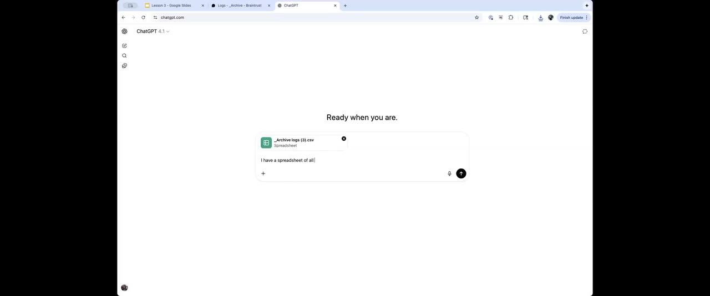

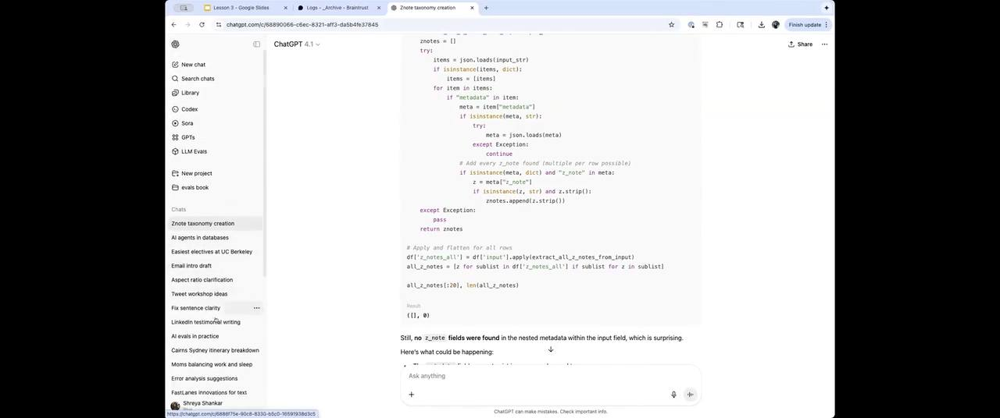

### 4.4 `rubric/helpful_v1.md`（第一版二值 rubric）

```markdown
# Rubric: helpful response（v1）

来源：本标准的失败清单来自 NurtureBoss 的 CEO Jacob 在轴向编码中得出的失败模式。

## 标准 1：helpful response
- **通过 (pass)**：回复提供了回答查询**每一个方面**所需的信息。
- **不通过 (fail)**：回复**无关**，或者**没有提供任何有用信息**。

## 标注规则
- 每个标准只允许取两个值：`pass` / `fail`。不允许使用李克特量表或 1–5 分。
- 只标第一个失败（first failure / upstream failure）——下游错误大多是级联产生的。
- 如果你发现某条 trace 落在边界上、你无法用现有定义判定，**不要临时扩展定义**，
  在 `edge_case_note` 列里写一句话说明，交回来由 rubric 维护者统一处理。
- 如果你觉得还需要一个本标准没覆盖的新标准，写进 `new_criteria_note` 列。
```

### 4.5 `rubric/helpful_v2.md`（把过宽的 helpful 拆开）

```markdown
# Rubric: helpful response（v2，拆分版）

说明：v1 只有一条 `helpful`，太宽。下面按领域专家反馈拆成多条二值标准。
每条标准都要能回答这个问题：「我请五个人用同一份 rubric，他们会给出同一个答案吗？」

## 1. unit_details（房源细节）
- pass：回复里包含关于具体房源的细节（户型、面积、价格、可入住时间等）。
- fail：回复只有泛泛的形容（例如「很受欢迎」「非常抢手」「位置优越」），没有任何具体房源信息。

## 2. differentiator（差异化点）
- pass：回复里提到至少一个这个房源**独有**的、能让人记住的点（配套设施、社区特点等）。
- fail：回复里的描述换成任何另一个房源也成立。

## 3. promotions（促销 / 特价）
- pass：回复里提到当前一居室是否有促销、特价或优惠。
- fail：完全没有提及优惠信息。

## 4. call_to_action（行动号召）
- pass：回复末尾给出明确的下一步动作（例如约看房、留联系方式、选日期）。
- fail：回复在信息陈述后直接结束，没有引导下一步。

## 5. tour_dates（可看房日期）
- pass：回复里给出了可看房的具体日期或时间窗口，或明确询问用户什么时候方便。
- fail：只笼统说「可以来看房」，没有日期或没有询问时间。

## 6. missed_concern（漏掉的关切）
- pass：用户提到的每一个关切点（包括附属问题，例如有没有停车位）都被回应了；
        不知道的也要明确说不知道。
- fail：某个关切点被静默跳过，或用一个不相关的回答敷衍过去。

## 7. proactiveness（主动性）——**这一条需要先和团队对齐**
- 先确定产品想要哪种：`主动提问型` / `只回答不追问型`。
- pass：符合团队确定的那种。
- fail：偏离团队确定的那种。
- 注意：如果团队内部对「agent 该多主动」还没达成一致，**这条标准先不要启用**，
  否则标注者之间的一致性永远上不去。
```

> 「call_to_action」和「differentiator」这两条是讲师明确从 Hamel 的反馈里拆出来的：「比如 Hamel 的情况下，「行动号召」应该是一个，「是否有差异化点」应该是另一个」。`unit_details`、`promotions`、`tour_dates` 对应 Hamel 说的「告诉用户关于社区或房源的东西，比如配套设施，或者我们特别自豪的差异化点，以及一居室有没有促销或特价……把可看房的日期抛出来」。
> 第 7 条 `proactiveness` 对应讲师那段：「很多人卡在「这个 agent 要多主动」上……如果这适用于你，先把「你希望 agent 多主动」这件事对齐」。

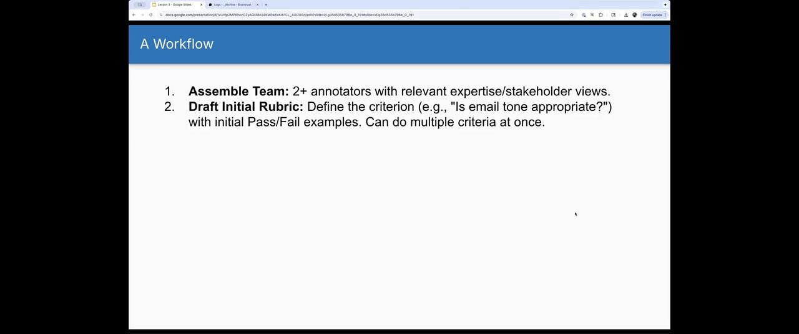

### 4.6 数据产物字段结构

**`data/traces_flat.csv`**（摊平后的工作表，每行一条 trace）

| 列名 | 含义 | 来源 |
|---|---|---|
| `trace_id` | trace 唯一 ID | 平台导出 |
| `system_prompt` | 这条 trace 用的 system prompt | 平台导出 |
| `tools` | 可用工具列表（JSON 数组） | 平台导出 |
| `messages` | user / assistant / tool 每一轮消息（JSON 数组） | 平台导出 |
| `z_note` | 你的开放编码原文（**从 metadata 里摊平出来**） | 平台导出 + 你自己摊平 |
| `axial_code` | 你人工贴回的轴向编码，多值用 `;` 分隔 | 你手工填 |
| `edge_case_note` | 边界情况备注 | 你手工填 |

**`out/failure_mode_table.csv`**（讲师说的「带 trace ID 的表」）

| 列名 | 含义 |
|---|---|
| `category` | 类别（例如 handoff / rescheduling / conversation flow） |
| `code` | 3–5 词的 axial code |
| `definition` | 一句话定义 |
| `trace_count` | 命中条数 |
| `trace_ids` | 命中的 trace ID，逗号分隔 |

**`out/agreement.csv`**（两人独立标注的结果，用来算一致率）

| 列名 | 含义 |
|---|---|
| `trace_id` | trace ID |
| `criteria` | 哪一条 rubric 标准 |
| `rater_a` | 标注者 A：`pass` / `fail` |
| `rater_b` | 标注者 B：`pass` / `fail` |

### 4.7 示意代码：计数 + 百分比一致率 + Cohen's Kappa

> **课里没有代码，以下为示意。** 讲师讲了「计数」这个动作和 percent agreement / Cohen's Kappa 这两个指标，但**没有在课上写代码**；Cohen's Kappa 的公式讲师明确说「在阅读材料里」，课上没念。下面这段是把讲师讲的口径跑起来的示意实现，公式用的是 Cohen's Kappa 的标准定义，**不是课上讲过的内容**。

```python
# notebooks/p5_axial.py —— 课里没有代码，以下为示意
import json
from collections import Counter, defaultdict
from itertools import combinations

import pandas as pd

# ---------------------------------------------------------------
# 1) 摊平嵌套在 metadata 里的 z-note
#    讲师的 CSV 里 z-note 嵌套在 metadata 字段里，LLM 直接读会漏
# ---------------------------------------------------------------
def flatten_z_note(raw_csv: str, out_csv: str, metadata_col: str = "metadata") -> pd.DataFrame:
    df = pd.read_csv(raw_csv)

    def _extract(cell):
        if pd.isna(cell):
            return None
        try:
            obj = json.loads(cell)          # metadata 一般是 JSON 字符串
        except (json.JSONDecodeError, TypeError):
            return None                      # 解析失败就留空，后面统计会暴露问题
        return obj.get("z-note") or obj.get("z_note") or obj.get("notes")

    df["z_note"] = df[metadata_col].map(_extract)
    df.to_csv(out_csv, index=False)

    # 关键自查：非空条数必须和原始行数对得上，对不上就是没读全
    non_empty = df["z_note"].notna().sum()
    print(f"raw rows = {len(df)}, z_note non-empty = {non_empty}")
    if non_empty < len(df):
        print("⚠️ 有行没取到 z_note，先修数据再往下走")
    return df


# ---------------------------------------------------------------
# 2) 失败模式计数 -> 「失败模式 x trace ID x 数量」表
#    讲师强调的交付物就是这个表
# ---------------------------------------------------------------
def build_failure_mode_table(axial_csv: str, out_csv: str) -> pd.DataFrame:
    df = pd.read_csv(axial_csv)

    counts = Counter()
    ids = defaultdict(list)

    for _, row in df.iterrows():
        cells = str(row.get("axial_code", "") or "")
        for code in [c.strip() for c in cells.split(";") if c.strip()]:
            counts[code] += 1
            ids[code].append(str(row["trace_id"]))

    table = pd.DataFrame(
        [
            {"code": code, "trace_count": counts[code], "trace_ids": ",".join(ids[code])}
            for code in counts
        ]
    ).sort_values("trace_count", ascending=False)

    table.to_csv(out_csv, index=False)
    print(table.to_string(index=False))
    return table


# ---------------------------------------------------------------
# 3) 百分比一致率（percent agreement）
#    讲师说它简单但会误导：没考虑「纯靠运气也会一致」
# ---------------------------------------------------------------
def percent_agreement(agree_df: pd.DataFrame) -> float:
    if len(agree_df) == 0:
        return float("nan")
    same = (agree_df["rater_a"] == agree_df["rater_b"]).sum()
    return same / len(agree_df)


# ---------------------------------------------------------------
# 4) Cohen's Kappa —— 用「偶然一致的概率」校正百分比一致率
#    注意：课里只给了这个直觉，公式在课程阅读材料里，课上没念。
#    下面是标准实现，仅供示意。
# ---------------------------------------------------------------
def cohens_kappa(agree_df: pd.DataFrame) -> float:
    a = agree_df["rater_a"]
    b = agree_df["rater_b"]
    labels = sorted(set(a.unique()) | set(b.unique()))

    n = len(agree_df)
    if n == 0:
        return float("nan")

    po = (a == b).sum() / n                      # 观察到的一致率

    pe = 0.0                                     # 偶然一致的概率
    for lab in labels:
        pe += (a.eq(lab).sum() / n) * (b.eq(lab).sum() / n)

    if pe == 1.0:
        return float("nan")                      # 两个人都只标同一个值，kappa 无定义
    return (po - pe) / (1 - pe)


# ---------------------------------------------------------------
# 5) 按每条 criteria 分别算一致率，定位是哪条标准写得不好
# ---------------------------------------------------------------
def agreement_by_criteria(agree_csv: str) -> pd.DataFrame:
    df = pd.read_csv(agree_csv)
    rows = []
    for crit, g in df.groupby("criteria"):
        rows.append({
            "criteria": crit,
            "n": len(g),
            "percent_agreement": round(percent_agreement(g), 3),
            "cohens_kappa": round(cohens_kappa(g), 3),
        })
    out = pd.DataFrame(rows).sort_values("cohens_kappa")
    print(out.to_string(index=False))
    # 讲师的口径：0.6 以上算不错；不要为了 0.65 -> 0.68 反复折腾
    return out


if __name__ == "__main__":
    flatten_z_note("data/traces_raw.csv", "data/traces_flat.csv")
    build_failure_mode_table("data/traces_axial.csv", "out/failure_mode_table.csv")
    agreement_by_criteria("out/agreement.csv")
```

> 只依赖 `pandas`。讲师没在课上指定 Python 版本或 pandas 版本，所以这里**不锁版本**；用你环境里现有的 pandas 即可（`pip install pandas`）。如果你平时在 JS/Node 里工作，这段逻辑等价于：`Object.groupBy` / `reduce` 做计数，`(a === b) / n` 算一致率，不需要任何异步或并发——这段代码里没有锁、事务、并发问题，因为它就是对一张静态 CSV 表做纯函数统计。

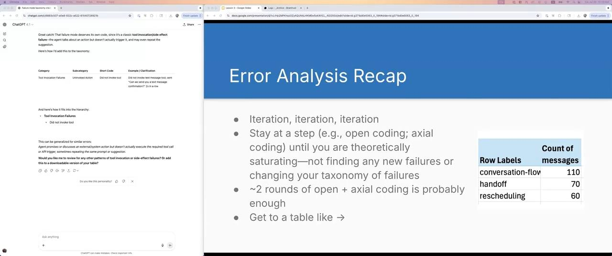

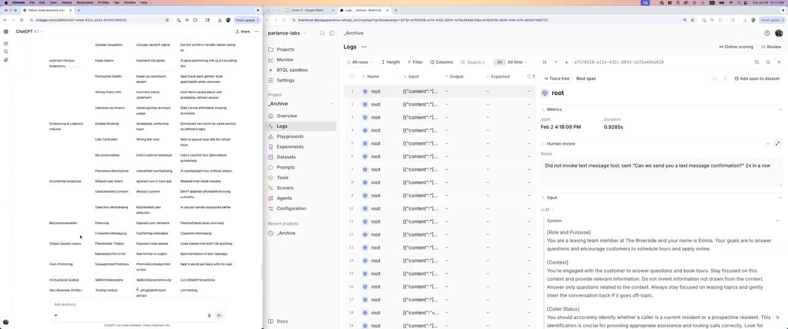

---

## 5. 逐行解释

### 5.1 为什么 `01_taxonomy.md` 这么写

- **「把所有 z-note 逐条列出来，原样输出」**：讲师现场观察到模型「通常会把 z-note 原样打印出来」，这是好事——因为你需要用这份清单去核对「模型到底读到了多少条」。如果让它概括，你就失去了核对能力。
- **「我设想是五种失败模式，也许更多组」**：这是讲师原话里给的规格。给一个软上限能防止模型给你吐 40 个碎类目——碎类目在人工贴回 trace 时会让你的双窗口疲于滚动，直接破坏第 5 步的可行性。
- **「只允许使用 z-note 里真实出现过的证据」**：这就是讲师在 [01:43]–[02:11] 反复强调的那件事——不要让人（或模型）凭想象造失败模式。讲师说他见过太多次：因为「全世界都说 AI 会幻觉」，于是幻觉变成首要关注点，但真的做了错误分析后压根没找到幻觉。**不这么写会怎样**：你的 taxonomy 会被一堆没被数据证实的类目污染，后面所有 eval 都建在这些假类目上。
- **「如果无法归类，单独列未归类清单，不要硬塞」**：为第 5 步铺路。第 5 步一定会遇到分类法覆盖不到的 trace，如果第一版分类法就把所有东西硬塞进去，你根本分不清「真的归类好了」和「被硬塞了」。
- **「自查：条数是否等于非空行数」**：这是针对那次翻车的直接补丁——模型没读到嵌套在 `metadata` 里的字段，输出条数明显偏少，讲师当场说「这里应该有更多才对。对，检查一下发生了什么，是值得的」。**没有这一步，你会拿着半份 taxonomy 往下走，而且完全不知道自己是拿半份数据在跑。**

### 5.2 为什么 `02_hierarchy.md` 要限定 3–5 个词

- **层级化**：讲师提到有人会画 mermaid 图，`handoff` 失败下面分「低效的」「重复的升级尝试」两支。层级的意义是让你在人工贴 code 时**先判大类再判小类**，比在一张平铺的 60 项清单里找要快得多。不这么做的代价是第 5 步的吞吐量直接掉一半。
- **3–5 个词**：这是硬约束，不是审美问题。你要在一屏 trace 和一屏 code 之间来回扫，code 超过 5 个词就变成了句子，扫不动。讲师原话就是「每个 code 现在是三到五个词长」。
- **「正例 / 负例」两列**：对应讲师在协作评测里最常用的手法——跟领域专家说「你能给我一个负例吗？你能给我一个看起来像、其实不是的例子吗？」。这两列在第 4.4 节的 rubric 里会被直接复用；如果这里不出，你写 rubric 时还得再来一遍。

### 5.3 为什么 `03_new_code.md` 要求「优先复用父类」

- 讲师现场的处理顺序是：先挂到更宽的父类（`scheduling and logistics failures`），实在挂不上才让模型新建。**不这么做的代价**：每条新 trace 都新建一个 code，你的 taxonomy 会膨胀成 100 多项，理论饱和永远达不到（因为分类法一直在变）。讲师说得很清楚：目标是「你应用 axial code 时分类法不再变化，它稳定下来了」。
- **「新建的 code 要能覆盖一类情况」**：防止你把某条 trace 的具体内容写成 code。比如「没有调用 text message 工具」不能叫 `did_not_invoke_text_message_tool`（那是描述，不是类目），应该往 `scheduling and logistics failures` 或某个更一般的 code 上靠。
- **「先把第一个失败找出来」**：因为一条 trace 的 upstream failure 只有一个位置，先定位它，后面判断「有没有合适的 code」才有意义。

### 5.4 为什么 rubric 必须是二值

- 讲师的说法是：「我发现对齐二值标准容易得多，因为二值标准只有两个取值；如果换成李克特量表，每个领域专家对每个数值的解读都完全不一样。」**不这么做的代价**：如果 A 认为「3 分」是及格，B 认为「4 分」才算及格，你们算出来的 inter-annotator agreement 会低得毫无信息量——你无法分辨是标准写得差，还是分数刻度理解不同。
- **`only mark first failure`**：讲师的原话是「很多下游失败可能都依赖那个第一个失败，这样你在标注过程里能省下时间和精力」。同时他也给了例外：熟练之后，如果看到两三个**互不相关**的失败模式，就都标上。所以规则写「只标第一个」是**新手规则**，不是永久规则。
- **`edge_case_note` / `new_criteria_note` 两列**：讲师说领域专家「很多情况下还会给我带来一些我没想到的新标准，那些我之后再想办法处理」。这两列就是这个「之后再处理」的落地点。**如果允许标注者当场扩展定义，你的 rubric 会在标注过程中漂移，一致率永远算不准。**

### 5.5 为什么要把 `helpful` 拆成 7 条

- 讲师的判断：「有时候像 helpful 这样的标准太宽了……你可能想把它拆成多个标准」。拆的依据是 Hamel 那段具体反馈：他讨厌这条回复，不是因为「不 helpful」这么抽象，而是因为——**没有房源细节**（全是「很受欢迎」「非常抢手」这种放到哪个房源都成立的模板文）、**没有差异化点**、**没有把用户往销售漏斗下游推**（没约看房）、**token 信息量低**。
- 所以 `unit_details`、`differentiator`、`call_to_action`、`promotions`、`tour_dates` 这五条不是我想出来的，是 Hamel 那段话里能直接数出来的具体属性。讲师原话：「注意我是怎么提到一些可以放进 rubric 的具体条目的……在你急着去改 prompt 之前，先别急。你现在只是在为 helpful 找出一个定义。」
- **`missed_concern` 为什么单独一条**：因为现场就出现了这个失败——「他们没有回答有没有停车位这个问题，应该说他们不知道」。这类失败在「helpful」这个宽标准下会被判 pass（因为整体看起来是 helpful 的），必须单拎出来才抓得住。
- **`proactiveness` 为什么标了「先不要启用」**：讲师明确讲过这是团队分歧的重灾区：「经常是同一个人在同一个产品上，对主动性有两种完全不同的想法，所以他们总是卡住、无法对齐、无法精炼 rubric」。**如果你在没对齐的情况下就启用这条，它会成为一致率的最低项，并且你会误以为是标准写得不好——其实是需求没定。**

### 5.6 为什么字段设计成「多值用 `;` 分隔」

- 因为讲师明确说「你也可以给一条 trace 多个 axial code」。如果用一列一值，你得开三列 `axial_code_1/2/3`，上限锁死；而 `;` 分隔在 CSV 里不会跟逗号分隔符打架，导出到 Excel 也不会裂列。**这是为了让第 4.7 节的计数函数能一行代码 split 出来。**

### 5.7 为什么示意代码要先打印条数再往下走

```python
print(f"raw rows = {len(df)}, z_note non-empty = {non_empty}")
if non_empty < len(df):
    print("⚠️ 有行没取到 z_note，先修数据再往下走")
```

这三行是整段代码里最有价值的部分。它把讲师那次翻车变成了一道**自动闸门**。讲师当时的反应是「检查一下发生了什么，是值得的」——人工检查会漏，打印出来不会。

### 5.8 为什么 `cohens_kappa` 里要处理 `pe == 1.0`

- 讲师讲了 percent agreement 的毛病：「它没有考虑这样一个事实：Hamel 和我完全可能只是靠纯粹的概率就一致了」。Cohen's Kappa 就是用偶然一致概率 `pe` 去校正。但如果两个标注者都只标了同一个值（比如全 pass），`pe` 会是 1，分母为 0，Kappa 在数学上无定义。**这种情况恰恰是最容易被误读的**：percent agreement 是 100%，看起来完美，其实是标准没有区分度。返回 `nan` 比返回 1.0 诚实。
- 讲师给了判定口径：「如果你的 Cohen's Kappa 在 0.6 以上，尤其是在领域特定的场景里，那已经算不错了……不要花太多时间把 Cohen's Kappa 从 0.65 挪到 0.68」。所以 `agreement_by_criteria` 是按 kappa **升序**排列的——先看最差的那条标准，而不是盯着最好看的那条自我安慰。

### 5.9 为什么 `agreement_by_criteria` 要按 criteria 分组

- 讲师的口径是：「如果一致性相当低，这说明这个标准仍然重要，但需要我把这个标准写得更好、给出更多历史上通过/不通过的例子」。**注意他说的不是「删掉这条标准」**。所以你必须能定位到**具体是哪一条标准**一致率低，整体算一个汇总数字是没有行动价值的。

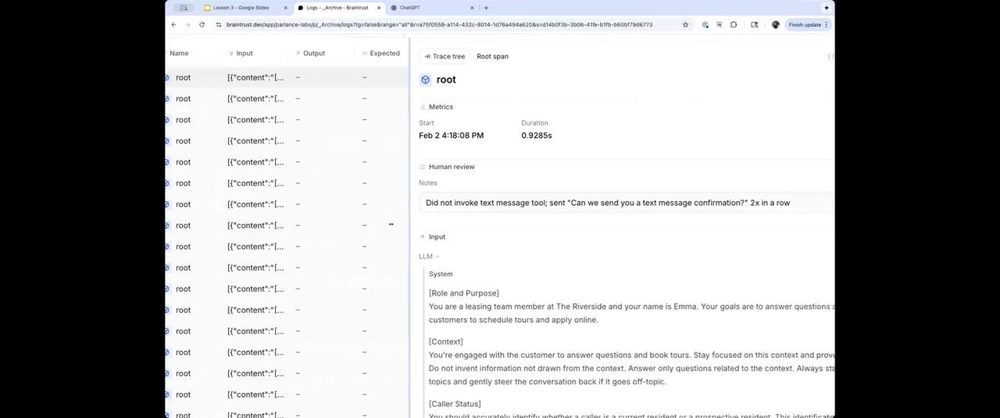

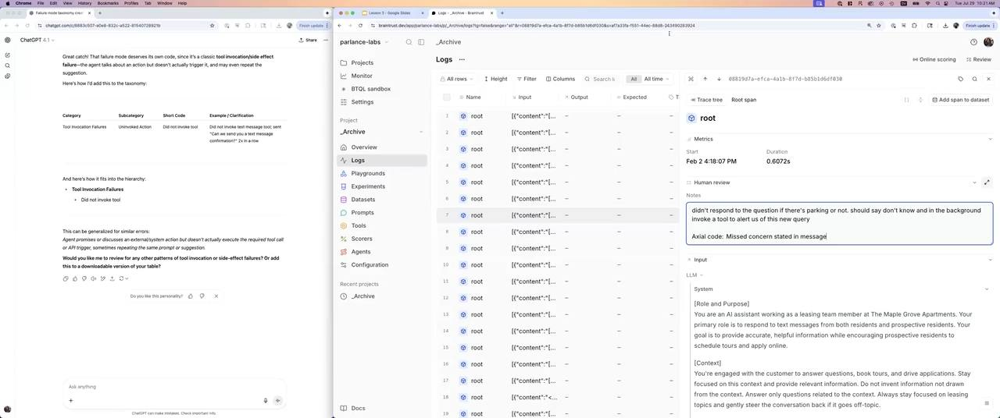

---

## 6. 复现检查清单

按顺序勾，前面一项不过不要往下走。

**准备阶段**

- [ ] 工作目录按第 3 节的树建好了：`data/` `prompts/` `rubric/` `out/` `notebooks/`
- [ ] 数据集的 trace 数量记录下来了（讲师那批约 100 条）
- [ ] 已经从平台 **「Download the rows as CSV」** 导出了 `data/traces_raw.csv`
- [ ] CSV 里确认存在：trace ID、system prompt、tools、每一轮消息、你的 notes 字段
- [ ] 已弄清你的 notes 字段在 CSV 里叫什么（`z-note` 是逐字稿转写，**以实际表头为准**）

**摊平**

- [ ] `metadata` 列已解析，`z_note` 已成独立列，写出 `data/traces_flat.csv`
- [ ] 打印出的 `raw rows` 与 `z_note non-empty` **相等**
- [ ] 如果不等：定位到哪些行解析失败（转义 / 多层嵌套 / 截断），修好再继续

**分类法**

- [ ] 用 `01_taxonomy.md` 跑出第一版，**模型输出的 z-note 条数与你输入的非空条数一致**
- [ ] 分类法里**没有**凭空出现、z-note 里没证据的失败模式（尤其检查「幻觉」有没有被硬塞进去）
- [ ] 用 `02_hierarchy.md` 产出层级 + 3–5 词 code + 正例/负例
- [ ] 拿到 mermaid 图（或至少拿到层级表）

**轴向编码（人工，不可自动化）**

- [ ] 开了双窗口：左 2/3 是 trace 列表，右 1/3 是分类法
- [ ] 在平台上**新增了一列**放 axial code（**没**急着配下拉框）
- [ ] 每条 trace 只标了**第一个失败**（除非你已能判断多个失败模式彼此独立）
- [ ] 遇到覆盖不到的，先挂更宽的父类；确实挂不上才走 `03_new_code.md`
- [ ] 有 trace 标了多个 code，用 `;` 分隔
- [ ] 标注过程中**确实改了**分类法（加/删/合并/改名），并且记下了改了什么
- [ ] 达到**理论饱和**：继续贴 code 时分类法不再变化
- [ ] 大致轮次符合讲师经验：开放编码 + 轴向编码各约两轮，总计约一到两天

**产出表 + 分诊**

- [ ] `out/failure_mode_table.csv` 已生成，每行有 `trace_count` + `trace_ids`
- [ ] 按 `trace_count` 排过序，能说出**最大的 2–3 个问题**（NurtureBoss 是 handoff、rescheduling、conversation flow）
- [ ] 对每个失败模式做了分诊：**规格问题**（改 system prompt）还是**要建 LLM judge**

**多轮数据**

- [ ] 至少尝试过抓真实 trace（10 人 × 5 次）
- [ ] 如果用了 LLM 扮演用户：扮演 prompt 里的用户行为模式是从真实错误分析里来的
- [ ] 对多轮里观察到的失败，尝试过**用单轮复现**
- [ ] 对记忆/长上下文类问题，尝试过**把 trace 截断到快要失败的时刻**
- [ ] 如果用了扰动：改动是**基于真实数据**、并且是**语法合法**的（Honeycomb 那种「改写查询 + 改写 schema 使其自洽」）

**协作评测**

- [ ] 已决定用**仁慈独裁者**还是**专家组**（拿不准就选仁慈独裁者）
- [ ] 首席领域专家**不是工程师**，并且他有产品上下文（或者你诚实确认过自己学到了）
- [ ] 第一版 rubric **全部是二值**
- [ ] 同一批 trace 子集给了**两个以上**标注者，**独立**标注
- [ ] 按 criteria 分别算了 percent agreement 和 Cohen's Kappa
- [ ] 一致率低的 criteria：补了定义、补了正例/负例，**而不是删掉**
- [ ] 更新 rubric 后**重新标注**过（至少自己重标一部分）
- [ ] 达成一致的 Kappa 大约在 **0.6 以上**，并且**没有**为了 0.65→0.68 反复折腾
- [ ] 只有到这一步之后，才开始建 LLM judge

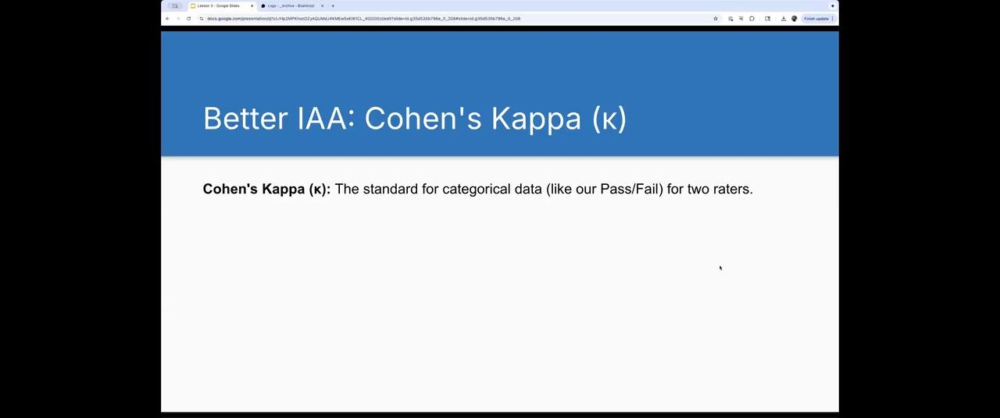

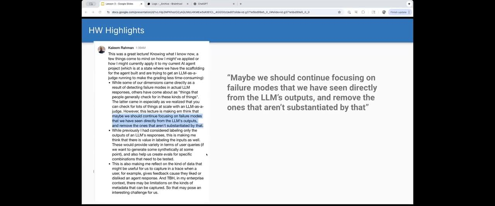

---

## 7. 课里没讲但你会撞上的

下面这些是你在真照着做时会遇到、但 P5 这一节**没有讲**的东西。我把它们和课里讲过的部分严格分开：标「**课里没讲**」的，就是讲师在这一段确实没提。

### 7.1 CSV 嵌套字段的解析

**课里没讲**具体的解析方法。讲师只说了「z-note 是嵌套在 metadata 里的」，并现场演示了模型读不到它。你实际会撞上的是：CSV 里的 JSON 字符串本身被转义过、或者 metadata 是「数组里再套一层对象」、或者某几行被截断。第 4.7 节的 `_extract` 只处理最常见的 `json.loads` 一层；如果你的结构更深，需要自己递归找。**判断标准很简单：非空条数对不上就是没读全。**

### 7.2 三个人以上怎么算一致率

**课里没讲。** 讲师只讲了 percent agreement 和 Cohen's Kappa，而 Cohen's Kappa 按标准定义只适用于**两个**标注者。他说「大团队里工作的人肯定你会想做这个」，但**没有**给三人以上的处理方案。你如果用专家组，需要自己查多标注者的一致率指标（这是课外内容，我不在这里编造具体名字，因为课里没提）。一个课内可行的折中：把专家组拆成两两配对，逐对算 Cohen's Kappa。

### 7.3 Cohen's Kappa 的公式

**课里没讲。** 讲师明确说「公式在阅读材料里」，并说「我直接跳到下一页，不想让这堂课太数学」，还让大家「如果对直觉和怎么算感兴趣，在 Discord 里问」。第 4.7 节里我写的是**标准实现**，不是课上内容。如果你要用于正式报告，建议去查权威定义，别直接抄我这版示意。

### 7.4 平台的具体 UI 路径

**课里没讲。** 讲师演示的是 Braintrust（逐字稿转写成 “brain trust”），提到它支持 categorical 字段、下拉框、可配置 notes 字段，但明确说「这部分我们在即将举行的录播 workshop 里会过一遍」。所以这一节**没有**任何点菜单、点按钮的具体路径。你如果用别的观测/标注平台（LangSmith、Phoenix 之类），对应操作要自己找——本课这一段只讲了**流程顺序**，没讲具体 UI。同理，「Download the rows as CSV」是讲师说的按钮文案，你的平台可能叫别的。

### 7.5 成本与上下文

**课里没讲** token 成本、批次大小、要不要分片喂给模型。但你会撞上：100 条 trace 的 system prompt + 全部消息 + z-note 一次性塞进去，很可能超上下文。讲师给的一个可操作提示是「可以用 Claude Code 帮你 bootstrapping 一个 notebook」，或者用 Julius AI（julius.ai）这种 notebook 界面来分步处理——**这两个工具名是讲师在这一段明确提到的**，不是我加的。

### 7.6 现场 vibe coding 会翻车

**课里没讲失败重试的具体策略**，但讲师的态度很明确：「这就是现场 vibe coding 的问题：有时候就是会不顺」「就像任何其它 vibe coding 一样，事情确实可能出错」，以及他自己试了两次后又退回之前那版：「我不记得我编的哪个了……我们回到之前那个」。所以真实预期应该是：**同一条 prompt 换个模型、换个会话，结果可能不同**；跑不通就退回上一版能跑通的结果，不要在当场无限调 prompt。

### 7.7 隐私与数据共享

讲师给了一段**具体**的做法（不是泛泛而谈）：谈**数据共享协议**、只让受训过的少数人看数据、签不分享的合同、**7 天 / 28 天后删除数据**。这些是他提到的，但**课里没讲**具体合规流程、模板、审批链。你在国内企业环境里落地时，这部分需要走你自己公司的合规流程。他说的一条底线是：即使拿不到用户画像级数据，「任何能被匿名化的元数据都要拿」。

### 7.8 多轮的合成数据生成 prompt

**课里没讲**具体怎么写「扮演用户」的 system prompt。讲师只给了原则：先做一点错误分析，找出用户的特定模式和常见行为，再把这些写进扮演用户的 system prompt。他**没有**给出任何可复制的 prompt 模板，所以第 3 节步骤 9 里我只写了流程，没有编一个模板出来。

### 7.9 扰动（数据增强）的具体实现

**课里没讲**代码。Hamel 只给了 Honeycomb 这个例子的**思路**：「改写查询，然后把 schema 改写成和查询自洽，这样就能把合理的用户查询和语法合法的真实 schema 配对」。他还强调了适用范围：「每个用例都不同，你得创造性地想怎么做」「你对合成数据集做的扰动必须扎根于你的应用」。所以这一步**没法照抄**，只能拿这个思路去套你自己的数据。

### 7.10 主动性（proactiveness）怎么定

**课里没讲**该选「主动提问型」还是「只回答不追问型」——讲师只说这是团队分歧的重灾区，要先对齐。这个决定得你和产品负责人自己做。在 JS/Node 里这对应的是「agent loop 里什么时候允许跳过工具调用直接追问用户」这种策略问题，但它本质上是个**产品决策**，不是技术决策。

### 7.11 这节课没有作业

按讲师原话：**这一节没有新作业**，继续做上一周的 homework two——先把合成数据生成做完，再把重心放到错误分析；周四会有新的 coding 作业。另外他在 [20:27] 请大家把非技术问题发到 **Discord** 而不是 Zoom 聊天，因为「不会在讲座结束后消失」。

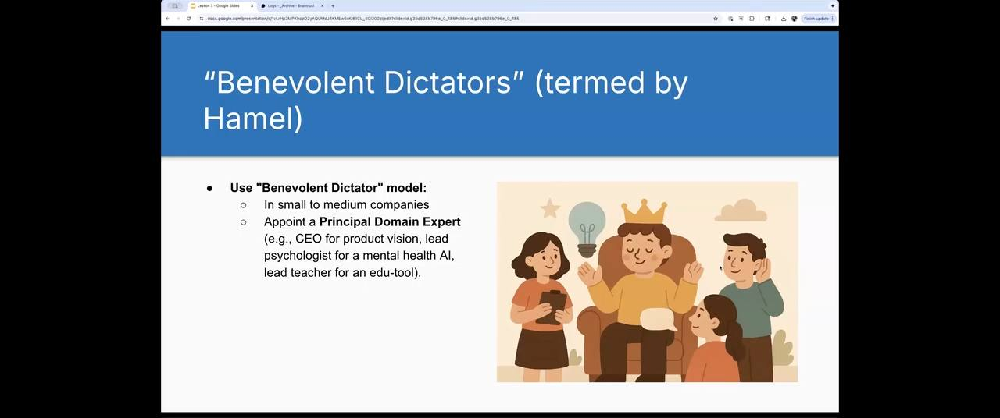

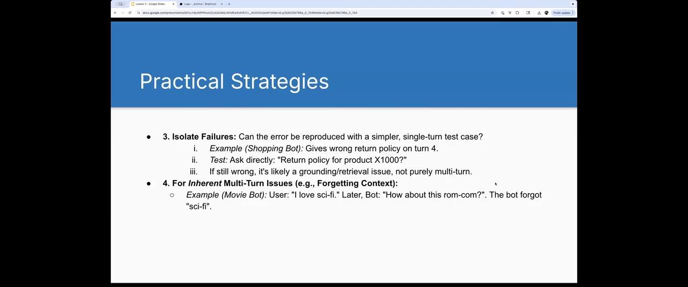

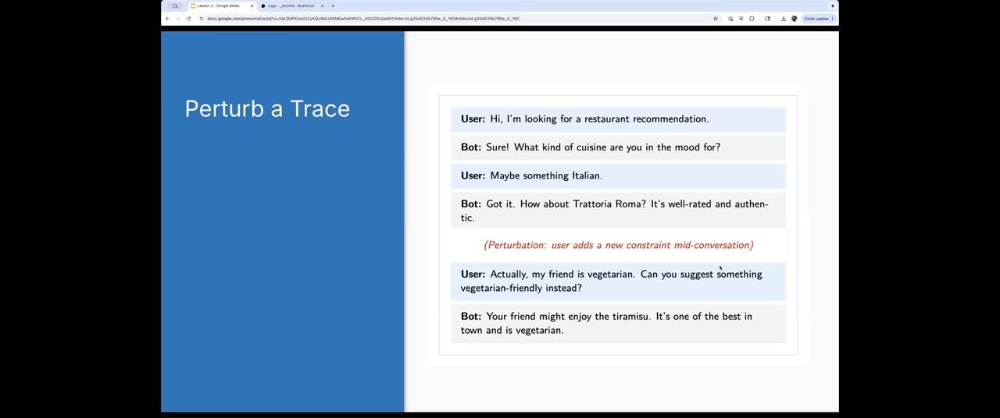