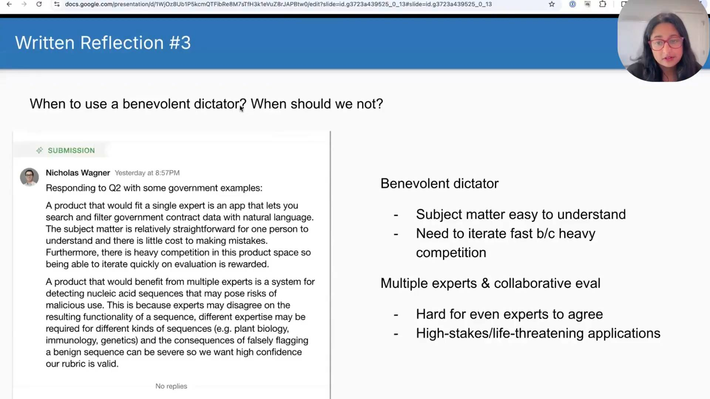
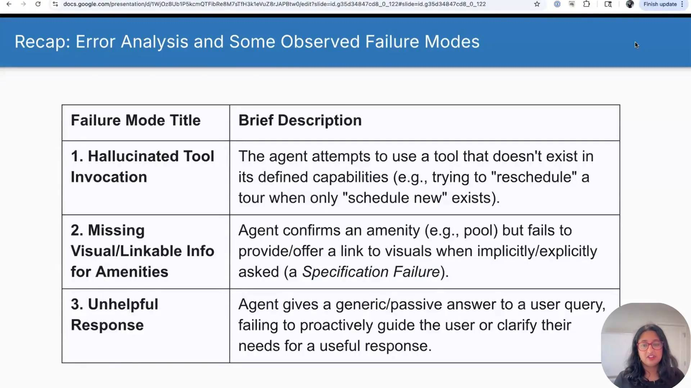
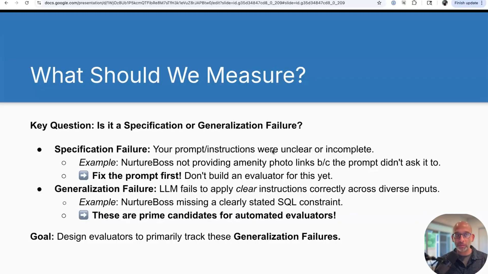
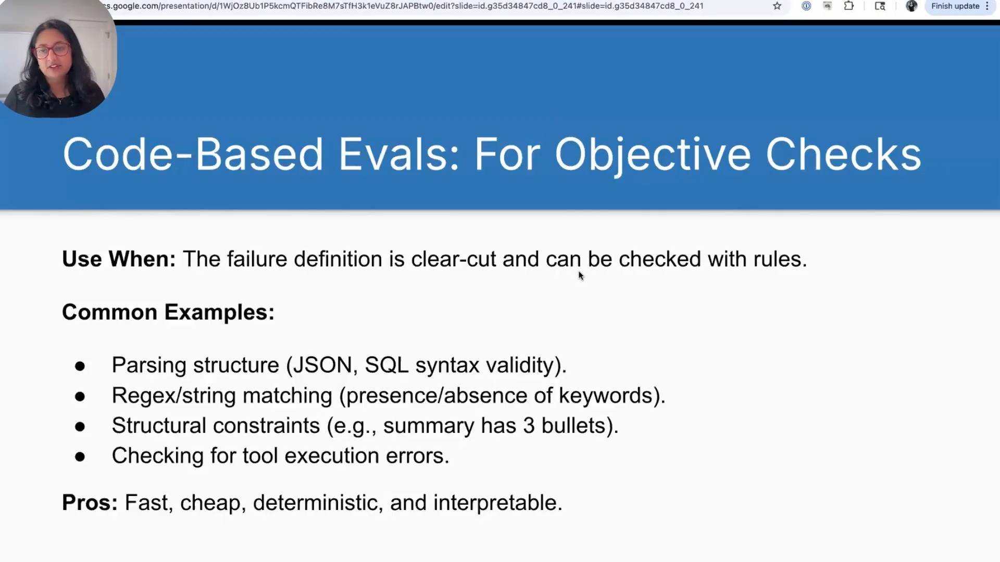
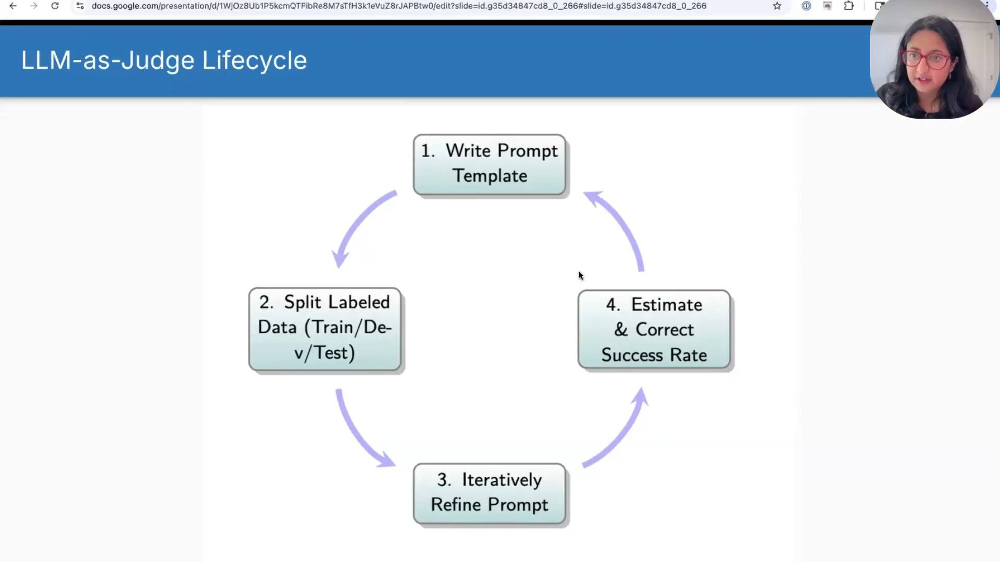
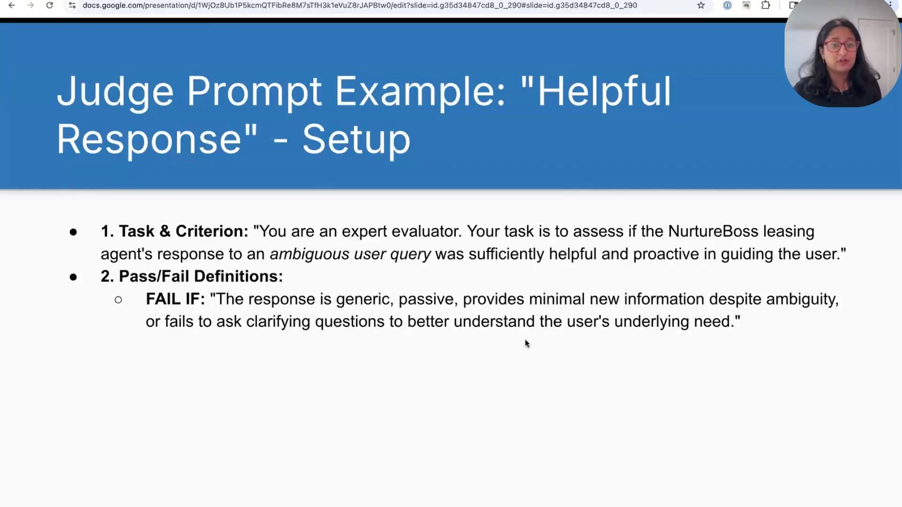
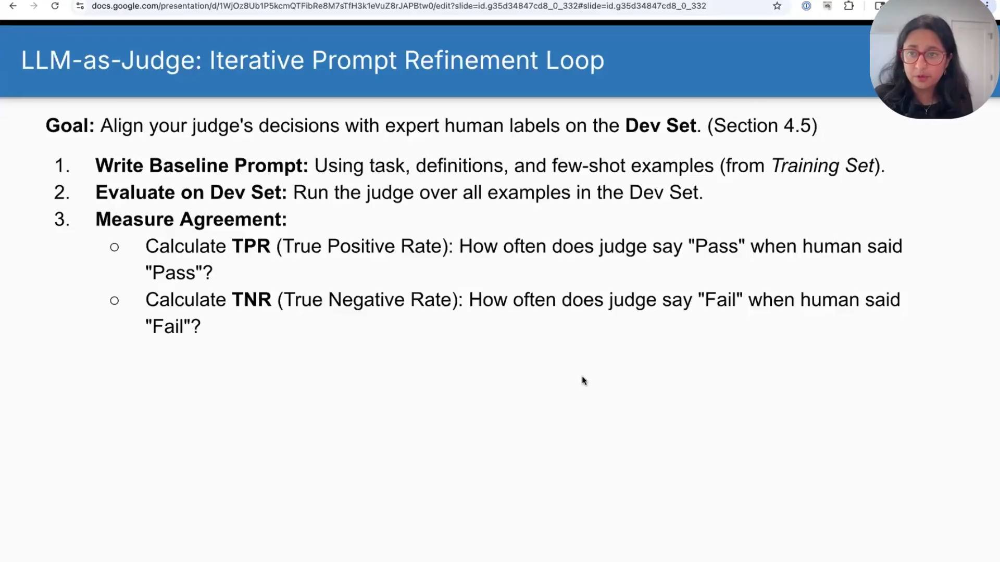
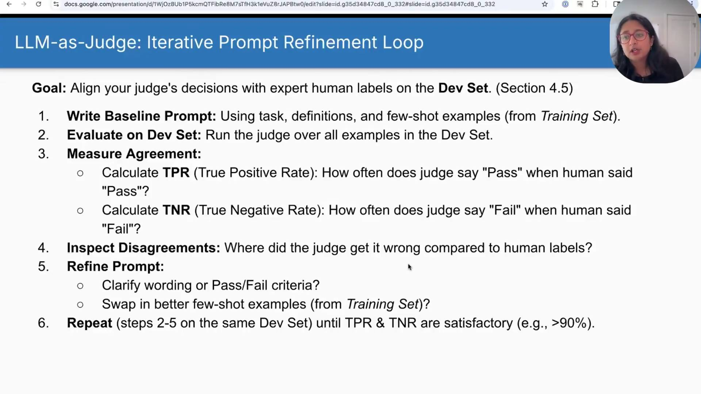

# AI Evals for Engineers & PMs —— 自动化评测器（Automated Evaluators）与 LLM as Judge 实战

> 课程：BV1FwTE6gEky ｜ 覆盖 P006（00:00–60:23）
> 读者定位：前端转 AI 应用工程师。本文档按「先做出来、再讲为什么」的顺序组织，所有命令、代码、配置均可直接保存运行。

---

## 1. 这一节做什么

上一节课我们做完了 **error analysis（错误分析）**：把几百条 trace 摊开、做 open coding（开放式编码）、再 axial coding（轴心编码），最后得到一份「失败模式清单」。这一节课要回答的问题是：

**你已经知道系统会怎么坏了，怎么量化「坏」有多普遍？尤其是在你没有人工标注数据的时候？**

讲师的答案分三层：

1. **先分类**：把失败模式分成 **Gulf of Specification（规格鸿沟）** 和 **Gulf of Generalization（泛化鸿沟）**。前者靠改 prompt 就能修，后者才值得投入做自动化评测器。
2. **先写代码评测器**：能确定性判断的（工具是否存在、输出能否解析、有没有泄漏关键词）一律用 Python 函数做 **code-based evaluator**，不要上 LLM。
3. **再上 LLM as Judge**：对主观、微妙的判断（回复是否有帮助、是否主动追问、总结是否忠实），用另一个 LLM 当裁判。但**必须像训练分类器一样对待它**：切分 train/dev/test、只看 TPR 和 TNR、用 dev set 爬山、用 test set 校正偏差。

课程用一个贯穿案例 **Nurture Boss**（一个租房社区 AI 助手，能查房源、约看房、查住户信息）来演示，从中挑出三个失败模式：

| 编号 | 失败模式 | 类型 | 处理方式 |
|---|---|---|---|
| FM1 | hallucinated tool invocation（调用了不存在的工具，比如根本没有 reschedule 工具却去调用） | 泛化 | code-based evaluator |
| FM2 | 确认了某个 amenity 存在，但没有给视觉链接 / 预约链接 / 使用说明（不够个性化） | 规格 | 先改 prompt |
| FM3 | unhelpful response（回答泛泛、被动，不主动澄清） | 泛化 | LLM as Judge |

本节最终交付物：一个能跑的 **LLM judge 评测流水线**——prompt 模板 + 标注数据切分脚本 + 在 train/dev/test 上跑 judge 并输出 TPR/TNR 的脚本。

---

## 2. 讲师原话

> "今天我们讲自动化评测器，接续前几节课讲过的错误分析。"
> —— p006 [00:00]

> "如果你过早地定义失败模式，你会有某种确认偏误——你在做开放式编码时只会专门去找那几种失败模式；而且即使它们出现频率很低，你也会被偏见带着认为它们很重要、必须修。当然还有漏掉失败的问题：你太聚焦于少数几种失败模式，就会错过系统其他所有可能出错的地方。"
> —— p006 [00:29]

> "我最喜欢引用那篇《Who Validates the Validators》论文里的一句话是 criteria drift（标准漂移）：你只有看过一些 LLM 的实际样例，才真正知道自己想要什么。很多人一上来就想自动化——扔个 LLM 上去，我不想看这些数据。这非常糟糕，因为你不看就根本不知道自己想要什么。"
> —— p006 [02:52]

> "今天我们要讲的是：好，你已经知道失败模式了，你做了错误分析。现在你怎么量化这些失败模式在你系统里有多普遍？更重要的是，在你没有标注数据的时候怎么做？这就是自动化评测器登场的地方——剧透一下，就是 LLM judge。"
> —— p006 [03:47]

> "有些失败是规格鸿沟问题。你的 prompt 里并没有包含你所有的隐含标准，LLM 被迫去读你的心，而有时候它就是读不对。"
> —— p006 [07:26]

> "我们的洞见是：当你审视所有失败模式时，写下你认为它是不是规格问题——它能不能通过把标准写进 prompt 来修好，或者你其实已经写进 prompt 了、这就是常识、而 LLM 仍然做不好。"
> —— p006 [08:20]

> "泛化失败更难迭代，因为你已经告诉它你想干什么了——它为什么不听我的？而规格失败更像是：好吧，我压根没费心告诉它这条规则。"
> —— p006 [09:41]

> "有一个 Nurture Boss 的规格失败例子，我们确实为它建了评测器：排期问题会在一些棘手的日期场景下失败，比如闰年、跨年边界，或者其他奇怪的边缘情况。这是我们可以靠 prompt 解决的，只是需要把所有边缘情况头脑风暴出来。"
> —— p006 [10:07]

> "Nurture Boss 早期还有一个问题：它做不对很多预约，因为我们压根没在 prompt 里写日期，LLM 根本不知道今天是几号。那个我们就不需要做评测器，因为太明显了。"
> —— p006 [11:33]

> "我的启发式通常是：如果我能想到一个非常明显的 prompt 修法，而且我有 99% 的把握它会显著提升准确率，我就直接去改 prompt，直接进入改进环节。如果我得想一些很 hack 的做法，或者得用某种 prompt 工程策略、得一步步试、得把一句话的描述扩写成一段话——这些情况下你现在不该做那个改进，开始建评测器吧。"
> —— p006 [12:30]

> "在我们看来，评测器具体来说就是一个函数，它告诉你一个你已经观察到、并且已经定义得很好的失败模式，在你系统里有多普遍。"
> —— p006 [14:15]

> "所以在你明确知道要测哪个失败模式之前，不要跳到这一步。"
> —— p006 [15:13]

> "评测器有两种。一种是 code-based evaluator，字面意义上就是一个确定性的 Python 函数或任何代码函数，接收 trace 和失败模式，返回 true/false 或者一个分数。非常适合客观的、基于规则的检查。能确定性做的时候尽量用代码评测器，因为它是确定性的；如果你能做确定性的事，那一定比非确定性更好。"
> —— p006 [15:13]

> "另一种是 LLM as judge。思路是用另一个 LLM 当裁判，评估这条 trace 是否表现出该失败模式。这类最适合非常主观或非常微妙的检查，比如回复的有帮助程度——你不太清楚怎么写一个确定性函数来做这件事。"
> —— p006 [16:07]

> "我见到的 code-based evaluator 最常见的地方：解析、确保输出能通过类型检查（这不需要理解 LLM 输出的含义就能做）；大量正则或字符串匹配，检查关键词出现与否；任何结构性约束，比如摘要生成流水线里你希望摘要至少多少词、或者有某种结构；工具执行错误——这是个大项，你应该用代码评测器。"
> —— p006 [16:36]

> "很多你以为需要 LLM judge 的东西，其实可以用代码评测器做，或者至少能很好地近似。"
> —— p006 [17:04]

> "有时候你的 system prompt 里有 user ID，因为你希望工具调用知道它，你不希望它被意外输出出来——不一定是因为泄漏了什么，就是很奇怪。这种情况用代码检查就行，很容易。"
> —— p006 [17:34]

> "有时候你在 system prompt 里指定了用什么数据库，比如 Postgres 或 Snowflake，但你不希望 AI agent 回复用户说「我查了我的 Snowflake 数据库，发现 XYZ」。所以你要检查 snowflake 或 postgres 这些关键词是否出现，确保没有泄漏出去。"
> —— p006 [18:03]

> "你也可以把这些想成人们常说的 guardrails（护栏）。你可以把评测器放在关键路径上当护栏，拦住输出不让它到用户那里；也可以离线、异步地用这些评测器，只是量化已经生成的 trace 里失败模式的普遍程度。"
> —— p006 [18:32]

> "对于 hallucinated tool invocation，这也是一个我看到人们用 LLM judge、但其实完全可以用代码的例子。你已经在 system prompt 或 MCP 规格里列出了你的工具有哪些。所以如果你要检查 agent 没有去编一个你没提供的工具，这可以用代码做：把工具列出来，或者从 system prompt 里解析出来，然后检查这个工具是否在那个列表里。"
> —— p006 [19:00]

> "有时候代码评测器不管用，你就得上 LLM judge。比如回复是否有帮助、语气是否合适、总结是否忠实。我用 faithful 这个词是因为它容易放在幻灯片上，但实际含义是：它是否真的代表了它想总结的内容，既没有幻觉出新信息，也没有忽略重要信息？"
> —— p006 [19:57]

> "你可以用各种方式做 LLM as judge，你可以让它判断任何事情。但能做不代表应该做。Hamel 和我逐渐意识到，当你用现成的 LLM 当裁判时，最好把你让它判断的失败模式定义得非常清楚，并且做成 pass/fail，也就是二分类问题。因为这样你去评估它的准确率时，只需要评估它是否正确说了 pass 或 fail。一旦你开始搞李克特量表、或者 0 到 100 打分，你就得验证每一个不同取值是否和你的偏好一致——那是一片人们永远走不出来的丛林。"
> —— p006 [20:53]

> "你定义这些 LLM judge 时会遇到的挑战：它会有偏向，要么偏向 pass 要么偏向 fail，你得学着搞清楚并相应调整。它会不一致——这经常发生，即使你把 temperature 设成 0、把流程做得尽可能可重复，你跑同一个评测器两次还是会得到两个不同回答。你可以通过聚合多个 LLM judge 的输出、取众数之类的方式缓解，但归根结底它是非确定性的，我们得吃下这个成本。当然还有美元成本：如果让 O3 来评判我们每一条 trace，你会把公司的钱全花在 LLM judge 上，而不是花在你的 AI 上。"
> —— p006 [21:53]

> "关于这张幻灯片我想澄清一点：例子部分第一条，「这个回复有帮助吗？语气合适吗？总结忠实吗？」——这只是给你一个概念性的理解，说明失败模式是什么意思，但你不应该有一个失败模式就叫「有帮助」。这是人们最常翻车的方式之一。用现成的「是否有帮助」LLM judge，就像你耸耸肩问「有帮助吗？」——那不是个好裁判。你需要非常具体，必须是你在错误分析中观察到的失败模式。"
> —— p006 [22:49]

> "你可以把这个 LLM judge 自己叫做 helpfulness judge，有一个一词的简洁描述很好。但它的定义应该非常具体、并且是针对你在错误分析中发现的失败模式的。"
> —— p006 [23:46]

> "在我们的失败模式三里，我们在很多 trace 里发现 agent 没有主动澄清。有时它会说「抱歉，我不知道」，然后就结束了。我们希望它主动追问：「你是指 XYZ 吗？」那是一个失败模式。我可能会把它归类为 helpfulness judge，但在我心里其实有一段很长的描述，我只是说 helpfulness 来省时间。"
> —— p006 [24:14]

> "你怎么做 LLM as judge？第一步，为你的 LLM judge 写一个 prompt 模板。第二步，为那个失败模式拿到一批标注数据。然后你要戴上机器学习的帽子，把整个过程想成训练一个分类器，来判断失败模式的普遍程度。"
> —— p006 [24:40]

> "你有标注数据，分成有失败的和没失败的。你把它切成 train/dev/test——这才像个好的机器学习人。你用训练集里的 few-shot 例子迭代地精炼 prompt 模板，从而在 dev set 上获得很好的对齐。然后你用 test set 找出你的标签和 LLM judge 之间的不一致，用这个不一致去校正你在生产环境无标注数据上观察到的失败率。"
> —— p006 [25:10]

> "人们总是搞砸的地方其实到处都是：judge prompt 写得差、数据没切分等等。但如果你只能从这节课带走一件事，那就是：一定要切分你的标注数据。不要把任何 test 实例泄漏进你构建 LLM judge prompt 的过程里。"
> —— p006 [26:06]

> "如果你和标签的对齐非常差，你就完全不能在生产的无标注 trace 上信任它。如果对齐差不多到位，你只需要稍微校正一下。但我看到几乎没人做任何形式的校正，而且人们还在部署和他们的偏好完全不对齐的 judge——那就是一堆你没法信任的随机数信号。别那样做，走一个好流程。"
> —— p006 [26:34]

> "我们现在讲的 LLM as judge 这部分，是大多数人不会教的。你看市面上的 LLM as judge，人们只说写个 prompt 就完了。我们今天要展示的是：好，你可以写个 prompt、有个 LLM judge，但你怎么知道这个 judge 是好的？你得对评测器本身做一点评测——也就是 eval on the eval。"
> —— p006 [27:02]

> "另一件事是我可能觉得这会花很多时间，但其中很多是一次性成本。一旦你有了一个好的 LLM judge 评测器，你就可以在几乎任何无标注 trace 上跑它，判断那里有没有失败模式。所以当你有一个可信的好 LLM judge 时，回报是巨大的。"
> —— p006 [27:59]

> "一个好的 LLM as judge 基本上就是把你自己扩展到所有 AI 工作负载上。"
> —— p006 [28:28]

> "去年我做了一轮叫「scaling up your vibe checks」的演讲，我的感受正是如此：好的 LLM judge 会放大你的 vibe check，坏的 LLM judge 会毁掉你的产品。没有中间地带。"
> —— p006 [28:28]

> "再说一遍，因为这一点真的需要敲进大家脑子里：选一个失败模式来建你的 LLM judge，确保它定义得非常清楚、范围非常明确。很多人会让 LLM judge 判断「这个对吗？这个好吗？」——不要有这种极度主观、又不是从错误分析中形成的标准。也不要让一个 LLM judge 去检查 15 件事。也许能work，我不知道，但通常拆成一个个独立的检查、每个检查一个 judge 会更好。实践中我看到仪表盘上大概会展示 5 到 10 个 LLM judge。"
> —— p006 [28:55]

> "怎么写这个 prompt？和给普通 LLM 写 prompt 非常像，但对 LLM judge 你可以在引导上更具体一些。首先从任务描述开始，在我们的例子里就是你要评估的标准：「评估 agent 对模糊查询的回复是否有帮助且主动」。这其实是个挺差的评估标准，我们可能一开始只能这么写，因为我们对「有帮助」和「主动」还没有很好的定义。但随着精炼 prompt，你会发现我们对这两个词有了更好的定义。"
> —— p006 [29:49]

> "同时要尽量明确限定范围，比如这里的「模糊查询」。如果我们在失败模式里看到的确实是用户模糊查询时出的问题，我们就要写明「模糊查询」，否则 LLM judge 可能会把这个标准套到我们其实并不关心的 trace 上。"
> —— p006 [30:17]

> "然后你要有精确的 pass 和 fail 定义：什么算有帮助且主动？什么算没帮助、不主动？一个很好的做法是放 few-shot 例子——pass 的例子和 fail 的例子。这是 LLM judge prompt 里非常重要的组成部分。展示而不是讲述，演示，随便你想用什么流行词。"
> —— p006 [30:45]

> "很多时候我们给 LLM 写开放式回复的指令、比如 system prompt 时，可能不会放太多 few-shot 例子，那完全没问题，因为它要做一个通用助手。但这里，当我们设计一个只做一件事的 LLM judge 时，我们其实可以提供 few-shot 例子，这会提升我们的对齐。一开始不清楚该放哪些例子，那没关系，先留占位符。"
> —— p006 [31:14]

> "最后，回到好的 prompt 准则：我们总想指定某种输出格式来保持一致，可能是 JSON、XML。对 LLM judge 我还会更进一步：也许你想要一个思考过程或推理字段，加上一个答案字段。正如 Discord 里有人指出的，你通常希望先要推理、再要答案。经验上这在很多 ML 论文里被证明能提升准确率。"
> —— p006 [32:05]

> "关于 few-shot 例子，有几个原则：你要给 LLM 看那些你觉得难的东西，不要只展示它反正都能做对的。所以 few-shot 例子要有点分量、携带额外信息。手动迭代一下是有用的。也有一些优化方法，你可以爬山（hill climb），程序化地采样例子放进 prompt 看指标怎么变。但我不推荐大多数人这么做。我觉得写 prompt、想一想、逼自己吐一些 token 去思考，是有用的。"
> —— p006 [32:53]

> "如果你是个喜欢 prompt 优化、爬山这些东西的人，而且你是资深 ML 专家，那这里就是你的舞台，尽情发挥，因为这是一个真正有标注数据的机器学习问题，我们可以做爬山。"
> —— p006 [33:50]

> "如果我给这个「有帮助的回复」标准设置 pass/fail 定义，我会写：如果它只提供了极少的新信息、或者没有提出澄清问题，就判 fail。这很重要。你可能会问，这是我们凭空想出来的吗？绝对不是。我们做错误分析、做开放式编码时，很多 open code 都写着「我们希望 agent 问一个澄清问题」「它这里应该问一个澄清问题」。"
> —— p006 [34:18]

> "如果你想知道 pass/fail 定义里该写什么，回到你的 open code 去，那会非常有帮助。你甚至可以把 open code 粘进 ChatGPT，让它总结出两句话的 fail 定义。用 LLM 来帮你，这里的核心词是复用——复用你在评测过程中创建的所有产物，什么都不会浪费。"
> —— p006 [34:46]

> "然后 few-shot 例子先留空，至少我一开始喜欢这样，因为我还真不清楚最好的 few-shot 例子是哪些。要么留空，要么放几个你已知的随机例子，之后迭代 prompt 时再填。"
> —— p006 [35:14]

> "我对好的 few-shot 例子的直觉是：把它想成我在向一个人解释。尽管我有一堆规则，但有些东西就是很棘手，如果我是对一个人说，有个例子会非常有用。所以我会把 judge 拟人化，想「这里什么会有帮助？」这招很管用。"
> —— p006 [35:43]

> "有时候我就直接翻我的训练样本，看哪个是最好的 pass 例子、哪个是最好的 fail 例子，各放一个。比如这里我们可能找到一个失败，因为它没有尝试缩小用户需求。现在回头看，也许这个推理不太好。但重点是，挑一个你相信是相当好的失败例子，它之后会变也没关系，先开始。"
> —— p006 [36:13]

> "推理字段其实很棒，这是个稍微进阶、但确实好的做法：你可以让你的 LLM judge 除了判断之外还输出推理，然后你的 few-shot 例子也可以带推理，这给 LLM 更丰富的依据。我一直在用推理，它帮我调试。我不确定 LLM 是否真的知道它为什么这么判断，别太拟人化，但它对调试很有帮助。"
> —— p006 [37:11]

> "我非常推崇推理字段，因为当我迭代 LLM judge prompt 时，我就看推理字段。尤其是新模型出来后，我甚至可能直接用 O3 给一堆 trace 打上失败模式的标签，然后通读所有推理，根据我是否同意这个推理来改 pass/fail。如果我没有对足够多 trace 做开放式编码，这可能比我从头标注高效得多。所以多用 LLM、多用推理，但不要用它替代你的判断，而是增强它、让它帮你。"
> —— p006 [37:35]

> "现在你有了一个 prompt，它不是最好的 prompt，你要迭代它。你用轴心编码得到的标注数据来迭代。这闻起来很像机器学习，戴上你的 ML 数据科学帽子。首先，把轴心编码的标注数据切成训练集、开发集、测试集。我们用 train/dev/test 这些词，是因为机器学习的人用了几十年——不是因为你真的要训练或微调模型，只是为了沿用术语。"
> —— p006 [38:30]

> "你可能会问，为什么是 10%–20% 训练、40% dev、40% test？这些数字听起来很奇怪。如果你是机器学习的人，你会把大部分标签放进训练集，dev 和 test 放很少。记住，我们这里不是在训练模型，所以我们其实不需要训练模型时那么多标注数据。我们只是用训练集来找出最好的 few-shot 例子、或者怎么改进 LLM judge prompt。所以训练集可以相对小，因为不是每个样本都会变成 few-shot 例子。"
> —— p006 [38:57]

> "dev set 是你要用的：就像机器学习里一样，你看 dev set 上的真阳性率和真阴性率。如果低，你就想办法迭代 prompt。所以本质上就是在 dev set 上对真阳性和真阴性率做爬山。然后到 test set——我们后面会讲——基本上把它放在一边，在 prompt 开发期间永远不看。它之后用来校正 judge 的偏差。"
> —— p006 [39:54]

> "我具体见过人们把这一步搞错。为什么要切分？假设你有一个 few-shot 例子，你最不想要的就是你的 LLM judge prompt 里的某个例子同时也是测试样本之一——你基本上是把答案给了 LLM judge。这不好。我见过太多次了。"
> —— p006 [40:23]

> "这些数字 20/40/40 不是「你必须遵守否则 judge 就不好」。如果你发现需要更多训练标签、好的失败样本不够，那就增加，这些只是我起步用的切分比例，有时会变。审慎处理就好。"
> —— p006 [41:20]

> "怎么精炼 prompt？如前所述，你的目标是让你的 judge 说的 pass/fail 和你标注的 pass/fail 对齐。假设你已经有基线 prompt，你在 dev set 上原样评估它，然后测量一致性。我们这门课讲两种一致性指标：真阳性率（TPR），即我说 pass 时 judge 也说 pass 的频率；真阴性率（TNR），即我说 fail 时 judge 也说 fail 的频率。"
> —— p006 [41:50]

> "如果你有 ML 背景，TPR 和 TNR 不新鲜。如果你刚接触 ML，要么接受这两个是 ML 文献里非常著名的指标、所以我们应该关心；但直觉上，为什么两个都要关心？如果你的 judge 过度偏向说 pass——100% 的时候都说 pass——你的 TPR 会是 100%，很好。但你也需要某个东西告诉你：这个 judge 偏向说 pass，它从来不给我任何失败。没有 TNR，你就没有这个失败不匹配的度量。所以如果 judge 永远 100% pass，TPR 是 100%、TNR 是 0%，那闻起来就有问题。"
> —— p006 [42:19]

> "换个角度想，这其实是关于不平衡数据集。如果你的 AI 应用有 10% 的错误，你可以造一个根本不含 AI 的 judge，只要它永远说「一切都好」，就能和你达到 90% 的一致性。如果你把它放上仪表盘，大多数人不会知道，他们会说「哦，90% 一致性，干得好」。你不想要那个，那是个陷阱。所以我们需要测量这些能考虑到这一点的指标。"
> —— p006 [43:16]

> "TPR、TNR 有很多不同名字：precision、recall、specificity，我甚至不知道那些是什么意思，我只记得 TPR 和 TNR。总之就是强调：两个指标都要关注。"
> —— p006 [43:46]

> "现在你有了 TPR 和 TNR，它们不会都是 100%。如果两个都是 100%，那真的很好——我都不知道该说什么了，可能哪里出问题了，也许你不小心把标签放进 prompt 里了。我干过这事，别这么干。但总之，99.9% 的情况下会有分歧，会低于 100%。"
> —— p006 [44:40]

> "这些情况下，你要看你的数据，感受一下 judge 相比你的人工标签在哪些例子上出错。尤其在 dev set 上做，也在 train set 上做。这会让你很好地感觉到 LLM judge 搞不定的难例子是哪些。这些是非常好的候选，可以放回 LLM judge prompt 当 few-shot 例子。"
> —— p006 [45:04]

> "我精炼 LLM judge prompt 时，会试着精炼两件事：我能不能把任务规格、或者 pass/fail 的定义写得更清楚？大概可以，我试一下。我能不能换进更好的 few-shot 例子？再说一次，只能用训练集，因为如果我们要在 dev set 上爬山，就不想把 dev set 的例子放进 prompt。"
> —— p006 [45:32]

> "我会重复这些步骤几轮，直到 TPR 和 TNR 都相当好。通常这花我三四轮，其实不太花时间。一旦你熟练了，你是工程师，打开 Jupyter notebook、打开你的工具，做两次就成第二天性了。整个流程一小时能做完。所以别想「天啊这工作量好大」，第一次学的时候会觉得多，但你会掌握它，而且这个技能可以应用到任何 LLM judge 上。"
> —— p006 [45:59]

> "你也不一定非得是工程师。我们有一位嘉宾讲者 Teresa Torres，她是产品经理，她会讲她怎么在 notebook 里做这个流程。"
> —— p006 [46:29]

> "你试着拿到好的 TPR 和 TNR，但很多情况下你做不到。你拿到好的 TPR，但 TNR 很差，比如 30%、40%，就是不对劲。这些是信号，说明你的 LLM judge 可能不好：也许你在用 GPT-4.1 Nano，应该换成 4.1 Mini 或 4.1 更强的模型；也许你的标准太复杂，应该拆成多个标准、每个标准一个 LLM judge；也许你需要更多标注数据。"
> —— p006 [46:58]

> "如果我到了怎么都提不高 TPR 和 TNR 的地步，我会先升级模型看能不能更好；不行就拆标准。我尽量不去收集更多标注数据，因为我自己也会疲劳。"
> —— p006 [47:23]

> "当我们说拆标准，字面意思就是把 helpfulness 这个标准拆成三个标准——我们希望它有帮助的三种方式，每一个都是一个 LLM judge。就是把范围再收窄一点。"
> —— p006 [47:51]

> "我昨晚其实试着给 Nurture Boss 的一个失败模式写 LLM judge，我没能拿到好的对齐，我会展示这个过程。"
> —— p006 [48:20]

> "常见问题：我可以用 prompt 优化工具吗？可以，只要做好切分、别泄漏数据，随便用。我的 prompt 该放多少例子？很难说。更重要的是选多样且难的例子。我倾向于 2–3 个 pass、2–3 个 fail，但如果每条 trace 很短，也许可以放 15–20 个。如果 trace 很长、或者是文档处理，你得小心，没法把所有文档塞进 prompt，也许得先总结文档。"
> —— p006 [48:48]

> "根本的一点是开始实验。不要被这些规则中的任何一条卡住。我知道你需要严格遵循这些规则，但先试、走一遍、迭代。如果出问题，再回头看「我是不是哪里做错了」。但先开始走流程，别太纠结。"
> —— p006 [49:16]

> "我下载了 Nurture Boss 的 trace，挑了一个不同的标准：所有 assistant 消息是否都有来自工具的信息作为依据？回想一下，上周做开放式编码时，有人问 A11 公寓，而工具里其实没有这个信息，agent 却在回复，没有基于真实数据——那是个失败。我们不希望 AI assistant 做出这种没有依据的声明。"
> —— p006 [49:42]

> "这是我写的一个高层 judge prompt：你要检测不受支持或没有依据的信息。我具体说明了那是什么意思。这里 true/false 的定义写得不好，因为「完全有依据」是什么意思？我说「每条 assistant 消息都完全有依据」某种程度上很清楚，但也许我该把 substantiate 定义得更好。我也定义了 false。然后我各放了一些 few-shot 例子。然后我给出一段对话，也就是 trace；然后我给出工具，我也叫它 metadata，但意思是 agent 可以访问的工具列表，以及 agent 可以访问的任何 metadata。这种情况下，你应该看 assistant 说过的所有消息，确保真的有一个工具能支撑那个声明。"
> —— p006 [50:37]

> "首先我想拿到这个标准的标签。我去看我的 open code，然后试着给 pass/fail——是否有依据。我做了大约 30 条，然后想「我做不下去了」。我要让 LLM 帮我做这个过程。所以我写了个脚本，它能访问 reviewer note（基本上就是我的 open code），应该为这个标准标 pass 或 fail。然后我过了一遍 Nurture Boss 的 trace 标注，读所有 rationale，确保我真的同意 O3 agent 说的。"
> —— p006 [52:04]

> "比如「可负担住房，我们参与了好几个项目，ADU」——但没有依据证明你们真的参与了这个项目，metadata 里没显示。所以那个案例是没有依据的。你可以看到我们有哪些可用工具：get tour availability、schedule a tour 等等。我相信我们的工具相当全面地覆盖了可用信息。"
> —— p006 [53:01]

> "然后我想真正跑一个 LLM judge，看这个失败模式有多普遍。首先我们把数据集切成 train/dev/test。这个案例里我最后用了 20/30/50，因为我想让 dev set 比 train set 多一点例子。然后我写了 judge prompt，就是幻灯片上那个，不再重复。关键是我放了随机的 pass 例子和随机的 fail 例子，我记得是 5 个随机 pass、5 个随机 fail。然后我的脚本就在 train/dev/test 上跑这个 prompt 模板。"
> —— p006 [53:28]

> "剧透：你不会得到很好的对齐，这是我发现的。我第一次写 judge prompt 时从来没拿到过好的对齐。好，这个还不算太差，TPR 和 TNR 是 93、80。但当我们到 dev set——别担心 test，我们甚至不该看 test，忽略 test，只看 train 和 dev。"
> —— p006 [54:21]

> "为什么会有这么大的性能差距？这很合理，因为我们在 prompt 里放了来自训练集的 few-shot 例子，所以我们预期 TPR 和 TNR 会相当好。这告诉我们：我们从训练集随机选的例子对 dev set 的失败并不很有代表性——对 pass 挺好，对 fail 不太好。所以我们需要去检查数据，检查它判 fail 的地方，然后据此改进 prompt。"
> —— p006 [54:48]

> "从根本上说，这意味着你训练集里用的数据不能泛化，它没有真正讲清楚模型该怎么思考，那些例子在某种意义上不够有说明性。这是 LLM judge 非常常见的情况——试图判断你的声明是否有依据。人们在实际中就有这种失败模式。如果你只是写个 prompt 就发出去建 LLM judge，对齐会给你糟糕的答案，你不能信任它。"
> —— p006 [56:11]

> "那我们会怎么做？我们会去看这些例子，试着改训练集里的 few-shot 例子，看能不能提升 dev set 表现。如果不行，我们就把失败模式拆成多个。比如「不受支持或没有依据的信息」这个失败模式，也许我们会拆成「关于公寓的不受支持信息」「关于我们属于哪些社区、有哪些合作关系的不受支持信息」。如果你想戴上数据科学帽子，这里很适合做聚类：找出不受支持信息的不同主题，然后为每个主题建一个不同的失败模式。"
> —— p006 [56:37]

> "永远不要一上来就信任你的 prompt。"
> —— p006 [57:07]

> "我们下次从「如何在无标注 trace 上估计成功率」继续。走之前说一下作业：作业是真正去建一个 LLM judge，针对你在开放式编码和轴心编码中找到的一个标准。你不应该把整个作业做完，只做一部分。这里有一个我们为你准备的失败模式：它是否真的给了你一个符合饮食偏好的食谱，比如纯素或原始人饮食。所以周二之前，选一个失败模式（或者用这个），生成一堆 trace 并标注它们，用你的 open code 或 axial code 来定标签。我们提供了几条 trace，你也可以生成自己的。然后你要试着建一个在 dev set 上表现好的 LLM judge prompt，拿到好的 TPR 和 TNR。"
> —— p006 [57:35]

> "作业链接在这里，书面反思也在这里。下周读第 7 到 9 章。我知道材料很多，请在 Discord 提问、组学习小组。核心内容开始滚雪球了，别掉队。"
> —— p006 [59:54]

---

## 3. 从零复现

这一节我们把讲师演示的整条流水线搭出来。目标：**给定一批 Nurture Boss 的 trace 和一个人工标注文件，跑出一个 LLM judge，输出 train/dev/test 上的 TPR 和 TNR。**

### 3.1 环境准备

```bash
# 建议 Python 3.11+
python -m venv .venv
source .venv/bin/activate          # Windows: .venv\Scripts\activate

pip install openai==1.54.0 pandas==2.2.3 scikit-learn==1.5.2 python-dotenv==1.0.1
```

环境变量（`.env` 文件，放在项目根目录）：

```bash
OPENAI_API_KEY=sk-你的key
# 讲师演示里用的是 O3 做标注辅助、judge 用 4.1 系列
JUDGE_MODEL=gpt-4.1-mini
LABELER_MODEL=o3
```

> 说明：讲师在演示里提到「用 GPT-4.1 Nano 应该换成 4.1 Mini 或 4.1 更强的模型」，也提到「用 O3 来给一堆 trace 打标签、然后读推理」。模型名以你账号实际可用的为准，课里没讲具体版本号之外的参数。

### 3.2 目录结构

```
nurtureboss-eval/
├── .env
├── data/
│   ├── traces.jsonl          # 原始 trace（对话 + 工具列表）
│   └── labels.csv            # 人工标注：trace_id,label,note
├── prompts/
│   ├── judge_substantiated.txt   # LLM judge prompt 模板
│   └── labeler_substantiated.txt # 辅助标注 prompt 模板
├── src/
│   ├── split.py              # 切分 train/dev/test
│   ├── run_judge.py          # 跑 judge + 算 TPR/TNR
│   └── code_eval_tools.py    # code-based evaluator 示例
└── out/
    └── judge_results.csv
```

### 3.3 第一步：准备 trace 数据

`data/traces.jsonl`，每行一条 trace。字段设计参考讲师演示时屏幕上给出的 judge prompt 输入：**对话（conversation）+ 工具列表（tools / metadata）**。

```jsonl
{"trace_id":"t001","conversation":[{"role":"user","content":"A11 公寓还有房吗？"},{"role":"assistant","content":"A11 公寓目前有 2 套可租，我们参与 ADU 可负担住房项目，您可以申请。"}],"tools":["get_tour_availability","schedule_tour","get_resident_info","search_listings"]}
{"trace_id":"t002","conversation":[{"role":"user","content":"我想看看泳池的照片"},{"role":"assistant","content":"这是泳池的照片链接：https://example.com/pool.jpg ，需要预约参观可以点这里：https://example.com/tour"}],"tools":["get_tour_availability","schedule_tour","get_resident_info","search_listings","get_amenity_media"]}
```

> 课里没讲 trace 的具体 schema，以上字段是按讲师演示时 judge prompt 里出现的「conversation」「tools / metadata」两块输入还原的最小结构。你接自己的系统时，把 trace 序列化成这两块即可。

### 3.4 第二步：人工标注（或半自动标注）

讲师的做法：先自己标了约 30 条，标不下去之后写脚本让 LLM 辅助标注，**但每一条都读 rationale 确认自己是否同意**。

`data/labels.csv`：

```csv
trace_id,label,note
t001,fail,"声称参与 ADU 项目，但工具列表里没有任何能证明合作关系的工具"
t002,pass,"给了照片链接和预约链接，有 get_amenity_media 工具支撑"
```

辅助标注脚本见第 4 节 `src/label_helper.py`。注意：**辅助标注产出的标签仍然要你逐条读 reasoning 后确认**，讲师原话是「不要用它替代你的判断，而是增强它」。

### 3.5 第三步：切分 train/dev/test

讲师给的起步比例是 **10–20% train / 40% dev / 40% test**；演示里因为想让 dev 多一点，实际用了 **20/30/50**。两个都可以，脚本里做成参数。

```bash
python src/split.py --labels data/labels.csv --train 0.2 --dev 0.3 --seed 42
```

产出 `data/split_train.csv`、`data/split_dev.csv`、`data/split_test.csv`。

**关键纪律**：prompt 开发期间只看 train 和 dev，**test 一次都不看**。讲师原话：「把它放在一边，在 prompt 开发期间永远不看。它之后用来校正 judge 的偏差。」

### 3.6 第四步：写 judge prompt 模板

模板分五块（讲师在幻灯片上逐条讲的）：

1. 任务描述 / 评估标准
2. 精确的 pass 定义、fail 定义
3. few-shot 例子（pass 若干、fail 若干，**只能来自 train set**）
4. 输入占位符：`{conversation}`、`{tools}`
5. 输出格式：先 reasoning 后 answer，JSON

完整模板见第 4 节 `prompts/judge_substantiated.txt`。

### 3.7 第五步：跑 judge，算 TPR / TNR

```bash
python src/run_judge.py \
  --prompt prompts/judge_substantiated.txt \
  --traces data/traces.jsonl \
  --split data/split_dev.csv \
  --out out/judge_results.csv
```

输出示例（字段名以脚本实际打印为准）：

```
split=dev  n=48
TPR = 0.93   (judge 说 pass 且人标 pass / 人标 pass)
TNR = 0.80   (judge 说 fail 且人标 fail / 人标 fail)
```

讲师演示时 train 上是 93 / 80，dev 上明显掉下来——原因就是 few-shot 例子来自 train，对 dev 的 fail 不具代表性。

### 3.8 第六步：迭代

按讲师的两条精炼路径循环：

- **改定义**：把 pass/fail 写得更清楚（回到 open code 里找措辞）
- **换 few-shot**：从 train set 里挑 judge 在 dev 上判错的「难例子」放进去

重复 3–4 轮。如果 TPR 上去了 TNR 还是 30–40%，按讲师给的顺序处理：

1. 升级模型（Nano → Mini → 更强）
2. 拆标准（把「是否有依据」拆成「关于公寓的信息是否有依据」「关于合作项目的信息是否有依据」）
3. 最后才考虑补标注数据

### 3.9 第七步（可选）：先写 code-based evaluator

在写 LLM judge 之前，先问一遍：这个失败模式能不能用代码判？讲师给的 hallucinated tool invocation 例子：

```python
# src/code_eval_tools.py 里的核心逻辑
allowed = set(trace["tools"])
called = {tc["name"] for tc in trace.get("tool_calls", [])}
hallucinated = called - allowed
```

`hallucinated` 非空即 fail。这个不需要 LLM，而且可以放进关键路径当 guardrail。

---

## 4. 完整代码

以下文件均可直接保存运行。**课里没有给出完整源码**（讲师是现场打开 notebook 演示的），以下按讲师在幻灯片和演示中明确讲过的结构还原；标注「课里没讲」的地方是补全的工程细节。

### 4.1 `prompts/judge_substantiated.txt`

```text
你是一个严格的评审员。你的任务是判断：在一段客服对话中，assistant 说出的每一条事实性声明，是否都能被 agent 可访问的工具或 metadata 所支撑。

【评估标准】
只评估「不受支持 / 无依据的信息」这一个失败模式。不要评估语气、不要评估是否有帮助、不要评估格式。

【什么算 fail】
满足以下任意一条即判 fail：
- assistant 声称某个事实（房源状态、价格、可负担住房项目、合作关系、住户信息、amenity 详情），但工具列表里没有任何一个工具能提供该类信息；
- assistant 给出了具体数字或具体承诺，但没有任何工具调用结果作为来源；
- assistant 把 system prompt 里的内部信息（例如数据库类型、内部 user id）泄漏给用户。

【什么算 pass】
- assistant 的每一条事实性声明，都能对应到工具列表中某个工具可能返回的信息；
- assistant 明确表示自己不知道、或主动提出去查询，而不是编造。

【示例：pass】
对话：
user: 我想看看泳池的照片
assistant: 这是泳池的照片链接：https://example.com/pool.jpg ，需要预约参观可以点这里：https://example.com/tour
可用工具：get_tour_availability, schedule_tour, get_resident_info, search_listings, get_amenity_media
推理：照片链接可由 get_amenity_media 支撑，预约链接可由 schedule_tour 支撑。
判定：pass

【示例：fail】
对话：
user: A11 公寓还有房吗？
assistant: A11 公寓目前有 2 套可租，我们参与 ADU 可负担住房项目，您可以申请。
可用工具：get_tour_availability, schedule_tour, get_resident_info, search_listings
推理：工具列表里没有任何工具能返回「参与 ADU 可负担住房项目」这一合作关系信息，该声明无依据。
判定：fail

【输入】
对话：
{conversation}

可用工具与 metadata：
{tools}

【输出格式】
只输出一个 JSON 对象，先写 reasoning 再写 answer：
{"reasoning": "<你的判断依据，逐条对照 assistant 的声明与工具列表>", "answer": "pass" 或 "fail"}
```

> 讲师强调：先 reasoning 后 answer，经验上能提升准确率；输出用 JSON 保证可解析。

### 4.2 `src/split.py`

```python
"""把标注数据切成 train / dev / test。"""
import argparse
import pandas as pd
from sklearn.model_selection import train_test_split


def main():
    ap = argparse.ArgumentParser()
    ap.add_argument("--labels", required=True)
    ap.add_argument("--train", type=float, default=0.2)
    ap.add_argument("--dev", type=float, default=0.3)
    ap.add_argument("--seed", type=int, default=42)
    args = ap.parse_args()

    df = pd.read_csv(args.labels)
    assert {"trace_id", "label"}.issubset(df.columns), "labels.csv 需要 trace_id 和 label 两列"
    assert args.train + args.dev < 1.0, "train + dev 必须小于 1，剩下的给 test"

    # 先切出 train，再把剩下的按比例切成 dev / test
    train_df, rest = train_test_split(
        df, train_size=args.train, random_state=args.seed, stratify=df["label"]
    )
    dev_ratio_of_rest = args.dev / (1.0 - args.train)
    dev_df, test_df = train_test_split(
        rest, train_size=dev_ratio_of_rest, random_state=args.seed, stratify=rest["label"]
    )

    train_df.to_csv("data/split_train.csv", index=False)
    dev_df.to_csv("data/split_dev.csv", index=False)
    test_df.to_csv("data/split_test.csv", index=False)
    print(f"train={len(train_df)} dev={len(dev_df)} test={len(test_df)}")


if __name__ == "__main__":
    main()
```

### 4.3 `src/run_judge.py`

```python
"""在指定 split 上跑 LLM judge，输出 TPR / TNR。"""
import argparse
import json
import os
from pathlib import Path

import pandas as pd
from dotenv import load_dotenv
from openai import OpenAI

load_dotenv()
client = OpenAI(api_key=os.environ["OPENAI_API_KEY"])
JUDGE_MODEL = os.environ.get("JUDGE_MODEL", "gpt-4.1-mini")


def load_traces(path):
    traces = {}
    with open(path, encoding="utf-8") as f:
        for line in f:
            line = line.strip()
            if not line:
                continue
            t = json.loads(line)
            traces[t["trace_id"]] = t
    return traces


def render_conversation(conv):
    return "\n".join(f"{m['role']}: {m['content']}" for m in conv)


def call_judge(template, trace):
    prompt = (
        template.replace("{conversation}", render_conversation(trace["conversation"]))
        .replace("{tools}", ", ".join(trace.get("tools", [])))
    )
    resp = client.chat.completions.create(
        model=JUDGE_MODEL,
        messages=[{"role": "user", "content": prompt}],
        temperature=0,  # 讲师：即使设 0 也不保证一致，但仍是默认做法
        response_format={"type": "json_object"},
    )
    raw = resp.choices[0].message.content
    try:
        obj = json.loads(raw)
        answer = str(obj.get("answer", "")).strip().lower()
        reasoning = obj.get("reasoning", "")
    except json.JSONDecodeError:
        answer, reasoning = "parse_error", raw
    return answer, reasoning


def main():
    ap = argparse.ArgumentParser()
    ap.add_argument("--prompt", required=True)
    ap.add_argument("--traces", required=True)
    ap.add_argument("--split", required=True)
    ap.add_argument("--out", required=True)
    args = ap.parse_args()

    template = Path(args.prompt).read_text(encoding="utf-8")
    traces = load_traces(args.traces)
    split_df = pd.read_csv(args.split)

    rows = []
    for _, r in split_df.iterrows():
        tid = r["trace_id"]
        if tid not in traces:
            continue
        judge_answer, reasoning = call_judge(template, traces[tid])
        rows.append(
            {
                "trace_id": tid,
                "human_label": r["label"],
                "judge_answer": judge_answer,
                "reasoning": reasoning,
            }
        )

    out_df = pd.DataFrame(rows)
    Path(args.out).parent.mkdir(parents=True, exist_ok=True)
    out_df.to_csv(args.out, index=False)

    # TPR = 人标 pass 中 judge 也说 pass 的比例
    # TNR = 人标 fail 中 judge 也说 fail 的比例
    human_pass = out_df[out_df["human_label"] == "pass"]
    human_fail = out_df[out_df["human_label"] == "fail"]
    tpr = (human_pass["judge_answer"] == "pass").mean() if len(human_pass) else float("nan")
    tnr = (human_fail["judge_answer"] == "fail").mean() if len(human_fail) else float("nan")

    print(f"split={Path(args.split).stem}  n={len(out_df)}")
    print(f"TPR = {tpr:.2f}")
    print(f"TNR = {tnr:.2f}")
    print(f"明细已写入 {args.out}")


if __name__ == "__main__":
    main()
```

### 4.4 `src/label_helper.py`（半自动标注，讲师演示过的流程）

```python
"""用 LLM 辅助标注：读 open code（reviewer note），给出 pass/fail + rationale。
产出仍需人工逐条确认。"""
import json
import os
from pathlib import Path

import pandas as pd
from dotenv import load_dotenv
from openai import OpenAI

load_dotenv()
client = OpenAI(api_key=os.environ["OPENAI_API_KEY"])
LABELER_MODEL = os.environ.get("LABELER_MODEL", "o3")

TEMPLATE = """你在帮我给客服对话打标签。评估标准：assistant 的每条事实性声明是否都能被可用工具支撑。

我的开放式编码笔记（reviewer note）如下，请参考它理解我关心的失败：
{note}

对话：
{conversation}

可用工具：
{tools}

请输出 JSON：{{"rationale": "<逐条对照的推理>", "label": "pass" 或 "fail"}}
"""


def main():
    traces = {}
    with open("data/traces.jsonl", encoding="utf-8") as f:
        for line in f:
            t = json.loads(line)
            traces[t["trace_id"]] = t

    notes = pd.read_csv("data/labels.csv")  # 复用已有 note 作为 reviewer note
    rows = []
    for _, r in notes.iterrows():
        tid = r["trace_id"]
        if tid not in traces:
            continue
        t = traces[tid]
        conv = "\n".join(f"{m['role']}: {m['content']}" for m in t["conversation"])
        prompt = TEMPLATE.format(
            note=r.get("note", ""), conversation=conv, tools=", ".join(t.get("tools", []))
        )
        resp = client.chat.completions.create(
            model=LABELER_MODEL,
            messages=[{"role": "user", "content": prompt}],
            response_format={"type": "json_object"},
        )
        obj = json.loads(resp.choices[0].message.content)
        rows.append(
            {"trace_id": tid, "llm_label": obj.get("label"), "rationale": obj.get("rationale")}
        )

    pd.DataFrame(rows).to_csv("out/llm_labels.csv", index=False)
    print("已写入 out/llm_labels.csv —— 请逐条读 rationale 后人工确认")


if __name__ == "__main__":
    main()
```

### 4.5 `src/code_eval_tools.py`（code-based evaluator 示例）

```python
"""两个 code-based evaluator：
1) hallucinated tool invocation
2) 内部信息泄漏（数据库名 / user id）
"""


def eval_hallucinated_tool(trace):
    """返回 True 表示存在幻觉工具调用（fail）。"""
    allowed = set(trace.get("tools", []))
    called = {tc["name"] for tc in trace.get("tool_calls", [])}
    return bool(called - allowed)


def eval_internal_leak(trace, forbidden_keywords=("snowflake", "postgres", "user_id")):
    """返回 True 表示 assistant 输出泄漏了内部关键词（fail）。"""
    text = " ".join(
        m["content"].lower() for m in trace["conversation"] if m["role"] == "assistant"
    )
    return any(k.lower() in text for k in forbidden_keywords)
```

> 讲师原话：「你已经在 system prompt 或 MCP 规格里列出了你的工具有哪些……把工具列出来，或者从 system prompt 里解析出来，然后检查这个工具是否在那个列表里。」以及「检查 snowflake 或 postgres 这些关键词是否出现，确保没有泄漏出去。」

---

## 5. 逐行解释

### 5.1 为什么先分类再建评测器

讲师反复强调的成本收益分析：**规格失败修 prompt 便宜，泛化失败修 prompt 贵**。所以判断顺序是：

1. 这个失败模式是不是我压根没在 prompt 里写？（比如「今天几号」没写进去）→ 直接改 prompt，**不要建评测器**。
2. 我能不能想到一个 99% 有把握的明显修法？→ 直接改，**不要建评测器**。
3. 我得想 hack 做法、得一步步试、得把一句话扩写成一段话？→ 建评测器。

`split.py` 里 `stratify=df["label"]` 这一行：讲师没提 stratify，但演示里 dev set 只有 48 条、fail 样本本来就少，不分层会导致某一 split 里 fail 样本为 0，TNR 直接算不出来（`float("nan")`）。这是工程补全，不是讲师原话。

### 5.2 为什么 TPR 和 TNR 必须同时看

讲师给的例子：应用本身错误率 10%，一个「永远说 pass」的假 judge 能达到 90% 一致性。只看 accuracy 会被骗。TPR 100% + TNR 0% 就是这种 judge 的指纹。

在 `run_judge.py` 里：

```python
tpr = (human_pass["judge_answer"] == "pass").mean()
tnr = (human_fail["judge_answer"] == "fail").mean()
```

- `human_pass` 是人标 pass 的子集，分母是「人标 pass 的条数」，分子是其中 judge 也说 pass 的条数 → 这就是 TPR 的定义。
- `human_fail` 同理 → TNR。

**在 JS/Node 里对应什么**：如果你用 TypeScript 写评测脚本，等价写法是

```ts
const tpr = humanPass.filter(r => r.judgeAnswer === "pass").length / humanPass.length;
const tnr = humanFail.filter(r => r.judgeAnswer === "fail").length / humanFail.length;
```

没有锁、没有事务，纯数组过滤，前端同学可以直接上手。

### 5.3 为什么 train 上 93/80、dev 上掉下来

讲师演示的核心现象。原因：**few-shot 例子来自 train set**，所以 judge 在 train 上表现好是必然的（等于开卷）。dev 掉下来说明「随机选的 train 例子对 dev 的 fail 不具代表性」。

这不是 bug，是信号。处理方式（讲师原话顺序）：

1. 去 dev set 看 judge 判错的例子，把**难例子**换进 few-shot（仍然只能从 train 里选）
2. 改 pass/fail 定义，写得更清楚
3. 还不行 → 升级模型
4. 还不行 → 拆标准（聚类找主题，每个主题一个 judge）
5. 最后才补标注数据

### 5.4 为什么 test set 一次都不能看

讲师原话：「在 prompt 开发期间永远不看。它之后用来校正 judge 的偏差。」如果你在 dev 上爬山时偷看了 test，test 就不再是独立估计，你无法用它校正生产环境上的失败率。这是标准的 ML 纪律，讲师把它原样搬到了 LLM judge 上。

`split.py` 里 test 是「剩下的全部」，`run_judge.py` 默认只跑你传进来的那个 split 文件——**流程上保证你不会不小心跑 test**，除非你显式传 `--split data/split_test.csv`。

### 5.5 为什么输出要 JSON + 先 reasoning 后 answer

- JSON：`response_format={"type": "json_object"}` 保证可解析，避免 judge 输出「判定为 pass。理由如下……」这种自由文本导致 `parse_error`。
- 先 reasoning 后 answer：讲师说「经验上这在很多 ML 论文里被证明能提升准确率」。同时 reasoning 字段是**调试的主要抓手**——讲师原话「我一直在用推理，它帮我调试」「我就看推理字段」。
- `temperature=0`：讲师明确说「即使设 0 也不保证一致」，但仍是默认做法。不一致的缓解手段是「聚合多个 LLM judge 的输出、取众数」——课里没给具体实现，属于后续内容。

### 5.6 为什么 code-based evaluator 优先

`eval_hallucinated_tool` 三行代码，确定性、零成本、可放进关键路径当 guardrail。讲师原话：「这也是一个我看到人们用 LLM judge、但其实完全可以用代码的例子。」

`eval_internal_leak` 同理：检查 `snowflake` / `postgres` / `user_id` 是否出现在 assistant 输出里。讲师说这类检查「也可以想成人们常说的 guardrails」。

**判断口诀**（讲师给的清单）：解析 / 类型检查 / 正则 / 关键词 / 结构约束（如摘要最小词数）/ 工具执行错误 → 全部先试代码。

### 5.7 关于「helpfulness judge」这个命名陷阱

讲师花了很长一段澄清：你可以把 judge 叫 `helpfulness judge`，但**它的定义不能是「是否有帮助」**。定义必须来自 open code。演示里的 FM3 定义是「agent 是否在模糊查询后主动澄清（比如追问『你是指 XYZ 吗？』），而不是说『抱歉我不知道』就结束」。

对应到 prompt 模板：`【评估标准】` 那段必须写具体行为，不能写形容词。

---

## 6. 复现检查清单

按顺序打勾，任何一项没过就不要往下走：

- [ ] `.env` 里 `OPENAI_API_KEY` 已配置，`python -c "import openai; print(openai.__version__)"` 输出 `1.54.0`
- [ ] `data/traces.jsonl` 每行是合法 JSON，且至少包含 `trace_id`、`conversation`、`tools` 三个字段
- [ ] `data/labels.csv` 有 `trace_id`、`label`、`note` 三列，`label` 取值只有 `pass` / `fail`
- [ ] 跑过 `python src/split.py --labels data/labels.csv --train 0.2 --dev 0.3 --seed 42`，三个 split 文件都生成，且每个 split 里 pass 和 fail 都非空
- [ ] **确认 `split_test.csv` 在 prompt 开发期间没有被 `run_judge.py` 读过**（检查你的 shell history）
- [ ] `prompts/judge_substantiated.txt` 里 `{conversation}` 和 `{tools}` 两个占位符都在
- [ ] few-shot 例子**全部来自 `split_train.csv`**，逐条核对 trace_id
- [ ] 跑 `python src/run_judge.py --prompt prompts/judge_substantiated.txt --traces data/traces.jsonl --split data/split_dev.csv --out out/judge_results.csv`，终端打印出 TPR 和 TNR 两个数
- [ ] `out/judge_results.csv` 里 `judge_answer` 没有大量 `parse_error`（有的话说明 JSON 输出不稳定，检查 prompt 的输出格式段）
- [ ] 打开 `out/judge_results.csv`，人工读至少 10 条 `reasoning`，确认 judge 的推理你能看懂、且你同意
- [ ] 迭代 3–4 轮后，dev 上 TPR 和 TNR 都达到你能接受的水平（讲师没给绝对阈值，只说「相当好」；如果 TNR 卡在 30–40%，按 5.3 的顺序处理）
- [ ] 最后才跑一次 `--split data/split_test.csv`，记录 test 上的 TPR/TNR，用于后续校正生产环境失败率

---

## 7. 课里没讲但你会撞上的

**1. trace 的 schema 没有标准。** 讲师演示时 judge prompt 的输入是「conversation + tools/metadata」，但没给 JSON schema。你接自己的 agent 时，第一件事是定一个序列化格式，并且**保证 judge 能看到它判断所需的最小信息集**——多给会稀释注意力，少给会误判。

**2. `response_format={"type": "json_object"}` 不是所有模型都支持。** 讲师演示用的模型组合（O3 标注 + 4.1 系列 judge）在写这节课时可用，但模型迭代很快。跑之前先 `client.models.list()` 确认，或者退化成「prompt 里要求输出 JSON + 正则提取」。

**3. 标注一致性没有工具支撑。** 讲师说「先自己标 30 条」，但没讲多人标注时怎么算 inter-annotator agreement（Cohen's kappa 之类）。如果你和同事一起标，先对齐 pass/fail 定义再开标，否则标签本身就是噪声。

**4. 成本估算课里没给公式。** 讲师只说「O3 判每条 trace 会把公司钱花光」。实际估算：`单条 trace token 数 × judge 单价 × trace 总量`。一个粗糙的量级感：如果 judge prompt 含 5 个 few-shot 例子、每条 trace 500 token，单次调用输入可能 3000+ token。跑 1 万条 trace 前先算一遍。

**5. 非确定性没有工程解法。** 讲师说「聚合多个 judge 取众数」可以缓解，但没给实现。一个可行做法是同一 trace 跑 3 次、取多数票，成本 ×3。是否值得取决于你的失败率量级。

**6. test set 校正生产失败率的具体公式课里没讲。** 讲师明确说「下次（周二）讲如何在无标注 trace 上估计成功率」。本文档到「拿到 test 上的 TPR/TNR」为止，校正那一步属于下一节内容。

**7. 拆标准的「聚类」只有一句话。** 讲师说「戴上数据科学帽子，这里很适合做聚类，找出不受支持信息的不同主题」。具体用什么聚类（embedding + k-means？按工具名分组？）课里没讲。实操上，按「声明涉及哪类信息」手工分组往往比聚类快。

**8. guardrail 的部署形态课里没讲。** 讲师说「可以放关键路径当护栏，也可以离线异步跑」，并说「下周会讲 guardrails」。同步拦截会加延迟，异步只做统计——这个取舍课里留到后面。

**9. 作业里的饮食偏好失败模式。** 讲师给的作业失败模式是「是否真的给出了符合饮食偏好（纯素、原始人饮食）的食谱」。这是一个**规格 + 泛化混合**的例子：如果 system prompt 里压根没写饮食约束，先改 prompt；如果写了但模型在冷门饮食上仍出错，才建 judge。作业要求只做一部分：选失败模式 → 生成/使用 trace → 标注 → 建 judge → 在 dev 上拿好 TPR/TNR，**不要做「在新 trace 上测量」那一步**。

**10. 前端同学容易踩的坑：把 judge 当同步 API 用。** LLM judge 单次调用几百毫秒到几秒，且非确定性。它适合离线批跑和异步统计，不适合塞进用户请求链路（除非是 code-based guardrail）。在 Node 里对应的是：judge 跑在 queue/worker 里，不要 `await` 在 request handler 里。

---

### 附：本节涉及的截图















