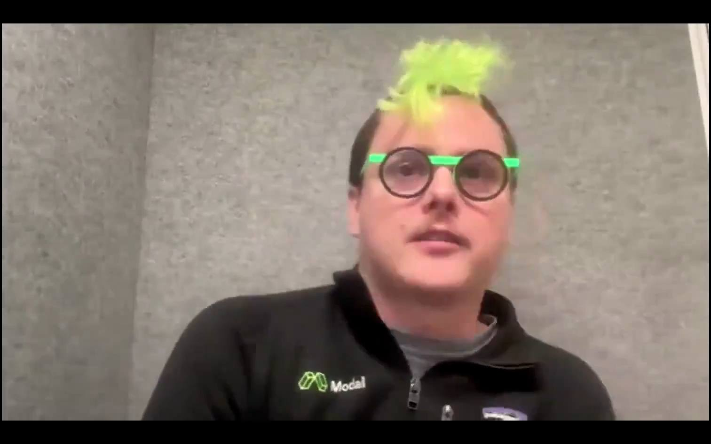
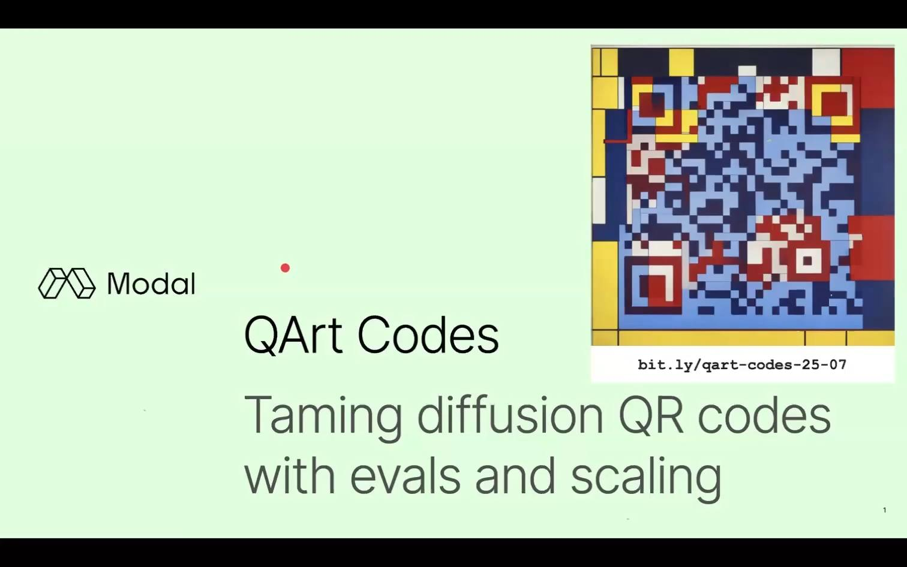
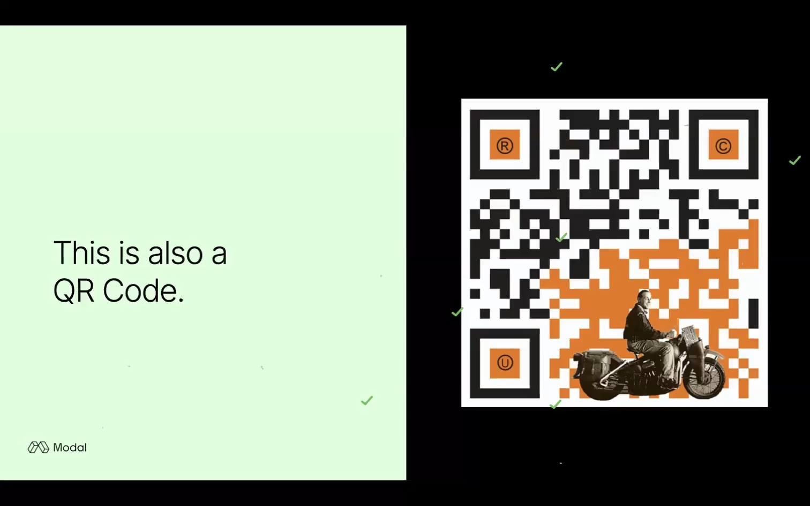
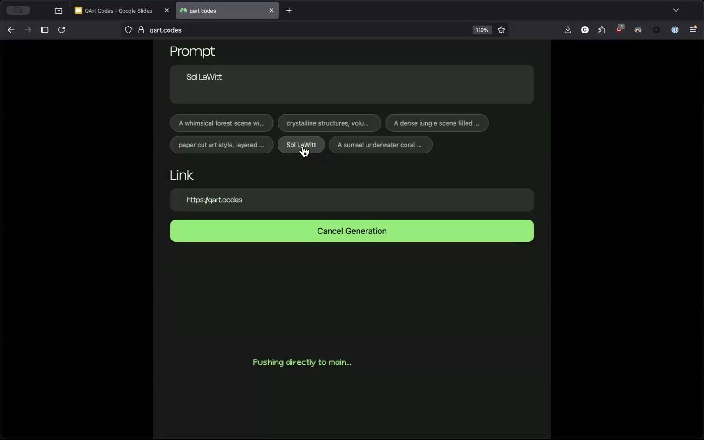
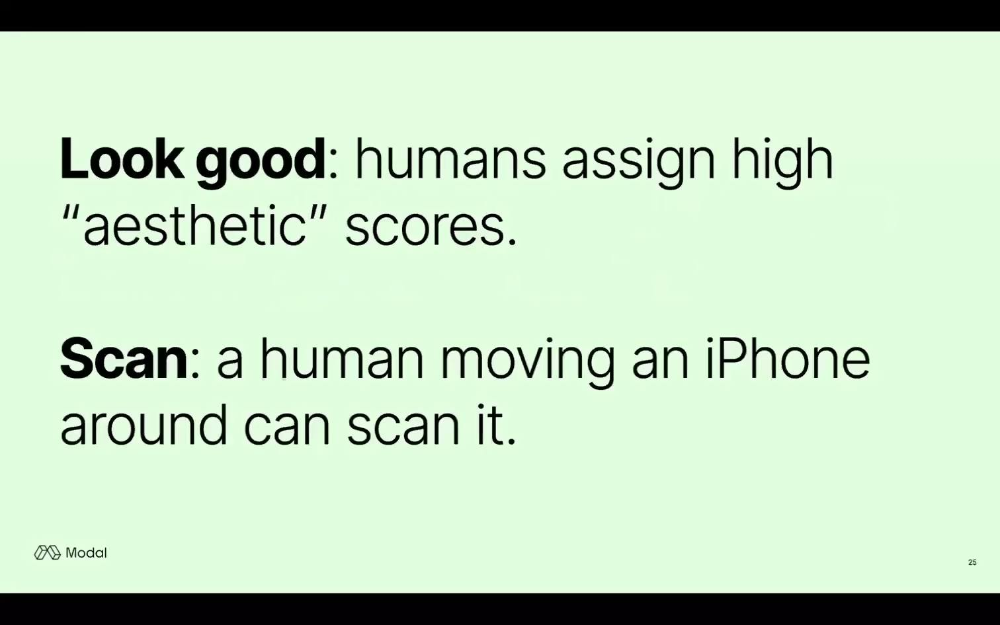
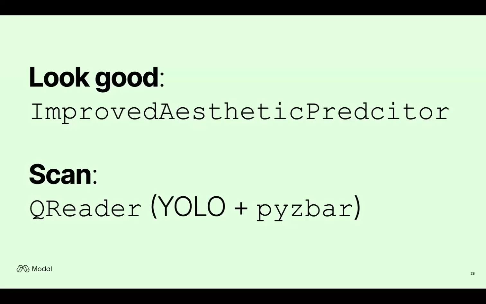
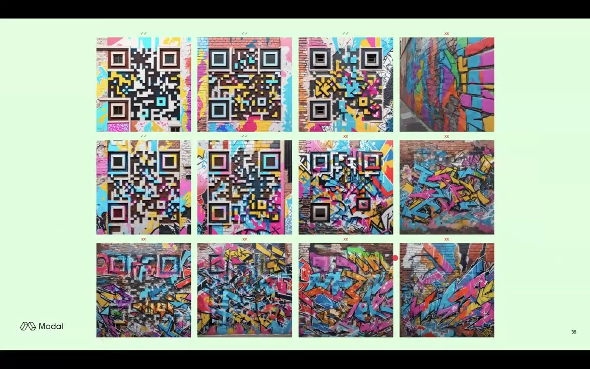
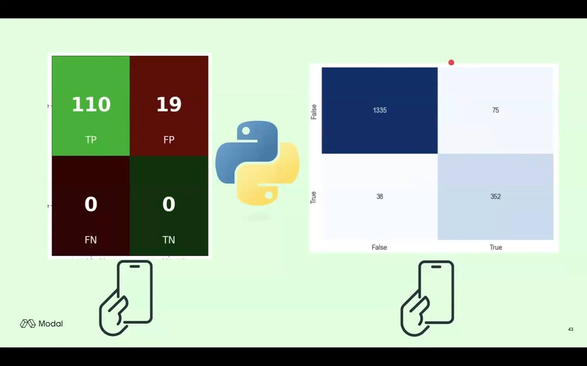
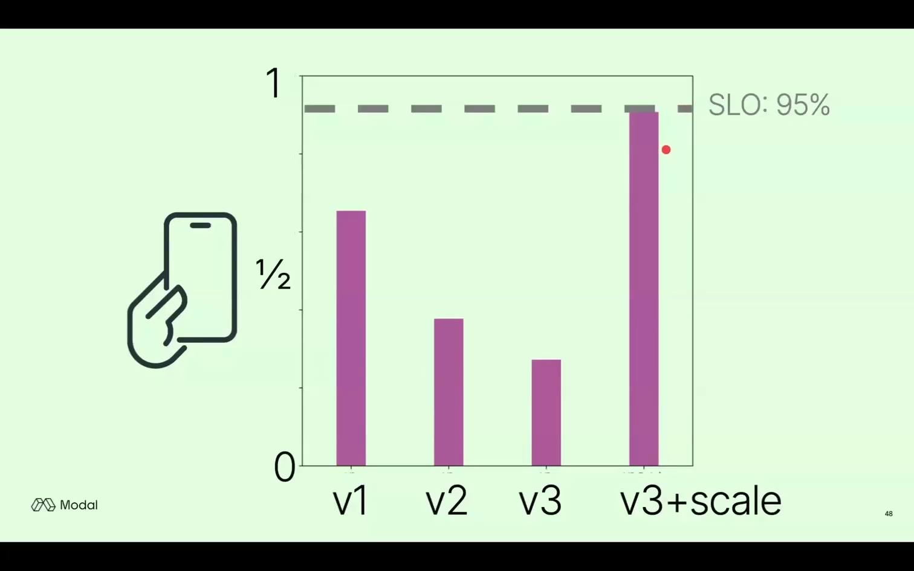

# AI Evals For Engineers & PMs —— 用评测驱动扩散模型生成可扫描艺术二维码（P007 复现文档）

> 本课是一门「评测方法论」课，讲师 Charles Fry（Modal）用一个真实项目——**用扩散模型生成既好看又能扫的艺术二维码（QART codes）**——来演示「如何把模糊的人类判断变成可自动化的评测，再用评测驱动推理时算力扩展（inference-time compute scaling）」。逐字稿里没有给出可直接运行的完整代码仓库，因此本文档第 4 节「完整代码」会按讲师描述的系统结构，给出**可直接保存运行的复现骨架**，并在每处标注「课里没讲」的部分，绝不把讲师没讲过的实现安到他头上。

---

## 1. 这一节做什么

这一节（P007）是一场约 45 分钟的分享 + Q&A。讲师 Charles Fry 来自 Modal（serverless GPU 平台），他讲的是自己做过的一个项目：**qr.codes**——输入一句提示词（比如「surreal underwater coral reef」「fireworks」），系统用扩散模型 + ControlNet 生成一批「长得像艺术画、但图案里藏着二维码明暗结构」的图片，然后**自动判断哪些能扫、哪些好看**，把最好的那张展示给用户。

这节课真正的主题不是扩散模型，而是**评测（evals）**。讲师反复强调的核心链路是：

1. 把「好看」「能扫」这种模糊的人类判断，先做一次**昂贵的、手工的操作化定义**（operationalization）；
2. 再把它**自动化**成机器可预测的指标（aesthetic predictor + QR 扫描器）；
3. 用这些自动化评测去**扫参数（sweep）**、**选参数**；
4. 最后把「能扫」这个又快又准的评测放进生产管线，做**推理时算力扩展**——一次生成多张，只要有一张能扫就展示，用算力换质量，直到命中 SLO（95% 可扫）。

对前端转 AI 应用工程师的读者来说，这一节的价值在于：**你会写 prompt、会调 API，但你怎么知道你的 Agent / 生成系统「变好了」？** 这节课给的就是那套「先人工标注一小批 → 训练/接入自动评测 → 用评测驱动迭代」的工程流程。它虽然讲的是图像，但方法论和 LLM Agent 评测完全同构。

---

## 2. 讲师原话

下面按主题摘录讲师的关键判断（逐字稿为英文，已翻译为中文；技术产品名保留英文）。

关于项目目标与「评测的通用性」：

> "这个项目用的是扩散模型而不是 LLM，但它恰恰说明了这些评测思路的通用性——它们适用于一般的机器学习系统，尤其是生成式 ML 系统。同样的基本思路都会出现，高层的经验教训都是一样的。"
> —— p007 [04:08]

关于「必须把感觉操作化」：

> "我们需要把『这个二维码能扫』和『这张图好看』这些事操作化。你不能只围着这些感觉去工程化——你可以一开始用眼睛看、用手机扫，但如果你想真正工程化一个东西，你就必须把它操作化。这是做东西的经典教训。"
> —— p007 [17:04]

关于「一个指标优化、一个指标设阈值」：

> "最好的做法，以我的经验，是挑一个你真正去优化的东西——你试着把这个数字做到尽可能大；然后再挑另一个，你对它设阈值。对我们来说，扫描是最容易设阈值的那个。"
> —— p007 [17:33]

关于 SLO 的算法：

> "扫描非常重要，它是我们要设定服务等级目标（SLO）的那个东西。我们最终定的是：你生成一个二维码，它有 95% 的概率真的能扫。因为这意味着如果你试两次，你只有 1/400 的概率失败。两分钟里 1/400，相当不错了。"
> —— p007 [18:03]

关于「先昂贵手工、再自动化」：

> "要把某件事操作化，我一般认为你先从一个非常昂贵、非常手工的定义开始，然后你想办法把它自动化。你可能一开始的定义里包含一个人类，很慢，你得等他们回邮件或回 Slack，要花他们一小时，但至少它把你关心的质量概念操作化了。"
> —— p007 [18:57]

关于两个评测的具体落地：

> "『好看』意味着人类会给它打一个很高的美学分——你让他们给这张图 1 到 10 打分，他们给个大数。『能扫』意味着一个真人拿着智能手机晃来晃去，能把屏幕上显示的这张图扫出来。"
> —— p007 [19:26]

> "美学这块，我们找到了 stable diffusion 社区出的那个 improved aesthetic predictor 模型。他们真的做了让人类看图打分、再训练模型的工作。基本上就是用一个 CLIP 做 embedding，然后在上面微调或训练一个小线性模型来预测人类美学分。扫描这块，我们落到了一个小 Python 包叫 Q reader，它用一个 YOLO 模型检测二维码，再用 PyZbar 这个二维码读取库，它还会做一堆事，比如放大缩小、模糊、改颜色——这些都是你手机也会做的事。"
> —— p007 [21:51]

关于「扫参数之前必须先亲手玩懂系统」：

> "但恰恰在这个点上，我们需要坐下来真正深入地理解这个系统。我和团队里一位 ML 工程师 Will Shane 坐下来，就玩这个东西玩了好几个小时。这个按钮是干嘛的？我改这个会怎样？……因为如果你想对参数做扫描，你就必须知道哪些参数重要。这对所有超参数扫描都成立：你得知道哪些参数重要、哪些应该一起变、哪些应该固定。"
> —— p007 [23:46]

关于「必须人工标注」：

> "现在我们需要把跑出来的所有结果，走一遍那个缓慢、昂贵的人工流程——标注数据，这样我们才能得出快速的自动评测。没人喜欢干这个。……Will 坐下来手工标了 1800 张从扫描里出来的图：这好看吗？这能扫吗？他搭了最简陋的实验装置，一个 Jupyter notebook，可以用上下左右键给四个标签之一。"
> —— p007 [26:59]

关于「别纠结小数点」：

> "过程中你可以犯错。如果你的结果取决于 0.1% 还是 1% 的误差，那你大概在解决错误的问题，那会让你的生活难很多。更重要的是让东西跑起来，然后一口气干完。"
> —— p007 [27:27]

关于那个「安静的 ML bug」：

> "结果发现我们的评测代码有个 bug。我们的评测代码在处理空字符串时出错了，处理一个 None 时出错了——那个 None 其实意味着『没扫出来』，但它却把它当成了正例。这是那种很烦人的 ML bug：系统不会崩，它只是给你垃圾数字。"
> —— p007 [30:17]

> "这就是你想看到的混淆矩阵：对角线很强，但四个象限里都有非零数字。"
> —— p007 [30:45]

关于推理时算力扩展：

> "现在我们可以做推理时算力扩展了，也就是说，往问题上砸更多 GPU，直到问题消失。我们信任这个扫描评测，它跑得又快，那我们就直接在生产里跑它，用它决定给用户看什么。"
> —— p007 [32:12]

> "如果你假设每次是独立的、有某个固定概率，你就会得到这种乘性的指数衰减。你从『三分之一的结果能扫』变成：如果我试两次，两次都扫不出来的概率是三分之二乘三分之二；如果我做 16 次，就是三分之二的 16 次方。你可以一直扩展，直到命中你的 SLO。"
> —— p007 [32:38]

关于成本与延迟的取舍：

> "做推理时算力扩展你唯一要担心的是成本和延迟。在小规模上做批处理没那么糟，所以我们做这个并没有承受太大的延迟损失。"
> —— p007 [34:28]

关于「什么时候该做评测」：

> "我觉得这个项目里我做了个错误决定：V1 我没做评测，那也没事，那是个 hack 项目，周日和 W&B 的朋友一起拼出来就上线了，跑得还行。……在那个头一两周搭评测会是个很大的分心。……我第二次迭代系统时（新模型出来、有些新 Modal 功能想试），那时候我真希望自己坐下来好好想想二维码、想想有哪些现成工具。……所以我觉得第二次迭代就是做这件事的正确时机。如果你回到这个项目、在做又一轮工作，那就是你写测试、写文档、把流程正式化的时候。评测就是其中经典的一项。"
> —— p007 [37:44]

关于「做评测的心理门槛」：

> "大概是一整个工作日，整整八个计费小时，来做那 1800 个标注。数据标注那部分——把你操作化但还有点模糊的人类定义变成数据集——是最磨人的，太枯燥了。但探索数据、框定问题、想出一个够用的计算机系统那部分，我觉得其实挺好玩。人们可能因为这两件事混在一起，就觉得整件事不好玩。……但就像锻炼和健康饮食，一旦你看到足够多的好处，你就会开始对它兴奋。"
> —— p007 [40:56]

---

## 3. 从零复现

这一节把讲师描述的流程拆成可执行的步骤。**注意：讲师没有给出完整仓库，下面每一步都标注了「课里讲了什么」和「课里没讲、需要你自己补什么」。** 第 4 节给出可运行的骨架代码。

### 步骤 0：环境与依赖

讲师提到的技术栈（逐字稿明确出现）：

- 扩散模型 + **ControlNet**（亮度/明暗引导），生产版 ControlNet「专门在二维码问题上训练过」；
- **improved aesthetic predictor**（stable diffusion 社区，CLIP embedding + 线性头）；
- **Q reader** Python 包（YOLO 检测 + **PyZbar** 解码 + 缩放/模糊/改色增强）；
- **Weights & Biases（weave）** 做实验记录与可视化；
- **Modal** serverless GPU 平台（B200 GPU，一次跑 32 个 generation，冷启动约 1 分钟）；
- 标注用 **Jupyter notebook**（上下左右键打 4 个标签）。

课里没讲：具体 Python 版本、各包精确版本号、扩散模型 checkpoint 名称。下面给一个**能跑通评测链路**的最小依赖集（评测部分是本课重点，生成部分用占位接口）。

```bash
# 建议 Python 3.10+
python -m venv .venv
source .venv/bin/activate      # Windows: .venv\Scripts\activate

pip install "qreader" "pyzbar" "opencv-python" "pillow" "numpy" "pandas" "tqdm"
# aesthetic predictor 依赖（CLIP + torch）
pip install "torch" "open_clip_torch"
# 实验记录（讲师用 W&B weave，可选）
pip install "wandb"
```

> 课里没讲：`qreader` 在部分系统上需要系统级 `zbar` 库（`apt install libzbar0` / `brew install zbar`）。这是 PyZbar 的常见坑，讲师没提，但你大概率会撞上。

### 步骤 1：把「能扫」操作化成可运行函数

讲师的定义链：**真人拿手机晃 → 屏幕上能扫出来**。自动化版本：用 Q reader（YOLO 检测 + PyZbar 解码 + 缩放/模糊/改色增强）来「模拟手机」。

关键工程点（讲师强调）：这个评测**跑得比模型推理还快**，所以可以放进生产管线。同时它必须**经过验证**——讲师用 1800 张人工标注图验证它「和真手机行为相似」。

### 步骤 2：把「好看」操作化成可运行函数

用 improved aesthetic predictor：CLIP embedding → 线性头 → 预测人类美学分。讲师明确说：**这个指标用来「选」，但不「深度信任」，所以不激进地优化它**——只用它从能扫的候选里挑最好看的那张。

### 步骤 3：人工标注一小批，验证评测

- 从参数扫描里抽 **1800 张**图；
- 人工打 4 类标签（好看/不好看 × 能扫/不能扫，对应混淆矩阵四象限）；
- 用混淆矩阵检查评测器：**对角线要强，四象限都要非零**；
- 讲师在这里踩了坑：评测代码把 `None`（没扫出来）当成正例，导致「从来没有负例」——看到「零负例」就该警觉。

### 步骤 4：参数扫描（sweep）

讲师把 ControlNet 的两个关键参数类比成「烤面包」：**火多大（guidance 强度）× 烤多久（ControlNet 运行时长）**。扫这两个参数的网格，画出 toast plot：左上角 guidance 太强太久 → 二维码清晰但难看；右下角没开 ControlNet → 没有二维码；**对角线中段**才是「二维码和 prompt 有意义融合」的甜区。

课里没讲：这两个参数在代码里的确切变量名和取值范围。下面骨架用 `controlnet_conditioning_scale` 和 `control_guidance_end` 作为占位（这是 ControlNet 的通用参数名，**非讲师原话**，请按你实际用的模型 API 调整）。

### 步骤 5：推理时算力扩展（inference-time compute scaling）

核心公式（讲师原话推导）：若单张可扫概率为 `p`，生成 `n` 张，则**至少一张可扫**的概率为：

```
P(至少一张可扫) = 1 - (1 - p)^n
```

讲师举例：`p = 1/3` 时，`n=2` 失败率 `(2/3)^2`，`n=16` 失败率 `(2/3)^16`。生产上他们最终选 **n=8**（而不是 32）就命中了 95% SLO，以控制成本和延迟。

### 步骤 6：上线 + 用户教育

- 一次生成 8 张 → 用扫描评测过滤 → 用美学评测排序 → 展示最佳 + 其余排名；
- 用 LLM 生成一批示例 prompt 随机展示给用户（讲师说「有些很 boomer prompty，有些是逗号分隔的老派 stable diffusion 风格，有些就一个词加个艺术家名」）；
- 讲师提到更好的做法是「用 LLM 帮用户改写 prompt」，但当时用的是「用户教育 + 示例 prompt」。

---

## 4. 完整代码

> **重要声明**：逐字稿与截图 OCR 均**没有**给出可运行的完整源码（本段 OCR 为空）。以下代码是**按讲师描述的系统结构复现的骨架**，评测部分（扫描器、美学分、混淆矩阵、算力扩展公式）是可运行的；生成部分因为课里没给模型 checkpoint 和 API，用**占位函数**表示，并明确标注。请勿把占位参数名当成讲师原话。

### 4.1 目录结构

```
qr-evals/
├── requirements.txt
├── scan_eval.py          # 「能扫」评测器（Q reader + PyZbar）
├── aesthetic_eval.py     # 「好看」评测器（CLIP + 线性头）
├── confusion.py          # 混淆矩阵验证（抓 None bug）
├── scaling.py            # 推理时算力扩展公式
├── pipeline.py           # 生产管线：生成 N 张 → 过滤 → 排序
└── label_tool.py         # 极简标注工具（Jupyter 里上下左右打标签）
```

### 4.2 `requirements.txt`

```text
qreader>=3.3
pyzbar>=0.1.9
opencv-python>=4.8
pillow>=10.0
numpy>=1.24
pandas>=2.0
tqdm>=4.66
torch>=2.1
open_clip_torch>=2.24
wandb>=0.16
```

### 4.3 `scan_eval.py` —— 「能扫」评测器

```python
"""
scan_eval.py
把「真人拿手机晃能扫出来」操作化成机器可预测的布尔值。
课里讲师用的就是 Q reader（YOLO 检测 + PyZbar 解码 + 缩放/模糊/改色增强）。
"""
from __future__ import annotations
import cv2
import numpy as np
from qreader import QReader

# QReader 内部用 YOLO 检测二维码，再交给 PyZbar 解码
_qreader = QReader()


def can_scan(image_path: str) -> bool:
    """
    返回 True 表示这张图能被扫出来。
    关键：解码失败时 QReader 返回空列表 / None，
    必须显式判空——这正是讲师踩过的 None bug 的源头。
    """
    img = cv2.imread(image_path)
    if img is None:
        # 读图失败，视为不可扫（不要静默当成 True！）
        return False

    # detect_and_decode 返回 [(decoded_text, (x1,y1,x2,y2)), ...]
    results = _qreader.detect_and_decode(image=img)

    # 讲师 bug 复现点：results 可能是 [None] 或 []，
    # 早期代码把 None 当成了「扫出来了」。
    if not results:
        return False
    # 过滤掉 None，只要有任意一个非空解码结果就算能扫
    decoded = [r for r in results if r]
    return len(decoded) > 0


def scan_probability(image_paths: list[str]) -> float:
    """一批图里能扫的比例，用于统计基线。"""
    if not image_paths:
        return 0.0
    hits = sum(can_scan(p) for p in image_paths)
    return hits / len(image_paths)
```

### 4.4 `aesthetic_eval.py` —— 「好看」评测器

```python
"""
aesthetic_eval.py
improved aesthetic predictor：CLIP embedding + 线性头，预测人类美学分。
课里没给具体权重文件；下面用 open_clip 的 ViT-L/14 做 embedding，
线性头权重需你自行加载（课里没讲权重来源）。
"""
from __future__ import annotations
import torch
import open_clip
from PIL import Image

_device = "cuda" if torch.cuda.is_available() else "cpu"

# 课里没讲具体 CLIP 变体，这里用社区常用的 ViT-L/14
_clip_model, _, _preprocess = open_clip.create_model_and_transforms(
    "ViT-L-14", pretrained="openai"
)
_clip_model = _clip_model.to(_device).eval()

# 课里没讲线性头权重路径，占位：真实使用时替换为 aesthetic predictor 的 .pth
_LINEAR_HEAD_PATH = "aesthetic_head.pth"


def _load_head():
    import os
    if not os.path.exists(_LINEAR_HEAD_PATH):
        # 没有权重时返回 None，调用方需处理
        return None
    head = torch.nn.Linear(768, 1)  # ViT-L/14 的 embedding 维度
    head.load_state_dict(torch.load(_LINEAR_HEAD_PATH, map_location=_device))
    return head.to(_device).eval()


_head = _load_head()


@torch.no_grad()
def aesthetic_score(image_path: str) -> float:
    """返回预测的人类美学分（越高越好看）。无权重时返回 0.0 并告警。"""
    if _head is None:
        print("[warn] 未找到 aesthetic_head.pth，返回 0.0（课里没讲权重来源）")
        return 0.0
    img = _preprocess(Image.open(image_path).convert("RGB")).unsqueeze(0).to(_device)
    emb = _clip_model.encode_image(img)
    emb = emb / emb.norm(dim=-1, keepdim=True)
    score = _head(emb.float()).item()
    return score
```

### 4.5 `confusion.py` —— 混淆矩阵验证（抓 None bug）

```python
"""
confusion.py
用人工标注（1800 张）验证扫描评测器。
讲师强调：对角线要强，四象限都要非零；出现「零负例」必是 bug。
"""
from __future__ import annotations
import pandas as pd
from sklearn.metrics import confusion_matrix
from scan_eval import can_scan


def build_confusion(labels_csv: str) -> pd.DataFrame:
    """
    labels_csv 列：image_path, human_scan (0/1)
    human_scan 是人工标注的「真人能不能扫」。
    """
    df = pd.read_csv(labels_csv)
    df["machine_scan"] = df["image_path"].apply(lambda p: int(can_scan(p)))

    cm = confusion_matrix(df["human_scan"], df["machine_scan"], labels=[0, 1])
    out = pd.DataFrame(
        cm,
        index=["human: 不能扫", "human: 能扫"],
        columns=["machine: 不能扫", "machine: 能扫"],
    )
    # 讲师警报：如果某一整列/整行全 0，说明评测器坏了
    if (cm == 0).all(axis=0).any() or (cm == 0).all(axis=1).any():
        print("[ALERT] 混淆矩阵出现全零行/列——很可能把 None 当成了正例！")
    return out


if __name__ == "__main__":
    print(build_confusion("labels.csv"))
```

### 4.6 `scaling.py` —— 推理时算力扩展

```python
"""
scaling.py
讲师推导：P(至少一张可扫) = 1 - (1 - p)^n
生产上他们选 n=8 命中 95% SLO。
"""


def prob_at_least_one(p_single: float, n: int) -> float:
    """单张可扫概率 p_single，生成 n 张，至少一张可扫的概率。"""
    if not (0.0 <= p_single <= 1.0):
        raise ValueError("p_single 必须在 [0,1]")
    return 1.0 - (1.0 - p_single) ** n


def min_n_for_slo(p_single: float, slo: float = 0.95, cap: int = 64) -> int:
    """给定单张概率和 SLO，求最少需要生成几张。"""
    for n in range(1, cap + 1):
        if prob_at_least_one(p_single, n) >= slo:
            return n
    return cap


if __name__ == "__main__":
    # 讲师举例：p=1/3
    p = 1 / 3
    for n in (1, 2, 8, 16, 32):
        print(f"n={n:2d}  P(至少一张可扫)={prob_at_least_one(p, n):.4f}")
    print("命中 95% 所需最少张数:", min_n_for_slo(p, 0.95))
```

### 4.7 `pipeline.py` —— 生产管线

```python
"""
pipeline.py
生成 N 张 → 扫描评测过滤 → 美学评测排序 → 返回最佳 + 其余排名。
生成函数是占位：课里没给模型 API / checkpoint。
"""
from __future__ import annotations
from scan_eval import can_scan
from aesthetic_eval import aesthetic_score
from scaling import min_n_for_slo


def generate_images(prompt: str, n: int) -> list[str]:
    """
    占位：调用你的扩散模型 + ControlNet 生成 n 张图，返回文件路径列表。
    课里没讲具体模型与 API；讲师提到生产 ControlNet 专门在二维码上训练过。
    """
    raise NotImplementedError("接入你的扩散模型 + ControlNet 生成实现")


def run(prompt: str, p_single_estimate: float = 1 / 3, slo: float = 0.95):
    n = min_n_for_slo(p_single_estimate, slo)  # 讲师生产上落在 8
    paths = generate_images(prompt, n)

    scannable = [p for p in paths if can_scan(p)]
    if not scannable:
        return {"best": None, "ranked": [], "n_generated": n}

    ranked = sorted(scannable, key=aesthetic_score, reverse=True)
    return {"best": ranked[0], "ranked": ranked, "n_generated": n}
```

### 4.8 `label_tool.py` —— 极简标注工具

```python
"""
label_tool.py
讲师用 Jupyter notebook + 上下左右键打 4 个标签。
这里用 OpenCV 窗口模拟：按 1/2/3/4 打标签，q 退出。
"""
import cv2
import csv
import os

LABELS = {ord("1"): "good_scan", ord("2"): "good_noscan",
          ord("3"): "bad_scan", ord("4"): "bad_noscan"}


def label_folder(folder: str, out_csv: str = "labels.csv"):
    files = sorted(f for f in os.listdir(folder) if f.lower().endswith((".png", ".jpg")))
    with open(out_csv, "w", newline="") as f:
        w = csv.writer(f)
        w.writerow(["image_path", "label"])
        for name in files:
            img = cv2.imread(os.path.join(folder, name))
            cv2.imshow("label (1-4, q=quit)", img)
            key = cv2.waitKey(0) & 0xFF
            if key == ord("q"):
                break
            if key in LABELS:
                w.writerow([os.path.join(folder, name), LABELS[key]])
    cv2.destroyAllWindows()


if __name__ == "__main__":
    label_folder("sweep_outputs")
```

---

## 5. 逐行解释

**`scan_eval.py` 的 `can_scan`**：这是整节课的枢纽。讲师说「扫描评测跑得比模型推理还快」，所以它能进生产管线。`detect_and_decode` 返回的列表里可能含 `None`（YOLO 检测到框但 PyZbar 解不出码），**必须显式过滤**。讲师的原 bug 就是「处理 None 时把它当成了正例」，导致混淆矩阵「从来没有负例」。代码里 `if not results: return False` 和 `[r for r in results if r]` 两处都是在堵这个洞。在 JS/Node 里，这等价于 `array.filter(Boolean)`——但注意 `0` 和 `""` 也会被 `Boolean` 过滤掉，Python 里 `None` 和空串都是 falsy，语义要小心对齐。

**`aesthetic_eval.py`**：讲师说美学模型是「CLIP embedding + 线性头」，所以代码先 `encode_image` 再归一化，过线性头。**关键判断**：讲师明确说「这个指标我们用来选，但不深度信任，所以不激进优化」。这对应代码里 `aesthetic_score` 只用于 `sorted(..., reverse=True)` 排序，**不参与参数选择的目标函数**。如果你把它当成主优化目标，就会像讲师说的「premature optimization」——生成一堆美学分高但扫不出来的图。

**`confusion.py`**：讲师的原话是「对角线很强，但四个象限都有非零数字」。代码里 `if (cm == 0).all(axis=0).any()` 就是在检测「某一列全零」——这正是他那个 bug 的表征。**为什么四象限都要非零**：如果「machine: 不能扫」那一列全零，说明评测器永远说「能扫」，它就没有区分能力，后面的算力扩展全是自欺欺人。

**`scaling.py`**：`1 - (1-p)^n` 是独立重复试验的补集。讲师用 `p=1/3` 举例：`n=2` 失败率 `(2/3)^2≈0.44`，`n=16` 失败率 `(2/3)^16≈0.0015`。代码里 `min_n_for_slo` 反解 n。**为什么生产选 8 不选 32**：讲师说「唯一要担心的是成本和延迟」，8 张已经命中 95%，32 张是浪费。在 Node 里这就是 `Promise.all` 并发 8 个生成请求再 `filter`——但要注意 GPU 批处理和小规模并发的区别，讲师说「小规模批处理没那么糟」。

**`pipeline.py`**：顺序是「生成 N → 扫描过滤 → 美学排序」。**先过滤再排序**很重要：美学分只在能扫的候选里比较，避免「好看但扫不出来」的图污染排名。`generate_images` 是占位，因为课里没给模型 API——讲师只说了「生产 ControlNet 专门在二维码上训练过」。

**`label_tool.py`**：讲师说 Will「用上下左右键给四个标签之一」，代码用 1/2/3/4 模拟。**为什么用最简陋的工具**：讲师原话「让东西跑起来，然后一口气干完」，1800 张标注是一整个工作日，工具越简单越不容易在工具本身上浪费时间。

---

## 6. 复现检查清单

- [ ] Python 3.10+ 虚拟环境建好，`pip install -r requirements.txt` 无报错
- [ ] 系统级 `zbar` 库已装（`libzbar0` / `brew install zbar`），否则 `pyzbar` 导入失败
- [ ] `scan_eval.can_scan` 对一张已知能扫的二维码返回 `True`，对一张纯噪声图返回 `False`
- [ ] **故意传一张解码失败的图，确认返回 `False` 而不是 `True`**（复现讲师的 None bug 防御）
- [ ] `aesthetic_eval` 能加载 CLIP；无线性头权重时打印告警而非崩溃
- [ ] 用 ≥50 张人工标注图跑 `confusion.py`，确认**四象限都有非零数字**
- [ ] `scaling.py` 对 `p=1/3` 打印出 `n=8` 时概率 ≥0.95
- [ ] `pipeline.py` 的 `generate_images` 已接入你的模型（或先用本地图片列表 mock）
- [ ] 生产管线先过滤后排序，顺序不能反
- [ ] 记录一次完整实验到 W&B（可选，讲师用 weave）

---

## 7. 课里没讲但你会撞上的

1. **`qreader` 的系统依赖**：PyZbar 依赖系统 `zbar` 动态库，Docker 里要 `apt install libzbar0`。讲师没提，但这是最高频的安装失败点。
2. **aesthetic predictor 权重来源**：讲师只说「stable diffusion 社区出的 improved aesthetic predictor」，没给下载地址和线性头维度。你需要自己找社区权重，并确认 CLIP 变体（ViT-L/14 是 768 维，换模型维度要改）。
3. **ControlNet 参数名**：讲师用「火多大 / 烤多久」比喻，没给代码变量名。骨架里的 `controlnet_conditioning_scale` / `control_guidance_end` 是通用名，**不是讲师原话**，请按你用的 diffusers / 模型 API 核对。
4. **`None` vs 空串 vs 空列表**：Python 里三者都 falsy，但语义不同。讲师 bug 是「None 被当正例」，你的代码要区分「没检测到框」和「检测到但解不出」。
5. **推理时算力扩展的成本模型**：讲师说「小规模批处理没那么糟」，但没给具体延迟数字。B200 上一次 32 张冷启动约 1 分钟（讲师口述），8 张的延迟要你自己压测。
6. **95% SLO 的统计口径**：「试两次 1/400 失败」是假设独立同分布。真实系统里同一 prompt 的多次生成可能相关（同一 ControlNet 参数），独立性假设会高估成功率——讲师没展开，但工程上要留意。
7. **前端视角的对应**：这套「人工标注 → 自动评测 → 算力扩展」在 Agent 里就是「人工标 200 条 trace → LLM-as-judge 打分 → 多次采样取最优」。`can_scan` 对应你的「工具调用是否成功」硬校验，`aesthetic_score` 对应「回答质量」软评分——**硬的设阈值，软的做排序**，这是讲师反复强调的分工。

---

















