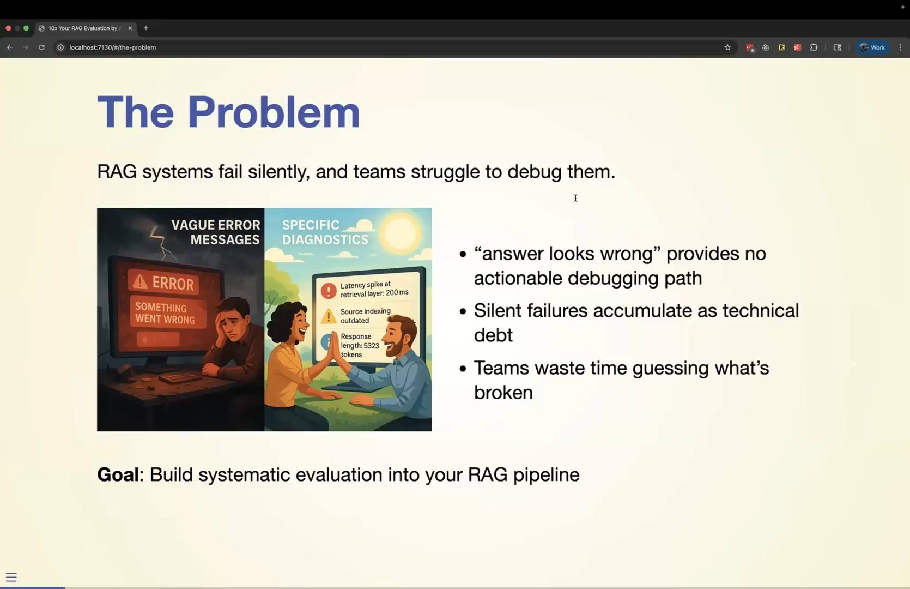
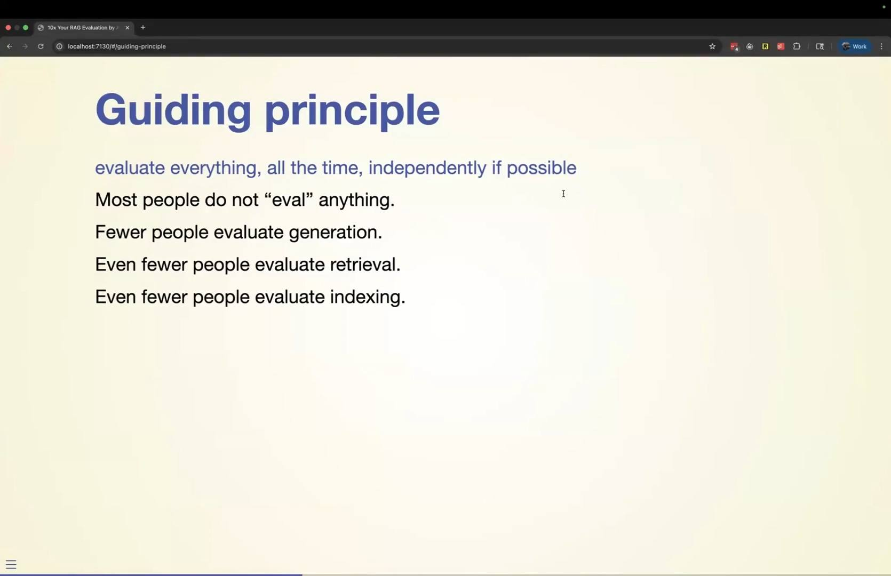
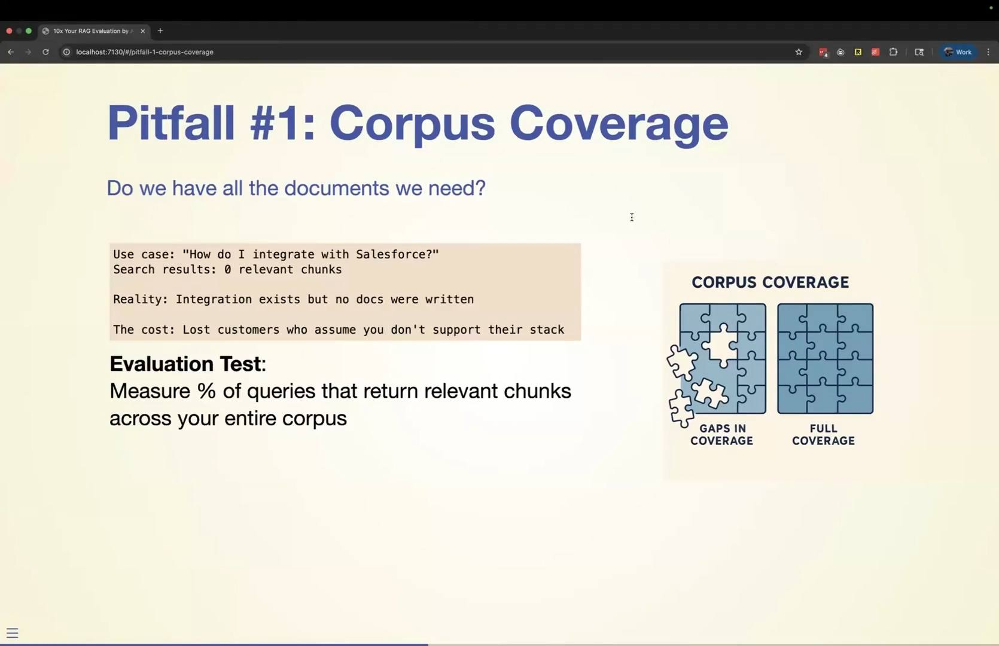
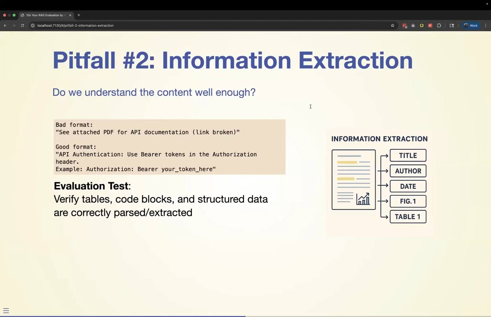
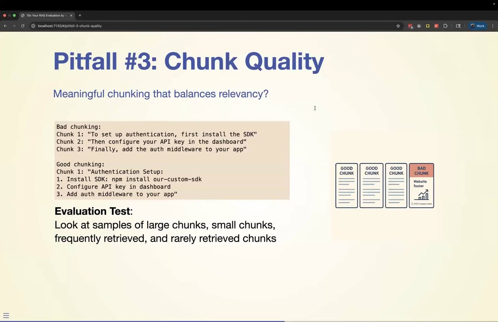
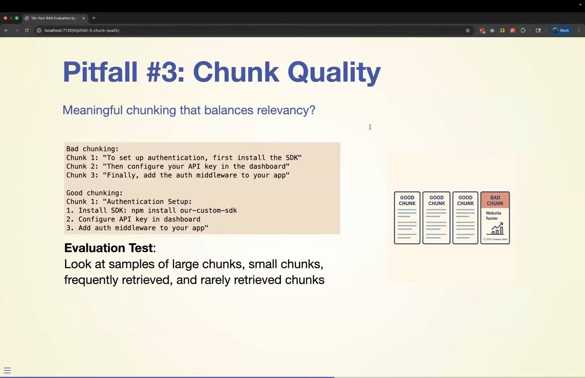
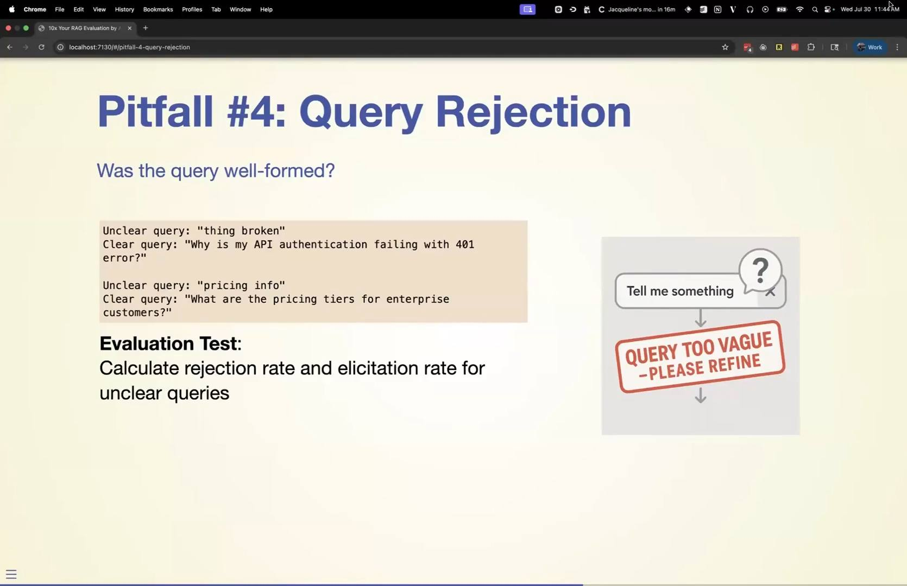
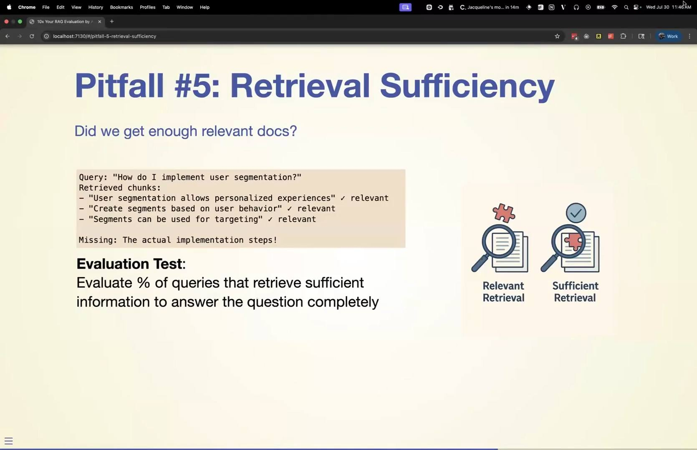
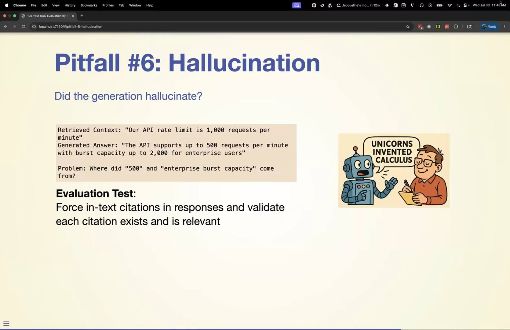
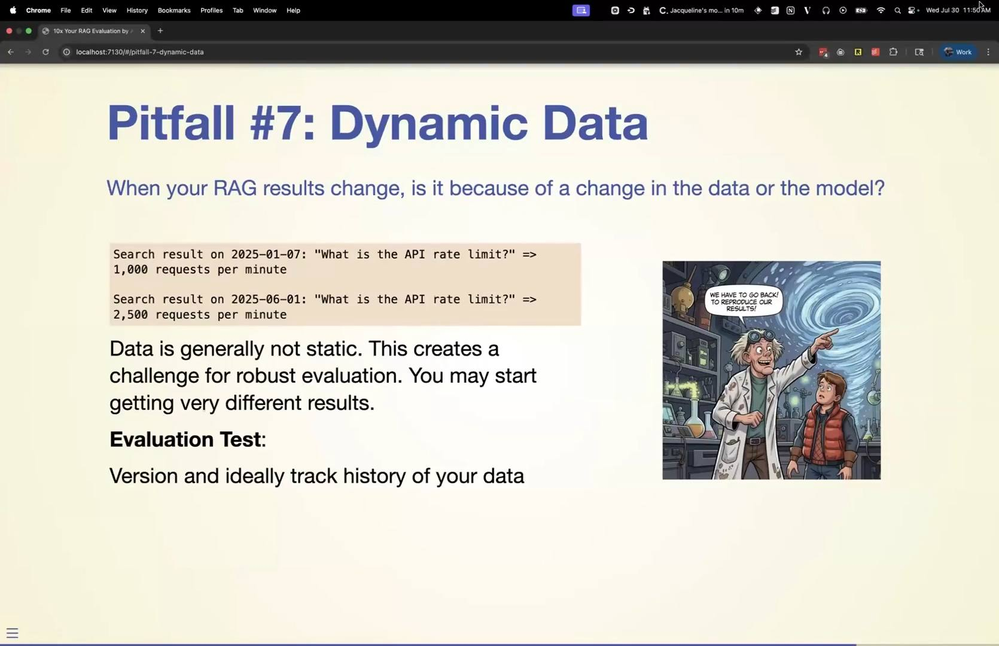

# AI Evals For Engineers & PMs（Agent 评测）P008 复现文档：RAG 系统的七类评测陷阱与可执行评估方案

> 文档范围：仅覆盖 P008。P008 是一场以讲解为主的分享，主题是 RAG 系统评测中的常见陷阱；逐字稿里没有代码、命令、依赖安装、环境变量或启动命令，截图清单也没有 OCR 结果。因此本文不会虚构一个“能启动的代码仓库”，而是把讲师给出的判断落成一套**可以直接照着执行的 RAG 评测流程、数据表和标注规范**。本文中的表名、字段名是复现用草案，不是讲师逐字稿或 OCR 里出现的原始字段。


## 1. 这一节做什么

这一节要解决的问题不是“再搭一个 RAG Demo”，而是：**当 RAG 系统没有报 500、没有明显崩溃，却给出了错误答案时，工程师和产品经理如何定位问题、如何建立可持续的评测。**

讲师开场就指出，AI 系统、包括 RAG 系统，常常是“静默失败”的：答案看起来不对，但系统不会告诉你哪里坏了。长期累积后，这些静默失败会变成技术债，团队会花大量时间猜“到底哪里坏了”。因此本节要复现的是一套评测工作流：

1. 先看整体系统是否解决了核心问题；
2. 通过错误分析找出最严重的子组件；
3. 分别评估索引、检索、生成等阶段；
4. 用代表性查询、模糊查询、文档缺口、分块、引用验证和数据版本记录，把“感觉不对”变成可追踪的证据；
5. 再迭代下一轮评测，而不是一开始就把所有指标全部铺开。

本节的最终产物是一份“RAG 评测工作簿”和一套评估规范，包括：文档清单、查询集、抽取审计、分块审计、查询拒绝/追问记录、检索充分性标注、引用验证、索引版本记录。它对应的不是某个具体框架，而是讲师反复强调的原则：**看你自己的数据，尽可能一直评估所有东西，并且尽可能独立评估。**



需要特别说明：这门课标题中有“Agent 评测”，但 P008 这一节实际聚焦的是 **RAG 系统评测**。关于 Agent 的工具调用、多步规划、多智能体协作如何评测，课里没讲。本文不会把没有出现过的 Agent 评测框架安到讲师头上。

## 2. 讲师原话

以下引用均来自 P008 逐字稿，已将英文原话翻译为中文；技术产品名保留英文。

> "AI 系统，包括 RAG 系统，常常是静默失败的。你看到的不是服务器返回 500，而是更微妙的问题。答案可能看起来不对，但这并不够可操作，它不会告诉你该看哪里、该修什么。"
> —— p008 [02:48]

> "如果你从这场分享里什么都不带走，我只希望你记住一件事：看你的数据。"
> —— p008 [04:15]

> "在所有陷阱背后，真正的指导原则是：尽可能一直评估所有东西，并且如果可能的话，独立评估。"
> —— p008 [04:15]

> "大多数人什么都不评估。更少的人评估 RAG 系统里的生成阶段。更少的人评估检索。更少的人评估索引。"
> —— p008 [04:43]

> "一个很多人没有问自己的关键问题是：我们有需要的文档吗？"
> —— p008 [05:39]

> "我很少看到有人评估索引侧是否正确。"
> —— p008 [08:59]

> "很多 RAG 系统高度过度分块，块非常小。"
> —— p008 [09:55]

> "看你的分块。分块质量常常非常可疑。"
> —— p008 [12:15]

> "用户会问一些从用户角度看有点懒的问题……比如‘东西坏了’。"
> —— p008 [12:44]

> "我不在乎我的 NDCG 是否高于某个数。那很难和最终用户价值连接起来。"
> —— p008 [14:42]

> "在所有相关文档中，我们有足够的信息回答查询吗？"
> —— p008 [16:09]

> "我很喜欢强制在回答里做文内引用，然后做两个验证。"
> —— p008 [17:52]

> "检索组件经常依赖某个非静态的外部数据源。"
> —— p008 [18:46]

> "最难的事情之一是组件太多，今天感觉能用，明天感觉不能用。如果你不知道到底什么变了，你可能会追很久的鬼。"
> —— p008 [19:42]

> "先评估整个系统，通过错误分析找出哪个子组件造成最多问题，再围绕它建立评估，继续错误分析，循环下去。"
> —— p008 [26:18]

> "BM25 加上简单的嵌入检索已经做得很好。"
> —— p008 [27:16]

讲师还提到自己的背景：曾在 LinkedIn 参与创建 AI Academy，帮助工程师学习 AI；也做过 Google 相关 AI 工作，目前做独立顾问，帮助公司构建 AI 产品。这些是背景信息，不影响本节复现。真正要复现的是他对 RAG 评测的判断和操作顺序。

## 3. 从零复现

### 3.1 需求：先明确复现什么

本节要复现的不是“某个开源 RAG 项目”，而是一个**能落地的 RAG 评测流程**。你应当选定一个真实的 RAG 场景，例如开发者文档客服、内部知识库问答、产品帮助中心问答，然后准备以下输入：

- 一份真实的文档语料：PDF、网页、Markdown、帮助文档均可；
- 一组真实用户会问的查询；
- 一个当前可运行的 RAG 系统，或者至少能拿到它的检索结果和生成结果；
- 一个可以记录标注结果的表格或数据库。

复现的最终判断标准不是“代码跑起来了”，而是：

1. 你能说清楚哪些查询没有可用文档；
2. 你能说清楚 PDF/网页转文本时有没有抽取错误；
3. 你能看到最大、最小、页脚、步骤被切碎的分块；
4. 你能判断哪些查询应该被拒绝或追问；
5. 你能看着检索到的前 10 个文档回答“这些材料够不够回答问题”；
6. 你能验证回答中的引用是否存在、是否真的支持当前语境；
7. 你能追溯某次评测使用了哪一版索引和数据。

关于工程环境，必须明确：**P008 没有给出目录结构、依赖版本、环境变量名、启动命令，也没有 OCR 出来的配置。** 因此本复现不提供也不虚构这些内容。下表把“课程是否给出”写清楚：

| 项目 | P008 是否给出 | 本文处理方式 |
|---|---|---|
| 代码仓库 | 没有 | 不虚构；用评估表和标注流程复现 |
| 目录结构 | 没有 | 不提供假目录 |
| 依赖版本 | 没有 | 不安装不存在的包 |
| 环境变量 | 没有 | 不编造变量名 |
| 启动命令 | 没有 | 不写假命令 |
| 截图 OCR | 没有 | 第 4 节不冒充 OCR 代码 |

如果你后续要把它工程化，应该另找实现资料；本文只保证评测思路、指标定义、数据表和执行顺序可复现。

### 3.2 约束：为什么不能只做一个“总分”

讲师给出的约束非常明确：

1. **失败是静默的。** 没有 500，没有明显异常，只有“答案看起来不对”。所以不能只监控服务是否存活。
2. **组件太多。** 索引、抽取、分块、检索、生成、外部数据源都可能变化。今天能用、明天不能用时，必须知道是哪一层变了。
3. **索引阶段本身可能包含 AI。** PDF 转 Markdown、表格抽取、图片处理可能由模型完成，模型可能抽出奇怪内容。
4. **分块默认值经常不可靠。** 很多系统是 Claude Code、Cursor 之类工具直接生成的，默认分块可能沿用“8K 上下文时代”的思路，切得非常碎。
5. **用户查询不一定良构。** 用户可能只输入“东西坏了”这种关键词，系统如果直接回答，容易进入“答非所问—用户沮丧—继续追问”的坏循环。
6. **经典检索指标不够。** NDCG、相关性精度可以看，但它们不直接回答“这些文档够不够回答问题”。
7. **没有足够文档时，RAG 管道后面做什么都没用。** 文档不存在，系统只能不回答或者幻觉。
8. **一开始不要煮沸海洋。** 不要第一天就为所有组件建全套评测；先评估整个系统，再用错误分析定位最痛的点。

### 3.3 估算：把“感觉”变成可计算的比例

讲师没有给固定阈值，也没有给样本量。他给的是测量思路。复现时先定义下面这些比例；**具体通过阈值必须由你的业务和标注结果决定，课里没讲固定数字，不要拍脑袋写“必须 90%”。**

| 指标 | 复现用定义 | 用途 |
|---|---|---|
| 语料覆盖度 | 至少检索到一个相关分块的查询数 ÷ 总查询数 | 判断是不是缺文档，或索引没收录 |
| 前 10 个文档的相关性精度 | 前 10 个文档中真正相关的文档数 ÷ 10 | 讲师提到的 `precision of relevance`，有用但不能代替充分性 |
| 检索充分性 | 只看检索到的文档即可回答的查询数 ÷ 已标注查询数 | 判断“有相关资料”是否等于“足够回答” |
| 查询拒绝/追问正确率 | 被正确拒绝或正确追问的模糊查询数 ÷ 模糊查询总数 | 判断系统是否识别不良查询 |
| 引用存在率 | 引用确实存在的回答数 ÷ 带引用的回答数 | 验证是否伪造引用 |
| 引用语境相关性 | 引用确实支持当前句子的回答数 ÷ 引用存在的回答数 | 验证引用是否被错误使用 |
| 分块检索频率 | 某个分块被检索到的次数 ÷ 查询总数 | 找出从不被检索、或被 80% 查询检索的分块 |
| 版本可复现性 | 用同一索引版本重跑后结果可解释的次数 ÷ 重跑次数 | 判断数据变化是否导致评测漂移 |

注意：`NDCG` 在课程中被提到，但讲师没有展开公式；本文不擅自补公式。分块检索频率里的“80%”是讲师举的真实案例，不是统一阈值。

### 3.4 方案：按顺序执行

#### 第 1 步：选定核心问题和真实语料

先问：“这个 RAG 系统要解决的核心问题是什么？”不要先问“我要接哪个向量库”。讲师在 Q&A 里明确建议：先评估你试图解决的 overarching problem，也就是整体问题，然后逐步评估组件。

把语料列成清单：文档标题、来源、格式、最后修改时间、是否包含表格/代码/图片。开发者产品客服的例子中，用户会问“如何集成 Salesforce”，但帮助文档里根本没有写这个集成。**文档不存在时，任何 RAG 技巧都救不了。** 这就是语料覆盖度问题。



#### 第 2 步：建立代表性查询集

你需要一组能代表真实用户意图的查询，而不是只挑几个自己觉得好回答的问题。查询集至少包含三类：

- 代表性查询：真实用户最常问的问题；
- 模糊/歧义查询：例如“东西坏了”“这个怎么弄”；
- 文档缺口查询：你知道语料里可能没有答案的问题，用来测试系统会不会硬答。

然后测量：多少查询至少返回了一个相关分块。注意，是**相关分块**，不是任意分块。如果很大一部分查询从来没有返回相关分块，优先怀疑两件事：索引有问题，或者文档根本没有。



#### 第 3 步：先跑整体系统，做错误分析

不要一开始就给每个组件写完美评测。先拿查询集跑完整 RAG，记录每次的回答、检索结果、引用、失败表现。然后逐条判断：这次失败主要出在文档缺失、抽取错误、分块错误、查询本身不清、检索不充分、引用不实，还是生成阶段没有用好材料。

这一步的输出是“错误分析表”，不是“总分”。总分告诉你变差了，错误分析告诉你为什么变差。

#### 第 4 步：评估语料覆盖度

对每个查询，检查检索结果中是否存在至少一个真正相关的分块。计算覆盖度。对于完全没有相关分块的查询，继续追问：

- 是文档没写？
- 是文档写了但没被索引？
- 是抽取失败？
- 是分块切坏了？
- 是检索没召回？

如果确认文档不存在，结论就是“不回答或明确告知没有资料”，而不是让模型自由发挥。讲师的原话很重：**如果文档不能回答问题，RAG 管道的其余部分并不重要。**

#### 第 5 步：评估信息抽取

PDF 比很多人想象得复杂。讲师举了一个很夸张的例子：有人在 PDF 里做出了俄罗斯方块。PDF 里可能有表格、代码块、结构化数据、图片、复杂布局。现在有很多库可以把 PDF 转成 Markdown，但这里面常常有模型参与抽取，所以你必须检查抽出来的文本是否正确。

复现动作：

1. 抽取若干包含表格、代码块、步骤列表、图片的 PDF；
2. 对照原文检查表格行列是否错位、代码是否丢失、步骤是否合并错误；
3. 单独记录“表格抽取正确/错误”“代码块抽取正确/错误”“结构化数据是否完整”；
4. 对图片中的关键信息，记录是否被遗漏。课里没有讲具体 OCR 工具，也没有给解析库版本，不要虚构。



#### 第 6 步：评估分块质量

讲师观察到，很多 RAG 系统是 AI 生成的，默认分块非常碎，像是还停留在 8K 上下文窗口的时代。一个具体案例是帮助文档里的步骤列表：第一步、第二步本来是一个连续流程，却被切成独立分块；检索时生成阶段把不同帮助文档的步骤混在一起，最后输出就是“胡言乱语”。

复现动作：

1. 查看最大的分块：是不是信息太多，应该拆小？
2. 查看最小的分块：是不是只有网站页脚、版权信息，根本没用？
3. 查看步骤型内容：同一个流程的步骤有没有被拆散？
4. 统计每个分块被检索的频率：从不被检索的分块为什么存在？是无关，还是抽取失败？
5. 查看被高频检索的分块。讲师见过某个分块在 80% 的查询里都被检索。顺着这个现象反推，可能它其实是几乎所有查询都需要的通用上下文，那就考虑把它放进提示词，而不是每次都靠检索。
6. 问一句：“这里真的需要分块吗？”如果整页不大，直接把整页放进去可能更好。



#### 第 7 步：测试查询拒绝与追问澄清

用户查询不一定良构。讲师说，AI 让人类变懒了，用户可能只打几个关键词，比如“东西坏了”。如果系统不加审视地直接回答，就会产生大量歧义。两个策略：

- 拒绝：明确说“我不理解你指的是什么”；
- 追问澄清：当查询太模糊时，先要求用户提供更多信息。

这两种策略都需要评测。准备一批故意模糊、故意歧义的查询，看系统是否能正确识别“这个查询不该直接回答”。记录拒绝率或追问率，并检查它是否把本来清楚的问题错误拒绝。课里没有给具体交互文案，也没有给阈值，复现时按你的产品语气设计。



#### 第 8 步：评估检索充分性，而不只是相关性

讲师对经典信息检索指标的态度很明确：他尊重 NDCG 这类指标，也承认相关性精度有用，但它们没有回答“充分性”。你可以有 10 个相关文档，但仍然无法回答用户问题；也可以只有一个文档，但信息足够。

复现方法：

1. 取前 10 个检索文档或分块；
2. 只根据这些材料，人工回答“能否回答该查询”；
3. 记录“能/不能”；
4. 如果不能用，再判断是文档缺失、检索不足，还是材料里有相关内容但没有答案；
5. 以后可以建 AI judge，但一开始先人工标注，像做阅读理解题一样：只根据文章里的信息回答问题。

这一步非常关键，因为如果材料不足，模型仍然给出流畅答案，本质上是在依赖模型“按你想要的方式幻觉”，可能变成错误信息或虚假信息。





#### 第 9 步：验证引用

讲师建议强制在回答里做文内引用，然后做两个验证：

1. **引用是否存在**：不能伪造引用；
2. **引用是否与当前语境相关**：引用存在但不支持这句话，同样是问题。可以用语义验证来做。讲师提到 Jason Liu 在 Instructor 网站上有很好的相关内容；课里没有展开具体实现。

复现时，对每个回答记录：引用编号、引用是否真实存在、引用是否支持当前句子。不要只检查“有没有引用”，还要检查“引用有没有被正确使用”。



#### 第 10 步：记录数据版本和变更

检索组件经常依赖外部数据
检索组件经常依赖外部数据源，而这些数据源不是静态的。讲师举了一个具体例子：他服务的一家 API 开发者公司，搜索索引里放着所有帮助文档，其中有一条速率限制说明。某天查是每分钟 1,000 次请求，后来变成每分钟 2,500 次请求。如果你的评测系统没有记录这个变化，评测结果就会漂移。至少要知道底层数据什么时候变了；成熟公司会做历史追踪，实现“时间旅行”，从而复现当时的结果。最底线是：用版本号或日期字段记录索引对应的数据版本。这样当评测结果突然大幅变化时，你不会因为“索引里的数据变了”或“我用的 Google 搜索变了”而追一个根本不存在的鬼。



走完这十步，你就得到了一份可执行的 RAG 评测工作簿。它不是一次性考试，而是一个循环：整体评测 → 错误分析 → 找到最痛子组件 → 为该组件建评测 → 再整体评测。讲师在 Q&A 中把这一点说得非常清楚，下面第 4 节会把循环落成具体的表格和字段。

## 4. 完整代码

本节标题保留“完整代码”，但必须说明：**P008 是纯讲解课，逐字稿和截图 OCR 中都没有出现任何代码、命令、配置文件、依赖版本或启动命令。** 因此这里不提供可执行程序，也不伪造 `package.json`、`requirements.txt`、`.env` 或启动脚本。下面把讲师的方案落成四类可直接使用的产物：设计决策表、组件职责表、接口/数据模型草案、容量估算表。所有表名、字段名都是复现草案，不是讲师原话；课程没有给出任何字段命名或数据库实现。

### 4.1 设计决策表

| 编号 | 陷阱/主题 | 讲师的判断 | 复现决策 |
|---|---|---|---|
| D1 | 语料覆盖 | 没有文档就无法回答，RAG 后面做什么都没用 | 先建“查询—相关分块”覆盖度测试，再谈检索和生成 |
| D2 | 信息抽取 | PDF 很复杂，抽取过程可能含模型，必须验抽取结果 | 对表格、代码块、步骤、图片分别建抽取审计 |
| D3 | 分块质量 | 默认分块常常过度切碎，步骤被拆散 | 人工看最大块、最小块、页脚块、步骤块、检索频率 |
| D4 | 查询拒绝/追问 | 用户查询可能很懒、很模糊，不能无审视直接答 | 建模糊查询集，测拒绝率或追问率 |
| D5 | 检索充分性 | 相关性不等于充分性；NDCG 难连接用户价值 | 人工只根据检索材料做“能否回答”标注 |
| D6 | 引用 | 强制文内引用，并做存在性与语境相关性两次验证 | 每条回答记录引用是否存在、是否支持当前句 |
| D7 | 外部数据变化 | 数据源非静态，必须知道何时变了 | 每次评测记录索引版本、数据日期、外部依赖版本 |
| D8 | 评测顺序 | 先评估整体系统，再逐步评估子组件 | 不做“全组件大而全”的第一版；用错误分析驱动 |
| D9 | 检索方案 | BM25 + 简单嵌入搜索已经很好；晚交互复杂度高 | 先优化分块和查询，不轻易上 ColBERT 类方案 |
| D10 | 可观测性 | AI 系统也应先记录一切 | 评测前先确保检索结果、回答、引用、版本都可追溯 |

### 4.2 组件职责表

| 组件 | 职责 | 本组件要评估什么 | 失败时的典型表现 |
|---|---|---|---|
| 文档源 | 提供原始文档 | 文档是否存在、是否覆盖目标问题 | 用户问集成 Salesforce，帮助文档里没写 |
| 信息抽取 | PDF/网页转文本或 Markdown | 表格、代码块、步骤、图片是否抽取正确 | 表格错行、代码丢失、步骤合并错 |
| 分块 | 把文档切成可检索单元 | 块是否完整、是否有意义、步骤是否被拆散 | 步骤 1 和步骤 2 分开，生成时混入其他文档步骤 |
| 索引 | 把分块写入可搜索结构 | 字段是否正确、向量是否生成、版本是否记录 | 文档写了但检索不到 |
| 检索 | 根据查询返回相关分块 | 是否召回相关块、前 10 个是否相关、是否充分 | 返回了相关块但不足以回答 |
| 查询理解/前置 | 判断查询是否良构 | 该拒绝还是该追问 | 对“东西坏了”直接硬答 |
| 生成 | 基于检索材料写回答 | 是否使用材料、是否带引用、是否幻觉 | 材料不足仍给出流畅错误答案 |
| 引用验证 | 检查引用存在且语境相关 | 引用存在率、引用支持率 | 引用编号不存在，或引用与句子无关 |
| 外部数据依赖 | 提供搜索、API 文档、速率限制等 | 版本、日期、变更记录 | 速率限制从 1,000 变为 2,500，评测结果漂移 |

### 4.3 接口/数据模型草案

课里没有代码，以下为示意，仅用于说明评测工作簿需要记录哪些字段；不是可运行程序，也不是讲师给出的 schema。

```json
{
  "queries": [
    {
      "query_id": "q_001",
      "query_text": "如何集成 Salesforce？",
      "query_type": "representative",
      "expected_answerable": true,
      "notes": "开发者产品客服场景"
    }
  ],
  "documents": [
    {
      "document_id": "doc_001",
      "title": "Salesforce 集成指南",
      "source_format": "pdf",
      "source_uri": "help/salesforce-integration.pdf",
      "last_modified": "2025-01-10",
      "contains_tables": true,
      "contains_code_blocks": true,
      "contains_images": false
    }
  ],
  "chunks": [
    {
      "chunk_id": "chunk_001",
      "document_id": "doc_001",
      "text": "步骤 1：在管理后台创建 Connected App。步骤 2：复制 Consumer Key。",
      "char_length": 120,
      "is_step_sequence": true,
      "contains_footer_only": false
    }
  ],
  "retrieval_runs": [
    {
      "run_id": "run_001",
      "query_id": "q_001",
      "index_version": "index_2025_01_10",
      "top_k": 10,
      "retrieved_chunk_ids": ["chunk_001", "chunk_009"],
      "relevant_chunk_ids": ["chunk_001"],
      "sufficient_to_answer": false,
      "sufficiency_reason": "只找到创建 Connected App 的步骤，缺少复制密钥后的配置说明"
    }
  ],
  "answers": [
    {
      "answer_id": "ans_001",
      "run_id": "run_001",
      "answer_text": "根据文档，你需要先创建 Connected App……",
      "citations": ["chunk_001"],
      "citation_exists": true,
      "citation_supports_claim": false,
      "citation_check_note": "引用只支持创建步骤，不支持后续配置说明"
    }
  ],
  "index_versions": [
    {
      "index_version": "index_2025_01_10",
      "data_date": "2025-01-10",
      "source_snapshot": "help_docs_2025_01_10",
      "external_dependency_versions": {
        "search_api": "unknown",
        "rate_limit_doc": "1000 rpm"
      }
    }
  ]
}
```

上表中的字段是复现草案。课程里没有出现 `query_id`、`run_id`、`sufficient_to_answer` 这些名字；它们只是把讲师提到的“看数据”“独立评估”“记录版本”落成可操作的记录结构。实际实现时字段名可以任意改，但语义不要丢。

### 4.4 容量估算表

课里没有给任何具体数字，也没有给样本量或通过阈值。下表只给估算项，具体数值需要你用自己的数据填。

| 估算项 | 符号 | 说明 | 你的值 |
|---|---|---|---|
| 代表性查询数 | Q_rep | 覆盖真实用户意图 | 待填 |
| 模糊/歧义查询数 | Q_amb | 测试拒绝或追问 | 待填 |
| 文档缺口查询数 | Q_gap | 已知语料没有答案 | 待填 |
| 文档总数 | D | 原始文档数量 | 待填 |
| 分块总数 | C | 索引中的分块数量 | 待填 |
| 每次检索 top-k | K | 讲师举例提到前 10 个文档 | 待填 |
| 需人工标注的检索运行数 | R | 至少覆盖 Q_rep + Q_amb + Q_gap | 待填 |
| 需检查的引用数 | Cit | 每条回答的每个引用都要查 | 待填 |
| 版本记录数 | V | 每次索引或外部数据变化记一条 | 待填 |

### 4.5 错误分析表（复现核心产物）

课里没有给错误分析表的字段，以下同样是复现草案。它对应讲师说的“先评估整个系统，再通过错误分析找子组件”。

| 字段 | 取值示例 | 用途 |
|---|---|---|
| query_id | q_001 | 关联查询 |
| run_id | run_001 | 关联一次检索/生成 |
| failure_stage | corpus / extraction / chunking / query / retrieval / sufficiency / citation / generation / external_data | 定位失败阶段 |
| failure_note | “文档缺失”“步骤被切碎”“引用不支持句子” | 写具体证据 |
| severity | high / medium / low | 排序修哪个 |
| fix_candidate | 补文档 / 改分块 / 加追问 / 换检索 / 加引用验证 | 下一轮动作 |

## 5. 逐行解释

### 5.1 为什么 D1 先做语料覆盖，而不是先调检索参数

讲师说：“如果你没有文档来回答问题，RAG 管道的其余部分真的不重要。”这不是说检索不重要，而是说当文档源本身缺失时，调 top-k、换嵌入模型、加 rerank 都是在错误层面上努力。开发者产品客服的例子中，Salesforce 集成明明存在，但帮助文档没写。此时无论检索器多强，都只能返回不相关分块，或者让模型编一个答案。所以复现时第一步就是测“多少查询至少返回一个相关分块”，并且对没有相关分块的查询追查是文档没写、没索引、抽取失败、分块切坏，还是检索没召回。把“文档缺失”和“检索失败”混在一起，就会导致团队花几天调检索，最后发现根本没写文档。

### 5.2 为什么 D2 要单独审计信息抽取

讲师强调 PDF 比很多人以为的复杂：“人们甚至在 PDF 里做过俄罗斯方块。”这句话的技术含义是：PDF 不是纯文本文件，它可能包含复杂布局、表格、代码块、图片和结构化数据。现在很多库能把 PDF 转成 Markdown，但这个过程“里面常常有一个模型在抽取文本”，所以抽取结果可能出错。如果你不单独评估抽取，后面分块和检索都会建立在错误文本上。复现时要把表格行列是否错位、代码块是否完整、步骤是否被合并、图片关键信息是否遗漏分别记录下来。课里没有指定 OCR 工具或解析库，所以第 4 节没有写具体库名；这是课程空白，不是遗漏。

### 5.3 为什么 D3 要看最大块、最小块和检索频率

讲师观察到很多 RAG 系统“高度过度分块，块非常小”，并给出步骤被切碎的案例：第一步和第二步被拆成独立块，生成阶段把不同帮助文档的步骤混在一起，输出变成胡言乱语。因此复现分块审计时不能只看平均块大小，要看：

- 最大块：是不是信息太多，需要拆；
- 最小块：是不是只剩网站页脚，没有信息量；
- 步骤块：同一流程有没有被拆散；
- 从不被检索的块：是无关，还是抽取失败；
- 被高频检索的块：讲师见过 80% 查询都检索到同一个块，反推后可能是几乎所有查询都需要的通用上下文，那就考虑放进提示词；
- “这里真的需要分块吗？”如果整页不大，直接把整页放进去可能更好。

这些动作之所以有效，是因为它们直接看数据，而不是只看一个分块参数。讲师原话是“看你的分块。分块质量常常非常可疑。”

### 5.4 为什么 D4 要把拒绝和追问当成评测对象

讲师说用户会问“有点懒”的问题，比如“东西坏了”。如果系统不加审视直接回答，就会产生歧义：什么东西坏了？哪个功能？在什么环境下？此时强行回答可能进入“答非所问—用户沮丧—继续追问”的坏循环。两个策略是拒绝或追问澄清。复现时要有意准备模糊查询，测系统是否识别“这个查询不该直接答”，同时也要测它有没有把清楚问题误拒。课里没有给具体的拒绝文案、追问文案或阈值，所以第 4 节没有写“拒绝率必须大于多少”；阈值需要按你的产品和标注结果定。

### 5.5 为什么 D5 要用“能否回答”而不是只看 NDCG

讲师对经典 IR 指标的态度是：“我不在乎我的 NDCG 是否高于某个数。那很难和最终用户价值连接起来。”他承认相关性精度有用，比如前 10 个文档里有多少真正相关，但这仍然不回答“充分性”。Google 搜索的典型假设是用户想找单个网页；而 RAG 要更进一步回答一个问题，所以必须问：在所有相关文档里，信息够不够回答？有时候答案是不够。此时如果模型仍然给出流畅回答，本质上是在依赖模型“按你想要的方式幻觉”，可能变成错误信息。复现时用人工标注：只看检索到的前 10 个材料，像做阅读理解一样判断“能否回答”，记录能/不能以及原因。以后可以建 AI judge，但讲师建议一开始先人工做。

### 5.6 为什么 D6 要做两次引用验证

讲师说：“我很喜欢强制在回答里做文内引用，然后做两个验证。”第一，验证引用存在，不能伪造引用；第二，验证引用在当前语境中相关，即引用是否真的支持这句话。只做第一步不够：引用编号存在但内容不支持当前句子，仍然是错误引用。可以用语义验证来做；讲师提到 Jason Liu 在 Instructor 网站上有很好的相关内容。课里没有展开语义验证的具体实现，所以第 4 节只记录 `citation_exists` 和 `citation_supports_claim` 两个字段，没有写具体判定算法。

### 5.7 为什么 D7 要记录索引版本和外部数据版本

讲师举的速率限制例子非常具体：同一条文档，某天是每分钟 1,000 次请求，后来变成每分钟 2,500 次请求。如果你的评测没有记录数据版本，评测结果突然变化时，你就不知道是模型变差、检索变差，还是文档本身变了。他说：“最难的事情之一是组件太多，今天感觉能用，明天感觉不能用。如果你不知道到底什么变了，你可能会追很久的鬼。”最低要求是知道底层数据何时变了；可以用版本号，也可以用日期字段；成熟公司会保留历史，实现“时间旅行”，从而复现当时的结果。复现时每次评测都记录 `index_version`、`data_date`、外部依赖版本，例如搜索 API 或第三方数据源。

### 5.8 为什么 D8 要先评估整体系统，再逐步评估组件

讲师在 Q&A 中明确说：“先评估整个系统，通过错误分析找出哪个子组件造成最多问题，再围绕它建立评估，继续错误分析，循环下去。”他还说，一开始就想评估所有组件很容易“煮沸海洋”，导致前期投入太大、迟迟不能改进。正确顺序是：整体跑查询集 → 错误分析 → 找最痛子组件 → 给该子组件建评测 → 再整体跑。这样每一轮评测都直接服务于下一步修复，而不是为了指标而指标。

### 5.9 为什么 D9 不轻易上晚交互/ColBERT

有观众问 ColBERT 等晚交互方案。讲师回答：他试过一些客户，但没有找到特别合适的场景；晚交互会显著增加复杂度，而“BM25 加上简单的嵌入检索已经做得很好”。他还指出，当嵌入检索不工作时，往往不是因为缺少晚交互，而是因为“分块里不包含任何看起来像查询的信息”。这种情况下晚交互也解决不了。因此复现顺序是先检查分块和查询，再考虑复杂检索方案。课里没有给出 BM25 或嵌入模型的具体参数，也没有给 ColBERT 的配置；第 4 节没有写这些细节。

### 5.10 为什么 D10 把可观测性放在评测之前

讲师说，很多工程师在普通系统里一定会做 instrumentation（埋点/观测），但一进入 AI 就像“到了新大陆，失去了立足点”，把可观测性丢了。他认为 AI 系统和其他系统一样，第一基础是 observability，要确保记录一切。没有检索结果、回答、引用、版本记录，后面的评测就无从谈起。因此复现工作簿里的 `retrieval_runs`、`answers`、`index_versions` 不是可选项；它们是错误分析和复现的前提。

### 5.11 关于 ML Tech Debt 论文和“80% 已经到位”

讲师提到 2015 年 Google 的 ML Tech Debt 论文，里面有一张图，把生产 AI 系统的各个组件画成盒子，盒子大小按代码量缩放，结果 AI 代码只是很小的一个盒子。他想说明：AI 部分并不是最难的部分，围绕它的工程才是。很多工程师觉得 API 把 AI 商品化了，但真正撞墙的是评测、可观测性、数据版本这些周边工作。他还说，好的工程师其实已经走了 80%，只需要帮他们越过最后一段。这个判断解释了为什么本课程把大量篇幅放在评测流程，而不是模型调用代码上。

## 6. 复现检查清单

- [ ] 已选定一个真实 RAG 场景，并写清它要解决的核心问题。
- [ ] 已列出文档清单：标题、来源、格式、最后修改时间、是否含表格/代码/图片。
- [ ] 已建立代表性查询集，且包含代表性查询、模糊/歧义查询、文档缺口查询。
- [ ] 已跑完整 RAG 系统，并记录每次查询的检索结果、回答、引用、失败表现。
- [ ] 已完成第一轮错误分析，并按 corpus / extraction / chunking / query / retrieval / sufficiency / citation / generation / external_data 分类。
- [ ] 已计算语料覆盖度：多少查询至少返回一个相关分块。
- [ ] 已对没有相关分块的查询追查：文档没写、没索引、抽取失败、分块切坏，还是检索没召回。
- [ ] 已对含表格、代码块、步骤列表、图片的 PDF 做抽取审计。
- [ ] 已查看最大分块、最小分块、页脚分块、步骤分块。
- [ ] 已统计分块检索频率，找出从不被检索和高频被检索的块。
- [ ] 已准备模糊查询，并测试系统是拒绝、追问还是硬答。
- [ ] 已对前 10 个检索结果做人工充分性标注：只根据这些材料能否回答问题。
- [ ] 已检查每条回答的引用是否存在。
- [ ] 已检查每条引用是否支持当前句子。
- [ ] 已记录每次评测的索引版本、数据日期、外部依赖版本。
- [ ] 已确认下一步只针对错误分析中最痛的子组件建评测，而不是一次性铺开所有组件。
- [ ] 已确认所有评测记录可追溯，能回答“这次结果对应哪版数据”。

## 7. 课里没讲但你会撞上的

以下问题在实际复现时会遇到，但 P008 没有展开，逐字稿和 OCR 里也没有出现，因此这里只提示“课里没讲”，不冒充讲师观点。

1. **PDF 解析库和 OCR 工具选型。** 讲师说 PDF 很复杂、抽取可能含模型，但没有指定用哪个库。你会需要自己比较解析质量，并建立抽样审计。
2. **分块参数。** 讲师说默认分块常常过度切碎，但没有给 chunk size、overlap 的具体数值。你需要按文档类型和查询类型自己调。
3. **向量数据库和嵌入模型。** 课程没有提任何向量库、嵌入模型或索引配置。复现时这部分需要你自行选型。
4. **AI judge 的实现。** 讲师说以后可以建 AI judge，但一开始先人工标注。课里没有给 judge 的提示词、模型或校准方法。
5. **引用语义验证的具体算法。** 讲师提到语义验证和 Jason Liu 的内容，但没有给实现。你需要自己决定用嵌入相似度、LLM 判断还是人工规则。
6. **数据版本化的工具。** 讲师说可以用版本号、日期字段或历史追踪，但没有指定工具。你需要自己决定用数据库字段、对象存储版本还是其他机制。
7. **查询集的规模。** 课里没有说至少需要多少条查询。样本量需要按业务风险和标注成本定。
8. **标注一致性。** 人工判断“是否充分”“引用是否支持”会有分歧；课里没有讲多人标注和仲裁流程。
9. **外部 API 的缓存与回放。** 如果检索依赖 Google 搜索或其他外部 API，评测时可能遇到结果变化；课里只说要记录版本，没有讲缓存或回放实现。
10. **Agent 评测。** 课程标题含 Agent 评测，但 P008 实际讲的是 RAG 评测；工具调用、多步规划、多智能体协作如何评测，课里没讲。
11. **通过阈值。** 讲师没有给任何“覆盖度必须达到多少”“充分率必须达到多少”的数字。第 4 节的容量估算表只给估算项，阈值需要你用基线数据自己定。
12. **趣味背景。** 讲师提到自己最喜欢的电影是《Mean Girls》，每年 10 月 3 日办派对；这与技术复现无关，课里也没有展开。


最后回到讲师反复强调的那句话：**看你的数据；尽可能一直评估所有东西，并且尽可能独立评估。** 如果只能记住一个动作，那就是先跑整体系统、看失败样本、定位最痛子组件，再为它建评测。不要一开始就追求大而全的评测体系，也不要在文档缺失时拼命调检索参数。按第 3 节的十步走一遍，再用第 4 节的工作簿记录证据，你就得到了一个可以持续迭代的 RAG 评测流程。