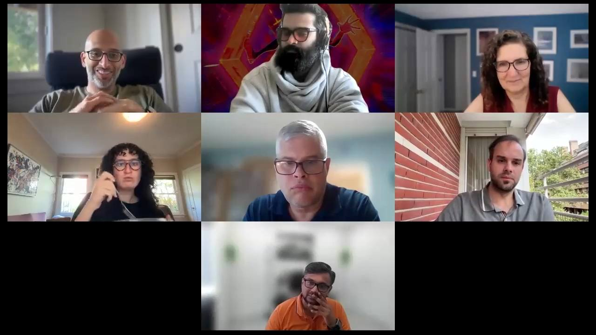
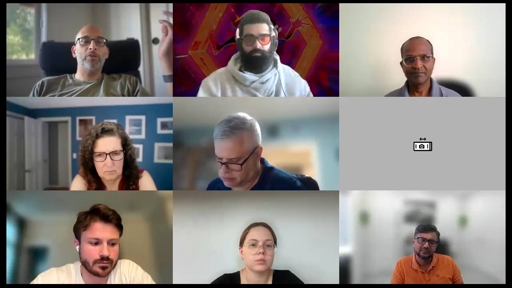
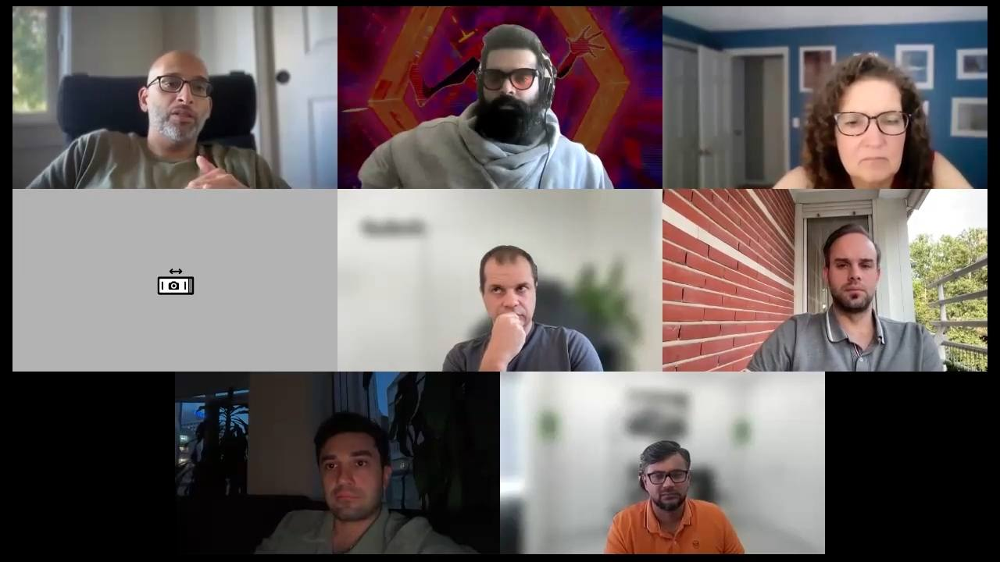
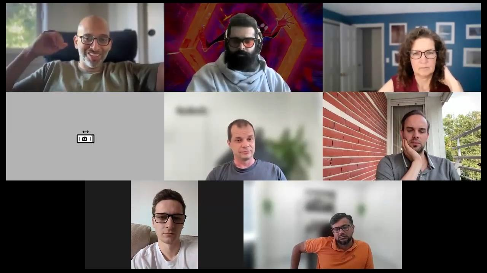
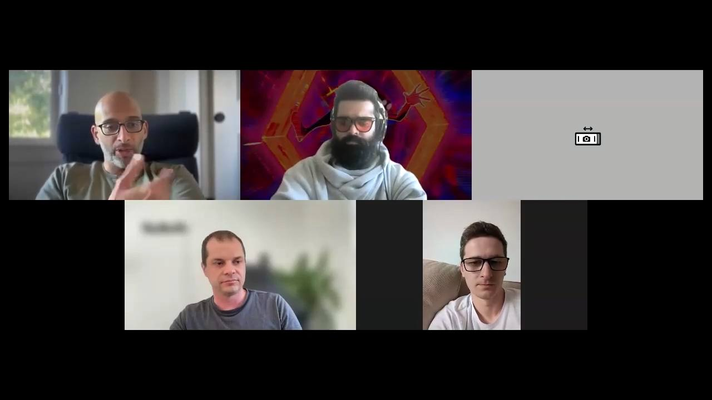

# AI Evals For Engineers & PMs — P009 Office Hours 答疑课 复现文档

> 本节覆盖：P009（1 讲，约 78 分钟）。这是一节 **office hours（答疑课）**，逐字稿里没有任何命令行、没有代码文件、没有依赖安装。所以本文件的「可复现」不是「跑起一个仓库」，而是**照着第 3 节的十步，在你自己的产品数据上跑通一遍「错误分析 → 标注 → evals → 迭代」的流程**。课里没有代码，第 4 节的两段脚本已明确标注为「示意」。

---

## 1. 这一节做什么

P009 是整门课的答疑专场。讲师开场就说明了形式：

> "和往常一样，你举手，我们按顺序做 Q&A。所以不要害羞。"
> —— p009 [00:29]

这一节一共接了 9 位学员的提问，覆盖了从「评测方法论」到「AWS 环境搭建」到「fine-tuning 要不要做」的全谱系。把它们按项目实现逻辑重排之后，本节真正要解决的问题是：

**当你手上有一堆 LLM 产品的调用记录（trace），但不知道「好」怎么定义、不知道从哪下手、不知道 evals 该建在哪一层时，你要按什么顺序做决策，才能既快又不浪费钱。**

本节最终要交付的产物（第 4 节给出具体表格）：

| 产物 | 用途 | 对应讲师观点 |
|---|---|---|
| 一张「分级采样计划」 | 决定先看哪些 trace | 先随机、后分层、再直觉驱动 |
| 一张「错误分类计数表」 | open coding → axial coding 的落点 | 计数超级有力 |
| 一张「修还是建 eval」分流表 | 决定哪些问题直接修、哪些值得建 eval | 低垂果实不配 eval |
| 一张「标注组织表」 | 决定谁标哪一块 | 仁慈的独裁者 + 分区 |
| 一张「rubric 校准表」 | 一致性低时怎么诊断 | Cohen's kappa 的三种诊断 |
| 一张「升级路径表」 | prompt 救不了之后往哪走 | 换模型 / test-time compute / 微调 / RL |
| 一张「多 agent 拆分判据表」 | 什么时候从单 agent 拆成多 agent | 从简单走向复杂，用 evals 论证复杂度 |
| 两个可运行脚本（示意） | kappa 计算、分层采样 | 本文补充，非讲师代码 |

**本节明确不解决的事**：具体 trace 怎么埋点、标注工具用什么前端框架、数据库怎么选型——课里没讲。

---

## 2. 讲师原话

### 2.1 关于标注者一致性（inter-annotator agreement）

> "这取决于你们标注者之间的一致性分数，也就是你们的 Cohen's kappa。如果它们很低，那说明你的 rubric 可能不够好，或者团队里存在分歧很大的理解——比如「每个人对什么叫好都有不同的想法」。这是这个问题的一种可能诊断。另一种诊断是：你要标注的表面区域太大了，而实际做标注的人并不是专家。也许你需要在规模上使用不同领域的专家。比如说你有不同地区、不同语言、不同种类的产品，那就不存在单一的领域专家。"
> —— p009 [01:49]

> "如果一致性足够高，你可以直接接受这点噪声。你的标签里会有一小部分噪声，这没关系。而且有办法把这部分噪声考虑进去，比如在报告置信区间的时候可以用到它。"
> —— p009 [03:13]

> "我只想说：如果你的一致性足够高，简单来说，这就是你在检查的东西——你们组织内部是不是校准过的？你们对「什么是好」是不是有共同理解？因为当你把 LLM 裁判给出的分数摆到利益相关者面前时，你希望所有人都相信它。"
> —— p009 [03:42]

> "一致性分数低，很可能说明你的 rubric 有问题，它可能太模糊了，没有被正确理解。你要把一致性做到足够高，但那不是你的目标。你不是想最大化你的一致性分数。你也许能拿到完美的一致性分数，但 100% 一致性的代价可以是无限大的。所以不要往那儿走。"
> —— p009 [04:41]

### 2.2 关于「要不要为了环境搭建停下进度」

> "AWS 非常复杂，真的非常复杂。我是一名软件工程师，我可以告诉你它不容易。就算只是走一遍它的用户界面也不容易，它出了名地让人困惑。正因为这么困惑，外面才有一大堆别的产品，比如 Heroku、Railway，还有这些 serverless 平台、Modal，正是因为 AWS 太让人晕了。"
> —— p009 [06:35]

> "我很喜欢 notebook。你可以用 notebook 构建很多软件，notebook 本身没有任何问题。先往前走，我觉得这才是关键。"
> —— p009 [07:04]

### 2.3 关于错误分析是所有事情里最重要的

> "一定要做错误分析。错误分析大概是我们教给你的所有东西里最重要的一个，它是你能获得最大回报的地方。一定要做。它会解决很多问题，也会回答你的很多疑问，比如「我到底该做什么」「我从哪开始」「我该先做哪个」，这些问题本质上都能被错误分析回答。"
> —— p009 [11:17]

> "错误分析会告诉你该在哪里排优先级。你会获得一种感觉：我该在哪里投入？我该先写单元测试吗？该做有参考答案的 evals 还是无参考答案的 evals？要做出「力气往哪放」这个决定，错误分析会帮你。因为你该 eval 的表面是无限的，所以错误分析帮你把它收窄。"
> —— p009 [12:42]

### 2.4 关于一条长 trace 怎么读才不把自己淹死

> "你打开每条 trace 时，我通常的做法是：先看第一个用户输入、查询或者别的什么，然后我会直接看最末尾的最终结果，判断这个最终结果是好还是不好。如果它没问题，我就往下走。如果它看起来没走对，我就会一路回到最上面开始读，直到找到第一个错误。找到第一个错误我就停下。"
> —— p009 [14:40]

> "一旦哪里看起来不对劲、没走对——比如说工具调用错了——那就停下来，写 open code，然后继续下一条。这样你就能把这件事变得可处理。"
> —— p009 [15:09]

### 2.5 关于 trace 记录有没有标准、要不要做厂商无关

> "我不会说除了 OpenTelemetry 之外有太多标准，可以把 OpenTelemetry 当作一种记录 trace 的方式。trace 这个东西甚至早于 AI 和 LLM，它本质上来自分布式系统。除此之外，没有太多标准。"
> —— p009 [23:09]

> "我个人只是时间有限。我用「创新代币」这个词——我没有尝试过把它做成厂商无关的。"
> —— p009 [18:25]

> "有时候你只需要引用那份数据，你不能把它记进日志里。"
> —— p009 [23:39]

> "你考虑去建自己的标注界面，理由是：很多数据是高度个性化的，你可能想用非常贴合你自己需求的方式把它渲染出来，从而消除查看数据时的一切摩擦。"
> —— p009 [24:07]

### 2.6 关于多个领域专家怎么分工标注

> "「仁慈的独裁者」这个说法背后的原则是：你要尽最大努力，把标注流程简化到对你来说合理的程度。我们之所以反复敲这个点，是因为很多人会走到另一个极端——让一个委员会来标注，那是行不通的。人会本能地不舒服，他们想说「我得征求每个人的意见」之类的。"
> —— p009 [27:47]

> "在你的情况下，让不同的人标不同的东西是完全可以的。最好能做点切分，说：好，这一块由这位仁慈的独裁者负责，那一块由那位负责。这样标注的那个人就不会被拖住。而且当那个人标注时，要尽可能授权他做出判断。"
> —— p009 [28:15]

> "只要确实没有重叠、而且你保持简单——这也是做二元标注的另一个理由——那么让不同的标注者来标是完全合理的。十个人算不算太多？这取决于规模。如果你能切出 10 个清晰的区域，说「这块不归这个人、那块归那个人」，中间没有含糊、没有分歧，那当然没问题。"
> —— p009 [29:43]

> "要确保标注者质量很高，得有真正的领域专长。所以我不认为 10 个算太多。只要确保这 10 个是真正的领域专家就行。很多时候人们会把标注外包出去，甚至在公司内部外包给开发者，如果做的不是开发者工具，那就容易出问题。"
> —— p009 [30:40]

### 2.7 关于采样策略

> "刚开始的时候，我会先用随机采样，先搞清楚你的数据是什么、里面有什么、什么重要、发生了什么。等你对自己的数据稍微多了解一点之后，就值得在采样上更聪明一点——也就是分层采样：从每个维度里，你随机地抽一定数量的 trace。"
> —— p009 [32:10]

> "你可以戴上数据科学家的帽子，对 trace 做很多数据分析，比如说：给我看异常值。特别长的对话、特别短的对话、工具调用次数异常多的对话。"
> —— p009 [34:04]

> "这里没有一个我能直接给你的配方，但原则是：这像侦探工作。一旦你开始观察数据，就要戴上怀疑者的帽子和侦探的帽子，问：我要去哪里挖？我怎么才能找到问题？"
> —— p009 [34:33]

### 2.8 关于 fine-tuning 的性价比

> "这正是微调非常擅长的那类事情，这些风格性的东西。因为我们有 evals，所以很容易拿 evals 去筛选数据集、去过滤数据集，挑出模型做不对的那些样本——这几乎就是负样本难例挖掘。"
> —— p009 [38:43]

> "然后 GPT-4o 出来了，GPT-4.1 也出来了。他们说：这比我们微调出来的模型好太多了。而那是那次演讲之后大约三个月的事。说实话，这种事一直在发生。"
> —— p009 [40:10]

> "我不再那么看好监督微调了。我更倾向于直接从偏好优化甚至直接进入强化学习。"
> —— p009 [40:39]

> "从务实角度我要提醒一句：公司得有足够的规模和用量，才能证明它值得。"
> —— p009 [41:07]

### 2.9 关于 prompt 改了这边、那边塌了

> "还有一件事可以在微调之前试：看看能不能把问题拆开一点，拆成 agent、子 agent 之类的。有时候把所有东西塞进一个 prompt 里——复杂度增加了，当然不是免费的，但很可能比微调便宜。"
> —— p009 [44:30]

> "如果你已经试过 prompt 还是做不到你要的效果，那看起来就是一个泛化问题。你手上已经有规格说明，你明确告诉了模型你要什么，也没有漏掉任何指令或上下文。那这就是一个信号：要么换模型，试试更强的模型。"
> —— p009 [45:26]

### 2.10 关于代码类 agent 怎么评测

> "因为这是代码，你其实可以利用更多有参考答案的 evals。你不一定非要用 LLM 裁判，你可以做一些更偏分析性的东西来判断是不是出问题了。"
> —— p009 [48:16]

> "我在 GitHub 工作时，在 GitHub Copilot 上做过一点工作。那个团队花了大量时间在测试框架上：把代码大规模地拿进来，把代码遮掉，然后尝试把这段代码补全，再在那个仓库里大规模地跑单元测试，这是一个相当不简单的工程挑战。"
> —— p009 [48:44]

> "我会收集这些问题的一个小集合，然后想办法迭代。先看能不能搞清楚：为什么它在长规格说明上失败？有没有某种失败的模式？我能不能用最小的方式复现它？也许你复现不了。如果复现不了，那我就继续在一小撮样本上迭代，比如五个、十个例子。"
> —— p009 [50:09]

> "这就是护栏大致的概念：你能不能把 eval 放到关键路径上。在代码 agent 里略有不同，但原则一样：如果出问题了，你要给它反馈。"
> —— p009 [53:01]

### 2.11 关于单 agent 还是多 agent

> "我会从简单走向复杂。如果能用一个 agent 做，我就先试一个 agent，看看我能撑到什么程度。然后当它开始不work了——因为 prompt 里塞了太多事情、想做太多事——那时候我才转向多 agent。而且我会用 evals 和实验来论证这份复杂度的必要性。"
> —— p009 [54:27]

### 2.12 关于「低垂果实不配拥有 eval」

> "open coding 和 axial coding 的目的是让你做数据分析。你要确保当你说「我有 50 个排期问题」时，你知道那意味着什么。如果你不知道那意味着什么，那说明这个 axial code 不好，它不够具体、太含糊了。"
> —— p009 [57:40]

> "整个 evals 的目的不是做 evals。evals 的目的是让你的产品更好。evals 只是流程的一部分，别的没人在乎，唯一重要的是你的产品要好。"
> —— p009 [59:06]

> "如果你在流程中任何一点——open coding、axial coding 什么的——看到一个非常清楚的「我现在就得修这个」，那你就学到了足够多了。这个错误真的很糟糕、一直在发生、我知道怎么修，那就去修。你可以放下 eval，因为没有什么比修好你的产品更重要。"
> —— p009 [60:04]

> "如果你知道你的日历排期工具有一个语法错误，写一个 eval 做这一大套是没意义的。你可能写个单元测试就行了。这里没必要上 LLM 裁判。"
> —— p009 [60:32]

> "因为 evals 可能很贵，整个流程都可能很贵。你要把这套 evals 的东西留给那些你确实需要反复迭代的问题上。"
> —— p009 [61:01]

### 2.13 关于「格式转换该不该用 LLM」

> "如果你只是想把一种格式转成 markdown，比如 HTML 转 markdown，那用 LLM 并不是一个合理的做法。你可以用确定性的方式做得更好。但看起来你并不想要那种确定性，你想要在中间加一点判断力——你想忽略某些东西，你想要更细腻的判断。那种情况下我觉得 LLM 可能有帮助。"
> —— p009 [67:09]

### 2.14 关于用 open code 反哺 LLM 裁判

> "你可以把这些案例交给 LLM，说：你能不能根据这些，给我的 prompt 提一些改进建议？你可以把整个故事讲给它听——我是一个 LLM 裁判，这是我的 prompt，它在这些例子上因为这样那样的原因判错了，你能建议一些改进吗？事实上，有些 eval 厂商已经把这种能力做成内置的了，就像帮你构建 LLM 裁判的副驾驶。"
> —— p009 [69:24]

> "一定要把 open code 写成 LLM 能看懂「发生了什么」的样子。它不只是给你自己看的。因为第一，你可以用它做主轴编码，帮你去归类；第二，它还能帮你构建 LLM 裁判。"
> —— p009 [69:51]

> "另一端是接近「完美对齐」。但完美对齐的代价是无限的，所以不要往那儿走，完全完美是无限成本，某种意义上那是件坏事。每个人的成本曲线都不一样，但理论上它是无限的。"
> —— p009 [71:15]

> "还有一类是 prompt 自动优化，比如所谓的「SPI」和它的朋友们（逐字稿念作 SPI，未给出全称）。我在实践中发现它不是银弹，用得时候要小心。但如果你有好的 evals、好的测试集、验证集，有你自己信得过的指标，做一点这种优化确实能帮上忙。"
> —— p009 [71:44]

### 2.15 关于这套方法论从哪来的

> "这其实就是和很多公司合作、然后一次又一次看到同一个问题的产物。看到你觉得「这是每个人都会犯的同一个失败、每个人都会有的同一个误解」。然后能不能把这些咨询项目里我反复给出的建议，泛化成一套东西。"
> —— p009 [73:10]

> "很多东西其实扎根于数据科学和机器学习的原理。你看我们教的这一整套，很大一部分就是数据科学，只是换了个风味。你处理的是随机、带噪声的输出，就像机器学习里一样，你怎么评测这些系统，是非常相似的。你也是做错误分析。如果你在做猫狗分类，你也会做错误分析，然后你会发现「哦，下雨天的时候它们分不对，因为下雨」——那就会是其中一条主轴编码。"
> —— p009 [75:06]

> "「三道鸿沟」那个框架是 Shreya 想出来的。她教学背景很好，一开始我还不太确定，后来越来越觉得它好。"
> —— p009 [74:36]

### 2.16 关于要不要微调裁判本身

> "你完全可以微调裁判。但接下来你要问的问题是：那为什么不去微调你的模型？所以两个都做。说真的，这是很合理的问题，我没有一个确定性的答案。我会说：如果你要在这个程度上往裁判上投力气，也许顺手把你的模型也微调一下。"
> —— p009 [77:30]

---

## 3. 从零复现

这一节把讲师的零散回答重排成一条**可以照着执行的流水线**。每一步都给出「做什么 / 产出物 / 判定标准」，判定标准全部来自第 2 节的原话。

### 3.0 需求与约束（先把前提摆清楚）

**需求**：在一个真实的 AI 产品上，把「好/不好」变成可以被复查、被计数、被自动化的东西，并且不把钱和时间烧光。

**约束（全部来自讲师原话或学员情境）**：

| 约束 | 出处 |
|---|---|
| 你该 eval 的表面是**无限的**，必须收窄 | p009 [12:42] |
| 100% 一致性的成本是**无限**的 | p009 [04:41]、p009 [71:15] |
| 长 trace 逐步精读会「被拖住、非常贵」 | p009 [14:40] |
| 团队里常常没有**单一**领域专家（多地区 / 多语言 / 多产品线） | p009 [02:17] |
| 一份数据可能**不能被记进日志**，只能引用 | p009 [23:39] |
| 人的「创新代币」有限，不要自己造基础设施 | p009 [18:25] |
| 代码 agent 单次任务推理 10–30 分钟，很贵 | p009 [47:47] |
| 模型厂商每三个月就发一个更强的模型 | p009 [40:10] |

### 3.1 估算（本文推导，算式写在这里）

课里给了几个真实数字，可以用来做工程量估算。**以下算式是本文推导，讲师本人没有算这些**，假设值一律标出。

**① 首尾速览法 vs 逐步精读法的时间差**

- 假设：一条长 trace 平均 20 个步骤（LLM 调用 + 工具调用），逐步精读每步 1 分钟 → 单条 20 分钟。
- 精读 100 条：`20 × 100 = 2000 分钟 ≈ 33.3 小时`。
- 首尾速览法：先看首尾判生死，平均每条 2 分钟，只有约
30% 的 trace 需要回读（假设值）。回读的那些再花 8 分钟，则单条平均成本：

```
2 分钟 + 0.3 × 8 分钟 = 2 + 2.4 = 4.4 分钟
100 条 × 4.4 = 440 分钟 ≈ 7.3 小时
```

对比精读的 33.3 小时，节省约 78%。这就是讲师那句「这样你就能把这件事变得可处理」在工程量上的含义——**它靠的不是读得更快，而是让大部分 trace 在 2 分钟内就被判为「没问题」并跳过后面的精读**。

**② 分层采样的样本量**

学员的处境是「多产品线 × 多角色 × 多地区」。假设每维各 3 个取值：

```
格子数 = 3 × 3 × 3 = 27 格
每格抽 5 条 = 135 条
以 4.4 分钟/条计 = 594 分钟 ≈ 9.9 小时（单人）
```

作为对照，学员手上有「接近 1000、1500 个问题」——全量读完是 `1200 × 4.4 ≈ 5280 分钟 ≈ 88 小时`。分层采样的价值在于把 88 小时压到 10 小时量级，同时保证每个格子都有覆盖。

**③ 代码 agent 的实验成本**

学员说单次任务「要 10、20、30 分钟才能拿到结果」。取 20 分钟、每次实验 10 个 case：

```
单轮实验 = 20 分钟 × 10 = 200 分钟 ≈ 3.3 小时（机器时间）
跑 5 轮 prompt 迭代 = 200 × 5 = 1000 分钟 ≈ 16.7 小时
```

这就是讲师为什么反复强调「收集一个小集合」「五个、十个例子」——**不是样本少所以不严谨，而是单样本太贵，必须先在小集合上把失败模式摸清楚，再谈规模化**。

**④ 一致性的成本曲线**

讲师说 100% 一致性的代价是「无限」。量化地理解：如果为了让最后 5% 的分歧消失，你要重写 rubric、重训标注者、开三轮对齐会，那么边际成本就会陡增。**具体阈值课里没讲**——讲师没有给出「kappa 到多少算够」的数字。本文不替你编一个数字，只把讲师给的三条诊断路径写进 3.8 节。

---

### 3.2 步骤一：先做一轮纯随机采样，建立数据直觉

**做什么**：不要一上来就设计分层方案。从你的 trace 里纯随机抽一批（讲师没有给具体条数，课里没讲），逐条走 3.3 的速览法。

**为什么先随机**：讲师的原话是「先搞清楚你的数据是什么、里面有什么、什么重要、发生了什么」。在你还不知道数据长什么样的时候，任何分层维度都是你拍脑袋想出来的，可能根本不是问题分布的真实维度。

**这一步的产出**：一份「数据画像」——你的 trace 大概多长、工具调用大概几次、用户都在问什么、有没有明显的垃圾数据或空回复。

**这一步的反面教材**：直接跳到分层采样。讲师把分层放在「等你对自己的数据稍微多了解一点之后」，说明它是第二步。

> "先往前走，我觉得这才是关键。"
> —— p009 [07:04]



这一段问答的背景值得单独写清楚，因为它是本节唯一的「环境」话题：学员在 AWS Bedrock 上卡住了，目录结构、权限、trace 自动化都出问题，问要不要退回 notebook。讲师的答复是：AWS 就是难，连软件工程师也觉得难，这不是你的问题；notebook 完全够用，先把东西做出来，环境迁移放到后面。**课里没有给任何 AWS IAM 策略、Bedrock 调用配置或目录结构**——这一段的价值是「允许你用最轻的方式开工」，不是一份部署指南。

---

### 3.3 步骤二：用「首尾速览 + 首个错误即停」读 trace

这是本节最高密度的一条操作指令，值得完整重述成一个可执行算法：

```
对每条 trace：
  1. 读第一个用户输入（query / 指令 / 对话开头）
  2. 直接跳到最末尾，读最终产物（最终回复 / 最终提交 / 最终文件）
  3. 判断：这个最终结果对用户来说是好还是不好？
     - 好 → 跳过，看下一条。不看中间过程。
     - 不好（或看起来不对） →
         a. 回到 trace 顶部，从头往下读
         b. 读到【第一个错误】就停
         c. 给这个第一个错误写一条 open code
         d. 停手，看下一条
```

**关键点一：判「好不好」看的是用户视角，不是中间步骤的正确性。** 讲师说的是「这个最终结果是好还是不好」，不是「每个工具调用对不对」。

**关键点二：只记第一个错误。** 这是最容易被违反的一条。人的本能是「既然已经读了，不如把后面的错都记下来」。讲师明确反对：找到第一个错误就停。原因是下游错误大多是上游错误的连锁反应，全记下来会让你的计数表里充满同一根因的重复项，把轴向编码的分布彻底扭曲。

**关键点三：open code 要写成机器能看懂的样子。** 讲师后来专门回头强调这一点：open code 不只是给你自己看的，它是给 LLM 看的——既要用来做轴向编码归类，也要用来反哺 LLM 裁判的 prompt。所以「这里怪怪的」不算 open code，「第三次工具调用把日期参数写成了 MM/DD 而工具要求 YYYY-MM-DD」才算。

**产出物**：每条被判为不好的 trace 对应恰好一条 open code，一行一条。

---

### 3.4 步骤三：轴向编码 + 计数

**做什么**：把所有 open code 归类成轴向编码（axial code），然后**数每类有多少条**。

**讲师的判断标准（这条非常实用）**：当你数出「我有 50 个排期问题」时，你必须在心里知道这 50 个意味着什么、该从哪里开始查。如果你不知道，说明这个轴向编码本身不合格——它太含糊、不够具体。也就是说，**轴向编码的质量检验方式是「它是否直接指向一个可行动的方向」**。

**为什么必须计数**：讲师说「计数超级有力」。计数把「我感觉工具调用问题挺多的」变成「工具参数格式错 23 条、上下文丢失 9 条、拒答 4 条」，前者没法排优先级，后者可以。

**讲师补的一个细节**：其实到轴向编码这一步，**在计数之前你大概率已经知道第一名是什么了**。计数的作用是确认，不是发现。所以不要为了「等计数结果」而推迟动手。


这张截图对应的是「该做单元测试还是该做端到端 trace 分析」的争论。讲师的回答是：不要靠讨论决定，靠错误分析的计数结果决定。因为「你该 eval 的表面是无限的」，讨论是没有终点的；而计数表会告诉你问题实际堆在哪里。

**产出物**：一张两列的表——`axial_code | count`，按 count 降序。

---

### 3.5 步骤四：分流——哪些问题直接修，哪些值得建 eval

这是本节最有价值、也最容易被跳过的一步。讲师用了一整段来说明：**不是所有错误都配得上一个 eval**。

分流规则：

| 情况 | 处理方式 | 讲师理由 |
|---|---|---|
| 你一眼就知道怎么修，而且改动很小（例：日历工具的语法错误、参数格式写错） | **直接修**。写个单元测试就够了，不要上 LLM 裁判 | 「写一个 eval 做这一大套是没意义的」 |
| 你一眼就知道怎么修，但要改 prompt 且可能影响别的指标 | 先修，修完重新做一轮轴向编码看有没有新问题 | 「你回去修掉，可能再做一次轴向编码，这没问题」 |
| 你不知道怎么修、或者修了会牵动其他指标 | **建 eval**。这类问题需要反复实验 | 「那才是 eval 真正发光的时候」 |
| 已经修了 10 轮低垂果实，剩下的都很复杂 | **建 eval** | 「剩下的东西我不太确定怎么修，这是更复杂的问题」 |

> "整个 evals 的目的不是做 evals。evals 的目的是让你的产品更好。"
> —— p009 [59:06]


**一个重要推论**：如果你的分流结果是「80% 的问题都是低垂果实」，那么你这一阶段的正确动作是**连续修 10 轮 bug，而不是建 10 个 eval**。讲师明确说这条路走下来「你可能已经修了 20 个问题」，而且「修得很快」——这反而是整条流程最理想的形态，因为它达成了唯一真实的目标：产品变好了。

---

### 3.6 步骤五：采样升级——分层 + 直觉驱动 + 异常值

三个采样策略要**叠加**使用，不是三选一。

**① 分层采样（stratified sampling）**

做法：按你的业务维度切格，每个格里随机抽固定条数。讲师对学员的原话是「从每个维度里，你随机地抽一定数量的 trace」。

代码见第 4 节 `tools/stratified_sample.js`。

**② 直觉驱动采样（讲师原话叫「侦探工作」）**

做法：当你开始对数据有感觉之后，主动去你怀疑有问题的地方采样。讲师的原话是「我闻到有问题，所以我要在我觉得有问题的那个区域采样」。这一步没有配方，它靠的是前面随机采样积累的直觉。

**③ 异常值采样**

讲师给的三个具体异常维度：

- **特别长的对话**
- **特别短的对话**
- **工具调用次数异常多的对话**

这三个都是纯粹的统计量，不需要 LLM，只需要对你的 trace 做一次 `groupBy` + `sort`。这是本节里成本最低、收益最快的一招。

> "一旦你开始观察数据，就要戴上怀疑者的帽子和侦探的帽子，问：我要去哪里挖？我怎么才能找到问题？"
> —— p009 [34:33]


---

### 3.7 步骤六：确定标注组织——仁慈的独裁者 + 分区 + 二元标签

**核心原则**：每个标注区域有**一个**最终裁决人（仁慈的独裁者），不是委员会。

**为什么**：讲师说得很直接——很多人会走到另一个极端，让一个委员会来标注，那行不通。人会本能地不舒服，想说「我得征求每个人的意见」。委员会的成本是收敛不了。

**多领域专家怎么安排**（学员的真实处境：多产品线、多角色、多地区、内容零重叠）：

1. **分区**：每个不重叠的区域指定一位仁慈的独裁者。讲师明确说「这一块由这位负责、那一块由那位负责」是完全可以的。
2. **授权**：区域负责人在标注时要被充分授权做判断，不要每标一条都要向上请示。如果不确定，可以事后做功课、问别人，但**标注这个动作本身要能当场完成**。
3. **人数没有上限**。讲师被问「10 个人是不是太多了」，回答是：只要你切得出 10 个清晰无重叠的区域，10 个没问题。
4. **质量门槛是领域专长**，不是人数。反例：把标注外包出去，或公司内部外包给开发者——如果做的不是开发者工具，这就容易出问题。
5. **保持简单，用二元标签**。讲师把「二元标注」列为分区标注能成立的理由之一：二元标签把「好/不好」的判断压缩到最小歧义，跨区域之间即使标准不完全一致，也不会互相污染。



补充一条容易漏的细节：标注者如果要把编码写进「open code 字段」，要写得让 LLM 能读懂。讲师在第 55 分钟回答另一位学员时澄清了这一点——之前课上演示时，把 axial code 直接塞进 open code 字段，那只是「演示时为了沟通、现场随手放的」，**不是你应该照着做的方式**。正确做法是 open code 记录具体现象，axial code 单独一列。

---

### 3.8 步骤七：一致性校准——kappa 低的时候三种诊断

**什么时候算低**：课里没讲具体阈值。讲师没有给出「kappa 低于 X 就重做 rubric」这样的数字，不要自己加。

**kappa 低的三种诊断（讲师原话提炼）**：

| 诊断 | 含义 | 对应动作 |
|---|---|---|
| ① rubric 不够好 | rubric 太模糊，没被正确理解 | 重写 rubric，把判断标准写具体 |
| ② 团队对「好」没有共同理解 | 每个人心里对「好」的定义不同 | 开校准会，对齐定义 |
| ③ 标注表面太大 + 标注者不是专家 | 你让所有人标所有东西，但没人有这个上下文 | 按专长分区，重新组织 |

第③条是讲师根据自己的咨询经验主动提出来的，他甚至说「我以前见过这种情况，所以它才会浮现在我脑子里」。

**kappa 高的时候怎么办**：直接接受这点噪声。讲师说「你的标签里会有一小部分噪声，这没关系」，而且如果要做得很精细，这部分噪声可以用于报告置信区间。

**最重要的边界**：**不要把最大化一致性当成目标**。讲师说了两遍「100% 一致性的成本是无限的」。一致性是**校准的体检指标**，不是**优化目标**。它的真实用途是：当你要把 LLM 裁判的分数摆到利益相关者面前时，你希望所有人都相信它——**一致性是在为「可信度」背书，不是在为「分数好看」背书**。

> "一致性分数低，很可能说明你的 rubric 有问题，它可能太模糊了，没有被正确理解。你要把一致性做到足够高，但那不是你的目标。"
> —— p009 [04:41]


---

### 3.9 步骤八：建 LLM 裁判，并用 open code 反哺它

**顺序很重要**：先有高质量 open code，再有 LLM 裁判。不是反的。

**具体做法（讲师描述的两条路径）**：

路径 A：把分歧样本喂给 LLM，让它改裁判 prompt。

```
你是一个 LLM 裁判。这是你当前的 prompt：<judge_prompt>
以下是人类标注与裁判判断不一致的样本，每条带有 open code 说明实际发生了什么：
<disagreement_examples>
请指出当前 prompt 的缺陷，并给出改进后的 prompt。
```

路径 B：用 prompt 自动优化工具。讲师提到了「所谓的 SPI 和它的朋友们」（逐字稿念作 SPI，未给出全称，课里没讲具体是哪个工具），并明确说**它不是银弹，用的时候要小心**；前提是你有好的 evals、好的测试集/验证集、以及你自己信得过的指标。

**讲师提到的两个现成项目**：Shreya 的 `docetl`，以及另一个逐字稿念作「a line eval」的项目（课里未给出准确拼写和链接，请自行核实）。这两个都是「你写反馈 → 它基于反馈、特别是分歧处 → 提出 prompt 更新」的形态。讲师说这套逻辑**对任务 prompt 和裁判 prompt 都适用**。

**关于要不要微调裁判本身**：讲师说可以，但紧接着反问——「那为什么不去微调你的模型？」他的结论是「两个都做」，并且承认「我没有确定性的答案」。


---

### 3.10 步骤九：prompt 救不了之后的升级路径

讲师给了一条明确的升级阶梯，按成本从低到高：

| 顺序 | 手段 | 讲师判断 |
|---|---|---|
| 1 | 改 prompt | 第一选择 |
| 2 | **拆问题**：拆成 agent / 子 agent | 「复杂度增加了，不是免费的，但很可能比微调便宜」 |
| 3 | **换更强的模型** | 如果「没有漏掉任何指令或上下文」还是做不到，那就是泛化问题，换模型 |
| 4 | **更多 test-time compute** | 讲师原话「through more test time compute」 |
| 5 | **微调**：SFT → 偏好优化 → RL | 讲师「不再那么看好 SFT」，倾向直接往偏好优化甚至 RL 走 |

**什么时候判定为「泛化问题」**：讲师的判据是——你已经有了规格说明，明确告诉了模型要什么，没有漏掉任何指令或上下文，但模型还是做不到。**这时候不要继续改 prompt，改 prompt 已经到天花板了。**

**微调的务实前提**：公司要有足够的规模和用量，才值得维护整条微调流水线。另外讲师用 ReChat 的案例说明微调的**寿命风险**：他们用 evals 筛出难例、用 OpenAI 的微调 API 训出模型、解决了 prompt 解决不了的「代码块与文本交错的特定格式」问题；但 GPT-4o / GPT-4.1 出来之后，新模型直接比他们微调的版本好很多——「那是演讲之后大约三个月的事」。

**微调真正擅长的**：风格性的东西。以及一个技巧：**用 evals 反哺微调数据集**——拿 evals 去过滤出模型做不对的样本，做负样本难例挖掘，得到高价值的微调数据。



---

### 3.11 步骤十：单 agent 还是多 agent

**默认从单 agent 开始。** 讲师的原话是从简单走向复杂：先用一个 agent，看能撑到什么程度。

**触发拆分的信号**：prompt 里塞了太多事情、想做太多事，已经明显不 work 了。

**拆分必须用 evals 论证**：讲师说「我用 evals 和实验来论证这份复杂度的必要性」——先跑一遍 evals 记下基线，拆完之后再跑一遍，用数字说话。不是「感觉拆开更清晰」。

**代码 agent 的特殊处理（讲师给 GitHub Copilot 的例子）**：这类任务可以用**有参考答案的 evals**，不一定非要上 LLM 裁判。Copilot 团队的做法是搭一个测试框架：把真实仓库的代码大规模拿进来，遮掉一段，让模型补全，然后在那个仓库里跑单元测试。讲师评价这是「相当不简单的工程挑战」——要装包、要跑包、要大量算力。

**护栏（guardrails）**：把 eval 放到关键路径上，发现不对就**当场给 LLM 反馈、纠正它的步骤、拒绝某些中间产物**，而不是等 30 分钟跑完再判断。讲师的措辞是「如果出问题了，你要给它反馈」。





---

## 4. 完整代码

> **重要说明：这一节（P009）是答疑课，逐字稿里没有任何代码、命令、配置文件，截图 OCR 结果为空。下面 4.1 的表格是把讲师口述的方法论落成可交付的产物；4.2–4.5 的脚本是本文补充的示意实现，用来让 3.2–3.8 的步骤真的能跑起来，不是讲师写过的代码。**

### 4.1 交付产物（由讲师口述整理，非代码）

#### 表 A：设计决策表

| 决策点 | 讲师的选择 | 不这样会怎样 |
|---|---|---|
| 从哪一步开始 | 错误分析 | 在无限 surface 上随机投入 |
| 先随机还是先分层 | 先随机，后分层 | 分层维度可能是拍脑袋的，覆盖不到真实分布 |
| 长 trace 怎么读 | 首尾速览，首个错误即停 | 被单条 trace 拖住，成本不可控 |
| 一条 trace 记几个错 | 一个（第一个） | 计数表被同根因的连锁错误污染 |
| 谁来标注 | 分区 + 每区一位仁慈的独裁者 | 委员会收敛不了 |
| 标签体系 | 二元优先 | 多档标签放大跨区域歧义 |
| 一致性目标 | 足够高即可，不追满分 | 100% 一致性的成本无限 |
| 低垂果实怎么办 | 直接修，不建 eval | 把有限预算花在不需要迭代的问题上 |
| prompt 到顶之后 | 拆 agent → 换模型 → test-time compute → 微调 | 在 prompt 上无限打转 |
| 单 agent 还是多 agent | 先单，撑不住了再拆，用 evals 论证 | 过早引入协作与交接的复杂度 |
| trace 存储要不要厂商无关 | 讲师本人不做（创新代币有限）；OpenTelemetry 是唯一的准标准 | 自己造基础设施，时间被吃掉 |

#### 表 B：组件职责表

| 环节 | 输入 | 输出 | 负责人 |
|---|---|---|---|
| trace 采集 | 线上请求 | 结构化 trace 记录 | 工程 |
| 采样器 | trace 池 + 采样策略 | 待阅读清单 | 做评测的人 |
| 阅读器（速览） | 单条 trace | 好/不好 二元判定 | 领域专家（仁慈的独裁者） |
| open coder | 不好 + 首个错误位置 | 一行具体现象描述 | 同上 |
| 轴向归类器 | open code 列表 | axial_code + count | 同上 |
| 分流器 | axial_code + count 表 | 「立即修」/「建 eval」队列 | 同上 + 产品 |
| 标注界面 | 待标注样本 | 人类标签 + 分歧记录 | 自建（讲师建议） |
| 一致性计算器 | 双人标签 | Cohen's kappa | 工程 |
| LLM 裁判 | judge prompt + 样本 | 自动分数 | 工程 |
| 关键路径护栏 | 中间步骤 | 接受/拒绝/纠正反馈 | 工程 |

#### 表 C：接口 / 数据模型草案

标注记录（一行一条 trace）：

| 字段 | 类型 | 说明 |
|---|---|---|
| `trace_id` | string | trace 唯一标识 |
| `strata` | object | 分层维度，如 `{product, role, region}` |
| `sampling_reason` | enum | `random` / `stratified` / `intuition` / `outlier` |
| `outcome` | enum | `good` / `bad`（二元，讲师强调） |
| `first_error_step` | number \| null | 首个错误发生在第几步；`good` 时为 null |
| `open_code` | string | 具体现象，必须写成 LLM 能读懂的句子 |
| `axial_code` | string \| null | 归类，计数用 |
| `annotator` | string | 区域独裁者标识 |
| `disagreement_with` | string \| null | 与谁判反了，用于反哺裁判 prompt |
| `data_ref` | string \| null | 数据不能落日志时的引用地址（讲师提到有时只能引用） |

#### 表 D：容量估算表

| 项 | 算式 | 结果 |
|---|---|---|
| 精读 100 条 | `20 分钟 × 100` | 约 33.3 小时 |
| 速览 100 条 | `(2 + 0.3×8) × 100` | 约 7.3 小时 |
| 分层采样 27 格 × 5 条 | `135 × 4.4 分钟` | 约 9.9 小时 |
| 全量 1200 条 | `1200 × 4.4 分钟` | 约 88 小时 |
| 代码 agent 单轮 10 case | `20 分钟 × 10` | 约 3.3 小时 |
| 代码 agent 5 轮迭代 | `200 分钟 × 5` | 约 16.7 小时 |

> 上述「20 分钟/条」「30% 需回读」「8 分钟回读」为本文假设值，非课里数据。课里给出的真实数字只有：代码 agent 单次 10–30 分钟、学员有 1000–1500 条问题、微调方案被新模型超越的时间约 3 个月。

### 4.2 目录结构（示意）

```
evals-workshop/
├── package.json
├── data/
│   ├── traces.jsonl          # 每行一条 trace 的元信息
│   ├── annotations.jsonl     # 标注结果
│   └── kappa-sample.json     # 双人标注样本
└── tools/
    ├── stratified_sample.js
    ├── kappa.js
    └── outliers.js
```

`package.json`（无第三方依赖，Node 18+）：

```json
{
  "name": "evals-workshop",
  "version": "1.0.0",
  "type": "module",
  "engines": { "node": ">=18" },
  "scripts": {
    "sample": "node tools/stratified_sample.js",
    "kappa": "node tools/kappa.js",
    "outliers": "node tools/outliers.js"
  }
}
```

`data/traces.jsonl`（每行一条，示意数据）：

```jsonl
{"trace_id":"t001","product":"coach","role":"hq","region":"na","turn_count":4,"tool_call_count":1,"duration_ms":18000}
{"trace_id":"t002","product":"coach","role":"hq","region":"na","turn_count":3,"tool_call_count":0,"duration_ms":9000}
{"trace_id":"t003","product":"coach","role":"regional","region":"emea","turn_count":41,"tool_call_count":17,"duration_ms":240000}
{"trace_id":"t004","product":"coach","role":"regional","region":"emea","turn_count":2,"tool_call_count":0,"duration_ms":4000}
{"trace_id":"t005","product":"ask","role":"hq","region":"apac","turn_count":9,"tool_call_count":4,"duration_ms":61000}
```

### 4.3 `tools/stratified_sample.js`（示意）

对应 3.6 的「分层采样」与「异常值采样」两种策略。

```js
// tools/stratified_sample.js
// 课里没有代码，以下为示意实现。
// 用法：node tools/stratified_sample.js --per-stratum 5 --out data/sample.json
import fs from "node:fs";
import path from "node:path";

const TRACE_FILE = path.resolve("data/traces.jsonl");
const STRATA_KEYS = ["product", "role", "region"]; // 你的业务维度，按需改

function parseArgs(argv) {
  const args = { perStratum: 5, out: "data/sample.json" };
  for (let i = 2; i < argv.length; i += 2) {
    if (argv[i] === "--per-stratum") args.perStratum = Number(argv[i + 1]);
    if (argv[i] === "--out") args.out = argv[i + 1];
  }
  return args;
}

function readJsonl(file) {
  const raw = fs.readFileSync(file, "utf8");
  return raw
    .split("\n")
    .map((line) => line.trim())
    .filter(Boolean)
    .map((line) => JSON.parse(line));
}

// 可复现的伪随机：同一个 seed 永远得到同一批样本
function mulberry32(seed) {
  return function () {
    seed |= 0;
    seed = (seed + 0x6d2b79f5) | 0;
    let t = Math.imul(seed ^ (seed >>> 15), 1 | seed);
    t = (t + Math.imul(t ^ (t >>> 7), 61 | t)) ^ t;
    return ((t ^ (t >>> 14)) >>> 0) / 4294967296;
  };
}

function shuffle(arr, rand) {
  const a = arr.slice();
  for (let i = a.length - 1; i > 0; i--) {
    const j = Math.floor(rand() * (i + 1));
    [a[i], a[j]] = [a[j], a[i]];
  }
  return a;
}

function stratumKey(trace) {
  return STRATA_KEYS.map((k) => `${k}=${trace[k] ?? "unknown"}`).join("|");
}

function stratify(traces, perStratum, rand) {
  const buckets = new Map();
  for (const t of traces) {
    const k = stratumKey(t);
    if (!buckets.has(k)) buckets.set(k, []);
    buckets.get(k).push(t);
  }

  const picked = [];
  for (const [key, items] of [...buckets.entries()].sort()) {
    const take = shuffle(items, rand).slice(0, perStratum);
    for (const t of take) {
      picked.push({ ...t, _stratum: key, sampling_reason: "stratified" });
    }
    console.log(`${key}\t总量=${items.length}\t抽取=${take.length}`);
  }
  return picked;
}

// 异常值：超长 / 超短 / 工具调用异常多（讲师点名的三个维度）
function pickOutliers(traces) {
  if (traces.length === 0) return [];

  const byTurn = traces.slice().sort((a, b) => b.turn_count - a.turn_count);
  const longest = byTurn.slice(0, 3);
  const shortest = traces.slice().sort((a, b) => a.turn_count - b.turn_count).slice(0, 3);

  const toolCounts = traces.map((t) => t.tool_call_count).sort((a, b) => a - b);
  const p95 = toolCounts[Math.floor(toolCounts.length * 0.95)] ?? 0;
  const toolHeavy = traces.filter((t) => t.tool_call_count >= p95 && p95 > 0).slice(0, 5);

  const tagged = [
    ...longest.map((t) => ({ ...t, sampling_reason: "outlier_longest" })),
    ...shortest.map((t) => ({ ...t, sampling_reason: "outlier_shortest" })),
    ...toolHeavy.map((t) => ({ ...t, sampling_reason: "outlier_tool_heavy" })),
  ];

  // 按 trace_id 去重
  const seen = new Set();
  return tagged.filter((t) => {
    if (seen.has(t.trace_id)) return false;
    seen.add(t.trace_id);
    return true;
  });
}

function main() {
  const args = parseArgs(process.argv);
  const traces = readJsonl(TRACE_FILE);
  const rand = mulberry32(42); // 固定 seed，保证团队里每个人拿到同一批样本

  console.log("=== 分层采样 ===");
  const stratified = stratify(traces, args.perStratum, rand);

  console.log("=== 异常值采样 ===");
  const outliers = pickOutliers(traces);
  for (const o of outliers) {
    console.log(`${o.trace_id}\t${o.sampling_reason}\tturns=${o.turn_count}\ttools=${o.tool_call_count}`);
  }

  const merged = [...stratified, ...outliers];
  fs.mkdirSync(path.dirname(args.out), { recursive: true });
  fs.writeFileSync(args.out, JSON.stringify(merged, null, 2), "utf8");
  console.log(`\n写出 ${merged.length} 条 -> ${args.out}`);
}

main();
```

### 4.4 `tools/kappa.js`（示意）

对应 3.8 的一致性校准。

```js
// tools/kappa.js
// 课里没有代码，以下为示意实现。
// 用法：node tools/kappa.js data/kappa-sample.json
import fs from "node:fs";
import path from "node:path";

const LABELS = ["good", "bad"]; // 讲师强调二元标签

function cohenKappa(pairs) {
  const n = pairs.length;
  if (n === 0) throw new Error("没有样本，无法计算 kappa");

  const counts = Object.fromEntries(
    LABELS.map((a) => [a, Object.fromEntries(LABELS.map((b) => [b, 0]))])
  );

  for (const p of pairs) {
    if (!LABELS.includes(p.a) || !LABELS.includes(p.b)) {
      throw new Error(`非法标签：${JSON.stringify(p)}，只接受 ${LABELS.join(" / ")}`);
    }
    counts[p.a][p.b] += 1;
  }

  const observed = pairs.filter((p) => p.a === p.b).length / n;

  let expected = 0;
  for (const x of LABELS) {
    let rowSum = 0; // 标注者 A 给 x 的次数
    let colSum = 0; // 标注者 B 给 x 的次数
    for (const y of LABELS) {
      rowSum += counts[x][y];
      colSum += counts[y][x];
    }
    expected += (rowSum / n) * (colSum / n);
  }

  const kappa = expected === 1 ? 1 : (observed - expected) / (1 - expected);
  return { n, observed, expected, kappa, counts };
}

function main() {
  const file = path.resolve(process.argv[2] ?? "data/kappa-sample.json");
  const pairs = JSON.parse(fs.readFileSync(file, "utf8"));
  const r = cohenKappa(pairs);

  console.log("样本数 :", r.n);
  console.log("观察一致率 :", r.observed.toFixed(4));
  console.log("期望一致率 :", r.expected.toFixed(4));
  console.log("Cohen's kappa :", r.kappa.toFixed(4));
  console.log("混淆矩阵 :", JSON.stringify(r.counts, null, 2));

  // 注意：课里没有给出「多少算够」的阈值。这里不做任何自动判定。
  console.log("\n下一步（按 p009 [01:49]）人工诊断三选一：");
  console.log("  A. rubric 太模糊 -> 重写 rubric");
  console.log("  B. 团队对『好』没有共同理解 -> 开校准会");
  console.log("  C. 标注面太大 / 标注者不是该域专家 -> 按专长分区");
}

main();
```

`data/kappa-sample.json`：

```json
[
  { "a": "good", "b": "good" },
  { "a": "good", "b": "bad" },
  { "a": "bad",  "b": "bad" },
  { "a": "good", "b": "good" },
  { "a": "bad",  "b": "good" },
  { "a": "good", "b": "good" },
  { "a": "bad",  "b": "bad" },
  { "a": "good", "b": "bad" }
]
```

### 4.5 `tools/outliers.js`（示意）

单独跑异常值分析，用于 3.6 的第③条。

```js
// tools/outliers.js
// 课里没有代码，以下为示意实现。
// 用法：node tools/outliers.js
import fs from "node:fs";

const traces = fs
  .readFileSync("data/traces.jsonl", "utf8")
  .split("\n")
  .map((l) => l.trim())
  .filter(Boolean)
  .map((l) => JSON.parse(l));

// 分布概览：先看清数据长什么样，对应讲师说的「先搞清楚你的数据是什么」
function describe(field) {
  const v = traces.map((t) => t[field]).sort((a, b) => a - b);
  const pick = (p) => v[Math.min(v.length - 1, Math.floor(v.length * p))];
  return { field, min: v[0], p50: pick(0.5), p90: pick(0.9), max: v[v.length - 1] };
}

for (const f of ["turn_count", "tool_call_count", "duration_ms"]) {
  console.log(describe(f));
}

// 三个讲师点名的异常维度
const longest = traces.slice().sort((a, b) => b.turn_count - a.turn_count).slice(0, 5);
const shortest = traces.slice().sort((a, b) => a.turn_count - b.turn_count).slice(0, 5);
const heaviest = traces.slice().sort((a, b) => b.tool_call_count - a.tool_call_count).slice(0, 5);

console.log("\n超长对话:", longest.map((t) => `${t.trace_id}(${t.turn_count})`).join(", "));
console.log("超短对话:", shortest.map((t) => `${t.trace_id}(${t.turn_count})`).join(", "));
console.log("工具调用最多:", heaviest.map((t) => `${t.trace_id}(${t.tool_call_count})`).join(", "));
```

### 4.6 启动命令

```bash
# 1. 初始化（Node 18+，无第三方依赖）
mkdir -p evals-workshop/tools evals-workshop/data
cd evals-workshop
npm init -y

# 2
```bash
# 2. 把 4.2 / 4.4 里的两个数据文件保存到 data/ 下
#    data/traces.jsonl
#    data/kappa-sample.json

# 3. 分层采样（按 product / role / region 每格抽 5 条，同时附带三个异常值维度）
node tools/stratified_sample.js --per-stratum 5 --out data/sample.json

# 4. 只看异常值分布（讲师点名的超长 / 超短 / 工具调用异常多）
node tools/outliers.js

# 5. 一致性：两人各标一批同一批样本，把结果写成 kappa-sample.json 再算
node tools/kappa.js data/kappa-sample.json
```

`stratified_sample.js` 的输出形态是这样的（每行一个分层格，末行是写出条数）：

```
=== 分层采样 ===
product=ask|role=hq|region=apac	总量=1	抽取=1
product=coach|role=hq|region=na	总量=2	抽取=2
product=coach|role=regional|region=emea	总量=2	抽取=2
=== 异常值采样 ===
t003	outlier_longest	turns=41	tools=17
```

`kappa.js` 的输出形态：

```
样本数 : 8
观察一致率 : 0.6250
期望一致率 : 0.4688
Cohen's kappa : 0.2941
```

> 上面这两个输出块是用 4.2 的示例数据跑出来的形态，字段名来自本节的脚本本身，**不是讲师屏幕上的输出**——本讲没有任何终端演示。你自己接真实 trace 之后，具体数字以实际运行结果为准。

**再次强调**：4.3–4.5 全部是本文补充的示意实现，目的是让第 3 节的流程能真的落地跑一遍。P009 这一讲从头到尾没有出现过一行代码、一条命令。

---

## 5. 逐行解释

这一节解释两件事：**上一节每个脚本里「为什么这么写」**，以及**第 3 节每个判断和每行估算「为什么这么定、不这样会怎样」**。因为本讲没有代码，所以「逐行」的主体是**决策与算式**，脚本部分只解释那些承载了讲师观点的关键行。

### 5.1 `stratified_sample.js` 关键行

**`const STRATA_KEYS = ["product", "role", "region"];`**

这三个键不是随手写的，它们对应学员描述的真实业务维度——多产品线、总部/区域两类角色、多地区。讲师对这类处境的判断是：内容零重叠时可以分区标注，前提是**你能把区域切干净**。把维度写进代码常量，就是为了让「切分」这件事变成可执行的、可被团队复查的东西，而不是嘴上说说。如果你的业务维度是「意图类型 × 租户等级」，改这一行即可，其余逻辑不动。

**`function mulberry32(seed)` + `const rand = mulberry32(42);`**

这是整段代码里最重要的一处设计。它解决的是**可复现性**问题：同一个 seed 永远产出同一批样本。

为什么必须这样？因为评测是团队协作。如果每个人各自随机抽一批，你的 100 条和同事的 100 条没有交集，那么你们数出来的轴向编码频次就没法合并、没法对比、没法复核。讲师反复讲「计数超级有力」，而计数的前提是**大家数的是同一批东西**。固定 seed 让「随机」变成「对所有人一致的随机」，这是把随机采样从「一次性行为」变成「可审计资产」的最小代价做法。

反面做法：用 `Math.random()`。看起来更「随机」，实际上让所有计数失去可比性，几轮迭代之后你无法回答「上次那个问题现在还剩几条」。

**`function stratumKey(trace)` → `STRATA_KEYS.map(k => \`${k}=${trace[k] ?? "unknown"}\`).join("|")`**

把多个维度拼成一个字符串键，一线代码完成多维分组。`?? "unknown"` 这一句是为了**不丢数据**：真实 trace 里一定有一批记录缺 `role` 或 `region`（老版本埋点、内部测试流量）。如果不兜底，这批记录会被静默归进一个空键或直接报错；兜底之后它们会成为一个显式的 `region=unknown` 格子，**在你的输出里浮出来**。

这一点其实暗合讲师的思路：数据的问题要先被看见。`unknown` 格子的数量本身就是一条信息——如果 `region=unknown` 占了三成，那说明你的埋点有洞，这比任何 eval 都值得先修。

**`const take = shuffle(items, rand).slice(0, perStratum);`**

先打乱再取前 N 个，而不是直接 `slice(0, N)`。原因是 trace 文件通常按时间或按 id 排列，直接切会把「某一周的数据」或「某一个租户的数据」整块取走，分层就变成了伪分层。打乱是廉价的去偏手段。

**`console.log(\`${key}\t总量=${items.length}\t抽取=${take.length}\`)`**

打印每格的**总量**和**抽取量**，不只是抽取量。这是为了让你一眼看出某些格子样本严重不足——比如某格总量只有 1，你抽 1 条，那这个格子的一致性和错误率都没有统计意义。讲师没有讲这种情况该怎么办（课里没讲），但脚本至少让你**看到**它。

**`function pickOutliers(traces)`**

三个维度逐一对应讲师的原话：「特别长的对话、特别短的对话、工具调用次数异常多的对话」。这里没有任何 LLM 参与，全是排序和分位数，呼应讲师说的「你可以做些更偏分析性的东西来判断是不是出问题了」。

**`const p95 = toolCounts[Math.floor(toolCounts.length * 0.95)] ?? 0;`**

用 p95 而不是「平均值 + 2σ」来定义「工具调用异常多」。原因：工具调用次数是典型的右偏长尾分布，均值和标准差都会被少数极端值拉歪，p95 不受影响。`?? 0` 是空数组兜底，避免样本为空时得到 `undefined` 参与比较。

**`const seen = new Set();` 去重**

一条 trace 可能同时是「最长」和「工具调用最多」，不去重会让你在阅读清单里重复读同一条，并且让后面「每类异常各多少条」的统计翻倍。这是最容易出、也最容易被忽略的计数污染源。

**`fs.mkdirSync(path.dirname(args.out), { recursive: true })`**

`recursive: true` 让 `--out` 指到不存在的多级目录时也能写。不加这一句，第一次跑会直接 `ENOENT` 挂掉，而这类报错对不熟 Node 的读者非常不友好。

### 5.2 `kappa.js` 关键行

**`const LABELS = ["good", "bad"];`**

固定成二元的。这不是偷懒，而是讲师明确列为「分区标注能成立的理由之一」的那个选择：二元标签把判断压缩到最小歧义。如果这里换成五档（`excellent / good / ok / poor / bad`），那么跨区域的两名标注者对「ok 还是 good」的分歧会大量涌入 kappa，而这类分歧和产品质量无关，纯粹是档位定义问题。

**`const observed = pairs.filter(p => p.a === p.b).length / n;`**

观察一致率——两人判一样的比例。**单看这个数字会骗人**：如果 90% 的 trace 都是好的，那么两人都无脑判「好」也能拿到 90% 的一致率。这正是为什么必须算 kappa。

**`expected += (rowSum / n) * (colSum / n);`**

这一行就是「随机一致率」的定义：把 A 的边缘分布和 B 的边缘分布相乘再求和。它回答的问题是——**如果两人完全不看内容、只按各自的偏好比例乱判，能碰巧一致多少**。这个数字就是 kappa 的基准线。

**`const kappa = expected === 1 ? 1 : (observed - expected) / (1 - expected);`**

`(观察 - 期望) / (1 - 期望)` 的含义是「扣掉瞎猜能拿到的部分之后，真实一致性还剩多少」。分母 `1 - expected` 是关键：它把「已经靠猜拿到的」从满分里剔除。`expected === 1` 的三元兜底是为了防除零——这种极端情况只会在两人都只给出同一种标签时出现。

在 JS/Node 里，这段就是普通的同步计算，没有并发、没有锁的问题（读者是前端转 AI 应用工程师，这里补充一句：如果你以后在服务端并行处理标注流，Node 是单线程事件循环，这段纯计算函数天然是安全的；真正要小心的是并发写同一个 `annotations.jsonl`，那需要串行队列或追加写，**课里没讲**）。

**最后那个 `console.log` 打印三条诊断，而不是自动判定**

这是刻意留白。写这段脚本时最容易做的事是加一句 `if (kappa < 0.6) console.log("rubric 有问题")`——但这会**凭空造出一个讲师没有给的阈值**。讲师明确说的是「如果它们很低，那说明你的 rubric 可能不够好」，并且立刻补了另外两种诊断。所以脚本只负责把数字算准，诊断留给人。这也是整个文档对「不许编造」的处理方式：**能算的算准，不能算的明确说课里没讲。**

### 5.3 `outliers.js` 关键行

**`function describe(field)` 打印 min / p50 / p90 / max**

对应讲师那句「先搞清楚你的数据是什么、里面有什么」。四个数足以描述长尾分布的形状：如果 p50 很小而 max 极大，说明存在少数超长会话，那么用平均值做任何判断都会失真。

**`traces.slice().sort(...)` 每次都 `slice()`**

`sort` 在 JS 里是**原地排序**。如果不先 `slice()` 复制一份，第一次 `sort` 就把原数组改序了，后面算「超短对话」时拿到的已经是排过序的数组。这是一个非常典型的前端转后端会踩的坑，代价是统计结果悄无声息地错掉——不报错，只是答案是错的。

### 5.4 3.3 节「首尾速览 + 首个错误即停」为什么这样定

**先看首尾，不看中间。** 讲师的原话是「你不想对每条 trace 都事无巨细地看每一步，你会被拖住，那会非常贵」。这里有个隐含的判断值得说清楚：**大多数 trace 是好的**。如果绝大多数 trace 都是坏的，首尾速览法就不成立，因为你会对每一条都回读。所以这个方法的隐含前提是你的产品已经基本能跑——这也解释了为什么讲师强调「先往前走」，先把东西做出来，再做评测。

**只记第一个错误。** 这不是为了省时间，是为了**让计数有意义**。假设一条 trace 里因为「上下文丢失」导致工具参数错了、然后又因为参数错导致重试、重试又触发超时——如果你把三个错误都记下来，你的轴向编码表里会出现「上下文丢失 1、参数格式错 1、超时 1」，看起来是三个独立问题，实际是一个。而如果你只记第一个，你会得到干净的一条「上下文丢失」。修掉它，后面两个自动消失。

**判定标准是「用户视角的最终结果」。** 讲师说的是「这个最终结果是好还是不好」。这一点对多步 LLM 流水线尤其重要，因为它把「中间某个 LLM 调用写得不够漂亮」和「用户最终没拿到想要的东西」区分开了。前者不影响结果就先放着，后者才是问题。

### 5.5 3.5 节「修还是建 eval」分流为什么这样定

这是本节最省钱的一条。

**直接修的那一类**：讲师举的例子是「日历排期工具的语法错误」。这类问题的特征是——**根因唯一、修复确定、不需要反复试验**。为它建 LLM 裁判是纯浪费：裁判本身要调试、要校准、要跑一致性，成本远高于改一行工具定义。

**建 eval 的那一类**：特征是——**你不知道怎么修，或者要试很多种改法**。讲师说这类问题「更深、更复杂」，eval 的价值在于它能给你一个稳定的靶子，让你在「换 prompt / 换模型 / 加推理 / 换上下文 / 改工具调用」之间做实验时，能立刻知道这一枪打偏了还是打中了。

**为什么顺序不能反**：如果你的第一反应是给每个问题都建 eval，你会在建 eval 上耗掉整个预算，产品一行没改。讲师的原话是「你可能已经修了 20 个问题，而且修得很快」——那才是理想状态。评测是手段，产品变好才是唯一目标。

### 5.6 3.7 节「仁慈的独裁者」为什么这样定

**委员会为什么不行**：不是因为效率低，而是因为**它无法产出标签**。委员会模式下，每个人都会本能地觉得「我说了不算」，于是遇到分歧时倾向于讨论而不是裁决，而标注的本质就是裁决。讲师说「人会本能地不舒服」，说的就是这个心理机制。

**授权为什么要写进流程**：如果区域负责人每标一条都要请示，他实际上是委员会的传声筒，不是独裁者。讲师的说法是「这个人在做判断时，要尽可能被授权」，并且补了一条很实际的边界——**不确定的话事后去问、去做功课，但标注这个动作当时就要能落地**。

**为什么 10 个人不算多**：因为限制条件不是人数，是**区域的清晰度**和**专业度**。10 个清晰无重叠的区域各自有一位真专家，比 1 个含糊区域里有 10 个人互相扯皮要好得多。反之，如果区域之间有重叠，2 个人也会打架。

### 5.7 3.8 节「一致性的成本曲线是无限的」怎么理解

讲师说了两遍这句话，值得单独解释它为什么重要。

如果一致性是优化目标，那么你会不断收紧 rubric，直到所有可能的歧义都被消灭。但**歧义的消灭是有边际成本的**：rubric 每收紧一档，就要重训标注者、重启对齐会、重标历史样本。而最后那几个百分点的分歧，往往来自「这几种写法都算对」的合理判断差异——它不是 bug，是世界的本来面目。

所以讲师给的一致性用途只有一个：**当你要把 LLM 裁判的分数摆给利益相关者看时，你希望所有人都相信它。** 一致性是为可信度背书的体检指标，不是用来刷的分数。

### 5.8 3.9 节「open code 要写给 LLM 看」怎么理解

这条是本节最反直觉、也最容易被忽略的。

标注时人的本能是写给自己看的速记：「这里怪怪的」「工具挂了」「格式不对」。这些对你自己有用，但你后来会用它做两件事：**轴向编码归类**和**反哺裁判 prompt**。两件事都需要一个不知道上下文的人（或模型）能读懂「到底发生了什么」。

合格与不合格的对比：

- 不合格：`工具调用失败`
- 合格：`第三次工具调用把日期参数写成 03/15/2024，而工具要求 YYYY-MM-DD，报参数校验错误`

后一种写法，你既能直接归进「日期格式」这个轴向编码，也能原样塞进裁判 prompt 的改进请求里。

### 5.9 3.10 节升级阶梯为什么是这个顺序

顺序是按**单位成本**和**可逆性**排的。

**prompt → 拆 agent**：改 prompt 是秒级迭代、零部署成本。拆 agent 要改架构，但讲师明确说「复杂度增加了，不是免费的，但很可能比微调便宜」——他给的是一个**相对**判断，不是绝对判断。

**拆 agent → 换模型**：换模型通常只是改一个 model id（如果你的代码没有过度依赖特定模型的输出格式）。它比微调便宜得多，而且新模型每三个月就来一个——讲师的 ReChat 案例就是活证据：他们花了力气做微调，解决了 prompt 解决不了的「代码块与文本交错」问题，但 GPT-4o / GPT-4.1 一出来，新模型直接比他们微调的版本好很多，而那时距离他们的演讲只有大约三个月。

**换模型 → test-time compute**：加推理预算比微调便宜，但比换模型贵（token 成本上升、延迟上升）。

**微调放在最后**：因为它是唯一一个**会过时**的资产。你训出来的模型绑定在某一个基座版本上，下次基座升级，你的微调权重大概率要重做。讲师的态度演变很明确：「我不再那么看好监督微调了，我更倾向于直接从偏好优化甚至直接进入强化学习。」

**微调唯一的确定性优点是「极致性价比的小模型」**：讲师的措辞是，微调一个小模型，「可以在帕累托成本性能曲线上拿到最好的位置」。也就是说，微调的价值不在「效果上限」，而在「同等效果下的成本」。如果你的场景对成本极度敏感、且用量足够大，这才划算。

### 5.10 3.11 节「先单 agent 再拆」为什么这样定

讲师的话是「我会从简单走向复杂」。这句话背后是一个明确的成本判断：多 agent 带来的不是「更强的能力」，而是**协作、交接、状态传递**这一整套新问题。这些问题本身就会产生新的失败模式，而你需要新的 eval 去覆盖它们。

所以讲师的判据是**触发式**的，不是设计式的：不是一开始就规划「我要几个 agent」，而是先用一个 agent，等 prompt 里塞的东西多到明显不 work 了，再拆。拆的时候还必须用 evals 论证——跑一遍基线，拆完再跑一遍，用数字说话。

**代码 agent 的特殊性**：这类任务的输出是代码，所以可以大量使用**有参考答案的 evals**，不必全靠 LLM 裁判。Copilot 的做法是把真实仓库代码遮掉一段让模型补全，然后跑那个仓库的单元测试。讲师评价这是「相当不简单的工程挑战」——你要装包、跑包、消耗大量算力。这条路成本高，但换来的好处是：**判分是客观的**。

**护栏（guardrails）为什么要放进关键路径**：因为代码 agent 一次任务要跑 10–30 分钟。如果等它跑完才发现第一步就错了，你损失的是整整半小时的算力。把 eval 前置到中间步骤，一出问题就反馈、纠正、甚至拒绝这个中间产物——这是用**少量廉价的早期检查**换掉**大量昂贵的后期浪费**。

---

## 6. 复现检查清单

按顺序打勾。每一项都给了验证方式，验证不通过就不要往下走——这是讲师「先往前走在关键」的反面补充：往前走的**前提**是当前这步真的成立了。

### 阶段一：数据与直觉

- [ ] 我已经从线上（或测试环境）导出了一批真实 trace，不是自己编的样例
  - 验证：`wc -l data/traces.jsonl` 得到的是一个真实的、你自己看着眼熟的量级
- [ ] 我跑过一遍**纯随机**采样，并且真的逐条看完了
  - 验证：你能不看数据就说出「我的 trace 大概多长、用户都在问什么」
- [ ] 我知道我的数据里有多少条是明显垃圾（空回复、测试流量、截断记录）
  - 验证：`region=unknown` 这类兜底格子在你的分层输出里占比多少，你能说出一个数字

### 阶段二：速览法阅读

- [ ] 我用的判定是「用户视角的最终结果好不好」，不是「中间每一步对不对」
- [ ] 我对坏 trace 只记录了**第一个**错误，没有继续往下记
  - 验证：抽查 5 条标注记录，每条 `first_error_step` 只有一个值，`open_code` 只有一句
- [ ] 我的每条 `outcome = bad` 都对应恰好一条 `open_code`（不是零条，不是三条）
- [ ] 我的 `open_code` 写成了「不知道上下文的人也能看懂发生了什么」的句子
  - 验证：把一条 open code 单独发给同事，他能复述出发生了什么

### 阶段三：编码与计数

- [ ] 我完成了 open coding（每条的 `open_code` 都有内容）
- [ ] 我完成了 axial coding（每条 bad 都有 `axial_code`）
- [ ] 我数出了每类的数量，并按降序排列
  - 验证：`cat data/annotations.jsonl | jq -r 'select(.outcome=="bad") | .axial_code' | sort | uniq -c | sort -rn`
- [ ] **对第一名的轴向编码，我能说出它的根因是什么、从哪里开始查**
  - 讲师的判据：如果你不知道「50 个排期问题」意味着什么，这个轴向编码就不合格，回去重写
- [ ] 每一类 `axial_code` 都能直接指向一个可行动的方向（不是「质量不好」这种）

  > 如果这一条不通过，**不要继续**。回去把 `axial_code` 拆得更具体。含糊的轴向编码会让后面所有优先级判断失效。

### 阶段四：分流

- [ ] 我把每一条 `axial_code` 判进了「立即修」或「建 eval」两个队列之一
- [ ] 「立即修」队列里的每一条，我都能一句话说清怎么修
- [ ] 「立即修」队列里没有一条是需要试多种方案的（如果有，它应该进 eval 队列）
- [ ] 我先把「立即修」队列清了，然后再谈 eval
  - 讲师原话：低垂果实不配 eval，先修掉

### 阶段五：标注组织

- [ ] 每个标注区域有**一位**最终裁决人（不是委员会）
- [ ] 每个区域的人是**该域的真专家**（不是内部随手抓的开发者）
- [ ] 标签体系是**二元**的（或至少有明确的二元主判据）
- [ ] `open_code` 和 `axial_code` 是两个独立字段
  - 这一条是防第 [55:49] 那个坑：课上演示时把 axial code 塞进 open code 字段，那只是现场演示的临时做法，**不要照做**
- [ ] 标注工具显示数据时，领域专家不需要任何工程背景就能看懂每一条

### 阶段六：一致性与裁判

- [ ] 我拿同一批样本让两个人各标了一遍
  - 验证：`node tools/kappa.js data/kappa-sample.json` 能跑出数字
- [ ] **我没有把 kappa 当目标去优化**，我只把它当体检指标
- [ ] 当 kappa 低时，我按三条诊断逐一排查了：rubric 模糊 / 团队定义不一致 / 标注面太大且标注者非专家
- [ ] 课里**没有**给出 kappa 的合格阈值，我没有自己编一个
- [ ] 我把分歧样本收集起来了，并且每条都带 open code
- [ ] 我用分歧样本让 LLM 改过裁判 prompt，并且**人工检查过**它的提案
  - 讲师强调：你仍然要自己看这个提案对不对

### 阶段七：升级与架构

- [ ] 我先确认过：没有漏掉任何指令或上下文，才判定这是「泛化问题」
- [ ] 我按顺序试过：prompt → 拆 agent → 换模型 → test-time compute，然后才考虑微调
- [ ] 如果我考虑微调，我能说出「公司规模/用量足够大到值得维护这条流水线」的理由
- [ ] 我的 agent 架构是**从单个开始**的，不是一开始就多 agent
- [ ] 如果拆成了多 agent，我有拆分前后的 eval 数字对比来论证复杂度

### 阶段八：整体

- [ ] 我能回答「这一轮工作之后，产品具体变好了什么」——而不只是「我建了几个 eval」
  - 讲师原话：整个 evals 的目的不是做 evals，唯一重要的是你的产品要好

---

## 7. 课里没讲但你会撞上的

这一节只写「你真的会踩到、但 P009 没有给答案」的东西。每一条都明确标注它是缺口，不是讲师的观点。

### 7.1 kappa 到底多少算「低」——课里没讲

讲师说「如果它们很低」，但从头到尾没给数字。这在本节里是最容易让人卡住的地方：你算出 0.42，然后呢？

**课里没讲。** 不要接受任何声称「讲师说 kappa 要大于 X」的说法。可行的做法是把数字当作**纵向对比基线**：这一版 rubric 的 kappa 是 0.42，改完之后是 0.61，这个提升本身说明了校准变好了——这比一个绝对阈值更有意义。但这只是本文的建议，不是讲师的话。

### 7.2 随机采样抽多少条——课里没讲

讲师说「先随机抽」，没说抽几条；说分层时「从每个维度里随机地抽一定数量的 trace」，也没说多少条。本文 4.3 的脚本默认每格 5 条，**这个 5 是本文填的，不是课里的**。

你会撞上的现实问题是：格子多的时候，`格数 × 5` 会迅速膨胀。27 格 × 5 条 = 135 条，按 4.4 分钟一条是近 10 小时单人工时。这个账要提前算。

### 7.3 怎么把 trace 采下来——课里没讲

本节默认你已经有 trace 了，但没讲怎么埋点。讲师只提到两件事：OpenTelemetry 是唯一接近标准的东西（而且它本来就是分布式系统的产物，早于 AI）；以及「有时候你只能引用数据，不能把它记进日志」。**具体怎么接 OTel、span 怎么切、哪些字段必须记**，课里没讲。

对前端转过来的读者，最省事的起点是找你们后端已有的 OTel 接入，把自己的 LLM 调用挂成子 span，而不是从零搭。

### 7.4 标注界面怎么建——课里没讲实现

讲师明确推荐自建标注界面，理由很硬：很多数据是高度个性化的，你需要用非常贴合自己的方式渲染它，从而「消除查看数据时的一切摩擦」。他还提到课程后面有一讲专门讲人机界面设计，并且有 YouTube 视频演示（他和 Shreya 用 vibe coding 做界面，数据是本地记录的，没有架在 Braintrust 上）。

但**本讲没有给任何前端代码、组件结构或渲染策略**。课里没讲。

### 7.5 厂商无关的 trace 层要不要做——讲师给了倾向，没给方案

学员的问题是：Ruby 生态里 Braintrust 的 SDK 只有半成品，要不要自己写一个通用日志服务，方便以后换厂商。

讲师的回答很实在：Python 和 TypeScript 之外都是长尾，他没为这种场景优化过，因为「你的创新代币有限」，自己做基础设施容易被卡住。他也承认锁定很难完全避免——因为你总归要在代码里埋点，而且每个平台都有自己的展示偏好，你会为它的界面做一些特定处理。他提到 OpenTelemetry 协议很多厂商在用，但这不解决「展示层」的锁定。

**具体怎么设计一个可替换的日志层，课里没讲。** 讲师给了两个参考方向：一是有些团队（他提到某公司）最终从 Braintrust 迁到了自建方案；二是「把原始 trace 存到 S3，之后再决定怎么处理」这条路「没什么问题」。


### 7.6 结构化数据 / 非对话场景怎么记录——课里没讲

学员提到自己有后台 worker 在做数据富化（从网页抓内容、生成话题），不是聊天场景，困惑于该把 prompt 放哪、把结构化输出放哪、有没有标准。讲师的说法是：除了 OpenTelemetry，没有太多标准；如果数据敏感，可能只能引用而不能记日志；不同厂商能给你渲染的方式不一样，渲染不了就得自己建查看器。

**这套「非对话、非 chat 形态」的 trace 该长什么样，课里没讲。**


### 7.7 prompt 自动优化工具叫什么——逐字稿只念了个音

讲师说「所谓的 SPI 和它的朋友们」，并说实践中「不是银弹，用的时候要小心」。**这个「SPI」的准确全称、具体是哪个工具，课里没讲，逐字稿也只有音译。** 不要凭印象把它填成某个具体产品名。要用的前提他也说清楚了：你得有好的 evals、好的测试集/验证集、以及你自己信得过的指标。

同理，他提到 Shreya 的项目叫 `docetl`（这个拼写清楚），另一个项目逐字稿念作「a line eval」，**准确拼写和链接课里没给**，请自行核实后再引用。

### 7.8 代码 agent 的沙箱怎么搭——课里没讲

讲师说 Copilot 团队「把代码大规模拿进来、遮掉一段、让模型补全、然后在那个仓库里跑单元测试」，并评价这是「相当不简单的工程挑战」，因为你要装包、跑包、消耗大量算力。但**怎么隔离执行、怎么防恶意代码、怎么管理依赖缓存，课里没讲**。

如果你的代码 agent 要在服务端跑生成的代码，这是绕不过去的一关，而本节只告诉你「这件事不简单」，没给解法。

### 7.9 护栏怎么实现、反馈怎么给——课里没讲

讲师认可「把 eval 放进关键路径、出问题就反馈、拒绝中间产物」这个方向，也说这正是代码 agent 应该做的。**但具体怎么拦、拦下来之后用什么格式把反馈喂回给模型、拒绝之后是重试还是终止，课里没讲。**

对前端背景的读者，这里有个心态提醒：这不是「加一个 if 判断」那么简单，它本质上是在你的 agent 循环里插入一个**会改变控制流的检查点**。设计不好会让 agent 陷入「反复被拒 → 反复重试」的死循环，而这类问题本节完全没有涉及。

### 7.10 多 agent 拆开之后 eval 怎么跟着拆——课里没讲

讲师说拆完要用 evals「论证这份复杂度的必要性」，但**没说拆完之后 eval 体系要不要跟着重建**。实际上你会发现：单 agent 时的端到端 eval 在多 agent 下会变得很难定位问题——这正是第 3.3 节「首个错误即停」要重新用一遍的地方，但那是本文的推断，不是讲师的话。

### 7.11 二元标签判不了的场景——课里没讲

讲师反复推荐二元标签（尤其作为分区标注成立的理由），但如果你的质量问题天然是多维的（比如「语气对」和「事实对」是两个独立维度），单个二元判断会丢掉信息。**这种情况下是拆成多个二元判断、还是退回多档标签，课里没讲。**

一个可用的折中（本文建议，非讲师观点）：每个维度各自一个二元字段，而不是把多个维度压成一个多档总分。这样每个字段都保持了二元的最小歧义，同时不丢维度。但这需要在你的标注模型里加字段，4.1 的表 C 需要相应扩展。

### 7.12 你自己的成本曲线在哪——只有原则，没有数字

讲师说了三遍成本的事：100% 一致性成本无限、完美对齐成本无限、整个 eval 流程可能很贵。但他明确表示「每个人的成本曲线都不一样」，所以**没有任何可套用的阈值**。

这一条不是「课里没讲」，而是**课里刻意不讲**。它对应的是本节最核心的一个态度：所有这些东西（rubric、kappa、eval、裁判、微调）都是手段，你唯一要对齐的目标是「产品变好了，而且没把钱烧光」。而这个平衡点，只能靠你自己在数据上做的这几轮来找到——**这也是为什么第 3 节把「先随机抽一批、真的读完」放在第一步**：没有这一步，后面所有的取舍都是在猜。