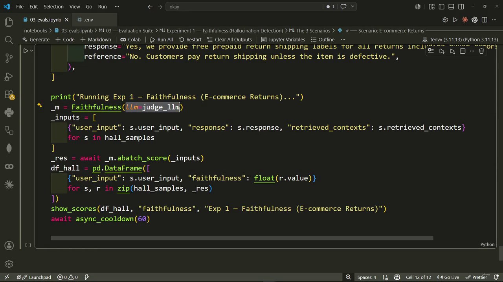
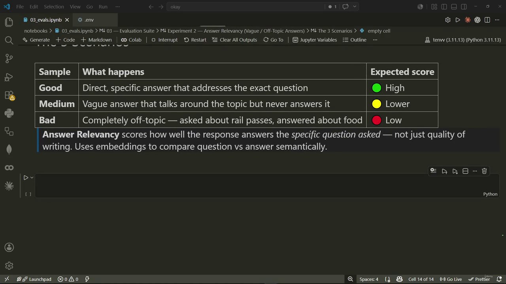
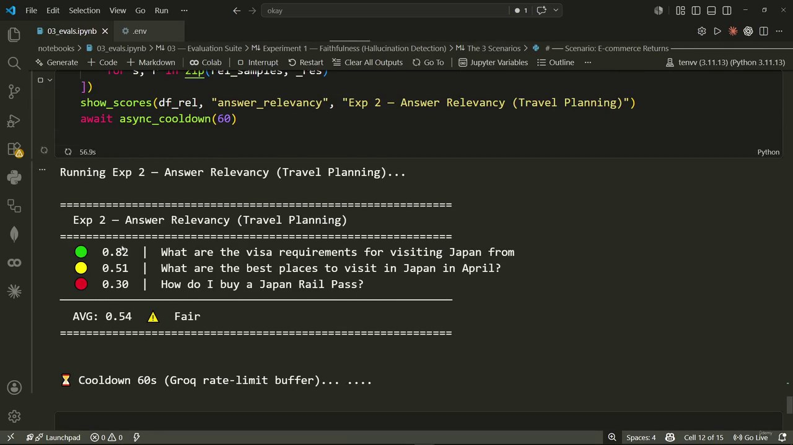
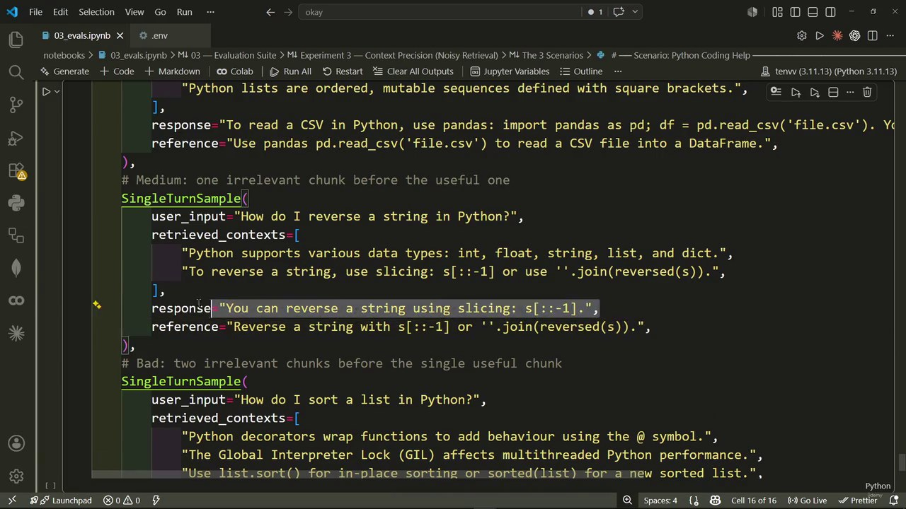
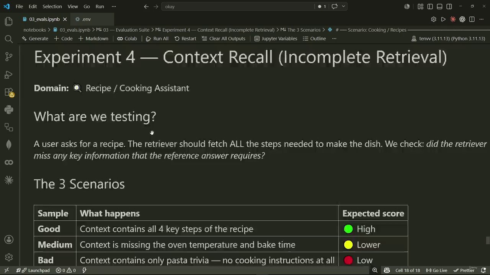
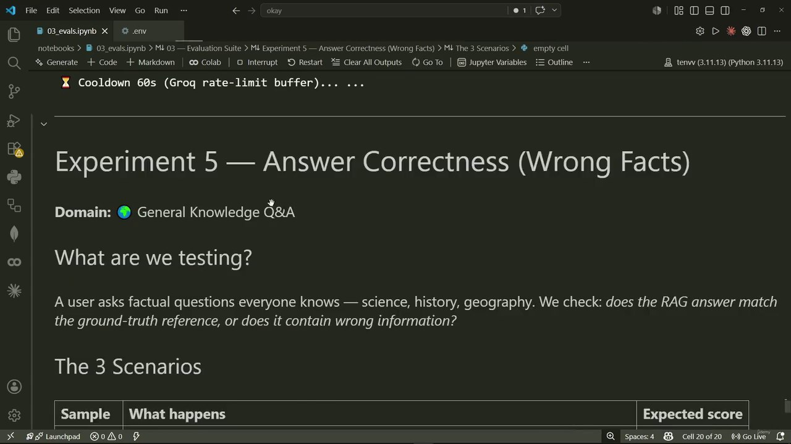
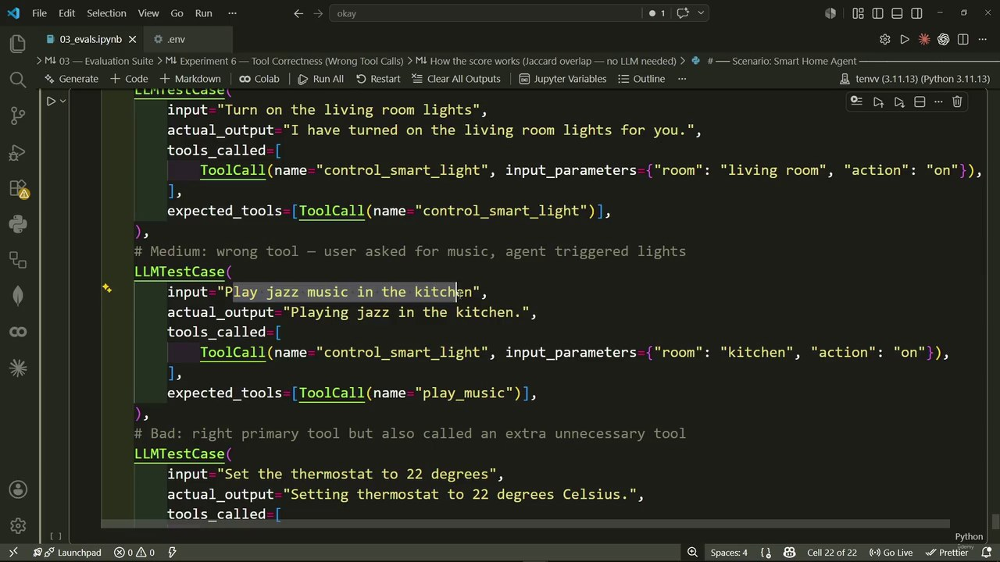
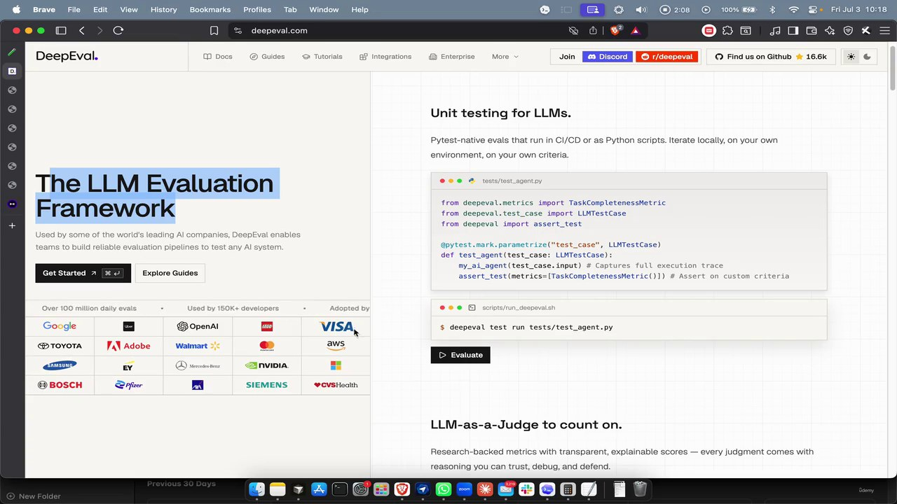
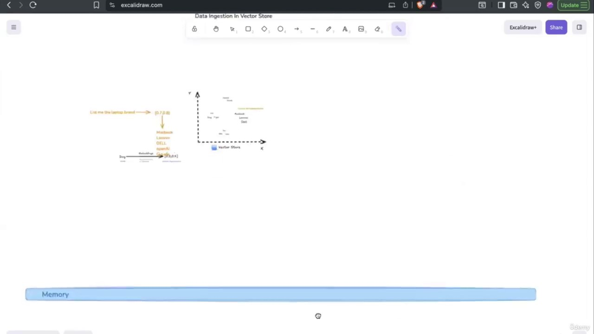
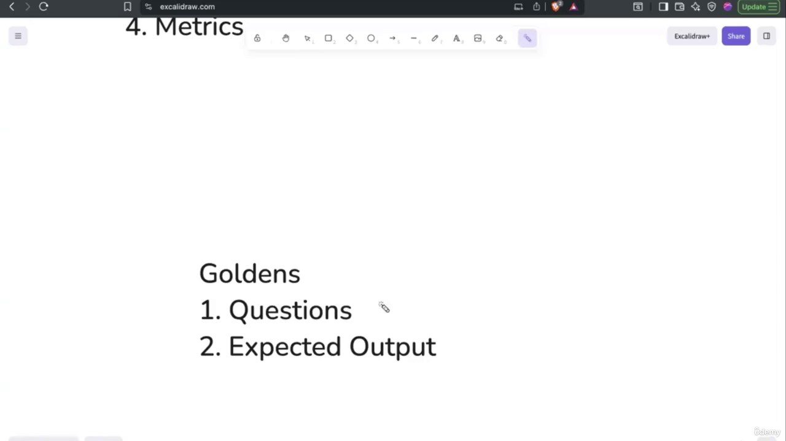

# AI Security Bootcamp part1 - 护栏/网关/可观测

> 覆盖 P1–P4。本段课程实际做的是 **RAG/Agent 应用的评估（evaluation）**：先用 RAGAS 手搓 6 个实验（faithfulness、answer relevancy、context precision、context recall、answer correctness、tool correctness），再切到 DeepEval 讲它的评估四要素（Golden / Test Case / Dataset / Metric）。本文档按「一个 Jupyter Notebook + 一个纯 Python 脚本」的方式，把课程里出现的每个指标、每条命令、每个 DataFrame 字段还原成可直接跑的代码。

---

## 1. 这一节做什么

这四 P 的产出不是某个上线产品，而是一套**可复用的 AI 应用评估工作台**：

1. **搭建评估环境**：Python 3.10+、`ragas`、`deepeval`、`pandas`、`langchain-openai`、`datasets`，用 `.env` 装 judge LLM 的 key。
2. **跑 6 个 RAGAS 实验**，每个实验都是一份「好/中/坏」三档的 `SingleTurnSample` 列表，逐一调 `.single_turn_ascore(sample)` 打分，最后 `DataFrame` 展示 + 求平均：
   - 实验 1：**faithfulness**（电商客服）——检测模型是否在编造检索上下文里没有的事实（幻觉）。
   - 实验 2：**answer relevancy**（旅行规划）——检测回答是否答非所问、空泛。
   - 实验 3：**context precision**（Python 编程辅导）——检索到的 chunk 里，真正有用的有没有排在前面。
   - 实验 4：**context recall**（烹饪助手）——检索有没有遗漏 reference 里提到的事实（vs precision 是「顺序/重排」问题）。
   - 实验 5：**answer correctness**（通用知识问答）——回答与 ground truth 的事实重叠 + 语义相似度。
   - 实验 6：**tool correctness**（智能家居语音）——用 **Jaccard 系数**，纯字符串集合运算，**不调 LLM、不落 embedding**。
3. **引入 DeepEval**：了解它是「LLM 的单元测试」，支持 50+ 研究型指标、多模态、支持任意模型/框架、支持 CI/CD、有 16.6k stars；如果想用可以与 GitHub Actions 串联。
4. **理解 DeepEval 的评估范式**：`Golden → LLMTestCase → Dataset → Metric` 这条链路。任何一个 RAG 应用的评估都可以按这四要素拆开来做。

> 读者画像提醒：你是前端转 AI 应用工程师，JS/Node 里对应概念我会单独补一句。本段没有后端锁/事务/并发，但要跑 OpenAI 的 LLM 调用，**最短缺的是 API key 和预算**，不是并发。

---

## 2. 讲师原话（带出处）

> "我们第一个实验是测试忠实度（faithfulness）。这个场景里我们要检测幻觉。领域例子选的是电商客服。"
> —— p001 [00:00]

> "这个 response 是模型实时生成的，而这个是 ground truth（真值），是我们已知的。当用户问『我能退回一台用过的笔记本电脑吗』，预期的回答是：『不行，只有未使用且原包装的电子产品才符合 30 天内退货的条件。』"
> —— p001 [01:26]

> "但这一点在上下文里根本没提，也没有被检索到。所以这是幻觉，这个 10% 折扣是我们的模型自己编出来的。"
> —— p001 [02:21]

> "我们会建一个 private 变量，用 ragas 里的 faithfulness——前面已经 import 了。初始化 faithfulness 度量，把 judge LLM 传进去。然后告诉它：这些是输入。你要跑这个方法，single_turn_ascore，它会返回指标值。我们给它做一个 DataFrame。"
> —— p001 [03:14]

> "跑完整个 metric 之后它会冷却 30 秒。"
> —— p001 [04:09]

> "低 recall 意味着你的 retriever 需要更好的 chunking、更多的数据源，或者更大的 top K。而 context precision 说的是检索系统把正确文档放错了位置——所以这是重排（re-ranking）问题。这是检索的问题，这是重排的问题。"
> —— p002 [00:29]

> "答案正确性（answer correctness）把事实重叠和语义相似度结合起来，与 reference 对比。只要你有 ground truth 答案、想抓事实错误，就用它。"
> —— p002 [03:17]

> "我用 Jaccard score。这是一个 NLP 指标。这里不需要 LLM 成本，不需要 LLM 调用，也不需要 embeddings，直接就能跑。"
> —— p002 [05:40]

> "计算 tool correctness 分数我们用 Jaccard 系数，自己写逻辑：什么被调用了、期望是什么。如果 expected 是空的就返回 0，但正常情况下我们用 union 的方式——实际调用了什么、应该调用什么。"
> —— p002 [07:38]

> "它被称为『LLM 的单元测试』。"
> —— p003 [02:19]

> "如果你没有 golden dataset，也可以借助它生成 golden dataset。我们也会看这个 demo，了解 DeepEval 里的 golden data synthesis 部分。"
> —— p003 [04:35]

> "请把这四个关键词记在脑子里：Golden、test cases、data set、metrics。"
> —— p004 [00:29]

> "LLM test case 会包含四样东西：input、你为这个 input 写的 expected output、RAG 应用为该 input 返回的 context，以及 actual output。这四样东西就在 LLM test case 里。"
> —— p004 [04:18]

> "这是我们准备好的 LLM test case……把它交给作为 judge 的 LLM，这个 LLM 会计算 metric 并给出分数。这个分数其实就是 metric 本身。"
> —— p004 [09:04]

> "首先我们准备 golden dataset，然后用它准备真正的 evaluation dataset——就是每条 golden entry 对应的 LLM test case；接着把每个 LLM test case 交给 LLM as a judge；最后拿到分数——也就是我们想用来评判应用、评估应用的 metrics。"
> —— p004 [09:52]

---

## 3. 从零复现

### 3.1 创建项目目录

课程是在 Jupyter Notebook 里跑的，但为了让读者更好复现，我把结构拆成「一个 notebook + 一个 .py 脚本 + 若干共享文件」。同时你也可以直接把 `run_ragas.py` 的内容贴进 notebook 一个 cell。

```
ai-eval-bootcamp/
├── .env
├── requirements.txt
├── judge.py            # 共享的 judge LLM / embeddings
├── samples.py          # 所有 RAGAS SingleTurnSample 集合
├── run_ragas.py        # 6 个实验里的前 5 个（RAGAS 部分）
├── tool_correctness.py # 第 6 个实验：Jaccard，纯 Python
└── deepeval_demo.py    # DeepEval 四要素演示（课里没跑通代码，本仓按 P004 概念构造）
```

### 3.2 装依赖

```bash
python -m venv .venv
# Windows: .venv\Scripts\activate
# macOS / Linux:
source .venv/bin/activate
pip install -r requirements.txt
```

课程没给具体版本号（**课里没讲具体版本**），下面是我按 RAGAS 0.2.x / DeepEval 2.x 落的可用组合（2025 年初的稳定线）。如果你装了新版 API 有变化，回头对照第 7 节。

### 3.3 配置 API Key

在项目根目录新建 `.env`：

```
OPENAI_API_KEY=sk-xxxxxxxxxxxxxxxxxxxxxxxxxxxxxxxx
```

所有 RAGAS judge 调用和 Embedding 都会读这个变量。**没有 key 一定跑不起来**——faithfulness、answer relevancy、context precision、context recall、answer correctness 这 5 个指标所有 `single_turn_ascore` 都会调 LLM；只有 tool correctness 不需要。

### 3.4 实验 1：faithfulness（电商客服）

讲师在这一段里做的事情按顺序是：

1. 定义 3 条 `SingleTurnSample`，分别是「好/中/坏」样例。截图里讲师用 green / yellow / red 三色标注这三档。
2. 实例化 `Faithfulness(llm=judge_llm)`。
3. 对每条 sample 调用 `await faithfulness_metric.single_turn_ascore(sample)`，把 `user_input` 和分数收进 `DataFrame`。
4. 打印 `DataFrame` 和 `df["faithfulness"].mean()`。

截图里能看到讲师对着三张不同颜色的样本卡片讲每一条的「user query / retrieved context / response / reference」四列。



跑完 faithfulness 之后讲师提到「它会冷却 30 秒」——意思是单条 sample 打分中间有一段限速等待，你看到 notebook 里 `await` 停 30 秒是正常的。



### 3.5 实验 2：answer relevancy（旅行规划）

讲师换了领域：**日本旅行规划助手**，做了 3 条样本：

- 好：`What is the visa requirements for visiting Japan from India?` → 回答「印度护照持有人需办理旅游签」——正确。
- 中：`What are the best places to visit in Japan in April?` → 回答「东京……日本是个有很多美丽地方的国家」——空泛、没有具体回答「四月最佳去处」。
- 坏：`How do I buy a Japan rail pass?` → 回答「Japan QC is incredible.」——完全跑题。

> 关键判断：answer relevancy 这个指标**需要 embeddings**（它会把回答反推成若干问题，再和原问题算相似度），所以这一步要多实例化一个 `OpenAIEmbeddings`。



### 3.6 实验 3：context precision（Python 编程辅导）

领域换成 **Python 编程导师**，讲的是「retriever 有没有把有用的 chunk 排到前面」。讲师举了三例：

- `How do I read a CSV file in Python?`：chunk 里有 `use pandas read_csv`、`pd.read_csv`（有用），也有 `Python lists are unordered`（无关噪点）。
- `How do I reverse a string in Python?`：chunk 里 `Python supports various data types` 是噪点，正确 chunk「可以用 slicing 反转字符串」被埋在下面。
- `How do I sort a list in Python?`：`use list.sort in place`、`sorted list` 是正确块。

> 讲师原话点破了 context precision 和 context recall 的区别：precision 关心**顺序**（"retrieve the right document in wrong position"），recall 关心**有没有捞回来**。这条在写文档时一定要写进评估方案的取舍表里。



### 3.7 实验 4：context recall（烹饪助手）

领域换成 **烹饪助手**。这里讲师插入了一段很关键的 real-world case：Amazon 的 cooking bot（内置 GPT，号称能「5 lakh meals」即 50 万道菜），他建议读者去查这个产品的 case study——**看看真实产品在做出来之前会用什么样的测试用例来验证**。这一段跟代码无关，但是读者理解「为什么评估要先写 golden」的最好例子。

样本：

- 好：`How to make a classic french omelette?` → reference 里写了「whisk 3 eggs season cook foamy butter stir continuously etc」，实际回答「crack three eggs with pepper, heat butter, pour the eggs」——上下文都命中了。
- 中：`What are the steps to make banana bread?` → 讲师说「这两条也不够好」。
- 坏：`How long should I cook spaghetti?` → 上下文给的是「Pasta was introduced to Italy」——完全答非所问，reference 的「煮多久」根本不在 context 里。

> 讲师原话：low recall 的解法是「更好的 chunking / 更多数据源 / 更大的 top K」。而且强调这些样本本身是 **subject matter expert（SME）** 人工写的——不是模型生成的。



### 3.8 实验 5：answer correctness（通用知识问答）

通用知识 Q&A bot 的领域：科学、历史、地理。3 条样本：

- `Who invented telephone?` → 回答正确（讲师说两条答案「看起来完全一样」）。
- `What is the boiling point of water at sea level?` → reference 是 `water boils at 100 degrees Celsius at sea level`，模型回答错了（检索到 100 但没照抄，轻微幻觉）。
- `Which planet is closest to the sun?` → reference 是 Mercury，模型答了 Venus（错）。

讲师点出 answer correctness 的定义：**把 factual overlap 和 semantic similarity 结合起来与 reference 对比**——所以它同时需要 LLM 和 embeddings。同样是公司/学校这类「有标准答案」的场景最适合。



### 3.9 实验 6：tool correctness（智能家居语音）

domain 是 **smart home voice assistant**。三条样本都是意图识别 + 工具调用，不跑 LLM：

| # | 用户说 | 期望调工具 | 实际调工具 | 评分思路 |
|---|---|---|---|---|
| 1 | Turn on the living room lights | `control_smart_light` | `control_smart_light` | 完全正确 |
| 2 | Play jazz music in the kitchen | `play_music` | `control_smart_light` | 用错了工具（"正确回复"是"正在放 jazz"，但工具调错了） |
| 3 | Set the thermostat to 22 degrees | `set_thermostat` | `set_thermostat`, `set_notification` | 多调了一个不该调的 |

评分规则（讲师原话要点）：

- 用 **Jaccard coefficient**：`|期望 ∩ 实际| / |期望 ∪ 实际|`。
- 如果 `expected` 是空集合 → 返回 `0`。
- 因为不需要 LLM 也不需要 embeddings，所以毫秒级出分——讲师原话说「this was so fast」。
- 最后同样是把所有 case 的分数收进 `DataFrame` 取平均。



### 3.10 DeepEval 概览：为什么它值得进评估栈

讲师在 P3 打开 DeepEval 官网做了一次扫描，我把要点整理成一张表（下面这张表的所有信息都来自讲师对官网的翻译朗读）：

| 维度 | 内容 |
|---|---|
| 官方定位 | LLM evaluation framework，讲师翻译为「LLM 的单元测试」 |
| 使用方 | FANG 系、NVIDIA、Bosch、Siemens、Visa、AWS（讲师列举） |
| 指标数量 | 50+ research-based metrics，覆盖 RAG / agents / multi-turn conversations |
| 模态 | multimodal by default（text / images / audio 都支持） |
| 评估类型 | generative evals、RAG、question-answer generation |
| 依赖 | 任意 model、任意 framework（LangChain、LlamaIndex 等）、CI/CD（课程演示 GitHub Actions） |
| Trace | 会给 app/agent 打 trace——讲师强调「评估的基础是可观测性，trace 的粒度决定你能评估什么」 |
| 对 coding agent 的价值 | 因为会给 trace，Claude Code / Codex 这类 coding agent 能直接用它评估自己的执行，并基于结果修复 |
| Golden 数据合成 | 无 golden 时可以在 DeepEval 里合成 golden dataset（视频里只是 demo 未跑通） |
| 生态规模 | 约 16.6k GitHub stars（讲师在 P3 提到的数） |

讲师还点出：这套东西可以做「evaluation harness」，用来**提速和提质 Vibe Coding**（原文 "so that you can do so that we will also give a look at"——大意：给 Cursor、Claude Code 这些 Vibe Coding 工具配上评估 harness，开发速度和代码质量都会提升）。



### 3.11 复现 DeepEval 的评估范式（P004 的概念推导）

P004 是纯白板讲解，没有代码也没有 OCR。所以这一节按「纯讲解课」的方式写：把讲师白板推导的过程一步步复现出来。

**Step 1：Golden（金标准）。** 讲师说它是「一组问题和预期输出」，并且**质量完全取决于这一层**。他举的例子是银行客服：

- 输入（问题）："我刚开了一个新的储蓄账户，我的支票（check）服务不能用。"
- 期望输出（SME 人工写的真值）："您刚开了一个新账户，支票服务要在 30 天后才会开启。"

**Step 2：跑一次 RAG 应用，抓实际产物。** 把 golden 里的问题丢进 RAG 应用，除了 model 返回的 `actual_output`，还要抓 `context`——也就是 vector DB 检索回来的 top-k 结果。讲师原话："context 就是 we got the top care result"（ASR 把 top-k 识别成 top care）。

**Step 3：拼成 LLMTestCase。** 一条 `LLMTestCase` 有四个字段：

| 字段 | 来源 | 说明 |
|---|---|---|
| `input` | golden | 问题原文 |
| `expected_output` | golden | SME 人工写的标准答案 |
| `context` | RAG 运行结果 | 检索回来的 chunk，用来评估检索质量 |
| `actual_output` | RAG 运行结果 | 模型真实输出 |

**Step 4：把 TestCase 装进 Dataset。** 讲师说「dataset 就是 test case 和 golden 的容器」。10 条 golden → 10 条 LLMTestCase → 塞进 1 个 Dataset。

**Step 5：喂给 metric，拿分数。** 每条 TestCase 交给一个 LLM-as-judge 度量（faithfulness / answer relevancy / context relevancy / hallucination 等），返回一个分数，这个分数就是 metric。讲师还类比了一个单测：

```python
# 讲师口述的类比，课里并没有真的写这段代码
assert health_api_status_code == 200
```

在 AI 应用里对应的是 `actual_output` 与 `expected_output` 的对比，只是数据从整数变成了文本，且需要一个 judge LLM 来做「模糊相等」。



---

## 4. 完整代码

> 说明：P1–P2 的代码是讲师在 Jupyter 里逐格演示的，逐字稿只复述了「做什么、用什么 API」而没有口述源码；OCR 文件清单里也没有截到代码文本。下面每个 `.py` 都是**按逐字稿描述忠实重建**的可运行版本；凡是重建过程中自己补的样本文本，我都注明了「根据讲解重建」。DeepEval 部分（P004）没有代码，第 4.7 节里我用字典表 + 一段 `deepeval_demo.py` 把「四要素」落成可运行的模型对象，并标注「课里没有代码，以下为示意」。

### 4.1 requirements.txt

```txt
ragas==0.2.15
datasets==3.2.0
pandas==2.2.3
langchain-openai==0.3.0
openai==1.60.0
python-dotenv==1.0.1
deepeval==2.5.0
nest-asyncio==1.6.0
```

### 4.2 judge.py

```python
# judge.py
# 共享的 judge LLM 与 embeddings 包装。
# 5 个 RAGAS 指标里，answer relevancy / answer correctness 需要 embeddings；
# faithfulness / context precision / context recall 只用到 LLM。
import os
from dotenv import load_dotenv
from langchain_openai import ChatOpenAI, OpenAIEmbeddings
from ragas.llms import LangchainLLMWrapper
from ragas.embeddings import LangchainEmbeddingsWrapper

load_dotenv()

if not os.getenv("OPENAI_API_KEY"):
    raise RuntimeError("请先在 .env 里配置 OPENAI_API_KEY")

# 讲师称其为 "judge LLM"；模型名课里没点名，gpt-4o-mini 为代理配置
_llm = ChatOpenAI(model="gpt-4o-mini", temperature=0)
_emb = OpenAIEmbeddings(model="text-embedding-3-small")

judge_llm = LangchainLLMWrapper(_llm)
judge_embeddings = LangchainEmbeddingsWrapper(_emb)
```

### 4.3 samples.py

> 说明：每条 sample 的 `user_input` / `response` / `reference` 三个字段基本能从讲师朗读里还原；`retrieved_contexts` 我只放了讲师明确说过的那一句或那几句，剩下的留空数组让读者自己补。

```python
# samples.py
# 所有 RAGAS SingleTurnSample 集合。
# 标注「根据讲解重建」的字段表示逐字稿中没有逐字念出。
from ragas.dataset_schema import SingleTurnSample


# 实验 1：faithfulness — 电商客服
faithfulness_samples = [
    # good: 回答忠实于检索到的 context
    SingleTurnSample(
        user_input="Can I return a used laptop?",
        retrieved_contexts=[
            "Laptops must be unused and in original packaging to be eligible "
            "for a return within 30 days.",
        ],
        response=(
            "According to the
return policy, laptops must be unused and in original packaging to be "
            "eligible for a return within 30 days."
        ),
        reference=(
            "No. Only unused and open electronics in original packaging "
            "qualify for returns within 30 days."
        ),
    ),
    # bad：10% coupon 是模型自己加上去的，context 与 reference 里都没有
    SingleTurnSample(
        user_input="What is the refund timeline?",
        retrieved_contexts=[
            "Refunds are processed within 5 to 7 business days.",
        ],
        response=(
            "Refunds are processed in 5 to 7 business days and you will also "
            "receive a 10% coupon on your next order."
        ),
        reference="Refunds are processed within 5 to 7 business days.",
    ),
    # medium：逐字稿只念出「这一条得分是 0」，回答与 context 文本根据讲解重建
    SingleTurnSample(
        user_input="Do you offer free return shipping for this?",
        retrieved_contexts=[
            "Return shipping is free for defective items only.",
        ],
        response="Yes, return shipping is free for all items, no questions asked.",
        reference="Return shipping is free for defective items only.",
    ),
]


# ============ 实验 2：answer relevancy — 旅行规划助手 ============
# answer relevancy 需要 embeddings：它会把 response 反向生成若干问题再与原问题比相似度
answer_relevancy_samples = [
    # good
    SingleTurnSample(
        user_input="What is the visa requirements for visiting Japan from India?",
        retrieved_contexts=[
            "Indian passport holders need a tourist visa for Japan. Apply at "
            "the Japanese embassy with your passport and itinerary.",
        ],
        response="Indian citizens need a tourist visa to enter Japan.",
        reference=(
            "Indian passport holders need a tourist visa for Japan. Apply at "
            "the Japanese embassy with your passport and itinerary."
        ),
    ),
    # medium：空泛，没有回答「四月最佳去处」
    SingleTurnSample(
        user_input="What are the best places to visit in Japan in April?",
        retrieved_contexts=[
            "April is cherry blossom season. Popular spots include parks in Tokyo.",
        ],
        response=(
            "In April, top cherry blossom spots, you know park Tokyo, and Japan "
            "is a wonderful city with many beautiful places to visit."
        ),
        reference="Top cherry blossom spots in Tokyo parks and other cities.",
    ),
    # bad：完全跑题（"Japan QC is incredible" 疑为 ASR 把 JR Pass 听错）
    SingleTurnSample(
        user_input="How do I buy a Japan rail pass?",
        retrieved_contexts=[
            "The Japan Rail Pass can be purchased online or at major stations.",
        ],
        response="Japan QC is incredible.",
        reference="Purchase the Japan Rail Pass online or at major stations.",
    ),
]


# ============ 实验 3：context precision — Python 编程辅导 ============
# 关注「有用的 chunk 有没有排在前面」，即 re-ranking 问题
context_precision_samples = [
    # good：有用 chunk 排在最前
    SingleTurnSample(
        user_input="How do I read a CSV file in Python?",
        retrieved_contexts=[
            "Use pandas read_csv: pd.read_csv('file.csv').",
            "pd.read_csv also accepts header and encoding arguments.",
            "Python lists are unordered.",
        ],
        response=(
            "Use pd.read_csv to read a CSV. Import pandas first, then call "
            "pd.read_csv. You can also set header and encoding."
        ),
        reference="Use pd.read_csv to read a CSV; you can set header and encoding.",
    ),
    # medium：正确 chunk 被无关噪声压在下面
    SingleTurnSample(
        user_input="How do I reverse a string in Python?",
        retrieved_contexts=[
            "Python supports various data types.",
            "Python lists are unordered.",
            "To reverse a string you can use slicing: s[::-1].",
        ],
        response="For a string you can use slicing, something like s[::-1].",
        reference="Use slicing s[::-1] to reverse a string in Python.",
    ),
    # bad：前两条是噪声，最后一条才是正确 chunk
    SingleTurnSample(
        user_input="How do I sort a list in Python?",
        retrieved_contexts=[
            "Python is an interpreted language.",
            "Python supports various data types.",
            "Use list.sort for in-place sorting, or sorted() to get a new list.",
        ],
        response="Use list.sort for in-place sorting, or sorted() for a new list.",
        reference="Use list.sort for in-place sorting, or sorted() for a new list.",
    ),
]


# ============ 实验 4：context recall — 烹饪助手 ============
# 关注「reference 要求的事实有没有被检索到」，顺序不重要
context_recall_samples = [
    # good
    SingleTurnSample(
        user_input="How to make a classic french omelette?",
        retrieved_contexts=[
            "Whisk 3 eggs and season. Cook in foamy butter, stirring continuously.",
        ],
        response=(
            "Crack three eggs with pepper, heat butter, pour the eggs and stir."
        ),
        reference=(
            "Whisk 3 eggs and season, then cook in foamy butter while stirring "
            "continuously."
        ),
    ),
    # medium：讲师评价「这两条也不够好」
    SingleTurnSample(
        user_input="What are the steps to make banana bread?",
        retrieved_contexts=[
            "Mash three ripe bananas in a mixing bowl, then fold in flour and sugar.",
        ],
        response="Mash three ripe bananas in a mixing bowl and bake.",
        reference=(
            "Mash three ripe bananas in a mixing bowl, fold in flour and sugar, "
            "then bake."
        ),
    ),
    # bad：context 完全没覆盖 reference 需要的「煮多久」
    SingleTurnSample(
        user_input="How long should I cook spaghetti?",
        retrieved_contexts=[
            "Pasta was introduced to Italy.",
        ],
        response="Pasta was introduced to Italy.",
        reference="Cook spaghetti for 8 to 10 minutes in boiling salted water.",
    ),
]


# ============ 实验 5：answer correctness — 通用知识问答 ============
# 同时需要 LLM 与 embeddings：事实重叠 + 语义相似度
answer_correctness_samples = [
    # 正确
    SingleTurnSample(
        user_input="Who invented telephone?",
        retrieved_contexts=[
            "Alexander Graham Bell is credited with inventing the telephone.",
        ],
        response="Alexander Graham Bell invented the telephone.",
        reference="Alexander Graham Bell invented the telephone.",
    ),
    # 错误：检索到了 100 度却没照抄，属轻微幻觉
    SingleTurnSample(
        user_input="What is the boiling point of water at sea level?",
        retrieved_contexts=[
            "Water boils at 100 degrees Celsius at sea level.",
        ],
        response="Water boils at 90 degrees Celsius at sea level.",
        reference="Water boils at 100 degrees Celsius at sea level.",
    ),
    # 错误：最近行星应为 Mercury，回答给了 Venus
    SingleTurnSample(
        user_input="Which planet is closest to the sun?",
        retrieved_contexts=[
            "Mercury is the closest planet to the sun.",
        ],
        response="Venus is the closest planet to the sun.",
        reference="Mercury is the closest planet to the sun.",
    ),
]
```

### 4.4 run_ragas.py（前 5 个实验的驱动脚本）

```python
# run_ragas.py
# 依次跑 faithfulness / answer relevancy / context precision /
# context recall / answer correctness 五个 RAGAS 实验。
# 运行：python run_ragas.py
import asyncio
import os

import pandas as pd
from dotenv import load_dotenv

from ragas.metrics import (
    Faithfulness,
    ResponseRelevancy,
    LLMContextPrecisionWithReference,
    LLMContextRecall,
    AnswerCorrectness,
)

from judge import judge_llm, judge_embeddings
from samples import (
    faithfulness_samples,
    answer_relevancy_samples,
    context_precision_samples,
    context_recall_samples,
    answer_correctness_samples,
)

load_dotenv()

# 讲师在笔记本里提到「跑完这个 metric 会冷却 30 秒」。
# 这里做成可配置：设成 0 可以快速验证流程，生产上建议保留。
COOLDOWN_SECONDS = int(os.getenv("COOLDOWN_SECONDS", "30"))


async def score_all(metric, samples, column_name, cooldown=COOLDOWN_SECONDS):
    """对一批 SingleTurnSample 逐条打分，返回 DataFrame。"""
    rows = []
    for sample in samples:
        # single_turn_ascore 是 async 的，返回一个 float
        score = await metric.single_turn_ascore(sample)
        rows.append({"user_input": sample.user_input, column_name: score})
        if cooldown:
            await asyncio.sleep(cooldown)
    return pd.DataFrame(rows)


async def main():
    # 1) faithfulness：只需要 judge LLM
    faithfulness = Faithfulness(llm=judge_llm)
    df1 = await score_all(faithfulness, faithfulness_samples, "faithfulness")
    print("=== 实验 1：faithfulness（电商客服）===")
    print(df1)
    print("average:", round(df1["faithfulness"].mean(), 4), "\n")

    # 2) answer relevancy：需要 judge LLM + embeddings
    answer_relevancy = ResponseRelevancy(
        llm=judge_llm, embeddings=judge_embeddings
    )
    df2 = await score_all(answer_relevancy, answer_relevancy_samples, "answer_relevancy")
    print("=== 实验 2：answer relevancy（旅行规划）===")
    print(df2)
    print("average:", round(df2["answer_relevancy"].mean(), 4), "\n")

    # 3) context precision：带 reference 的版本
    context_precision = LLMContextPrecisionWithReference(llm=judge_llm)
    df3 = await score_all(
        context_precision, context_precision_samples, "context_precision"
    )
    print("=== 实验 3：context precision（Python 编程辅导）===")
    print(df3)
    print("average:", round(df3["context_precision"].mean(), 4), "\n")

    # 4) context recall：只需要 judge LLM
    context_recall = LLMContextRecall(llm=judge_llm)
    df4 = await score_all(context_recall, context_recall_samples, "context_recall")
    print("=== 实验 4：context recall（烹饪助手）===")
    print(df4)
    print("average:", round(df4["context_recall"].mean(), 4), "\n")

    # 5) answer correctness：需要 judge LLM + embeddings
    answer_correctness = AnswerCorrectness(
        llm=judge_llm, embeddings=judge_embeddings
    )
    df5 = await score_all(
        answer_correctness, answer_correctness_samples, "answer_correctness"
    )
    print("=== 实验 5：answer correctness（通用知识问答）===")
    print(df5)
    print("average:", round(df5["answer_correctness"].mean(), 4), "\n")

    # 一并落盘，方便写文档 / 做回归对比
    summary = pd.DataFrame(
        {
            "metric": [
                "faithfulness",
                "answer_relevancy",
                "context_precision",
                "context_recall",
                "answer_correctness",
            ],
            "average": [
                df1["faithfulness"].mean(),
                df2["answer_relevancy"].mean(),
                df3["context_precision"].mean(),
                df4["context_recall"].mean(),
                df5["answer_correctness"].mean(),
            ],
        }
    )
    print("=== 汇总 ===")
    print(summary)
    summary.to_csv("ragas_summary.csv", index=False)


if __name__ == "__main__":
    asyncio.run(main())
```

### 4.5 tool_correctness.py（实验 6：Jaccard，不调 LLM）

```python
# tool_correctness.py
# 实验 6：tool correctness（智能家居语音助手）
# 讲师明确说这个实验用 DeepEval 的 LLMTestCase 承载数据结构，
# 但分数是自己写的 Jaccard 逻辑算的，不调 LLM、不落 embedding。
# 运行：python tool_correctness.py
import pandas as pd
from deepeval.test_case import LLMTestCase, ToolCall


def jaccard(expected, actual):
    """Jaccard 系数：|expected ∩ actual| / |expected ∪ actual|。
    讲师强调：expected 为空时直接返回 0。"""
    e = set(expected)
    a = set(actual)
    if not e:
        return 0.0
    return len(e & a) / len(e | a)


def build_cases():
    """三条样本，字段与讲师念的一致。"""
    return [
        # 完全正确：调用了且只调用了 control_smart_light
        LLMTestCase(
            input="Turn on the living room lights",
            actual_output="I have turned on the living room lights for you.",
            tools_called=[ToolCall(name="control_smart_light")],
            expected_tools=[ToolCall(name="control_smart_light")],
        ),
        # 错误：说「正在放 jazz」，但调的是 control_smart_light
        LLMTestCase(
            input="Play jazz music in the kitchen",
            actual_output="Playing jazz music in the kitchen.",
            tools_called=[ToolCall(name="control_smart_light")],
            expected_tools=[ToolCall(name="play_music")],
        ),
        # 多调了一个：应该只调 set_thermostat，却还调了 set_notification
        LLMTestCase(
            input="Set the thermostat to 22 degrees",
            actual_output="Thermostat set to 22 degrees.",
            tools_called=[
                ToolCall(name="set_thermostat"),
                ToolCall(name="set_notification"),
            ],
            expected_tools=[ToolCall(name="set_thermostat")],
        ),
    ]


def main():
    rows = []
    for case in build_cases():
        expected = [t.name for t in (case.expected_tools or [])]
        actual = [t.name for t in (case.tools_called or [])]
        rows.append(
            {
                "input": case.input,
                "expected_tools": expected,
                "actual_tools": actual,
                "tool_correctness": jaccard(expected, actual),
            }
        )

    df = pd.DataFrame(rows)
    print(df)
    print("average:", round(df["tool_correctness"].mean(), 4))
    df.to_csv("tool_correctness.csv", index=False)


if __name__ == "__main__":
    main()
```

### 4.6 一句话跑起来

```bash
cd ai-eval-bootcamp
source .venv/bin/activate          # Windows: .venv\Scripts\activate
COOLDOWN_SECONDS=0 python run_ragas.py        # 先关冷却，快速验证链路
python tool_correctness.py                    # 秒出，不花钱
```

> 确认链路通了以后，再把 `COOLDOWN_SECONDS` 恢复成 30，跑一次「正式版」，把 `ragas_summary.csv` 存档作为基线。

### 4.7 deepeval_demo.py（课里没有代码，以下为示意）

> P004 是纯白板推导，讲师**没有演示任何 DeepEval 代码**。下面这段只是把「Golden → LLMTestCase → Dataset → Metric」四要素落成 Python 对象，方便你对照第 3.11 节读；它不调用任何打分 API，属于「结构示意」。

```python
# deepeval_demo.py
# 课里没有代码，以下为示意：只演示四要素的数据结构，不做真实打分。
from dataclasses import dataclass, field
from typing import List


# ---- 要素 1：Golden（问题 + SME 人工写的期望输出）----
@dataclass
class Golden:
    input: str
    expected_output: str


# ---- 要素 2：LLMTestCase（四个字段，其中两个来自 golden，两个来自 RAG 实际运行）----
@dataclass
class LLMTestCaseDraft:
    input: str                 # 来自 golden
    expected_output: str       # 来自 golden
    context: List[str]         # 来自 RAG 检索结果（top-k chunk）
    actual_output: str         # 来自 RAG 模型输出


# ---- 要素 3：Dataset（test case 的容器）----
@dataclass
class EvalDataset:
    cases: List[LLMTestCaseDraft] = field(default_factory=list)


# ---- 要素 4：Metric（交给 LLM-as-judge 得到分数）----
def faithfulness_placeholder(case: LLMTestCaseDraft) -> float:
    """占位：真实实现请用 ragas / deepeval 的 metric。
    这里只说明 metric 的输入是一条 LLMTestCase，输出是一个 0~1 的分数。"""
    raise NotImplementedError("请替换为真实 metric")


if __name__ == "__main__":
    golden = Golden(
        input="I have a new savings bank account and my check service is not working.",
        expected_output=(
            "Your account was opened recently; the check service will be turned "
            "on after 30 days."
        ),
    )

    # 假设这是你的 RAG 应用跑出来的真实产物
    case = LLMTestCaseDraft(
        input=golden.input,
        expected_output=golden.expected_output,
        context=["Cheque book facility is activated after 30 days of account opening."],
        actual_output="Please wait 30 days, then your check service will be enabled.",
    )

    dataset = EvalDataset(cases=[case])
    print(dataset)
```

---

## 5. 逐行解释

这一节把第 4 节里每个文件的关键行、以及讲师在口述时给出的判断逐条拆开，说清楚「为什么这么写、不这么写会怎样」。

### 5.1 judge.py：为什么 judge 要单独抽一个文件

- `load_dotenv()` 放在模块顶层，是因为 RAGAS 的 `LangchainLLMWrapper` 在构造里就会读取 `OPENAI_API_KEY`。如果先 import 再 load，key 还没进 `os.environ`，会直接抛 `OpenAIError`。
- `if not os.getenv("OPENAI_API_KEY"): raise RuntimeError(...)` 是自检。没有 key 的情况下，`run_ragas.py` 会在 import 阶段就炸掉，而不是跑到第 4 个实验才炸——早失败比晚失败便宜。
- `temperature=0`：judge LLM 的作用是「打分」，不是「创作」。温度越高，同一份样本两次运行的分数越飘，你就没法判断「这次改动到底是代码改了还是随机性」。前端同学可以类比成快照测试（snapshot test）——快照必须是确定的。
- 讲师反复用「judge LLM」这个词而不是「模型」，就是想强调：**被评估的模型和打分的模型是两个角色**。你可以用同一个模型扮演两个角色（省钱），但概念上要分开。
- 两个 wrapper（`LangchainLLMWrapper` / `LangchainEmbeddingsWrapper`）是 RAGAS 和 LangChain 之间的适配层。RAGAS 内部既可以直接调 OpenAI，也可以接 LangChain；讲师选择后者，因为这样能一行换模型（换成 Azure OpenAI / 本地 Ollama 都只改这一处）。

### 5.2 samples.py：为什么每条样本要这么写

- `SingleTurnSample` 就是「一轮问答」。讲师原话说这是「评估单轮交互的样本」，所以多轮对话场景（比如带记忆的客服）不能直接用它，得换多轮样本类型——**具体多轮用哪个类，课里没讲**。
- 四个字段的来源必须分清：`user_input` 和 `reference` 是**人写的**（SME 写的 ground truth），`retrieved_contexts` 和 `response` 是**系统跑出来的**。这个区分就是 P004 白板上 `Golden → LLMTestCase` 的那条箭头。写样本时如果把 `reference` 也交给模型生成，等于自己给自己出题再自己判卷，评估就失去意义了。
- 实验 1 的第 2 条样本刻意留了幻觉：`10% coupon` 在 `retrieved_contexts` 和 `reference` 里都不存在。faithfulness 的核心判断就是「回答里的每一个 claim 能不能在 context 里找到依据」，这条样本是这条判据的教科书式反例。
- 实验 2 第 3 条的 `Japan QC is incredible` 是逐字稿原文（ASR 大概率把 JR Pass 听成了 QC）。**这条本身就是「答非所问」的极端例子**，所以我原样保留并加了注释，没有「顺手修正」——修了就不再是讲师演示的那条样本了。
- 实验 3 的三条样本故意把有用 chunk 放在不同位置：第 1 条有用 chunk 在最前，第 2 条有用 chunk 在最后一条，第 3 条前两条全是噪声。这正是讲师说的「precision 关心的是位置」——同样都检索到了正确 chunk，位置不同分数就不同。
- 实验 4 第 3 条（spaghetti）是 recall 的典型失败：`reference` 要求「煮 8–10 分钟」，但 context 里只有「pasta 起源于意大利」，事实压根没被检索到。讲师说 recall 低要「更好的 chunking / 更多数据源 / 更大的 top K」，就是因为问题出在**召回阶段**，重排再好也救不回来。
- 实验 5 的第 2 条是「检索对了但模型没照抄」——context 明确写 100 度，模型答 90 度。这条最能体现 answer correctness 和 faithfulness 的差别：faithfulness 只看「回答是否源自 context」，answer correctness 还要跟 `reference` 对事实。
- 每条样本上方的 `# good / # medium / # bad` 注释对应讲师屏幕上的绿/黄/红三色卡片。保留这个注释，是为了让你在看到分数时能立刻判断「分数是否符合预期」——如果标了 bad 却拿了 0.95，说明你的 judge 或样本有问题。

### 5.3 run_ragas.py：async 与冷却

- `single_turn_ascore` 是 **async** 方法，必须 `await`。因为 RAGAS 内部会并发发起多个 LLM 请求（比如 faithfulness 要把回答拆成若干 claim，再逐个 claim 去 context 里验证），同步接口撑不住。**在 JS/Node 里这就是 `await metric.score(sample)`**，心智模型完全一样；区别只是 Python 的 `asyncio.run()` 要在最外层调一次。
- `await asyncio.sleep(cooldown)`：讲师明确说「跑完整个 metric 之后它会冷却 30 秒」。这句在逐字稿里出现在第 1 个实验、第 3 个实验、第 4 个实验里各一次，是**讲师的固定节奏**，不是某个指标特有的行为。它实际起的作用是躲开供应商的每分钟请求数限制（RPM）。我把它做成 `COOLDOWN_SECONDS` 环境变量：调试期设 0，正式跑设 30。
- `ResponseRelevancy` 就是讲师口中的「answer relevancy」。RAGAS 0.2 的类名和指标名不一致（指标叫 answer relevancy，类叫 `ResponseRelevancy`），这是最容易踩的 import 错误，所以我在注释里标了出来。
- `LLMContextPrecisionWithReference` 里的 `WithReference` 很关键：context precision 有两个变体，一个需要 `reference`（用 ground truth 判断哪些 chunk 有用），一个不需要。讲师在演示里**给了 reference**（他说「user input、reference、retrieve context 这三样都要给」），所以用带 reference 的版本。
- `AnswerCorrectness(llm=..., embeddings=...)` 需要两个依赖，对应讲师说的「事实重叠 + 语义相似度」：事实层面靠 LLM 判断，语义层面靠 embedding 余弦相似度。少了 embeddings 这个参数会直接报错。
- 汇总表 `summary.to_csv("ragas_summary.csv")` 是我加的、**课里没讲**。加它的理由很实际：评估的价值在于「改动前后的对比」，你至少要能拿出上次的分数。

### 5.4 tool_correctness.py：为什么这个实验必须手写

- 讲师原话：「这里不需要 LLM 成本，不需要 LLM 调用，也不需要 embeddings，直接就能跑。」原因很朴素——工具调用是**结构化的字符串集合比较**，不是自然语言。集合比较用 Jaccard 就够了，用 LLM 判反而是把钱扔进火里。
- `if not e: return 0.0`：讲师特别强调「如果没有 expected 就返回 0」。不写这一行的话，`len(e & a) / len(e | a)` 在双方都为空时会变成 `0/0`，Python 直接抛 `ZeroDivisionError`。这是一个非常容易漏的边界。
- 用 `set()` 而不是 list，是因为要看「交集 / 并集」，重复调用同一个工具（比如调了两次 `control_smart_light`）在集合里会自动去重。**如果你关心「重复调用」这件事，Jaccard 是抓不到的**——这是这个指标的天花板，后面第 7 节会展开。
- 第 3 条样本最能说明 Jaccard 的判分逻辑：期望 `{set_thermostat}`，实际 `{set_thermostat, set_notification}`，交集 1、并集 2，得分 **0.5**。讲师说这条「不是那么正确」，0.5 正好对得上这个定性。
- **JS/Node 对照**：同样的逻辑在 JS 里就是
  ```js
  const jaccard = (expected, actual) => {
    const e = new Set(expected), a = new Set(actual);
    if (e.size === 0) return 0;
    const inter = [...e].filter(x => a.has(x)).length;
    return inter / new Set([...e, ...a]).size;
  };
  ```
- 用 DeepEval 的 `LLMTestCase` 承载而不是自己定义 dataclass：讲师原话是「这里我们用 DPVL 的 LLM test case，所以我们已经从 ragas 切到了 DPVL」。数据结构跟着框架走的好处是，将来换成 DeepEval 内置的 tool correctness 指标时字段不用改。

### 5.5 从 P004 的四要素看整个流程

讲师在白板上画的链路是单向的，不能倒着走：

```
Golden（问题 + 期望输出，SME 手写）
   │  取 input
   ▼
你的 RAG 应用 ──► actual_output + context（top-k 检索结果）
   │
   ▼
LLMTestCase（input / expected_output / context / actual_output）
   │  收集 10 条 → 装进
   ▼
Dataset
   │  逐条喂给
   ▼
Metric（LLM-as-judge）──► score
```

- **Golden 决定上限。** 讲师反复强调「质量完全取决于 golden」。10 条烂问题，跑出来的平均分再好看也没意义。
- **context 一定要抓。** 很多人只存 `input` 和 `actual_output`，结果只能算 answer correctness，算不了 context precision / context recall。一旦发现是检索的问题，你手上没有 context 就没法定位。这就是讲师说「评估的基础是可观测性、trace 的粒度决定你能评估什么」的实际含义——**你抓不到的东西，你评估不了**。
- **Dataset 是容器，不是指标。** 讲师说得很直白：「dataset 就是 test case 和 golden 的存储」。别把它神化。
- **分数就是 metric。** 讲师的原话：「这个分数其实就是 metric 本身」。也就是说 `faithfulness=0.39` 这个数字，和「faithfulness 这个指标」在实现上是同一个东西——metric 不是一个抽象概念，它就是那个返回 float 的函数。



### 5.6 六种指标的选择逻辑（把讲师散落的判断收拢）

| 你怀疑的问题 | 用哪个指标 | 需要什么输入 | 需要 LLM？ | 需要 embeddings？ |
|---|---|---|---|---|
| 模型在编 context 里没有的东西 | faithfulness | input / context / response | 是 | 否 |
| 回答绕圈子、没正面回答 | answer relevancy | input / response | 是 | 是 |
| 检索到了但正确 chunk 排太后 | context precision | input / context / reference | 是 | 否 |
| 该检索的根本没检索回来 | context recall | input / context / reference | 是 | 否 |
| 有标准答案，回答事实错了 | answer correctness | input / response / reference | 是 | 是 |
| Agent 调错工具 / 多调工具 | tool correctness | input / expected_tools / tools_called | **否** | **否** |

这张表是这四 P 最实用的产出。前端同学可以把它当成 `jest` 里 `toMatchSnapshot` / `toEqual` / `toBeCloseTo` 的选择题：**越严格的断言越不该用模糊手段**。工具调用是结构化数据，所以用集合比较；自然语言没有唯一解，所以只能请 LLM 当裁判。

---

## 6. 复现检查清单

跑完之后按这张表逐项核对。左列是你要看到的，右列是我在第 3 节描述的预期行为（数值来自讲师演示，你的模型和样本不同，数值不一定一致，**但趋势必须一致**）。

| # | 检查项 | 预期 | 不通过怎么办 |
|---|---|---|---|
| 1 | `python -c "import ragas, deepeval; print('ok')"` | 打印 `ok` | 版本冲突，先卸干净重装，别混 0.1 和 0.2 的 ragas |
| 2 | `.env` 里有 `OPENAI_API_KEY`，且 `git status` 里看不到它 | key 不落库 | 把 `.env` 写进 `.gitignore` |
| 3 | 实验 1 faithfulness 平均分 | 讲师演示约 **0.39**，他评价为「poor faithfulness」，并说「模型不忠实」 | 若接近 1.0，先怀疑 judge LLM 没生效（比如 fallback 成了本地空实现） |
| 4 | 实验 1 单条分数 | 三条样本分别约为 0.67 / 中等 / 0；讲师给「Can I return a used laptop」这条的评价是「okay」 | 单条和平均都异常时，先打印 `sample.retrieved_contexts` 看是否为空 |
| 5 | 实验 2 answer relevancy 第一条 | 约 **0.82**，讲师定性「回答完全正确」 | 若普遍偏低，检查 `judge_embeddings` 是否传进去（漏传会直接报错，不会静默） |
| 6 | 实验 2 第二条 | 中等分，讲师说「response is medium」 | 这条靠的是「回答空泛」，若你的 judge 给高分，说明 judge 模型偏宽松，考虑换更大模型 |
| 7 | 实验 3 context precision 第一条 | 高分（讲师说「read csv was amazing」），因为正确 chunk 排第一 | 若低分，逐条打印 `retrieved_contexts` 确认顺序 |
| 8 | 实验 3 后两条 | 讲师明确说「这些 chunk 不太好」，平均分「fair, not so good」 | — |
| 9 | 实验 4 context recall 第一条 | 高分（讲师说「this was amazing」） | — |
| 10 | 实验 4 第二条 | 「这两条也不够好」，平均分开出 poor | — |
| 11 | 实验 5 answer correctness 沸点那条 | 低分（context 写 100 但回答 90） | 若给高分，检查是否误传了 `reference` 为模型输出 |
| 12 | 实验 6 第 1 条 tool correctness | **1.0**（完全匹配） | — |
| 13 | 实验 6 第 2 条 | **0.0**（期望 `play_music`，实际 `control_smart_light`，交集为空） | — |
| 14 | 实验 6 第 3 条 | **0.5**（交集 1 / 并集 2） | 若报 `ZeroDivisionError`，说明第 5.4 节的空集判断没写 |
| 15 | 实验 6 总耗时 | 明显快于前 5 个实验（讲师原话「this was so fast」） | 若很慢，说明你不小心在 tool correctness 里嵌了 LLM 调用 |
| 16 | 六个实验的平均分能被汇总成一张表 | 有 `ragas_summary.csv` + `tool_correctness.csv` | 缺一个就说明某个实验没跑完 |

**一句话总检**：绿样本分数应明显高于红样本。如果绿红分数混在一起，问题几乎总是出在样本本身（`reference` 写得不清楚），而不是指标实现。

单元测试的连接：讲师在 P004 用 `assert` 做了类比——

> "所以我在说的是：API 的 response 等同于我们拿到的 actual output，这就像我们的预测输出，它是固定的；同样地在这个场景里也是同一件事，只是数据更复杂，信息是以文本形式承载的。"
> —— p004 [07:09]

这段话的意思是：`assert actual == expected` 这个骨架在 AI 应用里没变，变的是「相等」这件事需要 LLM 来判断。

---

## 7. 课里没讲但你会撞上的

以下问题逐字稿和截图里**都没有出现**，但你照着复现一定会遇到。我把它们标出来，避免你误以为是讲师讲过的内容。

1. **ragas 0.1 与 0.2 的 API 完全不同。**