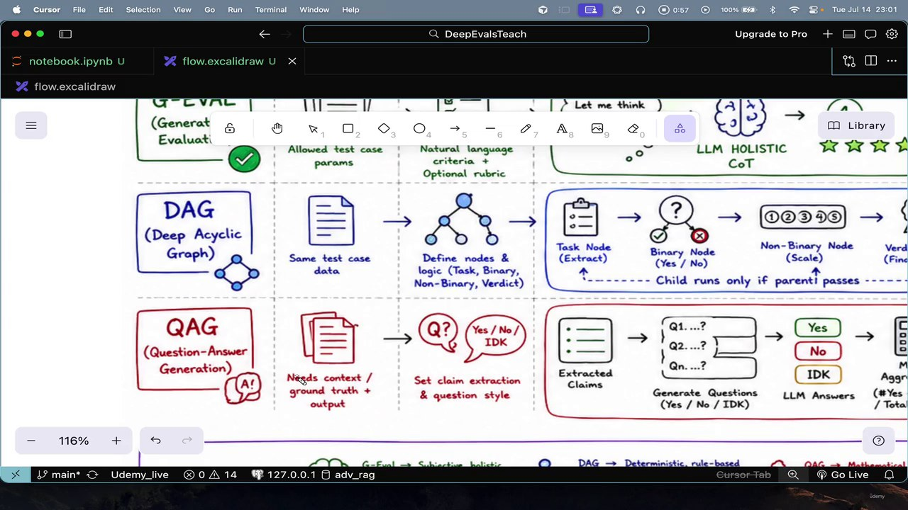
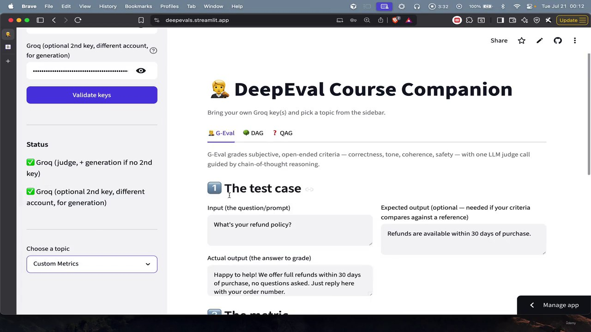
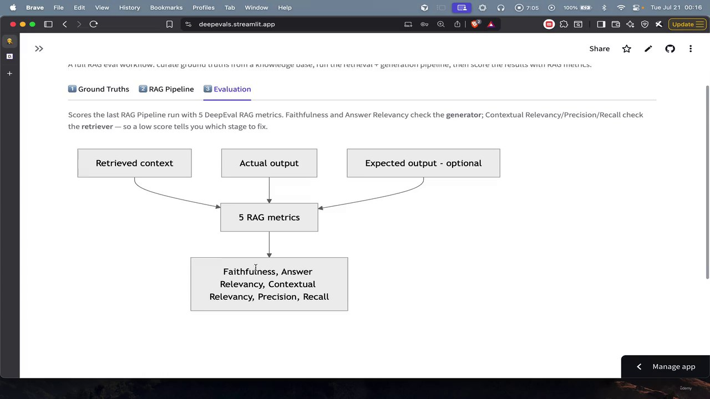
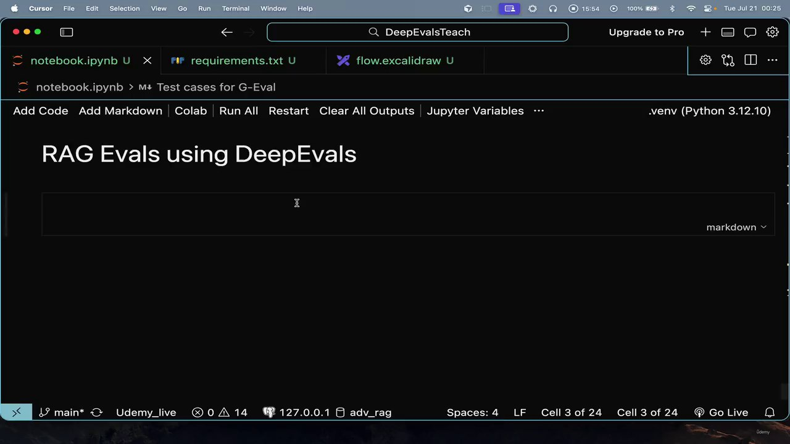
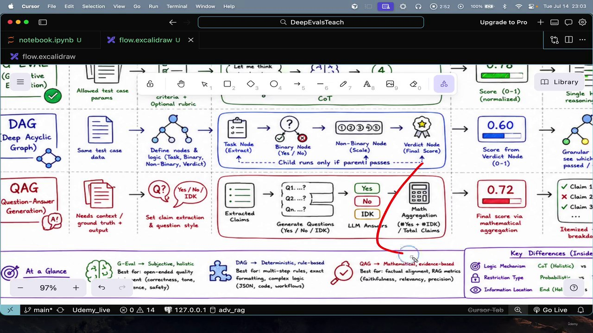
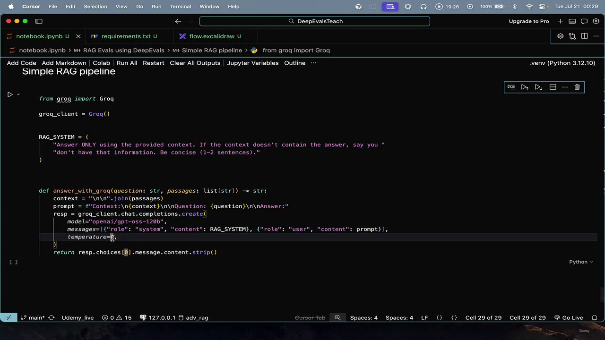
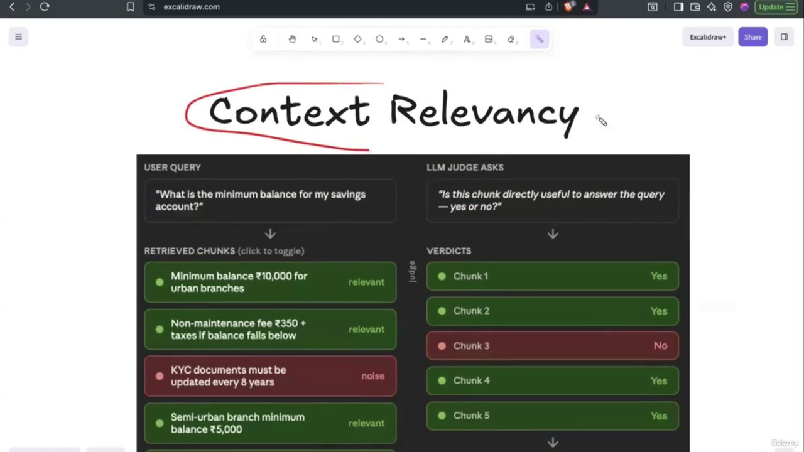
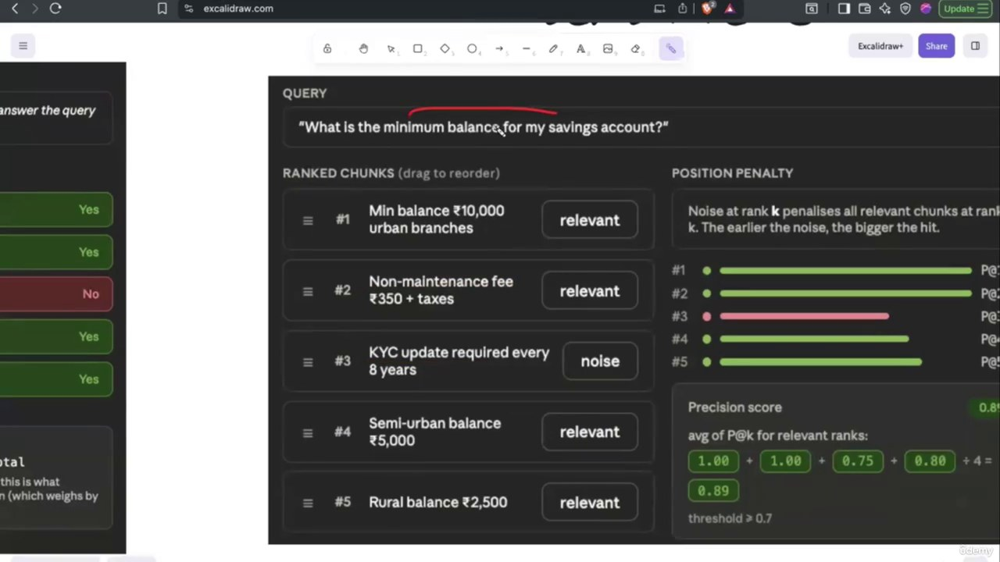
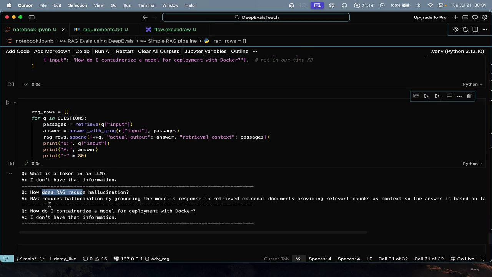

## 1. 这一节做什么

这一篇覆盖 P11–P13。需要先说明一个关键事实：**按逐字稿内容，这三段并不是在讲“护栏、网关、可观测”的代码实现，而是在讲 DeepEval 里的 QAG 指标、RAG 评估指标，以及如何用 Groq + DeepEval 跑一个最小 RAG 评估脚本。** 课里没有出现 AI Security Bootcamp 标题里对应的护栏、网关、可观测实现代码；如果读者是冲着“AI 安全网关”来的，这三段实际能复现的是“RAG 质量评估流水线”。这一点必须提前讲清楚，避免把课里没讲的东西安到讲师头上。

本节最终要复现的产物是：

1. 一个本地 Python 项目目录；
2. `requirements.txt`；
3. 一个可直接运行的 `rag_evals.py`；
4. 用 Groq 跑一个非常简单的关键词检索 RAG；
5. 把 RAG 的输入、实际输出、期望输出、检索上下文装进 `LLMTestCase`；
6. 用 DeepEval 的五个 RAG 指标跑评估：faithfulness、answer relevancy、contextual relevancy、contextual precision、contextual recall；
7. 配置 `max_concurrency=1`、`throttle_value=2`，避免 API 并发过高；
8. 看到每个测试用例的分数、阈值、通过/失败，以及聚合报告。

讲师在 P11 里反复强调 QAG 的核心：**LLM 只负责回答“是 / 否 / 我不知道”，最终分数由数学聚合算出来，不让 LLM 直接给分。** 这一点是整篇文档的主线。



## 2. 讲师原话

> "QAG 指标代表问答生成指标。"
> —— p011 [00:25]

> "在 QAG 里，我们先做 claim extraction，从输入测试用例里抽取 claim；然后根据具体指标和用例提出一组基础问题；每个问题得到 yes、no 或 I don't know 三种答案。"
> —— p011 [01:50]

> "在拿到这些答案之后，LLM as a judge 就不再参与了，后面全是数学聚合：有多少个 yes、多少个 I don't know，再除以 claim 总数，得到一个数学聚合值。"
> —— p011 [02:47]

> "QAG 的基本点是：永远不让 LLM 直接挑分数，而是把一组问题交给 LLM 回答，答案再用于数学聚合，得到最终分数。"
> —— p011 [05:06]

> "上下文相关性检查的是：我从 RAG 拿到的 top-k 上下文，是否和用户 query 相关。"
> —— p012 [01:51]

> "上下文精确度衡量的是 top-k 结果的顺序；如果你的应用在 context precision 上失败，你就需要加一个 re-ranker。"
> —— p012 [03:18]

> "Faithfulness 是检查 LLM 幻觉的非常好的指标：LLM 的回答到底基于检索上下文，还是在中间编造。"
> —— p012 [05:10]

> "评估流水线会拿 retrieved context、actual output、可选的 expected output，交给五个 RAG 指标：faithfulness、answer relevancy、context relevancy、context precision、context recall。"
> —— p013 [06:59]

> "我们新增一个依赖叫 groq。因为 RAG 流水线要用 LLM 生成答案，评估指标也要用 LLM 作为 judge。"
> —— p013 [13:07]

> "简单 demo 里三个 golden、五个指标，就是 15 次 API 调用；真实场景有成千上万个 golden，API 调用会非常多，所以必须管理限流。"
> —— p013 [25:22]

## 3. 从零复现

### 3.1 环境准备

课里没有给 Python 版本、依赖版本号；下面给的是可复现的最低配置。你本机需要：

- Python 3.10+；
- 一个 Groq API Key；
- 能访问 Groq API 的网络环境；
- 终端里能使用 `uv` 或 `pip`。

课里讲师用的是已有虚拟环境，并在 `requirements.txt` 里新增了 `groq`。他执行的是：

```bash
uv pip install -r requirements.txt
```

你可以按下面步骤从零建目录：

```bash
mkdir ai-security-bootcamp-rag-evals
cd ai-security-bootcamp-rag-evals
python -m venv .venv
source .venv/bin/activate        # Windows: .venv\Scripts\activate
python -m pip install --upgrade pip
pip install uv
uv pip install -r requirements.txt
```

设置 API Key。课里没有念出环境变量名；下面用 Groq 常见的 `GROQ_API_KEY` 作为示例。若你的 DeepEval/Groq SDK 使用别的变量名，按实际库要求替换：

```bash
export GROQ_API_KEY="你的_groq_api_key"
# Windows PowerShell:
# $env:GROQ_API_KEY="你的_groq_api_key"
```

### 3.2 目录结构

```text
ai-security-bootcamp-rag-evals/
├── requirements.txt
├── .env.example
└── rag_evals.py
```

课里的实现是在 notebook 里分 cell 做的：先填 API Key，重启 kernel，运行环境变量 cell；然后定义 knowledge base、retrieval、RAG pipeline、goldens、LLMTestCase、judge model、metrics，最后调用 `evaluate`。下面的 `rag_evals.py` 是把这些 cell 按顺序合并成一个可执行脚本。

### 3.3 复现顺序

1. 先创建 `requirements.txt`，安装依赖。
2. 设置 `GROQ_API_KEY`。
3. 创建 `rag_evals.py`。
4. 运行 `python rag_evals.py`。
5. 观察输出：每个 test case 会打印 input、actual output、expected output、每个指标的分数、阈值、是否通过。
6. 如果出现 context relevancy 的 LLM 报错，按课里演示，重新跑一次评估；讲师演示时也遇到过一次 “context relevancy is giving error because of some LLM thing”，再跑一次就修复了。
7. 观察结果：faithfulness 可能一直是 1，因为回答没有幻觉；answer relevancy 可能通过或失败；context relevancy 可能非常低，因为关键词检索给出的上下文和问题不相关。这个结果本身就是“报告卡”，告诉你 RAG 的检索层不行。



### 3.4 课里演示的 Streamlit 页面怎么理解

讲师演示了一个 Streamlit 应用，用户可以 bring your own key，填入 Groq API Key，选择 custom metrics 或 rag evals，查看 ground truths、knowledge base、RAG pipeline、evaluation pipeline。截图里能看到 RAG evals 的演示入口。

但要注意：**课里没有给 Streamlit 应用的完整源码。** 所以本文档不复刻 Streamlit UI，而是复刻后面 notebook 里的核心实现。你如果要做 UI，可以在这个脚本外面套一层 Streamlit，但 UI 代码课里没讲。



## 4. 完整代码

逐字稿没有贴出完整源码，也没有 OCR 代码块；下面是按讲师口述还原的最小可运行文件。函数名、变量名尽量采用讲师口述的 `corpus`、`retrieve`、`rag_system`、`answer_with_groq`、`rag_rows`、`LLMTestCase`、`evaluate`。DeepEval 不同版本 import 路径可能略有差异，代码里做了兼容处理；如果仍然报 import 错误，按第 7 节调整。

### 4.1 `requirements.txt`

```txt
# 逐字稿没有给版本号；以下是建议下限，实际以你安装时兼容的版本为准
deepeval>=2.0.0
groq>=0.9.0
```

### 4.2 `.env.example`

```bash
# 课里没有念出环境变量名；这里用 Groq 常见变量名作为示例
GROQ_API_KEY=replace_with_your_groq_api_key
```

### 4.3 `rag_evals.py`

```python
import os
import re
import json

from groq import Groq
from deepeval import evaluate
from deepeval.test_case import LLMTestCase
from deepeval.metrics import (
    FaithfulnessMetric,
    AnswerRelevancyMetric,
    ContextualRelevancyMetric,
    ContextualPrecisionMetric,
    ContextualRecallMetric,
)

# DeepEval 不同版本里 AsyncConfig / DisplayConfig 的导入路径可能不同。
try:
    from deepeval.evaluate import AsyncConfig, DisplayConfig
except ImportError:
    from deepeval.evaluate.configs import AsyncConfig, DisplayConfig

# 课里口述 judge model 来自 DeepEval 的 local model 模块；
# 当前 DeepEval 版本若提供 GroqModel，可直接用它。
try:
    from deepeval.models import GroqModel
except ImportError as exc:
    raise ImportError(
        "当前安装的 deepeval 没有 GroqModel。请升级 deepeval，"
        "或按课里口述改用 LocalModel 并传入 base_url/API key。"
    ) from exc


# ============================================================
# 1. API Key 与 Groq client
# 课里：先在 notebook 顶部设置 API Key，重启 kernel，再运行。
# ============================================================

GROQ_API_KEY = os.environ.get("GROQ_API_KEY")
if not GROQ_API_KEY:
    raise RuntimeError("请先设置 GROQ_API_KEY 环境变量")

groq_client = Groq(api_key=GROQ_API_KEY)


# ============================================================
# 2. Knowledge base
# 课里 knowledge base 包含 token、embedding、RAG、hallucination、agent 的定义。
# ============================================================

corpus = [
    "Token: A token is a small unit of text that a language model reads and generates. "
    "Prompts and outputs are split into tokens before the model processes them.",

    "Embedding: An embedding is a fixed-length vector representation of text. "
    "It is used for semantic search and similarity matching in vector stores.",

    "RAG: Retrieval-Augmented Generation retrieves external documents at query time, "
    "then passes the retrieved context to an LLM so the answer is grounded in documents.",

    "Hallucination: Hallucination happens when an LLM generates information that is not "
    "supported by the provided context or by reliable facts.",

    "Agent: An agent is an LLM-powered system that can decide steps, call tools, and "
    "use observations to complete a task.",
]


# ============================================================
# 3. 非常简单的 keyword-based retrieval
# 课里明确说：这不是 semantic matching，只是关键词重叠打分。
# ============================================================

def retrieve(query: str, documents: list[str], top_k: int = 5) -> list[str]:
    """
    课里的简单检索：
    1. 把 query 和文档拆成词；
    2. 看关键词重叠；
    3. 按重叠数量排序，取 top-k。

    这不是向量检索，也不是语义检索。
    在 JS/Node 里可以用 Set 交集 + sort 近似实现。
    """
    query_words = set(re.findall(r"\w+", query.lower()))

    scored = []
    for doc in documents:
        doc_words = set(re.findall(r"\w+", doc.lower()))
        overlap = len(query_words & doc_words)
        scored.append((overlap, doc))

    scored.sort(key=lambda item: item[0], reverse=True)

    # 课里演示 top-k 结果，即使分数为 0 也可能保留，
    # 这样更能暴露“检索质量差”的问题。
    return [doc for _, doc in scored[:top_k]]


# ============================================================
# 4. 非常简单的 RAG pipeline
# 课里：rag_system 要求只根据 provided context 回答；
# 如果没有信息，就说 I don't have the information。
# ============================================================

rag_system = (
    "You are a RAG assistant. Answer only using the provided context. "
    "If the context does not contain the answer, say you don't have the information. "
    "Be concise."
)


def answer_with_groq(question: str, passage: list[str]) -> str:
    """
    课里 answer_with_groq 接收 question 和 passage，返回字符串回答。
    passage 就是 retrievel 返回的 retrieved context。
    """
    context = "\n\n".join(passage) if passage else "(no retrieved context)"

    rag_prompt = f"""Context:
{context}

Question: {question}

Answer:"""

    response = groq_client.chat.completions.create(
        # 课里口述模型为 OpenAI GPT OSS 120 billion；
        # 这里使用 Groq 上对应的 openai/gpt-oss-120b。
        model="openai/gpt-oss-120b",
        messages=[
            {"role": "system", "content": rag_system},
            {"role": "user", "content": rag_prompt},
        ],
        # 课里明确说 temperature 设为 0，让回复更确定。
        temperature=0,
    )

    return response.choices[0].message.content or ""


# ============================================================
# 5. Goldens
# 课里 goldens 有输入和 expected output；
# 也允许只有 input、没有 expected output 的 golden。
# ============================================================

goldens = [
    {
        "input": "What is a token in LLM?",
        "expected_output": (
            "A token is a small unit of text that a language model reads and generates."
        ),
    },
    {
        "input": "How to reduce hallucination?",
        "expected_output": (
            "Use retrieval-augmented generation so the answer is grounded in retrieved context."
        ),
    },
    {
        "input": "How to containerize a model for deployment?",
        "expected_output": None,
    },
]


# ============================================================
# 6. 跑真实 RAG，生成 rag_rows
# 课里：每个 input 先 retrieve，得到 passage；
# passage 和 question 一起传给 answer_with_groq；
# 得到的 answer 追加到 rag_rows。
# ============================================================

rag_rows = []

for golden in goldens:
    question = golden["input"]
    retrieved_context = retrieve(question, corpus, top_k=5)

    actual_output = answer_with_groq(question, retrieved_context)

    rag_rows.append(
        {
            "input": question,
            "actual_output": actual_output,
            "expected_output": golden["expected_output"],
            "retrieval_context": retrieved_context,
        }
    )

print("=" * 80)
print("RAG 实际运行结果")
print("=" * 80)
print(json.dumps(rag_rows, ensure_ascii=False, indent=2))


# ============================================================
# 7. 把真实数据装进 LLMTestCase
# 课里：test case 是数据容器，包含 input、actual_output、
# expected_output、retrieval_context。
# ============================================================

test_cases = []

for row in rag_rows:
    test_cases.append(
        LLMTestCase(
            input=row["input"],
            actual_output=row["actual_output"],
            expected_output=row["expected_output"],
            retrieval_context=row["retrieval_context"],
        )
    )


# ============================================================
# 8. Judge model
# 课里：从 DeepEval 里创建 judge model；
# API Key 从 OS environment 读取；这里用 GroqModel。
# ============================================================

judge_model = GroqModel(
    model="openai/gpt-oss-120b",
    api_key=GROQ_API_KEY,
)


# ============================================================
# 9. 五个 RAG metrics
# 课里明确列出的五个：
# faithfulness, answer relevancy, context relevancy,
# context precision, context recall。
#
# 阈值：
# - context relevancy 课里演示 threshold = 0.7
# - faithfulness 课里演示 threshold = 0.8
# - 其他阈值课里没有逐个念出，这里不硬编码，使用库默认值。
# ============================================================

metrics = [
    FaithfulnessMetric(
        threshold=0.8,
        model=judge_model,
        include_reason=True,
    ),
    AnswerRelevancyMetric(
        model=judge_model,
        include_reason=True,
    ),
    ContextualRelevancyMetric(
        threshold=0.7,
        model=judge_model,
        include_reason=True,
    ),
    ContextualPrecisionMetric(
        model=judge_model,
        include_reason=True,
    ),
    ContextualRecallMetric(
        model=judge_model,
        include_reason=True,
    ),
]


# ============================================================
# 10. 执行评估
# 课里：evaluate 接收 test case、metrics、async configuration。
# max_concurrency=1，throttle_value=2，避免触发 API rate limit。
# display_config 打开 verbose 结果。
# ============================================================

if __name__ == "__main__":
    result = evaluate(
        test_cases=test_cases,
        metrics=metrics,
        async_config=AsyncConfig(
            max_concurrency=1,
            throttle_value=2,
        ),
        display_config=DisplayConfig(
            show_indicator=True,
            print_results=True,
        ),
    )

    print("=" * 80)
    print("DeepEval 聚合结果")
    print("=" * 80)
    print(result)
```

### 4.4 启动命令

```bash
export GROQ_API_KEY="你的_groq_api_key"
python rag_evals.py
```

如果你在 notebook 里复现，按课里的 cell 顺序执行：

1. 顶部设置 API Key；
2. 重启 kernel；
3. 运行环境变量 cell；
4. 运行 knowledge base cell；
5. 运行 retrieval cell；
6. 运行 RAG pipeline cell；
7. 运行 goldens / rag_rows cell；
8. 运行 LLMTestCase cell；
9. 运行 judge model + metrics cell；
10. 运行 `evaluate` cell。



## 5. 逐行解释

### 5.1 为什么先讲 QAG，而不是直接写评估代码

P11 先建立 QAG 的心智模型：QAG 不是让 LLM 直接输出一个 0 到 1 的分数，而是把评估拆成“claim extraction → 对每个 claim 提问 → LLM 只回答 yes / no / I don't know → 数学聚合”。

这和 G-Eval 不同。讲师说 G-Eval 是“完整自然语言 criteria + 评估步骤 + 利用 LLM 的 chain-of-thought reasoning”，最后算的是 LLM 输出概率的加权和。QAG 是“部分 chain-of-thought + 最终数学聚合”。所以 QAG 的分数更可解释：你能看到 claim 1 是 yes、claim 2 是 no、claim 3 是 I don't know，然后得到 0.70 这样的值。



在代码里，这个思想体现为：`metrics` 里的 FaithfulnessMetric、ContextualRelevancyMetric 等内部会做 claim/question/verdict 流程；我们作为使用者只负责把正确字段传进去：`input`、`actual_output`、`expected_output`、`retrieval_context`。讲师强调“LLM 永远不直接挑分数”，所以最终报告里会出现每个 claim 的 verdict 和最终数学聚合值。

### 5.2 knowledge base 为什么这么小

课里 knowledge base 只放了 token、embedding、RAG、hallucination、agent 五个定义。原因是这是评估演示，不是生产 RAG。讲师明确说为了尊重 API rate limit，goldens 只放了三个；knowledge base 也保持非常小。

在 `corpus` 里，
在 `corpus` 里，每条文档都写成一句“术语 + 定义”的短句，这样关键词检索才有词可以重叠；如果写成一大段长文，关键词打分会被稀释，检索结果会更难观察。真实项目里这里应该是向量库（讲师在 P12/P13 里反复提到 “vector store”“semantic search”），但课里明确说演示用的是“keyword based retrieval，不是 semantic matching”，所以我们照课里的做法保留纯关键词匹配。

### 5.3 `retrieve` 函数：为什么用 Set 交集

`retrieve` 只做三件事：把 query 小写并按 `\w+` 切词、把每篇文档同样切词、算两个集合的交集大小作为分数，然后按分数倒序取 `top_k`。讲师在演示里说的是“breaking down the words which are there inside the corpus，checking whether it is present in it or not，based on the overlap which is there and it is giving us a score”。这就是本函数逐行的中文翻译。

注意这里刻意**不丢弃 0 分文档**。讲师演示时出现过这个现象：问 “What is a token in LLM?”，检索回来的上下文里有 embedding 的信息、有 hallucination 的信息，但就是没有 token 的信息，于是 Groq 回答 “I don't have the information”。这正是我们想要暴露的失败——如果检索函数在 0 分时直接返回空列表，后面的 context relevancy 反而测不出“检索层不行”这个结论。在 JS/Node 里等价写法是 `new Set(queryWords)` 与 `new Set(docWords)` 求交集长度再 `sort((a,b)=>b.score-a.score)`，没有锁、没有事务，纯内存计算。

### 5.4 `rag_system` 与 `answer_with_groq`：RAG 的三个角色

讲师把 RAG 拆成三个实体：query、context、response。对应到代码：

- `rag_system` 是 system prompt，约束“Answer only using the provided context. If the context does not contain the answer, say you don't have the information.”。讲师在 P13 里说这段 prompt 的意思是“只根据提供的上下文回答，没有信息就说没有”，并要求简洁。
- `passage` 就是 retrieve 返回的 `retrieval_context` 列表，用换行拼成 `context` 字符串塞进 user prompt。
- `answer_with_groq(question, passage)` 返回字符串，这个字符串就是 `actual_output`。

模型部分：讲师口述用的是 “OpenAI GPT OSS 120 billion”，代码里写 `openai/gpt-oss-120b`（Groq 上的模型 ID 写法可能随平台调整，跑之前用 `groq_client.models.list()` 确认一下，课里没讲怎么列模型）。`temperature=0` 是讲师明确说的“skip zero to get somewhat deterministic replies”，目的是让同一份 golden 反复跑出来的分数波动小一点，否则评估结果本身就不可比。

`messages` 的结构是讲师逐条念过的：`role: system` 放 `rag_system`，`role: user` 放“包含 context 和 question 的完整 rag prompt”。这里不要自作聪明把 context 塞进 system，课里就是这么分的。

### 5.5 `goldens`：为什么允许 `expected_output` 为 None

讲师在 P13 里明确说：goldens 里有“input 和 expected output 都有”的，也有“只有 input、没有 expected output”的，“so that will going to be ignored”。第三个 golden 就是这种，`expected_output=None` 直接传给 `LLMTestCase`。

为什么要讲这个？因为五个指标对 `expected_output` 的依赖不一样：context recall 需要拿 expected output 去比对“上下文是否覆盖了答案的每个侧面”，没有 expected output 时这个指标就无从算起；而 faithfulness 只看 `actual_output` 和 `retrieval_context`，不需要 expected output。所以同一批 test case 里混着“有/没有 expected output”是合法的，只是部分指标在某些 case 上会缺失或跳过。课里没讲 DeepEval 具体怎么处理缺失字段（是跳过还是报错），以你实际运行的输出为准。

### 5.6 `rag_rows`：先跑真 RAG，再造 test case

这个循环的顺序很重要，不能颠倒：

1. `retrieve(question, corpus, top_k=5)` 拿到 passage；
2. `answer_with_groq(question, retrieved_context)` 拿到 actual_output；
3. 把 input / actual_output / expected_output / retrieval_context 四件套 append 进 `rag_rows`。

讲师的原话是“based on the knowledge base and based on the ground truth using the ground truth questions we are going to run the real RAG pipeline so that we can have the actual data so that we can create the LLM test cases”。也就是说：**test case 里的数据必须来自真实执行，不能手写**。手写 actual_output 就等于自己给自己发成绩单，评估失去意义。

### 5.7 `LLMTestCase`：它只是数据容器

讲师两次强调“a test case is simply a data container”。它不做计算、不调 LLM，只装四个字段。四个字段的来源对应关系是：

| 字段 | 来源 | 课里说法 |
|---|---|---|
| `input` | golden 的 input | 来自 golden data set |
| `actual_output` | 跑 RAG pipeline 得到的回答 | LLM 生成的结果 |
| `expected_output` | golden 的 expected output（可为 None） | 部分 golden 有，部分没有 |
| `retrieval_context` | retrieve 返回的 top-k | RAG 里检索到的上下文 |

这里最容易踩的坑是把 `retrieval_context` 写成字符串而不是列表。课里没说清楚类型要求，但 DeepEval 的 contextual 系列指标是按“多条 chunk”来算 precision 和 relevancy 的，所以代码里保持 `list[str]`。

### 5.8 `judge_model`：为什么评估要单独一个模型

讲师说得很直白：“the LLMs are going to be used to actually run the RAG pipeline，that is the one thing to actually generate the answer；the LLMs are going to be used to judge the evaluations”。也就是同一门课里有两个 LLM 角色：**被评估的生成模型** 和 **打分用的 judge 模型**。代码里两者都用了 Groq，但概念上必须分开——生产里你完全可以让生成用便宜模型、judge 用强模型。

讲师还提到“different different judge you can also use by defining a different judge”，意思是每个 metric 可以挂不同的 judge model。代码里为了简单，五个 metric 共用同一个 `judge_model`。



### 5.9 五个指标各自在问什么

把讲师在 P12、P13 里讲的三元组（query / context / response）拉成表：

| 指标 | 它在问的问题 | 用到的字段 | 讲师原话要点 |
|---|---|---|---|
| Contextual Relevancy | 检索回来的 top-k 上下文，和 query 相关吗？ | input、retrieval_context | “is this chunk directly useful to answer the query，yes or not”；5 条里 4 条相关就是 80%，阈值 0.7 就通过 |
| Contextual Precision | top-k 的**顺序**对不对？噪声排在了相关 chunk 前面吗？ | input、retrieval_context、expected_output | “it will penalize all the chunks which are listed below the noise”；如果 precision 失败，“you have to add a re-ranker” |
| Faithfulness | 回答是基于检索上下文，还是编的？ | actual_output、retrieval_context | “whether the LLM response is based on the chunks which we have retrieved，or is it hallucinating in between” |
| Answer Relevancy | 回答有没有答到 query 上？（不管它是否忠于上下文） | input、actual_output | “is this response answering the query or not” |
| Contextual Recall | 上下文有没有覆盖 query 需要回答的每一个侧面？ | input、retrieval_context、expected_output | “is the particular context covering every side of the query or not” |

两个必须讲透的区分：

**第一，answer relevancy 好 ≠ faithfulness 好。** 讲师举了航空客服的例子：用户问退款，上下文说 45 天，LLM 回答 30 天。这个回答“很切题”，answer relevancy 很高，但 faithfulness 崩了，因为它没follow上下文。这个例子说明为什么五个指标必须一起看。

**第二，faithfulness 低意味着幻觉，faithfulness 高的企业风险例子。** 讲师讲了那个真实新闻：某公司把 RAG 客服机器人上生产，机器人承诺了退款，但政策里根本没有退款条款，用户拿聊天记录去起诉公司。他原话的意思是“this is why this evaluation is very important”。这段不是技术点，但它是整个 P12 的动机，不能省。



### 5.10 Context Precision 的“顺序惩罚”到底怎么算

这是三节课里最容易听漏的一段。讲师用了一个具体例子：query 问最低余额，top-k 依次是“最低余额 1000”“维护费 350”“KYC 更新（噪声）”。他的说法是：

- 第 1 条相关，得分 1；
- 第 2 条相关，得分 1；
- 第 3 条是噪声，得分被大幅惩罚，他口述的数是 0.67；
- 第 4、5 条**虽然本身相关**，但因为排在了噪声下面，也被连带惩罚。

讲师的原话是“even though they are right，we are penalizing that because they are present below the relevant chunk，ideally they should present upward because they are more relevant”。也就是说：相关性够但排名靠后，同样扣分。这就是为什么他说“context precision 失败就要加 re-ranker”——re-ranker 的作用就是把相关的往前提。

请注意 0.67 这个数是讲师口述举例，不同版本的 DeepEval 内部聚合公式可能不同，你实际跑出来的分数以终端输出为准。



### 5.11 `evaluate` 的三个配置项

```python
evaluate(
    test_cases=test_cases,
    metrics=metrics,
    async_config=AsyncConfig(max_concurrency=1, throttle_value=2),
    display_config=DisplayConfig(show_indicator=True, print_results=True),
)
```

- `test_cases`：第 7 步装好的容器列表。
- `metrics`：第 9 步定义的五个指标对象。
- `async_config.max_concurrency=1`：同一时刻只跑 1 个并发调用。讲师说“one parallel call will be there”。
- `async_config.throttle_value=2`：讲师口述“the throttle value is 2 here”，用于控制请求节奏，避免撞 API rate limit。
- `display_config` 打开后“you are going to get more verbose results”。

为什么要限流？讲师算过一笔账：3 个 golden × 5 个 metric = 15 次 API 调用；真实场景成千上万个 golden，“your API calls will be very very high and you need to manage them”。这段算术是整个配置存在的理由，不是随手加的。

在 Node 里对应的是 `p-limit` 或 `bottleneck` 这类库控制并发，概念一样：不要让 Promise 全部同时飞出去。

### 5.12 结果怎么读

讲师跑完后逐条解读过输出，这段是“报告卡”的用法：

- **test case 0 failed**：但失败原因不是综合分低，而是某个 metric 没过阈值。
- **faithfulness = 1，passed**：讲师说“we don't find any instances where the LLM is hallucinating”，因为模型在没检索到时老老实实说“I don't have the information”，没有编造。
- **answer relevancy failed**：讲师说“the answer which is being provided here was not relevant to the question”。
- **context relevancy 非常低**：讲师说“the relevant context is completely unrelated information”，并且立刻下结论——“now itself this particular data is very useful and we can know that our context pipeline is not good and we can work towards that”。
- **context relevancy 报错**：讲师演示时遇到过一次 “context relevancy is giving error because of some LLM thing”，他的处理是“if I run this evaluation again，it is going to fix that”。所以重跑一次是课里承认的 workaround，不是你的环境坏了。

最后讲师说这份聚合结果是“your final report card，which you can be used to actually streamline your development to actually see where the things are lacking”。这句话定义了整节课的产出物：不是一个分数，而是一张能指出“检索层弱 / 生成层幻觉 / 排序层缺 re-ranker”的诊断表。

## 6. 复现检查清单

按顺序打勾，任何一项没过就不要往下走。

**环境**

- [ ] `python --version` 输出 3.10 及以上。
- [ ] 虚拟环境已激活（终端提示符前有 `.venv` 之类标记）。
- [ ] `uv pip install -r requirements.txt` 成功，没有依赖冲突报错。
- [ ] `python -c "import groq, deepeval; print('ok')"` 输出 `ok`。
- [ ] `echo $GROQ_API_KEY` 有值（Windows PowerShell 用 `echo $env:GROQ_API_KEY`）。
- [ ] `GroqModel` 能 import 成功（如果你的 deepeval 版本没有这个类，会立刻在第 4 节代码顶部的 `raise ImportError` 处报错，见第 7 节）。

**数据层**

- [ ] `corpus` 有 5 条文档，分别是 token、embedding、RAG、hallucination、agent。
- [ ] 手动调一次 `retrieve("What is a token in LLM?", corpus)`，打印结果，确认里面有跟 token 相关的文档，也有不相关的文档。
- [ ] `goldens` 有 3 条，其中第 3 条的 `expected_output` 是 `None`。

**RAG 层**

- [ ] `answer_with_groq` 单测一次，传入一个问题和几条 passage，能返回非空字符串。
- [ ] `rag_rows` 里每条都有 `input`、`actual_output`、`expected_output`、`retrieval_context` 四个 key。
- [ ] 问 “What is a token in LLM?” 时，模型输出里出现 “I don't have the information” 之类的句子——如果它答得头头是道，说明你的检索或 prompt 和课里不一样，先别急着往下评估。

**评估层**

- [ ] `test_cases` 长度等于 3。
- [ ] `metrics` 长度等于 5，顺序是 faithfulness、answer relevancy、contextual relevancy、contextual precision、contextual recall。
- [ ] `AsyncConfig(max_concurrency=1, throttle_value=2)` 生效，观察终端日志里请求是一条一条出的。
- [ ] 跑完能看到每个 test case 的逐 metric 分数、阈值、pass/fail。
- [ ] 能看到最后打印的聚合结果（`print(result)` 的输出）。
- [ ] 如果某个 metric 报 LLM 相关错误，按课里做法再跑一次，确认是否自愈。

**结论层（这一项最重要）**

- [ ] 你能指着输出说出至少一句诊断，例如“faithfulness 高但 context relevancy 为 0，说明模型没幻觉但检索层给错了上下文”。
- [ ] 你能说出下一步该改哪里：换语义检索、加 re-ranker、还是改 prompt。

**截图对照**

- [ ] 你的 notebook/终端里能看到类似 P013 [15:55] 的 corpus 与 retrieve 定义。
- [ ] 你的 notebook/终端里能看到类似 P013 [19:27] 的 judge model 与 metrics 定义。
- [ ] 你的输出里能看到类似 P013 [21:14] 的逐 metric 评分表。



## 7. 课里没讲但你会撞上的

**1. `GroqModel` 不一定存在。** 讲师在 P13 里说的是“bring it from the DeepEval itself，use this local model module”，口述不精确。不同 DeepEval 版本里 judge model 的类名和构造参数不一样：有的版本叫 `GroqModel`，有的要走 `LocalModel` 并传 `base_url`、`api_key`、`model`。第 4 节代码里用 try/except 把这条路拦住了并给出明确报错。你如果撞上，去看 `pip show deepeval` 的版本号，再对应该版本 `deepeval/models/` 下的实际类名。**课里没讲具体版本和构造参数。**

**2. `AsyncConfig` / `DisplayConfig` 的 import 路径。** 课里只在代码里用了这两个对象，没念 import 语句。不同版本分别在 `deepeval.evaluate` 和 `deepeval.evaluate.configs` 下。代码里做了兼容。

**3. 模型 ID 会变。** 讲师口述 “OpenAI GPT OSS 120 billion”，代码里写 `openai/gpt-oss-120b`。Groq 上的模型标识可能随平台更新，跑之前先列一下可用模型确认。**课里没讲怎么列模型。**

**4. 指标命名的两个体系。** 讲师口头说的是 “context relevancy / context precision / context recall”，DeepEval 现在的类名带 `Contextual` 前缀（`ContextualRelevancyMetric` 等）。这两套说法指的是同一批指标。如果你搜文档时对不上，按类名搜。

**5. `expected_output` 为 None 时哪些指标会出问题。** 课里只说“会被忽略”，没说具体行为。实测时你可能看到 contextual recall 在这个 case 上被跳过、报错或给出无意义分数。**课里没讲，以实际输出为准。**

**6. 阈值只讲了一部分。** 课里明确说过的阈值只有两处：context relevancy 的 0.7、faithfulness 的 0.8（P13 演示时 faithfulness 的阈值语境是“0.8 是阈值，0.75 就失败”）。其余三个指标的阈值课里没有逐个念，代码里交给库默认值。**不要凭印象给另外三个也填 0.7 或 0.8，课里没这么说。**

**7. context relevancy 会偶发 LLM 报错。** 讲师自己遇到并靠重跑解决。这属于 judge 模型侧的瞬时问题，不是你的代码 bug，但如果你批量跑几千条，需要自己在外面加重试；**课里没讲重试怎么写。**

**8. Rate limit 的真实规模。** 讲师只算了 demo 的 15 次调用，并说真实场景“thousands of goldens”。但他没讲具体怎么分批、怎么断点续跑、怎么把结果落盘。**这些课里没讲。** 生产上你需要把 `rag_rows` 和评估结果写成 JSON/JSONL，否则跑一半挂了要从头再来。

**9. Streamlit 应用没有源码。** P13 里演示的 `deepeval-streamlit.app` 是讲师提供的在线应用，用于 bring your own key 看 demo，包含 custom metrics 和 rag evals 两个板块、可添加自定义 golden、展示 knowledge base、RAG pipeline、evaluation pipeline。**课里没有给出这个应用的任何源码或部署方法。** 如果你想自己搭同样的 UI，那是课里没讲的部分。

**10. 这门课的实际主题与标题不符。** 标题写的是“AI Security Bootcamp part1（护栏/网关/可观测）”，但 P11–P13 的逐字稿全部围绕 DeepEval 的 QAG 指标、RAG 三个上下文指标和 Groq 评估实现，**没有出现护栏（guardrails）、网关（gateway）、可观测（observability）的任何实现代码或配置**。讲师唯一接近“安全”的话题是 P12 里那个 RAG 客服幻觉导致法律风险的案例，以及把 faithfulness 当作幻觉检测手段。如果你需要护栏/网关的落地代码，需要去其他 P 找，不要在这三节里找。

**11. 前端读者的心智映射。** 这节课里没有锁、没有事务、没有并发写入，唯一涉及“并发”的地方是 `max_concurrency` 和 `throttle_value`，对应 JS 里的 `p-limit` / `bottleneck`。`LLMTestCase` 对应 TS 里的一个普通 interface：

```ts
// 课里没有 TS 代码，以下仅为帮助前端读者理解的类型映射
interface LLMTestCase {
  input: string;
  actualOutput: string;
  expectedOutput?: string;
  retrievalContext: string[];
}
```

`metrics` 数组对应一组策略对象，每个对象有 `threshold`、`model`、`includeReason`，最后由 `evaluate` 统一调度——这就是策略模式，前端里写表单校验规则时是同一个结构。