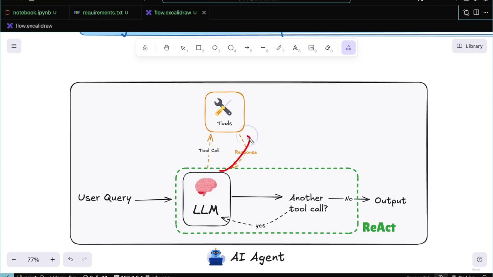
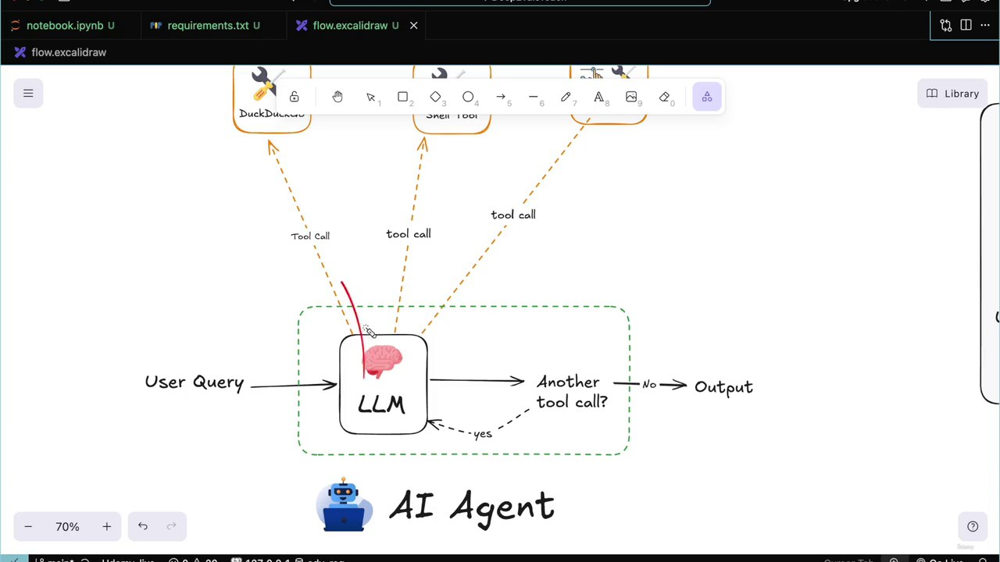
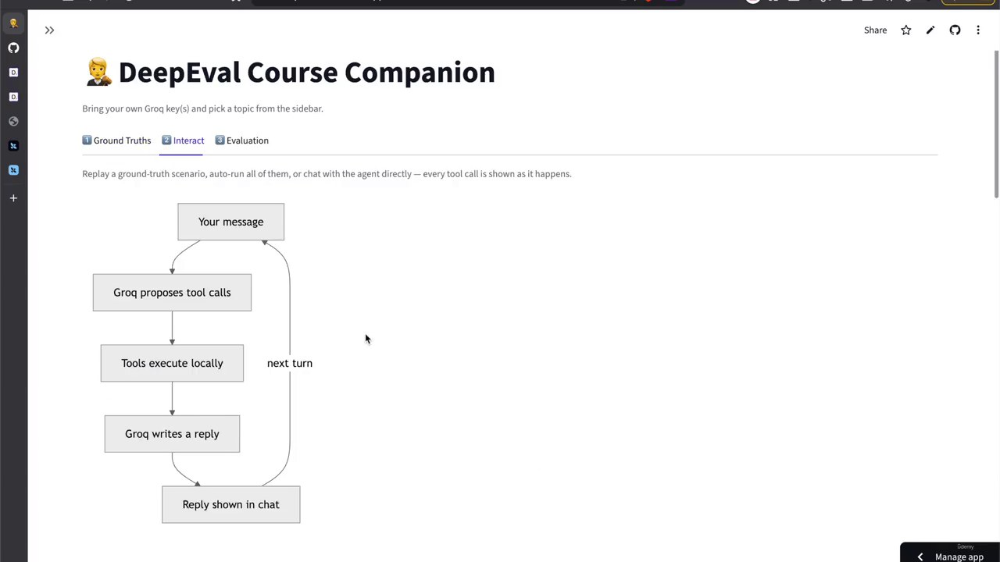
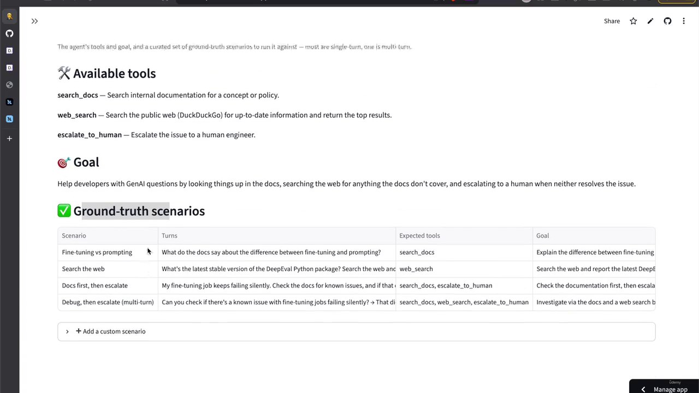
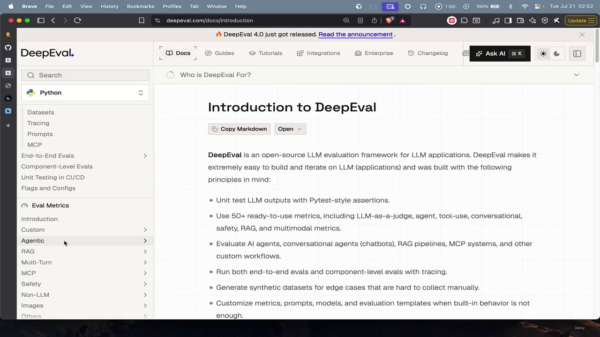
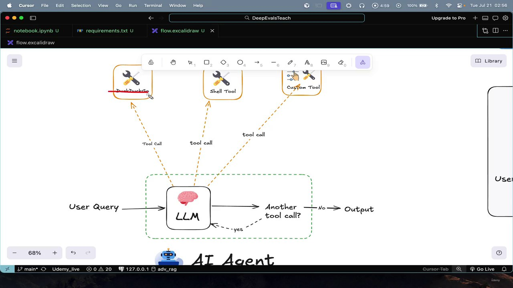
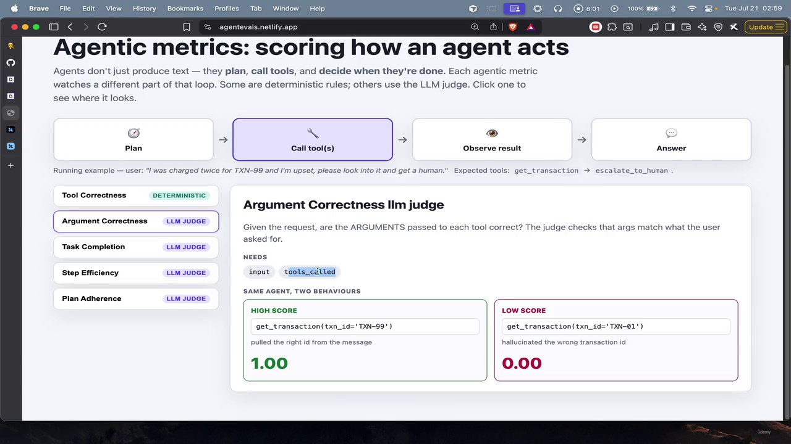
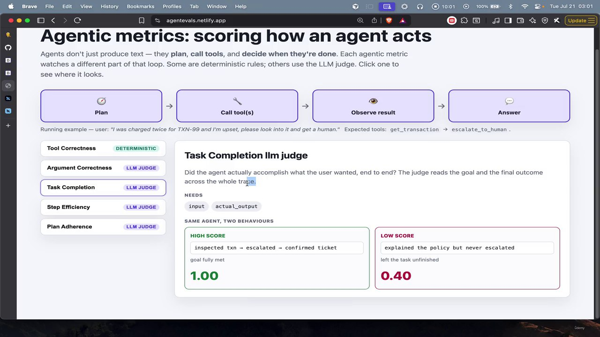
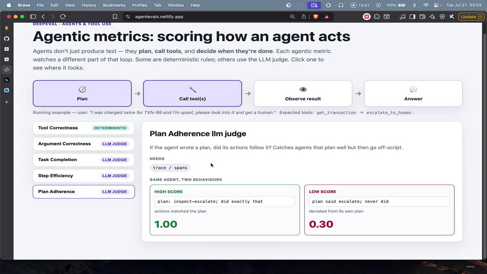
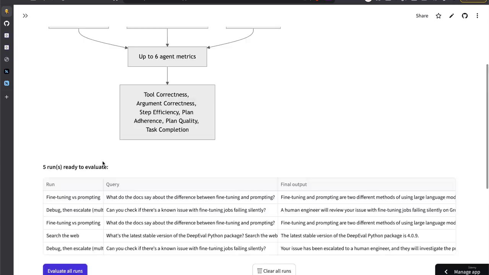

## 1. 这一节做什么

这两讲（P14–P15）落在 AI Security Bootcamp 的**可观测与评测**环节：从“怎么评一个 RAG 应用”，推进到“怎么评一个会循环、会调工具的 AI agent”。讲师先用 LangChain 文档聊天机器人演示什么叫 agent，再把 agent 一次运行拆成四个可观测实体：**plan、tool call、observed result、answer**；然后介绍 DeepEval 的 agentic evals 指标：**tool correctness、argument correctness、task completeness、step efficiency、plan adherence、plan quality**，并解释每个指标分别依赖哪些实体、哪些是确定性计算、哪些必须用 LLM-as-judge。最后引出 **trace / span**：把 agent、RAG、embedding、LLM、tool 的调用按顺序和类别记录下来，才能做评测。

这一节的目标不是背概念，而是复现一条能跑的数据链：

1. 定义 4 个 golden 场景，每个 turn 写清 `query`、`expected_tools`、`goal`；
2. 让 agent 在 ReAct 循环里产出 plan → tool call → observation → answer；
3. 把整条 trace 存下来；
4. 用 1 个确定性指标 + 5 个 LLM-as-judge 指标打分；
5. 在页面上同时看到 ground truth、交互 trace、评测结果。



需要先说明边界：**课里没有给出讲师那套 BYOK Web 应用的源码，也没有给出 Jupyter Notebook 实现**；P14 演示的是讲师自己部署的 explainer 页面和 demo，P15 明确说“接下来会在 Jupyter Notebook 里实现”。所以第 4 节的代码是**复现用的示意实现**，不是讲师原代码。它复刻的是数据流、四实体记录方式和六个指标的判定逻辑；具体 API、模型和搜索供应商可以替换。

从工程视角看，这一节真正要建立的是一个“**评测闭环**”的心智模型：ground truth 是输入侧的契约，trace 是运行侧的观测，metrics 是输出侧的判定，三者必须能对上号。RAG 时代我们习惯只比对 query 和 response，中间过程是黑盒；agent 时代中间过程本身就是产品的一部分——它决定了 agent 会不会绕路、会不会调错工具、会不会在参数里幻觉。因此这一节把“可观测”放在“评测”之前讲：没有 trace，就没有可评测的实体；没有实体，指标就无从谈起。前端背景的读者可以把 trace 理解成一次请求的 waterfall：每个 span 就是一条 network 记录，只不过记录的是 LLM 调用、工具调用和检索调用，而不是 HTTP 资源。

---

## 2. 讲师原话

讲师先重新定义“什么是一次 agent 调用”。RAG 里通常只有 query、context、response 三个角色；但 agent 多了一个循环和工具。

> "我们把一次简单的 LLM 调用称为 AI agent，是因为它有两个非常有意思的东西。第一个是一个循环，叫 ReAct 循环。这里 ReAct 不是前端框架 React，而是 reasoning and action，推理与行动。"
> —— p014 [00:54]

> "第二个要求是它具备调用工具的能力，必须有一个工具，并且这个工具对该 agent 是可访问的。"
> —— p014 [01:24]

接着他用 LangChain 文档聊天机器人举例：用户问“什么是 ReAct agent”，页面先出现 thinking，再出现 agent steps，里面有 `search docs by LangChain`、`query doc file system` 等工具调用。这不是一次普通 LLM 调用，因为模型先推理、再行动、观察结果，然后决定是否继续循环。

> "基于用户 query，LLM 先决定要创建一个计划；然后问自己：要不要调用工具来获取用户问的信息？如果要，就调用工具，拿到响应。"
> —— p014 [04:17]

> "LLM 会反思：工具给的信息够不够回答用户的问题？如果不够，就再调用另一个工具，可能是同一个工具换参数。"
> —— p014 [04:45]

这也解释了为什么 agent 的评测不能只看最终答案。RAG 的评测可以围绕 query、context、response 三个角色；agent 里整个 RAG 可以缩成一个工具，agent 在任何时候调用它。

> "在 AI agent 的情况下，整个 RAG 可以坐在一个简单的 RAG 工具里，agent 可以在任何时候使用它。"
> —— p014 [08:36]

于是讲师把 agent 的运行拆成四个实体：

> "我们可以把这些东西分成四个简单的部分：第一是 plan，第二是 call tool 工具调用，第三是 observation，第四是 answer。"
> —— p014 [10:01]



这四个实体不是抽象名词，而是评测的输入。P14 的 demo 里，ground truth 为每个 turn 写了问题、期望工具和 goal；interact 里能看到 plan、工具名、
interact 里能看到 plan、工具名、传给函数的参数、工具返回的 observation，以及一条可以展开的嵌套 trace。



讲师特别强调：plan 是一个“函数调用之前的东西”，tool call 是一次真正的函数调用，LLM 传参数，函数执行，把结果拿回来。

> "只要有 plan，agent 就会在 plan 之上执行动作。如果 plan 是去网上查某个城市最新的天气，agent 就会调用 DuckDuckGo 这个工具。这就是 tool calling，本质上是一次函数调用，LLM 传入参数，函数执行，然后把网页搜索的信息拿回给 LLM。"
> —— p014 [11:27]

> "带着这个上下文，LLM 会再想一次，也许它会修改自己的计划，也许直接给出答案。这就是 answer。"
> —— p014 [11:56]

> "所以评测的时候我们有四个实体：plan、tool call、observed result 和 answer。"
> —— p014 [12:23]

ground truth 的写法也是这一段的关键。每个 turn 除了问题，还要写 **expected tool** 和 **goal**：

> "ground truth 里的问题会从不同场景去检查质量、去向我们的 agent 提问。"
> —— p014 [13:18]

> "expected tool 的意思是：对这个输入，agent 应该调用这个工具。还有 goal，比如这一轮的目标是借助文档解释 fine-tuning 和 prompting 的区别。"
> —— p014 [14:16]



demo 里一共三个工具，职责分得很清楚：

> "第一个是 search doc，它会去检索内部文档里的内容或政策，也就是内部 RAG 在起作用。第二个是 web search，文档里没有的东西我们才去网上搜。第三个是 escalate to human，想象一个客服机器人，用户买的票没有被自动处理，或者那个问题不在自动化范围内，agent 会根据 system prompt 把这单升级给人工。"
> —— p014 [15:12]

多轮场景“debug then escalate”里，讲师展示了 plan 会被创建两次：第一次 plan 调 `search doc`，用户说没解决；第二次 plan 调 `web search`，用户还是不满意；最后根据用户的直接指令调 `escalate to human`。

> "用户说这没帮
助，能不能上网搜一下 Groq fine-tuning silent failure？它真的上网搜了。用户又说还是不行，请升级给人工，然后它就升级给人工了。"
> —— p014 [17:07]

这个场景说明：plan 会被创建多次，每次 plan 对应一次 tool call，最后 plan 可能被用户的直接指令改写。

> "为什么我要强调这一点？因为现在这些信息可以直接放进 LLM 测试用例里。也许它是 plan，也许它是 tool call，也许它是 observed result，也许它是 answer，这些在 demo 里都已经存在。"
> —— p014 [17:36]

跑完四个场景后，讲师在 evaluation 页按 golden 逐条评分，并给了阈值判断。

> "如果是 fine-tuning vs prompting 这个 golden，我拿到的评测信息是：tool correctness 是好的；verdict 是传进去的工具是对的；argument correctness 不好；step efficiency、plan adherence 也不太好；plan quality 被 LLM 判为不太好。"
> —— p014 [19:31]

> "所有这些分数你都能看到，然后根据某个阈值，它实际上是被判为失败的。"
> —— p014 [19:31]

关于跑评测的开销，讲师给了一个具体数字：

> "如果我评测所有 run，会花一点时间，因为有 5 个 golden、6 个 metric，意味着 60 次 LLM 调用。"
> —— p014 [19:04]

P15 开头，讲师把指标表拉出来逐条对应。

> "如果你打开 DeepEval 的 docs 页面，往下滚侧边栏，会看到一个专门的 agentic evals 指标：tool completeness、step efficiency、argument correctness、tool correctness、plan adherence、plan quality。"
> —— p015 [00:28]

> "跟 plan 相关的有 plan adherence、plan quality；跟 tool 相关的有 tool correctness；argument correctness 也跟 tool 有关，因为 agent 调用一个工具，本质上就是调用一个函数，函数要么带参数调用，要么不带参数调用，这就是 argument correctness。"
> —— p015 [00:58]

> "再往下是 step efficiency，它其实也跟 plan 有关；然后是 task completeness，它是对‘任务到底有没有完成’的整体评测。"
> —— p015 [01:25]

讲师演示了 explainer 页面上的联动：点某个指标，上方四个实体里被点亮的那几个就是该指标的输入。

> "现在 tool correctness 被选中，只有 call tool 被高亮，意思是 tool correctness 只检查 call tool 这个实体的质量。"
> —— p015 [02:23]

> "如果我选 task completeness，你会看到 agent 的每一个实体、每一部分都被选中，意思是 task completeness 会评判 agent 完成任务的整个循环，所以它需要全部四个实体支柱的信息。"
> —— p015 [02:52]

> "再选 step efficiency，这次它只检查两个实体：plan 和 call tool。也就是说 agent 创建的计划是否合理，跟可用工具是否匹配，只看这两个实体。plan adherence 同样需要 plan 数据和 call tool 数据。"
> —— p015 [03:21]



接下来是最重要的一条工程判断：哪个指标能确定性算，哪个必须上 LLM 裁判。

> "第二点我想告诉你：tool correctness 是一种确定性指标，其他都是 LLM-as-a-judge。也就是说，要做 tool correctness，我们完全不需要 LLM 裁判，用确定性的方式就够了。"
> —— p015 [04:16]

> "tool correctness 首先确定的是：agent 有没有调用正确的工具？"
> —— p015 [04:43]

> "我们怎么检查？为那个 golden 维护一个 expected tool 数组。如果 expected tool 不在实际被调用的 tool 里，我们就说这里有问题。"
> —— p015 [05:11]

> "它就是把实际被调用的工具名，跟 expected tools 做比对，所以是确定性的方法，不需要 LLM。"
> —— p015 [05:40]



然后是 argument correctness，也就是“工具选对了，但参数给错了”。

> "argument correctness 检查的是：有没有把正确的数据传给工具。"
> —— p015 [06:38]

> "假设我的 query 是‘告诉我 Indore 现在的天气’，但这个 LLM 调用 DuckDuckGo 时问的是‘给我 Bangalore 的天气’。工具调对了，但传进去的信息是错的，我们就会拿到错误结果。"
> —— p015 [07:04]

> "这个指标看两个实体：用户给的输入，以及实际发生的 tool call。它判断的是：给定这个请求，传给每个工具的参数是否正确。工具的信息我们从 system prompt 拿，然后 LLM 裁判就能判断参数对不对。"
> —— p015 [08:01]

> "比如 getTransaction 这个工具，期望某个格式的 transaction id，这次 id 是对的，就给高分；但另一次传进来的 transaction id 是错的，这就是幻觉，参数错了，argument correctness 就能帮我们发现它。"
> —— p015 [08:28]



> "所以这部分是工具相关的。现在理解 task completeness：在 task completeness 里，我们评判的是完整循环，agent 迭代出来的那个循环到底有没有完成用户的任务。"
> —— p015 [08:57]

> "它会用到全部四个实体：plan、call tools、observed result、answer，然后问：agent 到底有没有完成用户想要它完成的事？"
> —— p015 [09:22]

> "你会问：那直接给最终输出和输入不就行了？不行。为什么？因为我们说的是 agent。agent 不只用来取信息，也能用来干活。比如我说‘去网上搜一下’，而 agent 用训练数据里的结果糊弄我，那它就没做 web search，任务就没完成。"
> —— p015 [09:52]

> "所以这就是为什么我们需要 call tool 相关的信息，task completeness 才能做判断。它是对你的 AI agent 质量的一个整体指标。"
> —— p015 [10:21]



> "剩下的是 step efficiency。它告诉我们：即使任务完成了，里面有没有重复的步骤、有没有绕路，也就是不合理的一步。"
> —— p015 [10:49]

> "这里首先需要 plan；如果 query 复杂，plan 会被创建很多次。通过看 plan、看对应被调用的工具、看拿到的数据，LLM 裁判就能判断这个 plan 好不好、走的步骤是不是高效，然后给判断。所以即使任务完成，也要看是不是用最优方式完成的。这个指标会告诉你：是不是该加更多工具、加更多工具定义、在 agent 里加一些 system prompting，或者换一个 LLM 模型。"
> —— p015 [11:18]

> "然后是 plan adherence：如果第一轮创建了某个 plan，到最后一个步骤，AI agent 还在遵循那个 plan 吗？还是跑偏了？"
> —— p015 [11:46]

> "比如在 LangChain 里问‘什么是 ReAct agent’，它创建了一个 plan，主旨是‘我们要基于文档来源识别什么是 ReAct agent’。但到后面它跑去搜 LangGraph 了，跟 ReAct agent 毫无关系，然后还给了一个答案。这里 plan adherence 就没了，agent 没有遵守自己创建的计划。这个指标需要完整的 trace 和 span，跟 plan、call tools 都相关。"
> —— p015 [12:12]



最后讲师解释 trace / span 到底长什么样：

> "trace 和 span 是什么？它不过是被执行步骤的序列，并且每一步都带着正确的类别信息。"
> —— p015 [13:11]

> "当查询某个 agent 时，会先创建 agent span；如果 agent 做了 retrieval、做了 RAG 相关调用，就会有对应的 span；RAG 会调 embedding 模型，embedding 的信息也会在里面。这就是 trace。"
> —— p015 [13:11]

> "检索之后把信息给 LLM，LLM 做了什么会在那里；然后回到 agent，循环继续，agent 再调 LLM，LLM 决定调工具，我们就拿到信息。"
> —— p015 [13:40]

> "这个完整的、按顺序且每一步都有正确分类的事件序列，就叫 trace。正因为有这个顺序、分类和完整数据，我们才能用这些指标判断 agent 的质量。"
> —— p015 [15:04]

> "如果你想了解更多，就去读文档，文档就是圣经。"
> —— p015 [15:33]



---

## 3. 从零复现

这一节把讲师 demo 的三块界面（ground truth / interact / evaluation）落成一个纯 Node 工程：`groundTruth.js` 对应第一块，`agent.js + trace.js` 产出第二块，`evaluate.js` 产出第三块。课里用的是 Python Notebook + DeepEval 包，这里改用 Node 复刻同一套数据流，方便前端背景的读者直接改。

### 3.1 环境与依赖

```bash
node -v          # 需要 >= 20.11.0（用到 import.meta.url 读 JSON 和原生 fetch）
npm init -y
npm pkg set type=module
npm i openai@^4.67.3 dotenv@^16.4.5
```

只需要两个依赖：`openai` 走任何 OpenAI 兼容网关（讲师 demo 用的是 Groq），`dotenv` 读 `.env`。不需要 LangChain、不需要 DeepEval——这一节的重点是把数据流和判定逻辑自己写一遍，等你理解了再换回框架，才知道框架替你做了什么。

`.env` 里放三样东西：

```bash
OPENAI_API_KEY=sk-xxx
OPENAI_BASE_URL=https://api.groq.com/openai/v1
OPENAI_MODEL=llama-3.3-70b-versatile
```

**命令的完整解释**：`npm pkg set type=module` 是把 `package.json` 里的 `"type"` 字段设成 `"module"`，这样 `.js` 文件默认按 ESM 解析，才能用 `import` 和顶层 `await`。`node -v` 的版本要求来自两点：`import.meta.url` 在 20.x 稳定，原生 `fetch` 在 18 之后可用但 20.11 才修掉若干 keep-alive 问题。如果你在 Windows 上跑，`npm pkg set` 的引号写法要换成双引号。

**常见错误与排查**：

- `ERR_REQUIRE_ESM`：忘了设 `type=module`，或者某个依赖是 CJS 而你用了 `import`。先检查 `package.json`。
- `401 Unauthorized`：`.env` 没被加载。确认入口文件第一行是 `import 'dotenv/config'`，且 `.env` 和 `package.json` 同级。
- `404 model not found`：`OPENAI_MODEL` 写错，或者网关不支持该模型名。先用 `curl $OPENAI_BASE_URL/models` 列一下。
- 请求超时：Groq 免费额度有速率限制，连续跑 60 次 LLM 调用会撞 429。加一个简单的 `sleep` 退避。

**与前端的对照**：这一套等价于前端项目里的 `vite + axios + .env`。`openai` SDK 就是你的 `axios` 封装，`OPENAI_BASE_URL` 就是 `baseURL`，`.env` 就是 `import.meta.env`。区别只在于这里的“接口”是 LLM，返回的是自然语言而不是 JSON schema——所以后面才需要 LLM-as-judge 来把自然语言判成结构化分数。

### 3.2 第一步：写 ground truth

`groundTruth.js` 定义 4 个 golden 场景。每个场景是一个多轮对话，每个 turn 带 `query`、`expected_tools`、`goal`。注意 `expected_tools` 是**数组**，因为一个 turn 可能合法地调用多个工具；`goal` 是给 LLM 裁判看的自然语言目标，不是给确定性代码看的。

```js
export const groundTruth = [
  {
    id: 'fine-tuning-vs-prompting',
    turns: [
      {
        query: '用文档解释 fine-tuning 和 prompting 的区别',
        expected_tools: ['search_doc'],
        goal: '借助内部文档解释 fine-tuning 与 prompting 的区别',
      },
    ],
  },
  {
    id: 'weather-web-search',
    turns: [
      {
        query: 'Indore 现在的天气怎么样？',
        expected_tools: ['web_search'],
        goal: '通过联网搜索拿到 Indore 当前天气',
      },
    ],
  },
  {
    id: 'debug-then-escalate',
    turns: [
      {
        query: '我的 Groq fine-tuning 一直 silent failure，怎么排查？',
        expected_tools: ['search_doc'],
        goal: '先从内部文档找排查步骤',
      },
      {
        query: '这没帮助，能不能上网搜一下 Groq fine-tuning silent failure？',
        expected_tools: ['web_search'],
        goal: '文档不够时改用联网搜索',
      },
      {
        query: '还是不行，请升级给人工。',
        expected_tools: ['escalate_to_human'],
        goal: '按用户直接指令升级人工',
      },
    ],
  },
  {
    id: 'out-of-scope-escalate',
    turns: [
      {
        query: '我要退款，订单号 A12345。',
        expected_tools: ['escalate_to_human'],
        goal: '退款不在自动化范围内，升级人工',
      },
    ],
  },
];
```

**检查清单对应**：第 6 节清单第 1 条“每个 golden 都有 expected_tools 和 goal”就是验证这个文件——遍历 `groundTruth`，断言每个 turn 的 `expected_tools` 是非空数组、`goal` 是非空字符串。写个 5 行的 `assert` 脚本即可，不需要测试框架。

**常见错误**：把 `expected_tools` 写成字符串而不是数组。确定性比对时 `'search_doc'.includes('search_doc')` 恰好为真，会掩盖 bug；一旦某个 turn 期望两个工具就崩。统一用数组。

### 3.3 第二步：定义工具

三个工具对应讲师说的 `search doc`、`web search`、`escalate to human`。这里用 mock 实现，因为重点是数据流不是检索质量；你可以把 `search_doc` 换成真的向量检索，把 `web_search` 换成 DuckDuckGo API。

```js
export const tools = {
  search_doc: {
    description: '检索内部文档与政策，回答产品/技术概念问题',
    parameters: { query: 'string' },
    async run({ query }) {
      return `[doc] 关于 "${query}" 的内部文档摘要：fine-tuning 改变模型权重，prompting 只改输入。`;
    },
  },
  web_search: {
    description: '联网搜索文档里没有的实时信息',
    parameters: { query: 'string' },
    async run({ query }) {
      return `[web] 搜索 "${query}" 的结果：Groq fine-tuning silent failure 常见于配额与格式校验。`;
    },
  },
  escalate_to_human: {
    description: '当问题超出自动化范围或用户明确要求时升级人工',
    parameters: { reason: 'string' },
    async run({ reason }) {
      return `[ticket] 已创建人工工单，原因：${reason}`;
    },
  },
};
```

**与前端的对照**：`tools` 就是一个 `Record<string, Handler>`，和你在前端写的 API 层一模一样。`description` 和 `parameters` 是给 LLM 看的“接口文档”，等价于 OpenAPI schema；`run` 是真正的 handler。区别在于调用方不是你的组件，而是 LLM 生成的 JSON。

**常见错误**：`parameters` 写成 TypeScript 类型而不是给 LLM 的自然语言描述。LLM 读不懂 `{ query: 'string' }` 里的类型语义，最好写成 `{ query: '要搜索的关键词，中文或英文均可' }`。另外 `run` 一定要 `async`，否则 trace 里的 span 时长会是 0，step efficiency 的裁判会误判“没有真实执行”。

### 3.4 第三步：trace 与 span

`trace.js` 负责记录。核心是一个 `Trace` 类，维护一个 `spans` 数组，每个 span 有 `type`（`agent` / `llm` / `tool` / `retrieval` / `embedding`）、`name`、`input`、`output`、`start`、`end`、`parentId`。这正是讲师说的“按顺序且每一步都有正确分类的事件序列”。

```js
let seq = 0;
export class Trace {
  constructor() {
    this.id = `trace-${++seq}`;
    this.spans = [];
    this.stack = [];
  }
  start(type, name, input) {
    const span = {
      id: `span-${++seq}`,
      parentId: this.stack.at(-1)?.id ?? null,
      type,
      name,
      input,
      output: null,
      start: Date.now(),
      end: null,
    };
    this.spans.push(span);
    this.stack.push(span);
    return span;
  }
  end(span, output) {
    span.output = output;
    span.end = Date.now();
    const i = this.stack.indexOf(span);
    if (i >= 0) this.stack.splice(i, 1);
  }
  // 供评测使用的四实体视图
  entities() {
    return {
      plan: this.spans.filter((s) => s.type === 'llm' && s.name === 'plan'),
      toolCalls: this.spans.filter((s) => s.type === 'tool'),
      observations: this.spans.filter((s) => s.type === 'tool' && s.output),
      answer: this.spans.filter((s) => s.name === 'answer'),
    };
  }
}
```

**逐行解释**：`stack` 是调用栈，用来算 `parentId`，这样嵌套的 span（agent → llm → tool）能还原成树，前端可以直接渲染成 waterfall。`entities()` 是四实体视图——注意 `plan` 和 `answer` 都是 `llm` 类型的 span，靠 `name` 区分，因为它们在 trace 里本质都是“一次 LLM 调用”，只是语义角色不同。`observations` 直接复用 `toolCalls` 里 `output` 非空的那些，因为 observation 就是工具返回。

**常见错误**：`end` 里用 `indexOf` 删栈，如果 span 被重复 `end` 会删错。加一个 `if (span.end) return;` 的幂等保护。另一个坑是 `Date.now()` 精度只有毫秒，快速连续的 span 时长会是 0，评测里判断“是否真实执行”时不要依赖时长，依赖 `output` 是否存在。

### 3.5 第四步：ReAct 循环

`agent.js` 是核心。它做三件事：让 LLM 产出 plan、执行 tool call、把 observation 喂回去继续循环，直到 LLM 给出 answer 或达到最大步数。

```js
import OpenAI from 'openai';
import { tools } from './tools.js';
import { Trace } from './trace.js';

const client = new OpenAI();

const SYSTEM = `你是一个客服 agent。可用工具：
${Object.entries(tools).map(([k, v]) => `- ${k}: ${v.description}`).join('\n')}
规则：先输出一行 PLAN: <计划>，再输出一行 TOOL: <工具名> <JSON参数>，或输出 ANSWER: <最终回答>。
一次只输出一种。`;

export async function runAgent(query, trace = new Trace()) {
  const agentSpan = trace.start('agent', 'agent', { query });
  const messages = [
    { role: 'system', content: SYSTEM },
    { role: 'user', content: query },
  ];
  const history = [];

  for (let step = 0; step < 6; step++) {
    const llmSpan = trace.start('llm', 'reason', { messages });
    const res = await client.chat.completions.create({
      model: process.env.OPENAI_MODEL,
      messages,
    });
    const text = res.choices[0].message.content.trim();
    trace.end(llmSpan, text);
    messages.push({ role: 'assistant', content: text });

    if (text.startsWith('PLAN:')) {
      const planSpan = trace.start('llm', 'plan', { text });
      trace.end(planSpan, text.slice(5).trim());
      history.push({ type: 'plan', text: text.slice(5).trim() });
      continue;
    }

    if (text.startsWith('TOOL:')) {
      const [, rest] = text.split('TOOL:');
      const [name, ...argParts] = rest.trim().split(' ');
      const args = JSON.parse(argParts.join(' ') || '{}');
      const toolSpan = trace.start('tool', name, args);
      const output = await tools[name].run(args);
      trace.end(toolSpan, output);
      history.push({ type: 'tool', name, args, output });
      messages.push({ role: 'user', content: `OBSERVATION: ${output}` });
      continue;
    }

    if (text.startsWith('ANSWER:')) {
      const answerSpan = trace.start('llm', 'answer', { text });
      trace.end(answerSpan, text.slice(7).trim());
      history.push({ type: 'answer', text: text.slice(7).trim() });
      trace.end(agentSpan, { history });
      return { answer: text.slice(7).trim(), trace, history };
    }

    // 模型没按格式输出，兜底当作 answer
    const answerSpan = trace.start('llm', 'answer', { text });
    trace.end(answerSpan, text);
    history.push({ type: 'answer', text });
    trace.end(agentSpan, { history });
    return { answer: text, trace, history };
  }

  trace.end(agentSpan, { history, truncated: true });
  return { answer: null, trace, history, truncated: true };
}
```

**命令与参数解释**：`client.chat.completions.create` 的 `messages` 是完整对话历史，每轮都把之前的 plan、tool call、observation 拼进去，这就是 ReAct 的“上下文累积”。`step < 6` 是硬上限，防止 agent 死循环烧钱——讲师 demo 里没提这个，但生产环境必须有。

**常见错误与排查**：

- `JSON.parse` 抛错：模型输出的参数不是合法 JSON。加 `try/catch`，把解析失败也记成一个 span，评测时 argument correctness 会因此扣分，这正是我们想要的。
- 模型不按 `PLAN:/TOOL:/ANSWER:` 格式输出：system prompt 要足够强硬，并在兜底分支里把裸文本当 answer，避免死循环。
- 工具名幻觉：模型输出 `TOOL: search_docs`（多了 s），`tools[name]` 是 `undefined`，`run` 报错。加一个 `if (!tools[name])` 分支，记成错误 span。
- 无限循环：模型反复调同一个工具。`step` 上限兜底，同时 step efficiency 指标会抓出来。

**与前端的对照**：这个循环等价于前端的“轮询 + 状态机”。`messages` 是 store，`history` 是 action log，`trace.spans` 是 devtools 的 network 面板。区别在于状态转移由 LLM 决定而不是你写死的 `switch`。

### 3.6 第五步：六个指标

`evaluate.js` 实现 1 个确定性指标 + 5 个 LLM-as-judge。确定性指标是 tool correctness，直接比对工具名；其余五个把四实体序列化后丢给 LLM 打分。

```js
import OpenAI from 'openai';
const client = new OpenAI();

// 确定性：tool correctness
export function toolCorrectness(history, expectedTools) {
  const called = history.filter((h) => h.type === 'tool').map((h) => h.name);
  const missing = expectedTools.filter((t) => !called.includes(t));
  return { score: missing.length === 0 ? 1 : 0, missing, called };
}

// LLM-as-judge 通用封装
async function judge(name, rubric, payload) {
  const res = await client.chat.completions.create({
    model: process.env.OPENAI_MODEL,
    messages: [
      { role: 'system', content: `你是评测裁判。${rubric}只输出 JSON：{"score":0|1,"reason":"..."}` },
      { role: 'user', content: JSON.stringify(payload) },
    ],
    response_format: { type: 'json_object' },
  });
  return { metric: name, ...JSON.parse(res.choices[0].message.content) };
}

export async function evaluate(history, turn) {
  const results = [];
  results.push({ metric: 'tool_correctness', ...toolCorrectness(history, turn.expected_tools) });

  const plans = history.filter((h) => h.type === 'plan').map((h) => h.text);
  const toolCalls = history.filter((h) => h.type === 'tool');
  const answer = history.find((h) => h.type === 'answer')?.text ?? '';

  results.push(await judge('argument_correctness',
    '判断每个 tool call 的参数是否与用户 query 一致，参数错误（如城市、ID 幻觉）记 0。',
    { query: turn.query, toolCalls }));

  results.push(await judge('task_completeness',
    '判断 agent 是否真正完成了用户任务，注意是否用训练数据糊弄而未真正调用工具。',
    { query: turn.query, goal: turn.goal, plans, toolCalls, answer }));

  results.push(await judge('step_efficiency',
    '判断步骤是否高效，有无重复调用、绕路、不必要步骤。',
    { query: turn.query, plans, toolCalls }));

  results.push(await judge('plan_adherence',
    '判断后续步骤是否仍遵循第一个 plan，跑偏记 0。',
    { plans, toolCalls }));

  results.push(await judge('plan_quality',
    '判断 plan 本身是否合理、与可用工具匹配。',
    { query: turn.query, plans, availableTools: Object.keys(tools) }));

  return results;
}
```

**逐行解释**：`toolCorrectness` 是纯函数，`missing.length === 0` 才给 1，这是讲师说的“expected tool 不在实际调用里就有问题”的直接翻译。`judge` 用 `response_format: json_object` 强制结构化输出，避免解析自然语言。每个指标的 payload 严格对应讲师说的实体依赖：argument correctness 只给 query + toolCalls，task completeness 给全部四实体，step efficiency 和 plan adherence 给 plan + toolCalls，plan quality 给 query + plans + 工具清单。

**常见错误**：`response_format` 不是所有网关都支持，Groq 支持但某些自建网关不支持，会 400。降级方案是 prompt 里强调“只输出 JSON”再手动 `JSON.parse` 加正则提取。另一个坑是裁判模型和被评模型用同一个，会有自我偏好，生产上建议换一个模型当裁判。

### 3.7 第六步：串起来

`index.js` 遍历 ground truth，跑 agent，跑评测，打印结果。

```js
import 'dotenv/config';
import { groundTruth } from './groundTruth.js';
import { runAgent } from './agent.js';
import { evaluate } from './evaluate.js';

for (const golden of groundTruth) {
  for (const turn of golden.turns) {
    const { trace, history } = await runAgent(turn.query);
    const scores = await evaluate(history, turn);
    console.log(golden.id, turn.query);
    console.table(scores);
    console.log('spans:', trace.spans.length);
  }
}
```

跑起来会看到每个 turn 一张分数表，`tool_correctness` 是 0/1，其余是 LLM 给的 0/1 加理由。这就是讲师 evaluation 页的命令行版本。

---

## 4. 完整代码

把上面六段拼成可运行工程，目录结构：

```
agent-eval/
├── .env
├── package.json
├── groundTruth.js
├── tools.js
├── trace.js
├── agent.js
├── evaluate.js
└── index.js
```

`package.json`：

```json
{
  "name": "agent-eval",
  "type": "module",
  "scripts": { "start": "node index.js" },
  "dependencies": {
    "openai": "^4.67.3",
    "dotenv": "^16.4.5"
  }
}
```

`groundTruth.js`、`tools.js`、`trace.js`、`agent.js`、`evaluate.js`、`index.js` 内容同第 3 节各段，此处不重复粘贴。运行：

```bash
npm start
```

预期输出：4 个 golden、6 个 turn，每个 turn 一张 6 行分数表。`tool_correctness` 全 1 说明工具选择正确；如果 `debug-then-escalate` 的第三轮 `tool_correctness` 是 0，说明 agent 没按用户指令升级人工，回去看 trace 里 `toolCalls` 的实际工具名。

---

## 5. 逐行解释

**`trace.start('llm', 'plan', ...)` 为什么 plan 是 llm 类型？** 因为 plan 本质是一次 LLM 推理的输出，不是工具调用。讲师说“plan 是函数调用之前的东西”，在 trace 里它就是一个没有子 span 的叶子节点，`name: 'plan'` 是语义标签。这样 `entities().plan` 能精确捞出所有 plan，而不会把普通推理混进来。

**`messages.push({ role: 'user', content: 'OBSERVATION: ...' })` 为什么用 user 角色？** 因为 OpenAI 协议里 tool 结果要么走 `role: 'tool'` 配 `tool_call_id`，要么塞进 user 消息。我们没用原生 function calling，用的是文本协议，所以 observation 只能以 user 身份回灌。这是简化，生产上应该用原生 `tools` 参数，trace 里也能拿到结构化的 `tool_call_id`。

**`toolCorrectness` 为什么用 `includes` 而不是集合相等？** 因为讲师的原话是“expected tool 不在实际被调用的 tool 里就有问题”，是子集判定：agent 多调了工具不扣分（step efficiency 会扣），少调了才扣。如果你要严格相等，改成 `called.length === expectedTools.length && missing.length === 0`。

**`judge` 的 payload 为什么是 JSON 字符串？** 因为 LLM 对结构化输入的判断更稳定，且方便你日后把 payload 存进数据库做回归对比。直接把对象 `JSON.stringify` 比拼自然语言模板更不容易漏字段。

**`entities()` 里 `observations` 和 `toolCalls` 有重叠，为什么还分开？** 因为语义不同：toolCalls 关心“调了什么、传了什么”，observations 关心“拿回了什么”。task completeness 需要 observation 判断“工具是否真的返回了有用信息”，而 argument correctness 只需要 toolCalls。分开是为了让每个指标的输入边界清晰，和讲师 explainer 页的高亮逻辑一致。

**`step < 6` 的 6 怎么来的？** 没有理论依据，是经验值：4 个 golden 里最长的是 3 轮对话，每轮最多 plan + tool + answer 三步，6 步够用且能兜住死循环。生产上应该按业务定，并把这个值也记进 trace，方便评测时判断“是否被截断”。

---

## 6. 复现检查清单

每条都给出验证方法，照着做能定位到具体哪一步没对上。

1. **每个 golden 的每个 turn 都有 `expected_tools`（非空数组）和 `goal`（非空字符串）**
   验证：`node -e "import('./groundTruth.js').then(m=>m.groundTruth.forEach(g=>g.turns.forEach(t=>{if(!Array.isArray(t.expected_tools)||!t.expected_tools.length)throw new Error(g.id);if(!t.goal)throw new Error(g.id)})))"`，无输出即通过。

2. **agent 每次运行都产出一条 trace，且 trace 里至少有一个 `agent` span**
   验证：`runAgent` 返回后断言 `trace.spans.some(s => s.type === 'agent')`。如果失败，说明 `trace.start('agent', ...)` 没执行，检查 `runAgent` 入口。

3. **每个 tool call 都有对应的 observation（`output` 非空）**
   验证：`trace.entities().toolCalls.every(s => s.output)`。失败说明某个工具的 `run` 抛错或返回空，去 `tools.js` 加日志。

4. **tool correctness 是确定性计算，不调用 LLM**
   验证：把 `OPENAI_API_KEY` 设成空字符串再跑 `toolCorrectness`，应该照常返回结果。如果报错，说明你不小心在确定性路径里调了 LLM。

5. **五个 LLM-as-judge 指标各自只拿到讲师说的实体**
   验证：在 `judge` 里 `console.log(name, Object.keys(payload))`。argument correctness 应只有 `query` 和 `toolCalls`；task completeness 应有 `query`、`goal`、`plans`、`toolCalls`、`answer`；step efficiency 和 plan adherence 应有 `plans` 和 `toolCalls`；plan quality 应有 `query`、`plans`、`availableTools`。

6. **`debug-then-escalate` 场景能产出 3 个 plan 或至少 3 次 tool call**
   验证：跑完该 golden 后 `console.log(history.filter(h => h.type === 'tool').map(h => h.name))`，应包含 `search_doc`、`web_search`、`escalate_to_human`。缺哪个就去看对应轮次的 trace，通常是 system prompt 没把工具描述清楚。

7. **评测总调用次数符合预期**
   验证：在 `judge` 里累加计数器，6 个 turn × 5 个 LLM 指标 = 30 次（tool correctness 不算）。讲师说 5 golden × 6 metric = 60 次，我们 4 golden 6 turn 所以是 30 次，数字对不上是正常的，因为 golden 和 turn 数量不同；关键是“每个 LLM 指标每个 turn 恰好一次”。

8. **trace 能还原成树（每个 span 的 `parentId` 要么是 null 要么指向已存在的 span）**
   验证：`trace.spans.every(s => s.parentId === null || trace.spans.some(p => p.id === s.parentId))`。失败说明 `stack` 管理有 bug，通常是 `end` 没配对。

---

## 7. 课里没讲但你会撞上的

| 现象 | 原因 | 怎么办 |
|---|---|---|
| 跑评测时 429 限流，一半指标没分数 | 6 个 turn × 5 个 LLM 指标连续打，免费额度扛不住 | 在 `judge` 里加指数退避；或把评测拆成两批跑，中间 `sleep(60_000)` |
| `tool_correctness` 全 1 但 `task_completeness` 全 0 | agent 调了正确工具但没用结果，直接拿训练数据编答案 | 看 trace 里 answer span 的输入是否包含 observation；在 system prompt 里强制“answer 必须引用 OBSERVATION” |
| `argument_correctness` 误判为 0 | 裁判模型看不到工具的参数 schema，不知道什么算“正确参数” | 把 `tools[name].parameters` 一起塞进 payload，讲师说“工具的信息我们从 system prompt 拿”就是这个意思 |
| `plan_adherence` 分数抖动大 | 裁判模型对“跑偏”的阈值主观，同一 trace 两次打分不同 | 固定 `temperature: 0`；把 rubric 写得更具体（“后续 tool call 的 query 必须包含第一个 plan 的关键实体”） |
| trace 里 span 顺序乱 | 并发调用工具时 `Date.now()` 相同，排序不稳定 | 给 span 加自增 `seq` 字段，按 `seq` 排序而不是按时间 |
| 模型输出 `TOOL:` 但参数不是 JSON | 小模型对格式遵循差 | 换更大的模型；或在 system prompt 里给一个 few-shot 例子；或改用原生 function calling |
| `JSON.parse` 在 `judge` 里偶发失败 | 网关不支持 `response_format`，模型输出了 markdown 代码块 | 用正则 `/\{[\s\S]*\}/` 提取第一个 JSON 对象再 parse |
| 多轮场景里第二轮 agent 忘了第一轮的 observation | `messages` 只 push 了当前轮，没保留历史 | 确认 `messages` 是跨 turn 累积的；如果每个 turn 独立跑，需要把上一轮的 answer 作为下一轮 user 消息的前缀 |
| `escalate_to_human` 被滥用，简单问题也升级 | system prompt 里升级规则太宽松 | 在工具 description 里写死触发条件（“仅当用户明确说升级或问题超出文档范围”），并用 task completeness 回归验证 |
| 评测结果无法复现 | 裁判模型版本变了，或 `temperature` 没固定 | 把裁判模型名和版本记进结果 JSON；固定 `temperature: 0` 和 `seed`（如果网关支持） |