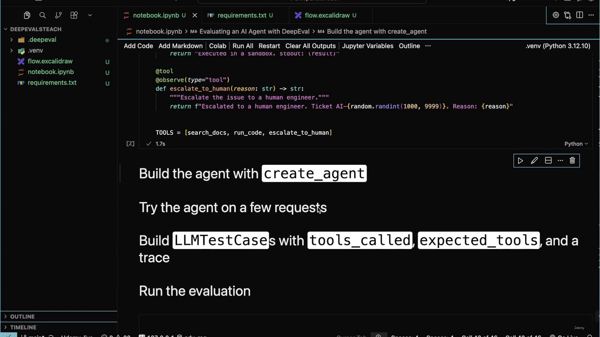
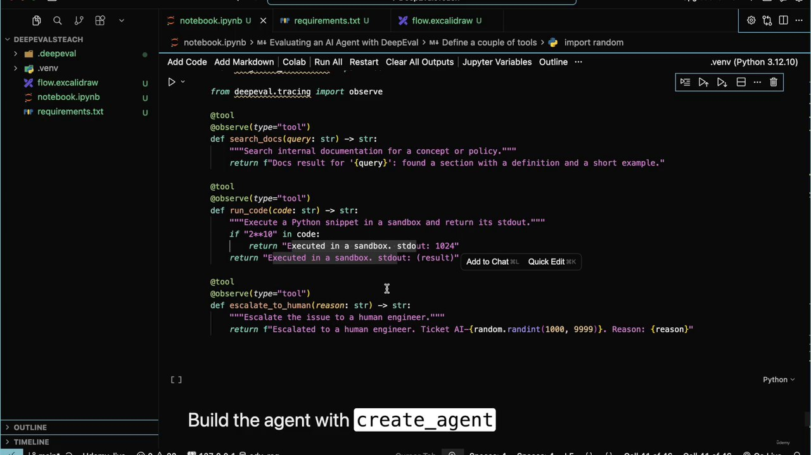
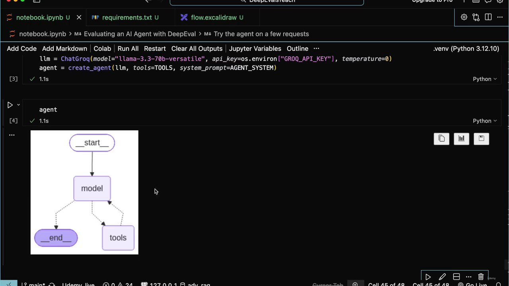
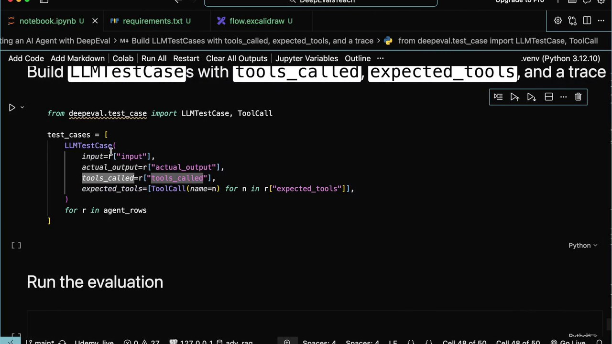
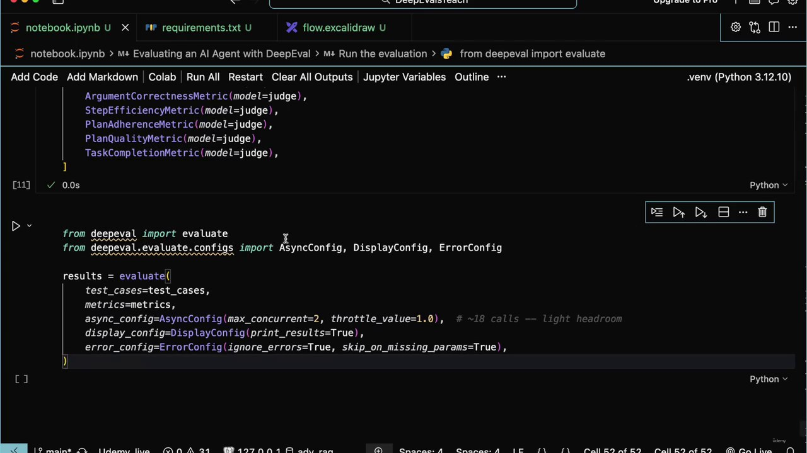
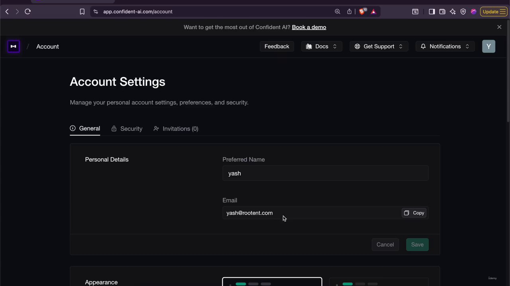
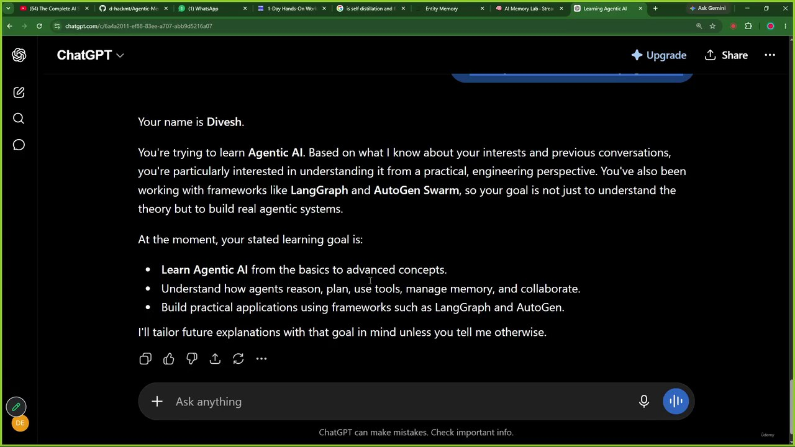
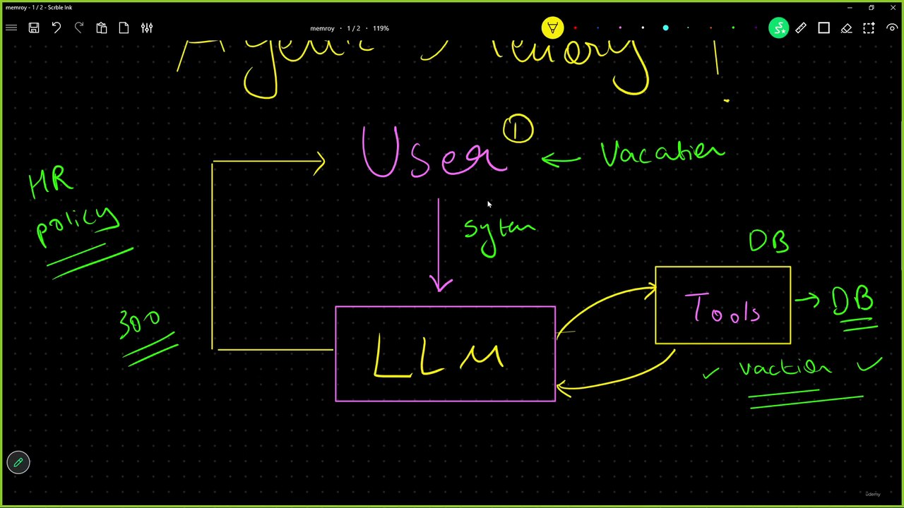
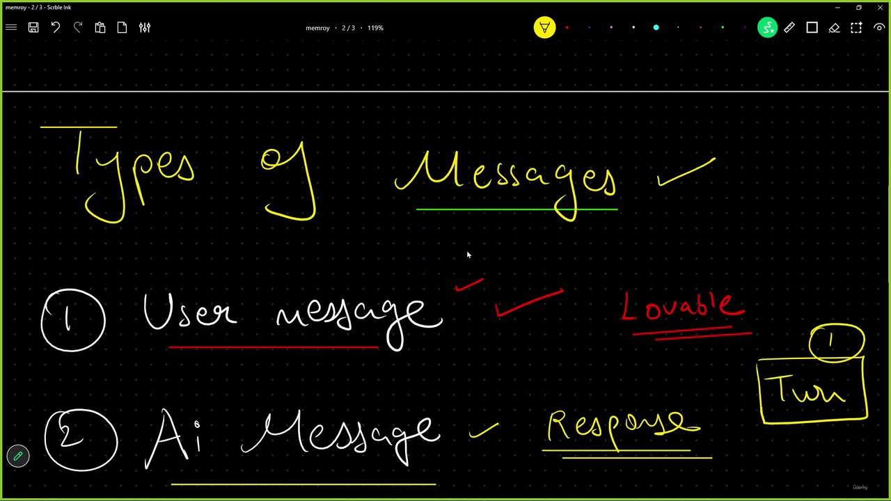

# AI Security Bootcamp part1（P16–P17）复现文档：DeepEvals 评估 AI Agent + Agentic Memory 概念推导

> 本文覆盖 P16–P17。P16 是可运行代码课：用 DeepEvals + LangChain + Groq 搭建一个带工具调用的 ReAct Agent，采集 trace，构造 LLM test case，跑评估，并把结果推到 Confident AI 仪表盘。P17 是概念推导课：讲清楚 agentic memory 为什么存在、一个 turn 里有哪些消息、为什么 AI Agent 必须 stateful、context engineering 解决什么问题。
>
> 阅读顺序建议：先按第 3、4 节把 P16 的代码跑通，再用第 3.2 节和第 5.2 节理解 P17 的概念。P17 没有代码，第 4.2 节给的是设计决策表和概念模型，不是讲师写过的实现。

---

## 1. 这一节做什么

P16 的目标不是“讲评估指标”，而是**把评估流水线真正跑起来**。讲师在一个 Jupyter Notebook 里完成以下动作：

1. 准备 Groq API Key 和 Confident AI API Key。
2. 安装依赖：`pydantic`、`langchain`、`langchain-groq`、`deepevals`，并把 `deepevals` 固定到 `4.1.2`，因为 `4.1.0` 有 bug，无法把 trace 和 event 推到 Confident AI 仪表盘。
3. 用 LangChain 的 `@tool` 装饰器定义三个工具：`search_doc`、`run_code`、`escalate_to_human`。工具内部故意写得很简单，只保留静态返回，目的是观察 agent 的调用流程，而不是真的执行代码或查数据库。
4. 用 DeepEvals 的 `@observe(type="tool")` 给每个工具加 trace；不加这个装饰器，工具调用不会产生 trace。
5. 用 LangChain 的 `create_agent` 创建 ReAct Agent，模型用 Groq 上的 `openai/gpt-oss-120b`。讲师一开始用的模型工具调用不兼容，后来换成了这个非付费模型。
6. 定义 golden questions：每条包含 `input`、`expected_tools`、`goal`。
7. 写 `invoke_agent(query, max_retries=3)`：带重试、带 `BadRequestError` 捕获、每次重试等 1 秒、用 `update_current_span` 更新 span 的输入输出。这个函数用 `@observe(type="agent")` 标记为 agent span。
8. 写 `run_agent(query)`：调用 `invoke_agent`，从 root span 里取 tool call 数据，拼成 JSON 返回。
9. 把每次 golden question 的执行结果转成 LLM test case：`input`、`actual_output`、`tools_called`、`expected_tools`、`trace`。
10. 定义 judge model（本地 `ChatGroq` 对象），定义 metrics：tool correctness、argument correctness、step efficiency、plan adherence、plan quality、answer correctness，然后调用 `evaluate`，开启 async。
11. 运行 `deepevals view`，在终端粘贴 Confident AI API Key，登录仪表盘，查看每次 test run 的分数、失败用例、verbose log。

P17 的目标是**建立 agentic memory 的概念模型**。讲师用 ChatGPT 的短对话/长对话演示短时记忆和长时记忆，然后画出标准 agentic loop：用户消息 → LLM 判断 → 工具检索 → 工具消息作为 context → AI 回复。接着把一次完整循环定义为一个 **turn**，一个 turn 里会出现四类消息：user message、system message、tool message、AI message。AI 的记忆不是记“消息”，而是记“turn 的列表”。最后引出 context engineering：turn 太多会导致 token 成本爆炸，也会让早期 turn 被遗忘，所以需要一套管理上下文的技巧。P17 没有代码，也没有具体 token 数字，本文不会替讲师编造实现。

---

## 2. 讲师原话

> "我们要真正看一看如何用 DeepEvals 实现 AI agent 评估。"
> —— p016 [00:27]

> "这个 `@observe` 函数由 DeepEvals 提供。它会给我们完整的 trace。"
> —— p016 [01:52]

> "`@tool` 装饰器是 LangChain 库的一部分，它定义这个函数可以在我们创建的 AI agent 里作为工具使用。"
> —— p016 [04:17]

> "`@observe` 来自 DeepEvals，用来做正确的 tracing，创建正确的 trace 对象。工具被调用时，传进去的信息、参数、名字、docstring、返回值，都会存进 trace 里。"
> —— p016 [04:46]

> "如果我把这个 `@observe` 装饰器去掉，这个工具的执行和调用就不会有任何 trace。"
> —— p016 [05:12]

> "这个函数会构建一个 tool 类型的 trace，所以我们在这里写 `type="tool"`。"
> —— p016 [05:12]

> "我们要用 LangChain 提供的 `create_agent` 来构建 AI agent。"
> —— p016 [07:02]

> "agent 的大脑是一个 LLM，由 Groq 提供，因为我们用的是 LangChain，所以通过 `ChatGroq` 来调用。"
> —— p016 [07:32]

> "这里有一个简单的 LangGraph 流，就是我们已经见过的 ReAct agent：模型和工具之间有一个循环，做 reasoning and action，如果不需要工具调用就走到结束。"
> —— p016 [08:30]

> "我们要导入 `time` 和 `BadRequestError`，因为 agent 在 ReAct 循环里会发很多 LLM 推理请求，需要正确的时间管理、编排管理和异步管理。"
> —— p016 [09:28]

> "对于每个 attempt，它调用我们创建的 ReAct agent，拿到 answer；如果有 `BadRequestError`，说明工具调用失败或工具调用错了；每轮循环等 1 秒，避免 LLM 的 rate limit。"
> —— p016 [10:51]

> "我们用 `update_current_span` 把输入和输出更新到当前 span 里，这样按顺序构建的 span 会被正确更新。"
> —— p016 [11:50]

> "这个 `invoke_agent` 函数要属于 agent span，所以我们加 `@observe(type="agent")`。"
> —— p016 [12:19]

> "`run_agent` 从 root span 里拿到 tool call 数据，返回一个 JSON 对象，方便在代码里展示。"
> —— p016 [12:46]

> "我们用的 LLM 工具调用不太兼容，所以把模型换成 OpenAI GPT OSS120B。这个不是付费模型，在 Groq 里也能推理。"
> —— p016 [13:41]

> "Confident AI 是一家维护开源 DeepEvals 框架的企业公司。加上 Confident AI API Key，就可以在浏览器仪表盘里看到所有 trace。"
> —— p016 [14:40]

> "`deepevals 4.1.0` 有 bug，导致不能把 trace 和 event 推到 Confident AI 仪表盘，请改成 `4.1.2`。"
> —— p016 [23:45]

> "如果记忆不在，对话就没有流程。AI 就只是一个内容生成器，永远不会成为我们的编码伙伴，也永远不会成为我们人类生态的一部分。"
> —— p017 [02:56]

> "一个 turn 里，四类消息会出现：user message、system message、tool message、AI message。"
> —— p017 [08:04]

> "AI 不能只记消息，AI 必须记 turn。"
> —— p017 [10:25]

> "人类被称为 stateful。我们在研究范式里尽最大努力让 AI agent 也变成 stateful。"
> —— p017 [12:17]

> "为了高效管理这些信息、不让内存爆炸，有不同的技术，这个技术叫 context engineering。"
> —— p017 [15:09]

> "Prompt engineering 是教 AI 怎么表现；context engineering 是管理 AI 如何在单个或多个 agent 之间维护记忆。"
> —— p017 [15:39]

---

## 3. 从零复现

### 3.1 复现 P16：DeepEvals + LangChain + Groq 评估流水线

#### 3.1.1 目录与文件

建议目录：

```text
ai-security-bootcamp-p16/
├── requirements.txt
├── agent_eval.py
└── .env
```

`.env` 内容：

```bash
GROQ_API_KEY=gsk_xxxxxxxxxxxxxxxxxxxxxxxx
CONFIDENT_API_KEY=confident_xxxxxxxxxxxxxxxx
```

> 课里讲师是在 Notebook 里直接粘贴 API Key，也提到可以在 notebook prompt 里输入。实际项目建议用 `.env`，不要硬编码。

#### 3.1.2 环境准备

讲师使用的是 `uv` 环境。命令顺序如下：

```bash
uv venv
source .venv/bin/activate          # Windows: .venv\Scripts\activate
uv pip install -r requirements.txt
```

`requirements.txt` 里必须把 `deepevals` 固定为 `4.1.2`：

```text
deepevals==4.1.2
langchain
langchain-groq
pydantic
python-dotenv
```

> 讲师原话是：`4.1.0` 有 bug，不能把 trace 和 event 推到 Confident AI，改成 `4.1.2` 后重新执行 `uv pip install -r requirements.txt`。如果你安装的是 `4.1.0`，仪表盘会一直提示没有 trace。



#### 3.1.3 Notebook / 脚本执行顺序

如果你用 Jupyter Notebook，按以下 cell 顺序执行：

1. 加载环境变量。
2. 导入依赖。
3. 定义三个工具，并加 `@tool` 和 `@observe(type="tool")`。
4. 把工具放进 `tools` 数组。
5. 定义 agent system prompt。
6. 实例化 `ChatGroq`。
7. 用 `create_agent` 创建 agent。
8. 定义 golden questions。
9. 定义 `invoke_agent` 和 `run_agent`。
10. 跑 golden questions，得到 `agent_rows`。
11. 把 `agent_rows` 转成 test cases，并附上 `trace`。
12. 定义 judge model 和 metrics。
13. 调用 `evaluate`。
14. 终端执行 `deepevals view`，粘贴 Confident AI API Key，打开仪表盘。

#### 3.1.4 工具定义的关键点

讲师强调：

- `search_doc`：只返回一个非常简单的 docstring，并把 query 嵌进去。
- `run_code`：只执行一个静态 if 语句，没有真实执行。目的是理解 agent 流程，不是真的跑代码。
- `escalate_to_human`：只返回一个示例字符串，没有真正 human-in-the-loop。

三个工具都必须加：

```python
@tool
@observe(type="tool")
def search_doc(query: str) -> str:
    ...
```

注意装饰器顺序：`@tool` 是 LangChain 的，`@observe` 是 DeepEvals 的。讲师说 `@observe` 负责 trace，去掉就没有 trace；`type="tool"` 表示构建 tool 类型 trace。



#### 3.1.5 Agent 创建

```python
from langchain.agents import create_agent
from langchain_groq import ChatGroq

llm = ChatGroq(
    model="openai/gpt-oss-120b",
    api_key=os.environ["GROQ_API_KEY"],
    temperature=0,
)

agent = create_agent(
    model=llm,
    tools=tools,
    system_prompt=AGENT_SYSTEM_PROMPT,
)
```

讲师说这个 agent 就是 ReAct agent：模型和工具之间循环，reasoning and action，不需要工具调用就结束。执行 `agent` 可以看到 LangGraph 的简单流程图。



#### 3.1.6 Golden questions 与执行

Golden questions 结构来自 DeepEvals 的 golden 数据：

```python
golden_questions = [
    {
        "input": "What is the vacation policy?",
        "expected_tools": ["search_doc"],
        "goal": "Answer vacation policy question using search_doc",
    },
    ...
]
```

讲师说每条包含：`input`、`expected_tools`、`goal`。实际 notebook 里的具体问题逐字稿没有逐条念出，所以第 4 节代码里给的是可运行示例，实际以课程资源为准。

执行时用 `run_agent(query)`，它内部调用 `invoke_agent`，并返回格式化 JSON。讲师运行后说“会花 15–20 秒”，然后看到 verbose 结果。

#### 3.1.7 构造 test case

讲师的原话逻辑：

- 遍历 `agent_rows`。
- 取 `input`、`actual_output`、`tool_calls`、`expected_tools`。
- 再把 `trace` 也塞进 test case，因为 step efficiency、plan efficiency、plan adherence 都需要 trace。



#### 3.1.8 评估

Judge model 用本地 `ChatGroq` 对象，直接传给 `evaluate`。讲师说如果直接用 `ChatGroq` 之外的简单 LLM，需要额外配置，所以这里用本地 judge model。

Metrics 包括：

- tool correctness
- argument correctness
- step efficiency
- plan adherence
- plan quality
- answer correctness

调用 `evaluate` 时开 async。运行后第一个 test case 通过，第二个失败，失败原因是 step efficiency 不好。



#### 3.1.9 Confident AI 仪表盘

讲师先在 notebook 里执行：

```python
!deepevals view
```

但提示要 API Key，而且 notebook 里执行不顺利，于是改到终端：

```bash
deepevals view
```

然后粘贴 Confident AI API Key。登录成功后，在 `my first project` 的 project settings 里创建 API Key。之后重新跑 notebook，必须把 `CONFIDENT_API_KEY` 也加到环境里，否则 trace 会提示 `no Confident API key found, skipping trace posting`。



### 3.2 复现 P17：Agentic Memory 的推导过程

P17 没有代码，按“需求 → 约束 → 方案 → 取舍”复现讲师的推导：

#### 需求

AI 要成为编码伙伴、工作流的一部分，而不是一次性内容生成器。讲师用 ChatGPT 演示：

- 短对话里问“我叫什么、我在学什么”，ChatGPT 能答出来 → 短时记忆。
- 长对话里问“我的第一条消息是什么”，ChatGPT 能检索到很早的消息 → 长时记忆。
- 如果没有记忆，对话没有 flow，AI 无法进入人类生态。

#### 约束

一个标准 agentic loop 里，用户消息进来，LLM 判断是闲聊还是 HR 查询；如果是 HR 查询，调用工具，工具返回 context，AI 再回复。这个循环里会出现四类消息：

1. user message：用户 query。
2. system message：内部 prompt engineering，规定 AI 怎么表现，比如“你是 HR 政策助手，只回答 300 词以内，总是用数据库回答”。
3. tool message：工具检索回来的上下文。
4. AI message：最终回复。

四类消息组成一个 **turn**。第二个问题进来，整个循环再跑一遍，就是 turn 2。

#### 方案

AI 的记忆不是“记消息”，而是“记 turn 的列表”：turn 1、turn 2、turn 3……这个 turn 列表就是 brain 的 context。讲师用“从 X 到 Y 要右转、直走、再右转”的类比：人能记住怎么走，是因为记得自己从哪来、要到哪去；人类是 stateful 的，所以要让 AI agent 也 stateful。

#### 取舍

如果 turn 无限增长：

- token 成本会爆炸。
- 到第 1000 个 turn 时，早期 turn 会被遗忘。
- 计算机程序无法记住所有信息。

所以需要 context engineering：管理单个或多个 agent 如何维护记忆。Prompt engineering 是教 AI 怎么表现；context engineering 是管理上下文。讲师明确说 context engineering 是另一个话题，本次只做 introduction。







---

## 4. 完整代码

### 4.1 P16 完整可运行代码（按逐字稿重建）

> 说明：以下代码按讲师逐字稿描述重建。DeepEvals 的具体 import 路径、`evaluate` 参数名可能随版本变化；如果你的版本报 `ImportError` 或 `TypeError`，请以 `deepevals` 官方文档为准。代码中标注“示例”的 golden question 是逐字稿没有逐条念出的部分。

`requirements.txt`：

```text
deepevals==4.1.2
langchain
langchain-groq
pydantic
python-dotenv
```

`agent_eval.py`：

```python
"""
AI Security Bootcamp P16
DeepEvals + LangChain + Groq 评估 AI Agent

运行前：
1. 复制 .env.example 为 .env，填入 GROQ_API_KEY 和 CONFIDENT_API_KEY
2. uv pip install -r requirements.txt
3. python agent_eval.py
"""

import os
import time
import json
from typing import Any

from dotenv import load_dotenv

load_dotenv()

# ============================================================
# 1. 导入 LangChain / Groq / DeepEvals
# ============================================================

from langchain_core.tools import tool
from langchain.agents import create_agent
from langchain_groq import ChatGroq
from groq import BadRequestError

# DeepEvals 的 observe / evaluate / update_current_span
# 注意：不同版本 import 路径可能不同，以实际安装版本为准
from deepevals import observe, evaluate, update_current_span

# ============================================================
# 2. 定义工具
# 每个工具都加 @tool（LangChain）和 @observe(type="tool")（DeepEvals）
# ============================================================

@tool
@observe(type="tool")
def search_doc(query: str) -> str:
    """Search internal documentation for the given query."""
    # 讲师故意只返回静态 docstring + query，不接真实数据库
    return f"DOC RESULT for query: {query}. Vacation policy: 20 days per year."


@tool
@observe(type="tool")
def run_code(code: str) -> str:
    """Run a sample code snippet. This is a static demo, not real execution."""
    # 讲师说这里只执行一个 sample if statement，没有真实执行
    if "error" in code.lower():
        return "STATIC RUN RESULT: detected error keyword, returning fallback branch."
    return "STATIC RUN RESULT: if branch executed, code looks fine."


@tool
@observe(type="tool")
def escalate_to_human(reason: str) -> str:
    """Escalate to a human. Demo only, no real human in the loop."""
    # 讲师说这里只返回 sample return string，没有真正 human-in-the-loop
    return f"ESCALATED: {reason}. A human agent would be notified here."


tools = [search_doc, run_code, escalate_to_human]

# ============================================================
# 3. Agent system prompt 与 LLM
# ============================================================

AGENT_SYSTEM_PROMPT = """You are a junior developer assistant.
You have access to tools: search_doc, run_code, escalate_to_human.
Use search_doc for documentation questions.
Use run_code when the user asks to run or check code.
Use escalate_to_human when the request needs human approval.
Always call a tool when the question is about internal policy or code execution.
Answer concisely."""

llm = ChatGroq(
    model="openai/gpt-oss-120b",  # 讲师口述为 OpenAI GPT OSS120B，实际 ID 以 Groq 控制台为准
    api_key=os.environ["GROQ_API_KEY"],
    temperature=0,
)

# LangChain create_agent：创建 ReAct agent
agent = create_agent(
    model=llm,
    tools=tools,
    system_prompt=AGENT_SYSTEM_PROMPT,
)

# ============================================================
# 4. Golden questions
# 讲师说每条包含 input、expected_tools、goal
# 下面为可运行示例，实际数据以课程资源为准
# ============================================================

golden_questions = [
    {
        "input": "What is the vacation policy?",
        "expected_tools": ["search_doc"],
        "goal": "Answer vacation policy question using search_doc",
    },
    {
        "input": "Please run this code and tell me if it has an error: print('hello')",
        "expected_tools": ["run_code"],
        "goal": "Check code using run_code",
    },
    {
        "input": "This request needs a human approval, please escalate.",
        "expected_tools": ["escalate_to_human"],
        "goal": "Escalate to human using escalate_to_human",
    },
]

# ============================================================
# 5. invoke_agent / run_agent
# ============================================================

@observe(type="agent")
def invoke_agent(query: str, max_retries: int = 3) -> str:
    """
    调用 ReAct agent。
    - 最多重试 max_retries 次
    - 捕获 BadRequestError（工具调用失败/错误工具调用）
    - 每次重试等待 1 秒，避免 rate limit
    - 用 update_current_span 更新当前 span 的 input/output
    """
    final_output = ""

    for attempt in range(max_retries):
        try:
            result = agent.invoke(
                {"messages": [{"role": "user", "content": query}]}
            )
            # 取最后一条 AI message 的内容
            messages = result.get("messages", [])
            if messages:
                final_output = messages[-1].content
            else:
                final_output = str(result)

            # 把 input/output 更新到当前 span
            update_current_span(
                input=query,
                output=final_output,
            )
            break

        except BadRequestError as e:
            # 讲师说：工具调用失败或工具调用错时会出现这类错误
            print(f"[attempt {attempt + 1}] BadRequestError: {e}")
            time.sleep(1)
        except Exception as e:
            # 其他异常也打印出来，方便定位
            print(f"[attempt {attempt + 1}] Exception: {e}")
            time.sleep(1)

    return final_output


def get_root_span_tool_calls() -> list:
    """
    从 root span 里取 tool call 数据。
    注意：不同 deepevals 版本获取 span 的方式不同。
    如果你的版本没有 get_current_span，请用对应 API 替换。
    """
    try:
        from deepevals import get_current_span
        span = get_current_span()
        if span is None:
            return []
        # 常见字段名可能是 tool_calls / tools_called，按实际输出为准
        return span.get("tool_calls", []) or span.get("tools_called", [])
    except Exception:
        return []


def run_agent(query: str) -> dict:
    """
    调用 invoke_agent，并从 root span 取 tool call 数据，
    返回 JSON 友好的 dict。
    """
    output = invoke_agent(query)
    tool_calls = get_root_span_tool_calls()
    return {
        "input": query,
        "actual_output": output,
        "tool_calls": tool_calls,
    }


# ============================================================
# 6. 跑 golden questions，收集 agent_rows
# ============================================================

agent_rows = []

for item in golden_questions:
    row = run_agent(item["input"])
    row["expected_tools"] = item["expected_tools"]
    row["goal"] = item["goal"]
    agent_rows.append(row)
    print("=" * 80)
    print(json.dumps(row, ensure_ascii=False, indent=2))

# ============================================================
# 7. 构造 LLM test cases
# 讲师强调：test case 里要带 trace，因为 step efficiency / plan adherence 需要 trace
# ============================================================

test_cases = []

for row in agent_rows:
    test_case = {
        "input": row["input"],
        "actual_output": row["actual_output"],
        "tools_called": row.get("tool_calls", []),
        "expected_tools": row.get("expected_tools", []),
        # 讲师说把 trace 存到 test case 的 trace 字段里
        "trace": row.get("trace", None),
    }
    test_cases.append(test_case)

print("=" * 80)
print("TEST CASES:")
print(json.dumps(test_cases, ensure_ascii=False, indent=2, default=str))

# ============================================================
# 8. Judge model 与 metrics
# ============================================================

judge_model = ChatGroq(
    model="openai/gpt-oss-120b",
    api_key=os.environ["GROQ_API_KEY"],
    temperature=0,
)

metrics = [
    "tool_correctness",
    "argument_correctness",
    "step_efficiency",
    "plan_adherence",
    "plan_quality",
    "answer_correctness",
]

# ============================================================
# 9. 运行评估
# 讲师说：evaluate 时开 async
# ============================================================

results = evaluate(
    test_cases=test_cases,
    metrics=metrics,
    model=judge_model,
    async_config={"max_concurrent": 4},
)

print("=" * 80)
print("EVALUATION RESULTS:")
print(json.dumps(results, ensure_ascii=False, indent=2, default=str))
```

终端执行：

```bash
python agent_eval.py
```

登录 Confident AI：

```bash
deepevals view
```

> 讲师在 notebook 里也试过 `!deepevals view`，但最后强调要在终端里跑，并且确保虚拟环境已激活。

### 4.2 P17 概念产物：设计决策表与消息模型

> P17 没有代码。以下不是讲师写过的实现，而是把讲师口述的概念落成可用的设计表，方便前端转 AI 应用工程师落地。

#### 4.2.1 四类消息职责表

| 消息类型 | 来源 | 作用 | 例子 |
|---|---|---|---|
| user message | 用户 | 表达 query | “告诉我休假政策” |
| system message | 开发者 | 规定 agent 身份、行为、边界 | “你是 HR 政策助手，只回答 300 词以内，总是用数据库回答” |
| tool message | 工具 | 提供检索到的 context | 数据库返回的休假政策文本 |
| AI message | LLM | 最终回复 | “每年 20 天休假……” |

#### 4.2.2 Turn 数据模型草案

```json
{
  "turn_id": 1,
  "messages": [
    { "role": "user", "content": "告诉我休假政策" },
    { "role": "system", "content": "你是 HR 政策助手……" },
    { "role": "tool", "name": "search_doc", "content": "休假政策：每年 20 天" },
    { "role": "assistant", "content": "每年 20 天休假。" }
  ]
}
```

#### 4.2.3 记忆管理决策表

| 问题 | 课里的判断 | 落地建议 |
|---|---|---|
| AI 记什么？ | 记 turn，不是只记消息 | 存储 turn 数组，每个 turn 保留四类消息 |
| 为什么要 stateful？ | 没有记忆就没有对话 flow，AI 只是内容生成器 | 对话服务必须保存 turn 历史 |
| turn 太多怎么办？ | token 成本爆炸，第 1000 个 turn 会忘掉早期内容 | 需要 context engineering：摘要、检索、裁剪、分层记忆 |
| prompt engineering 和 context engineering 区别？ | prompt engineering 教 AI 怎么表现；context engineering 管理记忆 | 两者分开设计，不要混在一个 prompt 里 |

#### 4.2.4 容量估算示意（课里没有给具体数字）

> 讲师只说了“1000 个 turn 会导致 token 成本爆炸、早期 turn 被遗忘”，没有给 token 数。下面只是帮助理解的量级示意，不是课程原话。

假设每个 turn 平均 500 tokens，10 个 turn 是 5,000 tokens；1000 个 turn 是 500,000 tokens。绝大多数模型上下文窗口承受不了，成本也会线性上涨。所以必须在 turn 数量增长前做摘要或检索。

---

## 5. 逐行解释

### 5.1 P16 代码逐行解释

**`from langchain_core.tools import tool`**  
LangChain 的工具装饰器。讲师说 `@tool` 定义这个函数可以作为一个 tool 被 agent 使用。前端可以理解为：给函数加一个“可被 LLM 调用的 schema”。

**`from langchain.agents import create_agent`**  
讲师明确说用 LangChain 的 `create_agent` 创建 AI agent。执行 `agent` 会看到 ReAct 的 LangGraph 流程图：模型和工具循环，直到不需要工具调用。

**`from langchain_groq import ChatGroq`**  
因为 LLM 用 Groq，LangChain 通过 `ChatGroq` 调用。讲师说 agent 的大脑是 LLM，这里就是给大脑指定模型。

**`from groq import BadRequestError`**  
讲师用 `BadRequestError` 捕获工具调用失败或错误工具调用。注意：不同 Groq SDK 版本异常类路径可能不同，如果 import 失败，查你安装的 `groq` 包。

**`from deepevals import observe, evaluate, update_current_span`**  
`observe` 用来创建 trace；`evaluate` 用来跑评估；`update_current_span` 用来更新当前 span 的输入输出。讲师说 `@observe` 是 DeepEvals 提供的，去掉就没有 trace。

**`@tool` + `@observe(type="tool")`**  
两个装饰器叠加。`@tool` 让 LangChain 识别工具；`@observe(type="tool")` 让 DeepEvals 记录工具调用的参数、名字、docstring、返回值。讲师说 `type="tool"` 表示构建 tool 类型 trace。

**`search_doc` 返回静态字符串**  
讲师说这个函数只是给一个非常简单的 docstring，并把 query 嵌进去。目的是理解 agent 流程，不是真的查数据库。

**`run_code` 只做静态 if 判断**  
讲师说没有真实执行，只是 sample if statement。如果 if 不执行，返回另一段 code。这样评估时能观察 agent 是否调用了正确工具。

**`escalate_to_human` 只返回 sample string**  
讲师说没有真正 human-in-the-loop，只是演示工具调用。

**`tools = [search_doc, run_code, escalate_to_human]`**  
这个数组会传给 agent。讲师说这个数组有用，因为后面要把它给 agent。

**`AGENT_SYSTEM_PROMPT`**  
讲师说这是一个非常基础的 system prompt：“junior developer assistant，调用工具”。它对应 P17 的 system message：规定 agent 怎么表现。

**`ChatGroq(model="openai/gpt-oss-120b", ...)`**  
讲师一开始用的模型工具调用不兼容，后来换成 OpenAI GPT OSS120B，并强调这不是付费模型，Groq 里可以推理。`temperature=0` 让评估更稳定。

**`create_agent(model=llm, tools=tools, system_prompt=...)`**  
创建 ReAct agent。讲师说这个 agent 有工具访问能力，模型和工具之间循环。

**`golden_questions`**  
每条包含 `input`、`expected_tools`、`goal`。讲师说这些在 DeepEvals 的 golden 数据里也有：turns、questions、expected tools、goal。

**`@observe(type="agent")` 修饰 `invoke_agent`**  
讲师说这个函数属于 agent span，所以加 `type="agent"`。

**`for attempt in range(max_retries)`**  
最多重试 3 次。讲师说每次 attempt 调用 agent，拿 answer。

**`agent.invoke({"messages": [{"role": "user", "content": query}]})`**  
按 agent 接受的格式传 query。讲师说要用 proper format。

**`except BadRequestError`**  
讲师说如果出现 bad request error，说明工具调用失败或工具调用错了。捕获后等 1 秒，避免 rate limit。

**`time.sleep(1)`**  
讲师明确说每个循环等 1 秒，为了 rate limit。

**`update_current_span(input=query, output=final_output)`**  
讲师说用这个把 span 的 input/output 更新好，这样按顺序构建的 span 会被正确更新。

**`run_agent(query)`**  
调用 `invoke_agent`，从 root span 取 tool call 数据，返回 JSON。讲师说这样可以在代码里以格式化方式打印输出。

**`test_cases` 构造**  
遍历 `agent_rows`，取 input、actual output、tool call、expected tools，再把 trace 放进去。讲师说 trace 对 step efficiency、plan efficiency、plan adherence 很重要。

**`judge_model = ChatGroq(...)`**  
讲师说用本地模型作为 judge，直接传给 `evaluate`。如果用简单 LLM，需要额外配置。

**`metrics = [...]`**  
讲师列出 tool correctness、argument correctness、step efficiency、plan adherence、plan quality、answer correctness。这些是评估 agent 的维度。

**`evaluate(test_cases=..., metrics=..., model=judge_model, async_config=...)`**  
讲师说定义 evaluate 对象、test case、metrics、async 配置，然后运行。结果里 test case 1 通过，test case 2 失败，失败原因是 step efficiency 不好。

**`deepevals view`**  
讲师先在 notebook 里用 `!` 跑，后来改到终端。登录后可以在 Confident AI 仪表盘看到 answer correctness、plan adherence、plan quality、step efficiency 等分数，以及每个 test case 的输入、实际输出、调用的工具、失败原因、verbose log。

### 5.2 P17 概念逐条解释

**短时记忆 vs 长时记忆**  
ChatGPT 短对话能记住名字和学习目标；长对话能回答“我的第一条消息是什么”。讲师用这两个例子说明：记忆让对话有 flow。

**没有记忆的后果**  
讲师原话：AI 只会是内容生成器，不会成为编码伙伴，不会成为人类生态的一部分，无法整合进工作流。

**标准 agentic loop**  
用户消息 → LLM 判断意图 → 如果是 HR 查询就调工具 → 工具返回 context → AI 基于 context 回复。讲师强调 AI 能给出准确答案，是因为信息来自可信工具。

**system instruction**  
讲师说内部给 AI 的指令是“你是 HR 政策助手，只回答 300 词以内，总是用数据库回答”。这是 prompt engineering，也是 system message。

**四类消息**  
user message 是用户 query；system message 是内部 prompt engineering；tool message 是工具检索的 context；AI message 是最终回复。四类消息组成一个 turn。

**turn 的定义**  
一次完整 workflow 叫一个 turn。第二个问题进来，整个 loop 再跑一遍，就是 turn 2。AI 的记忆要记 turn，不是只记消息，因为 turn 里包含用户输入、指令、工具信息和回复。

**stateful**  
人类是 stateful 的：记得自己从哪来、要到哪去，所以能连续右转、直走、再右转。AI agent 也要 stateful，否则无法在 1000 个文件的项目里保持记忆。

**coding assistant 的例子**  
GitHub Copilot、Claude Code、Google Anti-Gravity、Codex 这类工具不是只拿一段文本或图片，而是拿一个文件夹。文件夹里可能有 1000 个文件。AI 必须跨文件维护记忆。人类记不住哪个词在哪个文件，所以用 README 维护记忆；AI 也需要类似技术。

**context engineering**  
turn 太多会导致 token 成本爆炸，到第 1000 个 turn 会忘记早期内容。所以需要 context engineering 来高效管理信息。Prompt engineering 是教 AI 怎么表现；context engineering 是管理 AI 如何在单个或多个 agent 之间维护记忆。

**取舍**  
讲师没有给出具体实现，只给了方向：context engineering 是另一个话题，本次只是 introduction。所以第 4.2 节的表是概念落地建议，不是讲师代码。

---

## 6. 复现检查清单

### P16 检查清单

- [ ] 已创建虚拟环境并激活：`uv venv && source .venv/bin/activate`。
- [ ] `requirements.txt` 中 `deepevals==4.1.2`，不是 `4.1.0`。
- [ ] 已执行 `uv pip install -r requirements.txt`。
- [ ] `.env` 中有 `GROQ_API_KEY` 和 `CONFIDENT_API_KEY`。
- [ ] 三个工具都能单独 import，且都有 `@tool` 和 `@observe(type="tool")`。
- [ ] `agent` 创建成功，执行 `agent` 能看到 ReAct 循环图。
- [ ] `invoke_agent` 有 `@observe(type="agent")`。
- [ ] `invoke_agent` 里捕获 `BadRequestError`，每次重试 `time.sleep(1)`。
- [ ] `update_current_span` 在成功拿到输出后被调用。
- [ ] `run_agent` 返回 `input`、`actual_output`、`tool_calls`。
- [ ] `test_cases` 里包含 `trace` 字段。
- [ ] `evaluate` 的 metrics 至少包含 tool correctness、argument correctness、step efficiency、plan adherence、plan quality、answer correctness。
- [ ] 终端执行 `deepevals view` 能登录 Confident AI。
- [ ] 重新跑 notebook 后，终端出现 `Confident AI trace log successfully posted`，而不是 `no Confident API key found, skipping trace posting`。
- [ ] 仪表盘能看到 test run、每个 test case 的输入/输出/工具调用/失败原因/verbose log。

### P17 检查清单

- [ ] 能用自己的话解释短时记忆和长时记忆的区别。
- [ ] 能画出标准 agentic loop：user → LLM → tool → context → AI。
- [ ] 能说出四类消息：user、system、tool、AI。
- [ ] 能解释一个 turn 包含四类消息，第二个问题就是 turn 2。
- [ ] 能解释为什么 AI 要记 turn 而不是只记消息。
- [ ] 能解释 stateful 的含义，以及 coding assistant 跨 1000 个文件维护记忆的例子。
- [ ] 能区分 prompt engineering 和 context engineering。
- [ ] 能说出 turn 太多的两个问题：token 成本爆炸、早期 turn 被遗忘。

---

## 7. 课里没讲但你会撞上的

1. **Groq 模型 ID 可能变**  
   讲师口述“OpenAI GPT OSS120B”，代码里常见写法是 `openai/gpt-oss-120b`，但 Groq 控制台的模型 ID 可能调整。运行前先在 Groq 控制台确认可用模型名。如果报模型不存在，换一个支持 tool calling 的 Groq 模型。

2. **`create_agent` 的 import 路径随 LangChain 版本变化**  
   讲师用的是 `from langchain.agents import create_agent`。如果你安装的 LangChain 版本没有这个函数，可能需要 `create_react_agent` 或升级 LangChain。课里没讲版本兼容矩阵，遇到 `ImportError` 先查 LangChain 版本。

3. **DeepEvals 的 `observe` / `evaluate` / `update_current_span` API 可能变化**  
   课里没有逐行念 import 路径。本文按常见用法写。如果 `ImportError`，去 `deepevals` 官方文档查当前版本的 import。不要因为 import 失败就以为课程代码错了。

4. **`4.1.0` 的 bug 是真实存在的**  
   讲师明确说 `4.1.0` 不能把 trace 和 event 推到 Confident AI，必须 `4.1.2`。如果你看到 `no Confident API key found, skipping trace posting`，先检查版本，再检查 key。

5. **Confident AI 注册需要工作邮箱**  
   讲师说用 Gmail 不行，他用了工作邮箱；教育邮箱可能可以。课里没讲企业邮箱的具体域名限制，实际注册时按页面提示。

6. **`deepevals view` 在 notebook 里可能交互不正常**  
   讲师先试 `!deepevals view`，后来改到终端。建议直接在已激活虚拟环境的终端里运行，粘贴 API Key 更稳。

7. **API Key 不要硬编码**  
   课里讲师在 notebook 顶部粘贴 key。实际项目用 `.env` + `python-dotenv`，并且把 `.env` 加进 `.gitignore`。

8. **异步评估可能触发 rate limit**  
   讲师用 `async_config` 开并发，但没有给具体并发数。本文示例写 `max_concurrent: 4`，这是示意。如果 Groq 报 429，把并发调低，或在 `invoke_agent` 里保留 `time.sleep(1)`。

9. **`trace` 字段的获取方式因版本而异**  
   讲师说从 root span 取 tool call 数据，但逐字稿没有念出具体函数名。本文用 `get_current_span()` 做示意。如果你的版本没有这个函数，查 DeepEvals 文档里“current span / root span”的 API。

10. **P17 没有代码，不要硬套实现**  
    讲师只给了概念和类比，没有给 turn 存储、摘要、检索的代码。本文第 4.2 节是设计表，不是课程实现。真正做 agentic memory 时，还需要选存储（Redis/Postgres/向量库）、定裁剪策略、定摘要策略，这些课里都没讲。

11. **前端转 AI 应用工程师的对应关系**  
    - system message ≈ 你在前端里写的“系统级配置”，但它是给模型的自然语言指令。  
    - tool message ≈ 一次 API 调用的 response，只不过被塞回模型上下文。  
    - turn ≈ 一次完整的“用户请求 + 工具调用 + 模型回复”事务。  
    - context engineering ≈ 前端状态管理 + 缓存策略 + 分页/裁剪，只不过管理的是 token 而不是 DOM。

---

**结尾提醒**：P16 的代码请先保证“能跑通一条 golden question”，再去调评估指标。P17 的概念请用自己的话复述一遍四类消息和 turn 的定义，再去看 context engineering 的资料。课里没讲的内容，本文已经标注“课里没讲”或“示意”，不要当成讲师原话。