# AI Security Bootcamp part1：Agentic Memory 七种方案（P18–P21）复现文档

本文件覆盖 P18–P21 四讲。这四讲不是纯理论课，也不是纯代码课：讲师用一个已经做好的网页 playground（`aimemory.streamlet.app`）把「AI Agent 的记忆到底是什么」逐种演示了一遍，并且每一种记忆都展示了内部实际发给模型的消息结构、token 数、API 调用次数和成本。你要复现的产物是：**一套能跑出同样现象的 Agentic Memory 实验台**——先在官方 playground 上逐条验证现象，再用本文给出的 Node.js 工程在自己机器上复刻出同样的七种行为，最后跑一次横向对比。

课里没有给出任何源码，逐字稿里也没有出现代码行，OCR 结果为空。因此第 4 节的全部代码都是**按讲师描述的内部消息结构还原出来的示意实现**，每个文件顶部都标了「课里没有代码，以下为示意」。凡是讲师没有讲、我也没有在代码里亲眼看过的字段名，我都会明确写「以实际输出为准」。

---

## 1. 这一节做什么

一句话：**把「Agent 为什么会忘记你叫什么」这件事拆成七种可测量的实现，并亲手跑出来。**

P18 一开始，讲师先给了一个判断：今天的记忆技术已经走到「基于图的记忆」（graph based memories），这是最先进的一档，市面上有 30 多种维护记忆的技术。但他明确说，现在就把这些全学完没有价值：

> "现在这个时间点把所有技术都搞懂并不值得，因为如果我们不知道历史、不知道记忆这个概念最初是怎么起步的，就永远无法理解今天这些最先进的系统是怎么工作的。"
> —— p018 [00:29]

所以 P18–P21 的组织方式是「历史 → 当下」：先把最原始、最笨、但今天仍然大量用在原型和 PoC 里的几种记忆跑通，再讲向量存储和实体记忆，最后做横向对比。这四讲实际交付的东西有三样：

1. **一个可交互的实验台**：两个角色，一个是你（user），一个是讲师预先写好的 AI Agent，叫 Nova。你在输入框里说话，右边能看到 Nova 的回复、这一轮实际发给模型的消息、token 数和成本。
2. **七种记忆策略的完整行为清单**：no memory、conversational buffer、sliding window、summary、summary buffer、token buffer、vector store、entity memory（讲师最后口头复盘时把 no memory 之外的七种称为「不同的基础记忆」）。
3. **一张对比表**：讲师在最后说，在 playground 里点一下对比按钮会跑 24 条查询，跑完给出各策略的对比。

这一节不涉及护栏（guardrail）、网关、可观测性这三个词所指向的工程设施——逐字稿里从头到尾没有出现这些内容。课里没讲的部分，本文不会替讲师补。

---

## 2. 讲师原话

下面按「问题 → 方案 → 代价」的顺序重排了讲师的关键判断，每条都标了出处。原文是英文，这里是中文翻译，产品名保留英文。

**关于为什么必须先学历史：**

> "现在有三十多种维护记忆的技术。这三十多种都是历史。并不是说你不需要这些技术——你需要它们，你把它们组合起来做混合方案，一切才讲得通。"
> —— p018 [00:59]

> "要做到当前最先进的水平、搞清楚现在到底在发生什么，我们必须回到过去，理解当时究竟发生了什么，才能把历史和当下之间的缺口补上。"
> —— p018 [03:23]

**关于「没有记忆」的 Agent 长什么样：**

> "在没有记忆的场景里，早期 AI Agent 只有一样东西：大脑。也许还有工具。那时候没有记忆这个概念。Agent 给出消息时，消息直接进大脑，回复从大脑里生成。"
> —— p018 [05:21]

> "我问『我叫什么名字？』它会说：我们还没有正式互相介绍过。我刚才明明说了我叫 Maya，但它回忆不起来，因为这里根本没有记忆这个概念。"
> —— p018 [06:18]

> "内部我们总是会给 AI Agent 一条指令：你是 Nova，一个温暖、开朗的 AI 伙伴。这是一条 system message。然后是 user message。每一条新消息都是被隔离的。"
> —— p018 [09:09]

**关于对话缓冲记忆（conversational buffer memory）：**

> "请记住，一个 turn 里有四条消息：AI message、system message、user message 和 tool message。我们做的就是一轮接一轮地保留下去，第一轮、第二轮、第三轮……就这么简单，我们把所有轮次的历史都留着。"
> —— p019 [00:55]

> "最糟的是它变慢，因为这个窗口会越来越大。随着时间推移响应变慢，而且成本很贵，成本会直接指数级上升。"
> —— p019 [04:11]

**关于滑动窗口记忆：**

> "我们仍然在把对话倒进去，但我们设了一个阈值、一个上限：五条消息之后，剩下的消息应该被逐出（evict）。第六条消息一进来，第一条消息就被逐出。"
> —— p019 [05:29]

> "我说『逐出』，但不是『删除』。删除是另一回事，逐出是另一回事。"
> —— p019 [05:58]

**关于摘要记忆：**

> "它工作的方式是：你提问、你收到回复之后，这一轮会被总结成『用户的名字是这个，用户问了这个信息』。等你问第二个问题，这份摘要会被再总结一次。"
> —— p019 [10:45]

> "所以这里只有两样东西：新的用户消息，和之前的摘要。"
> —— p019 [14:05]

> "要把对话变成摘要，这里也有 AI Agent 参与。是 AI Agent 在做这份摘要，所以这一次不是一次 API 调用，而是两次。"
> —— p019 [14:05]

> "第二个问题叫上下文回声（context echo）。比如用户在每一句里都提足球，一百句里有七十句说了足球，那么这一百句的摘要写成一段话，里面 40%–50% 的词都会是足球。"
> —— p019 [16:27]

**关于摘要缓冲记忆：**

> "从名字你就能看出来，这是摘要记忆和对话缓冲记忆的组合。我们把这两种技术结合起来做一个混合方案，因为人们一个接一个地撞上了各种缺点。"
> —— p020 [00:26]

> "Nova 用完整的理解保留最近几条消息，对更老的消息则生成摘要。"
> —— p020 [00:26]

**关于 token 缓冲记忆：**

> "在滑动窗口里我们按轮次限制，两轮、三轮、四轮、五轮。这里我们不按轮次，而是按 token，也就是词的数量。这跟滑动窗口完全一样，只是把轮次换成了词数。"
> —— p020 [05:08]

> "这次如果消息短，用的 token 就少；消息长，用的 token 就多。我们可以控制 Agent 的行为，告诉它『回答永远控制在 200 词以内』，这样我们就待在自己的 token 窗口里。"
> —— p020 [07:33]

**关于向量存储记忆：**

> "我们维护着对话历史，一旦它出了窗口就被逐出；但逐出之后我们仍然把它存在数据库里。因为如果有 UI，我们想在 UI 上把聊天记录显示出来——即使内部已经忘了，UI 上我们仍然要展示用户说了什么。"
> —— p021 [01:25]

> "向量存储的引入是记忆这场游戏里最便宜的方案。这次我们不维护任何摘要，也不维护任何缓冲。用户消息一进来，回复也一样，直接存进向量数据库。每次新的用户查询进来，就从向量数据库里取。"
> —— p021 [03:18]

> "这就是为什么你在所有近期的记忆存储里都能看到向量数据库。它会为你取回相关信息。"
> —— p021 [03:48]

**关于实体记忆：**

> "实体记忆指向一个非常古老的 NLP 概念，叫命名实体识别（name entity recognition）。我一旦把信息说出来，内部就会建一张映射表：name 是 Divesh，还可以维护 gender 为 male，work 是 Mentor，salary 是 30,000。"
> —— p021 [07:11]

> "它把每一个细小的档案事实都留着，不管你聊多久它都不会膨胀，但它只记住长得像『事实』的东西，它对自由流动的故事很不在行。"
> —— p021 [09:07]

**关于最后的对比：**

> "最后你可以看到一个对比。它会把完整的对比跑一遍，最后给出结果。会跑 24 条查询，跑完之后你就能看到对比是什么样子。"
> —— p021 [10:03]

---

## 3. 从零复现

这一节分两条路径：**先复现现象（3.2）**，再**复现实现（3.3 起）**。现象必须在官方 playground 上先跑通，因为你后面自己写的代码对不对，唯一的判断标准就是「现象是否和讲师演示的一致」。

### 3.1 环境与依赖

| 项 | 要求 | 说明 |
|---|---|---|
| Node.js | ≥ 20 | 需要内置 `fetch`，不要用 18 以下 |
| 包管理器 | npm（随 Node 安装） | 只装一个依赖 `dotenv` |
| LLM API | Groq 免费 API | 讲师原话是「我们用的是免费的 API，也就是 grog」；按上下文应为 Groq。逐字稿把它记成了 grog，你自己搜的时候用 Groq |
| 环境变量 | `GROQ_API_KEY`、`LLM_MODEL`、`LLM_BASE_URL` | 讲师只讲了「配置应用时要填 grog API」，没有讲变量名，变量名是本文件为了能跑而定的 |
| 模型 | 课里没讲具体模型标识 | 讲师说「这里你也可以切换模型，看不同模型的成本」，说明 playground 有模型下拉框。你自己填一个当前可用的免费模型 id |

讲师对配置环节的原话是：

> "成本现在真的很低，因为我们用的是免费 API，也就是 grog。所以你在配置应用的时候，内部要填 grog 的 API。这里你也可以切换模型，看不同模型的成本，不同模型成本不一样。"
> —— p018 [07:18]

### 3.2 在 playground 上逐条复现七种现象

打开 `aimemory.streamlet.app`（讲师说「这个会提供给你们」）。页面左侧是记忆类型选择，中间是对话区，右侧（或下方）是「under the hood」面板，显示这一轮实际发出的消息、token 数、API 调用次数和成本。

背景可以顺便看一眼讲师贴的两篇论文截图，它们解释了为什么这套东西值得系统学：

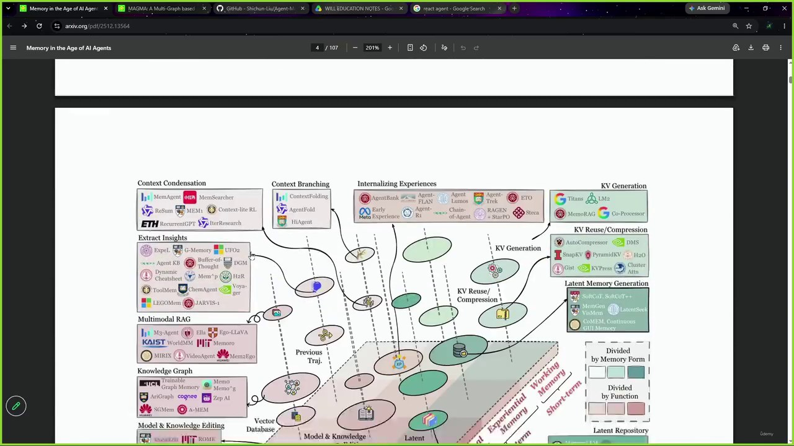

讲师提到的两篇是：
- **Memory in the Age of AI Agents**，2026 年 1 月 13 日发布，从零讲 LLM agent 系统，覆盖 flat memory、hierarchical memory、benchmark 等基础。
- **Magma: A Multi-Graph based Agentic Memory Architecture for AI Agents**，2026 年 4 月 16 日发布，是当前最前沿的多图记忆架构，里面出现 intent aware router、adaptive topological retrieval、semantic、entity 等概念——讲师明确说，不补历史这些词你根本看不懂。

#### 步骤 1：无记忆基线（no memory）

选「No memory」，依次输入：

1. `Hi, I am Maya. Nice to meet you.`
2. `What is agentic AI?`
3. `What's my name?`

预期：第 1 条回「Hi Maya, it's lovely to meet you」，第 2 条正常回答，第 3 条答不上来，会说你还没自我介绍过。同时面板显示 **3 次 API 请求**、**243 tokens** 送出。逐字稿原话是「243 tokens were sent in and one one zero eight tokens were received as input」——这里讲师把输入和输出说混了（也可能是语音识别把 1108 拆成了 one one zero eight），所以**具体哪个数字对应输入、哪个对应输出，请以 playground 面板实际标注为准**。

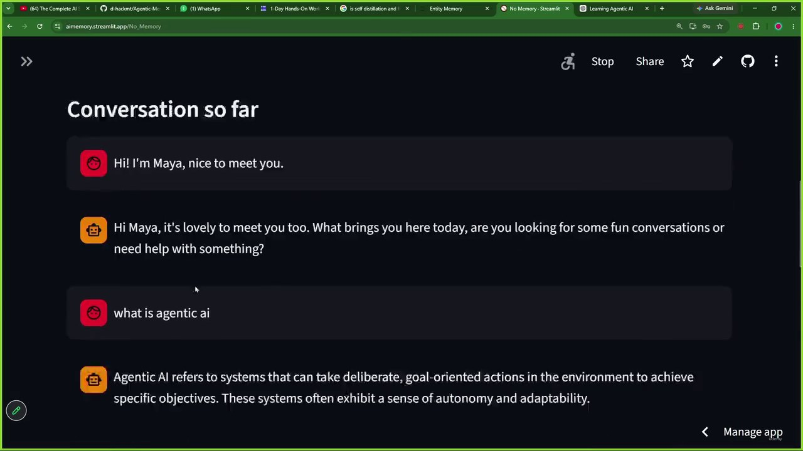

再验证一次「消息被隔离」：随便再发一个 `Hi`，看 under the hood 面板——永远只有一条 system message（内容是「你是 Nova，一个温暖、开朗的 AI 伙伴」）加一条 user message，历史一条都不带。

#### 步骤 2：对话缓冲记忆（buffer）

选「Conversation buffer」，按顺序输入：

1. `Hi, I am Maya. It's nice to meet you.`
2. `What's my name?` → 应回 "Your name is Maya"
3. `I have a cat whose name is Whiskers. She's super fluffy.`
4. `What is a fun fact about octopuses?`
5. `What is the tallest mountain?`
6. `What is my cat's name?` → 应回 Whiskers

看 under the hood：能看到 system message、user、AI、user、AI……一条不落地全部带上，token 数随轮次单调上涨。这就是「把聊天全倒进一个列表」，buffer 这个词在这里就是「列表」的意思。

#### 步骤 3：滑动窗口记忆（sliding window）

把窗口大小设成 **2**，依次输入：

1. `Hi. My name is Divesh and my salary is 30,000.`
2. `How much is my salary?` → 记得
3. `I also save 500 every month.` → 第 3 条一进来，第 1 条被逐出
4. `What is my salary?` → 仍然答得出 30,000（因为还在窗口内）
5. `What is my name?` → 答不上来，会说「我不认为我们讨论过你的名字」
6. `What is the first thing I told you?` → 只能给出模糊的、基于残留上下文的猜测

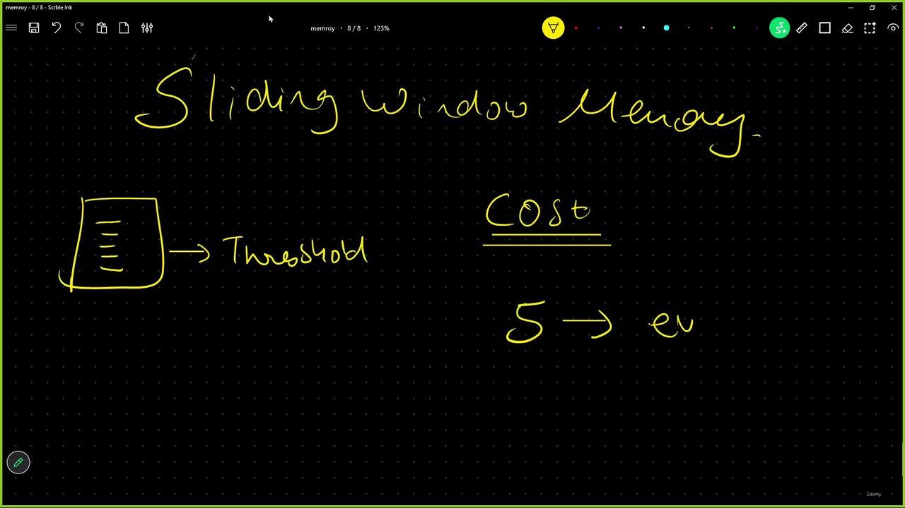

第 5、6 步是这个实验的关键：**它证明「便宜」是靠丢信息换来的**。讲师补了一个更狠的例子——你先说月薪、再说每月投多少、再说职业，最后让它「根据我所有收入生成一份投资计划」，它做不到，因为月薪那条已经在窗口外了。

被逐出的消息在面板上会显示成「已被逐出」的状态，注意看这个提示：

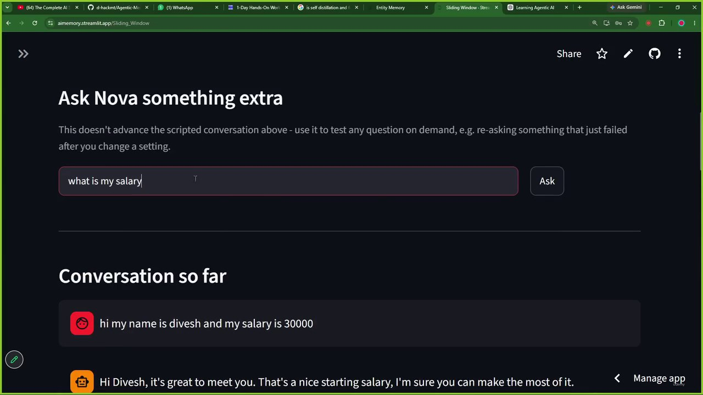

#### 步骤 4：摘要记忆（summary）

选「Summary」，输入：

1. `Hi, I am Maya. It's nice to meet you.`
2. `What's my name?`
3. `I have a pet cat named Whiskers. She's super fluffy.`
4. `I love playing football.`

看 under the hood：你会看到一条 system message、一条「recap of the conversation so far」，然后是新的用户消息。每发一句，右下角都会生成一条新的 summary，并且旧 summary 被合并进去。

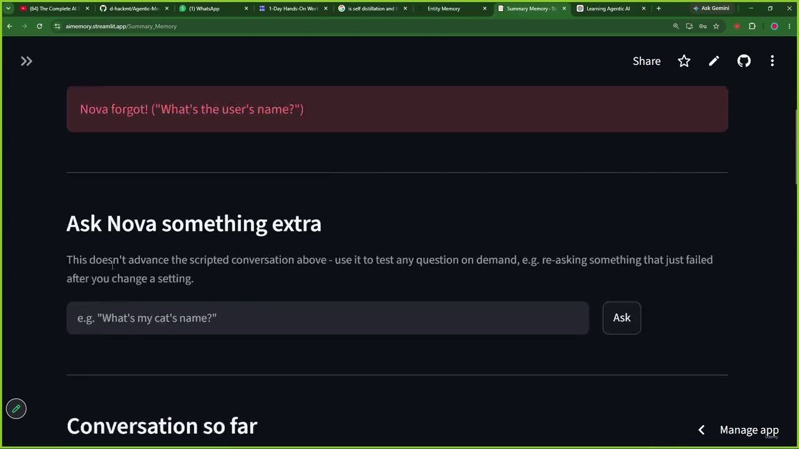

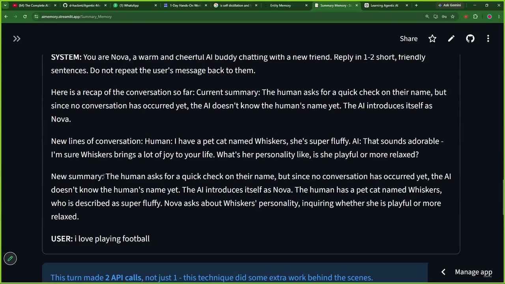

注意观察面板上每次的 **API 调用次数是 2**（一次回答、一次重新摘要），成本比 buffer 同轮次更低，但调用次数翻倍。

#### 步骤 5：摘要缓冲（summary buffer）

选「Summary buffer」，连续发 5–6 条（沿用步骤 2 的六句话，再加一句 `My favorite food is mango. I could eat it every day.` 和 `Can you tell me a short joke?`）。

预期现象：面板上方是「recap of older messages」，下方是最近 **3 轮**的原文（user / Nova、user / Nova、user / Nova）。讲师特别指出，摘要会把两轮压成一句，比如「Maya 介绍了自己，确认了自己的名字」这样一句只占 8 个 token。

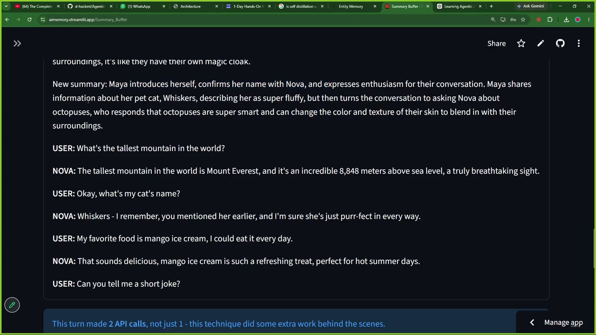

#### 步骤 6：token 缓冲（token buffer）

选「Token buffer」，把窗口设成 **50 words**，输入：

1. `Hi, my name is Maya.` → 面板显示已占 34 tokens（含 system prompt）
2. `What is my name?` → 记得
3. `I have a cat.`
4. 再补一轮
5. `What is my name?` → 不记得了，会说「很遗憾我没有这个信息，但我很想知道你的名字」
6. `What is the tallest mountain?` → 只能看到最后 50 个 token 的内容

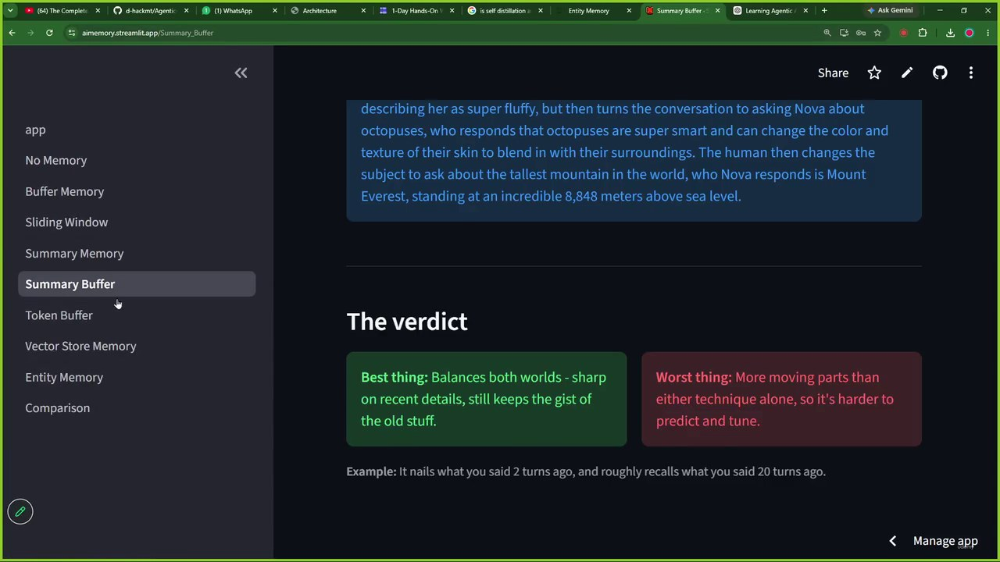

#### 步骤 7：向量存储记忆（vector store）

选「Vector store」。先做相似度实验：输入 `Python is the first programming language for beginners.`，再输入 `Which is the first programming language?`，看返回的 top 2 相似消息；再输入单个关键词 `tower`，看埃菲尔铁塔那条被排到第一。

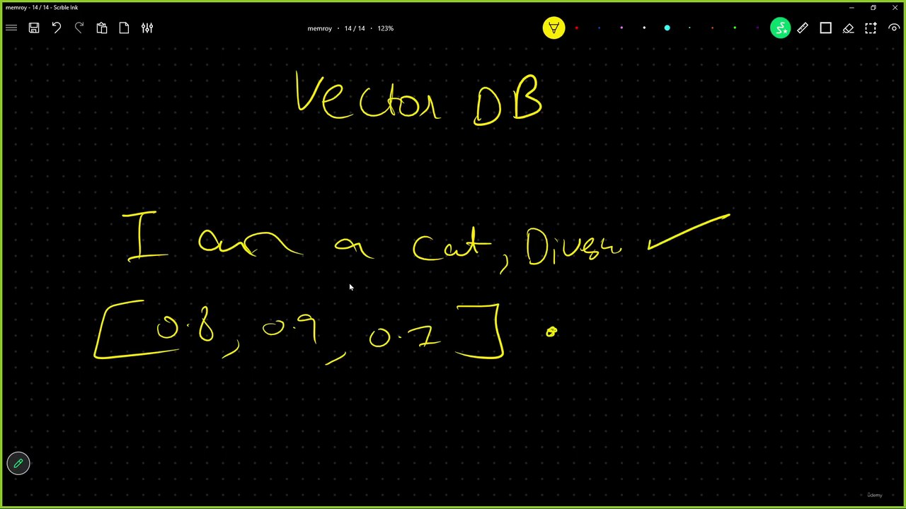

然后做记忆实验：输入 `What's my cat's name?`，看面板下方的三块内容——**raw memory context**（只有 inputs）、**向量数据库里的内容**、**relevant memories**（被取回的相关记忆）。

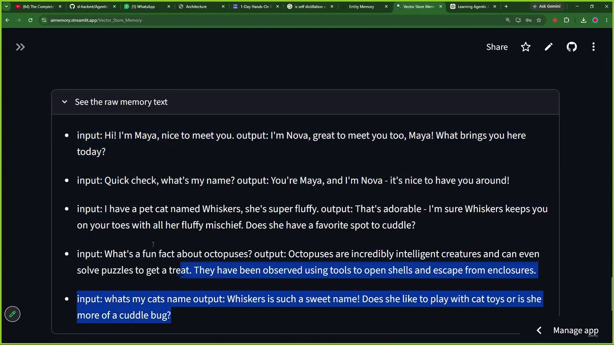

#### 步骤 8：实体记忆（entity memory）

选「Entity memory」，输入：

1. `My name is Maya.`
2. `What's my name?` → 应回 "Your name is Maya"

看面板：这一轮消耗 **4678 tokens**，而且这一轮做了 **8 次 API 调用**，不是 1 次。讲师原话是「这个技术只是在幕后多做了几步」，因为每轮都要让 AI 去映射实体，这是有成本的。他还强调：这是所有方案里最贵的，但信息最准确。

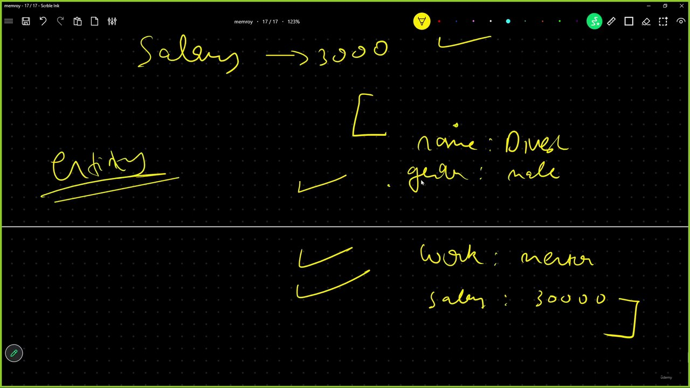

#### 步骤 9：跑一次总对比

点对比按钮，让它跑完 24 条查询，得到七种策略的横向对比表。这一步的结论就是你后面自建实验台要复现的验收标准。

### 3.3 自建实验台：目录结构

现在把上面的现象用代码复刻。下面是完整目录，**16 个文件，全部在第 4 节给出**：

```
agentic-memory-lab/
├── package.json
├── .env.example
├── .env                  # 由你从 .env.example 复制后填写，不要提交
└── src/
    ├── prompt.js
    ├── llm.js
    ├── scripts.js
    ├── run.js
    ├── compare.js
    └── memories/
        ├── index.js
        ├── noMemory.js
        ├── bufferMemory.js
        ├── slidingWindow.js
        ├── summaryMemory.js
        ├── summaryBuffer.js
        ├── tokenBuffer.js
        ├── vectorStore.js
        └── entityMemory.js
```

### 3.4 安装与运行

```bash
mkdir agentic-memory-lab && cd agentic-memory-lab
# 把第 4 节的文件按上面的目录结构逐个建好
npm install
cp .env.example .env
# 打开 .env，填入 GROQ_API_KEY 和 LLM_MODEL
node src/run.js buffer
node src/run.js sliding-window
node src/run.js summary
node src/run.js summary-buffer
node src/run.js token-buffer
node src/run.js vector
node src/run.js entity
node src/run.js no-memory
node src/compare.js
```

`run.js` 接受一个参数作为记忆类型；不传参数时默认跑 `buffer`。每种记忆都配了一段脚本化对话（第 4 节 `src/scripts.js`），脚本取自讲师在视频里实际输入的那些句子，所以你跑出来的现象应该和 3.2 节一致。

需要注意的一点：**你机器上的 token 数和成本不会和讲师演示的数字一模一样**。原因有三个，都不是 bug：

1. 讲师用的 playground 有自己的 system prompt 和拼装方式，我们只能对齐大意（讲师原话只给了 `you are Nova, a warm, cheerful AI buddy` 这一句）。
2. 讲师没有讲 token 是怎么算的，也没有讲用的是哪个 tokenizer。本实现用「字符数 ÷ 4」粗估，只用来做窗口裁剪的相对比较，**不能当计费依据**。
3. 讲师切换过模型，不同模型 token 计数和价格都不同（他原话是「不同模型有不同成本」）。

### 3.5 关于「成本」这件事怎么复现

讲师在无记忆那一节展示成本面板时说得很清楚：因为用的是免费 API，所以成本数字很低，「但当你用 OpenAI 或 Claude 这类付费 API 时，这个数字会到另一个量级」。所以复现成本时你要做的不是抄数字，而是观察**趋势**：

- buffer：随轮次线性增长，讲师形容为「指数级上升」（严格说是每轮把全部历史重发，增长是二次的，但他强调的趋势是「没有上限」）。
- sliding window / token buffer：**有硬上限**，讲师原话是「成本永远不会增长，不管聊多久」。
- summary：每轮固定 2 次调用，输入是「摘要 + 新消息」，长度可控。
- summary buffer：最近 3 轮原文 + 一份摘要，比 summary 贵一点，但短期细节准。
- vector store：每次只取 top-k，输入最短，讲师称之为「最便宜」。
- entity：每轮多次调用（讲师演示是 8 次），最贵，但事实最准。

---

## 4. 完整代码

> 说明：**课里没有代码，以下全部为示意实现**，按讲师在 P18–P21 描述的内部结构还原。文件可直接保存运行，但请把它当「行为复现器」，不要当生产级代码。

### 4.1 `package.json`

```json
{
  "name": "agentic-memory-lab",
  "version": "1.0.0",
  "private": true,
  "type": "module",
  "engines": {
    "node": ">=20"
  },
  "scripts": {
    "demo": "node src/run.js",
    "compare": "node src/compare.js"
  },
  "dependencies": {
    "dotenv": "^16.4.5"
  }
}
```

### 4.2 `.env.example`

```bash
# 讲师念作 grog，按上下文是 Groq 的免费 API
GROQ_API_KEY=在这里填你在 Groq 控制台创建的 key
# 课里没讲具体模型标识，去 Groq 控制台挑一个当前可用的模型填进来
LLM_MODEL=在这里填模型 id
# OpenAI 兼容的 base url，Groq 用下面这个
LLM_BASE_URL=https://api.groq.com/openai/v1
```

### 4.3 `src/prompt.js`

```js
// 课里没有代码，以下为示意。
// system prompt 取自 p018 [09:09] 讲师念出的原文：
// "you are Nova, a warm, cheerful AI buddy"
export const SYSTEM_PROMPT = 'You are Nova, a warm, cheerful AI buddy.';

export function systemMessage(extra = '') {
  return {
    role: 'system',
    content: extra ? `${SYSTEM_PROMPT}\n\n${extra}` : SYSTEM_PROMPT,
  };
}
```

### 4.4 `src/llm.js`

```js
// 课里没有代码，以下为示意。
import 'dotenv/config';

const BASE_URL = process.env.LLM_BASE_URL ?? 'https://api.groq.com/openai/v1';
const API_KEY = process.env.GROQ_API_KEY ?? '';
const MODEL = process.env.LLM_MODEL ?? '';

if (!API_KEY) {
  throw new Error('缺少 GROQ_API_KEY，请把 .env.example 复制成 .env 并填写');
}
if (!MODEL) {
  throw new Error('缺少 LLM_MODEL，
```js
    请在 .env 里填写一个当前可用的模型 id',
  );
}

// 全局计数器：讲师在每一页都在念「API 请求次数 / 输入 token / 输出 token / 成本」，
// 所以这三个数字必须被显式统计出来，否则你没法做第七节的横向对比。
export const stats = {
  calls: 0,
  promptTokens: 0,
  completionTokens: 0,
};

export function resetStats() {
  stats.calls = 0;
  stats.promptTokens = 0;
  stats.completionTokens = 0;
}

// 课里没讲 tokenizer 是什么，也没讲 token 怎么算。
// 这里用「字符数 ÷ 4」粗估，只用于窗口裁剪的相对比较，不能当计费依据。
export function estimateTokens(text = '') {
  return Math.ceil(String(text).length / 4);
}

export function estimateMessagesTokens(messages = []) {
  // 每条消息额外加 4，粗略模拟 role 分隔符的开销
  return messages.reduce((sum, m) => sum + estimateTokens(m.content) + 4, 0);
}

export async function chat(messages, { temperature = 0.7 } = {}) {
  const res = await fetch(`${BASE_URL}/chat/completions`, {
    method: 'POST',
    headers: {
      'Content-Type': 'application/json',
      Authorization: `Bearer ${API_KEY}`,
    },
    body: JSON.stringify({ model: MODEL, messages, temperature }),
  });

  if (!res.ok) {
    const body = await res.text();
    throw new Error(`LLM 请求失败 ${res.status}: ${body}`);
  }

  const data = await res.json();
  const text = data?.choices?.[0]?.message?.content ?? '';

  // 优先用接口返回的 usage；拿不到就本地粗估，保证统计表永远有数
  const usage = data?.usage ?? {};
  const promptTokens = usage.prompt_tokens ?? estimateMessagesTokens(messages);
  const completionTokens = usage.completion_tokens ?? estimateTokens(text);

  stats.calls += 1;
  stats.promptTokens += promptTokens;
  stats.completionTokens += completionTokens;

  return { text, usage: { promptTokens, completionTokens } };
}
```

### 4.5 `src/scripts.js`

```js
// 课里没有代码，以下为示意。
// 脚本取自讲师在 P018–P021 里实际敲进 playground 的那些句子，顺序按视频里的出现次序整理。

export const SCRIPTS = {
  'no-memory': [
    'Hi, I am Maya. Nice to meet you.',
    'What is agentic AI?',
    'What is my name?',
  ],
  buffer: [
    'Hi, I am Maya. Nice to meet you.',
    "What's my name?",
    'I have a cat whose name is Whiskers. She is super fluffy.',
    'What is a fun fact about octopuses?',
    'What is the tallest mountain in the world?',
    "What is my cat's name?",
  ],
  'sliding-window': [
    'Hi. My name is Divesh and my salary is 30,000.',
    'How much is my salary?',
    'I also save 500 every month.',
    'What is my salary?',
    'What is my name?',
    'What is the first thing I told you?',
  ],
  summary: [
    'Hi, I am Maya. Nice to meet you.',
    "What's my name?",
    'I have a pet cat named Whiskers. She is super fluffy.',
    'I love playing football.',
  ],
  'summary-buffer': [
    'Hi, I am Maya. Nice to meet you.',
    "What's my name?",
    'I have a pet cat named Whiskers. She is super fluffy.',
    'What is a fun fact about octopuses?',
    'What is the tallest mountain in the world?',
    'My favorite food is mango. I could eat it every day.',
    'Can you tell me a short joke?',
    "What is my cat's name?",
  ],
  'token-buffer': [
    'Hi, my name is Maya.',
    'What is my name?',
    'I have a cat.',
    'What is a fun fact about octopuses?',
    'What is my name?',
    'What is the tallest mountain?',
  ],
  vector: [
    'Python is the first programming language for beginners.',
    'Which is the first programming language?',
    'The Eiffel Tower is in Paris.',
    'tower',
    "What's my cat's name?",
  ],
  entity: [
    'My name is Divesh, my salary is 30,000 and I work as a mentor.',
    'What is my name?',
    'How much is my salary?',
  ],
};

// 对比用的 24 条查询。
// 课里没有给出这 24 条查询的具体内容，只说了「会跑 24 条查询」。
// 下面这 24 条是从视频里出现过的话拼出来的，凑够讲师说的条数。
export const COMPARE_QUERIES = [
  'Hi, I am Maya. Nice to meet you.',
  'What is my name?',
  'I have a cat whose name is Whiskers. She is super fluffy.',
  "What is my cat's name?",
  'What is a fun fact about octopuses?',
  'What is the tallest mountain in the world?',
  'Hi. My name is Divesh and my salary is 30,000.',
  'How much is my salary?',
  'I also save 500 every month.',
  'What is my salary?',
  'What is the first thing I told you?',
  'My favorite food is mango. I could eat it every day.',
  'Can you tell me a short joke?',
  'I love playing football.',
  'Python is the first programming language for beginners.',
  'Which is the first programming language?',
  'The Eiffel Tower is in Paris.',
  'tower',
  'The cheetah is the fastest land animal.',
  'Which animal is the fastest?',
  'My name is Divesh, my salary is 30,000 and I work as a mentor.',
  'Generate me an investment plan given all of my salaries.',
  'Give me a diet plan.',
  'Give me a workout plan.',
];
```

### 4.6 `src/memories/noMemory.js`

```js
// 课里没有代码，以下为示意。
// 对应 p018：每次请求只有一条 system message 和一条 user message，历史完全隔离。
import { systemMessage } from '../prompt.js';
import { chat } from '../llm.js';

export const name = 'no-memory';
export const description = '无记忆：每条消息互相隔离，follow-up 一定失败';

export function create() {
  return {
    name,
    description,
    async send(userText) {
      const messages = [systemMessage(), { role: 'user', content: userText }];
      const { text } = await chat(messages);
      return {
        reply: text,
        debug: { messageCount: messages.length },
      };
    },
  };
}
```

### 4.7 `src/memories/bufferMemory.js`

```js
// 课里没有代码，以下为示意。
// 对应 p019：把所有轮次的 user / AI 消息全部保留，一字不删。
// buffer 这个词在这里就是「列表」的意思。
import { systemMessage } from '../prompt.js';
import { chat, estimateMessagesTokens } from '../llm.js';

export const name = 'buffer';
export const description = '对话缓冲：保留全部历史，成本没有上限';

export function create() {
  const history = [];

  return {
    name,
    description,
    async send(userText) {
      history.push({ role: 'user', content: userText });

      const messages = [systemMessage(), ...history];
      const { text } = await chat(messages);

      history.push({ role: 'assistant', content: text });

      return {
        reply: text,
        debug: {
          keptMessages: history.length,
          keptTurns: history.length / 2,
          promptTokens: estimateMessagesTokens(messages),
        },
      };
    },
  };
}
```

### 4.8 `src/memories/slidingWindow.js`

```js
// 课里没有代码，以下为示意。
// 对应 p019：只保留最近 windowTurns 轮，超出的被 evict（逐出），不是删除。
// 讲师特别强调过「逐出和删除是两回事」：逐出只是不进 prompt，记录仍然留着，
// 所以这里用 evicted 数组单独存着，方便你验证「UI 上还看得到」。
import { systemMessage } from '../prompt.js';
import { chat, estimateMessagesTokens } from '../llm.js';

export const name = 'sliding-window';
export const description = '滑动窗口：只保留最近 N 轮，逐出不删除';

export function create({ windowTurns = 2 } = {}) {
  const history = [];
  const evicted = [];

  function trim() {
    while (history.length > windowTurns * 2) {
      evicted.push(history.shift());
    }
  }

  return {
    name,
    description: `${description}（窗口 ${windowTurns} 轮）`,
    async send(userText) {
      history.push({ role: 'user', content: userText });
      trim();

      const messages = [systemMessage(), ...history];
      const { text } = await chat(messages);

      history.push({ role: 'assistant', content: text });
      trim();

      return {
        reply: text,
        debug: {
          keptTurns: history.length / 2,
          evictedCount: evicted.length,
          promptTokens: estimateMessagesTokens(messages),
        },
      };
    },
  };
}
```

### 4.9 `src/memories/summaryMemory.js`

```js
// 课里没有代码，以下为示意。
// 对应 p019：每轮两次调用——一次用「摘要 + 新消息」回答，一次把摘要重新摘要。
// 这就是讲师说的「这一次不是一次 API 调用，而是两次」。
import { systemMessage } from '../prompt.js';
import { chat } from '../llm.js';

export const name = 'summary';
export const description = '摘要记忆：只保留摘要，每轮 2 次调用';

export function create() {
  let summary = '（对话尚未开始，暂无摘要）';

  return {
    name,
    description,
    async send(userText) {
      const messages = [
        systemMessage(`到目前为止的对话摘要：\n${summary}`),
        { role: 'user', content: userText },
      ];
      const { text } = await chat(messages);

      const summaryPrompt = [
        {
          role: 'system',
          content:
            '你是摘要器。把「旧摘要」和「本轮新对话」合并成一段不超过 80 字的新摘要。' +
            '只保留事实（姓名、偏好、数字、职业），不要评论，不要说「用户询问了」这类空话。',
        },
        {
          role: 'user',
          content: `旧摘要：${summary}\n\n本轮用户说：${userText}\n本轮 Nova 回答：${text}`,
        },
      ];
      const { text: newSummary } = await chat(summaryPrompt, { temperature: 0 });
      summary = newSummary.trim();

      return {
        reply: text,
        debug: { summary },
      };
    },
  };
}
```

### 4.10 `src/memories/summaryBuffer.js`

```js
// 课里没有代码，以下为示意。
// 对应 p020：最近 N 轮保留原文（短期细节），更老的压成摘要（长期要点），两者一起送。
import { systemMessage } from '../prompt.js';
import { chat } from '../llm.js';

export const name = 'summary-buffer';
export const description = '摘要缓冲：最近 N 轮原文 + 更早内容的摘要';

export function create({ recentTurns = 3 } = {}) {
  let summary = '（暂无更早的对话）';
  const recent = [];

  async function fold(rawTurns) {
    if (rawTurns.length === 0) return;
    const transcript = rawTurns
      .map((m) => `${m.role === 'user' ? '用户' : 'Nova'}：${m.content}`)
      .join('\n');

    const prompt = [
      {
        role: 'system',
        content:
          '你是摘要器。把「旧摘要」和「新增对话」合并成一段不超过 120 字的摘要，只保留事实。',
      },
      {
        role: 'user',
        content: `旧摘要：${summary}\n\n新增对话：\n${transcript}`,
      },
    ];
    const { text } = await chat(prompt, { temperature: 0 });
    summary = text.trim();
  }

  return {
    name,
    description: `${description}（原文 ${recentTurns} 轮）`,
    async send(userText) {
      recent.push({ role: 'user', content: userText });

      // 先折叠已经滑出窗口的旧轮次，再拼 prompt
      while (recent.length > recentTurns * 2) {
        await fold(recent.splice(0, recent.length - recentTurns * 2));
      }

      const messages = [systemMessage(`更早对话的摘要：\n${summary}`), ...recent];
      const { text } = await chat(messages);

      recent.push({ role: 'assistant', content: text });

      while (recent.length > recentTurns * 2) {
        await fold(recent.splice(0, recent.length - recentTurns * 2));
      }

      return {
        reply: text,
        debug: { summary, recentTurns: recent.length / 2 },
      };
    },
  };
}
```

### 4.11 `src/memories/tokenBuffer.js`

```js
// 课里没有代码，以下为示意。
// 对应 p020：和滑动窗口逻辑一样，但裁剪单位从「轮」换成「token」。
// 讲师原话是「这跟滑动窗口完全一样，只是把轮次换成了词数」。
import { systemMessage } from '../prompt.js';
import { chat, estimateMessagesTokens } from '../llm.js';

export const name = 'token-buffer';
export const description = 'Token 缓冲：按 token 数裁剪，不按轮数';

export function create({ tokenBudget = 50 } = {}) {
  const history = [];
  const evicted = [];

  function trim() {
    while (
      history.length > 0 &&
      estimateMessagesTokens([systemMessage(), ...history]) > tokenBudget
    ) {
      evicted.push(history.shift());
    }
  }

  return {
    name,
    description: `${description}（预算 ${tokenBudget} tokens）`,
    async send(userText) {
      history.push({ role: 'user', content: userText });
      trim();

      const messages = [systemMessage(), ...history];
      const { text } = await chat(messages);

      history.push({ role: 'assistant', content: text });
      trim();

      return {
        reply: text,
        debug: {
          budget: tokenBudget,
          promptTokens: estimateMessagesTokens(messages),
          evictedCount: evicted.length,
        },
      };
    },
  };
}
```

### 4.12 `src/memories/vectorStore.js`

```js
// 课里没有代码，以下为示意。
// 对应 p021：用户消息和回复都直接入库，不做摘要也不做缓冲；
// 每次新查询按相似度取回 top-k，塞进 system 上下文。
// 课里没讲用什么 embedding 模型，所以这里用词袋 + 余弦相似度代替真嵌入。
// 行为上等价于「按相似度取回」，但不具备真正的语义泛化能力。
import { systemMessage } from '../prompt.js';
import { chat } from '../llm.js';

export const name = 'vector';
export const description = '向量存储：全量入库，按相似度取回 top-k';

const STOP_WORDS = new Set([
  'the', 'a', 'an', 'is', 'are', 'am', 'my', 'me', 'i', 'you', 'what', 'which',
  'of', 'in', 'to', 'and', 'it', 'this', 'that', 'for', 'do', 'does', 'be',
  'how', 'much', 'was', 'were', 'with', 'about', 'can', 'please', 'tell',
]);

function tokenize(text) {
  return String(text)
    .toLowerCase()
    .replace(/[^a-z0-9\s']/g, ' ')
    .split(/\s+/)
    .filter((w) => w && !STOP_WORDS.has(w));
}

function toVector(text) {
  const vec = new Map();
  for (const w of tokenize(text)) {
    vec.set(w, (vec.get(w) ?? 0) + 1);
  }
  return vec;
}

function cosine(a, b) {
  let dot = 0;
  let na = 0;
  let nb = 0;
  for (const [w, v] of a) {
    na += v * v;
    if (b.has(w)) dot += v * b.get(w);
  }
  for (const v of b.values()) nb += v * v;
  if (na === 0 || nb === 0) return 0;
  return dot / (Math.sqrt(na) * Math.sqrt(nb));
}

export function create({ topK = 2 } = {}) {
  const store = []; // { role, content, vector }
  const allMessages = []; // 「逐出不删除」的原始流水，对应讲师说的 UI 里还要展示

  return {
    name,
    description: `${description}（top-${topK}）`,
    async send(user