# mem0 记忆层：从无状态 LLM 到可检索的长期记忆（P26–P28 复现文档）

> 先说明一个范围问题：你给的课程名是「AI Security Bootcamp part1（护栏/网关/可观测）」，但 P26–P28 的逐字稿实际讲的是 **mem0 / LLM memory / agent memory**。本段没有讲护栏、网关、OpenTelemetry 或可观测性实现。下面严格按逐字稿写，不把课里没讲的安全概念安到讲师头上；这些内容在本段课里没讲。

---

## 1. 这一节做什么

这一节要完成三件事：

1. 解释为什么 LLM API 调用是**无状态**的，以及为什么 AI 应用需要 short-term memory 和 long-term memory。
2. 用 **mem0 开源版**跑通一个 Python quick start：用 Groq 作为 LLM、Hugging Face sentence-transformers 作为 embedding、Qdrant 作为 vector store，完成 `add` 记忆和 `search` 记忆。
3. 用 mem0 官方架构图解释 `m.add()` 和 `m.search()` 内部发生了什么：信息抽取、冲突解决、向量库/图数据库写入、memory engine 编排、metadata 与原文本回取、user/session/run 作用域，以及 mem0 platform 与 mem0 open source 的差异。

最终你能得到一个可运行的最小项目：

```text
mem0-memory-demo/
├── .env
├── .env.example
├── pyproject.toml
├── uv.lock
├── mem0_quickstart.py
├── notebooks/
│   └── experiments.ipynb
└── qdrant_data/              # 运行后由 Qdrant local mode 生成；课里没讲这个具体目录名
```

课里实际是在 IDE 里新建 `notebooks` 目录和 `experiments.ipynb`，并用 `uv` 管理依赖。下面会同时给 notebook 单元格和可独立运行的 `mem0_quickstart.py`。如果你只想最快复现，直接跑 `mem0_quickstart.py`；如果你想对照课堂，按 notebook 单元格顺序粘贴。

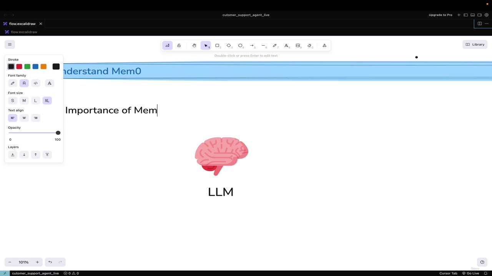

---

## 2. 讲师原话

> "LLM 很智能，因为它们经过了预训练，面对复杂查询或问题陈述时，能给出非常好的建议或有用回应。"
> —— p026 [00:29]

> "如果你直接调用任何模型提供方的 API，比如 Anthropic、OpenAI 或 Google，每一次 LLM 调用都是无状态的。"
> —— p026 [01:53]

> "如果你第二天不把之前的复杂查询和 LLM 给出的好建议一起传进去，而是直接给一个新输入，LLM 就无法帮助你，因为它没有上下文。"
> —— p026 [03:47]

> "小对话可以把所有内容存进数据库，这个做法可以接受；但大对话、跨对话上下文会超过 LLM 的 context window，然后 LLM 开始幻觉。"
> —— p026 [04:43]

> "memory 主要分两类：short-term memory 和 long-term memory。mem0 对两者都有帮助，但主要用于 long-term memory。"
> —— p026 [06:36]

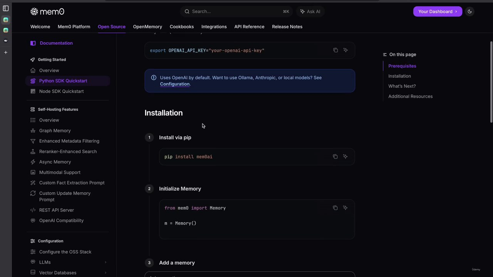

> "mem0 现在有两个版本：open source 和 platform。platform 是已经配置好的完整 mem0 stack，你可以购买 API 和付费服务；open source 里整套 stack 都由你拥有。"
> —— p027 [00:56]

> "Python quick start 里默认用 OpenAI API key，但我不使用它，因为它是付费 API key；我们用 Groq 的 LLM，它提供开源模型的免费推理额度。"
> —— p027 [02:44]

> "我使用 Hugging Face 的 embedding model，因为它是开源的，不需要任何 API key，也不需要额外 setup，所以完全免费。"
> —— p027 [05:56]

> "如果你直接实例化 mem0，它会使用默认 stack；默认 stack 我指的是默认 LLM、默认 vector store、默认 embedding model。默认 stack 使用 OpenAI，而 OpenAI 需要 OpenAI API key，所以会报错。"
> —— p027 [11:05]

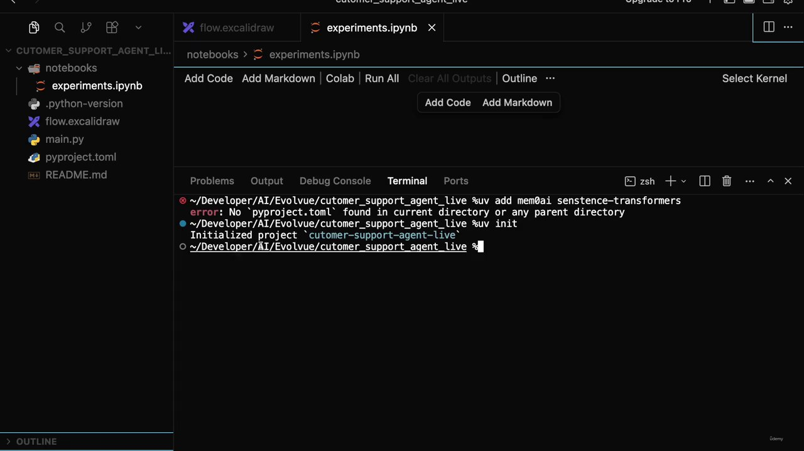

> "在 config 对象里，我可以定义用哪个 LLM provider、哪个 embedder、哪个 vector store，这三件事可以由我们自己决定。"
> —— p027 [13:00]

> "Chroma 不支持这个 embedding dimension，而 Hugging Face 给的 embedding dimension 是 384，所以我们要切换到 Qdrant，并明确告诉 Qdrant embedding model 的 dimension 是 384。"
> —— p027 [20:00]

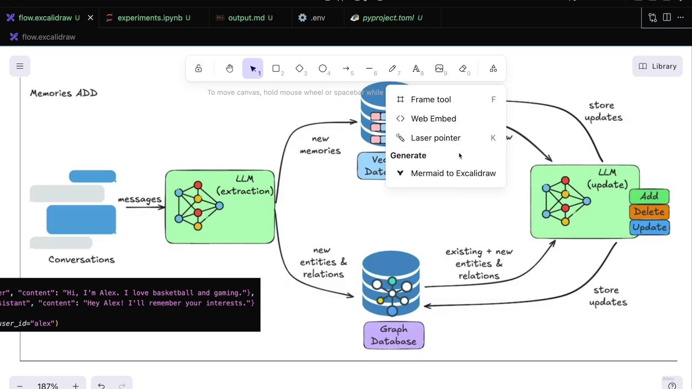

> "当你调用 `m.add` 并传入对话时，完整消息列表会进入 LLM，LLM 处理这些消息并抽出新记忆，然后存进 vector database。"
> —— p028 [00:26]

> "mem0 强大的地方是它同时利用 vector database 和 graph database。这个例子里 vector database 就够了；当出现多用户关系查询时，才需要 graph database。"
> —— p028 [02:17]

> "搜索时，query 加上 scope（比如 user ID）会进入 mem0 提供的 memory engine。memory engine 管理 LLM、embedder、vector store、graph store、metadata，并负责编排整个流程。"
> —— p028 [07:31]

> "写入记忆时，第一步是信息抽取：LLM 抽出 key fact、decision、preference；第二步是冲突解决：如果已有相同事实，就用最新 truth 替换；第三步才是存进 vector store，以及可选的 graph storage。"
> —— p028 [11:46]

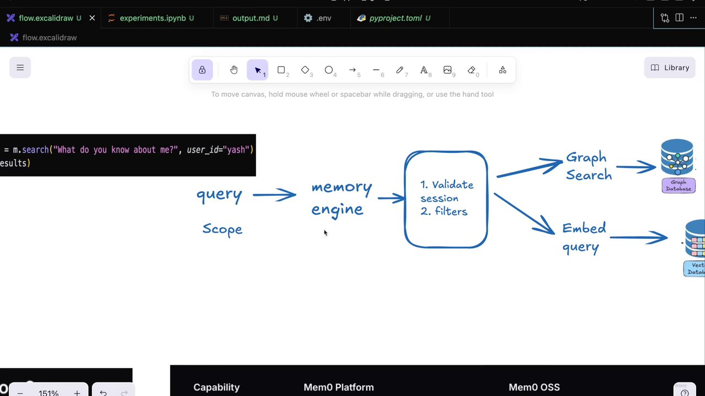

> "mem0 platform 和 open source 有四个主要差异：冲突解决是否自动且有 dashboard、graph write 是否需要完整 provider 配置、rate limit 由平台 API key 还是本地 provider 决定、以及是否有 dashboard 可见性。"
> —— p028 [18:19]

---

## 3. 从零复现

### 3.1 环境准备

讲师明确建议：如果你在 Windows 上，使用 **WSL**，这样 Python 依赖安装和依赖管理会更顺，不容易遇到环境问题。课里没有讲 WSL 的具体安装命令，只建议你去 YouTube 搜索 WSL 安装教程；课里说如果课程长度允许，后面可能补 WSL 安装视频。

你需要准备：

- 一个可用终端。
- Python 环境。课里没讲具体 Python 版本；用 `uv` 初始化时会生成项目环境。
- Groq API key。获取方式按讲师口述：打开 Groq 官网，点击 start building，用 Google 账号或你偏好的账号登录，进入 API key 页面创建并复制 key。
- 不需要 OpenAI API key。因为我们会通过 config 把默认 OpenAI stack 替换掉。

### 3.2 创建项目目录

在项目根目录执行：

```bash
mkdir -p notebooks
cd mem0-memory-demo   # 如果你还没有这个目录，先 mkdir mem0-memory-demo && cd mem0-memory-demo
ls
```

课里讲师在 IDE 里新建 `notebooks` 目录，再在里面新建 `experiments.ipynb`。随后打开终端，确认自己在项目目录内，执行 `ls` 查看内容。你也可以先创建项目根目录，再创建 notebook。

### 3.3 检查 uv 并初始化项目

讲师先检查机器上有没有 `uv`：

```bash
uv --version
```

然后初始化项目：

```bash
uv init
```

`uv init` 会生成项目基础文件，包括 `pyproject.toml` 等。之后用 `uv add` 添加依赖。

### 3.4 安装依赖

讲师实际安装/提到的包包括：

- mem0：用于创建 memory 对象、add/search 记忆。
- sentence-transformers：Hugging Face embedding 依赖。
- dotenv：读取 `.env` 环境变量。
- groq：Groq LLM provider 依赖。
- chromadb：一开始配置 Chroma vector store 时安装。
- Qdrant：后来因为 Chroma embedding dimension 问题切换到 Qdrant；课里没有逐字念出 `uv add qdrant-client`，但要让 Qdrant provider 在本地跑，需要安装对应客户端。

可复现命令如下：

```bash
# 讲师口述/终端里出现过 uv add mem0、uv add mem0 AI 等说法；
# 实际 PyPI 包名通常为 mem0ai。若 uv add mem0 找不到包，使用下面这条。
uv add mem0ai

uv add sentence-transformers
uv add python-dotenv
uv add groq
uv add chromadb
uv add qdrant-client
```

> 注意：逐字稿里讲师说 `uv add dotenv`，但 Python 代码里实际导入的是 `from dotenv import load_dotenv`，这个模块由 `python-dotenv` 提供。为了避免你卡住，上面写 `uv add python-dotenv`。课里没讲包名差异，这是复现时常见坑。
>
> 同理，逐字稿里 ASR 写成 `mem0 AI`、`my M0`、`MAM0`，实际按 `mem0ai` 处理；如果某个版本包名不同，以 `uv add` 报错信息和 mem0 文档为准。

安装后检查 `pyproject.toml`，应该能看到依赖。讲师在课里就是通过打开 `pyproject.toml` 确认 `sentence-transformers` 和 mem0 是否已经写入。

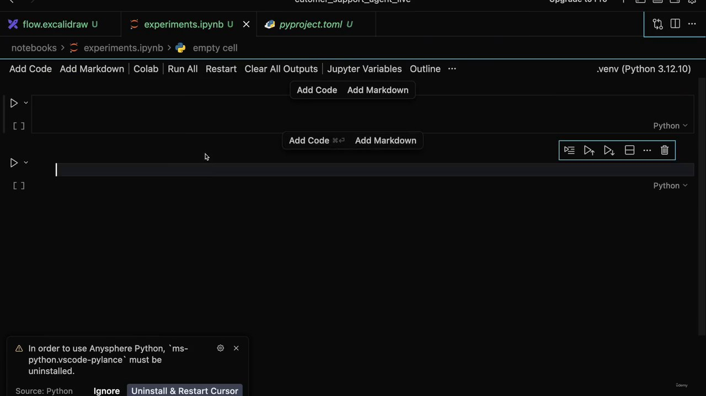

### 3.5 创建 `.env`

讲师创建 `.env` 文件，并在里面放 Groq API key。逐字稿里 ASR 把 Groq 写成 `grog`，但产品名是 **Groq**。为了代码清晰，下面用 `GROQ_API_KEY`：

```bash
# .env
GROQ_API_KEY=你的_groq_api_key
```

如果你坚持按讲师口述写成 `grog`，那么代码里读取的环境变量名也要改成同一个名字。环境变量名必须和代码一致。

`.env.example` 可以提交到仓库，`.env` 不要提交：

```bash
# .env.example
GROQ_API_KEY=replace_me
```

### 3.6 在 notebook 里读取环境变量

在 `notebooks/experiments.ipynb` 中新建第一个代码单元格：

```python
import os
from dotenv import load_dotenv
from mem0 import Memory

load_dotenv()

assert "GROQ_API_KEY" in os.environ, "请先在 .env 中设置 GROQ_API_KEY"
print("GROQ_API_KEY 已加载")
```

讲师在课里先 `import os`，再从 `.env` 加载环境变量，并检查 Groq API key 是否可用。第一次会报没有 `.env` 包，他执行 `uv add dotenv` 后重启 kernel，再运行成功。

> Jupyter/VS Code notebook 安装了新包后要 **restart kernel**。讲师在课里反复重启 kernel，就是为了避免缓存导致新包不生效。

### 3.7 配置 mem0：替换默认 stack

直接 `Memory()` 会使用默认 stack：默认 LLM、默认 vector store、默认 embedding model，而默认 stack 使用 OpenAI，需要 OpenAI API key。讲师的目标是：

- LLM：Groq
- Embedder：Hugging Face
- Vector store：一开始 Chroma，后来因为 embedding dimension 问题切换 Qdrant

配置对象如下。注意：逐字稿里讲师说配置“kind of a JSON object”，并在 JSON formatter 里修过语法错误；还出现过 `vector_store` 写两次、需要删除重复项、补 embedding dimension 的问题。下面给的是整理后的可运行版本。

```python
config = {
    "llm": {
        "provider": "groq",
        "config": {
            "model": "llama-3.3-70b-versatile",
            "temperature": 0.0,
            "api_key": os.environ["GROQ_API_KEY"],
        },
    },
    "embedder": {
        "provider": "huggingface",
        "config": {
            "model": "sentence-transformers/all-MiniLM-L6-v2",
            "embedding_dims": 384,
        },
    },
    "vector_store": {
        "provider": "qdrant",
        "config": {
            "collection_name": "mem0_demo",
            "embedding_model_dims": 384,
            # 课里没有讲 path/on_disk；这是为了让本地不启动 Docker 也能跑。
            # 如果你有 Qdrant 服务，可以改成 host/port。
            "path": "./qdrant_data",
            "on_disk": True,
        },
    },
}

print(config)
```

讲师口述的模型是 “Llama 3.3 70B”，temperature 为 0；embedding 是 Hugging Face 的 “mini lm”，维度 384；vector store 最终是 Qdrant，并显式声明 embedding dimension 为 384。

### 3.8 创建 Memory 对象

```python
m = Memory.from_config(config)
print(m)
```

讲师说在实例化时把 config 对象交给 mem0，让它“检查所有配置，并创建带全部配置的 mem0 memory 对象”。如果这里报 `No module named 'groq'`，说明 Groq provider 依赖没装，执行：

```bash
uv add groq
```

然后 restart kernel，重新运行前面的单元格。

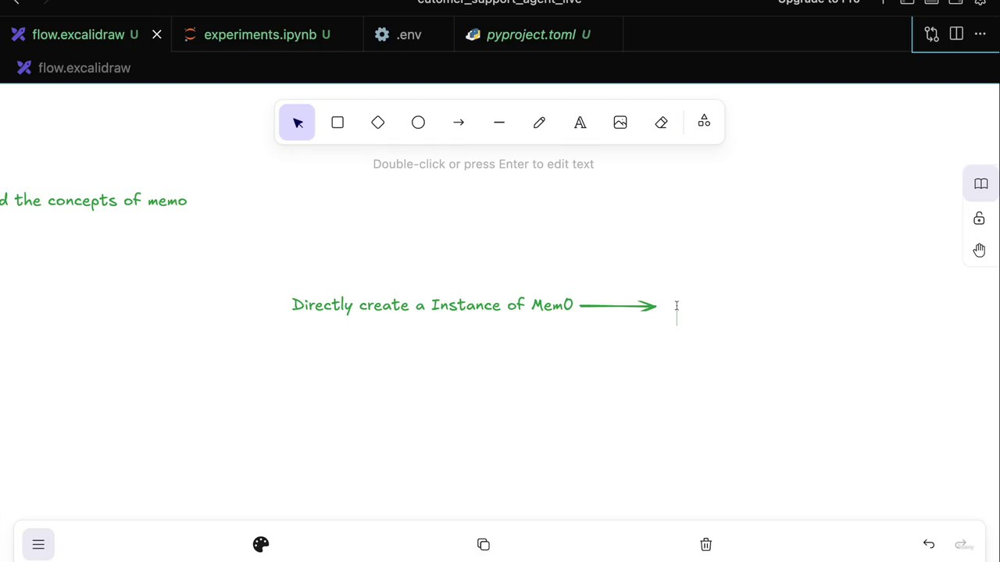

### 3.9 添加 Alex 的记忆

mem0 quick start 里的 messages 是两条：

- user：`hi I am Alex I love basketball and gaming`
- assistant：`hey Alex I will remember your interest`

讲师解释：把 messages 交给 mem0，mem0 会分析消息并抽取记忆。期望记住：名字是 Alex，Alex 喜欢 basketball 和 gaming。`user_id` 用于作用域，方便后续搜索、过滤和检索。

```python
messages = [
    {"role": "user", "content": "Hi, I am Alex and I love basketball and gaming."},
    {"role": "assistant", "content": "Hey Alex, I will remember your interests."},
]

add_result = m.add(messages, user_id="alex")
print(add_result)
```

讲师运行后看到结果里包含：这次操作的 id、抽取出的 memories、每条 memory 的 id、name 是 Alex、loves basketball、loves gaming，并且带有 user_id 作用域。

如果这里报 vector store 相关错误，讲师课里的原因是：配置了 Chroma，但环境里还没装 Chroma。他执行：

```bash
uv add chromadb
```

然后 restart kernel，重新加载 env、重新配置 memory。

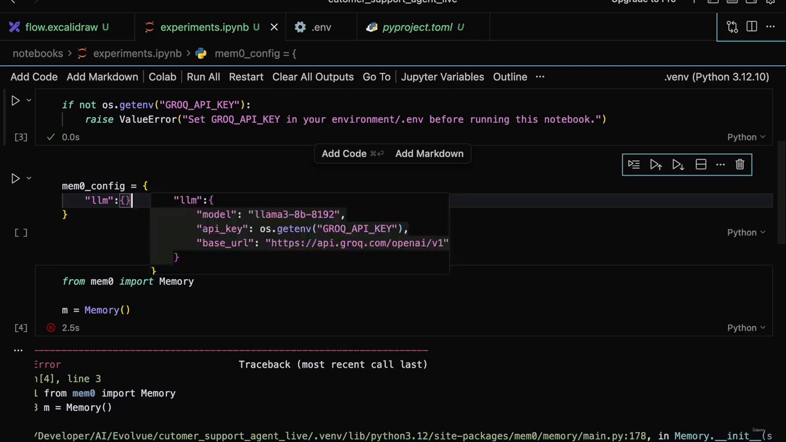

### 3.10 处理 Chroma 维度问题并切换到 Qdrant

讲师后来发现 config 有问题：`vector_store` 写了两次，需要删掉重复项。更重要的问题是：他判断 Chroma 不支持当前 embedding dimension，而 Hugging Face embedding 的维度是 384，于是切换到 Qdrant，并显式声明 Qdrant 的 embedding model dimension 是 384。

所以最终配置里：

```python
"embedder": {
    "provider": "huggingface",
    "config": {
        "model": "sentence-transformers/all-MiniLM-L6-v2",
        "embedding_dims": 384,
    },
},
"vector_store": {
    "provider": "qdrant",
    "config": {
        "collection_name": "mem0_demo",
        "embedding_model_dims": 384,
        "path": "./qdrant_data",
        "on_disk": True,
    },
},
```

> 课里没有讲 Qdrant 的 `path`、`on_disk` 字段；这是为了本地可运行补的。如果你用 Docker 启动 Qdrant，则改用 `host`/`port` 连接。

### 3.11 搜索 Alex 的记忆

讲师先尝试带 filters 的搜索，但遇到 filter 写法问题：他去掉多余的东西、把条件改成等号、去掉最后的 JSON，最终得到结果。可复现写法：

```python
result_alex = m.search(
    query="What do you know about me?",
    user_id="alex",
)
print(result_alex)
```

你应该能看到 Alex 的多条记忆：名字是 Alex，喜欢 basketball，喜欢 gaming，并且每条 memory 都带有 user_id。

### 3.12 用 Yash 验证 user_id 隔离

讲师又加了一个用户 Yash，内容是“I love chess and programming”，user_id 用 `yash`。然后搜索 Yash，得到 Yash 的名字、喜欢 chess、喜欢 programming。再搜索 Alex，仍然只返回 Alex 的记忆。

```python
messages_yash = [
    {"role": "user", "content": "I am Yash and I love chess and programming."},
    {"role": "assistant", "content": "Nice to meet you Yash. I will remember that."},
]

m.add(messages_yash, user_id="yash")

result_yash = m.search(
    query="What do you know about me?",
    user_id="yash",
)
print(result_yash)

result_alex_again = m.search(
    query="What do you know about me?",
    user_id="alex",
)
print(result_alex_again)
```

讲师强调：如果你把 user_id 去掉或换成一个没有记忆的 ID，会得到空结果或不同记忆。user_id 的作用是 scoping 和 personalization，决定这条记忆属于哪个角色、哪个人、哪个实体。

### 3.13 运行完整脚本

如果你不想用 notebook，直接运行：

```bash
uv run python mem0_quickstart.py
```

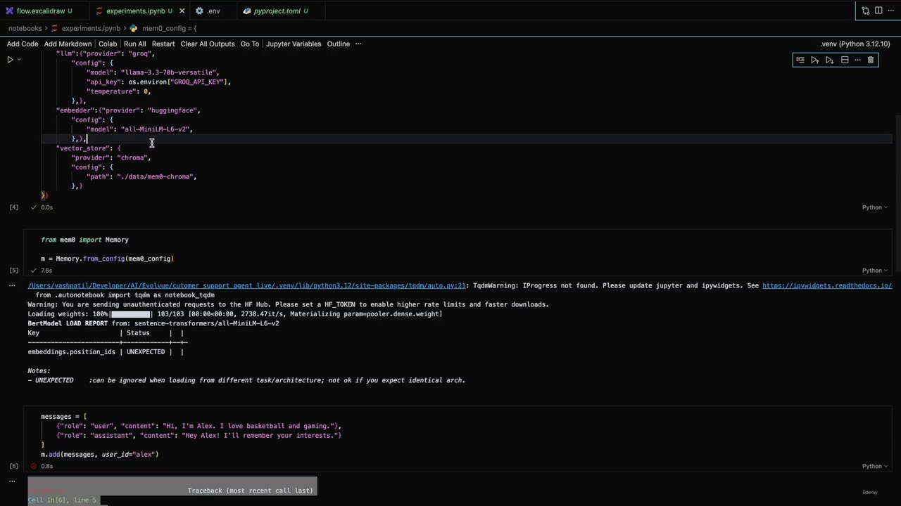

---

## 4. 完整代码

> 本段没有 OCR 结果。下面代码来自逐字稿里讲师口述的字段、命令和
配置项（因为逐字稿里没有 OCR，也没有念出完整文件；凡是逐字稿没念到的行，我都标注了「课里没讲」或「复现补全」）。

### 4.1 `pyproject.toml`（`uv init` + 多次 `uv add` 之后的形态）

```toml
[project]
name = "mem0-memory-demo"
version = "0.1.0"
description = "mem0 quick start: Groq LLM + HuggingFace embedder + Qdrant vector store"
readme = "README.md"
requires-python = ">=3.11"
dependencies = [
    "mem0ai",
    "sentence-transformers",
    "python-dotenv",
    "groq",
    "chromadb",
    "qdrant-client",
]
```

> 版本号课里没讲。`uv add` 默认会写入当时解析到的最新版本；如果你要锁定版本，用 `uv lock` 生成的 `uv.lock` 即可。`requires-python` 也是课里没讲的字段，`uv init` 会按你本机 Python 生成，照它给的写就行。

### 4.2 `.env`

```bash
# .env
GROQ_API_KEY=gsk_xxxxxxxxxxxxxxxxxxxxxxxxxxxxxxxx
```

### 4.3 `.env.example`（可提交）

```bash
# .env.example
GROQ_API_KEY=replace_me
```

### 4.4 `mem0_quickstart.py`（完整可运行文件）

```python
"""
mem0 quick start（P26–P28 复现）
LLM:        Groq
Embedder:   HuggingFace sentence-transformers (all-MiniLM-L6-v2, dim=384)
VectorStore: Qdrant (local on-disk mode)

运行：
    uv run python mem0_quickstart.py
"""

import os
import json

from dotenv import load_dotenv
from mem0 import Memory

# ---------------------------------------------------------------
# 1. 加载环境变量
# ---------------------------------------------------------------
load_dotenv()

if "GROQ_API_KEY" not in os.environ:
    raise RuntimeError("请先在 .env 中设置 GROQ_API_KEY")

# ---------------------------------------------------------------
# 2. 配置 mem0：替换默认 OpenAI stack
#    课里明确：llm / embedder / vector_store 三者由我们自己决定
# ---------------------------------------------------------------
config = {
    "llm": {
        "provider": "groq",
        "config": {
            "model": "llama-3.3-70b-versatile",
            "temperature": 0.0,
            "api_key": os.environ["GROQ_API_KEY"],
        },
    },
    "embedder": {
        "provider": "huggingface",
        "config": {
            "model": "sentence-transformers/all-MiniLM-L6-v2",
            "embedding_dims": 384,
        },
    },
    "vector_store": {
        "provider": "qdrant",
        "config": {
            "collection_name": "mem0_demo",
            "embedding_model_dims": 384,
            "path": "./qdrant_data",
            "on_disk": True,
        },
    },
}

print("=== config ===")
print(json.dumps(config, indent=2, ensure_ascii=False))

# ---------------------------------------------------------------
# 3. 用 config 创建 Memory 对象
#    直接用 Memory() 会走默认 stack（OpenAI），这里必须 from_config
# ---------------------------------------------------------------
m = Memory.from_config(config)
print("=== Memory 对象已创建 ===")

# ---------------------------------------------------------------
# 4. 添加 Alex 的记忆
# ---------------------------------------------------------------
messages = [
    {"role": "user", "content": "Hi, I am Alex and I love basketball and gaming."},
    {"role": "assistant", "content": "Hey Alex, I will remember your interests."},
]

add_result = m.add(messages, user_id="alex")
print("=== add(alex) ===")
print(json.dumps(add_result, indent=2, ensure_ascii=False, default=str))

# ---------------------------------------------------------------
# 5. 搜索 Alex 的记忆
# ---------------------------------------------------------------
result_alex = m.search(
    query="What do you know about me?",
    user_id="alex",
)
print("=== search(alex) ===")
print(json.dumps(result_alex, indent=2, ensure_ascii=False, default=str))

# ---------------------------------------------------------------
# 6. 添加 Yash 的记忆，验证 user_id 隔离
# ---------------------------------------------------------------
messages_yash = [
    {"role": "user", "content": "I am Yash and I love chess and programming."},
    {"role": "assistant", "content": "Nice to meet you Yash. I will remember that."},
]

m.add(messages_yash, user_id="yash")

result_yash = m.search(
    query="What do you know about me?",
    user_id="yash",
)
print("=== search(yash) ===")
print(json.dumps(result_yash, indent=2, ensure_ascii=False, default=str))

result_alex_again = m.search(
    query="What do you know about me?",
    user_id="alex",
)
print("=== search(alex) 再次 ===")
print(json.dumps(result_alex_again, indent=2, ensure_ascii=False, default=str))

# ---------------------------------------------------------------
# 7. 对照：换一个没有记忆的 user_id，应拿到空结果
#    课里讲师正是这样演示 scoping 的必要性
# ---------------------------------------------------------------
result_unknown = m.search(
    query="What do you know about me?",
    user_id="nobody_here",
)
print("=== search(nobody_here) ===")
print(json.dumps(result_unknown, indent=2, ensure_ascii=False, default=str))
```

> 关于 `default=str`：Qdrant / mem0 返回的对象里可能带非 JSON 原生类型，`json.dumps` 直接打印会抛异常。课里讲师是直接把结果贴到 JSON formatter 里看的，遇到格式化报错就说「forget about it」。这行只是让打印不炸，不改变业务逻辑。

### 4.5 `notebooks/experiments.ipynb` 的等价单元格顺序

如果你要 1:1 对照课堂，按下面顺序建单元格：

**Cell 1 — 打印 hello，验证 kernel**

```python
print("hello")
```

**Cell 2 — 加载依赖 + 环境变量**

```python
import os
from dotenv import load_dotenv
from mem0 import Memory

load_dotenv()
print("GROQ_API_KEY in env:", "GROQ_API_KEY" in os.environ)
```

**Cell 3 — config 对象**

```python
config = {
    "llm": {
        "provider": "groq",
        "config": {
            "model": "llama-3.3-70b-versatile",
            "temperature": 0.0,
            "api_key": os.environ["GROQ_API_KEY"],
        },
    },
    "embedder": {
        "provider": "huggingface",
        "config": {
            "model": "sentence-transformers/all-MiniLM-L6-v2",
            "embedding_dims": 384,
        },
    },
    "vector_store": {
        "provider": "qdrant",
        "config": {
            "collection_name": "mem0_demo",
            "embedding_model_dims": 384,
            "path": "./qdrant_data",
            "on_disk": True,
        },
    },
}
config
```

讲师在课里最后一行只写 `config`，让 notebook 直接把对象打印出来看。

**Cell 4 — 创建 Memory**

```python
m = Memory.from_config(config)
```

**Cell 5 — add**

```python
messages = [
    {"role": "user", "content": "Hi, I am Alex and I love basketball and gaming."},
    {"role": "assistant", "content": "Hey Alex, I will remember your interests."},
]
m.add(messages, user_id="alex")
```

**Cell 6 — search**

```python
m.search(query="What do you know about me?", user_id="alex")
```

**Cell 7 — 第二个用户**

```python
messages_yash = [
    {"role": "user", "content": "I am Yash and I love chess and programming."},
    {"role": "assistant", "content": "Nice to meet you Yash. I will remember that."},
]
m.add(messages_yash, user_id="yash")
m.search(query="What do you know about me?", user_id="yash")
```

### 4.6 `README.md`（复现步骤固化，课里没讲但建议有）

```markdown
# mem0 memory demo

## 1. 环境
- WSL（Windows 用户）/ macOS / Linux
- uv

## 2. 初始化
```bash
uv init
uv add mem0ai sentence-transformers python-dotenv groq chromadb qdrant-client
```

## 3. 配置 key
复制 `.env.example` 为 `.env`，填入 `GROQ_API_KEY`。

## 4. 运行
```bash
uv run python mem0_quickstart.py
```

## 5. 说明
- LLM: Groq `llama-3.3-70b-versatile`, temperature=0
- Embedder: HuggingFace `sentence-transformers/all-MiniLM-L6-v2`, dim=384
- VectorStore: Qdrant local, collection `mem0_demo`
- 记忆按 `user_id` 作用域隔离
```

### 4.7 记忆生命周期中的 add / search 决策表（把 P28 架构图落成表）

| 阶段 | 由谁做 | 输入 | 输出 | 课里出处 |
|---|---|---|---|---|
| 信息抽取 | LLM（Groq） | 完整 messages 列表 | 新记忆：key fact / decision / preference | p028 [00:54]、[11:46] |
| 冲突解决 | mem0 | 抽取结果 + 已存在记忆 | 保留最新 truth，替换/合并旧记忆 | p028 [12:40] |
| 向量写入 | embedder + vector store | 新记忆文本 | embedding + metadata（含原文本） | p028 [01:22]、[09:26] |
| 图写入（可选） | graph store | 实体 + 关系 | node（人/物）+ edge（带属性的关系） | p028 [03:44] |
| 检索 | memory engine 编排 | query + scope/filters | vector 结果 + graph 结果合并 | p028 [07:31]、[09:55] |
| 原文本回取 | vector store metadata | 匹配到的 embedding | 原始文本（不需要反向解码向量） | p028 [08:57] |

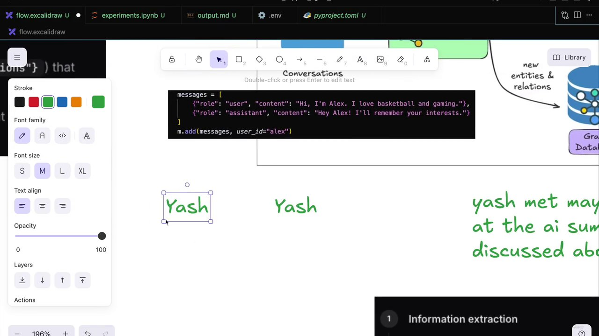

**实体/关系草案（课里口述的例子）**

```json
{
  "nodes": [
    { "id": "yash", "type": "person" },
    { "id": "mayank", "type": "person" },
    { "id": "ai_summit_2026", "type": "event" }
  ],
  "edges": [
    { "from": "yash", "to": "mayank", "relation": "met", "at": "AI Summit 2026", "topic": "AI agents" },
    { "from": "yash", "to": "ai_summit_2026", "relation": "attended" },
    { "from": "mayank", "to": "ai_summit_2026", "relation": "attended" }
  ]
}
```

> 这是把讲师口述的「Yash met Mayank，他们都在 AI Summit 2026，讨论了 AI agents」画成结构，方便你理解 graph 为什么要 node + edge。课里没有给这段 JSON，字段名也不是 mem0 的正式 schema，仅作示意。

### 4.8 作用域与标识符对照表（P28 关键术语）

| 标识符 | 作用 | 课里的类比 | 本项目是否使用 |
|---|---|---|---|
| `user_id` | 记忆归属到某个用户，跨会话长期有效 | ChatGPT 里「这个用户的历史偏好」 | ✅ 用了 `alex` / `yash` |
| `session_id` | 记忆限定在某一次会话/某一段对话 | ChatGPT 里「这一个聊天窗口」 | ❌ 课里没实际用 |
| `run_id` | 记忆限定在某一次运行/某一条链路 | 课里只提到它也能用于 scoping | ❌ 课里没实际用 |
| `agent_id` | 课里没讲这个字段名 | —— | 课里没讲 |

### 4.9 `infer` 开关与 metadata（P28 关键术语）

| 参数 | 取值 | 行为 | 什么时候用 |
|---|---|---|---|
| `infer` | `True`（默认语义） | LLM 抽取 key fact / decision / preference 后再存 | 原始对话流，想让 mem0 帮你总结成结构化记忆 |
| `infer` | `False` | 不抽，直接把原始 messages 存进去 | 你手上的数据已经是清洗过、可信的，不需要 LLM 再加工 |
| `metadata` | 任意 dict | 给记忆打自定义标签，之后可当 filter 用 | 想按 `category=hobby` 这类维度过滤检索 |

课里讲师原话说的是：`infer` 为 `false` 就存原始消息；为 `true` 就用 LLM 抽取该实体的 key fact 和 preference。`metadata` 可以设计成 `category: hobby` 这种，add 的时候写入、search 的时候过滤。

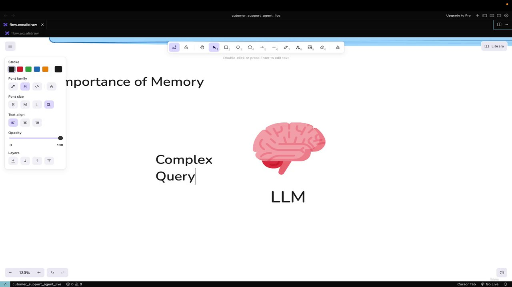

---

## 5. 逐行解释

### 5.1 为什么必须显式传 `api_key` 和 `model`

```python
"llm": {
    "provider": "groq",
    "config": {
        "model": "llama-3.3-70b-versatile",
        "temperature": 0.0,
        "api_key": os.environ["GROQ_API_KEY"],
    },
},
```

mem0 的默认 stack 是 OpenAI（默认 LLM、默认 vector store、默认 embedding model 三件套都是 OpenAI 系）。如果只写 `Memory()`，它会去找 `OPENAI_API_KEY`，找不到就报「API client 必须设置 / OpenAI key 必须存在」这类错误。讲师在课里就是先写了 `Memory()` 然后被打回，才引入 config 对象。

所以这三层是必须的：

- `provider`：告诉 mem0 用哪家的 adapter。
- `config`：adapter 自己的参数。
- `api_key`：从环境变量读，不硬编码在文件里。

`temperature: 0.0` 的作用是让抽取结果稳定、可复现。记忆抽取本质是「结构化信息提取」，不是创作任务，温度越低越好，否则同一段对话两次运行抽出来的 facts 措辞都可能不一样，冲突解决逻辑会误判成两条不同事实。

**JS/Node 对应**：这等价于你在 Node 里 `new OpenAI({ apiKey: process.env.OPENAI_API_KEY })`，只是这里多了一层 provider 选择。

### 5.2 为什么 `embedding_dims` 和 `embedding_model_dims` 要写两遍

```python
"embedder": {
    "provider": "huggingface",
    "config": {
        "model": "sentence-transformers/all-MiniLM-L6-v2",
        "embedding_dims": 384,
    },
},
"vector_store": {
    "provider": "qdrant",
    "config": {
        "collection_name": "mem0_demo",
        "embedding_model_dims": 384,
        ...
    },
},
```

这不是重复劳动，两边语义不同：

- embedder 侧：告诉 embedding 模型/封装「我产出 384 维向量」。
- vector store 侧：告诉 Qdrant「请在建 collection 时把向量维度设成 384」。

Qdrant 在第一次创建 collection 时就把维度写死进 schema，后续写入的向量维度必须完全一致。讲师在课里的原始错误是：他一开始用了 Chroma，Chroma 不接受这个 embedding dimension，于是他判定「Chroma 不支持 384 维」，切到 Qdrant，并且必须显式把 384 告诉 Qdrant。

如果你把这里写成别的数字（比如 768），后果是：collection 按 768 维建好，但 embedder 实际吐 384 维向量，写入会被拒绝，报维度不匹配。**这两个数字必须来自同一个模型**。

**JS/Node 对应**：类似你在 Prisma/pgvector 里建表时写 `vector(384)`，之后所有 `INSERT` 的向量长度必须 = 384。

### 5.3 为什么用 `Memory.from_config(config)` 而不是 `Memory()`

```python
m = Memory.from_config(config)
```

`Memory()` 走默认 stack；`from_config` 走你给的栈。这就是课里从报错到跑通的分水岭。讲师的原话是：把配置对象在实例化时交给 mem0，它会「检查所有配置，并创建带全部配置的 memory 对象」。

**JS/Node 对应**：`Memory()` 像 `new Client()` 用默认连接串；`from_config` 像 `new Client({ host, user, password, database })`。

### 5.4 `m.add(messages, user_id="alex")` 内部发生了什么

按 P28 的讲解，`m.add` 触发三段：

1. **信息抽取**：完整 messages 列表进 LLM，LLM 处理这些消息，抽出 key fact、decision、preference。课里的例子抽出来是「name = Alex」「loves basketball」「loves gaming」。
2. **冲突解决**：先查这个 scope 下是不是已经有相同 truth。如果有，用最新的替换，不重复存。为什么必须做？讲师说得很直白：如果每次都无脑写入，会「增加 latency 和不必要的处理开销」。
3. **存储**：写进 vector store（本项目），可选的 graph storage（本项目没用）。

`user_id="alex"` 在这里不是可有可无的装饰，它决定后续能不能按人隔离。你把它去掉，记忆会落进一个没有归属的池子，检索时也没法按人过滤，个人化就没了。

**JS/Node 对应**：`user_id` 就像你在业务表里必填的 `userId` 外键。少写就等于所有用户共用一份 profile，前端做出来的「个性化」全是串的。

### 5.5 `m.search(query=..., user_id=...)` 内部发生了什么

按 P28，`m.search` 的编排链路是：

1. query + scope 一起进 **memory engine**。memory engine 是 mem0 自己的组件，负责管 LLM、embedder、vector store、graph store、metadata，并做统一编排。
2. **校验 session、构造 filters**。本项目的 filter 就是 `user_id`。课里说文档里还有很多别的 filter 可以加。
3. **并行/并列两条检索**：
   - graph search 打 graph DB；
   - query 先被 embed，带上 filters 后打 vector store。
4. **取回原文本**：vector store 返回的是 embedding，但每条 embedding 的 metadata 里存了原始文本，所以不需要再做「向量 → 文本」的反向解码（那是不可能的）。讲师特意强调这是他们设计 vector store 时就埋好的。
5. **合并两路结果**，返回给调用方。

课里讲师实际调 filter 时踩了一个坑：一开始他写的 filters 结构嵌套了 user_id、字符串比较、多了一层 JSON，结果跑出来识别不到用户。他的修法是：去掉多余的嵌套、改成等号比较、删掉最后那层 JSON，然后就能搜到。所以你如果照着网上别的示例抄 filters 结构，注意 mem0 不同版本对 filters 写法不一致——**本项目的写法是直接 `user_id="alex"`，不要包成 `filters={"AND": [{"user_id": {"eq": "alex"}}]}` 之类**。课里没讲这种嵌套写法的正确形态，只演示了把它删掉。

### 5.6 为什么 `user_id` 换成 `nobody_here` 会得到空结果

课里讲师演示过：把 user_id 改成一个没有记忆的 id，搜索返回空。这不是 bug，正是 scoping 在起作用。等价地，你搜 `alex` 时不会搜到 `yash` 的记忆——两个用户的记忆在 vector store 里物理上是同一个 collection，但 metadata 里的 user_id 让检索被过滤掉。

对前端转 AI 工程师的读者，一句话理解：**这就是多租户隔离，只不过隔离键叫 user_id**。

### 5.7 为什么讲师在 add 之后能看到每条记忆的 id

P28 里讲师说：输出里每条记忆都带一个 innate ID，有了这个 ID 就能对单条记忆做 CRUD——增、删、改。因为有了 ID，你不需要让 LLM 再参与「我要删哪条」，直接拿 ID 定位即可。

课里说这些 CRUD 方法在 mem0 文档里能查到；具体方法名（`update` / `delete` / `get` / `history` 之类）课里没有逐字念出来，**该接口名请以 mem0 实际文档为准**。

**JS/Node 对应**：就是 REST 里的 `POST/PUT/DELETE /memories/{id}`。

### 5.8 什么时候该往记忆里写（P28 的触发条件清单）

讲师给了一份「什么时候该加记忆」的判定表，逐条翻译如下：

| 触发场景 | 说明 | 前端类比 |
|---|---|---|
| 用户分享了新偏好 | 用户说「我喜欢篮球」 | 用户改主题/语言/默认值 |
| 做出了决策或建议 | agent 给出方案被采纳 | 提交了一次配置保存 |
| 完成了一个目标/任务 | 任务闭环 | 完成 onboarding |
| 引入了新实体 | 出现新的人、地点、事件 | 新建了一条实体记录 |
| 用户给出反馈或澄清 | 纠正、补充、评价 | 用户提交 bug feedback |
| agent 给出偏好/决策/建议 | agent 侧的结论也要沉淀 | 服务端写入审计日志 |

讲师还强调：在他这个项目里，**用户给的每一次反馈、每一个 error 都会存进记忆**；agent 给出的偏好/决策/建议也全部落记忆。这就是为什么记忆层不是「可选的加分项」，而是「AI 应用要变得好用、强大」的基础设施。

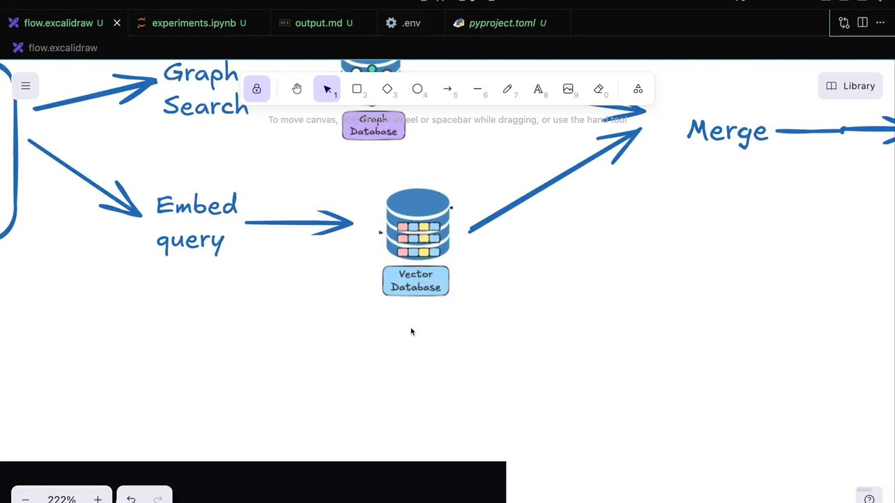

### 5.9 mem0 platform vs mem0 open source：四个差异为什么是这个顺序

讲师在 P28 给了四个差异，逐条解释：

1. **冲突解决**：platform 自动做，而且 dashboard 里能看到「哪条记忆冲突了、平台怎么解的」；open source 要你自己在本地管理，存储也归你自己控。**影响**：选 OSS 就等于你接手了「记忆去重」的运维责任。
2. **graph write**：platform 只要写 `enable_graph=True` 就开了；OSS 需要你提供完整的 graph provider 配置（课里提到 Neo4j 可以用，但本项目不需要）。**影响**：OSS 想上图数据库，配置成本明显更高。
3. **rate limit**：platform 的限流由你买的 API key / workspace 额度决定；OSS 的限流由你自己的硬件和 LLM provider 的额度决定。**影响**：OSS 的成本曲线跟着 Groq 这类 provider 的免费额度走，跑大批量会撞 rate limit。
4. **dashboard 可见性**：platform 有现成 dashboard；OSS 只能用 CLI 日志 + 自己写 UI（讲师说这部分会在项目里带大家做）。**影响**：OSS 调试期你会花不少时间在「看不见记忆库里到底有什么」上。

讲师最后的结论原话大意是：要快、要少控制、要简单 setup、并且愿意把数据托付给 mem0 platform，就选 platform；要全在自己掌控、有开发团队、有时间集成，就选 open source；而且**对开发者来说强烈建议学 open source**，这门课走的就是 OSS 路线。

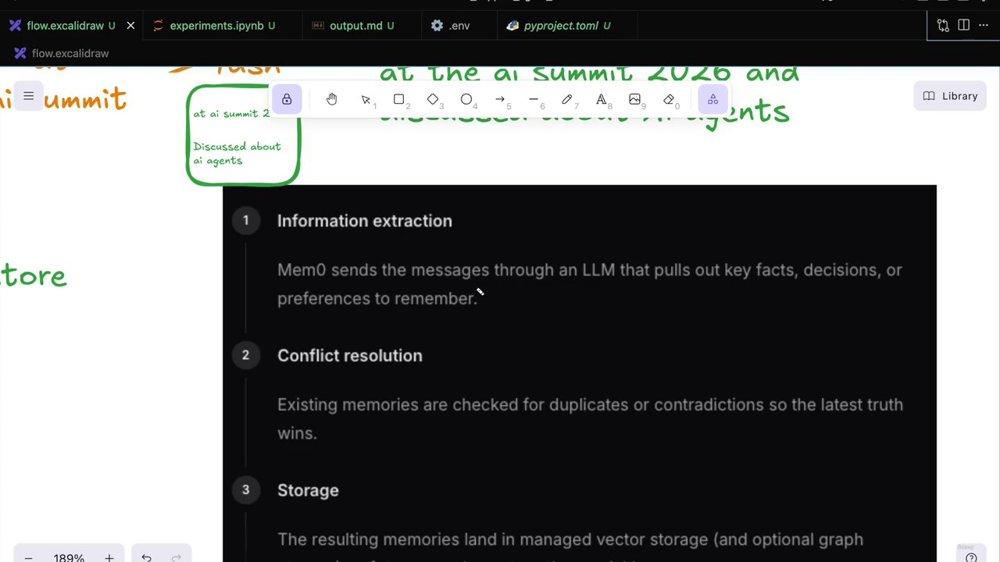

### 5.10 数据隐私边界：哪部分在你自己机器上

讲师在 P27 结尾明确说：因为用了 Qdrant 本地存储，所有记忆数据都在自己这边，**数据隐私是完整的**；但 LLM 处理这一段仍然走 Groq 的 API，所以「处理」这一环当前是外包出去的。他也说了：理论上可以换成开源模型在本地跑，但那需要更多配置，本课先不做。

这句话的分量在于：**存 = 本地，算 = 远端**。你做安全评估时，这条边界就是你的数据出境点。

---

## 6. 复现检查清单

按顺序打勾，每一条都对应一个课里出现过的失败点。

**环境**

- [ ] Windows 用户已切到 WSL（讲师明确建议）
- [ ] `uv --version` 能输出
- [ ] `uv init` 已执行，`pyproject.toml` 已生成
- [ ] `uv add mem0ai sentence-transformers python-dotenv groq chromadb qdrant-client` 全部成功
- [ ] 打开 `pyproject.toml`，能看到 mem0、sentence-transformers 等依赖（讲师就是这么核对的）

**配置**

- [ ] `.env` 已创建，`GROQ_API_KEY` 已填
- [ ] `load_dotenv()` 之后，检查环境变量存在的那行不报错
- [ ] `config` 里 **`vector_store` 只出现一次**（讲师踩过写两次的坑）
- [ ] `config` 是合法 Python dict，没有多余逗号/少括号（讲师在 JSON formatter 里修过语法）
- [ ] embedder 的 `embedding_dims` 与 vector store 的 `embedding_model_dims` 都是 `384`

**运行**

- [ ] `Memory.from_config(config)` 不报 OpenAI key 相关错误
- [ ] `Memory.from_config(config)` 不报 `No module named 'groq'`（报了就 `uv add groq` + restart kernel）
- [ ] `m.add(messages, user_id="alex")` 不报 vector store 相关错误（报了就确认已装 chromadb / qdrant-client）
- [ ] 第一次运行会下载 Hugging Face 模型，耐心等，不要以为卡死
- [ ] `m.search(query=..., user_id="alex")` 能返回 name=Alex、loves basketball、loves gaming 这类记忆
- [ ] `m.add(messages_yash, user_id="yash")` 后搜 `yash` 能返回 Yash 的记忆
- [ ] 再搜 `alex` 不会混进 Yash 的记忆
- [ ] 搜一个不存在的 user_id 返回空

**每次装包之后**

- [ ] restart kernel / 重启 Python 进程（讲师反复强调，避免缓存导致新包不生效）

**产物**

- [ ] `./qdrant_data` 目录已生成（Qdrant local 落盘位置；课里没讲具体目录名）
- [ ] `.env` 没有被提交到 git
- [ ] `uv.lock` 已生成

---

## 7. 课里没讲但你会撞上的

**1. 包名 vs 课堂口述名不一致**

逐字稿里 ASR 出来的 `mem0 AI`、`my M0`、`MAM0` 都是 `mem0`；PyPI 上的正式包名通常是 `mem0ai`。讲师在课里就是先 `uv add` 报 `not found`，然后「让我把包名复制准确一点」才装上。同理 `dotenv` 在 pip 生态里有两个包：`dotenv` 和 `python-dotenv`，代码里 `from dotenv import load_dotenv` 用的是后者。这些差异课里没讲，但你不处理就会卡在第一步。

**2. Qdrant 客户端没被逐字念出来**

讲师从 Chroma 切到 Qdrant 后，是直接改 config 里 `provider: "qdrant"` 就跑。他没念 `uv add qdrant-client`。如果你的环境没装，`from_config` 会报 import 类错误。同理，本地嵌入式模式还需要 `path` / `on_disk` 这类字段，课里没讲，你按本文补上即可；如果你本地起了 Qdrant 服务，则改 `host` / `port`，这两种连接方式的字段课里都没讲。

**3. Groq 模型名会变**

讲师用的是 `llama-3.3-70b-versatile` 这个量级的模型（口述为「Llama 3.3 70B」）。Groq 侧的模型目录会迭代、会下架旧 model id。如果报 model 不存在，去 Groq 控制台的模型列表里换一个当前可用的，`model` 字段改掉即可，其他都不用动。

**4. Hugging Face 首次下载**

`all-MiniLM-L6-v2` 第一次用会从 Hugging Face 拉模型权重。学员反馈里最常见的就是「运行到 `Memory.from_config` 就卡住」——不是死锁，是在下载。课里没讲这一点，但这是实际必撞的。

**5. filters 写法在不同 mem0 版本间不统一**

课里讲师演示的是「先把 filters 写复杂了 → 删掉多余嵌套 → 改成等号 → 能搜到」。他只给了结论：直接用 `user_id="alex"` 就能搜。至于 `filters={"AND":[...]}`、`{"eq": ...}` 这类写法在哪个版本可用，**课里没讲**。照本文用最简形式最稳。

**6. 返回结构里的字段名**

讲师口述的输出包含：这次操作的一个 id、抽取出的 memories 列表、每条 memory 自己的 id、记忆文本、以及 user_id 作用域；检索时还会带 filters 信息和「事件/来源」信息。但逐字稿里没有把 JSON key 逐字念出来，**具体字段名请以你实际跑出来的输出为准**，不要照记忆猜。

**7. `infer=False` 与 `metadata` 在本文脚本里没有实际调用**

P28 讲了这两个能力，但 P27 的 quick start 演示里没有跑。本文把语义解释放在 4.9 表格里，没有塞进可运行脚本——因为「课里没实际调用」。你想验证的话，可以自己写 `m.add(messages, user_id="alex", infer=False)` 对比抽取结果，或者加 `metadata={"category": "hobby"}` 然后在 search 时按 category 过滤。**这两个参数的确切用法请以 mem0 文档为准**。

**8. graph DB 全程没有真正接入**

P28 大篇幅讲了 vector + graph 双写、node/edge、Yash met Mayank 的例子，也提到 OSS 上 graph 需要完整 provider 配置（Neo4j 可行）。但讲师明确说：「这个用例 vector store 就够了，所以我没有接 graph。」所以本文的脚本**没有** graph 配置。如果你要接，课里没给可运行配置，只给了「platform 上 `enable_graph=True`、OSS 上要自己配 provider」这个结论。

**9. mem0 的 CRUD 方法名**

P28 说「每条记忆都有 ID，可以做 CRUD，LLM 不参与，直接给 ID 就行」，但讲师没有在视频里敲出 `update` / `delete` / `get` 这些方法名。**课里没讲具体签名**，请查文档。

**10. 关于本次课程标题的错位**

你给的课程名是「AI Security Bootcamp part1（护栏/网关/可观测）」，但 P26–P28 逐字稿全篇是 mem0 记忆层。**护栏（guardrails）、网关（gateway）、OpenTelemetry/Grafana 可观测性，这三块在 P26–P28 里一处都没出现。** 本文没有把这三个词安到讲师头上。如果你要写那部分文档，需要另外的 P 号段落。

**11. 前端读者会问：这门课的东西在 Node 里怎么用**

课里只写了 Python。逐字稿里没有任何 JS/Node 代码，**课里没讲**。可以类比的对应关系是：`Memory.from_config` ≈ 构造函数注入 client；`m.add(messages, user_id)` ≈ `POST /memories`；`m.search(query, user_id)` ≈ `GET /memories/search?userId=...`；`user_id` ≈ 多租户外键；`config` 里的三个 provider ≈ 三个依赖注入点。真正要落到 TS 里，你得自己包一层 HTTP 服务把 Python 的 mem0 暴露出去，或者照 mem0 的 JS SDK 文档重写——这两条路课里都没走。

**12. 关于「重启 kernel」这件事的代价**

讲师在 P27 里至少重启了四五次 kernel，每次都重新跑 env 加载 + config + Memory 创建。这是 notebook 的固有摩擦。如果你想避免，改用本文的 `mem0_quickstart.py` + `uv run`，每次都是干净进程，改完 config 直接重跑，不用点 restart。

---

## 附：本节关键命令速查

```bash
# 环境
uv --version
uv init

# 依赖（一次性）
uv add mem0ai sentence-transformers python-dotenv groq chromadb qdrant-client

# 逐个补装（对应课里的报错顺序）
uv add groq            # 报 No module named 'groq' 时
uv add chromadb        # 用 Chroma 时报 vector store 相关错误时
uv add python-dotenv   # 报 No module named 'dotenv' 时

# 运行
uv run python mem0_quickstart.py
```

```text
环境变量名：GROQ_API_KEY
LLM provider：groq
LLM model：llama-3.3-70b-versatile
LLM temperature：0.0
Embedder provider：huggingface
Embedder model：sentence-transformers/all-MiniLM-L6-v2
Embedding dim：384
Vector store provider：qdrant
Qdrant collection：mem0_demo
作用域字段：user_id（alex / yash）
```