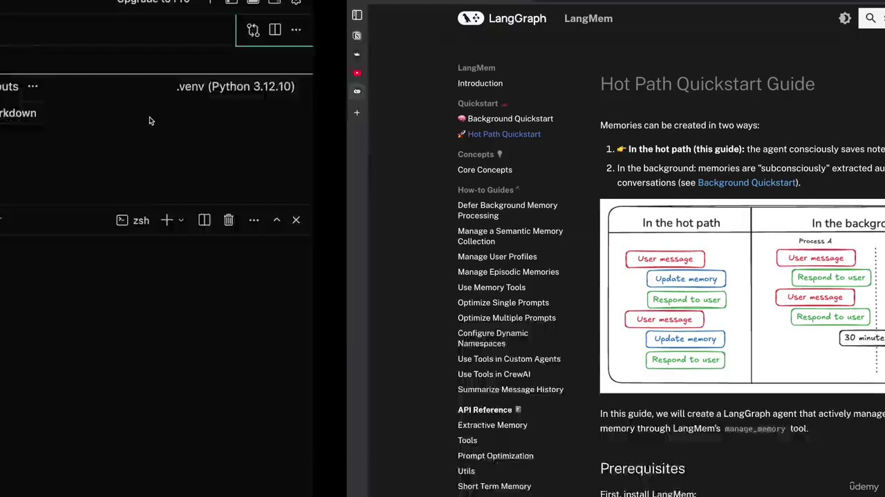
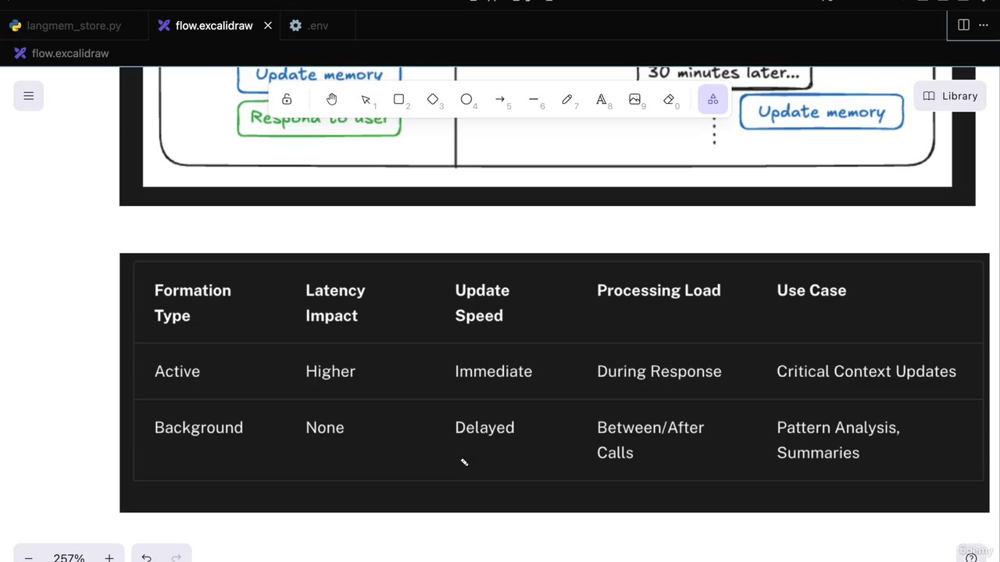
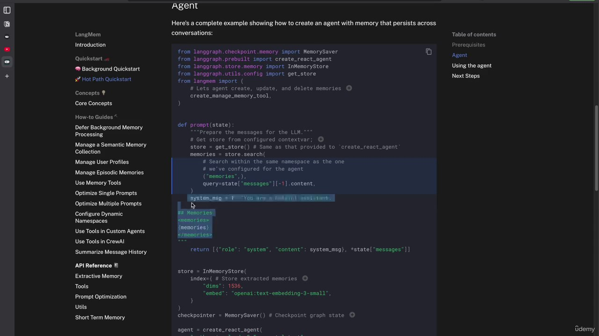
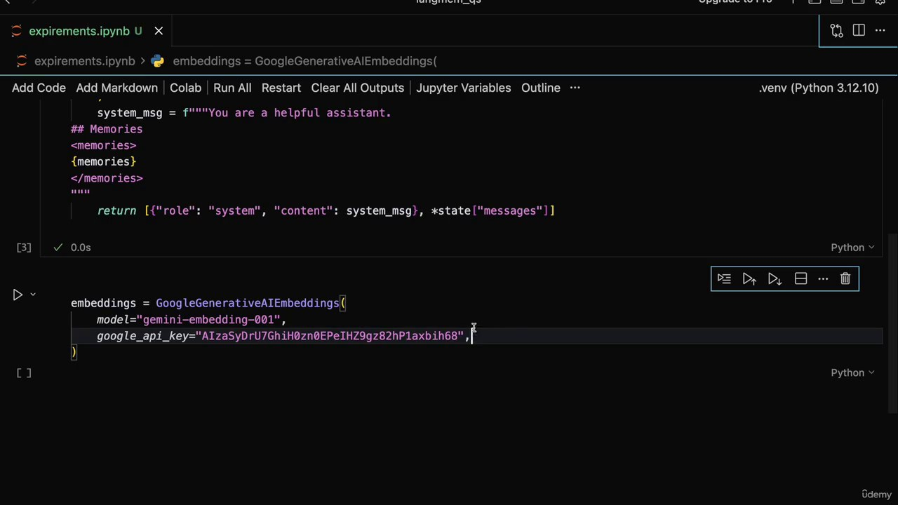
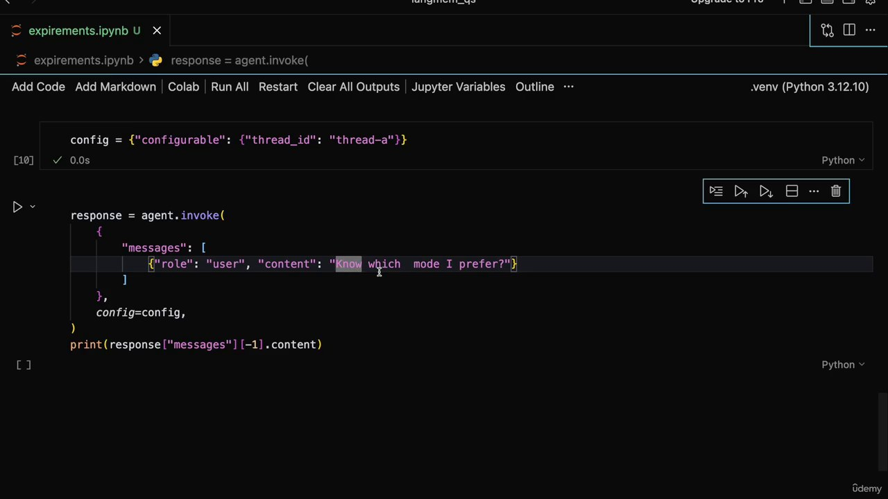
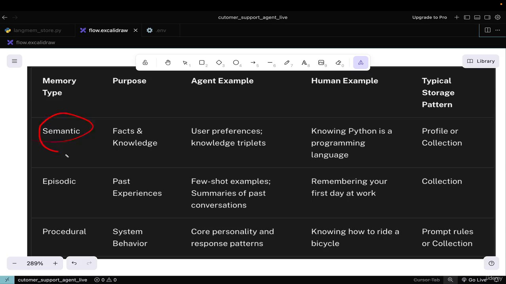
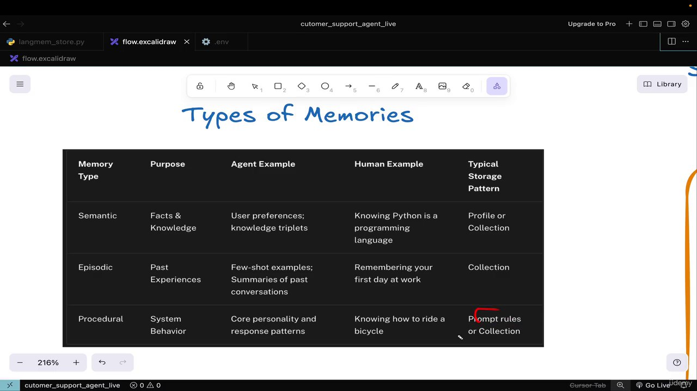
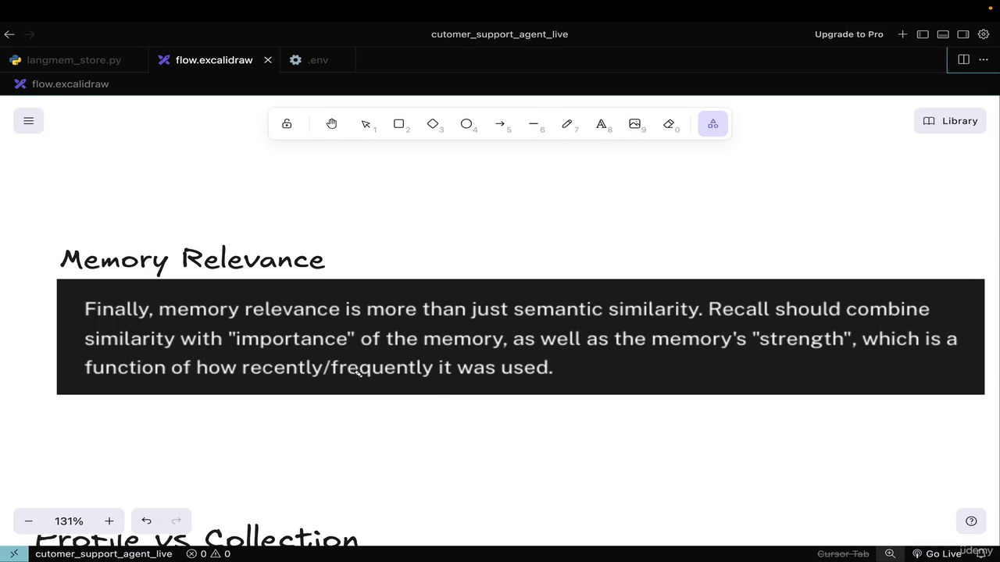

# LangMem 快速上手与核心概念（P029–P030）

> 课程：AI Security Bootcamp part1（护栏/网关/可观测）｜BV1PSGA6SEKx
> 覆盖：P029（LangMem 热路径 Quick Start 实操）、P030（LangMem 核心概念：记忆类型、存储模式、命名空间、相关性）
> 读者：前端转 AI 应用工程师。本文档按「能照着跑起来」的标准写，所有代码为完整文件，可直接保存运行。

---

## 1. 这一节做什么

这两节课是 LangMem 的入门双集，目标非常明确：**先跑通一个能记住用户偏好的 Agent，再把 LangMem 的记忆模型讲透**。

- **P029 是动手课**：用 `uv` 建一个 Python 3.12 项目，装 `langmem`、`langgraph`、`langchain-groq`、`langchain-google-genai` 四个包，在 Jupyter Notebook（`experiments.ipynb`）里写一个 ReAct Agent。这个 Agent 挂了一个 `create_manage_memory_tool` 工具，能在对话过程中**主动**把「用户偏好深色模式」写进 LangMem 的存储；然后用两个不同的 `thread_id` 验证：记忆在**不同会话之间是共享的**（因为记忆存在 store 里，不在 checkpoint 里）。
- **P030 是概念课**：讲清 LangMem 的四个核心概念——① 核心更新模式（旧记忆列表 + 新对话 → LLM 产出新记忆列表）；② 三种记忆类型（semantic / episodic / procedural）；③ 两种存储模式（profile 单文档严格 schema / collection 多文档灵活 schema）；④ 命名空间（namespace）与记忆相关性（recency + frequency + importance）。

学完这两节，你应该能回答：为什么我的 Agent 换个聊天窗口还记得我？记忆到底存在哪？什么时候该用 profile、什么时候该用 collection？

**前置条件**：Python 3.12、`uv` 已安装、一个 Groq API Key（免费）、一个 Google Gemini API Key（用于 embedding）。课里明确说不用 Anthropic key，因为要绑支付方式。

---

## 2. 讲师原话

> "在 LangMem 里，我们有两种创建记忆的方式。第一种是热路径（hot path），第二种是后台（background）。"
> —— p029 [01:22]

> "热路径里，Agent 是通过工具**有意识地**保存笔记；而后台方式里，我们是**下意识地**从对话中提取，它是一个后台进程。"
> —— p029 [01:51]

> "热路径是在对话运行时更新记忆，而后台是在对话结束 30 分钟之后，进程 B 才介入去更新记忆。这非常像人类的思考方式。"
> —— p029 [02:21]

> "你正在面试，面试官说『我叫 Arun，我来面你的 UX 设计岗』，你会立刻更新即时记忆：我在和 Arun 面试，我要从 UX 设计的角度回答。这就是有意识地保存记忆。"
> —— p029 [03:19]

> "后台方式类似无意识记忆。比如你练吉他、打游戏，玩的时候大脑在触发『我要把这个存下来』，但真正的接线（wiring）发生在之后的睡眠里。"
> —— p029 [04:13]

> "热路径的延迟影响更高——因为 Agent 必须先更新记忆再回复；后台方式没有延迟影响，但更新是延迟的。热路径的处理负载在运行时，后台的处理负载在调用之间或调用之后。"
> —— p029 [05:09]

> "热路径的用例是**关键上下文更新**（比如面试官的名字），后台的用例是**模式分析、总结**，就像你开完会之后在笔记本上写的会议纪要。"
> —— p029 [06:05]

> "官方 quick start 用的是 Anthropic API key，我不用，因为 Anthropic 要付费、要绑支付方式，很麻烦。我用 Groq API key，可以免费拿到。"
> —— p029 [08:19]

> "这个 prompt 函数里，我们先拿到 store，在 store 里按 query 搜索记忆，然后把检索到的记忆拼进 system message，返回 `role: system` 的消息。"
> —— p029 [09:19]

> "这里我们准备的是 in-memory store，也就是 LangMem 提供的 store；embedding 官方用 OpenAI，我用 Google Gemini；checkpointer 用 LangGraph 的 memory saver。"
> —— p029 [10:13]

> "我们导入 `create_manage_memory_tool`，这个工具会被 Agent 在需要时动态调用——因为这是热路径的例子，每次新交互都会更新。"
> —— p029 [11:38]

> "embedding 模型用 `gemini-embedding-001`，我直接把 Google API key 传进去。我知道这不是好实践，应该放 `.env` 再读环境变量，但这是 quick start，录完我就把这个 key 禁掉。"
> —— p029 [12:35]

> "LLM 用 ChatGroq，模型是开源的 Qwen3 32B，temperature 设为 0。"
> —— p029 [13:04]

> "创建 ReAct Agent 时传入 LLM、prompt、tools，tools 就是 `create_manage_memory_tool`，namespace 给的是 `memory`。namespace 是什么？别急，下一个核心概念视频里讲清楚。"
> —— p029 [13:32]

> "thread 就像 ChatGPT 界面左边的『你的聊天』列表：这是一个 thread，那是另一个 thread，每个 thread 是一个独立会话，新消息只会落在那个 thread 下面。"
> —— p029 [15:56]

> "第一次问『你知道我偏好哪个显示模式吗』，它说没有这个信息。然后我说『我偏好深色模式，记住』，同一个 thread A，它就去调用了 manage memory 工具，工具消息里返回了记忆创建在某个 ID 上。"
> —— p029 [17:17]

> "注意这条 AI 消息 content 是空的，但 reasoning content 里能看到它在推理：用户说他偏好深色模式并要求记住，让我看看有哪些工具可用——它看到了我们配置的 manage memory 函数，于是调用了它。"
> —— p029 [18:42]

> "我新建一个 config，thread 改成 thread B，问『你记得我吗，我的偏好是什么』——你看，在新聊天里记忆也被共享了，它说『我记得你，从之前的交互我知道你偏好深色模式』。"
> —— p029 [20:32]

> "最后我把 store 里 namespace 为 memory 的记忆搜出来打印，能看到 value 是『用户偏好深色模式』，还有 memory id。"
> —— p029 [21:54]

> "LangMem 里有一个专门用来创建记忆的 LLM。你在对话中间，已经有一份旧记忆列表，新信息出现后，新对话连同旧列表一起送给这个 LLM，它负责抽取事实、知识、过往经验、系统行为，产出一份新的记忆列表。"
> —— p030 [01:24]

> "这个 LLM 会判断：第一条还需要，保留；第二条已经过时了，用户给了新信息，更新它；第三条仍然相关，保留；第四条是用户这次新披露的，加进去。"
> —— p030 [02:23]

> "LangMem 有三种记忆类型：semantic（语义）、episodic（情景）、procedural（程序）。这和人类记忆的类型也非常类似。"
> —— p030 [03:44]

> "Semantic 是对话中讨论的事实和知识，比如用户偏好——我透露我是 Python 程序员，我喜欢你用 Python 解释代码库。"
> —— p030 [04:13]

> "Episodic 是 Agent 的过往经验。就像你记得和全家去 Manali 度假的那个完整片段；Agent 记得的是：我接到解释 Python 代码的任务，试了两三种方式，用真实生活例子讲用户就懂了——这整个片段存进情景记忆。"
> —— p030 [05:08]

> "Procedural 是系统行为，也就是你给 Agent 的 system prompt。通过程序记忆，我们可以根据 Agent 的表现去更新 system prompt。"
> —— p030 [06:55]

> "类比人类：上学有流程——穿校服、站队祈祷、进教室、第一节课……这就是你脑子里操作学校的 system prompt。哪天课表从『第一节英语第二节数学』变成『第一节数学第二节英语』，这个 system prompt 就被更新了。"
> —— p030 [07:25]

> "Profile 是单个文档、严格 schema，只和 semantic 记忆关联，只保存对话的**最新状态**，不保留历史状态。"
> —— p030 [09:44]

> "比如最新状态是：名字 Yes、技能 Python、偏好风格随意加讽刺加 emoji。对话中我说『我不叫 Yes 了，我叫 Yes Part Of』，又说『我还会 LangChain』，又说『风格改成随意讽刺但不要 emoji』——它不是追加，而是**替换/更新**。"
> —— p030 [10:43]

> "Collection 可以是多个文档、灵活 schema，取决于你用哪种记忆类型；它不仅存最新状态，也存过去的信息；semantic、episodic、procedural 三种记忆都可以用 collection 存。"
> —— p030 [13:35]

> "在 collection 里，更新方式是**追加**；在 profile 里，是**更新或替换**。"
> —— p030 [15:53]

> "官方文档说：profile 在你需要快速访问当前状态、并且对能存什么信息有数据要求时最合适，而且它易于呈现给用户做手动编辑。"
> —— p030 [16:18]

> "Collection 适合跨多次交互追踪知识而不丢信息，适合**按上下文**回忆某些信息，而不是每次都全量带上。"
> —— p030 [17:13]

> "记忆相关性不只是语义相似度。召回应该把相似度和记忆的重要性结合起来；重要性又和记忆强度有关——也就是它多近被用过、多频繁被用过。"
> —— p030 [18:11]

> "就像 ABCD 你记得牢，因为它被重复了无数次，记忆强度高；一年前学的东西、小学一二年级学的东西，不重复就沉到脑后了。"
> —— p030 [19:09]

> "命名空间本质是目录结构。想象 LangMem 存记忆的柜子：先有根目录 `memories`，下面按用户分——这是 Yesh 的记忆，里面是 memory 1、memory 2……每条记忆有自己的唯一 memory ID。"
> —— p030 [20:08]

> "检索方式很灵活：可以直接按 memory ID 访问；可以语义搜索（带语义分数，本质就是 RAG）；还可以做 metadata 过滤——比如只要 `is_disabled = false` 的记忆。"
> —— p030 [22:55]

> "集成方式有 core API 和 stateful integration，后者主要面向 LangGraph。我们项目里会用 memory managers，`create_memory_manager` 是个重要函数。"
> —— p030 [23:53]

---

## 3. 从零复现

### 3.1 环境准备

```bash
# 1) 确认 uv 可用
uv --version

# 2) 新建项目目录（课里是在 IDE 里直接 uv init，这里等价）
mkdir langmem-quickstart && cd langmem-quickstart
uv init --python 3.12

# 3) 安装依赖（课里逐条 uv add，这里合并成一条，效果相同）
uv add langmem langgraph langchain-groq langchain-google-genai

# 4) 装 Jupyter kernel，让 notebook 能选到这个环境
uv add --dev ipykernel
uv run python -m ipykernel install --user --name langmem-quickstart --display-name "Python (langmem-quickstart)"
```

课里讲师是在 IDE 里执行 `uv init`，然后看到「Python 版本 3.12」的环境就绪；接着在 notebook 里如果提示安装 kernel，就点安装。上面第 4 步就是把这个动作显式化。

### 3.2 配置 API Key

课里讲师为了演示方便，**把 key 直接写在代码里**，并明确说这不是好实践、录完就禁用。复现时请用环境变量：

```bash
# .env 文件（不要提交到 git）
GROQ_API_KEY=gsk_xxxxxxxxxxxxxxxxxxxx
GOOGLE_API_KEY=AIzaxxxxxxxxxxxxxxxxxxxx
```

Notebook 里用 `python-dotenv` 加载（课里没讲这个包，属于「课里没讲但你会撞上」的补充，见第 7 节）：

```bash
uv add python-dotenv
```

### 3.3 创建 notebook

新建 `experiments.ipynb`，kernel 选 `Python (langmem-quickstart)`。先跑一个 `print("hello")` 确认环境通了（课里就是这么验证的）。

### 3.4 按顺序执行单元格

1. **导入**：`ChatGroq`、`GoogleGenerativeAIEmbeddings`、`MemorySaver`、`create_react_agent`、`InMemoryStore`、`create_manage_memory_tool`。
2. **定义 `prompt` 函数**：从 store 按 query 搜记忆，拼进 system message。
3. **定义 embedding 模型**：`gemini-embedding-001`。
4. **定义 LLM**：ChatGroq + `qwen/qwen3-32b` + `temperature=0`。
5. **定义 store**：`InMemoryStore`。
6. **定义 checkpointer**：`MemorySaver`。
7. **创建 agent**：传入 LLM、prompt、tools=[manage memory tool]、store、checkpointer、namespace=`memory`。
8. **定义 config**：`{"configurable": {"thread_id": "thread-A"}}`。
9. **第一轮对话**：问「你知道我偏好哪个显示模式吗」→ 预期回答「不知道」。
10. **第二轮对话**（同一 thread）：说「我偏好深色模式，记住」→ 预期触发工具调用，记忆写入。
11. **第三轮对话**（同一 thread）：问「我偏好的显示模式是什么」→ 预期回答「深色模式」。
12. **换 thread**：新建 `thread-B` 的 config，问「你记得我吗，我的偏好是什么」→ 预期仍然回答「深色模式」，证明记忆跨会话共享。
13. **打印全部记忆**：`store.search(("memory",), limit=100)`，看到 value 与 memory id。

### 3.5 关键验证点

- 第 10 步的 AI 消息 `content` 可能为空，但 `reasoning_content` 里能看到它在推理并决定调用工具——这是 Qwen3 这类带思考的模型的特征，课里专门指出了这一点。
- 第 12 步是整节课的「点睛」：记忆存在 store 里，不在 checkpointer 里，所以换 thread 依然能读到。**thread 隔离的是对话历史，不是长期记忆。**

---

## 4. 完整代码

> 说明：本节 OCR 无结果，以下代码依据逐字稿中讲师口述的每一步重建，API 名称与参数以 LangMem / LangGraph 公开接口为准。逐字稿未念出的细节（如 `create_react_agent` 的 `store` 参数名）按官方签名补齐，并在第 7 节标注。

### 4.1 `experiments.ipynb` —— 单元格 1：导入

```python
# Cell 1: imports
from langchain_groq import ChatGroq
from langchain_google_genai import GoogleGenerativeAIEmbeddings
from langgraph.checkpoint.memory import MemorySaver
from langgraph.prebuilt import create_react_agent
from langgraph.store.memory import InMemoryStore
from langmem import create_manage_memory_tool
```

### 4.2 单元格 2：prompt 函数

```python
# Cell 2: prompt —— 每次调用 Agent 前，先从 store 检索相关记忆，拼进 system message
def prompt(state):
    store = config["configurable"]["store"]          # 指向同一个持久化 store
    query = state["messages"][-1].content            # 用最后一条用户消息做检索 query
    memories = store.search(("memory",), query=query, limit=5)
    memory_text = "\n".join(f"- {m.value}" for m in memories) if memories else "（暂无记忆）"
    system_message = {
        "role": "system",
        "content": (
            "你是一个有长期记忆的助手。以下是从记忆中检索到的、与当前对话相关的信息：\n"
            f"{memory_text}\n"
            "回答时请利用这些记忆；如果记忆里没有相关信息，就如实说不知道。"
        ),
    }
    return [system_message, *state["messages"]]
```

> 课里讲师的 prompt 函数是「拿到 store → 按 query 搜索 → 拼 system message → 返回 `role: system` 的消息」。上面把检索结果格式化成文本列表，逻辑一致。`config` 的注入方式见 4.7 的说明。

### 4.3 单元格 3：embedding 模型

```python
# Cell 3: embeddings —— 课里用 Google Gemini 做 embedding
import os
from dotenv import load_dotenv
load_dotenv()

embeddings = GoogleGenerativeAIEmbeddings(
    model="gemini-embedding-001",
    google_api_key=os.environ["GOOGLE_API_KEY"],
)
```

> 课里讲师是直接把 key 字符串传给 `google_api_key`，并说「录完就禁用」。这里改成读环境变量。

### 4.4 单元格 4：LLM

```python
# Cell 4: LLM —— ChatGroq + 开源 Qwen3 32B，temperature=0
llm = ChatGroq(
    model="qwen/qwen3-32b",
    api_key=os.environ["GROQ_API_KEY"],
    temperature=0,
)
```

### 4.5 单元格 5：store 与 checkpointer

```python
# Cell 5: store + checkpointer
store = InMemoryStore(index={"embed": embeddings, "dims": 1536})
checkpointer = MemorySaver()
```

> 课里说「in-memory store 是 LangMem 提供的 store」「checkpointer 用 LangGraph 的 memory saver」。`InMemoryStore` 要支持语义检索需要传 `index`，`dims` 与 embedding 维度对应；`gemini-embedding-001` 的维度课里没讲，若报维度不匹配，改成实际维度即可（见第 7 节）。

### 4.6 单元格 6：创建 ReAct Agent

```python
# Cell 6: 创建 ReAct Agent，挂上 manage memory 工具
agent = create_react_agent(
    model=llm,
    tools=[create_manage_memory_tool(namespace=("memory",))],
    prompt=prompt,
    store=store,
    checkpointer=checkpointer,
)
```

> 课里明确：tools 就是 `create_manage_memory_tool`，namespace 给 `memory`。`namespace` 用元组是 LangGraph store 的惯例，课里口述为「memory」，写成 `("memory",)` 等价。

### 4.7 单元格 7：config 与三轮对话

```python
# Cell 7: 定义 config（thread A），并跑第一轮
config = {"configurable": {"thread_id": "thread-A", "store": store}}

response = agent.invoke(
    {"messages": [{"role": "user", "content": "你知道我偏好哪个显示模式吗？"}]},
    config=config,
)
print(response["messages"][-1].content)
# 预期：我没有关于你显示模式偏好的信息。
```

```python
# Cell 8: 同一 thread，告诉它偏好，触发工具调用
response = agent.invoke(
    {"messages": [{"role": "user", "content": "我偏好深色模式，记住这一点。"}]},
    config=config,
)
for m in response["messages"]:
    print(type(m).__name__, "| content:", getattr(m, "content", ""), "| tool_calls:", getattr(m, "tool_calls", None))
# 预期：出现一条带 tool_calls 的 AIMessage，随后一条 ToolMessage 返回记忆创建成功及 memory id
```

```python
# Cell 9: 同一 thread，问偏好
response = agent.invoke(
    {"messages": [{"role": "user", "content": "我偏好的显示模式是什么？"}]},
    config=config,
)
print(response["messages"][-1].content)
# 预期：你偏好深色模式（此前已记录）。
```

### 4.8 单元格 8：换 thread 验证跨会话共享

```python
# Cell 10: 新 thread B，验证记忆跨会话共享
config_b = {"configurable": {"thread_id": "thread-B", "store": store}}

response = agent.invoke(
    {"messages": [{"role": "user", "content": "嘿，你记得我吗？我的偏好是什么？"}]},
    config=config_b,
)
print(response["messages"][-1].content)
# 预期：我记得你，从之前的交互我知道你偏好深色模式。
```

### 4.9 单元格 9：打印全部记忆

```python
# Cell 11: 列出 namespace 为 memory 的全部记忆
memories = store.search(("memory",), limit=100)
for m in memories:
    print("key:", m.key)
    print("value:", m.value)
    print("---")
# 预期：value 中含「用户偏好深色模式」，key 即 memory id
```

### 4.10 `pyproject.toml`（uv 生成后的关键片段）

```toml
[project]
name = "langmem-quickstart"
version = "0.1.0"
requires-python = ">=3.12"
dependencies = [
    "langmem",
    "langgraph",
    "langchain-groq",
    "langchain-google-genai",
    "python-dotenv",
]
```

> 课里没给版本号，`uv add` 会写入当时最新版。复现时若接口有变，以 `uv.lock` 锁定为准。

---

## 5. 逐行解释

**`from langgraph.store.memory import InMemoryStore`**
LangMem 的记忆最终落在 LangGraph 的 store 抽象上。`InMemoryStore` 是进程内实现，重启即丢——课里就是用它做 demo。生产要换持久化后端（课里没讲具体后端）。

**`store.search(("memory",), query=query, limit=5)`**
第一个参数是 namespace 元组，对应课里说的「namespace 给 memory」。`query` 走语义检索（需要 store 配了 `index`），`limit` 限制条数。课里在 prompt 函数和最后打印记忆时都用了 `search`，前者带 query，后者只给 limit。

**`create_manage_memory_tool(namespace=("memory",))`**
这就是「热路径」的载体：Agent 在对话中**主动**决定调用它写记忆。课里强调「这个工具会被 Agent 在需要时动态调用，每次新交互都会更新」——注意是 Agent 决定，不是你代码里硬写。

**`create_react_agent(..., prompt=prompt, store=store, checkpointer=checkpointer)`**
- `prompt` 是动态函数，每次调用前执行，负责把检索到的记忆塞进 system message——这是「记忆注入」的关键。
- `store` 是长期记忆的落脚点。
- `checkpointer` 是短期对话历史（按 thread 隔离）。
- **两者分离**，正是第 12 步「换 thread 还记得」的原因。

**`{"configurable": {"thread_id": "thread-A"}}`**
课里用 ChatGPT 左侧聊天列表类比：一个 thread 一个会话。`thread_id` 不同 → checkpointer 里的历史不同；但 store 是同一个 → 长期记忆共享。

**`temperature=0`**
课里明确设 0，让工具调用决策稳定、可复现。

**`reasoning_content`**
课里指出：第二轮那条 AI 消息 `content` 为空，但 `reasoning_content` 里有推理过程——「用户说他偏好深色模式并要求记住，让我看看有哪些工具可用」。这是带思考能力的模型（Qwen3）的输出结构，前端同学可以理解为「先输出一段思维链，再输出结构化 tool_calls」。

**P030 的核心更新模式（伪代码化理解）**

```
new_memories = MemoryLLM(old_memories, new_conversation)
# 逐条判断：保留 / 更新 / 新增 / 丢弃
```

课里用「第一条保留、第二条过时更新、第三条保留、第四条新增」讲清了这个循环。**每次写记忆都在跑这个循环**，不是简单 append。

**三种记忆类型对照表（课里口述整理）**

| 类型 | 含义 | 人类类比 | 典型内容 |
|---|---|---|---|
| semantic | 事实与知识 | 你记得自己是 Python 程序员 | 用户偏好、技能、身份 |
| episodic | 过往经验 | 记得全家去 Manali 度假的完整片段 | Agent 哪次任务、用了什么策略、用户是否满意 |
| procedural | 系统行为 | 学校里「穿校服→祈祷→上课」的流程 | system prompt 本身，可被更新 |

**profile vs collection（课里口述整理）**

| 维度 | profile | collection |
|---|---|---|
| 文档数 | 单文档 | 多文档 |
| schema | 严格 | 灵活 |
| 状态 | 只存最新状态 | 最新 + 历史 |
| 更新方式 | 替换/更新 | 追加 |
| 关联记忆类型 | 仅 semantic | semantic / episodic / procedural 都可 |
| 适用 | 每步都要用的关键信息、易呈现给用户手动编辑 | 跨多次交互追踪知识、按上下文召回 |

课里举的例子很具体：profile 里「名字 Yes → Yes Part Of」「技能加 LangChain」「风格去掉 emoji」都是**替换**；collection 里则是不断追加文档。

**命名空间（P030）**

```
memories/
  └── yesh/
        ├── memory-1  (memory id: xxx)
        └── memory-2  (memory id: yyy)
  └── kush/
        └── ...
```

课里说「namespace 本质是目录结构」，支持多级（organization / user / application 层级），每条记忆有唯一 memory id，可直连访问、可语义搜索、可 metadata 过滤（如 `is_disabled = false`）。

**记忆相关性（P030）**

课里原话：相关性 = 语义相似度 + 重要性；重要性由记忆强度决定，强度 = 多近用过（recency）+ 多频繁用过（frequency）。ABCD 记得牢就是因为高频重复。这部分课里只讲了原理，**没给公式**，不要自行编造权重。

---

## 6. 复现检查清单

- [ ] `uv --version` 有输出，Python 3.12 环境就绪
- [ ] `uv add langmem langgraph langchain-groq langchain-google-genai` 成功
- [ ] Jupyter kernel 已安装并在 notebook 里选中
- [ ] `.env` 里 `GROQ_API_KEY`、`GOOGLE_API_KEY` 都已填
- [ ] Cell 1 导入无报错
- [ ] `print("hello")` 能跑（课里的环境自检）
- [ ] Cell 6 创建 agent 无报错（若报 store/index 维度问题，见第 7 节）
- [ ] 第一轮问偏好 → 回答「不知道」
- [ ] 第二轮说「偏好深色模式，记住」→ 出现 tool_calls 与 ToolMessage，返回 memory id
- [ ] 第三轮问偏好 → 回答「深色模式」
- [ ] 换 `thread-B` 再问 → 仍回答「深色模式」（**核心验证点**）
- [ ] `store.search(("memory",), limit=100)` 能打印出 value 与 key
- [ ] 能口述 hot path 与 background 在延迟、更新速度、处理负载、用例上的四点差异
- [ ] 能口述 semantic / episodic / procedural 各举一例
- [ ] 能说清 profile 与 collection 的六点差异

---

## 7. 课里没讲但你会撞上的

1. **`InMemoryStore` 的 `index` 维度**：课里只说「用 Gemini 做 embedding」，没给维度。`gemini-embedding-001` 默认维度与 `dims` 不匹配会报错。撞上了就查该模型实际维度填进 `dims`，或先不传 `index`（此时 `search` 的 `query` 语义检索会退化为按 namespace 列举）。
2. **`prompt` 函数里怎么拿到 `store`**：课里口述「拿到 store」，但没演示注入方式。LangGraph 的 `create_react_agent` 在较新版本会把 `store` 放进 `config["configurable"]`；若你的版本拿不到，改用闭包直接引用外层 `store` 变量即可，效果相同。
3. **`create_manage_memory_tool` 的 `namespace` 类型**：课里口述为字符串 `memory`，LangGraph store 惯例是元组。两种写法在不同版本兼容性不同，报错就换另一种。
4. **`reasoning_content` 字段**：只有带思考的模型（Qwen3 等）才有。换别的模型这条字段不存在，别写死。
5. **`python-dotenv`**：课里没提，但讲师自己都说「应该放 .env」。这是复现时的必要补充，不算课程内容。
6. **持久化 store**：课里全程 `InMemoryStore`，重启 notebook 记忆全丢。生产用什么后端课里没讲。
7. **`create_memory_manager`**：P030 结尾提到「我们项目里会用 memory managers，`create_memory_manager` 是重要函数」，但这两节没展开，属于后续模块化代码的内容。
8. **background 路径的具体实现**：课里只讲了概念（对话结束 30 分钟后进程 B 介入），没给代码。想复现得等后续课程或查官方文档。
9. **记忆相关性的计算公式**：课里只讲「相似度 + 重要性，重要性含 recency 和 frequency」，**没给公式**，不要自行编造权重。
10. **JS/Node 对照**：`thread_id` 类似前端里每个 chat session 的 `sessionId`；`store` 类似一个跨 session 的全局 KV + 向量库；`checkpointer` 类似每个 session 自己的消息数组。热路径 = 在请求处理链路里同步写库（会增加响应延迟），后台路径 = 请求返回后用队列/定时任务异步写库（不增加延迟但有时延）。

---

### 附：本节截图















