# AI Security Bootcamp Part 1：用 PyRIT 做 LLM 红队测试（P031 完整复现）

> 本文档对应课程 BV1PSGA6SEKx 的 P031。这一集是「红队测试（Red Teaming）」模块的第一集，核心是把 Microsoft 开源的 **PyRIT**（Python Risk Identification Toolkit）装起来、跑通第一个 target、理解 Prompt Normalizer 的编排架构。下一集才会真正开始跑攻击（prompt injection / jailbreak / skeleton key 等）。本文按「装环境 → 配 key → 定义 target → 定义 message → 发第一条 prompt → 查 SQLite 记忆」的顺序，带你从零复现这一集里讲师做的每一步。

---

## 1. 这一节做什么

这一集要完成的事情，按顺序是：

1. 讲清楚**红队测试（red teaming）**是什么：蓝队（开发者/测试）写代码、红队（安全专家/渗透测试）找漏洞，红队找到 bug 报给蓝队修，循环往复，目标是让应用更安全。
2. 区分**传统红队测试**和 **LLM 红队测试**：传统应用（比如登录页的 SQL 注入）行为可预测、攻击手法固定、好修；LLM 的输入是自然语言，prompt 数量近乎无限、输出是概率性的、会幻觉、会被操纵，所以行为不可预测，红队测试难得多。
3. 介绍两个主流的 LLM 红队工具：**PyRIT**（本课主线）和 NVIDIA 的 **Garak**（讲师说如果多人要求会单独出一集，两者都是开源、零成本）。
4. 讲 LLM 红队测试的两种做法：**手工**（雇 prompt engineer + 安全专家，一条条写 prompt，慢、贵、有人为错误）vs **自动化**（PyRIT/Garak 自动生成成千上万条 prompt、自动评估响应）。
5. 讲 **PyRIT 的架构**：Prompt Normalizer 是总编排器（manager），内部挂 target、scorer、converter、memory 四个 worker，外加一个 attacker 负责生成 prompt。
6. **动手**：建虚拟环境、`pip install pyrit`、装 `python-dotenv`、配 OpenAI 和 Groq 两个 API key 到 `.env`、验证安装、初始化 SQLite 中央记忆、定义第一个 OpenAI target、定义 message 和 message piece、通过 normalizer 发第一条 prompt、打印响应结构、再用 Groq（Llama）当 target 跑一遍、最后从 SQLite 里把历史消息读出来。

这一集**没有真正发起攻击**，只是把管道搭通、把概念讲透。讲师反复强调：**别盯代码，盯概念**——代码可以让 Claude Code 生成，概念不行。

---

## 2. 讲师原话

> "从这一集开始我们讲红队测试（red teaming），红队测试里我们会专门讲一个工具，叫 PyRIT，这个 PyRIT 工具就是用来做红队测试的。"
> —— p031 [00:00]

> "假设有两个团队，一个蓝队，一个红队。红队一般由网络安全专家、黑客、道德黑客、渗透测试人员组成；蓝队由开发者或测试人员组成。开发者写了代码、做了应用、部署上线，红队的任务就是在这个应用里找漏洞、找 bug。红队找到 bug 就得一分，找不到蓝队得分。红队把 bug 报给蓝队，蓝队修，修完红队再找——这样循环，最终目的是让这个应用的安全性变强。"
> —— p031 [00:27]

> "传统红队测试里，比如 SQL 注入，你在登录表单里塞 SQL 语句想绕过安全。常见的 SQL 注入语法就那么五六种，开发者很容易修——改改代码逻辑，让 SQL 命令不能在这两个字段里执行，问题就解决了。所以它的行为是非常可预测的。"
> —— p031 [02:47]

> "但到了 LLM 就不一样了。LLM 里我们有的是 prompt，prompt 的数量是不确定的，可能有上千甚至上百万条。你给 prompt 一，LLM 表现正常；prompt 二你换了个说法、意思一样但语法不同，LLM 的安全就被绕过了。所以 LLM 的行为非常不可预测，对 LLM 做红队测试相当难。"
> —— p031 [04:13]

> "所以这时候有两个工具上场：PyRIT，还有 NVIDIA 出的 Garak。这两个是很有名的 LLM 红队测试工具，目的是一样的。传统红队是在普通应用、网站里找漏洞；LLM 红队是在 LLM 模型里找漏洞——比如你问 LLM 怎么做炸弹，这是很危险的问题，你直接问它肯定拒绝，但你说我在拍电影、要写一个角色做炸弹的场景，需要哪些化学品，LLM 就可能被绕晕，以为你只是在讲故事，就回答了。"
> —— p031 [06:10]

> "LLM 红队测试分两种：手工和自动。手工就是你雇一个 prompt engineer，或者一个既懂网络安全又懂 prompt 工程的人，他写 prompt 一发给 LLM 看结果，再写 prompt 二、三、四、五……写到上千条。这非常费时间，工资也给得高，成本不划算，不推荐。自动化就是用 PyRIT 或 Garak，它们已经内置了所有针对 LLM 的攻击集合，你跑一次，它会自动尝试 LLM 注入、LLM 越狱、skeleton key 攻击等等，告诉你哪些攻击在你的应用上生效了，你去修就行。"
> —— p031 [08:35]

> "红队测试的意思是：在真正的攻击者之前，故意去攻破你自己的系统。这些网络安全专家其实是你公司自己的人，他们故意去破系统，好让开发者知道这里有 bug、需要修。"
> —— p031 [10:00]

> "LLM 是不可预测的，因为它是自然语言，你用中文、印地语、阿拉伯语、英语都能输入，LLM 都能懂，所以你可以构造出让 LLM 预测不了的、给出有害答案的输入。输出也是概率性的，LLM 会幻觉、会被操纵。AI 模型是在模仿人，人在情绪化，所以 LLM 也被训练得有点情绪化——你问 ChatGPT 说我最近很抑郁，它会像另一个人一样安慰你。"
> —— p031 [10:28]

> "这个模块里我们会测试的常见攻击有：prompt injection、jailbreaking、detection、indirect injection、encoding attacks、language attacks。不止这些，还有一些被低估的攻击我们也会讲。"
> —— p031 [10:57]

> "PyRIT 的全称是 Python Risk Identification Toolkit。它由 Microsoft 在 2024 年构建，开源，GitHub 上有仓库。主语言是 Python，支持 OpenAI、Groq、Azure 以及任何 LLM 模型——虽然它最初是专门为 OpenAI 设计的，OpenAI 有专门的模块。它可以和任何 API 集成。这门课我们用两个 API：OpenAI 和 Groq。"
> —— p031 [11:54]

> "进实操之前我想说：别盯代码，只理解概念。代码可以用 Claude Code 这些 LLM 生成，但概念生成不了。你理解了概念，就可以跟 Claude 说：用 PyRIT 集成到我的 LLM 系统里，对我的系统做一次 skeleton key 攻击——它会自动把代码写出来、把攻击也实现出来。Claude 有这个能力。课程最后也有 Claude Code 模块，想学可以去学。这套代码就是 Claude 生成的，我审过、手动跑过、一步步检查过，但不是我写的——我知道怎么实现它，这才是重点。"
> —— p031 [12:52]

> "存储这块，PyRIT 最近更新过。以前它用 DuckDB，现在用 SQLite。SQLite 是自动集成进 PyRIT 做存储的。你发上千条 prompt 做自动化，需要把响应存下来做评估，PyRIT 就把所有东西存在 SQLite 里——一个轻量级数据库。"
> —— p031 [14:18]

> "这是 PyRIT 的架构，很重要。最外面是 Prompt Normalizer，它像经理，是主控，所有事情都在它里面。Prompt Normalizer 里面有 target、scorer、converter、memory。记住：Prompt Normalizer 是主控、是编排器，它来定义 target、定义 scorer、定义 converter、定义 memory。"
> —— p031 [14:46]

> "target 就是你要测的 LLM 模型。你做了一个 LLM 应用，里面用的是 Groq 或某个开源模型，那就是你要测的 target，看它会不会生成有害响应。然后是 attacker——图里没画出来。attacker 是发 prompt 的人。PyRIT 不会自动生成 prompt，得有人生成。比如你用 GPT 生成，那 GPT/OpenAI 就是 attacker，它生成 prompt 发给 target。"
> —— p031 [15:41]

> "attacker 攻击 target，那谁来判定攻击成不成功？需要 scorer，也就是裁判 LLM。比如 attacker 是 OpenAI，攻击 Groq，Groq 是 target，攻击没成功，你得到 0 或 false；GPT 攻击 Claude，这次成功了，你得到 true 或 1、0.8 这样。scorer 有很多种，后面细讲。"
> —— p031 [16:07]

> "然后是 converter，它有自己的规则。你从 attacker 往 target 发 prompt，中间可以转换：英文转印地语、转阿拉伯语、转 base64 编码，这些都由 converter 做。"
> —— p031 [16:37]

> "然后是 memory。你发这么多 prompt、拿到这么多分数、做了这么多转换，这些响应、这些数据存哪？存在 memory 里，也就是 SQLite 数据库。target、attack、score、converter、memory，所有这些工作流都在 Prompt Normalizer 里编排。target 是 Prompt Normalizer 的一部分，scorer 也是。target、scorer、converter、memory 是独立的组件，被集成进 Prompt Normalizer。Prompt Normalizer 是经理，这四个是工人，经理告诉它们：用这个 target、这个 scorer、这个 converter、这个 memory、这个 attacker，然后跑整条流水线——attacker 发起攻击、生成分数、存起来、把响应给到外面，整个编排由 Prompt Normalizer 负责。"
> —— p031 [17:05]

> "你可以这么类比：target 是银行金库，Prompt Normalizer 是测试金库的团队，scorer 检查金库到底有没有被攻破，converter 是伪装大师——有些人会根据场合换脸。"
> —— p031 [18:32]

> "现在到安装部分。你可以用 pip install，也可以用 conda，我们用 pip。写 `pip install pyrit`，再装 `python-dotenv`——为什么要装它？因为你要用两个 API，OpenAI 和 Groq，key 要存在 `.env` 文件里。还有，你要建虚拟环境：按 Ctrl+Shift+P，点创建环境，选 Python 3.11。我的环境已经建好了，就不建了，你会看到 env 文件夹。你还要建 `.env` 文件。"
> —— p031 [19:01]

> "现在装这些东西。`nest_asyncio` 也装一下，它用于 API 调用，你不用操心。不用盯代码。我切一下环境、切一下 converter、选环境，然后运行——PyRIT 会自动装好，python-dotenv 也装好，第一次会花点时间。安装完成你会看到 installation complete，有些 notice 消息可以忽略。"
> —— p031 [20:25]

> "现在验证装没装好。运行一下，它显示 PyRIT 版本是这个，说明装好了。再看看这些模块能不能导入——因为 PyRIT 刚更新了版本，改了很多东西，这些 import 也变了，但我们这里所有模块都导入成功了。"
> —— p031 [20:54]

> "现在配 API key。先要 OpenAI key，再要 Groq key。去 OpenAI 平台，用 Google 账号登录，去 API keys，充 5 美元。为什么不用 Groq 的免费 API？因为我想给你看差异：OpenAI 非常安全，是最好的 API 之一，模型也是最好的之一；Groq 一般是开源 LLM，比如 Llama、Mistral，这些没那么安全。我想展示差异，所以用两个。再去 Groq Cloud 注册账号，免费，点一下创建 API key，复制下来。"
> —— p031 [21:22]

> "在 Jupyter notebook 的根目录建一个 `.env` 文件，就在这里，你能看到 `.env`，打开它：OpenAI key 粘进去，Groq API key 粘进去，完成。我跑一下看 `.env` 在不在——`.env` 已存在，如果不存在它会创建一个。再检查 OpenAI key 和 Groq key 有没有加载进来，用我们刚装的 dotenv 来查。"
> —— p031 [22:42]

> "我讲过所有东西都存在 SQLite 里。SQLite 是跑在单文件上的快速轻量数据库，不需要服务器。你要跑 MySQL 或 PostgreSQL 就得有服务器、要 Docker 容器；SQLite 就是个基于文件的 SQL 记忆，不需要服务器，非常轻。PyRIT 默认用它——以前用 DuckDB，DuckDB 也是一种记忆，现在换到 SQLite 了。它存什么？attacker 发的每一条 prompt、你拿到的每一个响应、所有对话历史、所有分数、所有元数据——这条 prompt 是什么时候发的、用了多少 token，全存。"
> —— p031 [23:11]

> "现在跑第一个 cell。我们在 Jupyter 里初始化 async，这是可选的。然后先定义 memory，我说了用 SQLite，这样导入：`from pyrit.memory import SQLiteMemory`。什么是 central memory？就是告诉 PyRIT：你用我定义的这个 SQLite memory 来存所有东西，这就是你的全局中央记忆。不是说你每次都得连 SQLite——你也可以自己托管 SQL server 把细节存服务器上，不是非得用 SQLite。现在做 demo 不需要 SQL server，所以我用 SQLite。你想的话也可以接 PostgreSQL、MySQL。所以你要告诉 PyRIT：central memory，set memory 等于 memory，memory 我们定义成 SQLite。"
> —— p031 [24:04]

> "跑这个，现在你能看到 existing records 是 879。为什么这么多？因为我之前已经跑过很多东西、在测 PyRIT，所以我的 SQLite 里有 879 条。你第一次用的话会是 0。PyRIT 一般把东西存在它原生的数据库里，那个原生数据库在 PyRIT data 目录下，大概在 C 盘，你可以搜一下、想删可以删，我没删。我这里是 879，就留着；你那里会显示 0。"
> —— p031 [25:32]

> "现在定义第一个 PyRIT target，OpenAI。target 就是你要测的模型。你做了一个 LLM 应用，里面用 OpenAI，你想测 OpenAI，那 OpenAI 就是 target。PyRIT 最初就是为测 OpenAI 做的，因为 Microsoft 对 OpenAI 有内建支持，Copilot 也用 OpenAI。所以你在 prompt target 里定义 target 时，一般用两种：一种是 `OpenAIChatTarget`，专门为 OpenAI 模型做的；如果某些模型用和 OpenAI 一样的 JSON 格式，也能用它——比如 Groq 模型、Llama 模型，Llama 用的格式和 OpenAI 一样。但如果你用中国模型，比如 DeepSeek，它们的 JSON 格式和 OpenAI 不同，那就得用另一种：`HTTPTarget`，在 HTTP target 里你可以自定义 JSON。HTTP target 我们后面也会用。现在先用 OpenAIChatTarget。"
> —— p031 [26:31]

> "用 OpenAIChatTarget 定义 target，然后定义 Prompt Normalizer——我说了它是主控，编排所有东西。然后是 message 和 message piece。什么是 message？message 是一整个气泡，一个聊天气泡。message piece 是 message 的单位。举个例子：你用 WhatsApp 发图片，点图标进相册选一张图，图片选好了，WhatsApp 底部还会让你写 caption，你写「这是图片」，然后发送——图片和文字一起发出去。这整个东西是你的 message，图片和文字分别是 message piece。两个 message piece 合成一个 message。同理，你给 LLM 发一个 prompt，这是一条 message；如果这个 prompt 里既有文字又有图片，合起来还是一条 message。"
> —— p031 [27:54]

> "现在定义 OpenAI target：定义 OpenAIChatTarget、定义模型名、定义 endpoint 名。为什么要定义 endpoint？如果你读过 TensorFlow LLM gateway 那部分（我在那门课/这门课讲过 LLM gateway），如果你的 LLM 应用用了 LLM gateway，endpoint 就填 gateway 的 URL；如果没用 gateway，就填 OpenAI 的默认 URL。然后定义 API key，key 在环境变量里，名字是 `OPENAI_API_KEY`。然后初始化 Prompt Normalizer，再定义 message。这条 message 是「用一到两句话回答什么是人工智能」，一条 message 里有一个 message piece。然后通过 normalizer 发出去：`normalizer.send_prompt`，传入 message 和 target。normalizer 负责编排——你定义了 target、定义了 message，但真正把 message 发给 target 的是 normalizer。normalizer 把 message 发给这个 target，拿到响应，你在外面取响应。"
> —— p031 [30:18]

> "跑一下，这是基础版，后面还会做更多。我们发了 message，拿到了响应，你能看到「人工智能指的是对人类智能的模拟……」这就是响应。我们这一步没做红队测试。我们做了什么？定义了 target（OpenAI，用 GPT-4o-mini，你可以用），定义了 message（什么是 AI 之类），定义了 normalizer。normalizer 把 message 发给 target，OpenAI 返回响应，响应展示给你（用户）。这就是整个流程。没做红队测试，我只是讲了 normalizer 怎么发、你怎么拿响应。"
> —— p031 [31:42]

> "再跑这个 cell，我解释一下。OpenAI 返回结果时会给你很多东西：响应类型是 message、piece 数量是 1（只有 1 个 piece，说明你只发了一个 message piece，没带图片之类）、message piece 长什么样、role 是 assistant（assistant 给了这个答案）、value 是 text、conversation ID、timestamp。这些元数据都存在 SQLite 数据库里。响应长这样。我们遍历了 message pieces，拿到响应——所有响应都在 response 变量里，我们遍历它，取 role、取原始值、取 data type、取 conversation、取每条对话的 timestamp。"
> —— p031 [33:37]

> "现在用 Groq 当 target。虽然 Groq 也支持 OpenAIChatTarget——在 OpenAIChatTarget 里把模型名写成 Llama、endpoint 填 Groq 的、API key 填 Groq 的，也能跑。但为了展示差异，我用 HTTPTarget。用 HTTPTarget 你可以连任何模型。PyRIT 最初专为 OpenAI 红队测试做，现在也广泛用于其他 LLM。Groq target：模型名 Llama，endpoint 填 Groq 的，定义 API key，Groq normalizer 同样设置，只改这个，其他不变，然后跑。也可以用 HTTPTarget 跑。然后检查 memory 有没有存下来——跑这个 cell，你能看到最近四条消息：你问「什么是人工智能」，AI 回答「人工智能是……」，你又问「什么是人工智能」，它又回答了一个不一样的。两个答案不同，一个是「对人类智能的模拟」，一个是「计算机系统的发展」。"
> —— p031 [34:35]

> "HTTP target 我会在后面的模块展示，那个代码我写在另一个模块里了，我知道我写了。这一集就是 PyRIT 的第一模块，我们只做了介绍：PyRIT 架构是什么、红队测试是什么、为什么用 PyRIT、传统红队和 LLM 红队的区别、装了 PyRIT、设了第一个 target、第一个 normalizer、第一个 message 和 message piece、用 Groq 和 OpenAI 都试了、拿到响应、看了响应里的 role、value、data type、conversation id、timestamp，还讲了 SQLite 数据库怎么存。你看，我导入 central memory、拿到实例、从实例里取所有 message pieces、全部展示出来——你不用读代码，理解概念就行：SQLite 把所有东西都存下来了。它存响应类型、piece 数量、role、timestamp、conversation ID 这些。这就是模块一，可以进模块二了。"
> —— p031 [36:32]

---

## 3. 从零复现

### 3.1 前置条件

- Python **3.11**（讲师明确说选 Python 3.11）
- 一个 OpenAI 账号（讲师建议充 5 美元额度）
- 一个 Groq Cloud 账号（免费，可创建 API key）
- VS Code + Jupyter 扩展（讲师在 VS Code 里跑 Jupyter notebook）

### 3.2 建目录与虚拟环境

在你想放项目的目录下建一个文件夹，比如 `pyrit-redteam/`，用 VS Code 打开。然后：

1. 按 `Ctrl+Shift+P` 打开命令面板。
2. 输入并选择 **Python: Create Environment**（讲师原话是「create environment」）。
3. 选择 **Venv**，再选 **Python 3.11**。
4. 创建完成后，项目根目录会出现 `.venv/` 文件夹（讲师截图里显示为 `env` 文件夹，名字随你，关键是激活它）。

在 VS Code 里切换解释器到刚建的环境：`Ctrl+Shift+P` → **Python: Select Interpreter** → 选 `.venv` 里的 python。讲师原话是「我切一下环境、切一下 converter、选环境」。

### 3.3 安装依赖

打开终端（确保已激活虚拟环境），执行：

```bash
pip install pyrit python-dotenv nest_asyncio
```

讲师原话是「写 `pip install pyrit`，再装 `python-dotenv`」，并提到「`nest_asyncio` 也装一下，它用于 API 调用」。第一次装会花点时间，装完看到 `installation complete` 之类的提示，中间有些 notice 消息可以忽略。

> 注意：讲师说 PyRIT「最近更新了版本，改了很多东西，这些 import 也变了」。所以如果你装到的版本和本文档的 import 路径对不上，以你实际装到的版本为准——先跑 3.5 的验证 cell，看哪些模块能导入。

### 3.4 配置 API key

在项目**根目录**（和 notebook 同级）新建 `.env` 文件，内容：

```dotenv
OPENAI_API_KEY=sk-你的OpenAI密钥
GROQ_API_KEY=gsk_你的Groq密钥
```

讲师原话：「在 Jupyter notebook 的根目录建一个 `.env` 文件……OpenAI key 粘进去，Groq API key 粘进去，完成。」

Groq key 的获取：登录 Groq Cloud → 注册（免费）→ API Keys → Create API Key → 复制。
OpenAI key 的获取：登录 OpenAI 平台（可用 Google 账号）→ API keys → 创建 → 充值 5 美元。

### 3.5 验证安装

新建一个 notebook（比如 `module1.ipynb`），第一个 cell 跑：

```python
import pyrit
print("PyRIT version:", pyrit.__version__)

# 验证关键模块能否导入（PyRIT 新版本改过 import 路径）
from pyrit.memory import SQLiteMemory
from pyrit.orchestrator import PromptSendingOrchestrator
from pyrit.prompt_target import OpenAIChatTarget, HTTPTarget
from pyrit.models import Message, MessagePiece
print("all imports OK")
```

讲师原话：「运行一下，它显示 PyRIT 版本是这个，说明装好了。再看看这些模块能不能导入……我们这里所有模块都导入成功了。」

> 说明：上面 `PromptSendingOrchestrator`、`OpenAIChatTarget`、`Message`、`MessagePiece` 的 import 路径是 PyRIT 新版常见写法。讲师屏幕上的具体 import 行本集 OCR 没有抓到，**以你实际装到的版本为准**；如果报 `ImportError`，去 PyRIT 官方 GitHub 仓库看对应版本的 import 示例。讲师也提醒过「这些 import 变了」。

### 3.6 初始化 async（可选）

讲师原话：「我们在 Jupyter 里初始化 async，这是可选的。」在 notebook 顶部加：

```python
import nest_asyncio
nest_asyncio.apply()
```

### 3.7 定义中央记忆（SQLite）

```python
from pyrit.memory import SQLiteMemory

memory = SQLiteMemory()
print("existing records:", len(memory.get_message_pieces()))
```

讲师原话：「先定义 memory，我说了用 SQLite，这样导入：`from pyrit.memory import SQLiteMemory`……告诉 PyRIT：你用我定义的这个 SQLite memory 来存所有东西，这就是你的全局中央记忆。」

跑完你会看到 `existing records`。**第一次用是 0**；讲师因为之前测过很多东西，显示 879。讲师说这个原生数据库在 PyRIT data 目录下、大概在 C 盘，想删可以搜出来删。

### 3.8 定义第一个 target（OpenAI）

```python
import os
from dotenv import load_dotenv
from pyrit.prompt_target import OpenAIChatTarget

load_dotenv()

openai_target = OpenAIChatTarget(
    model_name="gpt-4o-mini",
    endpoint="https://api.openai.com/v1/chat/completions",
    api_key=os.environ["OPENAI_API_KEY"],
)
```

讲师原话：「定义 OpenAIChatTarget、定义模型名、定义 endpoint 名……如果你的 LLM 应用用了 LLM gateway，endpoint 就填 gateway 的 URL；如果没用 gateway，就填 OpenAI 的默认 URL。然后定义 API key，key 在环境变量里，名字是 `OPENAI_API_KEY`。」模型讲师用的是 GPT-4o-mini（原话「用 GPT-4o-mini，你可以用」）。

### 3.9 定义 message 和 message piece

```python
from pyrit.models import Message, MessagePiece

msg = Message(
    message_pieces=[
        MessagePiece(
            role="user",
            original_value="What is artificial intelligence? Answer in exactly 1-2 sentences.",
        )
    ]
)
```

讲师原话：「这条 message 是『用一到两句话回答什么是人工智能』，一条 message 里有一个 message piece。」message 是整条聊天气泡，message piece 是气泡里的一个单位（一段文字、一张图）。

### 3.10 用 normalizer 发第一条 prompt

```python
from pyrit.orchestrator import PromptSendingOrchestrator

normalizer = PromptSendingOrchestrator(
    objective_target=openai_target,
    memory=memory,
)

response = await normalizer.send_prompt(prompt=msg)
print(response)
```

讲师原话：「通过 normalizer 发出去：`normalizer.send_prompt`，传入 message 和 target……normalizer 负责编排——你定义了 target、定义了 message，但真正把 message 发给 target 的是 normalizer。」跑完你会看到类似「人工智能指的是对人类智能的模拟……」的响应。

> 说明：`PromptSendingOrchestrator` 就是讲师口中的「Prompt Normalizer」（PyRIT 里 orchestrator 层负责编排）。构造参数名（`objective_target` / `memory`）和 `send_prompt` 的签名以你装到的版本为准；讲师屏幕上的具体写法本集 OCR 没抓到。

### 3.11 打印响应结构

```python
for piece in response.message_pieces:
    print("role:", piece.role)
    print("value:", piece.original_value)
    print("data_type:", piece.data_type)
    print("conversation_id:", piece.conversation_id)
    print("timestamp:", piece.timestamp)
```

讲师原话：「OpenAI 返回结果时会给你很多东西：响应类型是 message、piece 数量是 1……role 是 assistant、value 是 text、conversation ID、timestamp。这些元数据都存在 SQLite 数据库里。我们遍历了 message pieces，取 role、取原始值、取 data type、取 conversation、取每条对话的 timestamp。」

### 3.12 用 Groq（Llama）当 target 再跑一遍

```python
from pyrit.prompt_target import HTTPTarget

groq_target = HTTPTarget(
    model_name="llama-3.3-70b-versatile",
    endpoint="https://api.groq.com/openai/v1/chat/completions",
    api_key=os.environ["GROQ_API_KEY"],
)

groq_normalizer = PromptSendingOrchestrator(
    objective_target=groq_target,
    memory=memory,
)

groq_response = await groq_normalizer.send_prompt(prompt=msg)
print(groq_response)
```

讲师原话：「Groq target：模型名 Llama，endpoint 填 Groq 的，定义 API key，Groq normalizer 同样设置，只改这个，其他不变，然后跑。」讲师也说过「虽然 Groq 也支持 OpenAIChatTarget——把模型名写成 Llama、endpoint 填 Groq 的、API key 填 Groq 的，也能跑。但为了展示差异，我用 HTTPTarget」。所以上面两种写法都行，本文用 HTTPTarget。

> 说明：`HTTPTarget` 的构造参数（`model_name` / `endpoint` / `api_key`）以你装到的版本为准；讲师说「在 HTTP target 里你可以自定义 JSON」，具体自定义 JSON 的写法讲师说在后面的模块展示，本集没讲。

### 3.13 从 SQLite 读回历史消息

```python
pieces = memory.get_message_pieces()
for p in pieces[-4:]:
    print(p.role, "|", p.original_value[:80], "|", p.timestamp)
```

讲师原话：「检查 memory 有没有存下来——跑这个 cell，你能看到最近四条消息：你问『什么是人工智能』，AI 回答……你又问『什么是人工智能』，它又回答了一个不一样的。」讲师还说：「我导入 central memory、拿到实例、从实例里取所有 message pieces、全部展示出来。」

---

## 4. 完整代码

下面是这一集从头到尾的完整 notebook 代码，按 cell 顺序排列，可直接保存为 `module1.ipynb` 逐 cell 运行。**本集 OCR 没有抓到讲师屏幕上的代码，以下代码依据逐字稿描述的步骤和 PyRIT 公开 API 写成；import 路径和参数名以你实际装到的 PyRIT 版本为准**（讲师明确说过 PyRIT 新版改过 import）。

### Cell 1：验证安装

```python
import pyrit
print("PyRIT version:", pyrit.__version__)

from pyrit.memory import SQLiteMemory
from pyrit.orchestrator import PromptSendingOrchestrator
from pyrit.prompt_target import OpenAIChatTarget, HTTPTarget
from pyrit.models import Message, MessagePiece
print("all imports OK")
```

### Cell 2：初始化 async（可选）

```python
import nest_asyncio
nest_asyncio.apply()
```

### Cell 3：加载环境变量并检查 key

```python
import os
from dotenv import load_dotenv

load_dotenv()

print("OPENAI_API_KEY loaded:", bool(os.environ.get("OPENAI_API_KEY")))
print("GROQ_API_KEY loaded:", bool(os.environ.get("GROQ_API_KEY")))
```

### Cell 4：定义中央记忆（SQLite）

```python
from pyrit.memory import SQLiteMemory

memory = SQLiteMemory()
print("existing records:", len(memory.get_message_pieces()))
```

### Cell 5：定义 OpenAI target

```python
from pyrit.prompt_target import OpenAIChatTarget

openai_target = OpenAIChatTarget(
    model_name="gpt-4o-mini",
    endpoint="https://api.openai.com/v1/chat/completions",
    api_key=os.environ["OPENAI_API_KEY"],
)
```

### Cell 6：定义 message 和 message piece

```python
from pyrit.models import Message, MessagePiece

msg = Message(
    message_pieces=[
        MessagePiece(
            role="user",
            original_value="What is artificial intelligence? Answer in exactly 1-2 sentences.",
        )
    ]
)
```

### Cell 7：定义 normalizer 并发第一条 prompt

```python
from pyrit.orchestrator import PromptSendingOrchestrator

normalizer = PromptSendingOrchestrator(
    objective_target=openai_target,
    memory=memory,
)

response = await normalizer.send_prompt(prompt=msg)
print(response)
```

### Cell 8：打印响应结构

```python
for piece in response.message_pieces:
    print("role:", piece.role)
    print("value:", piece.original_value)
    print("data_type:", piece.data_type)
    print("conversation_id:", piece.conversation_id)
    print("timestamp:", piece.timestamp)
```

### Cell 9：用 Groq（Llama）当 target

```python
from pyrit.prompt_target import HTTPTarget

groq_target = HTTPTarget(
    model_name="llama-3.3-70b-versatile",
    endpoint="https://api.groq.com/openai/v1/chat/completions",
    api_key=os.environ["GROQ_API_KEY"],
)

groq_normalizer = PromptSendingOrchestrator(
    objective_target=groq_target,
    memory=memory,
)

groq_response = await groq_normalizer.send_prompt(prompt=msg)
print(groq_response)
```

### Cell 10：从 SQLite 读回历史消息

```python
pieces = memory.get_message_pieces()
for p in pieces[-4:]:
    print(p.role, "|", p.original_value[:80], "|", p.timestamp)
```

### `.env` 文件（项目根目录）

```dotenv
OPENAI_API_KEY=sk-你的OpenAI密钥
GROQ_API_KEY=gsk_你的Groq密钥
```

### 安装命令

```bash
pip install pyrit python-dotenv nest_asyncio
```

---

## 5. 逐行解释

**Cell 1 验证安装**：先 `import pyrit` 打印版本，确认包装上了。讲师原话「它显示 PyRIT 版本是这个，说明装好了」。然后逐个 import 关键模块——因为 PyRIT 新版改过 import 路径，讲师特意说「这些 import 也变了，但我们这里所有模块都导入成功了」。这一步是排雷：如果某个 import 报错，说明你装的版本和代码不匹配，先去查版本再往下走。

**Cell 2 nest_asyncio**：Jupyter 本身跑在事件循环里，PyRIT 的 `send_prompt` 是 async 的，直接 `await` 可能和 Jupyter 的循环冲突。`nest_asyncio.apply()` 让嵌套事件循环可用。讲师说「这是可选的」，但加上更稳。

**Cell 3 加载 key**：`load_dotenv()` 读根目录 `.env`，把 `OPENAI_API_KEY`、`GROQ_API_KEY` 塞进环境变量。讲师原话「用我们刚装的 dotenv 来查」key 有没有加载。打印 bool 是为了确认没拼错变量名——讲师强调 key 在环境变量里「名字是 `OPENAI_API_KEY`」。

**Cell 4 SQLiteMemory**：这是「中央记忆」。讲师原话「告诉 PyRIT：你用我定义的这个 SQLite memory 来存所有东西，这就是你的全局中央记忆」。`len(memory.get_message_pieces())` 打印已有记录数——第一次是 0，讲师因为测过很多次是 879。讲师还强调「不是说你每次都得连 SQLite」，你可以换 PostgreSQL/MySQL，demo 阶段用 SQLite 是因为「不需要 SQL server」。

**Cell 5 OpenAIChatTarget**：target 就是「你要测的模型」。三个参数：`model_name`（讲师用 gpt-4o-mini）、`endpoint`（没用 LLM gateway 就填 OpenAI 默认 URL，用了 gateway 就填 gateway URL）、`api_key`（从环境变量取）。讲师解释为什么 OpenAI 有专门的 target 类：「Microsoft 对 OpenAI 有内建支持，Copilot 也用 OpenAI」。他还提醒：Groq、Llama 用和 OpenAI 一样的 JSON 格式，所以也能用这个类；但 DeepSeek 等中国模型 JSON 格式不同，得用 `HTTPTarget`。

**Cell 6 Message / MessagePiece**：讲师用 WhatsApp 发图打比方——图片 + caption 一起发出去是**一条 message**，图片和文字分别是 **message piece**。这里一条 message 里只有一个 piece（纯文字 prompt）。如果 prompt 里既有文字又有图片，仍然是一条 message、两个 piece。

**Cell 7 PromptSendingOrchestrator + send_prompt**：这就是讲师口中的「Prompt Normalizer」，是**经理/编排器**。你只负责定义 target 和 message，真正「把 message 发给 target」的是 normalizer。讲师原话「normalizer 负责编排……真正把 message 发给 target 的是 normalizer」。`memory=memory` 把中央记忆挂上去，所有请求响应自动落库。

**Cell 8 打印响应结构**：OpenAI 返回的不只是文本，还有一堆元数据。讲师逐项念过：响应类型是 message、piece 数量是 1（说明只发了一个 piece、没带图）、role 是 assistant、value 是 text、conversation ID、timestamp。这些「都存在 SQLite 数据库里」。遍历 `message_pieces` 是为了看清结构——这也是理解后面 scorer 怎么打分的基础。

**Cell 9 Groq + HTTPTarget**：讲师用 Groq 是为了「展示差异」——OpenAI 模型最安全，Groq 上的开源模型（Llama、Mistral）没那么安全，后面跑攻击时对比才明显。用 `HTTPTarget` 而不是 `OpenAIChatTarget`，是因为「用 HTTPTarget 你可以连任何模型」，且能自定义 JSON（自定义 JSON 的具体写法讲师说在后面的模块展示）。normalizer 的设置和 OpenAI 那套一模一样，「只改这个，其他不变」。

**Cell 10 读回历史**：验证 SQLite 真的存了东西。讲师原话「你能看到最近四条消息」——两次提问、两次回答，而且「两个答案不同」，正好说明 LLM 输出是概率性的（呼应前面「输出也是概率性的」）。取 `[-4:]` 是因为前面已经跑过别的，只看最近四条。

**贯穿全篇的判断**：讲师反复说「别盯代码，盯概念」。代码是 Claude 生成的（「我审过、手动跑过、一步步检查过，但不是我写的」），概念才是你要带走的——理解了 Prompt Normalizer 是经理、target/scorer/converter/memory 是工人，你就能让 Claude Code 帮你写出任何攻击流程。

---

## 6. 复现检查清单

跑完对照打勾：

- [ ] Python 3.11 虚拟环境建好，VS Code 解释器切过去了
- [ ] `pip install pyrit python-dotenv nest_asyncio` 成功，无报错
- [ ] `import pyrit` 能打印出版本号
- [ ] `SQLiteMemory`、`PromptSendingOrchestrator`、`OpenAIChatTarget`、`HTTPTarget`、`Message`、`MessagePiece` 全部 import 成功（若失败，查你装到的 PyRIT 版本的 import 路径）
- [ ] 根目录 `.env` 里 `OPENAI_API_KEY`、`GROQ_API_KEY` 都填了，Cell 3 打印两个 `True`
- [ ] `SQLiteMemory()` 初始化成功，`existing records` 打印出数字（第一次应为 0）
- [ ] OpenAI target 定义成功，`send_prompt` 返回了「什么是人工智能」的回答
- [ ] 响应结构打印出 role=assistant、value、data_type、conversation_id、timestamp
- [ ] Groq target 用 `HTTPTarget` 跑通，返回了另一个版本的答案
- [ ] 从 `memory.get_message_pieces()` 能读回最近四条消息，两次回答内容不同
- [ ] 知道 PyRIT 原生数据库在 PyRIT data 目录（大概 C 盘），知道怎么搜、怎么删

---

## 7. 课里没讲但你会撞上的

1. **PyRIT 版本与 import 路径漂移**。讲师明确说「PyRIT 刚更新了版本，改了很多东西，这些 import 也变了」。本文的 import 是常见写法，但你装到的版本可能不同。撞上 `ImportError` 时，去 PyRIT 官方 GitHub 仓库看对应版本的示例，别硬套本文。**课里没讲具体是哪个版本号**。

2. **`send_prompt` 的参数名**。讲师口述是「传入 message 和 target」，但 PyRIT 不同版本里 `send_prompt` 的签名可能是 `prompt=`、也可能是位置参数，orchestrator 的构造参数可能是 `objective_target=` 也可能是别的。**课里没讲具体签名**，以你装到的版本为准。

3. **`HTTPTarget` 的自定义 JSON**。讲师说「在 HTTP target 里你可以自定义 JSON」，但具体怎么定义（header、body 模板、response 解析）他说「在后面的模块展示」。**本集没讲**，你如果现在就要接 DeepSeek 这类非 OpenAI 格式的模型，得自己查 PyRIT 文档。

4. **`nest_asyncio` 的报错**。如果 Jupyter 里 `await` 报「event loop is already running」，就是没 apply nest_asyncio，或者 apply 的位置不对（要在最前面）。讲师只说「可选」，没说具体报错长什么样。

5. **SQLite 数据库文件位置**。讲师说「在 PyRIT data 目录下，大概在 C 盘，你可以搜一下」。**具体路径课里没给全**，Windows 上一般在用户目录下的 PyRIT 相关文件夹，搜 `pyrit` 或 `.db` 文件即可。想清空记录就删这个文件（讲师说「想删可以删，我没删」）。

6. **Groq 模型名**。讲师只说「模型名 Llama」，本文用了 `llama-3.3-70b-versatile`。Groq 的可用模型名会变，**以 Groq 控制台当前列表为准**，课里没给确切型号。

7. **OpenAI 充值**。讲师说「充 5 美元」。如果你不充值，OpenAI 调用会报 429/insufficient_quota。Groq 免费额度够 demo 用。

8. **前端视角对照**：这一集的「memory」相当于你在 Node 里用的一个持久化存储（类似 Prisma + SQLite），「normalizer」相当于一个 service 层编排器（把 target、scorer、converter、memory 注入进去），「message / message piece」相当于一个请求体里可以带多个 part（类似 `multipart/form-data` 的多个字段）。讲师没做这个类比，这是给你迁移用的。

9. **下一集才真正跑攻击**。本集只搭管道、发普通 prompt，**没有跑 prompt injection / jailbreak / skeleton key**。讲师列了这些攻击名（prompt injection、jailbreaking、detection、indirect injection、encoding attacks、language attacks，还有「被低估的攻击」），但具体怎么用 PyRIT 发起，**本集没讲**，在模块二。

---

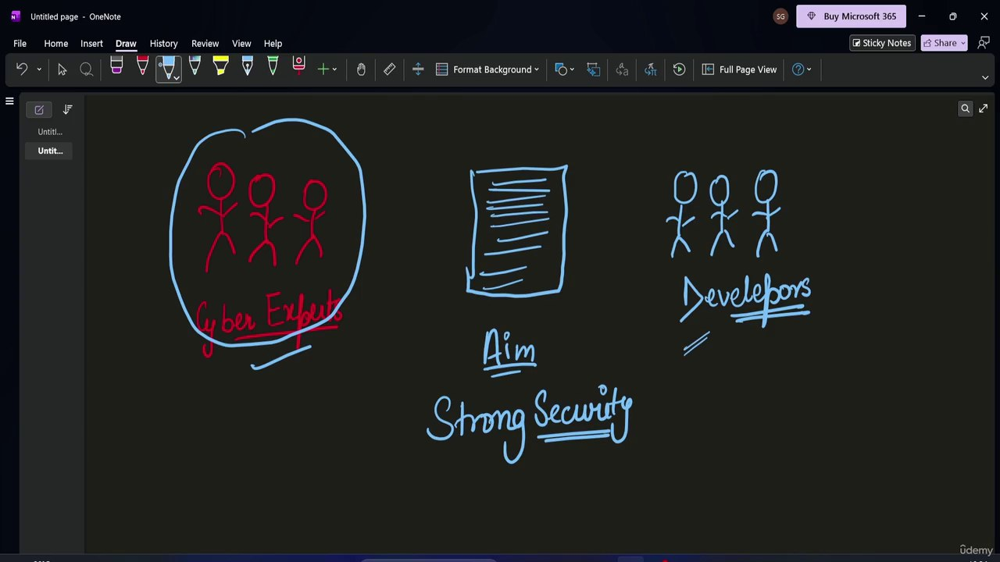

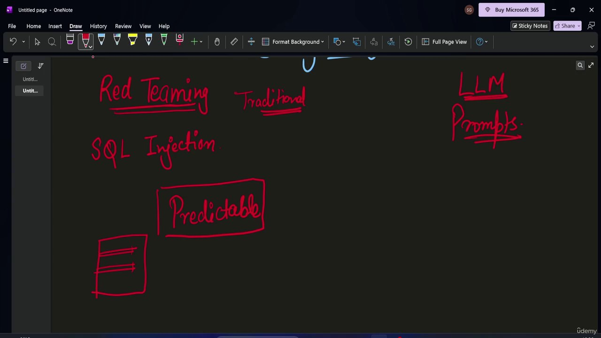

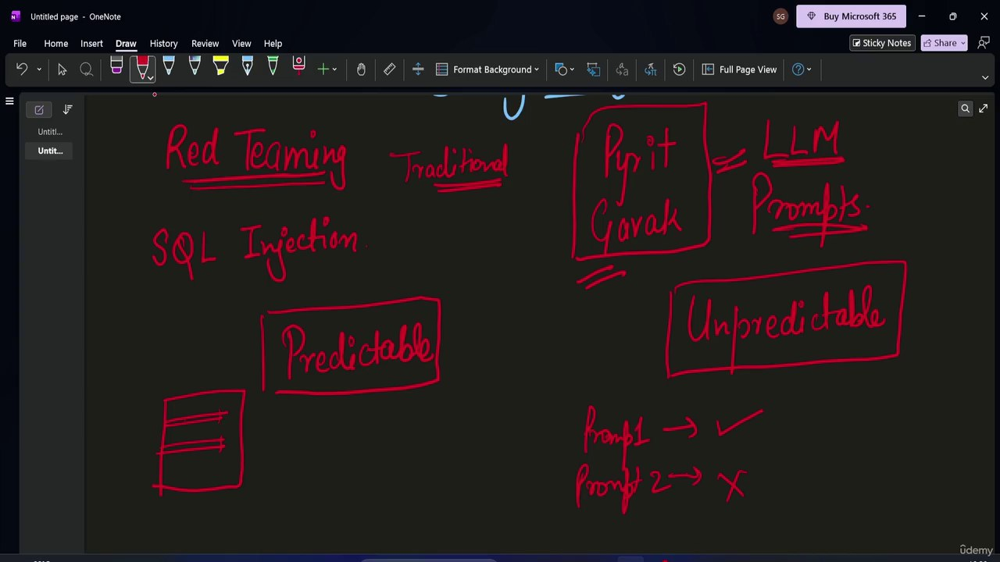

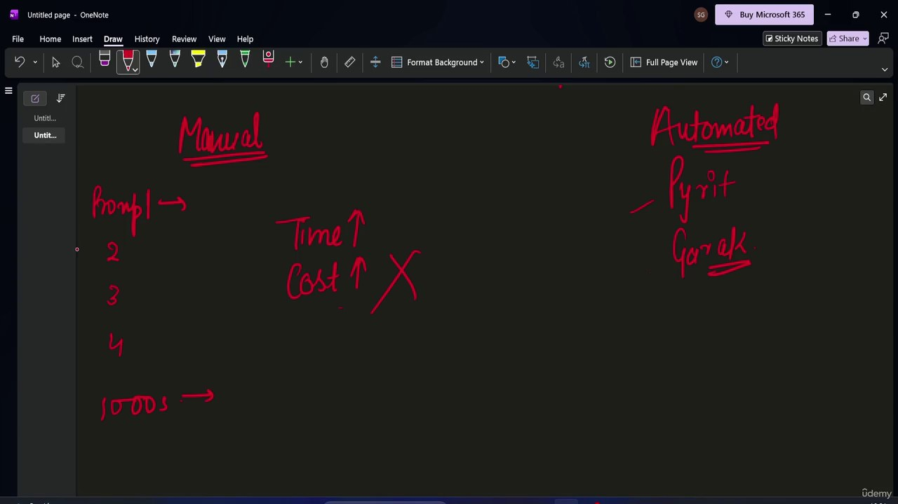

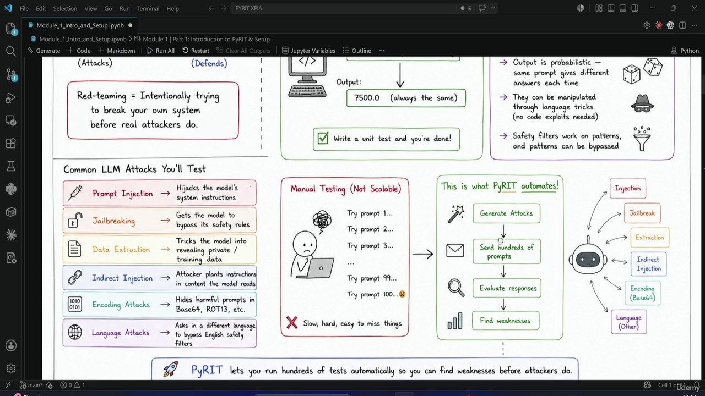

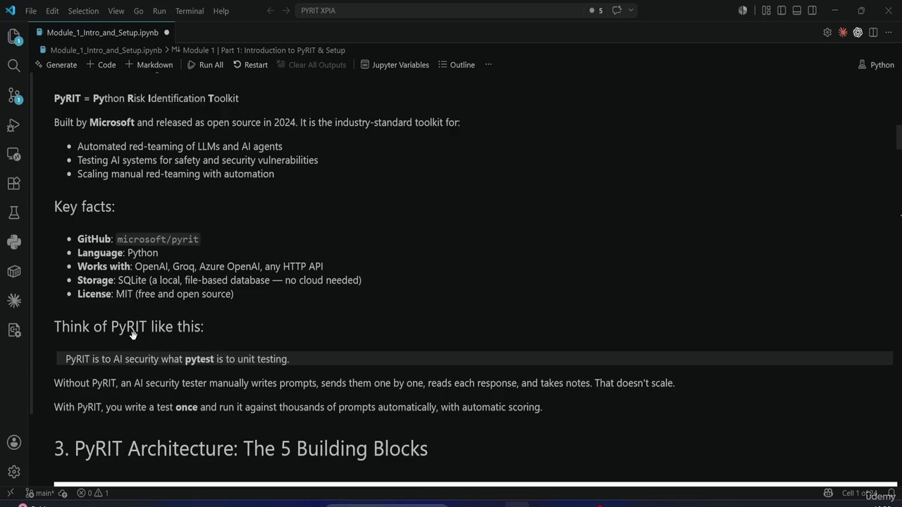

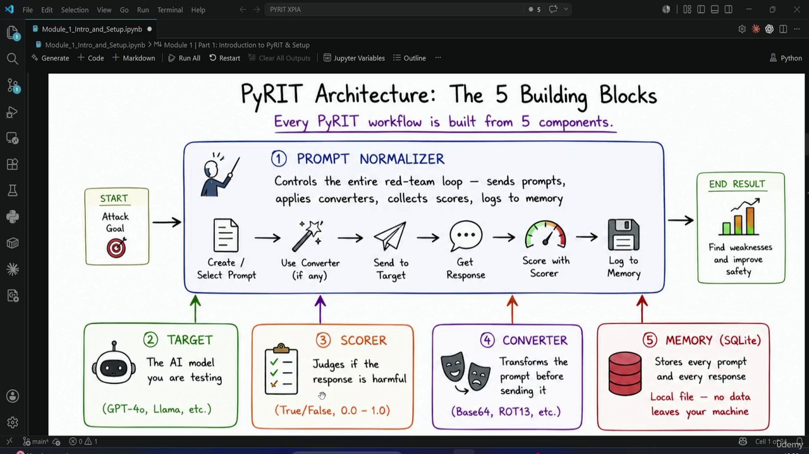

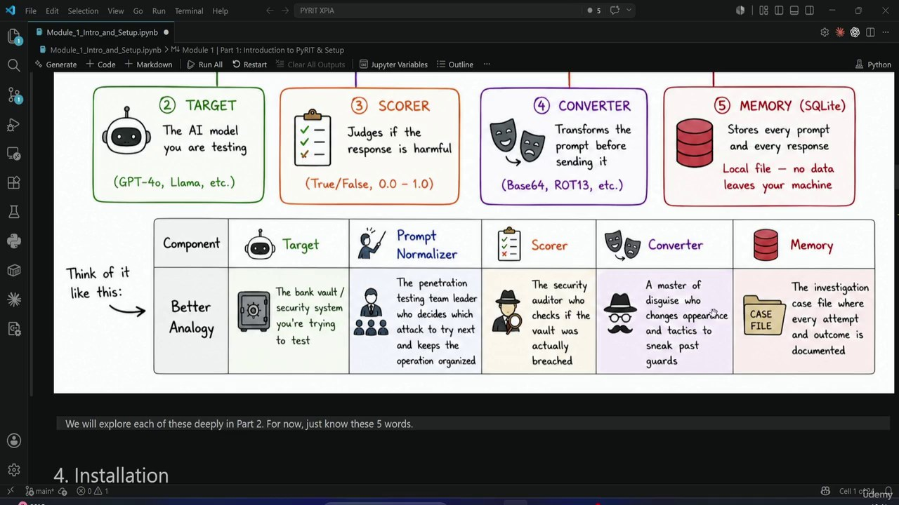

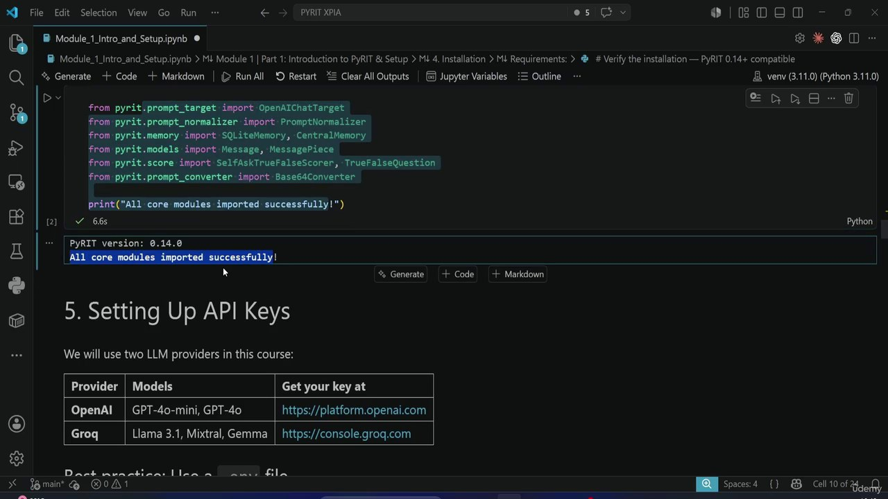

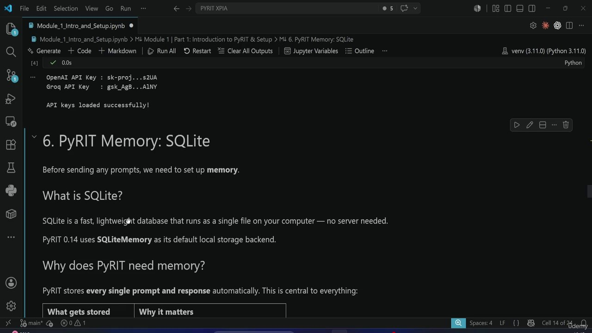

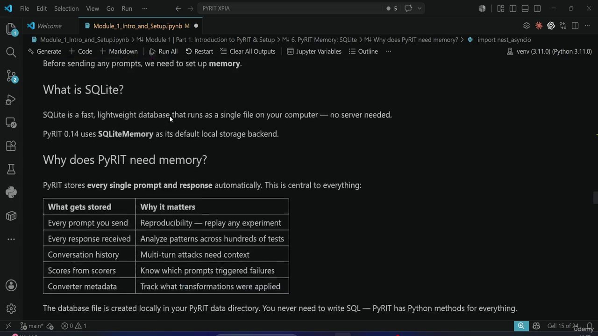

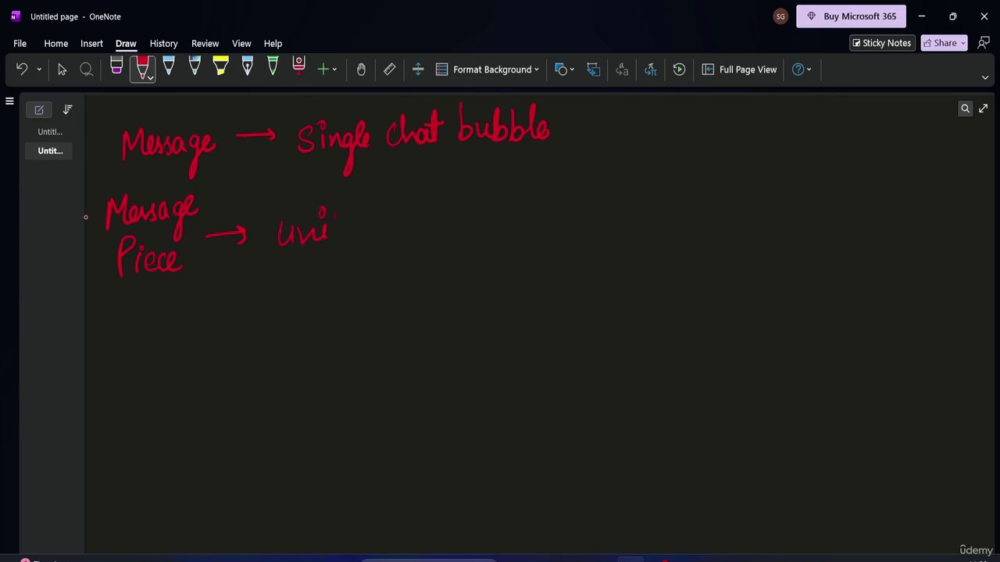