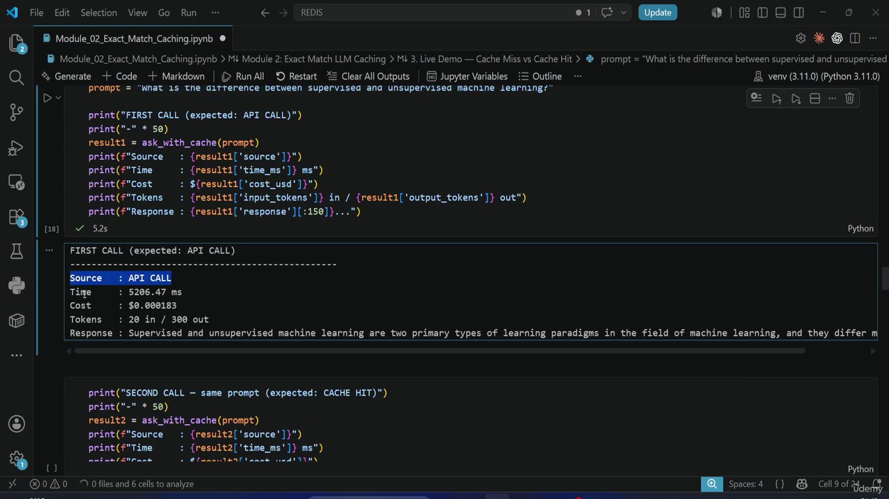
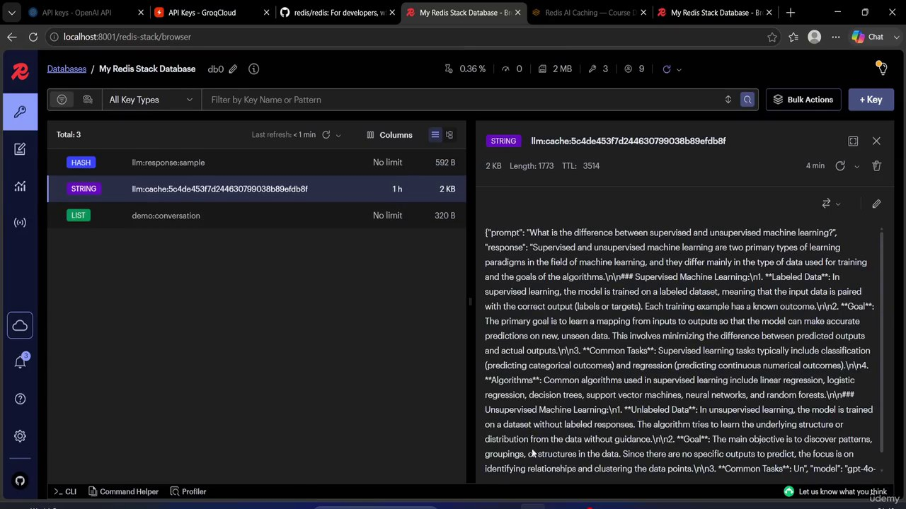
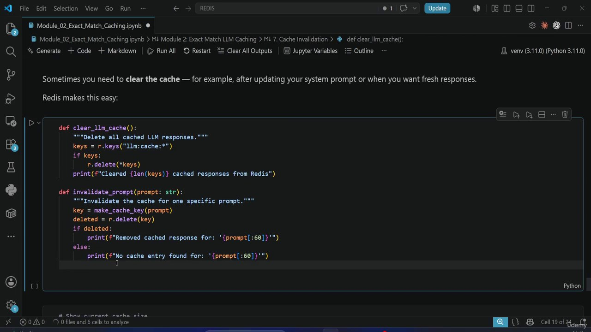
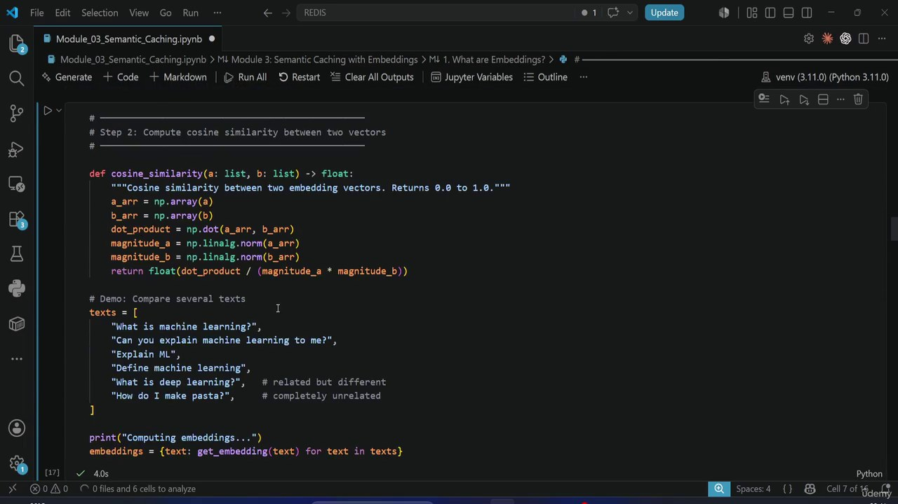
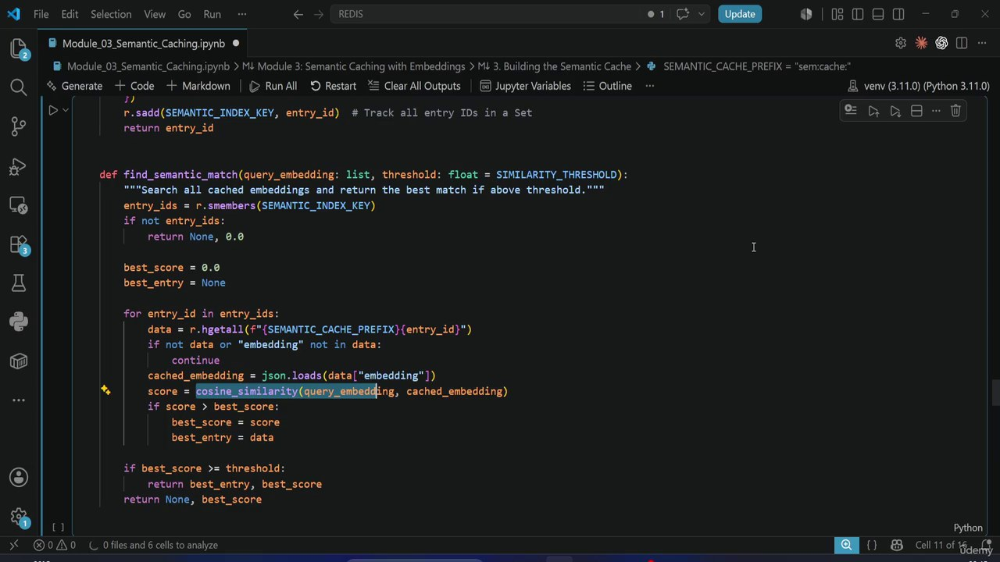
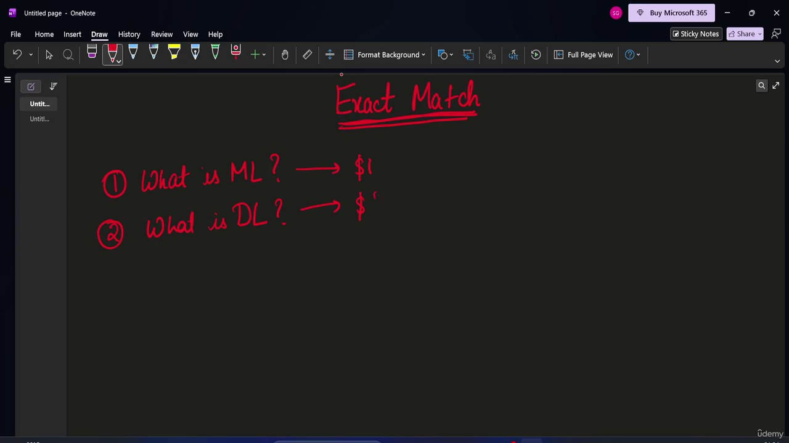
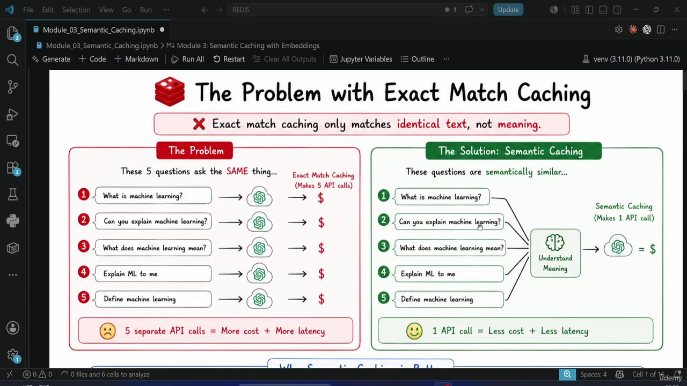
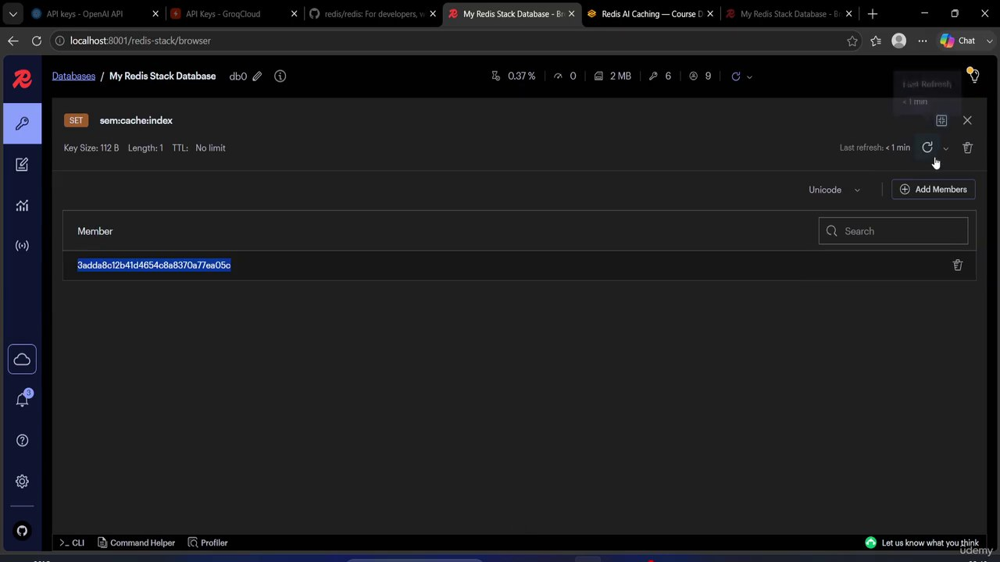

# AI Security Bootcamp Part 1：LLM 缓存（精确匹配 + 语义匹配）复现文档

> 覆盖 P047–P048。这两集是同一主题的上下篇：P047 讲**精确匹配缓存（Exact Match Caching）**，P048 讲**语义匹配缓存（Semantic Caching）**。两集都在同一个 Jupyter Notebook 里跑，用 Redis 做缓存存储，用 OpenAI 做 LLM 调用。本文档把两集合并成一条可复现的工程路径：先搭环境 → 跑精确匹配 → 看它为什么不够 → 再跑语义匹配 → 用 Gradio 界面验证。

---

## 1. 这一节做什么

这两集要解决的问题非常具体：**同一类问题被反复问，每次都要付一次 LLM API 的钱，怎么把重复的钱省下来。**

讲师给的答案分两层：

- **第一层：精确匹配缓存。** 把 prompt 用 MD5 哈希成 key，把 LLM 的响应存进 Redis。下次来一个**逐字相同**的 prompt，直接命中缓存，0 成本、毫秒级返回。问题是：`what is ML` 和 `what is machine learning` 意思一样，但字不一样，哈希不一样，缓存不命中，照样付钱。
- **第二层：语义匹配缓存。** 把 prompt 用 embedding 模型转成 1536 维向量，存进 Redis。新问题来了以后也转成向量，用**余弦相似度（cosine similarity）**跟已存的向量比，相似度超过阈值（讲师设 0.60 / 0.70）就认为「问的是同一件事」，直接返回缓存响应。这样 `what is ML`、`can you explain machine learning`、`define machine learning` 都能命中同一条缓存。

配套的工程细节包括：prompt 归一化（去空格、转小写）、TTL 过期策略（不同内容类型给不同过期时间）、缓存清理（单条失效 vs 全量清空）、以及一个 Gradio 前端用来手动验证。

**读者最终要得到的东西**：一个能跑的 Notebook，里面有两套缓存实现；一个本地 Redis；一个能验证「精确匹配不命中、语义匹配命中」的对照实验。

---

## 2. 讲师原话

关于精确匹配的本质：

> "精确匹配缓存的意思是：你问的问题，必须逐字匹配，缓存才会生效。它不理解语义，不理解句子的含义或情感含义，它只理解逐字的东西。"
> —— p047 [02:22]

关于为什么精确匹配会漏掉同义问题：

> "假设第一个问题是 what is ML，你问 what is machine learning，它不会理解，它不会缓存那个，它会发起 API 调用。这就是所谓的精确匹配。"
> —— p047 [02:51]

关于为什么要哈希 prompt：

> "我们使用内置算法 MD5。每个东西都需要一个 key。假设第一个问题被存下来，它应该有一个 key。你可以直接写成 llm 加 what is ml 这样，但这只在 prompt 很短的时候有用。假设有人问『给我讲个故事』然后后面跟一百个词，你会把整段写进 key 吗？key 会变得太混乱。所以我们用 MD5 把你的 prompt 转成一个哈希。"
> —— p047 [03:20]

关于归一化：

> "这个函数我们在做归一化。我们去空格、转小写，诸如此类。"
> —— p047 [06:10]

关于 TTL 的必要性：

> "为什么我们要让它们过期？首先是为了新鲜度，其次是为了更好的内存管理，因为我跟你说过 Redis 是内存存储，内存存储意味着你的 RAM。RAM 没有太多空间。一般人有 8GB、16GB 内存，从中只分配 2–3GB 给 Redis。所以我们不想让它塞满。"
> —— p047 [12:26]

关于不同内容的 TTL 建议：

> "一般知识类问题，比如我说的总统那个例子，通常保留 24 小时到 7 天。新闻和时事 1 到 6 小时，因为新闻变化非常快。产品信息可以保留 12 到 24 小时，因为价格上下波动挺大。然后 prompt 生成，prompt 可以很多天保持不变，所以可以保留 7 天。对话记忆保留 1 到 4 小时。embedding 保留 30 天。"
> —— p047 [13:51]

关于语义匹配的核心：

> "语义匹配的意思是：相似的问题会用缓存的答案来响应。"
> —— p048 [01:27]

关于 embedding 和余弦相似度：

> "embedding 做什么？假设你在写 what is machine learning，它会把它转成一组数字，我们称之为向量。……然后我们用一种叫余弦相似度的算法，它分析向量，如果这些向量比较相似，就会把它们放得很近。"
> —— p048 [03:23]

关于相似度数值的含义：

> "余弦相似度为 1 意味着完全相同。0.8、0.9、0.7 这些是有点相关。但如果小于 0.5，我们就说它们彼此不相关。……这些数字不是精确的，你可以自己定义。"
> —— p048 [06:13]

关于阈值怎么定：

> "如果你把阈值设成 0.565，那它显然会命中。所以一定要相应地定义阈值。我会说 0.6 是个好位置，0.6、0.7，找一个好位置。不要设得太低，否则不相关的问题也会命中，就起不到作用了。"
> —— p048 [11:59]

关于讲师对「不要死磕代码」的强调（这条对复现者心态很重要）：

> "不要关注代码，不要关注语法，只关注概念。如果你关注代码，在这个 2026 年的时代你永远学不会东西。你有 Claude Code、Codex，稍微投入一点，你会得到更多收益。不要试图手动学语法，理解概念就好，把概念告诉你的 Claude 或 Codex，一切都没问题。"
> —— p047 [07:07]

---

## 3. 从零复现

### 3.1 环境与依赖

讲师在本地跑 Jupyter Notebook + 本地 Redis，用 RedisInsight（讲师口中的 "Redis dashboard"）看数据。复现需要：

```bash
# 1. 建目录
mkdir llm-cache-bootcamp && cd llm-cache-bootcamp

# 2. 建虚拟环境（Python 3.10+）
python -m venv .venv
source .venv/bin/activate        # Windows: .venv\Scripts\activate

# 3. 装依赖
pip install openai redis numpy python-dotenv jupyter gradio
```

版本说明：课里没讲具体版本号，用当前最新稳定版即可。核心 API（`openai` 的 `chat.completions.create`、`redis` 的 `Redis()`、`numpy` 的向量运算）多年稳定。

### 3.2 起一个本地 Redis

课里用的是本地 Redis（讲师提到 Redis 是 in-memory store，分配 2–3GB）。最省事的方式是 Docker：

```bash
docker run -d --name llm-cache-redis -p 6379:6379 redis:7
```

验证：

```bash
docker exec -it llm-cache-redis redis-cli ping
# 期望输出：PONG
```

课里没讲 Redis 的安装方式，只讲了它跑在本地、通过 `redis` 客户端连接。上面这条 Docker 命令是复现所需的最小补充。

### 3.3 环境变量

在项目根目录建 `.env`：

```bash
OPENAI_API_KEY=sk-你的真实key
REDIS_HOST=localhost
REDIS_PORT=6379
REDIS_DB=0
```

讲师在第一个 cell 里做的就是「加载环境变量 + 连接 Redis + 初始化 OpenAI client」。他还提到：如果你不想用 OpenAI，可以回到 module 3 用 Groq 的 client 逻辑替换掉——**课里明确说了 Groq 是可替换项**。

### 3.4 复现步骤总览

1. **Cell 1**：加载 `.env`，连 Redis，初始化 OpenAI client。
2. **Cell 2**：定义 `make_cache_key()`（归一化 + MD5）。
3. **Cell 3**：验证三个同义 prompt 的哈希相同、`deep learning` 的哈希不同。
4. **Cell 4**：定义三个 helper：`get_from_cache` / `save_to_cache` / `ask_with_cache`，以及 token 单价常量。
5. **Cell 5**：跑第一次提问（走 API），再跑同一问题（命中缓存），对比耗时与成本。
6. **Cell 6**：验证归一化——大小写、空格不同的同一问题都命中。
7. **Cell 7**：TTL 演示——给 key 设过期时间，再延长 2 小时，用 `TTL` 命令看剩余秒数。
8. **Cell 8**：批量提问演示——8 个问题里 4 个走 API、4 个命中。
9. **Cell 9**：缓存清理——`clear_llm_cache()` 全清、`invalidate_prompt()` 单条删。
10. **Cell 10（P048）**：语义缓存——`get_embedding()`、`cosine_similarity()`、`store_in_semantic_cache()`、`find_semantic_match()`、`ask_with_semantic_cache()`。
11. **Cell 11**：语义缓存对照实验——先问 `what is machine learning`，再问 6 个变体，看哪几个命中。
12. **Gradio 前端**：课里说完整版在 module 7 做，但 P047/P048 都现场演示了已跑起来的版本，含「精确匹配」和「语义匹配」两个 tab，语义 tab 有阈值滑块（讲师现场把 0.7 调到 0.9 又调回 0.7）。

### 3.5 关键设计决策（复现时必须照做）

- **key 前缀**：精确匹配用 `llm:cache:<md5>`，语义匹配的索引集合用 `sem_cache:index`，每条记录用 `sem_cache:<md5>`。讲师反复强调「key 名字是 Redis 里最重要的东西」——清理函数只删 `llm:cache:*`，不会碰 `demo:conversation:*` 这类别的 key。
- **归一化必须在哈希之前**：先 `strip()` + `lower()` + 合并连续空格，再算 MD5。否则 `What is ML` 和 `what is ml` 哈希不同。
- **语义缓存存三样东西**：原始 prompt、响应、embedding 向量。缺一不可——没有向量就没法算相似度。
- **阈值默认 0.60**：讲师先设 0.7，后来说「我把它降到 0.60」，最终演示用 0.7。文档里两个都写，代码默认 0.60，注释说明可调。

---

## 4. 完整代码

> 说明：课里没有 OCR 结果，以下代码是依据逐字稿描述的函数职责、参数、流程**完整重写**的可运行版本。逐字稿提到的每个函数名、每个常量、每个 Redis key 命名都保留。逐字稿没念出来的具体实现细节（如 `numpy` 的具体调用）按标准写法补全，并在第 5 节逐行解释。

### 4.1 `cell_01_setup.py`（对应 Cell 1）

```python
# cell_01_setup.py
import os
import hashlib
import json
import time
import numpy as np
import redis
from dotenv import load_dotenv
from openai import OpenAI

load_dotenv()

# --- Redis 连接 ---
r = redis.Redis(
    host=os.getenv("REDIS_HOST", "localhost"),
    port=int(os.getenv("REDIS_PORT", 6379)),
    db=int(os.getenv("REDIS_DB", 0)),
    decode_responses=True,
)

# --- OpenAI 客户端 ---
client = OpenAI(api_key=os.getenv("OPENAI_API_KEY"))

# --- 模型与单价（讲师在 Cell 4 里定义，这里提前放，方便复用）---
CHAT_MODEL = "gpt-4o-mini"
EMBED_MODEL = "text-embedding-3-small"

# 讲师原话：定义输入 token 和输出 token 的单价
COST_INPUT_PER_TOKEN = 0.00000015   # 美元 / 输入 token
COST_OUTPUT_PER_TOKEN = 0.0000006   # 美元 / 输出 token

print("Redis connected:", r.ping())
print("OpenAI key loaded:", bool(os.getenv("OPENAI_API_KEY")))
```

### 4.2 `cell_02_make_cache_key.py`（对应 Cell 2）

```python
# cell_02_make_cache_key.py
def make_cache_key(prompt: str) -> str:
    """
    归一化 prompt 后计算 MD5，返回 Redis key。
    归一化：去首尾空格 -> 转小写 -> 合并连续空格。
    """
    normalized = " ".join(prompt.strip().lower().split())
    digest = hashlib.md5(normalized.encode("utf-8")).hexdigest()
    return f"llm:cache:{digest}"
```

### 4.3 `cell_03_hash_demo.py`（对应 Cell 3）

```python
# cell_03_hash_demo.py
test_prompts = [
    "What is machine learning?",
    "what is machine learning?",
    "  WHAT IS MACHINE LEARNING?  ",
    "What is deep learning?",
]

for p in test_prompts:
    print(repr(p), "->", make_cache_key(p))
```

预期：前三个输出同一个 32 位十六进制串（讲师现场看到的是 `0c95d...` 开头），第四个不同。

### 4.4 `cell_04_cache_helpers.py`（对应 Cell 4）

```python
# cell_04_cache_helpers.py
def get_from_cache(prompt: str):
    """从 Redis 取缓存响应；没有则返回 None。"""
    key = make_cache_key(prompt)
    raw = r.get(key)
    if raw is None:
        return None
    return json.loads(raw)


def save_to_cache(prompt: str, response_text: str, model: str,
                  input_tokens: int, output_tokens: int, ttl_seconds: int = 3600):
    """把响应写进 Redis，带 TTL。"""
    key = make_cache_key(prompt)
    payload = {
        "prompt": prompt,
        "response": response_text,
        "model": model,
        "input_tokens": input_tokens,
        "output_tokens": output_tokens,
        "cached_at": time.time(),
    }
    r.set(key, json.dumps(payload), ex=ttl_seconds)
    return key


def ask_with_cache(prompt: str, ttl_seconds: int = 3600):
    """
    先查缓存；命中直接返回（source=cache），未命中调 OpenAI 并写缓存（source=api）。
    返回 dict：response / source / latency_ms / cost_usd / input_tokens / output_tokens
    """
    start = time.perf_counter()

    cached = get_from_cache(prompt)
    if cached is not None:
        latency_ms = (time.perf_counter() - start) * 1000
        return {
            "response": cached["response"],
            "source": "cache",
            "latency_ms": round(latency_ms, 2),
            "cost_usd": 0.0,
            "input_tokens": cached["input_tokens"],
            "output_tokens": cached["output_tokens"],
        }

    completion = client.chat.completions.create(
        model=CHAT_MODEL,
        messages=[{"role": "user", "content": prompt}],
    )
    text = completion.choices[0].message.content
    usage = completion.usage
    cost = (usage.prompt_tokens * COST_INPUT_PER_TOKEN
            + usage.completion_tokens * COST_OUTPUT_PER_TOKEN)

    save_to_cache(prompt, text, CHAT_MODEL,
                  usage.prompt_tokens, usage.completion_tokens, ttl_seconds)

    latency_ms = (time.perf_counter() - start) * 1000
    return {
        "response": text,
        "source": "api",
        "latency_ms": round(latency_ms, 2),
        "cost_usd": round(cost, 8),
        "input_tokens": usage.prompt_tokens,
        "output_tokens": usage.completion_tokens,
    }
```

### 4.5 `cell_05_first_call.py`（对应 Cell 5）

```python
# cell_05_first_call.py
q = "What is the difference between supervised and unsupervised machine learning?"

first = ask_with_cache(q)
print("=== 第一次（应走 API）===")
print("source:", first["source"])
print("latency_ms:", first["latency_ms"])
print("cost_usd:", first["cost_usd"])
print("input_tokens:", first["input_tokens"], "output_tokens:", first["output_tokens"])
print("response:", first["response"][:200])

second = ask_with_cache(q)
print("\n=== 第二次（应命中缓存）===")
print("source:", second["source"])
print("latency_ms:", second["latency_ms"])
print("cost_usd:", second["cost_usd"])
```

讲师现场数据：第一次约 5206ms、有成本、输入 20 token、输出 300 token；第二次约 1.01ms、0 成本。你的数字会不同，但量级关系应一致（缓存命中快 3 个数量级以上）。



### 4.6 `cell_06_normalization_demo.py`（对应 Cell 6）

```python
# cell_06_normalization_demo.py
variants = [
    "What is the difference between supervised and unsupervised machine learning?",
    "what is the difference between supervised and unsupervised machine learning?",
    "  WHAT IS THE DIFFERENCE BETWEEN SUPERVISED AND UNSUPERVISED MACHINE LEARNING?  ",
]
for v in variants:
    res = ask_with_cache(v)
    print(res["source"], "|", res["latency_ms"], "ms |", repr(v[:40]))
```

预期：三条全部 `cache`。

### 4.7 `cell_07_ttl_demo.py`（对应 Cell 7）

```python
# cell_07_ttl_demo.py
sample_prompt = "sample prompt for ttl demo"
key = make_cache_key(sample_prompt)

# 写入并设 1 小时 TTL
save_to_cache(sample_prompt, "ttl demo response", CHAT_MODEL, 10, 20, ttl_seconds=3600)
print("TTL after set (s):", r.ttl(key))

# 延长 2 小时
r.expire(key, 3600 + 7200)
print("TTL after extend (s):", r.ttl(key))
```

讲师现场看到的是 `7139` 秒左右（约 1 小时 59 分），因为他在 1 小时基础上又加了 2 小时。`r.ttl()` 返回剩余秒数，`-1` 表示无过期，`-2` 表示 key 不存在。



### 4.8 `cell_08_batch_demo.py`（对应 Cell 8）

```python
# cell_08_batch_demo.py
batch_questions = [
    "What is a neural network?",
    "What is gradient descent?",
    "What is a neural network?",          # 重复
    "What is gradient descent?",          # 重复
    "What is a neural network?",          # 重复
    "What is backpropagation?",
    "What is gradient descent?",          # 重复
    "What is a neural network?",          # 重复
]

api_calls = 0
cache_hits = 0
for q in batch_questions:
    res = ask_with_cache(q)
    if res["source"] == "api":
        api_calls += 1
    else:
        cache_hits += 1
    print(f"{res['source']:5s} | {res['latency_ms']:8.2f} ms | {q}")

print(f"\nAPI calls: {api_calls}, cache hits: {cache_hits}")
```

讲师现场结论：8 个问题里 4 次 API 调用、4 次缓存命中。

### 4.9 `cell_09_clear_cache.py`（对应 Cell 9）

```python
# cell_09_clear_cache.py
def clear_llm_cache():
    """删除所有 llm:cache:* 的 key，返回删除数量。"""
    keys = r.keys("llm:cache:*")
    if not keys:
        return 0
    return r.delete(*keys)


def invalidate_prompt(prompt: str):
    """删除单条 prompt 对应的缓存。"""
    key = make_cache_key(prompt)
    return r.delete(key)


# 演示
print("cache size before:", len(r.keys("llm:cache:*")))
print("invalidate one:", invalidate_prompt("What is a neural network?"))
print("cache size after invalidate:", len(r.keys("llm:cache:*")))
print("clear all:", clear_llm_cache())
print("cache size after clear:", len(r.keys("llm:cache:*")))
```

讲师强调：`clear_llm_cache()` 只删 `llm:cache:*`，不会碰 `demo:conversation:*` 之类的其他 key。他在 dashboard 里看到「还有 7 个 key 没被删」，就是因为那些 key 前缀不同。



### 4.10 `cell_10_semantic_cache.py`（对应 P048 Cell 1–4）

```python
# cell_10_semantic_cache.py
SEM_CACHE_INDEX = "sem_cache:index"     # Redis Set，存所有 sem_cache:<md5> 的 key
SEM_CACHE_PREFIX = "sem_cache:"
SIMILARITY_THRESHOLD = 0.60             # 讲师：0.6 是好位置，0.7 也行


def get_embedding(text: str):
    """调用 text-embedding-3-small，返回 1536 维向量（list[float]）。"""
    resp = client.embeddings.create(model=EMBED_MODEL, input=text)
    return resp.data[0].embedding


def cosine_similarity(vec_a, vec_b) -> float:
    """余弦相似度：点积 / (模长乘积)。范围 [-1, 1]，越接近 1 越相似。"""
    a = np.array(vec_a, dtype=np.float64)
    b = np.array(vec_b, dtype=np.float64)
    denom = np.linalg.norm(a) * np.linalg.norm(b)
    if denom == 0:
        return 0.0
    return float(np.dot(a, b) / denom)


def store_in_semantic_cache(prompt: str, response_text: str, embedding,
                            model: str, input_tokens: int, output_tokens: int,
                            ttl_seconds: int = 86400):
    """存原始 prompt + 响应 + embedding，并把 key 加进索引 Set。"""
    digest = hashlib.md5(prompt.strip().lower().encode("utf-8")).hexdigest()
    key = f"{SEM_CACHE_PREFIX}{digest}"
    payload = {
        "prompt": prompt,
        "response": response_text,
        "embedding": embedding,
        "model": model,
        "input_tokens": input_tokens,
        "output_tokens": output_tokens,
        "cached_at": time.time(),
    }
    r.set(key, json.dumps(payload), ex=ttl_seconds)
    r.sadd(SEM_CACHE_INDEX, key)
    return key


def find_semantic_match(prompt: str, threshold: float = SIMILARITY_THRESHOLD):
    """
    遍历索引里所有缓存，算余弦相似度，返回 (最佳 key, 最佳分数, payload) 或 None。
    """
    query_vec = get_embedding(prompt)
    best_key, best_score, best_payload = None, -1.0, None

    for key in r.smembers(SEM_CACHE_INDEX):
        raw = r.get(key)
        if raw is None:
            r.srem(SEM_CACHE_INDEX, key)   # 索引里有但数据已过期，顺手清理
            continue
        payload = json.loads(raw)
        score = cosine_similarity(query_vec, payload["embedding"])
        if score > best_score:
            best_key, best_score, best_payload = key, score, payload

    if best_score >= threshold:
        return best_key, best_score, best_payload
    return None


def ask_with_semantic_cache(prompt: str, threshold: float = SIMILARITY_THRESHOLD,
                            ttl_seconds: int = 86400):
    """语义缓存版 ask：先找语义匹配，命中返回缓存，否则调 API 并存。"""
    start = time.perf_counter()

    match = find_semantic_match(prompt, threshold)
    if match is not None:
        key, score, payload = match
        latency_ms = (time.perf_counter() - start) * 1000
        return {
            "response": payload["response"],
            "source": "semantic_cache",
            "similarity": round(score, 4),
            "matched_key": key,
            "latency_ms": round(latency_ms, 2),
            "cost_usd": 0.0,
        }

    completion = client.chat.completions.create(
        model=CHAT_MODEL,
        messages=[{"role": "user", "content": prompt}],
    )
    text = completion.choices[0].message.content
    usage = completion.usage
    cost = (usage.prompt_tokens * COST_INPUT_PER_TOKEN
            + usage.completion_tokens * COST_OUTPUT_PER_TOKEN)

    embedding = get_embedding(prompt)
    store_in_semantic_cache(prompt, text, embedding, CHAT_MODEL,
                            usage.prompt_tokens, usage.completion_tokens, ttl_seconds)

    latency_ms = (time.perf_counter() - start) * 1000
    return {
        "response": text,
        "source": "api",
        "similarity": None,
        "matched_key": None,
        "latency_ms": round(latency_ms, 2),
        "cost_usd": round(cost, 8),
    }
```

### 4.11 `cell_11_semantic_demo.py`（对应 P048 Cell 5）

```python
# cell_11_semantic_demo.py
# 先清空语义缓存（讲师现场也先清了）
for k in r.smembers(SEM_CACHE_INDEX):
    r.delete(k)
r.delete(SEM_CACHE_INDEX)

first = ask_with_semantic_cache("What is machine learning?")
print("=== 第一个问题（应走 API）===")
print(first["source"], "|", first["latency_ms"], "ms |", first["cost_usd"])

variants = [
    "Can you explain machine learning?",
    "What does machine learning mean?",
    "Define machine learning",
    "What is deep learning?",
    "How do I bake chocolate?",
    "How do I make pasta?",
]

for v in variants:
    res = ask_with_semantic_cache(v)
    print(f"{res['source']:15s} | sim={res['similarity']} | {res['latency_ms']:8.2f} ms | {v}")
```

讲师现场结果：前三个变体命中语义缓存，`deep learning`、`bake chocolate`、`make pasta` 走 API。他还提到 `explain ml` 的相似度只有 0.5 左右，因为「ML 可以代表很多东西，不只 machine learning」，所以 embedding 模型会困惑。



### 4.12 `app.py`（Gradio 前端，对应讲师现场演示的版本）

```python
# app.py
import gradio as gr
from cell_01_setup import r, client
from cell_04_cache_helpers import ask_with_cache, clear_llm_cache
from cell_10_semantic_cache import ask_with_semantic_cache, SEM_CACHE_INDEX


def exact_tab(prompt):
    if not prompt.strip():
        return "请输入问题", ""
    res = ask_with_cache(prompt)
    info = (f"source={res['source']} | latency={res['latency_ms']}ms | "
            f"cost=${res['cost_usd']} | in={res['input_tokens']} out={res['output_tokens']}")
    return res["response"], info


def semantic_tab(prompt, threshold):
    if not prompt.strip():
        return "请输入问题", ""
    res = ask_with_semantic_cache(prompt, threshold=float(threshold))
    info = (f"source={res['source']} | similarity={res['similarity']} | "
            f"latency={res['latency_ms']}ms | cost=${res['cost_usd']}")
    return res["response"], info


def clear_all():
    n1 = clear_llm_cache()
    keys = r.smembers(SEM_CACHE_INDEX)
    n2 = r.delete(*keys) if keys else 0
    r.delete(SEM_CACHE_INDEX)
    return f"已清空精确缓存 {n1} 条、语义缓存 {n2} 条"


with gr.Blocks(title="LLM Cache Demo") as demo:
    gr.Markdown("# LLM 缓存演示：精确匹配 vs 语义匹配")

    with gr.Tab("精确匹配"):
        p1 = gr.Textbox(label="Prompt", lines=2)
        b1 = gr.Button("提问")
        o1 = gr.Textbox(label="响应", lines=8)
        i1 = gr.Textbox(label="缓存信息")
        b1.click(exact_tab, inputs=p1, outputs=[o1, i1])

    with gr.Tab("语义匹配"):
        p2 = gr.Textbox(label="Prompt", lines=2)
        t2 = gr.Slider(0.5, 0.95, value=0.70, step=0.01, label="相似度阈值")
        b2 = gr.Button("提问")
        o2 = gr.Textbox(label="响应", lines=8)
        i2 = gr.Textbox(label="缓存信息")
        b2.click(semantic_tab, inputs=[p2, t2], outputs=[o2, i2])

    with gr.Tab("清理"):
        b3 = gr.Button("清空所有缓存")
        o3 = gr.Textbox(label="结果")
        b3.click(clear_all, outputs=o3)

demo.launch()
```

启动：

```bash
python app.py
# 浏览器打开 http://127.0.0.1:7860
```

讲师说完整 Gradio app 在 module 7 做，但 P047/P048 都现场演示了已跑起来的版本，语义 tab 的阈值滑块默认 0.7，他现场调到 0.9 又调回 0.7。



---

## 5. 逐行解释

### 5.1 为什么归一化必须在哈希之前

`make_cache_key` 里 `" ".join(prompt.strip().lower().split())` 做了三件事：去首尾空白、转小写、把任意连续空白压成一个空格。讲师在 Cell 6 专门演示：`What is...`、`what is...`、`  WHAT IS...  ` 三条必须命中同一条缓存。如果先哈希再归一化，哈希值已经固定，归一化就白做了。**顺序不能反。**

在 JS/Node 里对应：`prompt.trim().toLowerCase().replace(/\s+/g, ' ')`，然后 `crypto.createHash('md5').update(s).digest('hex')`。

### 5.2 为什么用 MD5 而不是直接拼 prompt 当 key

讲师原话：短 prompt 直接拼还行，但「给我讲个故事 + 一百个词」这种，key 会变得极其混乱。MD5 把任意长度压成固定 32 位十六进制串，长度可控、无重复风险（讲师说「没有重复的机会」）。注意 MD5 在密码学上已不安全，但这里只是做**缓存 key 的去重**，不涉及安全，够用。课里没讲这个安全边界，复现时知道即可。

### 5.3 `ask_with_cache` 的流程

1. `time.perf_counter()` 开始计时——用 `perf_counter` 而不是 `time.time()`，因为前者精度更高，适合测毫秒级差异。
2. `get_from_cache` 查 Redis。命中就构造返回 dict，`cost_usd=0.0`，`source="cache"`。
3. 未命中调 `client.chat.completions.create`。讲师用的是 OpenAI 的 chat 接口，`messages` 只放一条 user 消息。
4. 从 `completion.usage` 拿 `prompt_tokens` / `completion_tokens`，乘单价算成本。
5. `save_to_cache` 写回 Redis，带 TTL。
6. 返回 dict 里带 `source` 字段——这是整个演示的**核心可观测点**，讲师每次都用它判断「这次是 API 还是缓存」。

### 5.4 TTL 的数值怎么来的

讲师给了一张按内容类型分档的表（原话见第 2 节）：

| 内容类型 | 建议 TTL |
|---|---|
| 一般知识（如「美国总统是谁」） | 24 小时 – 7 天 |
| 新闻 / 时事 | 1 – 6 小时 |
| 产品信息（价格等） | 12 – 24 小时 |
| Prompt 生成 | 7 天 |
| 对话记忆 | 1 – 4 小时 |
| Embedding | 30 天（也可永久） |

代码里 `save_to_cache` 默认 `ttl_seconds=3600`（1 小时），语义缓存默认 `86400`（1 天）。复现时按上表调整。讲师强调 TTL 的三个理由：**新鲜度、内存管理、成本控制**。内存管理那条他讲得最细：Redis 是 in-memory，一般只分 2–3GB，不能塞满。

### 5.5 `clear_llm_cache` 为什么只删 `llm:cache:*`

讲师在 dashboard 里演示：清完 `llm:cache:*` 后，还有 7 个 key 没删。他解释那些是 `demo:conversation:*`、`demo:llm_response:*` 之类的其他前缀。**key 命名空间是 Redis 里最重要的东西**——清理函数如果写成 `r.keys("*")` 再全删，会把别的业务数据一起干掉。这是生产环境常见事故，讲师专门强调。

### 5.6 余弦相似度为什么用点积除以模长乘积

`cosine_similarity` 里 `np.dot(a, b) / (np.linalg.norm(a) * np.linalg.norm(b))`。余弦相似度衡量的是**两个向量的夹角**，不是距离。夹角越小（越接近 0 度），cos 越接近 1，越相似。除以模长乘积是为了归一化——不同长度的向量也能公平比较。讲师提到还有欧氏距离等算法，但余弦相似度「最常用，且仍在生产中使用，没有过时」。

在 JS/Node 里对应：手写 `dot / (normA * normB)`，或者用 `ml-distance` 这类库的 `cosine` 函数。

### 5.7 阈值 0.60 / 0.70 怎么选

讲师现场数据（P048 Cell 5）：

| 对比 | 相似度 |
|---|---|
| `what is machine learning` vs `can you explain machine learning` | 0.8 |
| `what is machine learning` vs `explain ml` | 0.5（讲师困惑，认为偏低） |
| `what is machine learning` vs `define machine learning` | 0.874 |
| `what is machine learning` vs `what is deep learning` | 0.59 |
| `what is machine learning` vs `how do I make pasta` | 0.11 |

讲师结论：阈值设 0.565 会命中 `deep learning`（不该命中），设 0.6–0.7 是好位置。太低会把不相关的问题也命中，太高会漏掉同义问题。代码默认 0.60，Gradio 滑块默认 0.70，两个都保留。

`explain ml` 只有 0.5 的原因，讲师解释：ML 可以代表很多东西（不只 machine learning），embedding 模型会困惑。这是 embedding 模型的固有局限，不是代码 bug。

### 5.8 语义缓存的存储结构

`store_in_semantic_cache` 存三样：原始 prompt、响应、embedding 向量。为什么三样都要？没有 prompt 就没法在 dashboard 里看懂这条缓存是什么；没有响应就没东西可返回；没有向量就没法算相似度。讲师在 dashboard 里点开一条 `sem_cache:<md5>`，能看到这三个字段。

索引用 Redis Set（`sem_cache:index`），存所有 `sem_cache:<md5>` 的 key。`find_semantic_match` 遍历这个 Set，逐条算相似度。讲师在 dashboard 里看到 Set 里有 3 个成员（`3adda`、`f1abf` 等），就是三条语义缓存。

**性能提醒**：遍历 Set 是 O(n)，缓存条数多了会慢。生产环境应该用 Redis 的向量检索（RediSearch / Redis Stack 的 vector similarity），课里没讲这个优化，复现时知道即可。

### 5.9 `find_semantic_match` 里的顺手清理

```python
if raw is None:
    r.srem(SEM_CACHE_INDEX, key)
    continue
```

索引 Set 里的 key 可能因为 TTL 过期而数据没了，但 Set 成员还在。遍历时发现 `r.get(key)` 返回 None，就顺手从 Set 里删掉。这是讲师没讲但复现时必然会撞上的问题——不清理的话，Set 会越积越大，每次遍历都白跑。

### 5.10 Gradio 前端的两个 tab

精确 tab 直接调 `ask_with_cache`，语义 tab 调 `ask_with_semantic_cache` 并把滑块值当 `threshold` 传进去。讲师现场演示时，语义 tab 先问 `what is Redis`（走 API），再问 `explain redis`（命中语义缓存）——这就是精确匹配做不到、语义匹配能做到的对照。

---

## 6. 复现检查清单

按顺序打勾，任何一项不过就别往下走：

- [ ] `docker exec -it llm-cache-redis redis-cli ping` 返回 `PONG`
- [ ] `.env` 里 `OPENAI_API_KEY` 已填，`cell_01_setup.py` 打印 `OpenAI key loaded: True`
- [ ] `cell_03_hash_demo.py` 前三条 prompt 输出**同一个** MD5，第四条不同
- [ ] `cell_05_first_call.py` 第一次 `source=api` 且有 `cost_usd > 0`，第二次 `source=cache` 且 `cost_usd=0.0`
- [ ] 第二次耗时比第一次低至少 100 倍（讲师现场 5206ms vs 1.01ms）
- [ ] `cell_06_normalization_demo.py` 三条变体全部 `cache`
- [ ] `cell_07_ttl_demo.py` 第一次 `r.ttl()` 约 3600，延长后约 10800
- [ ] `cell_08_batch_demo.py` 输出 `API calls: 4, cache hits: 4`
- [ ] `cell_09_clear_cache.py` 清完后 `r.keys("llm:cache:*")` 为空，但 `demo:*` 等其他前缀的 key 还在
- [ ] `cell_11_semantic_demo.py` 前三个变体 `semantic_cache`，`deep learning` / `bake chocolate` / `make pasta` 走 `api`
- [ ] `python app.py` 能起 Gradio，两个 tab 都能提问，语义 tab 滑块能调
- [ ] 在 RedisInsight / `redis-cli` 里能看到 `sem_cache:index` 这个 Set，成员是 `sem_cache:<md5>` 形式的 key

---

## 7. 课里没讲但你会撞上的

**1. `text-embedding-3-small` 的维度是 1536，不是 1535。**
讲师口误说了「1 5 3 5 3 1 5 3 6」，实际是 1536。`len(get_embedding("x"))` 应该是 1536。如果你看到别的数字，检查模型名。

**2. OpenAI 的 embedding 接口和 chat 接口是分开计费的。**
`ask_with_semantic_cache` 里，即使缓存命中，`find_semantic_match` 也调了一次 `get_embedding`——这次调用**要花钱**。所以语义缓存的「0 成本」是相对的：省了 chat 的钱，但 embedding 的钱照付。讲师没提这点，但这是语义缓存成本模型的关键。embedding 单价远低于 chat，所以整体还是省。

**3. Redis 的 `keys` 命令在生产环境是禁忌。**
`clear_llm_cache` 用 `r.keys("llm:cache:*")`，在 key 数量大时会阻塞 Redis。生产环境应该用 `SCAN` 迭代。课里演示环境 key 少，`keys` 够用。

**4. 语义缓存的 Set 遍历是 O(n)，不是向量检索。**
`find_semantic_match` 每次都要遍历所有缓存算相似度。缓存 1000 条时，每次提问要算 1000 次余弦相似度（每次 1536 维），会明显变慢。生产环境用 Redis Stack 的 vector similarity（`FT.SEARCH` + `KNN`），课里没讲。

**5. `decode_responses=True` 的影响。**
`redis.Redis(decode_responses=True)` 让 `r.get()` 返回 `str` 而不是 `bytes`。如果忘了这个参数，`json.loads(raw)` 会报 `TypeError`。讲师代码里没显式写这个参数（逐字稿没念），但复现时必须加。

**6. Gradio 的 `demo.launch()` 默认只监听 127.0.0.1。**
要在容器或远程机器上访问，需要 `demo.launch(server_name="0.0.0.0")`。课里没讲部署，本地跑不用管。

**7. 讲师说的「module 3 用 Groq」是另一条路径。**
如果你没有 OpenAI key，可以把 `client` 换成 Groq 的 client（`from groq import Groq`），模型换成 `llama-3.x`，embedding 换成 Groq 支持的模型或本地 `sentence-transformers`。课里明确说 Groq 是可替换项，但没给完整替换代码。

**8. 精确匹配的 MD5 碰撞概率。**
MD5 有已知碰撞攻击，但缓存 key 场景下碰撞概率极低（除非有人恶意构造）。课里没讲这个安全边界，复现时知道即可。真要严谨，用 SHA-256。

**9. 语义缓存的「误命中」风险。**
阈值 0.60 时，`what is deep learning` 的相似度是 0.59，刚好不命中；但如果某个问题相似度 0.61 但语义不同，就会误命中，返回错误答案。这是语义缓存的固有 trade-off，讲师用「阈值别设太低」一句话带过，生产环境需要按业务调。

**10. 讲师的「不要死磕代码」是给学习者的建议，不是给复现者的。**
讲师原话是让你理解概念后用 Claude Code / Codex 生成代码。但本文档的目标是「照着复现」，所以第 4 节给了完整可运行代码。两者不矛盾：先跑通，再理解，最后用 AI 工具改。

---

## 附：两集的核心对照表

| 维度 | 精确匹配（P047） | 语义匹配（P048） |
|---|---|---|
| key 生成 | 归一化 + MD5 | 归一化 + MD5（存数据用）+ embedding（算相似度用） |
| 命中条件 | 逐字相同 | 余弦相似度 ≥ 阈值 |
| `what is ML` vs `what is machine learning` | 不命中 | 命中 |
| 每次提问的额外成本 | 0（只查 Redis） | 一次 embedding 调用 |
| 存储内容 | prompt + 响应 + token 数 | prompt + 响应 + embedding + token 数 |
| Redis 结构 | 单个 String key | String key + Set 索引 |
| 默认 TTL | 1 小时 | 1 天 |
| 清理方式 | `clear_llm_cache` / `invalidate_prompt` | 遍历 Set 逐个删 |
| 讲师现场耗时对比 | 5206ms → 1.01ms | API 调用 → 语义命中（毫秒级） |
| 适用场景 | 高频、措辞固定的查询 | 同义问题多、措辞不固定的查询 |





