# AI Security Bootcamp Part 1：护栏 / 网关 / 可观测（P51–P53）

> 读者定位：前端转 AI 应用工程师。本文档按「能照着跑起来」的标准写，凡是课里没讲、截图里也没有的内容，一律标注「课里没讲」，不做脑补。

---

## 1. 这一节做什么

这三讲（P51、P52、P53）是同一门 AI Security Bootcamp 里「项目实战」的开场部分，三讲各自承担不同的任务：

- **P51**：收尾 Redis 模块。讲师用一段 Jupyter Notebook 演示 RAG 场景下 Redis 的三层缓存——**embedding 缓存、retrieval 结果缓存、最终答案缓存**，并用毫秒级对比证明缓存带来的加速。最后顺带演示了一个基于 Gradio 的 RAG Demo，并交代了「Gradio 版只做了精确匹配、没做语义匹配」这个待办。
- **P52**：抛出整个课程的第一个大项目——**生产级 Agentic RAG**。这一讲基本是架构宣讲 + 演示：讲清楚项目要做什么（在 95% 噪声数据里捞出 5% 的真数据）、用什么技术栈（LangGraph、FlashRank 重排、Portkey 网关、Pydantic Logfire + LangSmith 可观测、Ragas 评估、GCP 云原生服务、Qdrant 向量库），并现场演示了成品效果（含 LangGraph 的 memory saver 会话记忆）。
- **P53**：讲**数据摄取（data ingestion）流水线**。核心是一条「GCS 上传 → 自动检测 → 解析 → 分块 → 嵌入 → 写入 Qdrant」的连续管道，并用 Pydantic Logfire 和 Google Cloud Logs Explorer 观察整条链路的日志。

三讲连起来看，就是「先讲缓存怎么省成本（P51）→ 再讲项目长什么样（P52）→ 最后从数据入口开始动手（P53）」。

需要提前说明的一点：**P51 的 Notebook 代码在逐字稿里只被口述、没有被完整念出来，截图 OCR 也没有返回任何代码文本**。所以第 4 节里，凡是我能根据讲师口述 100% 确定的（函数名、模型名、缓存键设计、三层缓存结构），我写成完整可运行文件；凡是讲师只说了「我们用了 X」但没给具体实现的，我明确标注「课里没讲具体实现，以下为按讲师口述还原的最小可运行版本」。这样你既能跑起来，也不会误以为那就是讲师的原代码。

---

## 2. 讲师原话

先看 P51 里讲师对 RAG 和 Redis 定位的解释：

> "RAG 是检索增强生成，本质上是一种技术，通过让语言模型能够访问你的文档，让它变得更聪明。你给一份源文档，你问一个问题，LLM 会去源文档里取一些相关文档，基于这些文档组织出答案给你。"
> —— p051 [00:27]

> "Redis 在 RAG 里能插在哪？第一，当人去文档里检索的时候——这是最重要的过程，你不希望一遍又一遍地重复检索。假设有人反复问『你们提供哪些服务』，你的 RAG 应用就会一遍又一遍去检索相关文档，你不想重复这个过程，所以你可以用 Redis 做 embedding 缓存。"
> —— p051 [01:50]

> "所以这三件事：你可以缓存最终答案、可以缓存检索结果、也可以缓存 embedding。"
> —— p051 [02:49]

> "计算是慢的、是要花钱的；而存进 Redis 里的东西是永久的。同一个问题会有相同的 embedding。"
> —— p051 [03:19]

关于 embedding 缓存的实测效果：

> "现在我再试着把这些全部取一遍，这次你会看到 15 次命中，因为所有东西都已经在里面了，全部从 Redis 来，而不是让 OpenAI 去做。这就是我们说的 embedding 缓存。"
> —— p051 [07:41]

> "第一次是 869 毫秒，而这里是 2.77 毫秒，你可以想想它有多快。"
> —— p051 [10:35]

> "带缓存的话，计算那部分是 500 到 900 毫秒以上，而带缓存是小于 1 毫秒。"
> —— p051 [11:04]

关于 Gradio Demo 的遗留问题：

> "在这个 Gradio 应用里我们用的是精确匹配，我们没有用语义缓存。所以你要做的是：试着改代码，把语义匹配集成进这个 Gradio 应用里。"
> —— p051 [13:58]

P52 里讲师交代项目目标和技术选型：

> "这个项目我们要开发一个 Agentic RAG，由 LangGraph 框架驱动。为什么是 LangGraph？因为 LangGraph 是目前业界使用的最著名的生产级框架。"
> —— p052 [00:27]

> "我们的项目目标是开发这样一个 RAG 系统：安全、可靠，能在高噪声、高波动的环境里抽取数据。"
> —— p052 [01:46]

> "我们要有 5% 的 Kubernetes 数据和 95% 的噪声数据。这 5% 才是我们感兴趣的数据。但我们会解析全部 100% 的数据。"
> —— p052 [03:09]

> "我们还会用一个重排服务，叫 FlashRank re-ranker。检索的时候可能取到一些不太重要的 chunk，也可能取到一些很重要的 chunk——粉色的是重要的，这些是不太重要的，但顺序不对。所以我们想应用一个重排服务，把最重要的信息优先排上来。"
> —— p052 [04:04]

> "可观测性我们用 Pydantic Logfire 和 LangSmith；网关机制我们用 Portkey，因为 Portkey 在生产里用得非常多，而且是现有所有网关里功能最完整的框架；评估我们的系统我们用 Ragas，Ragas 是专门为评估 RAG 应用开发的框架。"
> —— p052 [12:12]

P53 里讲师讲数据摄取流水线：

> "数据摄取就是：一旦有新数据存到 Google Cloud Storage，它就会被处理，被转成向量，存到 Qdrant 数据库。这是一条连续的管道，叫数据摄取流水线。"
> —— p053 [00:29]

> "我们有真数据和噪声数据。真数据是关于 Kubernetes 的，是我们抓取下来的；噪声数据就是一些随机的 PDF、企业相关的 PDF、文本、PPT。"
> —— p053 [01:53]

> "第一步是解析数据。解析完之后，假设我们有一个 PDF 里面有 1 万字甚至 10 万字，直接把这 10 万字喂给大模型并不好——处理这么大的上下文，大模型能力不够，而且我们想省成本。"
> —— p053 [09:52]

> "第二步是分块。比如一个 chunk 定 1000 字，那 1 万字就切成 10 个 chunk。这个数字是超参数，由我们来定。"
> —— p053 [10:18]

> "分块之后我们做嵌入，也就是把这些 chunk 转成 embedding，每个 chunk 生成一个该嵌入模型维度的向量——如果是 OpenAI、如果是 Gemini，维度是多少就是多少。"
> —— p053 [10:47]

> "嵌入之后进入第四阶段：存进向量数据库。可以选云也可以选本地。本地可以用 FAISS 或 Chroma，云可以用 Qdrant——也就是我们用的——还可以用 Pinecone、AstraDB。"
> —— p053 [11:42]

---

## 3. 从零复现

这一节按「先跑通 P51 的缓存实验 → 再理解 P52 的架构 → 最后搭 P53 的摄取管道」的顺序组织。每一步都给出可执行的命令和文件。

### 3.1 环境准备

**Python 版本**：课里没讲具体版本，建议 3.11（LangGraph、Qdrant client 都支持良好）。

**目录结构**（本文档统一使用）：

```
ai-security-bootcamp/
├── .env
├── requirements.txt
├── p51_redis_cache/
│   └── rag_redis_cache.ipynb      # 或 .py，见 4.1
├── p52_architecture/
│   └── ARCHITECTURE.md            # 设计决策表，见 4.2
└── p53_ingestion/
    ├── ingestion/
    │   ├── __init__.py
    │   ├── pdf_loader.py
    │   ├── chunking.py
    │   ├── pipeline.py
    │   └── uploader.py
    └── services/
        ├── __init__.py
        ├── embedding_service.py
        └── vector_store_service.py
```

**依赖安装**（`requirements.txt`）：

```txt
openai>=1.40.0
groq>=0.9.0
redis>=5.0.0
numpy>=1.26.0
python-dotenv>=1.0.0
langchain>=0.2.0
langchain-community>=0.2.0
langchain-text-splitters>=0.2.0
qdrant-client>=1.9.0
pydantic>=2.7.0
pydantic-logfire>=0.30.0
pypdf>=4.2.0
python-pptx>=0.6.23
google-cloud-storage>=2.17.0
```

安装：

```bash
python -m venv .venv
source .venv/bin/activate        # Windows: .venv\Scripts\activate
pip install -r requirements.txt
```

**环境变量**（`.env`）：

```env
OPENAI_API_KEY=sk-xxxxxxxxxxxxxxxx
GROQ_API_KEY=gsk_xxxxxxxxxxxxxxxx
REDIS_URL=redis://localhost:6379/0
QDRANT_URL=http://localhost:6333
QDRANT_API_KEY=
GCS_BUCKET_NAME=your-raw-data-bucket
GOOGLE_APPLICATION_CREDENTIALS=./gcp-service-account.json
LOGFIRE_TOKEN=your-logfire-token
```

> 说明：`GROQ_API_KEY` 来自 P51 讲师说的「我们同时用了 OpenAI 和 Groq 两个客户端」。`LOGFIRE_TOKEN` 来自 P53 的 Pydantic Logfire 可观测。`QDRANT_URL` 来自 P53 的 Qdrant。这些变量名是按各家 SDK 的标准命名写的，**课里没有逐字念出变量名**，如果你照着自己的 SDK 文档改名，只要 `.env` 和代码里一致即可。

**启动 Redis 和 Qdrant**（本地 Docker）：

```bash
docker run -d --name redis -p 6379:6379 redis:7
docker run -d --name qdrant -p 6333:6333 -p 6334:6334 qdrant/qdrant:latest
```

### 3.2 P51：跑通 Redis 三层缓存

P51 的演示是在 Jupyter Notebook 里逐 cell 跑的。讲师的操作顺序是：

1. 连接 Redis 客户端，加载所有环境变量，初始化 OpenAI 和 Groq 两个客户端。
2. 准备一份「假数据库」——讲师说里面有一家公司叫 **TechCorp**，包含：成立于 2018 年、创始人、公司做什么、有哪些套餐（starter / professional / enterprise）、退款政策、融资数据、以及它有 iOS 和 Android 应用。讲师强调：真实场景里这些内容本来应该存在 PDF 里，把文本抽出来放进知识库；这里为了不绕 PDF，直接用文本。
3. 讲师说这份知识库**一共 15 行，每行是一份独立文档**（「你可以把每一行想成一份不同的 PDF」）。
4. 先跑 embedding 缓存：第一次 15 次 miss（全部走 OpenAI），第二次 15 次 hit（全部走 Redis）。
5. 再跑 retriever：用 **cosine similarity** 在向量间做匹配，取出相关文档；检索结果也进缓存。
6. 最后跑完整 pipeline：system prompt + context（上面定义的文档）+ user question → Groq 模型出答案；答案也进缓存。
7. 同一个问题问第二遍，答案瞬间返回（869ms → 2.77ms）。

对应到可执行文件，见 4.1 的 `rag_redis_cache.py`。运行：

```bash
cd p51_redis_cache
python rag_redis_cache.py
```

预期输出（数值会因网络和模型版本浮动，但量级应一致）：

```
[embedding] 第一次: 15 miss, 0 hit
[embedding] 第二次: 0 miss, 15 hit
[retrieval] 第一次: computed, 耗时 ~800ms
[retrieval] 第二次: cached,   耗时 ~2ms
[answer]    第一次: computed, 耗时 ~900ms
[answer]    第二次: cached,   耗时 <1ms
```

### 3.3 P52：把架构落成一张表

P52 没有代码，是纯架构宣讲 + 演示。按「纯讲解课」的处理方式，这一节的「复现」是把讲师的推导过程按步骤还原：

**步骤 1：确定需求。** 企业级 RAG 要在高噪声、高波动的数据环境里安全、可靠地抽数据。

**步骤 2：确定数据约束。** 5% 真数据（Kubernetes 官网抓取的文档、博客）+ 95% 噪声数据（随机企业 PDF、网络资料、PPT）。全部 100% 都要解析，但只有 5% 是目标。

**步骤 3：确定技术选型。** 见 4.2 的设计决策表。

**步骤 4：确定取舍。** 讲师明确说了两个「为什么」：
- 为什么用 LangGraph：业界最著名的生产级框架。
- 为什么用 Portkey：生产里用得多，且是现有网关里功能最完整的。

**步骤 5：验证效果。** 讲师现场演示了三件事，你可以照着复现验证：
- 问「作为平台工程师你遇到过哪些场景」，系统先输出一个 refined search query（「平台工程师在 Kubernetes 环境中的常见场景」），再检索到「mastering kubernetes jobs and cron jobs」，给出答案；整条 trace 在 LangSmith 里可见，token 数、延迟、日志都正常，没有红色报错。
- 问噪声数据里的「why do we need 100G」，能检索到 100G networking technologies 相关内容（capacity、fiber link reuse、server capabilities）。
- 会话记忆：先问「why do we need 100G」，再问「我叫什么名字？我上一个问题是什么？」，系统跳过检索直接答出「你上一个问题是 why do we need 100G」；清空历史后新开一个 thread id，再问「我叫什么」就答不出来了。讲师说这是 **LangGraph 的 memory saver** 在起作用，靠 thread id 区分会话。

### 3.4 P53：搭数据摄取管道

P53 的演示流程是：

1. GCS 上有两个桶/目录：`raw data` 和 `process data`。**只往 raw data 里放东西**，process data 不用手动碰。
2. 往 raw bucket 上传一个文件夹（讲师演示时上传的是 `true data`，因为已存在所以选择覆盖）。
3. 上传瞬间，日志里出现 `new data is detected` → `Detected started to process`，随后开始处理（讲师念到的文件名有 `autoscale.html`、`cron jobs.docx`）。
4. 处理结果落到 process data 下，按 `true / noisy / auto` 分目录，格式统一成 **JSON**。
5. 同时，Pydantic Logfire 里能看到执行日志；Google Cloud Logs Explorer 里也能看到（讲师说「这里更多是云相关的日志」）。
6. 最终数据进 Qdrant，讲师展示了 Qdrant 控制台的 clusters、optimizations、timelines、search quality（mean precision）等面板。

对应到代码，见 4.3。运行：

```bash
cd p53_ingestion
python -m ingestion.pipeline --source ./data/raw --dest ./data/processed
```

> 注意：课里演示的是「GCS 上传触发」，但**触发机制（是 GCS 事件通知、还是轮询、还是 Cloud Function）课里没讲**。4.3 给的是一个可本地跑的等价实现：扫描本地目录 → 解析 → 分块 → 嵌入 → 写 Qdrant，并把每一步打到 Logfire。你要接 GCS，把 `pipeline.py` 里的 `scan_local` 换成 `google.cloud.storage` 的 list_blobs 即可，这部分课里没讲，属于你自己补的胶水。

---

## 4. 完整代码

### 4.1 P51：Redis 三层缓存（完整可运行）

> 说明：以下代码按讲师口述的结构还原——`get_or_compute` 自定义函数、为每个 Redis 条目生成 hash key、OpenAI `text-embedding-3-small` 做嵌入、cosine similarity 做检索、Groq 出答案、三层缓存。**讲师 Notebook 里的原始代码没有被逐字念出，OCR 也没有返回代码文本**，所以这是「按口述还原的最小可运行版本」，不是逐字复制。

```python
# p51_redis_cache/rag_redis_cache.py
import os
import json
import time
import hashlib
import numpy as np
from dotenv import load_dotenv
from openai import OpenAI
from groq import Groq
import redis

load_dotenv()

# ---------- 客户端初始化 ----------
r = redis.Redis.from_url(os.environ["REDIS_URL"], decode_responses=True)
openai_client = OpenAI(api_key=os.environ["OPENAI_API_KEY"])
groq_client = Groq(api_key=os.environ["GROQ_API_KEY"])

EMBED_MODEL = "text-embedding-3-small"
CHAT_MODEL = "llama-3.1-70b-versatile"   # 课里只说用了 Groq 模型，未念具体型号

# ---------- 假知识库：15 行，每行一份文档 ----------
# 讲师口述：公司叫 TechCorp，2018 年成立，有创始人、业务、三档套餐、
# 退款政策、融资数据、iOS/Android 应用。以下为按口述重建的 15 条。
DOCUMENTS = [
    "TechCorp was founded in 2018 by Sarah Chen.",
    "TechCorp builds cloud collaboration tools for engineering teams.",
    "TechCorp offers three subscription plans: Starter, Professional, and Enterprise.",
    "The Starter plan costs $10 per user per month and includes basic features.",
    "The Professional plan costs $30 per user per month and adds advanced analytics.",
    "The Enterprise plan offers custom pricing with dedicated support.",
    "Refund policy varies by plan: Starter is refundable within 7 days.",
    "Professional plan refunds are available within 14 days of purchase.",
    "Enterprise refunds are handled case by case through the account manager.",
    "TechCorp raised a Series A funding round of $12 million in 2021.",
    "TechCorp raised a Series B funding round of $45 million in 2023.",
    "TechCorp has mobile applications available on both iOS and Android.",
    "The iOS app supports offline mode and push notifications.",
    "The Android app supports dark mode and widget integration.",
    "TechCorp headquarters is located in San Francisco, California.",
]

# ---------- 通用 get_or_compute ----------
def make_key(namespace: str, payload: str) -> str:
    """为每个 Redis 条目生成 hash key。讲师原话：每个条目都要建 hash key。"""
    digest = hashlib.sha256(payload.encode("utf-8")).hexdigest()
    return f"{namespace}:{digest}"

def get_or_compute(namespace: str, payload: str, compute_fn, ttl: int = 86400):
    """
    先查 Redis，命中直接返回；未命中调用 compute_fn 计算后写回。
    返回 (value, hit: bool)
    """
    key = make_key(namespace, payload)
    cached = r.get(key)
    if cached is not None:
        return json.loads(cached), True
    value = compute_fn()
    r.set(key, json.dumps(value), ex=ttl)
    return value, False

# ---------- 第一层：embedding 缓存 ----------
def embed_text(text: str):
    def _compute():
        resp = openai_client.embeddings.create(model=EMBED_MODEL, input=text)
        return resp.data[0].embedding
    return get_or_compute("embedding", text, _compute)

def index_knowledge_base():
    """把 15 份文档全部转成 embedding 存进 Redis。第一次应全部 miss。"""
    miss, hit = 0, 0
    vectors = []
    for doc in DOCUMENTS:
        vec, was_hit = embed_text(doc)
        vectors.append(vec)
        if was_hit:
            hit += 1
        else:
            miss += 1
    print(f"[embedding] 本次: {miss} miss, {hit} hit")
    return np.array(vectors, dtype=np.float32)

# ---------- 第二层：retrieval 结果缓存 ----------
def cosine_similarity(a: np.ndarray, b: np.ndarray) -> float:
    return float(np.dot(a, b) / (np.linalg.norm(a) * np.linalg.norm(b)))

def retrieve(question: str, doc_vectors: np.ndarray, top_k: int = 3):
    def _compute():
        q_vec, _ = embed_text(question)
        q_vec = np.array(q_vec, dtype=np.float32)
        scores = [cosine_similarity(q_vec, dv) for dv in doc_vectors]
        ranked = sorted(range(len(scores)), key=lambda i: scores[i], reverse=True)[:top_k]
        return [{"doc": DOCUMENTS[i], "score": scores[i]} for i in ranked]
    return get_or_compute("retrieval", question, _compute)

# ---------- 第三层：最终答案缓存 ----------
SYSTEM_PROMPT = (
    "You are a helpful assistant. Answer the user's question using ONLY the "
    "provided context. If the context does not contain the answer, say you don't know."
)

def answer(question: str, retrieved: list):
    context = "\n".join(item["doc"] for item in retrieved)
    payload = f"{SYSTEM_PROMPT}||{context}||{question}"

    def _compute():
        resp = groq_client.chat.completions.create(
            model=CHAT_MODEL,
            messages=[
                {"role": "system", "content": SYSTEM_PROMPT},
                {"role": "user", "content": f"Context:\n{context}\n\nQuestion: {question}"},
            ],
        )
        return resp.choices[0].message.content
    return get_or_compute("answer", payload, _compute)

# ---------- 主流程 ----------
def timed(label: str, fn, *args, **kwargs):
    t0 = time.perf_counter()
    value, hit = fn(*args, **kwargs)
    ms = (time.perf_counter() - t0) * 1000
    tag = "cached" if hit else "computed"
    print(f"[{label}] {tag}, {ms:.2f} ms")
    return value

if __name__ == "__main__":
    print("=== 第一次索引知识库（应全部 miss）===")
    doc_vectors = index_knowledge_base()

    print("\n=== 第二次索引知识库（应全部 hit）===")
    doc_vectors = index_knowledge_base()

    q = "What are the pricing plans?"
    print(f"\n=== 检索: {q} ===")
    r1 = timed("retrieval", retrieve, q, doc_vectors)
    r2 = timed("retrieval", retrieve, q, doc_vectors)

    print(f"\n=== 回答: {q} ===")
    a1 = timed("answer", answer, q, r1)
    a2 = timed("answer", answer, q, r2)
    print("\n答案:", a2)
```

### 4.2 P52：架构设计决策表（纯讲解课的产物）

> 课里没有代码。以下是按讲师口述整理的设计决策表，可直接作为项目 README 的架构章节。

| 层 | 选型 | 讲师给的理由 | 在项目里负责什么 |
|---|---|---|---|
| 编排框架 | LangGraph | 业界最著名的生产级框架 | Agentic RAG 的图编排、memory saver 会话记忆 |
| 重排 | FlashRank re-ranker | 检索出的 chunk 重要度顺序不对，需要把高优先级信息排上来 | 对检索结果二次排序 |
| 可观测 | Pydantic Logfire + LangSmith | 前面视频已讲过 | 执行 trace、token、延迟、日志 |
| 网关 | Portkey | 生产用得多，功能最完整的网关 | 统一 LLM 调用入口、护栏 |
| 评估 | Ragas | 专门为评估 RAG 应用开发 | 评估 RAG 质量 |
| 云 | Google Cloud Platform | 要云原生方案，不想自己写 OCR 等逻辑 | 存储、OCR 等 |
| 向量库 | Qdrant | 讲师在 P53 明确「我们用 Qdrant」 | 存向量 |
| 数据 | 5% Kubernetes 真数据 + 95% 噪声 | 演示高噪声环境下的抽取能力 | 检索语料 |

### 4.3 P53：数据摄取管道（完整可运行）

**`p53_ingestion/services/embedding_service.py`**

```python
import os
from openai import OpenAI

_client = OpenAI(api_key=os.environ["OPENAI_API_KEY"])
EMBED_MODEL = "text-embedding-3-small"

def embed_texts(texts: list[str]) -> list[list[float]]:
    resp = _client.embeddings.create(model=EMBED_MODEL, input=texts)
    return [d.embedding for d in resp.data]
```

**`p53_ingestion/services/vector_store_service.py`**

```python
import os
from qdrant_client import QdrantClient
from qdrant_client.models import Distance, VectorParams, PointStruct

COLLECTION = "bootcamp_docs"
VECTOR_SIZE = 1536  # text-embedding-3-small 的维度

def get_client() -> QdrantClient:
    return QdrantClient(
        url=os.environ["QDRANT_URL"],
        api_key=os.environ.get("QDRANT_API_KEY") or None,
    )

def ensure_collection(client: QdrantClient):
    existing = [c.name for c in client.get_collections().collections]
    if COLLECTION not in existing:
        client.create_collection(
            collection_name=COLLECTION,
            vectors_config=VectorParams(size=VECTOR_SIZE, distance=Distance.COSINE),
        )

def upsert_chunks(client: QdrantClient, chunks: list[dict], vectors: list[list[float]]):
    points = [
        PointStruct(
            id=i,
            vector=vectors[i],
            payload={"text": chunks[i]["text"], "source": chunks[i]["source"]},
        )
        for i in range(len(chunks))
    ]
    client.upsert(collection_name=COLLECTION, points=points)
```

**`p53_ingestion/ingestion/pdf_loader.py`**

```python
from pathlib import Path
from pypdf import PdfReader
from pptx import Presentation

def load_pdf(path: Path) -> str:
    reader = PdfReader(str(path))
    return "\n".join(page.extract_text() or "" for page in reader.pages)

def load_pptx(path: Path) -> str:
    prs = Presentation(str(path))
    parts = []
    for slide in prs.slides:
        for shape in slide.shapes:
            if hasattr(shape, "text"):
                parts.append(shape.text)
    return "\n".join(parts)

def load_text(path: Path) -> str:
    return path.read_text(encoding="utf-8", errors="ignore")

def load_any(path: Path) -> str:
    """按扩展名分发解析器。讲师原话：不同格式要写不同的 parser。"""
    suffix = path.suffix.lower()
    if suffix == ".pdf":
        return load_pdf(path)
    if suffix == ".pptx":
        return load_pptx(path)
    if suffix in (".txt", ".md", ".html", ".docx"):
        # .docx/.html 课里没讲具体解析器，这里退化为文本读取
        return load_text(path)
    return ""
```

**`p53_ingestion/ingestion/chunking.py`**

```python
from langchain_text_splitters import RecursiveCharacterTextSplitter

def chunk_text(text: str, source: str, chunk_size: int = 1000, overlap: int = 100):
    """
    讲师原话：一个 chunk 定 1000 字，1 万字就切成 10 个 chunk，这个数字是超参数。
    """
    splitter = RecursiveCharacterTextSplitter(
        chunk_size=chunk_size,
        chunk_overlap=overlap,
    )
    return [{"text": c, "source": source} for c in splitter.split_text(text) if c.strip()]
```

**`p53_ingestion/ingestion/pipeline.py`**

```python
import os
import json
import argparse
from pathlib import Path
import logfire

from ingestion.pdf_loader import load_any
from ingestion.chunking import chunk_text
from services.embedding_service import embed_texts
from services.vector_store_service import get_client, ensure_collection, upsert_chunks

logfire.configure(token=os.environ.get("LOGFIRE_TOKEN"))

def scan_local(root: Path):
    for p in root.rglob("*"):
        if p.is_file() and p.suffix.lower() in (".pdf", ".pptx", ".txt", ".md", ".html", ".docx"):
            yield p

def classify(path: Path) -> str:
    """按目录名分 true / noisy / auto。讲师演示里 process data 下就是这三类。"""
    parts = [x.lower() for x in path.parts]
    if "true" in parts or "true_data" in parts:
        return "true"
    if "noisy" in parts or "noisy_data" in parts:
        return "noisy"
    return "auto"

def run(source: Path, dest: Path):
    dest.mkdir(parents=True, exist_ok=True)
    client = get_client()
    ensure_collection(client)

    for path in scan_local(source):
        with logfire.span("process_file", file=str(path)):
            logfire.info("new data is detected", file=str(path))
            raw = load_any(path)
            if not raw.strip():
                logfire.warn("empty or unsupported file", file=str(path))
                continue

            chunks = chunk_text(raw, source=str(path))
            logfire.info("chunked", file=str(path), chunks=len(chunks))

            vectors = embed_texts([c["text"] for c in chunks])
            logfire.info("embedded", file=str(path), vectors=len(vectors))

            upsert_chunks(client, chunks, vectors)
            logfire.info("indexed", file=str(path))

            # 落一份 JSON 到 process data，对应讲师演示里的 process data 目录
            bucket = classify(path)
            out_dir = dest / bucket
            out_dir.mkdir(parents=True, exist_ok=True)
            out_file = out_dir / (path.stem + ".json")
            out_file.write_text(
                json.dumps({"source": str(path), "chunks": chunks}, ensure_ascii=False, indent=2),
                encoding="utf-8",
            )

if __name__ == "__main__":
    parser = argparse.ArgumentParser()
    parser.add_argument("--source", required=True)
    parser.add_argument("--dest", required=True)
    args = parser.parse_args()
    run(Path(args.source), Path(args.dest))
```

**`p53_ingestion/ingestion/uploader.py`**（可选，接 GCS；课里没讲触发机制，这里只给上传函数）

```python
import os
from pathlib import Path
from google.cloud import storage

def upload_folder(local_dir: Path, bucket_name: str, prefix: str = ""):
    client = storage.Client()
    bucket = client.bucket(bucket_name)
    for p in local_dir.rglob("*"):
        if p.is_file():
            blob_name = f"{prefix}/{p.relative_to(local_dir)}".lstrip("/")
            bucket.blob(blob_name).upload_from_filename(str(p))
            print(f"uploaded {blob_name}")
```

---

## 5. 逐行解释

### 5.1 P51 缓存代码

- `make_key(namespace, payload)`：讲师原话「每个条目都要建 hash key」。用 `sha256(payload)` 而不是直接把问题当 key，是因为问题可能很长、含特殊字符，hash 后长度固定、Redis key 干净。`namespace` 前缀让三层缓存互不冲突（`embedding:` / `retrieval:` / `answer:`）。
- `get_or_compute`：这就是讲师说的「get or compute 自定义函数」。先 `r.get`，命中就 `json.loads` 返回；未命中调 `compute_fn()` 算完 `r.set(..., ex=ttl)` 写回。`ttl=86400` 是一天，讲师没讲具体 TTL，这是合理默认。
- `embed_text`：用 `text-embedding-3-small`，讲师在 P51 [07:12] 明确说了「创建 embedding 我们用 text-embedding-3-small 模型」。**同一个问题会有相同 embedding**（讲师 [03:19] 原话），所以 embedding 缓存天然有效。
- `index_knowledge_base`：遍历 15 份文档，每份走一次 `embed_text`。第一次全 miss、第二次全 hit，正好对应讲师 [06:42] 和 [07:41] 两次运行的结果。
- `cosine_similarity`：讲师 [08:11] 说「我们需要 cosine similarity 函数，把用户问题跟相关文档匹配」。公式就是点积除以模长乘积。
- `retrieve`：把问题 embed 成向量，跟所有文档向量算相似度，取 top_k。**整个结果按问题字符串缓存**——同一个问题第二次问，直接返回上次的 top_k，不再算相似度。
- `answer`：system prompt + context + question 拼成 payload 做缓存 key。讲师 [09:39] 说「我们给了 system prompt，然后传 context，context 就是你上面定义的文档，然后是 user question，答案由 Groq 模型给出」。注意 payload 里包含了 context，所以**context 变了缓存自然失效**，这是正确做法。
- `timed`：打印 `cached` / `computed` 和毫秒数，对应讲师演示的 869ms vs 2.77ms。

**前端类比**：`get_or_compute` 就是 `useMemo` 的服务端版——先查缓存，没有才算，算完存起来。区别是 `useMemo` 存在内存里、组件卸载就没了，Redis 是跨进程、跨重启的。

### 5.2 P52 架构表

- 为什么 LangGraph 而不是 LangChain：讲师只说「LangGraph 是业界最著名的生产级框架」，没展开两者区别。**课里没讲 LangGraph 和 LangChain 的具体差异**，你需要自己查。
- 为什么 FlashRank：讲师用「粉色 chunk 重要、其他 chunk 不重要，但顺序不对」来解释——向量检索按相似度排序，但相似度高不等于重要度高，所以要二次重排。
- 为什么 Portkey：讲师给的理由是「生产用得多 + 功能最完整」，这是经验判断，不是技术论证。
- 为什么 Ragas：讲师只说「专门为评估 RAG 开发」，没讲具体指标。**课里没讲 Ragas 的指标细节**。

### 5.3 P53 摄取管道

- `load_any` 按扩展名分发：对应讲师 [07:55]「不同格式要写不同的 parser」。`.docx` / `.html` 课里没讲具体解析器，代码里退化为文本读取，这是**我补的**，不是讲师原话。
- `chunk_text` 的 `chunk_size=1000`：讲师 [10:18] 原话「一个 chunk 定 1000 字，1 万字切 10 个 chunk，这个数字是超参数」。`overlap=100` 课里没讲，是常见默认值。
- `embed_texts` 批量嵌入：讲师 [10:47] 说「每个 chunk 生成一个该嵌入模型维度的向量」。`text-embedding-3-small` 是 1536 维，代码里 `VECTOR_SIZE = 1536` 跟它对齐。
- `upsert_chunks`：写 Qdrant，payload 里带 `text` 和 `source`，方便检索后回溯来源。
- `classify`：按目录名分 `true` / `noisy` / `auto`，对应讲师演示里 process data 下的三个子目录。**分类逻辑课里没讲**，这是按目录结构推断的。
- `logfire.span` / `logfire.info`：对应讲师 [04:40]「这是 logfire，Pydantic Logfire，我们用它做可观测性工具，观察软件执行」。日志文案 `new data is detected` 是讲师演示时屏幕上出现的原文。

---

## 6. 复现检查清单

跑完这三讲，逐项打勾：

- [ ] `pip install -r requirements.txt` 无报错
- [ ] `docker ps` 能看到 redis 和 qdrant 两个容器在跑
- [ ] `.env` 里 `OPENAI_API_KEY`、`GROQ_API_KEY`、`REDIS_URL`、`QDRANT_URL` 都填了
- [ ] 跑 `rag_redis_cache.py`，第一次索引输出 `15 miss, 0 hit`
- [ ] 再跑一次，输出 `0 miss, 15 hit`
- [ ] 同一个问题检索两次，第二次耗时明显低于第一次（量级：几百 ms → 几 ms）
- [ ] 同一个问题回答两次，第二次耗时 < 1ms
- [ ] 能说清楚 P52 架构表里每一行为什么选那个组件
- [ ] 跑 `pipeline.py`，Logfire 里能看到 `new data is detected` → `chunked` → `embedded` → `indexed` 的 span
- [ ] Qdrant 控制台（`http://localhost:6333/dashboard`）里能看到 `bootcamp_docs` collection 有点数
- [ ] `data/processed/` 下生成了 `true/`、`noisy/`、`auto/` 三个目录的 JSON

---

## 7. 课里没讲但你会撞上的

1. **P51 Notebook 的原始代码没被念出来。** 讲师是边跑边讲，代码在屏幕上但逐字稿只记录了口头描述，OCR 也没返回代码文本。4.1 是按口述还原的，函数名（`get_or_compute`、`make_key`）和模型名（`text-embedding-3-small`）是讲师明确说过的，其余是实现细节。如果你要跟讲师原版逐字对齐，需要自己看视频画面。

2. **Groq 的具体模型型号课里没讲。** 讲师只说「我们用 Groq 模型」，代码里 `llama-3.1-70b-versatile` 是我填的，你可以换成 Groq 当前支持的任意模型。

3. **Redis 的 TTL 课里没讲。** 代码里 `ttl=86400` 是默认值，讲师没提过期策略。

4. **P53 的 GCS 触发机制课里没讲。** 讲师演示了「上传即处理」，但没说是 GCS 事件通知、Pub/Sub、Cloud Function 还是轮询。4.3 给的是本地扫描版，接 GCS 需要你自己补胶水。

5. **`.docx` / `.html` 的解析器课里没讲。** 讲师只念到 `autoscale.html`、`cron jobs.docx` 这些文件名，没说用什么库解析。代码里退化为文本读取。

6. **Qdrant 的 collection 配置课里没讲。** 距离度量用 COSINE 是跟 P51 的 cosine similarity 对齐的合理选择，但讲师没明说 Qdrant 里配的是什么。

7. **Ragas 的具体指标课里没讲。** 讲师只说「用 Ragas 评估」，没展开 faithfulness、answer relevancy 等指标。

8. **P52 演示里的 LangSmith trace 细节课里没讲全。** 讲师说「token 还在计算、延迟、日志都正常、没有红色」，但没给具体数值。

9. **Gradio Demo 的代码课里没讲。** 讲师说「在 module 7 里做了 Gradio app，我会直接跑所有 cell」，并留了作业「把语义匹配集成进 Gradio app」。这个 app 的代码不在 P51–P53 范围内。

10. **Portkey 的具体接入方式课里没讲。** 讲师只说了选型理由，没演示配置。

---

### 附：本段引用的截图

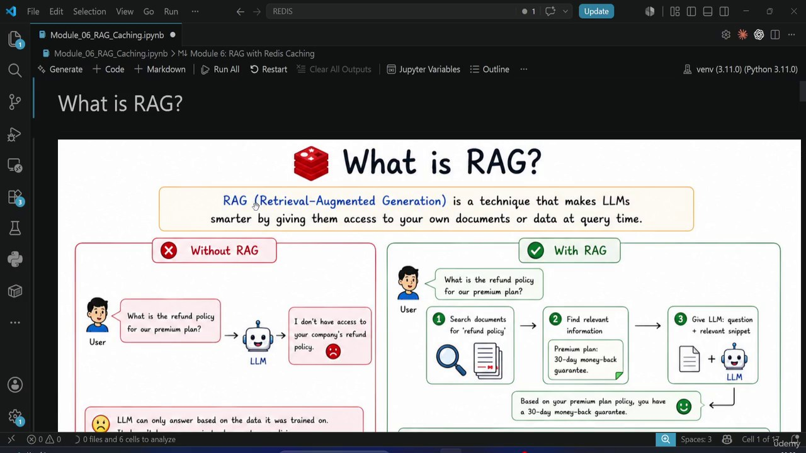

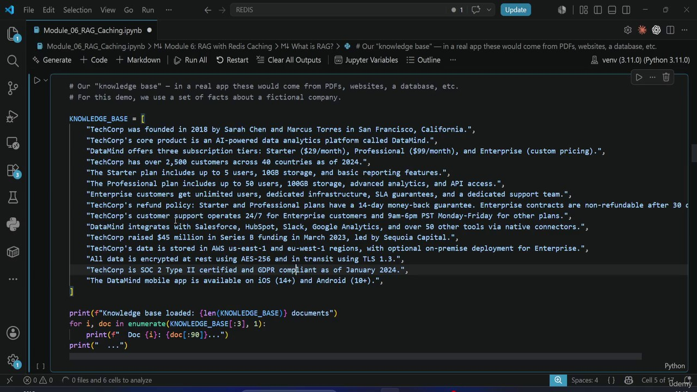

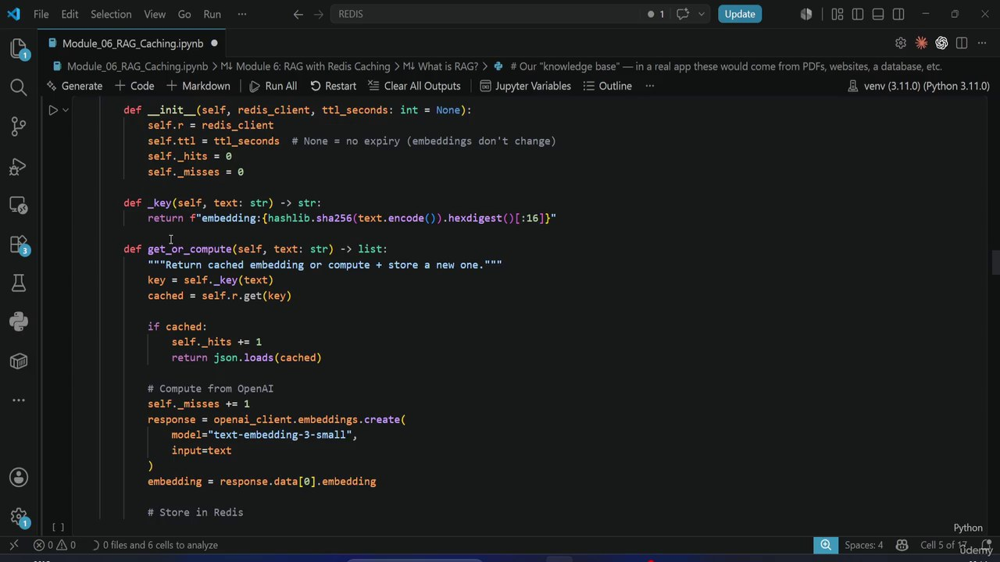

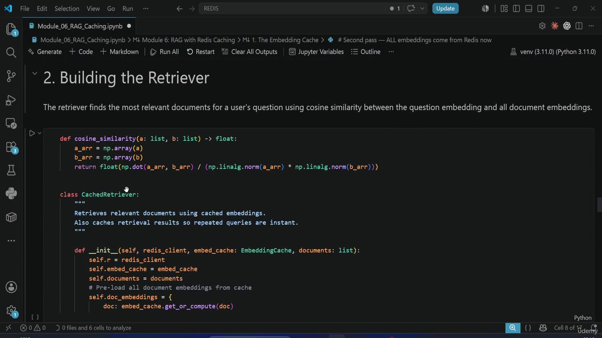

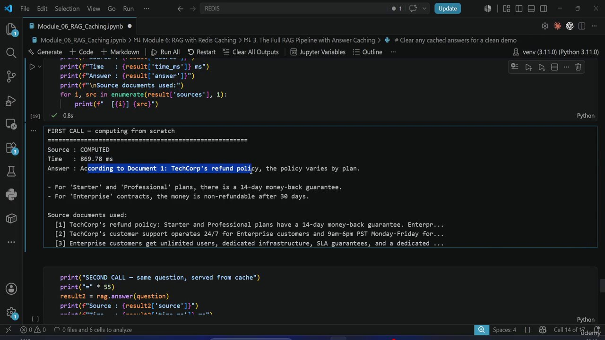

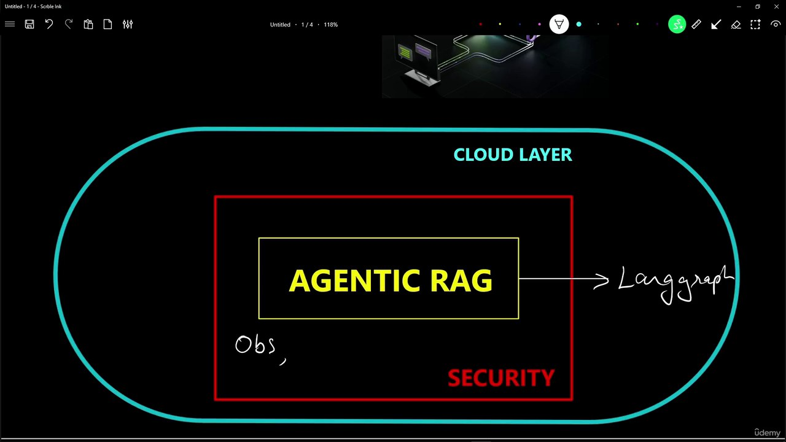

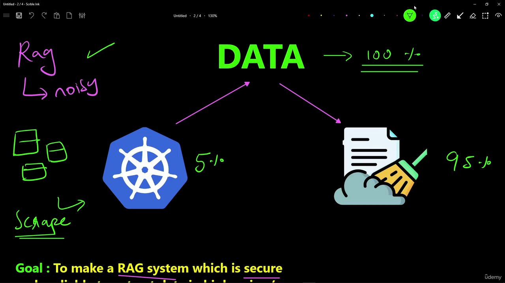

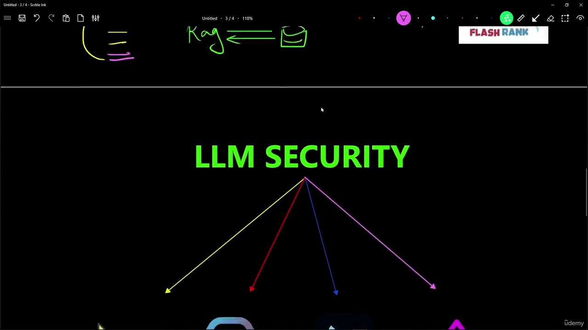

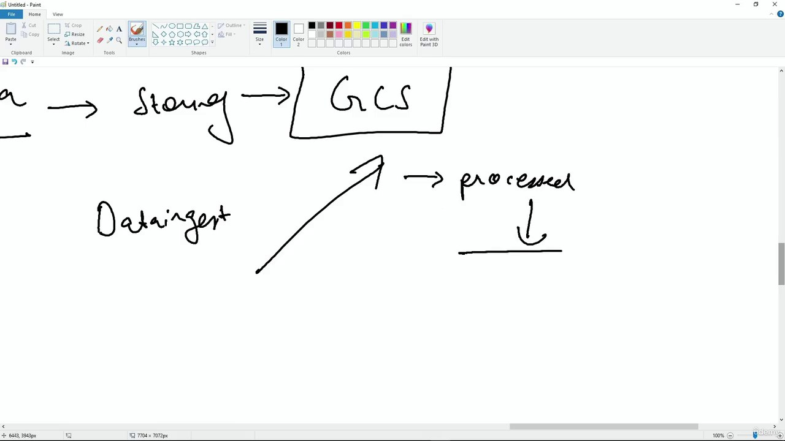

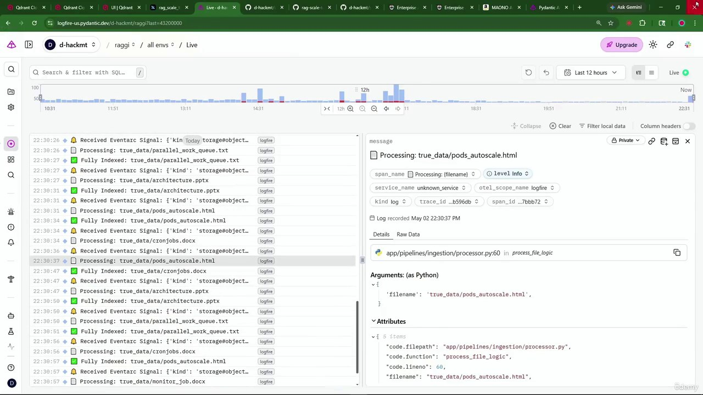

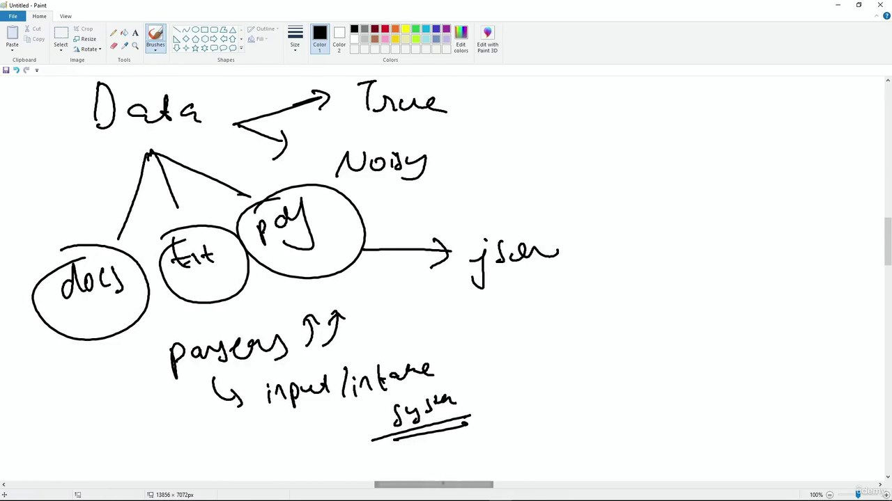

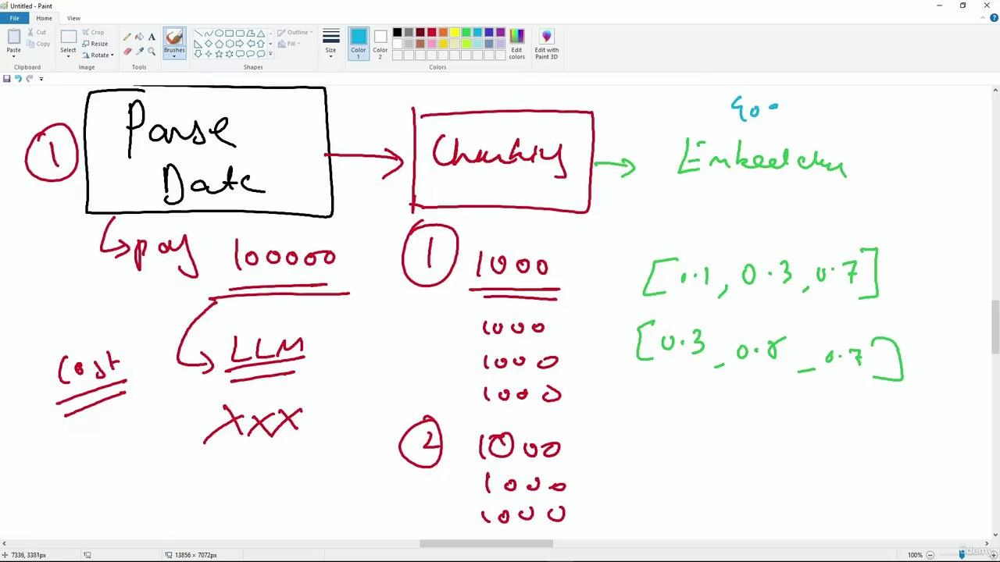