# 1. 这一节做什么

这一节（P54–P56）是整门 AI Security Bootcamp 第一部分的**总览集 + 地基集**，三集各管一件事：

- **P54**：讲师在白板上把 RAG 系统的完整链路画一遍——用户消息进 LLM（用 Groq 提供方）、LLM 去 Qdrant 向量库检索企业私有数据的 chunk、chunk 先过 re-ranker 再回给用户；然后加进一个「planner node」，让 LLM 先判断意图是「闲聊」还是「技术问题」，闲聊就跳过检索直接答，技术问题才走 retriever。接着讲两层 memory（本地用 LangChain/LangGraph 的 memory saver，生产用 Cloud SQL 上的 Postgres 存对话历史）、两层 tracing（LangSmith 追 LLM 调用、Pydantic Logfire 追应用执行），最后把 monolithic 与 scalable 两套架构在 GCP 上落地（Cloud Run / GCS / Cloud SQL / Artifact Registry / Vertex AI embeddings）。
- **P55**：Module 2 开场，讲清楚这一模块要交付什么（启用哪些服务、项目结构、requirement 文件、环境变量文件），并交代讲师自己的技术选型史——早期用 PyMuPDF 读 PDF、用 Pydantic AI 做结构化响应，后来换成 LangGraph，原因给了两条：行业标准、节点级细粒度控制。同时反复强调「docs 文件夹就是你的答案」。
- **P56**：真正动手——装 Google Cloud CLI、建 GCP 项目、拿 Groq API key、建 Qdrant Cloud 免费集群、在 UI 和 CLI 两条路上逐个启用 API（Cloud Build / Cloud SQL Admin / Artifact Registry / Cloud Storage / Compute Engine / Discovery / Eventarc / Document AI / Cloud Run Admin / Vertex AI）、用 `uv venv enterprise_env` 建虚拟环境、然后打开 readme 和 docs 目录逐个看。

**读完这一节、照着做完，你应该手里有**：一个可用的 GCP 项目、一套已启用的 API、一把 Groq key、一个 Qdrant 集群（API Key + Endpoint）、一个本地 Python 虚拟环境、以及一份能回答你 80% 疑问的 docs 目录。

**注意一个关键冲突**：P54 讲 re-ranker 用 Google Vertex AI，但 P56 打开 readme 时说「我把它换成了 FlashRank 本地 re-ranker，快得多」。两集不是一个时间点的产物，**以 P56 的新版为准**，详见第 7 节。

---

# 2. 讲师原话

**关于 RAG 是什么**

> "RAG 是生成式 AI 的一种用例：我们基于自己的领域数据做一个聊天机器人。"
> —— p054 [00:00]

> "我们不想要一个只装着训练数据知识的普通语言模型，我们要它去检索我们的企业数据。"
> —— p054 [01:26]

**关于用 Groq 当模型提供方**

> "我们这个聊天机器人背后是一个大语言模型，这个模型走 Groq API。我们用 Groq 做提供方，因为它免费。"
> —— p054 [00:28]

**关于 Qdrant 与检索**

> "这些企业数据存在 Qdrant 向量库里……大语言模型向它发一条 query，它把相关的 chunk 作为响应返回，然后模型再把结果返回给用户。这就是一个简单 RAG 系统的完整生命周期。"
> —— p054 [02:26]–[02:55]

**关于 re-ranker 干什么**

> "假设检索回来 1、2、3、4、5、6、7、8 个 chunk，其中某三个在一起的关联度更高，那么这三个会被提到优先级最前面，其余的被降级——这就是 re-ranking 的含义。"
> —— p054 [03:24]–[03:53]

**关于 planner node**

> "我们不希望它每次都直接去撞数据库。用户发来消息后，我们有一个 planner node，它本身也是一个大语言模型，还是 Groq。它来规划：根据用户文本理解意图，用户到底想干什么。"
> —— p054 [04:22]–[04:50]

> "如果用户只是发一句 hi，它就理解到这只是闲聊，那就跳过检索，直接给响应。但如果消息是 hi，告诉我 Kubernetes 的事，它就知道用户想要信息，那就去 retriever，再由 responder 节点把响应发回给用户。"
> —— p054 [05:19]–[05:48]

> "planner 只输出两个词，根据用户 query，它只给两个回答：是 conversational 还是 technical。"
> —— p054 [10:01]–[10:30]

**关于 memory 的两级**

> "如果讲本地 memory，我们用的是 LangChain 或 LangGraph 的 memory saver；讲生产环境，我们用 Cloud SQL 服务，里面跑一个 Postgres 服务器，把这些信息以表的形式存起来。"
> —— p054 [06:41]–[07:10]

**关于 tracing**

> "我们把这个 LLM 追踪到 LangSmith 上——LLM 调用追踪走 LangSmith；应用执行追踪走 Pydantic Logfire。"
> —— p054 [07:38]

**关于服务清单**

> "我们的应用跑在 Cloud Run 上，以微服务形式——在 Cloud Run 上跑三个容器：容器一是数据摄取，容器二是 UI，容器三是后端。"
> —— p054 [14:21]–[14:49]

> "讲单体架构的话，应用还是跑在 Cloud Run，但只跑一个容器，整个应用都在里面。缺点是不会有数据摄取，而且不能对高流量做水平扩展——可以扩，但只能垂直扩，也就是加容器的配置。"
> —— p054 [15:18]–[15:47]

> "这些容器存在哪里？都存在 Google Artifact Registry 上。"
> —— p054 [16:45]

> "re-ranking 我们用 Vertex AI，嵌入数据（甚至在数据摄取流水线里嵌入数据）我们也用 Vertex AI embeddings，用的是 text-embedding-004。"
> —— p054 [17:14]–[17:44]

**关于为什么从 Pydantic AI 换到 LangGraph**

> "Pydantic AI 在验证、结构化响应上都很强，为什么我还是用 LangGraph？第一，LangGraph 是行业标准。第二，我们能在 LangGraph 上做非常细粒度、非常模块化的控制。这是关键。往后看那些漂亮的节点就知道了。"
> —— p055 [06:26]–[06:54]

> "LangSmith 是 LangChain 和 LangGraph 的原生应用，所以我们可以顺带做追踪。"
> —— p055 [07:17]

> "我为什么还留着 Pydantic Logfire？因为我之前用 Pydantic AI，后来意识到留着它没坏处——就一行代码。所以我保留了 Logfire，同时上了 LangSmith 和 LangGraph。"
> —— p055 [07:43]

**关于搭建 GCP**

> "你要做的第一件事是安装 Google Cloud CLI。"
> —— p056 [00:00]

> "你怎么验证它在不在？敲一下 version 就行。"
> —— p056 [00:54]

> "第一步你得有 Google 账号，有了账号再去装 Cloud CLI；有了账号、建了新项目，还要再建一个新项目。"
> —— p056 [00:54]

> "Grok 这边，创建一个新的 API key，我把它叫 enterprise rag，不设过期时间最好，记得收好，你后面要用。"
> —— p056 [02:51]–[03:19]

> "Qdrant 是云向量数据库，我们在这个项目里用它。你去 Qdrant Cloud 开一个免费账号，用 Google 登录，它会让你建一个 free cluster，我把它叫 enterprise rag，选你想用的区域，创建完你会拿到一个 API key 和一个 endpoint。"
> —— p056 [03:19]–[04:41]

> "我把所有 API 用 CLI 跑一遍，也给你演示怎么跑这些命令。"
> —— p056 [07:02]

> "我用 git bash 操作 Google Cloud，用 command prompt 操作我的项目目录。"
> —— p056 [08:56]

> "我敲 `uv venv enterprise_env`，用 uv 建一个虚拟环境。"
> —— p056 [09:23]

> "readme 里写的是用 Vertex AI re-ranker 重排 embedding，我已经把它换成了 FlashRank 本地 re-ranker，快得多。"
> —— p056 [09:52]

---

# 3. 从零复现

下面按**你实际动手的顺序**排（和讲师 P56 的临场顺序基本一致，只是把「先有账号」提到最前）。命令凡是讲师没念具体字符串的，我都标了「※ 讲师只说了要做什么，没念这条命令」。

## 3.0 前置条件

| 项 | 说明 |
|---|---|
| Google 账号 | P56 [00:54] 明确：先有账号，再装 CLI，再建项目 |
| GCP 结算账号 | 印度区开免费试用要押约 ₹1000，试用期结束后返还（p055 [00:51]） |
| Python ≥3.10 + `uv` | P56 [09:23] 用 `uv venv` 建环境，课里没讲 uv 怎么装 |
| Git Bash（Windows） | p056 [08:56] 明确要求：Cloud 操作用 git bash，项目目录用 command prompt |
| 预算 | 讲师自己充了 20000 credits，做这个项目花掉 12k–13k（p056 [01:51]） |

## 3.1 安装 Google Cloud CLI

讲师原话是「搜索 Google Cloud Shell download」——这里 ASR/口误都把 CLI 说成了 Shell，**实际要装的是 Google Cloud CLI（含 Google Cloud SDK Shell）**，装完打开的就是那个交互式 shell。

1. 浏览器搜索 `Google Cloud CLI download`（p056 [00:28]，讲师说「去第一个链接」）。
2. 选 Windows 或 Mac 的 installer，下载、安装。
3. 打开 **Google Cloud SDK Shell**（讲师机器上是这个，p056 [00:00]）。
4. 第一次打开会自动问你配置（选项目、选区域），跟着走。
5. 验证：

```bash
gcloud --version
```

<p align="center">验证装没装好，敲 version 就行（p056 [00:54]）</p>

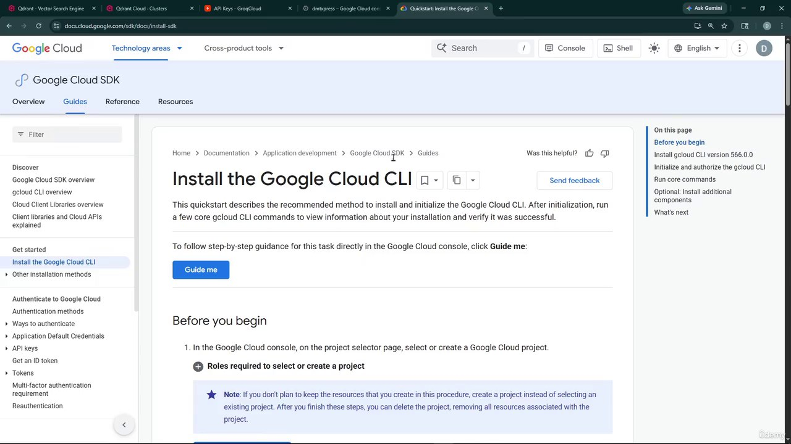

> 在 JS/Node 里对应什么：这等价于你装 `aws-cli` / `gcloud` 这类全局命令行工具，装完能在终端里直接调云 API，不用开浏览器点按钮。

## 3.2 建 GCP 项目

在 GCP 控制台 → 顶部项目选择器 → **新建项目**：

- 项目名：`enterprise rag`（讲师就用这个名字，p056 [01:23]）
- Billing account：选你开了免费试用的那个
- Organization：有就选，没有可以不选（p056 [01:23]）

建完把 **Project ID**（不是显示名）记下来，后面 `gcloud config set project` 要它。

```bash
# ※ 讲师在 UI 里点的，没念命令行版本；以下是等价的 gcloud 标准做法
gcloud auth login
gcloud config set project <你的 PROJECT_ID>
gcloud projects describe <你的 PROJECT_ID> --format="value(projectNumber)"
```

最后那条就是讲师说的 commands 文件里的「提取 project number」helper（p056 [11:17]）。

## 3.3 拿 Groq API Key

1. 打开 Groq 控制台（讲师在 P54 [00:58] 说「文档写得不错，可以点进去看」）。
2. 登录 → **Create new API key**。
3. 名字填 `enterprise rag`。
4. **Expiration 选 no expiration**（p056 [02:51] 原话：「不设过期时间最好」）。
5. 提交后立刻复制保存——这个 tab 别关，后面要贴进 `.env`。

## 3.4 建 Qdrant Cloud 免费集群

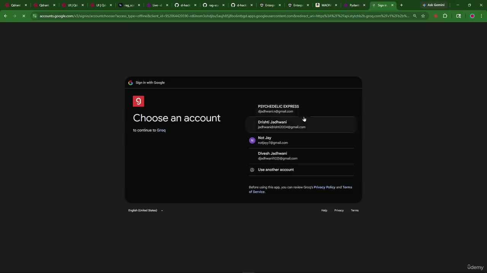

1. 打开 Qdrant Cloud，用 **Google 登录**开免费账号（p056 [03:19]）。
2. 点 **Create free cluster**。
3. 集群名：`enterprise rag`（讲师的原话是「我一直用这个词，因为我们在用 GCP，我选 GCP，让一切都对上」）。
4. 区域：任选（p056 [04:13]）。
5. 创建完成后拿到两样东西，**都记下来**：
   - **API Key**
   - **Endpoint**（形如 `https://xxxx.region.gcp.cloud.qdrant.io:6333`）

讲师强调：这两个 tab 都别关，或者存到别处（p056 [04:41]）。

## 3.5 启用 API —— 两条路都走一遍

讲师给了两种方式（p056 [02:16]，p055 [02:16]）：UI 适合想看得见的人，CLI 适合开发者。他两种都演示了。

### 3.5.1 UI 方式（讲师实际点的）

1. 进 **APIs & Services** → **Library**。
2. 搜索服务名 → 点进去 → **Enable**。

以 Cloud Storage 为例：搜 `cloud storage`，看到结果，点 Enable（p056 [06:34]）。

<p align="center">UI 上逐个搜索、逐个 Enable，看得见但慢</p>

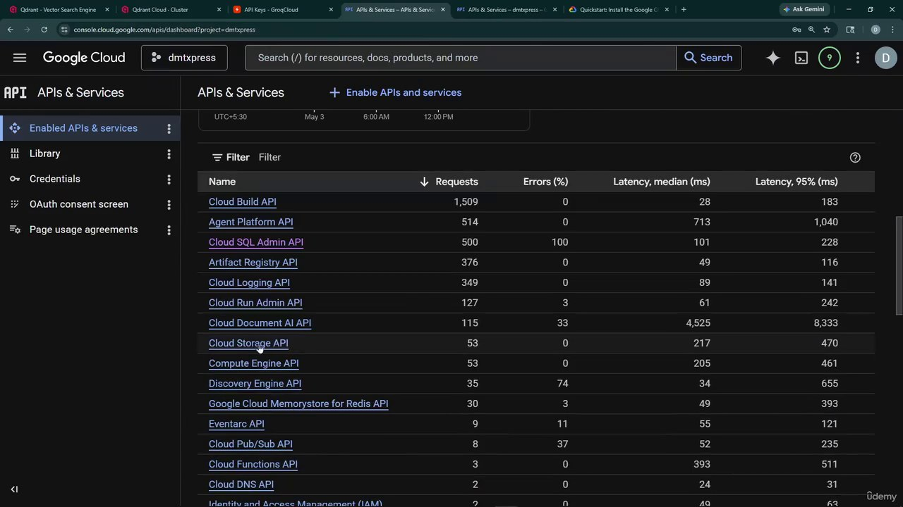

### 3.5.2 讲师屏幕上已启用的 API 清单

P56 [05:08]–[05:37] 讲师把自己的列表拉出来给你对照，逐个念了名字：

| 讲师念到的服务名 | 用途（讲师说的） |
|---|---|
| Cloud Build API | 「我用得最多」——构建镜像 |
| Cloud SQL Admin | 存对话历史的生产库 |
| Artifact Registry | 存容器镜像 |
| Cloud Storage API | 存原始数据 |
| Cloud Compute Engine | 计算 |
| Discovery API | — |
| Event Arc API | — |

P56 [07:31] 追加：**Cloud Document AI API**（「后面视频要用，解析 PDF / OCR」）。
P56 [11:47] 追加：**Cloud Run Admin API**。
P56 [12:16] 追加：**Vertex AI**。

### 3.5.3 CLI 方式

<p align="center">讲师在 git bash 里一次跑完所有 enable 命令（p056 [07:02]）</p>

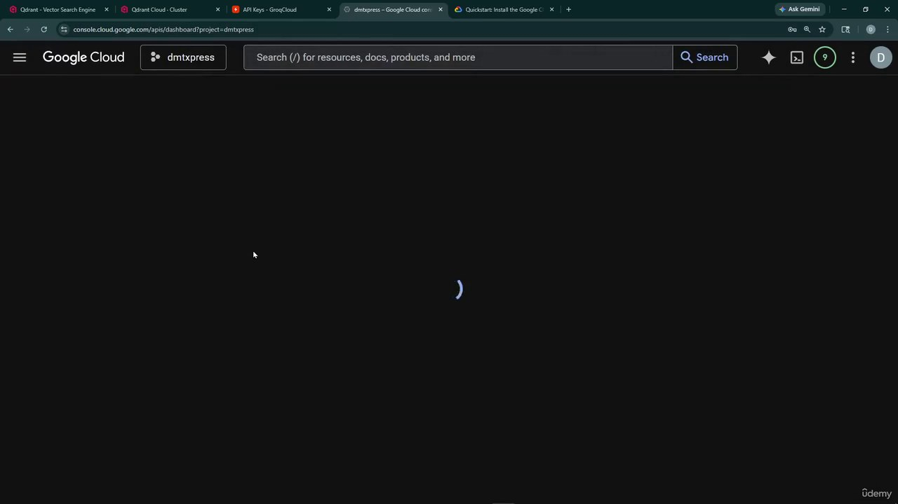

完整脚本见第 4 节 `enable_apis.sh`。跑完用下面这条核验：

```bash
gcloud services list --enabled --project="<PROJECT_ID>"
```

## 3.6 建项目目录 + 虚拟环境

讲师在 `command prompt` 里（不是 PowerShell，p056 [08:56]）：

```bash
mkdir enterprise-rag
cd enterprise-rag
uv venv enterprise_env
enterprise_env\Scripts\activate
```

`enterprise_env` 是讲师给的名字（p056 [09:23]）。激活命令讲师只说「I can just activate this particular environment」，没念具体写法；Windows 是上面那条，mac/Linux 是 `source enterprise_env/bin/activate`。

> 在 JS/Node 里对应什么：这就是「每个项目一份独立的 `node_modules`」的 Python 版，`uv venv` 约等于 `nvm use` + `npm install` 的组合前一步。`.env` 则对应 Node 的 `dotenv`。

## 3.7 看文档（讲师反复强调的一步，别跳过）

<p align="center">readme 预览：production-grade RAG 的 key features、技术栈、代码结构</p>

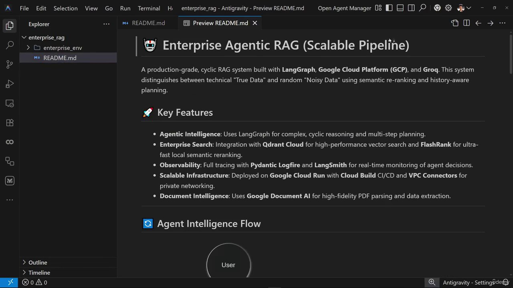

readme 里讲了（P56 [09:52]–[10:21]）：

- **Key features**：production grade RAG
- **Flow**：UI（Streamlit）→ planner node → …
- **重要变更**：原先用 Vertex AI re-ranker 重排 embedding，**已替换为 FlashRank 本地 re-ranker，更快**
- **代码结构**
- **技术栈**：cloud platform、compute services（Cloud Run）、cloud storage、Cloud SQL、AI services

<p align="center">docs 目录：system overview / ingestion engine / node intelligence / observability / environment variables</p>

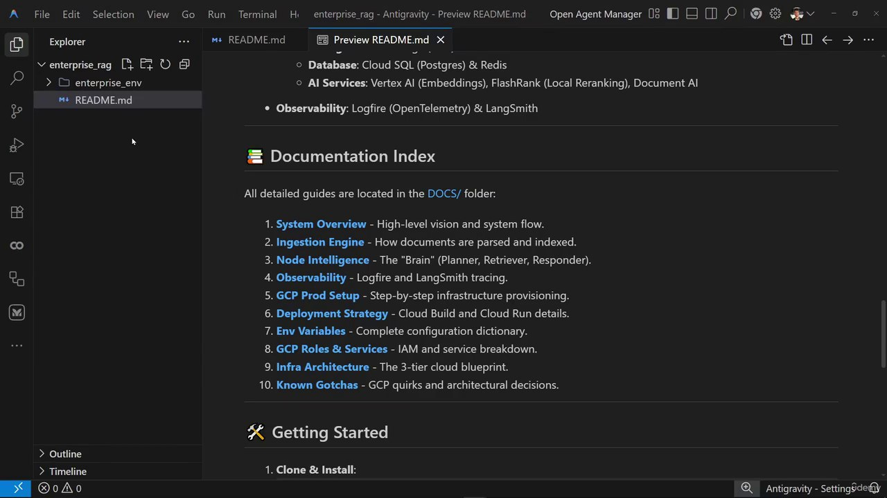

`docs/` 里五篇（p056 [10:50]）：

1. **system overview** —— 系统总览
2. **ingestion engine** —— 摄取引擎怎么工作
3. **node intelligence** —— LangGraph 节点 / AI agent 怎么工作
4. **observability** —— 可观测
5. **environment variables** —— 环境变量

另外还有一个 **commands** 文件（p056 [11:17]）：里面是 helper 命令，用来「提取 project number、Authorization 等」。

以及一个 **gotchas** 文档（p056 [13:43]）：记录「你会撞上什么错」——比如 Document AI 报错、用旧命令创建 GCS bucket 之类。

## 3.8 讲师的架构图（先看懂再写代码）

<p align="center">讲师在 docs 里展示的架构图：Streamlit UI → planner → retriever → re-ranker → 响应</p>

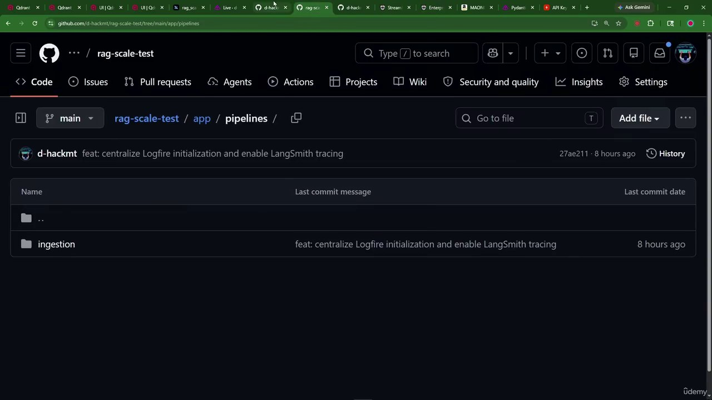

按 P54 [10:01]–[11:28] 的描述，链路是：

```
用户 → Streamlit UI → planner node（LLM，输出 conversational 或 technical）
                        ├─ conversational → 直接响应
                        └─ technical      → retriever node
                                              ├─ 改写 query（换更好的搜索词）
                                              └─ re-ranker 重排 chunk → responder → 用户
```

讲师还展示了 LangGraph 的节点层级（p055 [06:54]）：user → planner → 判断 → Qdrant / 直接响应。

<p align="center">LangGraph 的节点式工作流：user → planner → 分支</p>

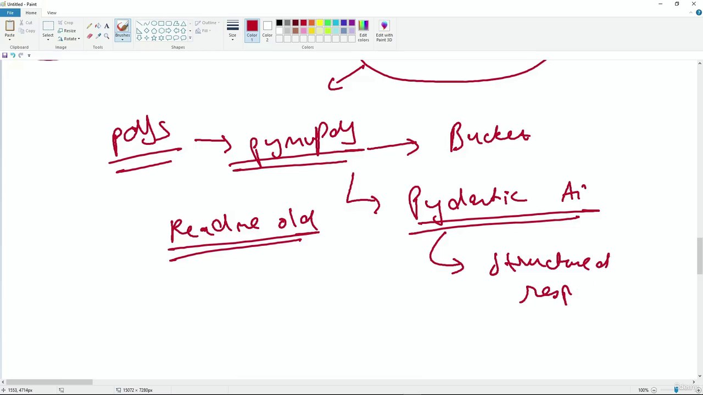

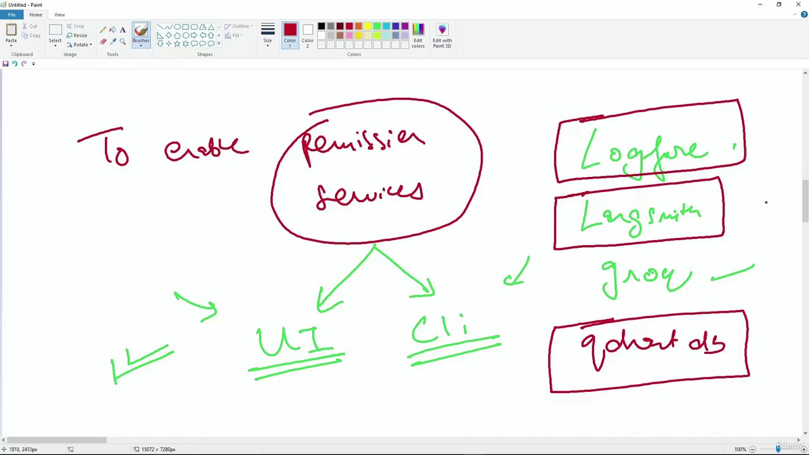

## 3.9 部署拓扑（两种架构）

**Scalable（微服务）** —— Cloud Run 上跑 3 个容器（p054 [14:21]–[14:49]）：

1. **data ingestion**（数据摄取）
2. **ui**（Streamlit）
3. **backend**（FastAPI + LangGraph）

**Monolithic（单体）** —— Cloud Run 上跑 1 个容器，整个应用装在里面（p054 [15:18]）。

讲师给的两个缺点（p054 [15:18]–[15:47]）：

1. **没有 data ingestion** 容器
2. **不能水平扩展**高流量 —— 只能垂直扩（加大容器配置）

配套服务：

| 服务 | 干什么 | 出处 |
|---|---|---|
| Google Cloud Run | 跑容器 | p054 [14:21] |
| Google Cloud Storage (GCS) | 存原始数据 | p054 [16:16] |
| Google Cloud SQL (Postgres) | 存对话历史，让 LLM 有记忆 | p054 [16:16] |
| Google Artifact Registry | 存所有容器镜像 | p054 [16:45] |
| Vertex AI embeddings (text-embedding-004) | re-ranking + 数据摄取时嵌入 | p054 [17:14] |

---

# 4. 完整代码

> **先说清楚底线**：P54–P56 **没有给出任何一段可运行的业务源码**。讲师反复说的是「代码结构、环境变量、命令都在 docs 里，自己去看」（p056 [10:50]、[11:17]）。所以下面 4.1–4.5 是**讲师屏幕上真实展示过的产物结构 + 他口述的服务清单**落成的可保存文件；每处「讲师没念细节」我都标了。4.6 是唯一一段示意代码，明确标注「课里没有代码」。

## 4.1 项目目录结构

```
enterprise-rag/
├── docs/                          # P56 [10:48] 讲师打开的 docs 文件夹
│   ├── system-overview.md         # 系统总览
│   ├── ingestion-engine.md        # 摄取引擎
│   ├── node-intelligence.md       # LangGraph 节点 / agent 逻辑
│   ├── observability.md           # LangSmith + Logfire
│   ├── environment-variables.md   # 环境变量说明
│   └── gotchas.md                 # P56 [13:43] 常见报错
├── commands.md                    # P56 [11:17] helper 命令：project number / 授权
├── readme.md                      # 新版：Streamlit UI + planner + FlashRank（P56 [09:52]）
├── readme_old.md                  # 旧版：PyMuPDF + Pydantic AI（P55 [05:59]）
├── .env                           # 环境变量，不进 git
├── requirements.txt               # P55 [00:25] 提到的 requirement 文件
└── enterprise_env/                # uv venv 建的虚拟环境（P56 [09:23]）
```

## 4.2 `.env`（完整文件）

> ※ 讲师只说了「要配 Logfire、LangSmith、Groq key、Qdrant」这几类东西（p055 [03:15]、p056 [02:51]、[04:41]），**没有念过任何变量名**。下面的变量名是按各家 SDK 的常规命名补的，你以自己 `.env.example` 或 docs 里的实际命名为准。

```dotenv
# ── LLM 提供方：Groq（P54 [02:26] 免费）
GROQ_API_KEY=gsk_xxxxxxxxxxxxxxxxxxxxxxxxxxxxxxxx

# ── Qdrant Cloud（P56 [04:41] 建完 free cluster 拿到的两样东西）
QDRANT_API_KEY=xxxxxxxxxxxxxxxxxxxxxxxxxxxxxxxx
QDRANT_URL=https://xxxxxxxx-xxxx-xxxx-xxxx-xxxxxxxxxxxx.us-east4-0.aws.cloud.qdrant.io:6333

# ── GCP
GCP_PROJECT_ID=enterprise-rag
GCP_REGION=us-central1
GCS_BUCKET_NAME=enterprise-rag-raw

# ── Cloud SQL / Postgres（P54 [06:41] 生产 memory）
INSTANCE_CONNECTION_NAME=enterprise-rag:us-central1:rag-pg
DB_NAME=rag
DB_USER=rag
DB_PASS=change-me

# ── LangSmith（P54 [07:38] LLM 调用追踪）
LANGCHAIN_TRACING_V2=true
LANGCHAIN_API_KEY=lsv2_pt_xxxxxxxxxxxxxxxxxxxxxxxx
LANGCHAIN_PROJECT=enterprise-rag

# ── Pydantic Logfire（P54 [07:38] 应用执行追踪）
LOGFIRE_TOKEN=xxxxxxxxxxxxxxxxxxxxxxxxxxxxxxxx
```

## 4.3 `requirements.txt`（完整文件）

> ※ 讲师说了有 requirement 文件（p055 [00:25]），但**没念包名、没念版本**。下面是按他在 P54/P55/P56 亲口点名的技术反推出来的最小集合，版本锁死请自己做——课里没给版本。

```text
# Web
fastapi
uvicorn[standard]

# 编排 / LLM
langgraph
langchain
langchain-groq

# 可观测
langsmith
pydantic-ai
logfire

# 向量库
qdrant-client

# UI
streamlit

# 摄取（旧版用 PyMuPDF，P55 [05:32]）
pymupdf

# 重排（P56 [09:52] 换成 FlashRank，替代 Vertex AI re-ranker）
flashrank

# GCP
google-cloud-storage
cloud-sql-python-connector[pg8000]
```

## 4.4 `enable_apis.sh`（完整可执行脚本）

> ※ 讲师说了「我会用 CLI 跑一遍」并且念出了服务名（p056 [05:08]–[05:37]、[07:31]、[11:47]、[12:16]），但**没有念过任何一条 `gcloud services enable` 的具体命令字符串**。下面的 API service name 是每个服务对应的标准标识符，你用前先跑 `gcloud services list --available | grep <关键词>` 核对一下。
>
> 在 **Git Bash** 里跑（p056 [08:56] 明确要求）。

```bash
#!/usr/bin/env bash
set -euo pipefail

PROJECT_ID="enterprise-rag"   # 换成你自己的 Project ID（显示名是 "enterprise rag"）

# 先登录 + 指定项目
gcloud auth login
gcloud config set project "$PROJECT_ID"

# ── 讲师屏幕上已启用的（p056 [05:08]–[05:37]）
gcloud services enable cloudbuild.googleapis.com       --project="$PROJECT_ID"  # Cloud Build API
gcloud services enable sqladmin.googleapis.com         --project="$PROJECT_ID"  # Cloud SQL Admin
gcloud services enable artifactregistry.googleapis.com --project="$PROJECT_ID"  # Artifact Registry
gcloud services enable storage.googleapis.com          --project="$PROJECT_ID"  # Cloud Storage API
gcloud services enable compute.googleapis.com          --project="$PROJECT_ID"  # Cloud Compute Engine
gcloud services enable discovery.googleapis.com        --project="$PROJECT_ID"  # Discovery API
gcloud services enable eventarc.googleapis.com         --project="$PROJECT_ID"  # Event Arc API

# ── 讲师后续追加的（p056 [07:31] / [11:47] / [12:16]）
gcloud services enable documentai.googleapis.com       --project="$PROJECT_ID"  # Cloud Document AI API（PDF 解析 / OCR）
gcloud services enable run.googleapis.com              --project="$PROJECT_ID"  # Cloud Run Admin API
gcloud services enable aiplatform.googleapis.com       --project="$PROJECT_ID"  # Vertex AI（embeddings / re-ranking）

# ── 核验（对照讲师屏幕上那份列表）
gcloud services list --enabled --project="$PROJECT_ID"
```

## 4.5 `commands.sh`（helper 命令，等价于讲师说的 commands 文件）

> P56 [11:17] 讲师说 commands 文件里是「提取 project number、Authorization 等」的 helper。**具体命令字符串课里没念**，下面是这几件事的标准写法。

```bash
#!/usr/bin/env bash
set -euo pipefail

PROJECT_ID="enterprise-rag"

# 1) 取 Project ID（显示名 ≠ ID）
gcloud projects list --format="table(projectId,name,projectNumber)"

# 2) 取 Project Number（很多 API / 服务账号要用）
gcloud projects describe "$PROJECT_ID" --format="value(projectNumber)"

# 3) 应用默认凭据（本地 SDK 调 GCP 时用）
gcloud auth application-default login

# 4) 当前账号
gcloud auth list

# 5) 建 GCS bucket（讲师在 gotchas 里提过「用旧命令建 bucket 会报错」，用下面这条现代写法）
gcloud storage buckets create "gs://${PROJECT_ID}-raw" \
  --project="$PROJECT_ID" \
  --location="us-central1"

# 6) 建 Artifact Registry（放容器镜像，p054 [16:45]）
gcloud artifacts repositories create enterprise-rag-repo \
  --repository-format=docker \
  --location="us-central1" \
  --project="$PROJECT_ID"
```

## 4.6 示意代码：planner 的双值路由

> ⚠️ **课里没有代码，以下为示意。** P54 [04:50]–[05:48] 讲师只在白板上画了 planner「只输出两个词」的分支逻辑。下面这段只为让你看清「planner → 条件边 → 两个终点」的结构，**不是项目的真实实现**，真实实现请看 `docs/node-intelligence.md`。

```python
# ⚠️ 示意代码，课里没有给出
from typing import Literal, TypedDict
from langgraph.graph import StateGraph, START, END

class RAGState(TypedDict, total=False):
    question: str
    intent: Literal["conversational", "technical"]
    context: str
    answer: str

def planner(state: RAGState) -> RAGState:
    """planner node：本身就是一个 LLM（Groq）。
    讲师强调：它只输出两个词之一 —— conversational / technical。"""
    intent = decide_intent_with_llm(state["question"])  # 课里没讲这个函数怎么实现
    return {"intent": intent}

def responder(state: RAGState) -> RAGState:
    """conversational 分支：跳过检索，直接答。"""
    return {"answer": call_llm(state["question"])}

def retriever(state: RAGState) -> RAGState:
    """technical 分支：先改写 query，再去 Qdrant 检索，再过 re-ranker。
    注意：P56 [09:52] 说 re-ranker 已从 Vertex AI 换成 FlashRank。"""
    ...

def route(state: RAGState) -> str:
    return state["intent"]          # 直接拿两个词当路由键

builder = StateGraph(RAGState)
builder.add_node("planner", planner)
builder.add_node("responder", responder)
builder.add_node("retriever", retriever)
builder.add_edge(START, "planner")
builder.add_conditional_edges("planner", route,
                              {"conversational": "responder",
                               "technical": "retriever"})
builder.add_edge("retriever", END)
builder.add_edge("responder", END)

graph = builder.compile(checkpointer=memory_saver)   # 本地 memory saver（P54 [06:41]）
```

---

# 5. 逐行解释

**`uv venv enterprise_env`**
讲师在 P56 [09:23] 亲自敲的就是这条。`uv` 是 Rust 写的 Python 包管理器，比 `virtualenv` 快；`enterprise_env` 是环境目录名。为什么必须建虚拟环境：你会同时装 `langgraph`、`pydantic-ai`、`streamlit`、`qdrant-client`，这些库的依赖树会互相冲突，全局装必然炸。**在 Node 里这就是「每个项目独立 node_modules」**。

**`enterprise_env\Scripts\activate`**
Windows 下激活。激活后命令行前缀会变，`pip install` 才会装进这个环境。讲师只说「I can just activate」，没念写法，mac/Linux 是 `source enterprise_env/bin/activate`。

**用 git bash 而不是 PowerShell（p056 [08:56]）**
这不是洁癖。讲师的分工是：**Git Bash ↔ 操作 GCP（`gcloud` 那一串）**，**Command Prompt ↔ 操作项目目录（`python` / `uv` / `streamlit`）**。原因是 Windows PowerShell 对 `gcloud` 输出的某些转义和路径处理会出问题，而 Git Bash 的行为跟 Linux 一致，出问题能直接搜到 Linux 的解法。

**`gcloud services enable <service>.googleapis.com`**
每一条对应讲师屏幕上勾选过的一个 API。为什么要用 CLI 而不是 UI：P56 [07:02] 讲师的原话是「一个个搜、一个个点，好是好，但不够省时、不够开发者友好」。你以后要开新环境（测试/staging），脚本一跑就全齐，UI 得点十几分钟。

**`gcloud projects describe $PROJECT_ID --format="value(projectNumber)"`**
GCP 里 `projectId`（小写带连字符，全局唯一）和 `projectNumber`（纯数字）是两回事。很多服务账号、API URL 要的是 number，不是 id。这就是讲师 commands 文件里说的「提取 project number」。

**`gcloud auth application-default login`**
这是给「本地跑代码、代码要调 GCP API」用的。`gcloud auth login` 是给人（浏览器登录）用的，`application-default` 是给程序用的。不跑这条，本地调 Cloud SQL / GCS 会报 `Could not automatically determine credentials`。讲师在 commands 文件里说的「Authorization」指的就是这块。

**Groq key 不设过期（p056 [02:51]）**
讲师原话「no expiration is always good」。便利性换安全性：key 一旦泄露就是永久泄露。**真实项目里建议设过期 + 定期轮转**，这条讲师没讲，是我基于安全常识补的（见第 7 节）。

**Qdrant 集群与 GCP 同区域（p056 [04:13]）**
讲师自己说「我只是假设同一个 provider 会快一点」。跨区域每跳一次延迟 +几十毫秒，RAG 每次检索都要跨，LLM 又要再等，会叠加。

**planner 只输出「两个词」而不是 JSON（p054 [10:01]）**
这是个刻意的设计取舍：输出空间越小，模型越不容易胡编，解析也越简单（不需要 `json.loads` + try/except）。讲师原文「它只给两个回答：是 conversational 还是 technical」。代价是以后想加第三类（比如 `code`）就得改 prompt 和路由表。**在 JS 里这等价于让你的 classifier 返回一个 enum 而不是自由文本**。

**re-ranker 在 8 个 chunk 里挑 3 个（p054 [03:24]）**
向量检索是「大致相关」，re-rank 是「精排」。检索返回一堆 chunk，re-ranker 按与 query 的语义相关度重排，高相关提优先级、低相关降级。讲师演示时 Logfire 里显示「retrieved 15 candidates → semantic re-ranker → top 5 chunks」（p054 [13:24]），即 **15 进、5 出**。这解释了为什么响应质量稳：喂给 LLM 的上下文是被筛过的。

**memory 的两级（p054 [06:41]）**
本地开发用 LangGraph 的 `MemorySaver`（进程内存，重启就没），生产用 Cloud SQL 上的 Postgres（表结构持久化）。讲师演示里「my name is Divesh，我教什么？」能答对，走的就是 `intent = fetch memory` 分支，**跳过检索**（p054 [08:37]）。这也是 planner 存在的意义：不是所有问题都值得去撞向量
**memory 的两级（续）**
……数据库——撞一次要花一次 embedding、一次 Qdrant 查询、一次 re-rank，全是钱和时间。这也是为什么讲师在 P55 [06:54] 说「planner 会想两件事：用户在闲聊，还是在问我技术问题」。

**`builder.compile(checkpointer=memory_saver)`**
这一行就是「本地 memory」的落点（p054 [06:41]）。`checkpointer` 负责把每个节点的 state 快照存下来，下一轮对话再按 `thread_id` 取回来，模型才「记得你」。生产换 Cloud SQL 时，换的是这个 checkpointer 的实现（用 Postgres 存表），**图本身不用改**——这是 LangGraph 相对手写 if/else 编排的核心收益：状态管理与业务流程解耦。

**LangSmith 与 Logfire 的分工（p054 [07:38]）**
两个不是二选一，是两条不同视角的 tracing：

- **LangSmith** 追的是 **LLM 调用**：prompt 进、token 出、模型返回了什么。讲师演示的 trace（p054 [11:58]–[12:27]）里能看到：拿到问题 → planner 判定 `intent = technical` → 进 retriever 拿到一堆 chunk → responder → 最终 chat 响应（讲师问的是「how to manage clusters」，回答是「管理集群就像放牧猫」那套玩笑话）。
- **Pydantic Logfire** 追的是 **应用执行**：P54 [13:24] 的 event 序列是「LLM synthesis → user chat interaction → planner decision（intent identified）→ knowledge retrieval（searching for Qdrant，retrieved 15 candidates）→ semantic re-ranker（re-ranking complete，top 5 chunks retrieved）→ LLM synthesis → response synthesized」。里面还有一条 `Redis is failing`，讲师当场说「Redis 现在关着，所以它失败，不影响」。

> 给你的判断：**排查「模型答得烂」看 LangSmith，排查「服务慢了/挂了」看 Logfire。** 前者是语义层，后者是工程层。

**为什么留着 Pydantic Logfire（p055 [07:43]）**
讲师原话是「它不碍事，就一行代码」。从 Pydantic AI 迁移到 LangGraph 后，Logfire 成了「历史包袱变顺手工具」——它跟 Pydantic AI 同厂，结构化校验的日志天然好看。**课里没讲**怎么同时给 LangGraph 接 Logfire，实际要靠 Logfire 的 OpenTelemetry 集成（本段没讲过，别把它当讲师说的）。

**LangGraph 对比 Pydantic AI（p055 [06:26]）**
讲师给了两条理由，都不是「功能更强」：
1. **行业标准** —— 生态、文档、招聘上都认；
2. **节点级细粒度控制** —— 每个节点干什么、走哪条边，你能精确控制，而不是靠一个 agent 自己瞎决定。

他的原话评价 Pydantic AI 是「验证和结构化响应上都很强」。所以这不是贬低，是**场景匹配**：结构化抽取用 Pydantic AI，多步可控编排用 LangGraph。**在 JS 里对应什么**：Pydantic AI ≈ 带 schema 校验的 `zod` + SDK；LangGraph ≈ 你自己写的一张状态机（像 XState），而不是让模型自由调工具。

**为什么 re-ranker 后来换 FlashRank（p056 [09:52]）**
P54 的架构图写的是 Google Vertex AI re-ranker，P56 打开 readme 却说「已换成 FlashRank 本地 re-ranker，快得多」。判断很直接：**re-rank 是一次同步调用，每次都跨网络打 GCP，延迟和费用都叠在用户等待里；本地模型是进程内计算，没有网络往返。** 取舍是：本地模型体积小、精度略逊于云端大模型。**这个问题讲师没在课上讨论精度差距**，他只说了「更快」。

**`gcloud storage buckets create` 而不是 `gsutil mb`（p056 [13:43] 的 gotchas 提到）**
讲师在 gotchas 文档里明确写了「用旧命令创建 Google Cloud Storage 会报错」。`gsutil` 是上一代工具，Google 已在往 `gcloud storage` 迁移。**课里没讲具体报什么错**，只说了有这个问题。

**把「重复 chunk」当成已知现象（p054 [09:32]）**
讲师演示时自己解释了：他为了做演示**反复摄取过好几次数据**，所以检索结果里出现重复的、相似度都很高的 chunk。这不是 bug，是**摄取流水线没有幂等去重**。你做的时候如果不重跑，就不会看到；一旦重跑，先想清楚要去重还是加版本号。

---

<p align="center">讲师在 GCP 上新建项目：填项目名、选 billing account、organization 可选</p>

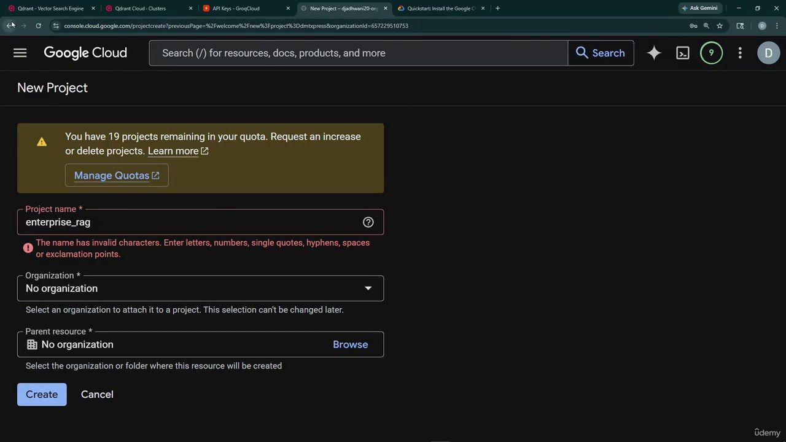

<p align="center">Groq 侧：创建 API key、命名 enterprise rag、过期时间不设</p>

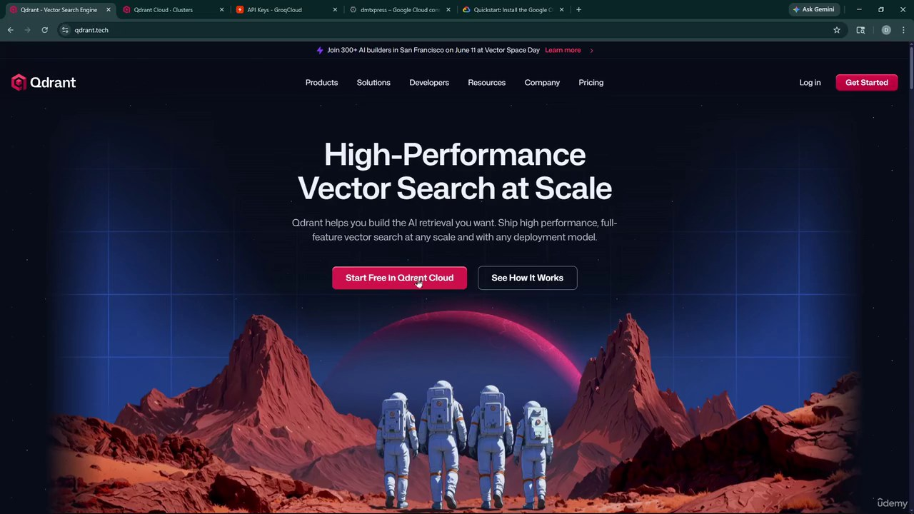

---

# 6. 复现检查清单

按顺序打勾，**每一项都有可执行的验证动作**。凡是「课里没讲」的验证方式，我注明了是通用做法。

## 6.1 账号与 CLI

- [ ] Google 账号已建、GCP 免费试用已开（印度区需先押约 ₹1000，p055 [00:51]）
- [ ] Google Cloud CLI 已装，**Google Cloud SDK Shell 能打开**（p056 [00:00]）
- [ ] 验证：`gcloud --version` 有版本输出（p056 [00:54] 讲师原话「敲 version 就行」）
- [ ] 已登录：`gcloud auth list` 能看到你的账号
- [ ] 项目已建：显示名 `enterprise rag`，**Project ID 已抄下来**（p056 [01:23]）
- [ ] 已切换：`gcloud config get project` 返回的是你的 Project ID
- [ ] Project Number 已记录：`gcloud projects describe <PROJECT_ID> --format="value(projectNumber)"`（p056 [11:17] 的 helper）
- [ ] `gcloud auth application-default login` 已跑过（本地代码调 GCP 用；课里只说 commands 文件里有「Authorization」，没念命令）

## 6.2 API 启用（对照 p056 [05:08]–[05:37] / [07:31] / [11:47] / [12:16]）

- [ ] Cloud Build API
- [ ] Cloud SQL Admin
- [ ] Artifact Registry
- [ ] Cloud Storage API
- [ ] Cloud Compute Engine
- [ ] Discovery API
- [ ] Event Arc API
- [ ] Cloud Document AI API（后面视频要用，PDF 解析/OCR）
- [ ] Cloud Run Admin API
- [ ] Vertex AI

- [ ] 验证：`gcloud services list --enabled --project="<PROJECT_ID>"`，上面十个名字都要在里面。
      **注意**：讲师 P56 [11:47] 亲口提醒「有些 API 对我是已启用的，对你不是，我作为人可能会漏讲」。所以**以这条 list 命令的输出为准，不以我的清单为准**——缺哪个补哪个。

## 6.3 三家外部服务

- [ ] Groq：API key 已建，名字 `enterprise rag`，过期时间不设（p056 [02:51]）
- [ ] Groq key 可用性自测（通用做法，课里没讲）：`curl https://api.groq.com/openai/v1/models -H "Authorization: Bearer $GROQ_API_KEY"` 返回 200
- [ ] Qdrant Cloud：免费账号已开（Google 登录），**free cluster 已创建**，名字 `enterprise rag`（p056 [03:19]–[04:13]）
- [ ] **API Key 和 Endpoint 两样都已抄下来**（p056 [04:41] 明确说这俩都要留）
- [ ] 两个 tab 已保存或已关（切记先抄再关）
- [ ] LangSmith：账号已建、API key 已拿、project 名已定（p054 [07:38]）
- [ ] Pydantic Logfire：token 已拿（p054 [07:38]）

## 6.4 本地环境

- [ ] 目录已建：`enterprise-rag/`
- [ ] `uv venv enterprise_env` 已跑（p056 [09:23]）
- [ ] 环境已激活：命令行前缀出现 `(enterprise_env)`
- [ ] 验证：`python -c "import sys; print(sys.executable)"` 路径里含 `enterprise_env`，**不是全局 Python**
- [ ] `requirements.txt` 已建（p055 [00:25] 提到有这个文件）
- [ ] 依赖已装（`uv pip install -r requirements.txt` 或 `pip install -r requirements.txt`；课里没念装依赖的命令）
- [ ] `.env` 已建、已填满 6.3 里所有 key
- [ ] `.gitignore` 里有 `.env`（**课里没讲**，但不加就是把 key 推上 GitHub）
- [ ] 终端分工确认：**Git Bash 跑 `gcloud`，Command Prompt 跑项目命令**（p056 [08:56]）

## 6.5 文档已就位（这一步别跳过）

- [ ] `docs/system-overview.md`（p056 [10:50]）
- [ ] `docs/ingestion-engine.md`
- [ ] `docs/node-intelligence.md`
- [ ] `docs/observability.md`
- [ ] `docs/environment-variables.md`
- [ ] `docs/gotchas.md`（p056 [13:43]）
- [ ] `commands.md`（p056 [11:17]）
- [ ] `readme.md`（新版，Flow 写的是 **FlashRank**，p056 [09:52]）
- [ ] `readme_old.md`（旧版，PyMuPDF + Pydantic AI，p055 [05:59]）

- [ ] **交叉核对**：`.env` 里的变量名，**必须**在 `docs/environment-variables.md` 里出现；对不上的就以 docs 为准（我第 4.2 节的变量名是常规命名补的，不是讲师念的）

## 6.6 GCP 资源（可选，做部署时才需要）

- [ ] GCS bucket 已建：`gcloud storage buckets create gs://<PROJECT_ID>-raw`（讲师在 gotchas 说旧命令会报错，用新命令）
- [ ] Artifact Registry 已建：`enterprise-rag-repo`，格式 docker（p054 [16:45]）
- [ ] Cloud SQL 实例已建（**课里没讲创建命令**，只在架构里说「跑一个 Postgres 服务器」，p054 [06:41]）

## 6.7 端到端冒烟（对应讲师的三个演示）

按 P54 的三个 demo 复现，这是验收标准：

| 你的输入 | 期望行为 | 讲师演示出处 |
|---|---|---|
| `hi` | planner 判 `conversational` → **跳过检索** → 直接回 | p054 [08:07] |
| `my name is Divesh, I teach at Krishnak Academy. What is my name?` | 命中 memory（**不撞向量库**）→ 答出名字 | p054 [08:37] |
| `how to autoscale pods on Kubernetes?` | planner 判 `technical` → **改写搜索词** → Qdrant 检索 → re-rank → 回答 | p054 [09:04] |

- [ ] 三条都符合预期
- [ ] LangSmith 里能看到 planner 的 decision、retriever 的 chunk、responder 的输出（p054 [12:27]）
- [ ] Logfire 里能看到 event 序列：planner decision → knowledge retrieval → re-ranking complete → response synthesized（p054 [13:24]）
- [ ] Logfire 里若出现 `Redis is failing`，对照讲师的处理：他的 Redis 当时是关的，**不影响主流程**（p054 [13:24]）

---

# 7. 课里没讲但你会撞上的

## 7.1 架构版本冲突：Vertex AI re-ranker vs FlashRank

P54 白板和 docs 架构图（p054 [11:00] 讲师手写「re-ranking → Google Vertex AI」）说 re-ranker 用 **Vertex AI**；P56 打开 readme 预览说**已换成 FlashRank 本地 re-ranker**（p056 [09:52]）。同一门课，两个时点。

**怎么办**：以 `readme.md` + `docs/node-intelligence.md` 为准（新版），把 P54 当「历史设计讲解」看。如果你是照 P54 去买 Vertex AI re-ranker 的 API，会发现自己装了套已经不用的东西。**课里没讲**为什么要换、什么时候换的，只说了「快得多」。

## 7.2 Groq key 不设过期 = 永久泄露风险

讲师 p056 [02:51] 明确说「no expiration is always good」。这是**教学便利**，不是安全实践。你是转 AI 应用工程师的前端，最容易犯的错是：

- 把 key 塞进浏览器端代码 / 前端构建变量（`VITE_GROQ_KEY` 之类）→ **key 在打包产物里，F12 就能看见**；
- 把 key 硬编码进 Streamlit 前端 → 同理。

**必须**：所有 LLM key 只在**后端**（FastAPI，即讲师那三个容器里的 backend）持有；前端只调你自己的后端。这条**课里没讲**，但它是「AI Security Bootcamp」这个标题下最该记住的一条。

## 7.3 `uv` 没装，第 3.6 节第一行就卡死

课里直接敲 `uv venv`，**没讲 uv 怎么装**（p056 [09:23]）。Windows 上通用做法是 `pip install uv` 或官方 installer（以 uv 文档为准）。或者你退回标准库：`python -m venv enterprise_env`。

## 7.4 PowerShell 跑 `gcloud` 出怪问题

讲师 p056 [08:56] 特意说「I don't need PowerShell，I need git bash」。他给的理由是对比「git bash 管云、cmd 管项目」。**课里没讲**具体会报什么错。实际常见的是引号/转义、路径带空格、输出编码乱码。照他的分工做，能省你两小时。

## 7.5 `gsutil` vs `gcloud storage`

gotchas 文档（p056 [13:43]）里明确写了「用旧命令创建 GCS bucket 会报错」，但**讲师没念是哪个错误、也没念新命令**。你网上搜到的老教程 90% 是 `gsutil mb`，撞上去就报错。用 `gcloud storage buckets create`。

## 7.6 Document AI 报错

gotchas 里点名了 Document AI（p056 [13:43]：「如果你用 Document AI 遇到报错……」），**但具体错误信息课里没念**。能预判的两类：API 没 enable（就是 6.2 里那条 `documentai.googleapis.com`）、以及 OCR processor 没建/没选（processor 的创建流程课里完全没讲，只在 P55 [01:47] 说了「Document AI parser，我们拿它解析 PDF、做 OCR」）。

## 7.7 你的 `.env` 变量名可能跟讲师的对不上

我在 4.2 里给的变量名是**按各家 SDK 常规命名补的**，讲师**一个变量名都没念过**。别硬套——打开 `docs/environment-variables.md` 抄。这是讲师 P56 [10:50] 特意为这件事准备的文档。

## 7.8 重复摄取导致 chunk 重复

讲师演示里自己承认「我摄取了好几次，所以你会看到重复的东西」（p054 [09:32]）。你的摄取流水线如果没有幂等设计（upsert + 稳定 id，或用文件 hash 去重），重跑一次就会污染检索结果，re-rank 会把重复的相近 chunk 顶上来。**兜底方案课里没讲**。

## 7.9 Cloud SQL 连接：本地怎么连

架构上说生产 memory 跑 Cloud SQL 上的 Postgres（p054 [06:41]），但**课里没讲本地怎么连**（socket？公网 IP？Cloud SQL Python Connector？）。我在 requirements 里列了 `cloud-sql-python-connector[pg8000]`，那是通用做法，不是讲师指定的。撞上 `connection refused` 时先确认：实例是否开了公网、你的 IP 是否在授权网段、或走 connector。

## 7.10 Streamlit 上 Cloud Run 的两个坑（课里没讲）

- **端口**：Cloud Run 默认监听 `$PORT`（一般 8080），Streamlit 默认 8501 → 部署时要在容器里 `--server.port=$PORT`。
- **鉴权/公开访问**：Cloud Run 默认要 IAM 鉴权，前端要公开访问得改设置。

这两条 P54 只说了「UI 是 Streamlit、跑在 Cloud Run 的一个容器里」（p054 [14:21]），**具体怎么做完全没讲**。

## 7.11 `text-embedding-004` 会不会变

p054 [17:14] 讲师明确用的是 Vertex AI 的 **text-embedding-004**，摄取和 re-rank 都用它。**课里没讲**模型会不会下线、要不要迁移——以 Vertex AI 文档为准，别把模型名当成永久契约。**换 embedding 模型必须重建整个 collection**，因为向量维度可能变，混用会检不出东西。

## 7.12 在 JS/Node 里对应什么（给前端背景的你）

| 课里的 Python 概念 | Node 里的对应 |
|---|---|
| `uv venv` + `activate` | `nvm use` + 项目内 `node_modules` |
| `.env` + dotenv | 完全一样，`dotenv` 或 Node 20 的 `--env-file` |
| `requirements.txt` | `package.json` + `package-lock.json`（**注意：Python 这里课里没锁版本，你要自己锁**） |
| LangGraph `StateGraph` + `add_conditional_edges` | 状态机（XState）或自己写的 reducer + switch |
| `checkpointer`（thread 级 state 持久化） | 类似把会话 state 存 Redis/Postgres，按 `sessionId` 取 |
| `MemorySaver`（进程内） | 一个 `Map<sessionId, State>`，重启即丢 |
| FastAPI 后端 | Express / Fastify，职责一样：**持有所有 key，前端不碰** |
| LangSmith trace | 相当于一次请求的完整 span 树（类似 OpenTelemetry 的 trace，但专门给 LLM） |

> Java 等语言语法：本段全程没有 Java 代码，**知道即可**——LangGraph 官方是 Python/JS 双实现，你要真上 Java 得自己接 HTTP。

---

## 一句话收尾

这一节（P54–P56）没有一行业务代码，但把**后面所有模块的前提**全给你了：Groq（免费模型）+ Qdrant（向量库）+ GCP（Cloud Run / GCS / Cloud SQL / Artifact Registry / Vertex AI）+ LangGraph（编排）+ LangSmith（LLM tracing）+ Logfire（应用 tracing）。**照着第 3 节和 6 节做完、三条冒烟都过**，你就站在了 P57 的起跑线上；任何一步对不上，**先翻 `docs/gotchas.md`**——讲师花了 20000 credits 和一个月踩出来的坑，都在那一个文件里。