# AI Security Bootcamp part1（护栏/网关/可观测）P57–P59 复现文档：企业 RAG 基础设施、IAM、环境变量与可观测准备

> 说明：这三讲逐字稿实际讲的是“企业 RAG 项目”的基础设施搭建：依赖安装、GCP 项目与 API、IAM、GCS Bucket、Document AI OCR、VPC、`.env`、LangSmith/Logfire。**护栏、网关的代码实现课里没讲**；可观测部分也只做到装依赖、建项目、配 token，还没有写 trace 埋点代码。本节没有 OCR 结果，截图里无法确认的完整命令参数不会伪造；逐字稿没有念出的完整 gcloud 参数，我会标成“按步骤重建，需替换项目名/项目号”。

---

## 1. 这一节做什么

这三讲要完成的是一个“企业级 RAG”项目的**开工准备**。讲师的最终目标是做一个 enterprise RAG：企业里每天有大量数据流入，真正重要的数据可能只占 5%，剩下 95% 是 noisy data；但现实中没时间人工分出哪些重要、哪些不重要，而且未来也不知道哪些文件会突然有用。所以系统要能解析全部数据，并从 true data 和 noisy data 里都能正确回答。

这一节结束时，你应该得到：

1. 一个本地项目目录，包含 `requirements.txt`、`.env`、`data/true_data`、`data/noisy_data`、`scripts/gcp_setup.sh`。
2. 用 `uv` 创建虚拟环境并安装全部依赖。
3. 一个 GCP 项目，拿到 **project name / project id** 和 **project number**。
4. 已登录 `gcloud`，并设置默认项目。
5. 已启用课程提到的 GCP API：Cloud Storage、Artifact Registry、Cloud Run、Cloud Build、Cloud SQL Admin、Document AI、Compute、Discovery Engine、Cloud AI Platform。
6. 已给个人 Google 账号授予 Cloud Run、Artifact Registry、Cloud Storage、Cloud SQL、Cloud AI Platform 等 IAM 角色。
7. 已创建两个 GCS Bucket：raw 与 processed，区域为 `us-central1`。
8. 已创建 Document AI 的 **Document OCR** processor，拿到 processor ID，并知道 Document AI 默认 location 是 `us`，不是 `us-central1`。
9. 已创建或选择 VPC 网络；讲师建议先用 `default`，报错再建 `rag-vpc`。
10. 已在 `.env` 中写入 Groq、Qdrant、LangSmith、Logfire、GCP 的配置。
11. 已理解 FlashRank 做 semantic re-ranking、Redis 做 semantic caching。

按逐字稿关系，目标结构可以画成：

```text
Streamlit UI / FastAPI + Uvicorn
        |
        v
LangGraph / LangChain Agent
        |
        +--> Groq 模型
        +--> Qdrant 向量库 + FlashRank 语义重排
        +--> Redis 语义缓存
        +--> Cloud SQL / Postgres（pg8000 + SQLAlchemy + LangGraph Postgres Saver）
        +--> GCS raw / processed Bucket
        +--> Document AI OCR
        +--> Vertex AI Embeddings
        +--> LangSmith / Logfire 可观测
        |
        v
Cloud Run（从 Artifact Registry 拉容器，Cloud Build 构建容器）
```

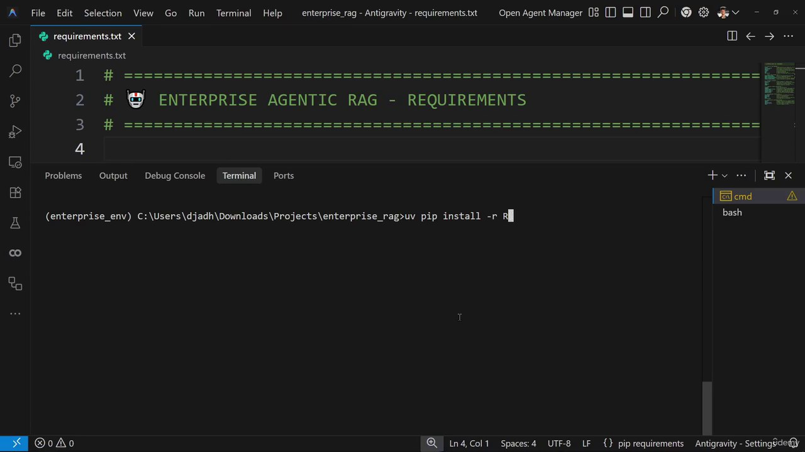

---

## 2. 讲师原话

> "第一步是安装 requirements 文件里的所有依赖；在安装的同时，我会解释为什么需要这些依赖。"
> —— p057 [00:00]

> "asyncio 用来支持异步相关操作，这样我们的 AI agent 可以以异步方式运行，也就是多个 agent 可以同时异步工作。"
> —— p057 [01:25]

> "我们做的是 enterprise RAG。真实企业里会有大量数据流入，我们要做一个可扩展、准确、可靠的聊天机器人或 RAG 系统。"
> —— p057 [07:31]

> "即使真正重要的数据只有 5%，我们也没有时间把它分出来；另外 95% 里也可能有少数文件是我们需要的，所以不如做一个能解析所有数据、并从这两部分数据里正确回答的 RAG。"
> —— p057 [08:54]

> "当我运行这些命令时，所有 Google Cloud 服务会一次性激活，不需要我到 UI 里一个个点。"
> —— p058 [11:10]

> "我们需要这些服务：Artifact Registry、Cloud Run、Cloud Build、SQL、Document AI、Compute 和 Discovery Engine。"
> —— p058 [12:36]

> "IAM 代表 identity and access management，也就是身份与访问管理；用很简单的话说，就是谁能访问什么服务。"
> —— p059 [00:00]

> "semantic re-ranking 由 FlashRank 完成，semantic caching 由 Redis 完成。"
> —— p059 [07:54]

> "semantic caching 会缓存所有用户问过的问题；如果另一个用户或我们再次问同样的问题，就不打 LLM、不打数据库，而是直接从缓存拿响应。"
> —— p059 [09:17]

> "Document AI 是 Google Cloud Platform 的服务，可以用来对文档做 OCR、解析文档、处理文档。"
> —— p059 [19:18]

> "VPC 代表 virtual private network，我们整个应用会跑在 GCP 的私有网络里，这是最安全的位置。"
> —— p059 [20:13]

> "环境都设置好了，依赖也装好了，接下来就可以进入数据摄入 pipeline。"
> —— p059 [25:27]

---

## 3. 从零复现

### 3.1 建目录结构

在本地建一个项目目录，建议名字随意，例如 `enterprise-rag`：

```text
enterprise-rag/
├─ .env
├─ .env.example
├─ .gitignore
├─ requirements.txt
├─ app/
│  └─ config.py
├─ scripts/
│  └─ gcp_setup.sh
└─ data/
   ├─ true_data/
   └─ noisy_data/
```

`data/true_data` 放讲师说的“真正需要的数据”，`data/noisy_data` 放大量噪声数据。逐字稿里讲师展示过 true data、PPT、HTML、doc、text、PDF 等文件；noisy data 里文件更多，原来有 10–15GB，后来为了省 token 做了裁剪。课程说这些数据会提供，你也可以先放几个测试文件。

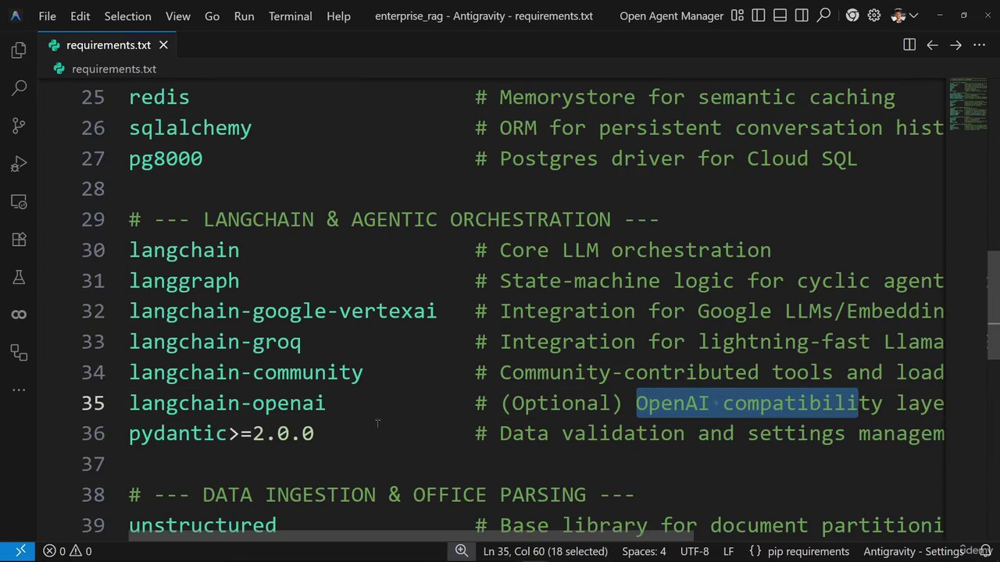

### 3.2 安装 Git Bash 与 uv

讲师明确说他用的是 **Git Bash**，Windows 用户可以搜索 `git bash download`，下载安装 Git Bash。后面所有 `gcloud` 命令都可以在 Git Bash 里执行。

安装 `uv`。逐字稿里讲师直接运行了类似 `uv pip install -r requirements.txt`，并强调 `uv` 很快，安装只用了 **2.58 秒**。你可以在 Git Bash 里执行：

```bash
python -m pip install --upgrade uv
uv --version
```

如果你已经有 Python，也可以用 `uv venv` 建虚拟环境。课程没有讲 Python 版本；建议先用 Python 3.11 或 3.12，遇到依赖冲突再按 `uv` 的解析结果调整。

### 3.3 创建虚拟环境并安装依赖

在项目根目录执行：

```bash
uv venv
source .venv/Scripts/activate   # Windows Git Bash
# macOS / Linux 用：source .venv/bin/activate

uv pip install -r requirements.txt
```

`requirements.txt` 的完整内容在第 4 节。讲师的依赖分组逻辑是：

- Web/API：FastAPI、Uvicorn、python-dotenv、requests、Streamlit、numpy、pytz、asyncio。
- GCP：Cloud Storage、AI Platform、Discovery Engine、Document AI、SQL Python connector。
- 数据库/记忆：SQLAlchemy、pg8000、LangGraph Postgres Saver 所需驱动。
- 向量与缓存：Qdrant Client、FlashRank、Redis。
- Agent 编排：LangChain、LangGraph、LangChain Google Vertex AI、LangChain Groq、LangChain Community、LangChain OpenAI 兼容层、Pydantic。
- 数据摄入：unstructured、python-pptx、python-docx、pypdf、beautifulsoup4。
- 可观测：LangSmith、Logfire、logfire-fastapi、logfire-requests、Loguru。

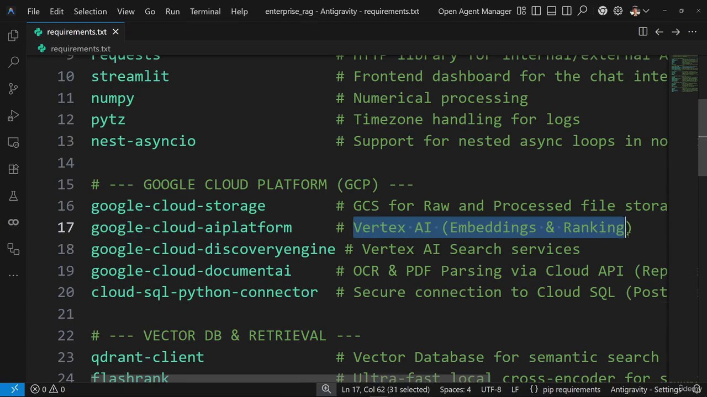

### 3.4 创建 GCP 项目并拿 project name / project number

进入 Google Cloud Console，新建项目。逐字稿里讲师新建的项目叫 `Enterprise rag`，选择 billing account，选择 No organization。创建后，把该项目设为默认项目。

你需要两个值：

1. **project name / project id**：例如 `dmt-express`、`enterprise-rag`。
2. **project number**：一串数字。讲师强调，这不是你手动创建的；新建项目初期在 IAM 页面可能只看到自己的邮箱，等你启用某个 API 或服务后，才会出现 project number。

获取 project number 的方式：

```bash
gcloud config get-value project
gcloud projects describe YOUR_PROJECT_ID --format="value(projectNumber)"
```

也可以在 Console 的 IAM 页面看。讲师特别说：“这个数字不是你创建的，是你启用服务后自动出现的。”

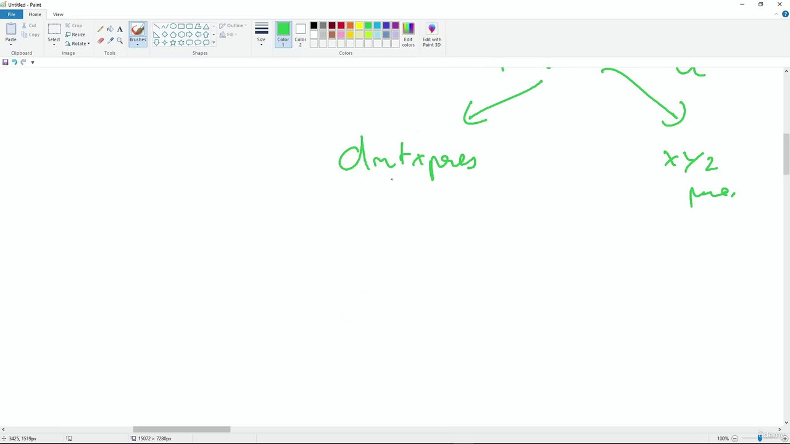

### 3.5 用 gcloud 登录并设置默认项目

打开 Git Bash，执行：

```bash
gcloud auth login
```

浏览器会打开，选择你的 Google 账号并点 Allow。然后执行 Application Default Credentials 登录：

```bash
gcloud auth application-default login
```

再设置默认项目：

```bash
gcloud config set project YOUR_PROJECT_ID
gcloud config get-value project
```

讲师强调：先 `gcloud auth login` 是普通登录；再 `gcloud auth application-default login` 是把本地应用默认凭据接到 GCP 项目。之后你运行 Python 代码、LangGraph、Google Cloud SDK 时，默认会使用这个项目。

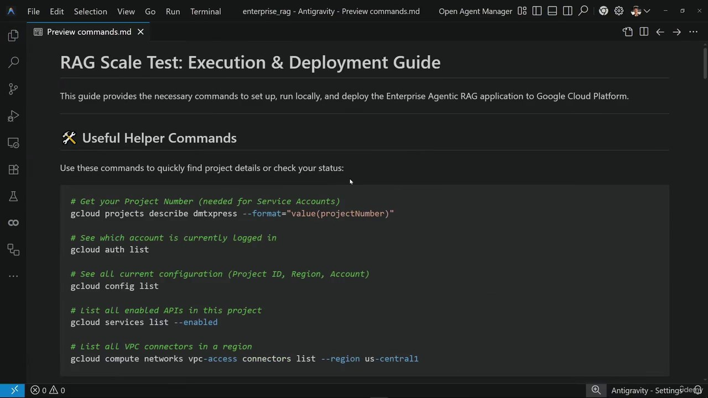

### 3.6 一次性启用 GCP 服务

讲师说不用在 UI 里一个个点，可以用命令一次性启用。课程提到的服务包括：

- Cloud Storage：存数据。
- Artifact Registry：存容器镜像。
- Cloud Run：从 Artifact Registry 拉容器并运行。
- Cloud Build：构建容器。
- Cloud SQL Admin：连接 SQL。
- Document AI：对 PDF 做 OCR，解析表格、图、结构化内容。
- Compute Engine：Cloud Run 运行容器时需要底层计算能力，讲师用“虚拟电力/计算”来解释。
- Discovery Engine：Vertex AI Search 相关，讲师说可能用也可能不用，但先启用更稳。
- Cloud AI Platform：Vertex AI embeddings / ranking 相关。

命令：

```bash
gcloud services enable \
  storage.googleapis.com \
  artifactregistry.googleapis.com \
  run.googleapis.com \
  cloudbuild.googleapis.com \
  sqladmin.googleapis.com \
  documentai.googleapis.com \
  compute.googleapis.com \
  discoveryengine.googleapis.com \
  aiplatform.googleapis.com
```

讲师在 UI 里演示过：启用 Cloud Storage API 后，Cloud Run Admin API 一启用，IAM 页面就会出现 project number。

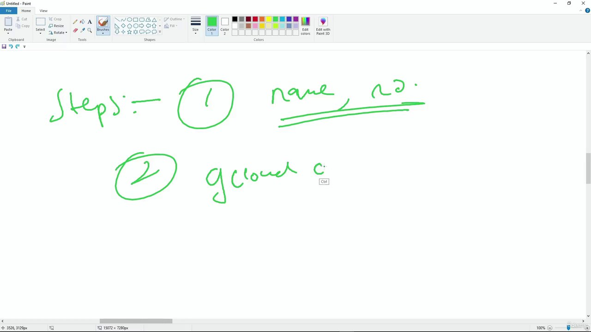

### 3.7 配 IAM：用户、角色、服务账号

IAM = Identity and Access Management。讲师解释：简单说就是“谁能访问什么服务”。

- **IAM user**：给人用的。比如你有个朋友 ABC，你给他你的 Google Cloud 账号权限，只允许他用 Cloud Storage 和 Cloud Run。
- **IAM role**：给应用用的。应用需要自动往 GCS 写数据、自动从终端跑 Cloud Run，就要给应用授权。
- **service account**：服务账号。讲师说它通常是自动创建的，用来让应用拥有权限，例如自动往 Cloud Storage 存东西、自动跑 Cloud Run。

课程里给个人账号授予了这些角色：

- Cloud Run：`roles/run.admin`
- Artifact Registry：`roles/artifactregistry.admin`
- Cloud Storage：`roles/storage.admin`
- Cloud SQL：`roles/cloudsql.admin`
- Cloud AI Platform：`roles/aiplatform.user`

命令示例，把 `YOUR_EMAIL` 和 `YOUR_PROJECT_ID` 换成你的：

```bash
gcloud projects add-iam-policy-binding YOUR_PROJECT_ID \
  --member="user:YOUR_EMAIL" \
  --role="roles/run.admin"

gcloud projects add-iam-policy-binding YOUR_PROJECT_ID \
  --member="user:YOUR_EMAIL" \
  --role="roles/artifactregistry.admin"

gcloud projects add-iam-policy-binding YOUR_PROJECT_ID \
  --member="user:YOUR_EMAIL" \
  --role="roles/storage.admin"

gcloud projects add-iam-policy-binding YOUR_PROJECT_ID \
  --member="user:YOUR_EMAIL" \
  --role="roles/cloudsql.admin"

gcloud projects add-iam-policy-binding YOUR_PROJECT_ID \
  --member="user:YOUR_EMAIL" \
  --role="roles/aiplatform.user"
```

讲师还提到“要给 Document AI 访问 Cloud Run 服务的权限”，并说这一步需要 project name 和 project number。但逐字稿没有念出完整绑定命令，也没有给出具体角色名。所以这里不要盲目复制一个你没见过的角色；请到 IAM 控制台，按讲师演示的页面给 Document AI 相关服务账号授权。**该步骤的完整命令课里没讲。**

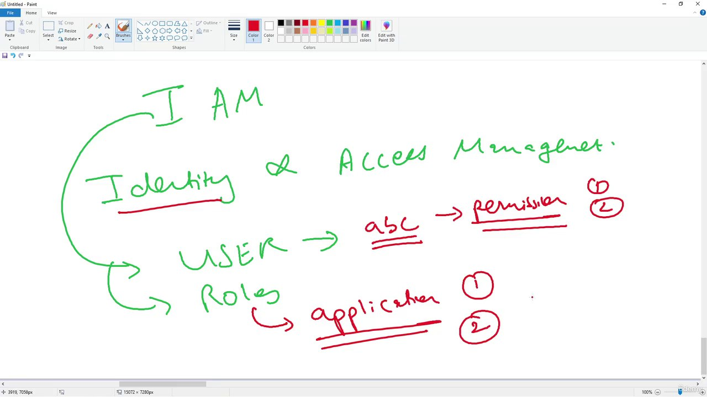

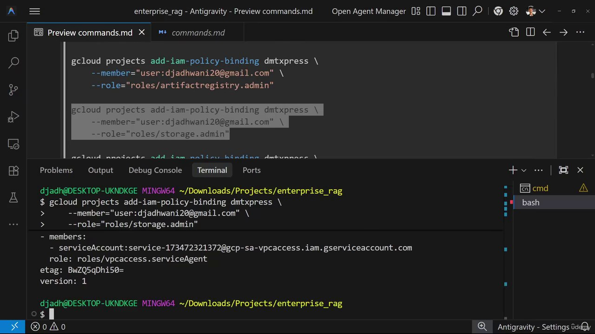

### 3.8 创建两个 GCS Bucket

讲师演示了两种方式：UI 和 CLI。他创建了两个 Bucket：

- raw bucket：存原始数据，例如 `dmt-express-rag-raw`。
- processed bucket：存处理后的数据，例如 `dmt-express-rag-processed`。

区域选 `us-central1`。他说这个区域对他最合适，后面所有服务都尽量统一到这个区域。

CLI 创建：

```bash
gcloud storage buckets create gs://YOUR_RAW_BUCKET --location=us-central1
gcloud storage buckets create gs://YOUR_PROCESSED_BUCKET --location=us-central1
```

说明：Bucket 名字全球唯一，所以如果你的名字被占用，就在前面加项目名或随机后缀。讲师在 UI 里演示了创建后上传文件、上传文件夹、删除 Bucket、再用 CLI 重建。CLI 刷新后能看到新 Bucket。

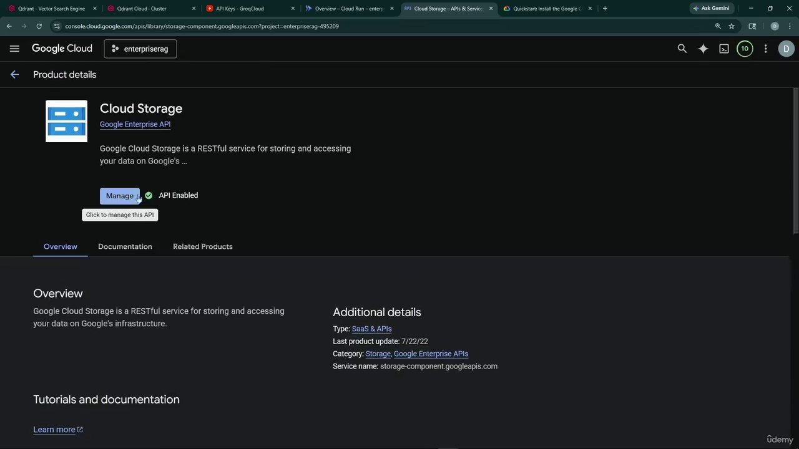

### 3.9 创建 Document AI OCR processor

Document AI 用来对 PDF 做 OCR。讲师说 `pypdf` 这类老库适合抽文本，但表格、图、OCR 效果不够好，所以 PDF 表格/图/结构化内容用 Google Cloud Document AI。

步骤：

1. 进入 Document AI。
2. 启用 Document AI API。
3. 创建 processor。
4. 选择 **Document OCR**。
5. 区域选 **United States**，默认就是 `us`。
6. 创建后拿到 processor ID。

注意：你的项目区域是 `us-central1`，但 Document AI 默认 location 是 `us`。讲师专门解释了：Document AI 在 `us` 这个 location 工作，所以你要显式告诉它“我访问 Doc AI 的 location 是 us”；而项目运行区域是 `us-central1`。这两个不是同一个值。

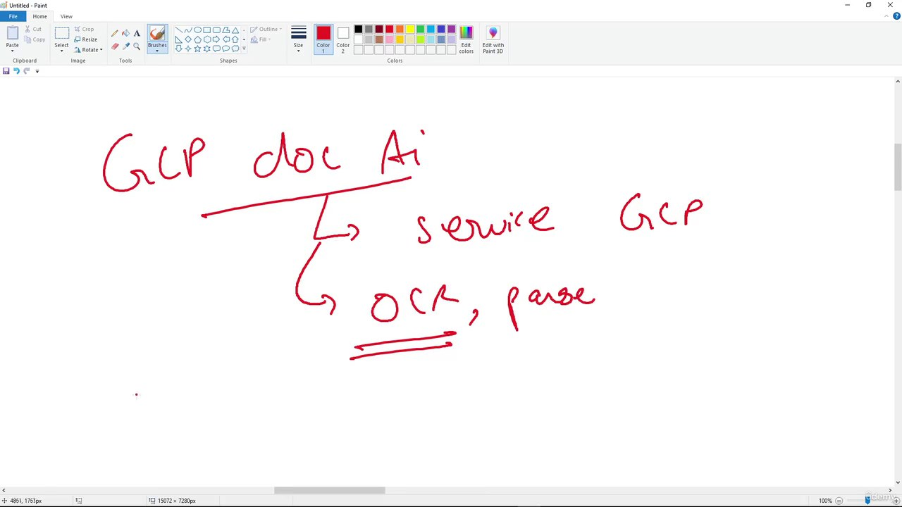

### 3.10 创建或选择 VPC

讲师说 VPC = virtual private network，整个应用会跑在 GCP 的私有网络里，这是最安全的位置，其他实体不能随便进入。

他演示了创建 VPC 网络：

```bash
gcloud compute networks create rag-vpc --subnet-mode=auto
```

他也说：可以先试 `default`，如果报错再建 `rag-vpc`。所以 `.env` 里的 VPC connector 可以先写 `default`，也可以写你新建的网络名。注意：逐字稿里说的是“VPC connector”，但演示的是“VPC network”；Serverless VPC connector 的完整创建参数课里没讲。如果后面 Cloud Run 连私有网络报错，再到控制台创建 connector。

### 3.11 创建 `.env` 并填环境变量

在项目根目录创建 `.env`。逐字稿里讲师一项项填了：

- Groq API key。
- Qdrant API key。
- Qdrant cluster endpoint。
- LangSmith tracing / endpoint / API key / project。
- Logfire token。
- GCP project id。
- GCP region：`us-central1`。
- GCP Document AI location：`us`。
- GCP Document AI processor ID。
- VPC connector。

课程没有逐字给出变量名，只说了变量含义。所以下面第 4 节用一套统一命名，你只要保证 Python 代码和 `.env` 一致即可。

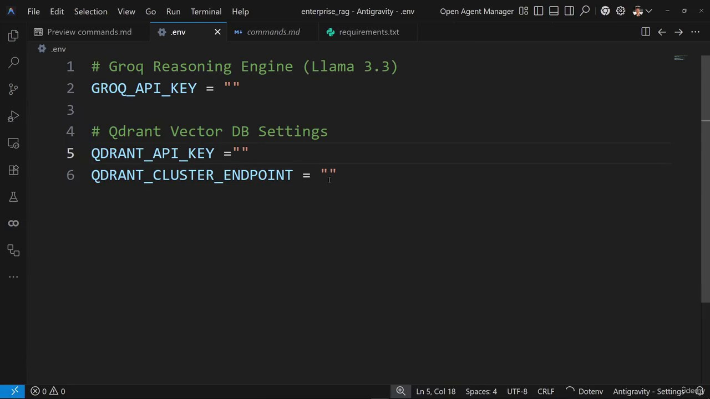

### 3.12 LangSmith、Logfire、Qdrant、Groq

**LangSmith**：讲师从 LangChain 文档点 Try LangSmith，登录后进入 Tracing，新建项目 `enterprise-rag`，生成 API key，复制 `.env` 变量。关键值包括 tracing 开关、endpoint、API key、project name。

**Logfire**：讲师进入 Pydantic Logfire，登录后新建项目 `enterprise-rag`。然后执行：

```bash
logfire auth
logfire projects use enterprise-rag
```

`logfire auth` 会打开浏览器让你授权设备。授权后本地会生成 `.logfire` 凭据，里面有 token。讲师把 token 填到 `.env` 的 Logfire token 变量里。

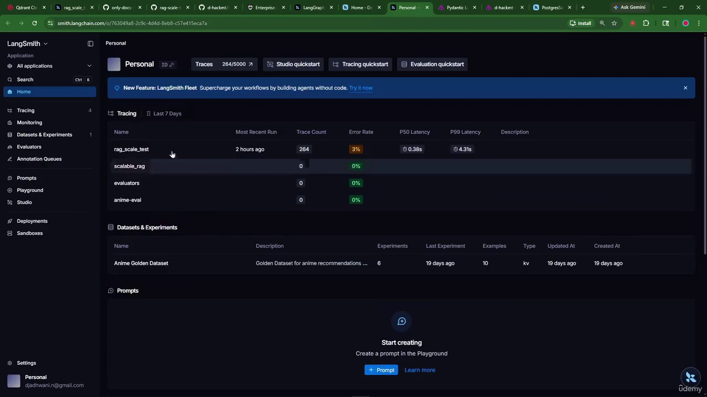

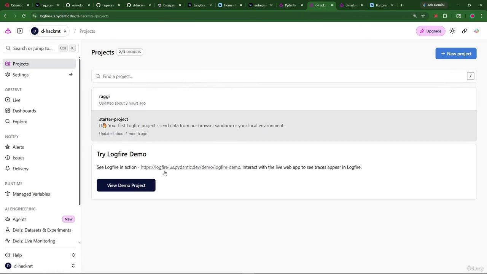

**Qdrant**：创建 cluster，复制 API key 和 cluster endpoint。后面 Qdrant Client 用它连向量库。

**Groq**：复制 Groq API key。后面 LangChain Groq 用它调用模型。

### 3.13 验证环境

```bash
python -c "import fastapi, uvicorn, dotenv, streamlit, numpy, pytz, sqlalchemy, pg8000, qdrant_client, flashrank, redis, langchain, langgraph, pydantic, unstructured, pptx, docx, pypdf, bs4, langsmith, logfire, loguru; print('deps ok')"
gcloud auth list
gcloud config get-value project
gcloud storage buckets list
```

如果都能跑通，说明本地依赖、gcloud 登录、默认项目和 Bucket 基本就绪。

---

## 4. 完整代码

### 4.1 目录树

```text
enterprise-rag/
├─ .env
├─ .env.example
├─ .gitignore
├─ requirements.txt
├─ app/
│  └─ config.py
├─ scripts/
│  └─ gcp_setup.sh
└─ data/
   ├─ true_data/
   └─ noisy_data/
```

### 4.2 `requirements.txt`

```txt
# Web / API
fastapi
uvicorn[standard]
python-dotenv
requests
streamlit
numpy
pytz

# GCP
google-cloud-storage
google-cloud-aiplatform
google-cloud-discoveryengine
google-cloud-documentai
cloud-sql-python-connector[pg8000]

# SQL / memory
sqlalchemy
pg8000

# Vector DB / rerank / cache
qdrant-client
flashrank
redis

# LangChain / LangGraph / agent
langchain
langgraph
langchain-google-vertexai
langchain-groq
langchain-community
langchain-openai
pydantic

# Data ingestion
unstructured
python-pptx
python-docx
pypdf
beautifulsoup4

# Observability
langsmith
logfire
logfire[fastapi]
logfire[requests]
loguru
```

说明：

- `asyncio` 是 Python 标准库，不写进 `requirements.txt`。
- 讲师没有给依赖版本，所以这里不锁版本。想可重复复现，可以在安装后执行 `uv pip freeze > requirements.lock
```bash
uv pip freeze > requirements.lock
```

（`requirements.lock` 不是课程要求，是我建议你加的：讲师没有锁版本，`uv` 解析出来的实际版本会随时间变化。把 freeze 结果留在仓库里，下次复现时用 `uv pip install -r requirements.lock` 就能装到同一批版本。注意 `pip freeze` 会把 `logfire[fastapi]` 这类 extras 拍平成 `logfire` + 对应子依赖，这是正常现象。）

### 4.3 `.env.example`

这是给仓库提交的模板，真实 `.env` 不要提交。

```dotenv
# ===== LLM =====
GROQ_API_KEY=your_groq_api_key

# ===== Qdrant（向量库）=====
QDRANT_URL=https://xxxxxxxx-xxxx-xxxx-xxxx-xxxxxxxxxxxx.us-central1-0.prod.cloud.qdrant.io:6333
QDRANT_API_KEY=your_qdrant_api_key
QDRANT_COLLECTION=enterprise_rag

# ===== LangSmith（可观测：链路追踪）=====
LANGSMITH_TRACING=true
LANGSMITH_ENDPOINT=https://api.smith.langchain.com
LANGSMITH_API_KEY=your_langsmith_api_key
LANGSMITH_PROJECT=enterprise-rag

# ===== Logfire（可观测：日志/指标）=====
LOGFIRE_TOKEN=your_logfire_token
LOGFIRE_PROJECT=enterprise-rag

# ===== GCP =====
GCP_PROJECT_ID=your-project-id
GCP_PROJECT_NUMBER=000000000000
GCP_REGION=us-central1

# Google Cloud Storage
GCS_RAW_BUCKET=your-project-rag-raw
GCS_PROCESSED_BUCKET=your-project-rag-processed

# Document AI
GCP_DOC_AI_LOCATION=us
GCP_DOC_AI_PROCESSOR=your_processor_id_here

# VPC（先试 default，报错再换成你自建的网络名）
GCP_VPC_CONNECTOR=default
GCP_VPC_NETWORK=default

# ===== Cloud SQL / Postgres（对话记忆）=====
SQL_CONNECTION_NAME=your-project-id:us-central1:your-instance
SQL_DB_NAME=enterprise_rag
SQL_DB_USER=postgres
SQL_DB_PASSWORD=your_password

# ===== Redis（semantic caching）=====
REDIS_URL=redis://localhost:6379/0
```

逐字稿里讲师只在屏幕上填了值、没有念出变量名，所以上面这套变量名是**按讲师说过的每一项含义统一命名**的，不是逐字稿原文。你只要让 `.env` 和 `app/config.py` 用同一套名字就行。`.env.example` 与 `.env` 内容一致，只把值换成占位符。

### 4.4 `.gitignore`

```gitignore
# 环境与密钥
.env
.logfire/
.venv/

# 数据（讲师说 noisy data 有 10–15GB，绝不要进 git）
data/true_data/*
data/noisy_data/*
!data/true_data/.gitkeep
!data/noisy_data/.gitkeep

# Python
__pycache__/
*.py[cod]
*.egg-info/
.pytest_cache/

# 锁文件按需保留，这里保留
# requirements.lock

# 系统
.DS_Store
Thumbs.db
```

讲师在演示时提到“我会保留这个 `.gitignore`，用它来忽略相关文件”，但他没有展示 `.gitignore` 的具体内容；上面是按他的意图（忽略数据、密钥、虚拟环境）重建的。

### 4.5 `app/config.py`

```python
"""集中读取 .env，其他模块只从这里取配置，避免 os.getenv 散落各处。"""

import os
from functools import lru_cache

from dotenv import load_dotenv
from pydantic import BaseModel

# 显式加载项目根目录的 .env（config.py 在 app/ 下，所以往上一级）
load_dotenv(dotenv_path=os.path.join(os.path.dirname(__file__), "..", ".env"))


def _bool(value: str | None, default: bool = False) -> bool:
    if value is None:
        return default
    return value.strip().lower() in {"1", "true", "yes", "on"}


class Settings(BaseModel):
    # LLM
    groq_api_key: str

    # Qdrant
    qdrant_url: str
    qdrant_api_key: str
    qdrant_collection: str = "enterprise_rag"

    # LangSmith
    langsmith_tracing: bool = False
    langsmith_endpoint: str = "https://api.smith.langchain.com"
    langsmith_api_key: str | None = None
    langsmith_project: str = "enterprise-rag"

    # Logfire
    logfire_token: str | None = None
    logfire_project: str = "enterprise-rag"

    # GCP
    gcp_project_id: str
    gcp_project_number: str | None = None
    gcp_region: str = "us-central1"

    gcs_raw_bucket: str
    gcs_processed_bucket: str

    gcp_doc_ai_location: str = "us"          # 注意：Document AI 默认是 us
    gcp_doc_ai_processor: str | None = None

    gcp_vpc_connector: str = "default"
    gcp_vpc_network: str = "default"

    # Cloud SQL / Postgres
    sql_connection_name: str | None = None
    sql_db_name: str = "enterprise_rag"
    sql_db_user: str = "postgres"
    sql_db_password: str | None = None

    # Redis
    redis_url: str = "redis://localhost:6379/0"


@lru_cache
def get_settings() -> Settings:
    return Settings(
        groq_api_key=os.environ["GROQ_API_KEY"],
        qdrant_url=os.environ["QDRANT_URL"],
        qdrant_api_key=os.environ["QDRANT_API_KEY"],
        qdrant_collection=os.getenv("QDRANT_COLLECTION", "enterprise_rag"),
        langsmith_tracing=_bool(os.getenv("LANGSMITH_TRACING"), False),
        langsmith_endpoint=os.getenv("LANGSMITH_ENDPOINT", "https://api.smith.langchain.com"),
        langsmith_api_key=os.getenv("LANGSMITH_API_KEY"),
        langsmith_project=os.getenv("LANGSMITH_PROJECT", "enterprise-rag"),
        logfire_token=os.getenv("LOGFIRE_TOKEN"),
        logfire_project=os.getenv("LOGFIRE_PROJECT", "enterprise-rag"),
        gcp_project_id=os.environ["GCP_PROJECT_ID"],
        gcp_project_number=os.getenv("GCP_PROJECT_NUMBER"),
        gcp_region=os.getenv("GCP_REGION", "us-central1"),
        gcs_raw_bucket=os.environ["GCS_RAW_BUCKET"],
        gcs_processed_bucket=os.environ["GCS_PROCESSED_BUCKET"],
        gcp_doc_ai_location=os.getenv("GCP_DOC_AI_LOCATION", "us"),
        gcp_doc_ai_processor=os.getenv("GCP_DOC_AI_PROCESSOR"),
        gcp_vpc_connector=os.getenv("GCP_VPC_CONNECTOR", "default"),
        gcp_vpc_network=os.getenv("GCP_VPC_NETWORK", "default"),
        sql_connection_name=os.getenv("SQL_CONNECTION_NAME"),
        sql_db_name=os.getenv("SQL_DB_NAME", "enterprise_rag"),
        sql_db_user=os.getenv("SQL_DB_USER", "postgres"),
        sql_db_password=os.getenv("SQL_DB_PASSWORD"),
        redis_url=os.getenv("REDIS_URL", "redis://localhost:6379/0"),
    )
```

### 4.6 `scripts/gcp_setup.sh`

```bash
#!/usr/bin/env bash
# 一次性完成 P58/P59 的 GCP 侧准备工作。
# 使用前先改下面 3 个变量，或者在终端 export 好。
set -euo pipefail

PROJECT_ID="${PROJECT_ID:-your-project-id}"
PROJECT_NUMBER="${PROJECT_NUMBER:-000000000000}"
YOUR_EMAIL="${YOUR_EMAIL:-you@gmail.com}"

REGION="us-central1"
RAW_BUCKET="${RAW_BUCKET:-${PROJECT_ID}-rag-raw}"
PROCESSED_BUCKET="${PROCESSED_BUCKET:-${PROJECT_ID}-rag-processed}"

echo "== 1. 登录（需手动点浏览器授权）=="
gcloud auth login
gcloud auth application-default login

echo "== 2. 设置默认项目 =="
gcloud config set project "${PROJECT_ID}"
gcloud config get-value project

echo "== 3. 启用本课程用到的 API =="
gcloud services enable \
  storage.googleapis.com \
  artifactregistry.googleapis.com \
  run.googleapis.com \
  cloudbuild.googleapis.com \
  sqladmin.googleapis.com \
  documentai.googleapis.com \
  compute.googleapis.com \
  discoveryengine.googleapis.com \
  aiplatform.googleapis.com

echo "== 4. 给个人账号授予 IAM 角色 =="
for ROLE in \
  roles/run.admin \
  roles/artifactregistry.admin \
  roles/storage.admin \
  roles/cloudsql.admin \
  roles/aiplatform.user
do
  gcloud projects add-iam-policy-binding "${PROJECT_ID}" \
    --member="user:${YOUR_EMAIL}" \
    --role="${ROLE}" \
    --quiet
done

echo "== 5. 创建两个 GCS Bucket =="
gcloud storage buckets create "gs://${RAW_BUCKET}" \
  --location="${REGION}" --uniform-bucket-level-access || echo "raw bucket 可能已存在"

gcloud storage buckets create "gs://${PROCESSED_BUCKET}" \
  --location="${REGION}" --uniform-bucket-level-access || echo "processed bucket 可能已存在"

echo "== 6. VPC 网络（先尝试 default，不存在才建）=="
gcloud compute networks describe default >/dev/null 2>&1 || \
  gcloud compute networks create rag-vpc --subnet-mode=auto

echo "== 完成。请到控制台手动做：Document AI OCR processor / VPC connector / LangSmith / Logfire / Qdrant =="
echo "project number: ${PROJECT_NUMBER}"
```

说明：`--uniform-bucket-level-access`、`--quiet` 这两个参数不是讲师逐字念的，是为了脚本能无人值守跑通加的。讲师演示的是“在 UI 里点创建、再在 CLI 里创建一遍验证结果一致”，所以脚本里的 Bucket 创建命令属于**按演示重建**，Bucket 名必须改成你自己的。

---

## 5. 逐行解释

### 5.1 `requirements.txt` 为什么这样分组

讲师是按“这个库在架构里承担什么职责”来讲的，不是按字母序。分组对应架构分层，复现时不要随意合并——尤其 GCP 那几行，少了任何一个，后面 Document AI、Vertex AI embeddings、Cloud SQL 都会在运行时报 `ImportError` 或 `DefaultCredentialsError`。

- `fastapi` + `uvicorn[standard]`：agent 要跑在 web 上，FastAPI 起服务，Uvicorn 是 ASGI 服务器。`[standard]` 会带 `uvloop`、`httptools` 等加速件；如果你在 Windows 上遇到 `uvloop` 装不上，改成 `uvicorn` 也能跑。
- `python-dotenv`：读 `.env`。讲师在 P59 末尾专门建 `.env`，就是靠它加载。
- `requests`：HTTP 调用。
- `streamlit`：UI。讲师的 Logfire 也装了 `logfire` 的 requests/streamlit 相关追踪能力，对应“用 fastapi 追踪 FastAPI 执行、用 requests 追踪 HTTP 请求、通过 Streamlit UI 看结果”。
- `numpy`：数值处理，向量/打分都会用到。
- `pytz`：时区。讲师原话是“让我们的 agent 知道时间”，这样 RAG 回答“最近三个月”之类的问题时才有正确的当前时间基准。
- `google-cloud-storage`：读写 GCS 的 raw/processed 两个 Bucket。
- `google-cloud-aiplatform`：Vertex AI embeddings / ranking 的入口。讲师说“现在还没用 ranking”，但依赖先装上。
- `google-cloud-discoveryengine`：Vertex AI Search 相关，讲师原话是“如果需要的话”。
- `google-cloud-documentai`：OCR 和 PDF 解析。讲师明确说 `pypdf` 这类老库“抽纯文本最好，但 OCR 和表格不行”，所以 PDF 里的表格、图、结构化内容交给 Document AI。
- `cloud-sql-python-connector[pg8000]`：Cloud SQL 的 Python 连接器。`[pg8000]` 这个 extra 会拉纯 Python 的 Postgres 驱动，省掉编译 `psycopg2` 的麻烦。
- `sqlalchemy`：ORM，存 conversation memory / 持久化对话历史。
- `pg8000`：Postgres 驱动。讲师特别解释了为什么要单独列它：**LangGraph 的 Postgres Saver 后端用的就是 pg8000**，而你的向量库/应用也要连 Cloud SQL，两边共用同一个驱动，所以必须装。
- `qdrant-client`：连 Qdrant 向量库。
- `flashrank`：semantic re-ranking。讲师选它是因为“非常轻量、快”。
- `redis`：semantic caching。讲师说 scalable 架构里用它。
- `langchain` / `langgraph`：agentic orchestration，把 RAG 流程编成图。
- `langchain-google-vertexai`：embeddings 走 Vertex AI。
- `langchain-groq`：模型走 Groq。
- `langchain-community`：LangChain 工具（tools）在这里。
- `langchain-openai`：OpenAI 兼容层。讲师的意思是“它和很多东西兼容”，后面接兼容 OpenAI 协议的服务时用得上。
- `pydantic`：数据校验 + settings 管理。`app/config.py` 就靠它。
- `unstructured`：文档切分（partition）。讲师说“我们有不同种类的文档”，所以要先 partition 再进 pipeline。
- `python-pptx` / `python-docx` / `pypdf` / `beautifulsoup4`：分别解析 PPT、Word、PDF、HTML。这是对 `data/true_data` 里多格式文件的直接回应。
- `langsmith`：tracing。
- `logfire`：Pydantic 家的可观测。讲师说“Pydantic 有非常多项目在推进，建议都去看看”。
- `loguru`：增强 Python 日志。

`asyncio` 不需要装：它是标准库。讲师讲它是为了说明“agent 可以异步跑，多个 agent 可以同时工作”，这是运行时特性，不是依赖项。

### 5.2 `app/config.py`

- 顶部 `load_dotenv(dotenv_path=os.path.join(os.path.dirname(__file__), "..", ".env"))`：不用 `load_dotenv()` 的无参形式，是因为无参形式只按当前工作目录找 `.env`；你从 `scripts/` 目录启动脚本时就会找不到。用 `__file__` 往上退一级，路径就固定了。
- `_bool()`：`.env` 里的值永远是字符串，`LANGSMITH_TRACING=true` 直接塞进 `bool()` 会得到 `True`（因为非空字符串为真），但 `LANGSMITH_TRACING=false` 也会得到 `True`——这是经典坑。所以必须显式判断 `{"1","true","yes","on"}`。
- `Settings` 用 `pydantic.BaseModel` 而不是 `BaseSettings`：Pydantic v2 把 `BaseSettings` 挪到了独立的 `pydantic-settings` 包，讲师没提这个包，所以这里不引入额外依赖，改成“dotenv 读环境变量 + BaseModel 做校验”的组合。
- 必填项（`groq_api_key`、`qdrant_url`、`qdrant_api_key`、`gcp_project_id`、`gcs_raw_bucket`、`gcs_processed_bucket`）用 `os.environ[...]`：缺了会直接 `KeyError`，比“跑到一半才发现没配”好。
- `gcp_doc_ai_location` 默认 `"us"`：这是 P59 的重点。讲师反复强调 Document AI 在 `us` 这个 location 工作，而项目本身在 `us-central1`。两个值混用，后面调 OCR 会报 location 不匹配。
- `gcp_vpc_connector` 默认 `"default"`：对应讲师说的“你可以先试 default，报错再建自己的 VPC”。
- `@lru_cache`：只解析一次，全局复用；也避免每次请求都读一遍 `.env`。

### 5.3 `scripts/gcp_setup.sh`

- `set -euo pipefail`：任何一条命令失败就停。这里的风险点是 IAM 绑定——如果邮箱写错，`add-iam-policy-binding` 会报错，你希望它立刻停下，而不是继续把后面的角色都绑到错误对象上。
- `PROJECT_ID` / `PROJECT_NUMBER` / `YOUR_EMAIL` 用 `${VAR:-默认值}`：既能 `export` 覆盖，也能直接改脚本。
- `gcloud auth login` 与 `gcloud auth application-default login` 是两条不同的命令。前者是 CLI 自己的凭据，后者是给代码（ADC）用的凭据。讲师在 P58 用“先登录、再 ADC 登录”两步演示过，很多人只做第一步，结果 Python 里调 GCS 就报 `Could not automatically determine credentials`。
- `gcloud config set project`：讲师强调“把项目设为默认非常重要”。
- `gcloud services enable` 后面那串 API：对应讲师列的 Artifact Registry、Cloud Run、Cloud Build、SQL Admin、Document AI、Compute、Discovery Engine，加上 Cloud AI Platform（Vertex AI）。
- `for ROLE in ...` 循环：对应讲师一条条贴 `add-iam-policy-binding` 的操作。讲师说他“复制两条、粘贴两条、一条接一条跑，全都正常工作”。
- Bucket 创建加了 `|| echo "可能已存在"`：讲师在演示里反复删 Bucket 再重建，脚本要能重复执行。
- `gcloud compute networks describe default >/dev/null 2>&1 || ...`：这就是讲师“先用 default，不行再建”的逻辑落到代码里。
- 最后那行 `echo` 是关键：**Document AI processor、VPC connector、LangSmith、Logfire、Qdrant 这五件事全程是 UI 操作，脚本做不了**，必须手动去控制台点。不写这行，你第二天就忘了自己漏了哪一步。

### 5.4 semantic re-ranking 与 semantic caching 为什么放在这一节讲

讲师在 P59 中间突然回头补讲这两件事，因为它们是 `requirements.txt` 里 `flashrank` 和 `redis` 的“解释欠账”。

**semantic re-ranking**：数据在 Qdrant 里，LLM 发 query，Qdrant 返回一批 documents，顺序是 1、2、3、4、5，但“前几个最重要、后几个没那么重要”这个判断，向量检索本身给得不够准。FlashRank 会“理解问题的含义”，按语义相关度把这批文档重新排成 1、2、3，然后是 4、5。讲师选 FlashRank 的理由是轻量、快——重排是在每次检索后都要跑的步骤，太重会拖慢整个响应。

**semantic caching**：同一个 session 里你十分钟前问过“how to make clusters on Kubernetes”，另一个用户问“how will I manage clusters”，两句话字面不同但语义相同。Redis 把所有用户问过的问题缓存起来，再遇到语义相同的问题，**不打 LLM、不打数据库**，直接返回缓存答案。收益是：响应更快、相似问题性能更高、不重复烧 token。

在前端语境里可以这么类比：re-ranking 相当于拿到一页搜索结果后在前端做一次相关性排序（只不过这里的“相关性”是模型语义，而不是字符串匹配）；semantic caching 相当于把请求按“意图”做缓存键，而不是按 URL 字符串——`/search?q=how+to+make+clusters` 和 `/search?q=how+will+i+manage+clusters` 在普通 HTTP 缓存里是两个 key，在语义缓存里是同一个 key。

### 5.5 关于“存储对话记忆”的那条线

`sqlalchemy` + `pg8000` + `cloud-sql-python-connector` 这一组对应讲师说的“把 SQL 集成进来，存 conversation memory”。对前端来说需要补一句：**写对话历史是一次数据库写入，多用户并发时涉及事务**。在 JS/Node 里对应的是 `BEGIN / COMMIT / ROLLBACK`（`pg` 的 `client.query('BEGIN')`）或 ORM 的 `transaction()`；在 Python/SQLAlchemy 里是 `with session.begin():`。这一节只装驱动、建实例，**没有写任何事务代码**，课程也没讲隔离级别，所以复现时不要把“装好驱动”当成“并发安全已经解决”。

---

## 6. 复现检查清单

按顺序打勾，任何一项没过就不要往下走。

**本地环境**

- [ ] Git Bash 已安装，能在其中执行 `gcloud --version`。
- [ ] `uv --version` 有输出。
- [ ] `.venv` 已创建并激活（激活后 `which python` 指向 `.venv`）。
- [ ] `uv pip install -r requirements.txt` 无报错结束。
- [ ] `python -c "import fastapi, uvicorn, dotenv, sqlalchemy, pg8000, qdrant_client, flashrank, redis, langchain, langgraph, langsmith, logfire, loguru; print('ok')"` 输出 `ok`。
- [ ] `python -c "from app.config import get_settings; s=get_settings(); print(s.gcp_region, s.gcp_doc_ai_location)"` 输出 `us-central1 us`。

**GCP 项目**

- [ ] Console 里能看到你的项目，且已绑定 billing account。
- [ ] `gcloud config get-value project` 返回你的 project id。
- [ ] 拿到了 project number（`gcloud projects describe YOUR_PROJECT_ID --format="value(projectNumber)"`）。
- [ ] `gcloud auth list` 里你的账号前面是 `*`（ACTIVE）。
- [ ] ADC 登录过：`gcloud auth application-default print-access-token` 能出 token。

**API 与 IAM**

- [ ] 9 个 API 全部 enabled：storage、artifactregistry、run、cloudbuild、sqladmin、documentai、compute、discoveryengine、aiplatform。
- [ ] 你的邮箱在 IAM 里有 run.admin、artifactregistry.admin、storage.admin、cloudsql.admin、aiplatform.user。
- [ ] 知道 service account 在 IAM 页面哪个位置（讲师说“先放一边，后面再讲”）。

**存储与网络**

- [ ] raw Bucket 存在，region 是 `us-central1`。
- [ ] processed Bucket 存在，region 是 `us-central1`。
- [ ] 能往 raw Bucket 上传一个测试文件（UI 或 `gcloud storage cp` 都行）。
- [ ] VPC：`gcloud compute networks list` 里至少有 `default`（或你自建的 `rag-vpc`）。
- [ ] 记住了：这里建的是 **VPC network**，不是 Serverless VPC **connector**。

**Document AI**

- [ ] Document AI API 已启用。
- [ ] 有一个 **Document OCR** 类型的 processor。
- [ ] processor 的 location 是 `us`（不是 `us-central1`）。
- [ ] processor ID 已抄进 `.env` 的 `GCP_DOC_AI_PROCESSOR`。

**第三方服务**

- [ ] Groq API key 可用。
- [ ] Qdrant cluster 已建，endpoint 能 ping 通（`curl $QDRANT_URL/collections -H "api-key: $QDRANT_API_KEY"`）。
- [ ] LangSmith 项目 `enterprise-rag` 已建，API key 已生成，`.env` 里 tracing 为 `true`。
- [ ] `logfire auth` 已完成，`logfire projects use enterprise-rag` 已执行，`.logfire/` 目录已生成。
- [ ] Logfire token 已填入 `.env`。

**仓库卫生**

- [ ] `.env` 在 `.gitignore` 里。
- [ ] `data/true_data`、`data/noisy_data` 在 `.gitignore` 里（讲师说 noisy data 原量 10–15GB）。
- [ ] `.env.example` 里没有任何真实密钥。

---

## 7. 课里没讲但你会撞上的

**1. 这三讲里没有任何护栏（guardrail）和网关（gateway）代码。**
课程标题带“护栏/网关/可观测”，但 P57–P59 只做到“装依赖 + 配 GCP + 配 `.env` + 讲清 re-ranking 和 caching 的概念”。没有 prompt 注入防护、没有输出过滤、没有模型路由网关的实现，也没有一行 trace 埋点。可观测部分只有：装 `langsmith`/`logfire`、建项目、拿 token、`logfire auth`。真正的 `logfire.instrument_fastapi(app)`、LangSmith 回调挂载，**课里没写**。所以复现到本节结束，你的项目是“能装、能连、能配”，但还没有“能观测”。

**2. `asyncio` 装不上。**
它是标准库。如果你照着“requirements 里每个词都装一遍”的思路执行 `uv pip install asyncio`，会装到一个同名的、早就废弃的第三方占位包，然后 `import asyncio` 的行为可能变得莫名其妙。别装。

**3. `python-docx` 的包名和导入名不一致。**
`requirements.txt` 里写 `python-docx`，代码里是 `import docx`。同理 `python-pptx` → `import pptx`，`beautifulsoup4` → `import bs4`，`google-cloud-documentai` → `from google.cloud import documentai`。验证脚本里我用的就是导入名。

**4. `logfire[fastapi]` 和 `logfire[requests]` 写在两行，pip 会把 extras 合并。**
这是允许的，但 `pip freeze` 之后 extras 信息会丢，只剩 `logfire`。如果你把 freeze 结果当 lock 用，下次装出来的 extras 就没了——所以 lock 里最好保留原始 `requirements.txt` 的 extras 写法。

**5. Document AI 的 location 和项目 region 是两个值。**
这是本节最容易踩的坑。项目 region 是 `us-central1`，Document AI processor 默认建在 `us`。调 OCR 时如果 `location` 传成 `us-central1`，会报找不到 processor。讲师专门用一大段话解释这件事，说明他自己也被这个设计卡过。

**6. GCS Bucket 名字全球唯一。**
`dmt-express-rag-raw` 这种名字别人可能已经占了。脚本里我用了 `${PROJECT_ID}-rag-raw`，project id 本身全球唯一，所以基本不会冲突。讲师用的是他自己的项目名，你直接抄会失败。

**7. “VPC connector”和“VPC network”不是一回事。**
讲师口头上说的是 VPC connector，演示的是创建 VPC network，最后 `.env` 里填的也是网络名。Cloud Run 要连私有网络，需要的是 **Serverless VPC Access connector**（它自己还要指定 region、subnet、IP 段）。这节课没有创建 connector，也没有给命令。如果后面 Cloud Run 报 “VPC connector not found”，你得到的错误不是“网络不存在”，而是“连接器不存在”——去控制台建一个 Serverless VPC Access connector 即可，这不属于讲师讲过的内容。

**8. IAM 里“给 Document AI 访问 Cloud Run 的权限”这一步没有命令。**
讲师说“这需要 project name 和 project number”，然后就跳到别处了。逐字稿没给角色名，也没给 `--member` 的格式。你到 IAM 页面按 UI 操作更稳；不要在脚本里猜一个 `roles/documentai.xxx`，猜错会在后续 Cloud Run 调用时表现为权限拒绝，很难排查。

**9. Vertex AI embeddings 需要正确的凭据和区域。**
`langchain-google-vertexai` 在本地跑时依赖 ADC（`gcloud auth application-default login`）。只用 `gcloud auth login` 是不够的。另外 Vertex AI embeddings 的区域和 `us-central1` 要对上，否则会报模型在该区域不可用。课程没讲这部分参数，只说了“embeddings 我们用 Vertex AI”。

**10. Cloud SQL 实例没有在本节创建。**
讲师说的是“SQL admin 我们后面会需要”“SQL 用来存 conversation memory”，但 P57–P59 全程没有 `gcloud sql instances create`，也没有建库建表。`.env` 里的 `SQL_CONNECTION_NAME` 现在填了也连不上，因为实例还不存在。这属于下一节的内容。

**11. Redis 是本地的还是云上的，课里没说。**
讲师只讲“semantic caching 用 Redis”“我们在 scalable 架构里用它”。Qdrant 他明确用了 Cloud 版（有 endpoint 和 api key），Redis 没有给 endpoint。所以 `REDIS_URL` 先按 `redis://localhost:6379/0` 填，本地起一个 `docker run -p 6379:6379 redis` 就能跑通缓存逻辑；上生产要换成托管 Redis，这一步课里没讲。

**12. LangSmith 的变量名会随 SDK 版本变。**
老版本用 `LANGCHAIN_TRACING_V2` / `LANGCHAIN_API_KEY` / `LANGCHAIN_PROJECT`，新版本用 `LANGSMITH_TRACING` / `LANGSMITH_API_KEY` / `LANGSMITH_PROJECT`。讲师是从 LangSmith 后台直接复制 `.env` 片段，所以以你后台显示的为准。如果 trace 不出现，先怀疑变量名对不上，而不是怀疑网络。

**13. `uv` 在 Windows Git Bash 里的路径问题。**
`uv venv` 建出来的 `.venv/Scripts/activate` 是 Git Bash 的路径；在 PowerShell 里是 `.venv\Scripts\Activate.ps1`；在 CMD 里是 `.venv\Scripts\activate.bat`。讲师全程用 Git Bash，所以你跟着用 Git Bash 最省事。

**14. `unstructured` 会拉一堆重依赖。**
它为了支持各种格式，会带 OCR、PDF、图片处理的可选依赖。讲师没锁版本，`uv` 解析时可能拉到较新的版本，导致和 `pypdf` 有版本约束冲突。如果安装卡住或报冲突，先单独装 `unstructured` 看提示，再回头补 `requirements.txt`。

**15. 数据目录是空的也能跑，但 pipeline 跑不出东西。**
讲师说数据会提供，也演示了 true_data（PPT/HTML/doc/text）和 noisy_data 的规模差异。如果你没拿到数据，就自己往 `data/true_data` 放两三个 PDF、一个 docx、一个 html，往 `data/noisy_data` 放十几个杂文件，足够验证“能不能解析多格式 + 能不能从噪声里捞到答案”。这是对讲师“我们不知道哪些文件重要，所以全解析”的设计目标的直接验证。

**16. 关于“可靠”和“高波动环境”，课里只给了目标，没给指标。**
讲师说要在“高 volatile 环境”下保持准确和可靠，说数据每天在变。但没有定义准确率阈值、没有说怎么评测、没有说数据更新后怎么重建索引。这些都是后面模块的事，本节不要自己发明一套 eval 指标然后当成课程内容。