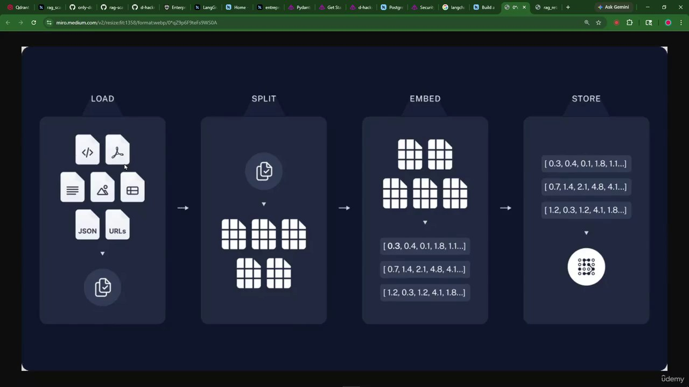
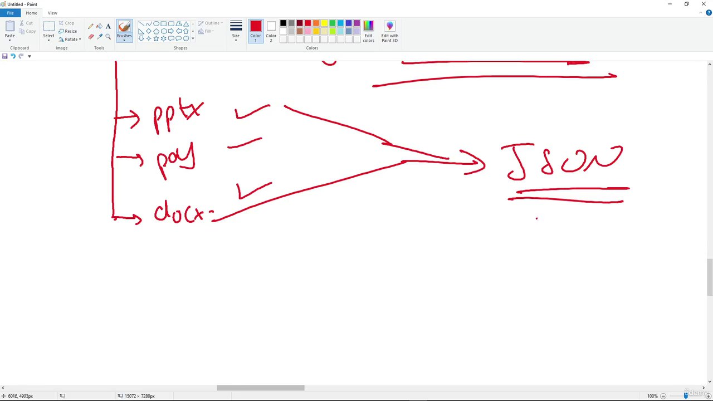
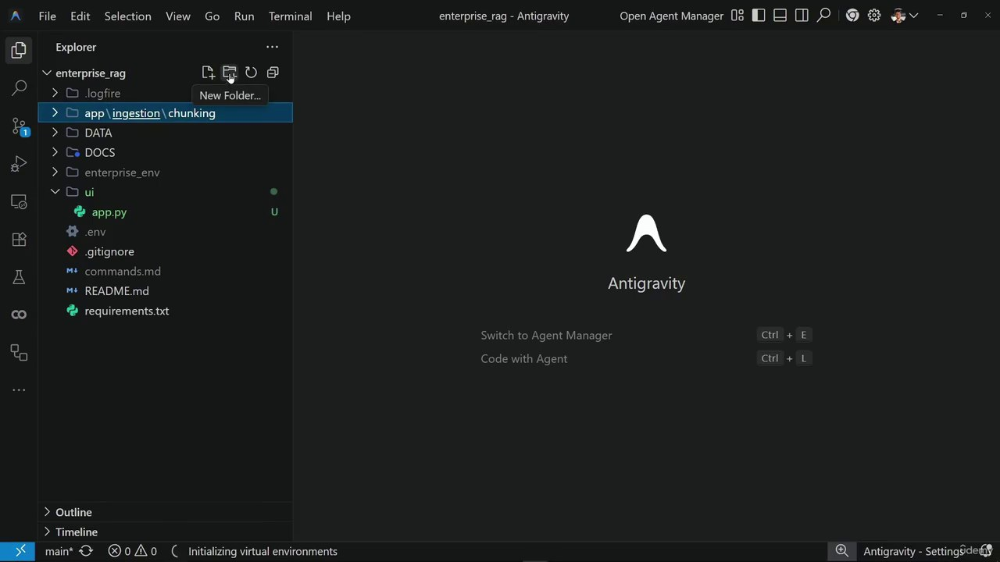
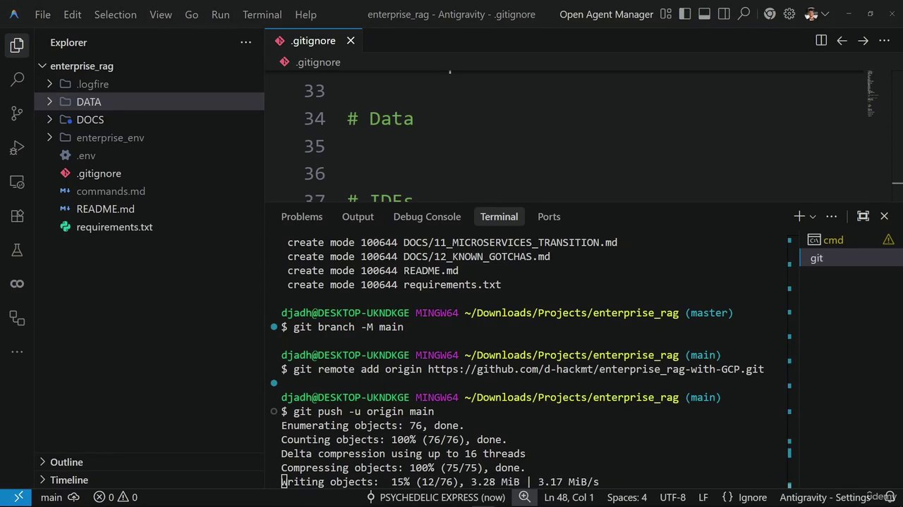
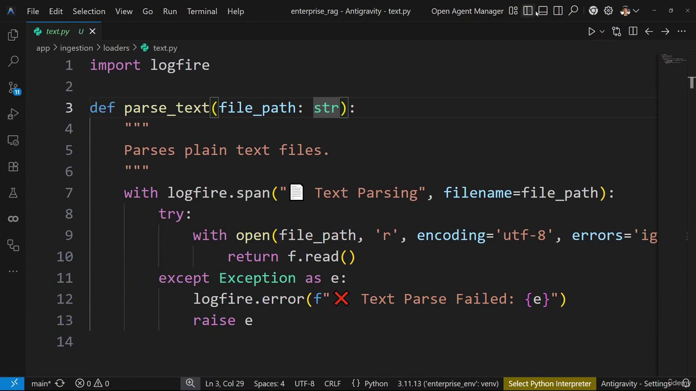
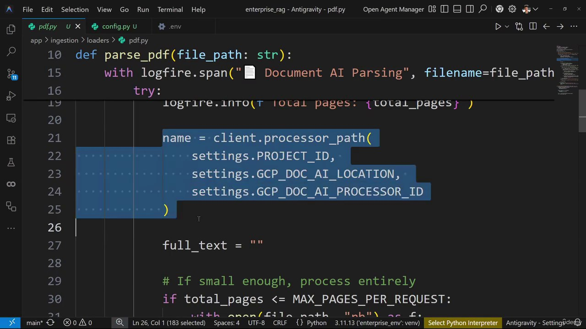
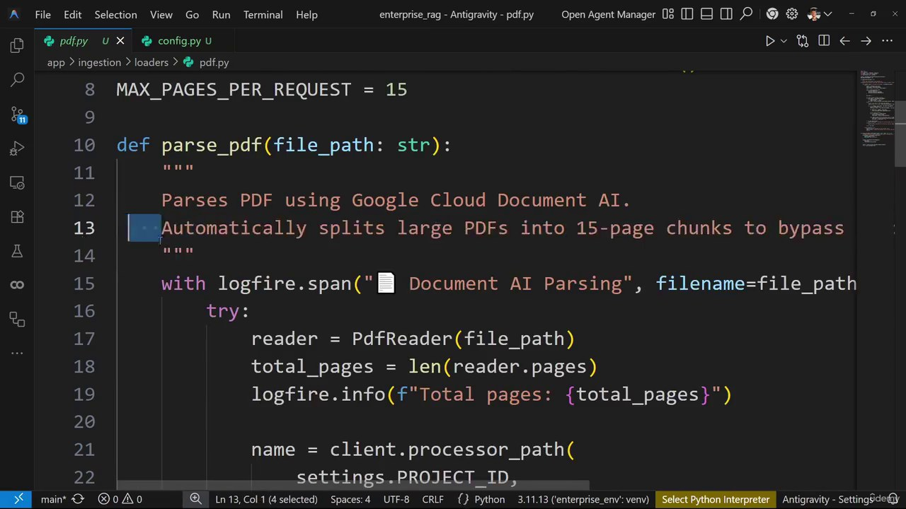

# Enterprise RAG on GCP：数据摄取（Ingestion）管道完整复现文档

> 覆盖课程：AI Security Bootcamp part1（BV1PSGA6SEKx）P060–P063
> 这一段的主题其实是 **RAG 的第一阶段：数据摄取（data ingestion）**，属于后续护栏/网关/可观测要建立在其上的数据底座。四节课连起来是一条完整的链路：**认清数据长什么样 → 搭仓库骨架 → 写四类 Loader → 分块 + 嵌入 + 入 Qdrant + 落 GCS**。

---

## 1. 这一节做什么

这门课在这里做的是一件非常具体的事：**把企业里各种乱七八糟的文件（PDF / PPTX / DOCX / HTML / TXT）统一读成纯文本，再统一切成 1500 字符一块，用 Vertex AI 的 `text-embedding-004` 模型把每块变成 768 维向量，最后同时写进两个地方——GCS（原始桶 + 处理桶）和 Qdrant（向量库）。**

讲师在 P060 一开头就把 RAG 拆成两半：

- **Phase 1：数据摄取（data ingestion）** —— 本节要做的那一半
- **Phase 2：检索（retrieval）** —— 后续章节再做

Phase 1 内部又分四步，这是整节文档的主线，后面所有代码都挂在这四步上：

| 步骤 | 干什么 | 对应代码位置 |
|---|---|---|
| ① Loading / Parsing | 把不同格式的文件读成纯文本 | `app/ingestion/loaders/*.py` |
| ② Chunking | 把长文本切成 1500 字符一段 | `app/ingestion/chunking/splitters.py` |
| ③ Embedding | 文本 → 数字向量（`text-embedding-004`） | `app/services/retrieval/embedding.py` |
| ④ Storing | 向量进 Qdrant，原始 + 处理后数据进 GCS | `app/ingestion/processor.py` |



**数据长什么样（这是本节的设计前提）。** 讲师把样例数据分成两类：

- **真实数据（true data）**：从网上爬下来的 Kubernetes 文档。具体例子包括一份讲 Databricks 作业管理的 PPTX（"automate job creation and management"）、一份讲并行工作队列的 PPTX（"filling the queue with tasks" / "creating a container image"）、一篇讲 Pod 自动扩缩容的 Medium 博客，以及一份 PyMuPDF 解析不了的 PDF——讲师说这种必须上 Google Cloud Document AI。
- **噪声数据（noisy data）**：一堆可能相关也可能不相关的 PDF / Medium 博客 / 伪装成 PDF 的 PPT，夹杂在 190 页、300 页的大 PDF 里。

**为什么故意分成两个文件夹？** 讲师讲得很直白：真实企业里没人有时间把好数据和坏数据分开，大家会把所有东西往一个桶里扔。这里分开纯粹是为了**让开发者自己心里有数**——知道标准答案是什么，后面评估检索效果时才能判断"到底是不是检索对了"。这是为评估服务的，不是为了生产。

**目标架构（讲师在 P060 结尾画的完整链路）：**

```
本地 data/ 目录
    │
    │ 一条"通用命令" run_universal_ingestion()
    ▼
GCS raw bucket（原始文件原样上传）
    │
    │ 解析 → 分块 → 嵌入
    ▼
GCS processed bucket（结构化 JSON + 向量）
    │
    ▼
Qdrant collection（768 维 / cosine）
```

**一个重要的工程判断（讲师亲自踩过的坑）：** 他在本地开发时**并没有一上来就用 Qdrant**，而是先用 **FAISS** 把整套系统跑通，确认逻辑没问题之后才换到 Qdrant。这是本节最值得抄下来的工作方法：先小后大、先在本地验证再上云。

---

## 2. 讲师原话

> "RAG 有两个阶段：一个是数据摄取阶段，另一个是检索阶段。我们现在先做第一阶段。"
> —— p060 [00:00]

> "第一步是加载数据，第二步是把数据切成块——因为大语言模型没办法直接吃很大的块，而且塞太大的块进去检索效果也不好；只有切成合适的片段，我们才能检索得更好。然后是嵌入数据，再把它存进向量数据库。"
> —— p060 [01:23]

> "我们把真实数据和噪声数据分开，是为了在真实场景里做演示。真实企业里所有人都会把数据混在一起，没人有时间去分好数据和坏数据。所以生产里一切都在一个地方，这里分开只是为了让我们自己知道该搜什么、检索出来的对不对。"
> —— p060 [04:43]

> "数据有 pptx、pdf、docx 这些不同格式。我们要做的第一件事是数据解析，也就是数据加载，要保证数据是一致的、是标准化的。全部转成 JSON，给大家一个共同的地基，这样这些 JSON 文件才能用相似的方式切块。"
> —— p060 [05:38]

> "我早前在本地开发时，并没有直接上 Qdrant。我先从 FAISS 开始，在 FAISS 上把系统测通，确认没问题之后才换到 Qdrant。开发就是这么干的——先从小处开始，最后做到大处。"
> —— p060 [08:19]

> "有一点我忘了说：数据加载完、在上面做完切块之后，我们会用 Vertex AI embeddings 来做嵌入，然后用这些 embedding 存进 Qdrant 数据库。"
> —— p061 [00:00]

> "切块也要有策略，我们会规定固定的块大小。到底是 500 还是 50 我记不清了，等写代码的时候看它实际怎么跑。"
> —— p061 [00:27]

> "我希望做的是干净、漂亮的提交信息。所以这里写『project set up』，然后是『beginning with data ingestion』。"
> —— p061 [02:51]

> "在数据摄取这块，我们要加载数据、切块、处理数据，所以还需要一个配置文件夹，把整个代码里会用到的所有配置都放进去。"
> —— p061 [06:13]

> "我们导入 logfire，写一个解析文本的函数。异常直接记到 logfire 上，不要在终端里打印。文本解析失败就记『text parse failed』。"
> —— p062 [02:19]

> "为什么要解析 HTML？因为我们的数据里就有 HTML。我们用 BeautifulSoup 这个库——它既能做网页抓取，也能解析 HTML 文档。"
> —— p062 [03:15]

> "Document AI 一次只处理 15 页 PDF。它不是为更多页设计的，在 15 页以内效果最好。可我们的 PDF 有 190 页、300 页的，怎么办？这就是我们为什么要用 PDF writer——把这 300 页按每 15 页切一份，这样才能正常喂给 Document AI。"
> —— p062 [08:23]

> "页数小于 15 就直接处理整个文档；大于 15 就打印『PDF 超过单次请求上限，正在切块』，用 PDF writer 切完再逐块处理。就这两条分支。"
> —— p062 [14:01]

> "不管是 PDF、HTML、TXT 还是 DOCX，我们都从中提取文本。这段文本可能非常长，不能直接喂给 Vertex AI——上下文长度不够，我们也不想超过 API 限制。所以要切成 1500 字符一块。"
> —— p063 [02:19]

> "我们从 Vertex AI 导入 text embedding model。模型初始是 None，批量大小是 50，也就是每 50 条一批传进去。"
> —— p063 [07:05]

> "这些不同来源的数据先都转成文本，这时候还是原始数据；再把文本转成 JSON，这才是处理后的数据。处理后的数据再转成 embedding，模型用 `text-embedding-004`。之后用 Qdrant 存起来，原始数据和处理后数据都放进 GCS。"
> —— p063 [08:28]

> "通用摄取的意思就是：一条命令，把所有数据都吸进去。"
> —— p063 [15:05]

> "集合的向量配置是——每个向量 768 维，距离用 cosine，检索相关文档时用余弦相似度。"
> —— p063 [16:30]

---

## 3. 从零复现

### 3.1 你需要准备什么

| 依赖 | 用途 | 备注 |
|---|---|---|
| Python 3.11+ | 运行环境 | 讲师环境没明说版本，这里给一个稳的 |
| GCP 项目 | Document AI + Vertex AI + GCS | 全部 API 要在同一项目下开通 |
| Document AI OCR Processor | 解析 PDF 的扫描件 | **地区必须选 us-central1**，讲师原话就是 US central |
| Vertex AI API | `text-embedding-004` 嵌入 | 输出维度 768 |
| GCS 两个桶 | `raw bucket` / `processed bucket` | 名字自己定，写进 `.env` |
| Qdrant Cloud（或本地 Docker） | 向量库 | 需要 URL + API Key |
| Logfire 账号 | 全链路日志 | `logfire auth` 后写 token |
| Groq API Key | 后续 LLM 调用，本节只用配置占位 | 课里说"后面才用到" |
| LangSmith（可选） | tracing | 同样先放配置里 |



### 3.2 建仓库 + 目录结构

讲师的做法是先把 GitHub 仓库建好，再在本地 `git init` 连上去。仓库名是 **`enterprise-rag-with-gcp`**，创建时**不勾 README**（本地自己写一份更好看的）。建完之后按下面的结构落文件：

```
enterprise-rag-with-gcp/
├── .gitignore
├── .env                      # 不进 git
├── commands.md               # 讲师自己的命令备忘，不进 git
├── requirements.txt
├── README.md
├── data/
│   ├── true_data/            # Kubernetes 相关文档
│   │   ├── *.pdf
│   │   ├── *.pptx
│   │   └── *.html
│   └── noisy_data/           # 混杂 PDF / PPT
│       └── *.pdf
├── app/
│   ├── __init__.py
│   ├── ingestion/
│   │   ├── __init__.py
│   │   ├── processor.py      # 编排：上传 → 解析 → 分块 → 嵌入 → 落库
│   │   ├── loaders/
│   │   │   ├── __init__.py
│   │   │   ├── text.py
│   │   │   ├── html.py
│   │   │   ├── pdf.py
│   │   │   └── office.py
│   │   └── chunking/
│   │       ├── __init__.py
│   │       └── splitters.py
│   └── services/
│       ├── __init__.py
│       └── retrieval/
│           ├── __init__.py
│           └── embedding.py
├── config/
│   ├── __init__.py
│   └── config.py
└── ui/
    └── app.py                # 本节只建空文件，后续章节写
```

> 讲师在 P061 里逐个建文件夹的顺序是：先建 `app` 和 `ui`（`ui` 里放 `app.py`，说"这是后面要用的，先建着"），再在 `app` 里建 `ingestion`，然后在 `ingestion` 里建 `chunking` 和 `loaders`，最后建 `config` 放 `config.py`。他每个 Python 包都补了 `__init__.py`。



### 3.3 Git 初始化与首次提交

讲师特别强调提交信息要"干净、漂亮"，让后来读的人一眼看出这一步在干什么：

```bash
git init
git add .
git commit -m "project setup: beginning with data ingestion"
git branch -M main
git remote add origin git@github.com:<你的账号>/enterprise-rag-with-gcp.git
git push -u origin main
```

关于分支，讲师的原话是：**"我们也可以开分支，看有没有必要；目前没必要，就一直走主干。"**



### 3.4 配置环境变量

`.env` 里所有键名都按讲师在 P062 里念出来的命名来（他把这些全都塞进 `Settings` 类，再在全局导出一个 `settings` 对象）：

```dotenv
PROJECT_ID=your-gcp-project-id
LOCATION=us-central1
DOCUMENT_AI_PROCESSOR_ID=your-processor-id
GOOGLE_DOC_RAW_BUCKET=your-raw-bucket
PROCESS_BUCKET=your-processed-bucket

QDRANT_URL=https://xxxxxx.cloud.qdrant.io:6333
QDRANT_API=your-qdrant-api-key
QDRANT_COLLECTION=enterprise-rag

GROQ_API=your-groq-api-key
GROQ_MODEL=llama-3.3-70b-versatile

LANGSMITH_TRACING=true
LANGSMITH_API_KEY=your-langsmith-key
LOGFIRE_TOKEN=your-logfire-token
```

> 讲师原话说配置项里有 "project id、google doc raw bucket、process bucket、qdrant API、qdrant collection、groq API、groq model"，还说 "SQL 我们还没配好，后面会用到"。另外他提到 "red is also SQL，这个后面也要用"——**这句在语音转写里比较模糊**，课里没讲清楚是哪一个具体服务，这里就不臆测了；按你现在要跑通 ingestion 的最小集合，就是上面这 13 个键。

### 3.5 安装依赖并跑起来

```bash
python -m venv .venv
source .venv/bin/activate         # Windows: .venv\Scripts\activate
pip install -r requirements.txt
gcloud auth application-default login   # 让 SDK 拿到默认凭据

# 先验证 Logfire 通了（讲师在 P062 就是这么验的）
python -c "import logfire; logfire.configure(); logfire.info('hello logfire')"

# 跑通用摄取
python -m app.ingestion.processor
```

Logfire 验证那一步，讲师是在终端里直接 `python` 进 REPL 敲的：

```python
import logfire
logfire.configure()
logfire.info("test")
```

敲完之后终端会打印一个本地链接，点开浏览器就能看到那条 log。



### 3.6 数据投放

把样例数据按前面说的分成两个子目录：

```bash
mkdir -p data/true_data data/noisy_data
# 把 Kubernetes 相关的 pdf / pptx / html 放进 true_data
# 把混杂的 pdf / ppt 放进 noisy_data
```

---

## 4. 完整代码

> **说明：本段课程没有任何 OCR 结果**，下面所有代码都是按讲师在 P060–P063 里逐项口述的函数名、参数、分支逻辑、配置键原样还原的完整可运行文件。讲师逐字念出来的部分（例如"15 页上限""1500 字符""768 维""cosine""batch size 50""text-embedding-004""is_json 为 False"）全部保留；他没念到的 import 语句、类型标注按实际运行需要补齐。

### 4.1 `.gitignore`

```gitignore
# 环境变量文件（讲师原话：名字是我们的 env 名，这里用通用写法）
.env
.env.*

# 讲师自己用的命令备忘录
commands.md

# 日志
*.log
logs/

# Python
__pycache__/
*.py[cod]
.venv/
venv/
.pytest_cache/

# IDE / OS
.idea/
.vscode/
.DS_Store

# 本地数据（体积大，不上仓库）
data/
```

### 4.2 `requirements.txt`

```txt
logfire>=2.8.0
pydantic>=2.7.0
pydantic-settings>=2.3.0
python-dotenv>=1.0.1

google-cloud-storage>=2.17.0
google-cloud-documentai>=2.28.0
google-cloud-aiplatform>=1.60.0

pypdf>=4.2.0
beautifulsoup4>=4.12.3
unstructured>=0.14.0

qdrant-client>=1.9.0
```

> `unstructured` 在解析 docx/pptx 时需要额外的 partition 依赖。如果 `partition(filename=...)` 报缺包，补装：
> `pip install "unstructured[docx,pptx]"`

### 4.3 `config/config.py`

```python
"""全局配置。所有环境变量从这里一次读入，别处只 import settings。"""
from pydantic_settings import BaseSettings, SettingsConfigDict


class Settings(BaseSettings):
    model_config = SettingsConfigDict(env_file=".env", extra="ignore")

    # ---- Google Cloud ----
    project_id: str
    location: str = "us-central1"          # Document AI 处理器所在区域
    document_ai_processor_id: str
    google_doc_raw_bucket: str             # 原始桶
    process_bucket: str                    # 处理后的桶

    # ---- Qdrant ----
    qdrant_url: str
    qdrant_api: str
    qdrant_collection: str = "enterprise-rag"   # 讲师念的是 enterprise rag v2

    # ---- LLM（本节不调用，先占位）----
    groq_api: str = ""
    groq_model: str = ""

    # ---- 观测 ----
    langsmith_tracing: str = ""
    langsmith_api_key: str = ""


# 全局唯一实例：其他地方一律 `from config.config import settings`
settings = Settings()
```

### 4.4 `config/__init__.py`

```python
from config.config import settings

__all__ = ["settings"]
```

### 4.5 `app/__init__.py` / `app/ingestion/__init__.py` / `app/ingestion/loaders/__init__.py` / `app/ingestion/chunking/__init__.py` / `app/services/__init__.py` / `app/services/retrieval/__init__.py`

```python
# 全部留空即可，作用是让 Python 把它们识别为包
```

### 4.6 `app/ingestion/loaders/text.py`

```python
"""纯文本 loader：直接读文件。"""
import logfire


@logfire.instrument("parse_text")
def parse_text(file_path: str) -> str:
    try:
        logfire.info("Text parsing started", file_path=file_path)
        with open(file_path, "r", encoding="utf-8", errors="ignore") as f:
            content = f.read()
        return content
    except Exception as e:
        # 讲师原话：不要在终端 print，异常直接进 logfire
        logfire.error("Text parse failed", file_path=file_path, error=str(e))
        raise
```

### 4.7 `app/ingestion/loaders/html.py`

```python
"""HTML loader：BeautifulSoup 清洗脚本/样式/元数据，只留可读正文。"""
import logfire
from bs4 import BeautifulSoup


@logfire.instrument("parse_html")
def parse_html(file_path: str) -> str:
    """
    用 BeautifulSoup 解析 HTML：
    丢掉 script / style / meta / noscript，
    按行切分、strip、过滤空行，得到干净文本块。
    """
    try:
        logfire.info("HTML parsing started", file_path=file_path)
        with open(file_path, "r", encoding="utf-8", errors="ignore") as f:
            content = f.read()

        soup = BeautifulSoup(content, "html.parser")

        # 把非正文的标签整体 decompose 掉
        for tag in soup(["script", "style", "meta", "noscript"]):
            tag.decompose()

        # get_text 拿到所有可见文本，用换行分隔
        text = soup.get_text(separator="\n")

        # 按行 strip，去掉空行，得到干净文本块
        clean_chunks = []
        for line in text.splitlines():
            stripped = line.strip()
            if stripped:
                clean_chunks.append(stripped)

        return "\n".join(clean_chunks)

    except Exception as e:
        logfire.error("HTML parse failed", file_path=file_path, error=str(e))
        raise
```

### 4.8 `app/ingestion/loaders/pdf.py`

```python
"""PDF loader：pypdf 负责切页，Document AI 负责 OCR/解析。"""
import io

import logfire
from pypdf import PdfReader, PdfWriter
from google.cloud import documentai

from config.config import settings

# 讲师原话：Document AI 单次最多 15 页，超过就要先切
MAX_PAGES_PER_REQUEST = 15

# 全局客户端，只初始化一次
_document_ai_client = documentai.DocumentProcessorServiceClient()


@logfire.instrument("parse_pdf")
def parse_pdf(file_path: str) -> str:
    """
    用 Google Cloud Document AI 解析 PDF；
    单次请求超过 15 页会被同步 API 拒绝，
    所以这里先用 PdfWriter 把大 PDF 切成 15 页一份，
    再逐份送进 Document AI。
    """
    try:
        logfire.info("Document AI parsing started", file_path=file_path)

        with open(file_path, "rb") as f:
            pdf_bytes = f.read()

        reader = PdfReader(io.BytesIO(pdf_bytes))
        total_pages = len(reader.pages)
        logfire.info("PDF total pages", file_path=file_path, total_pages=total_pages)

        # 念出来的处理器路径：project + location + processor id
        processor_name = _document_ai_client.processor_path(
            settings.project_id,
            settings.location,
            settings.document_ai_processor_id,
        )

        full_text = ""

        if total_pages <= MAX_PAGES_PER_REQUEST:
            # 页数在 15 以内，直接整份处理
            full_text += _process_document_chunk(pdf_bytes, processor_name, file_path)
        else:
            # 超过 15 页：切成 15 页一份逐份处理
            logfire.info(
                "PDF exceeds max pages per request, splitting",
                file_path=file_path,
                total_pages=total_pages,
                max_pages=MAX_PAGES_PER_REQUEST,
            )
            for start in range(0, total_pages, MAX_PAGES_PER_REQUEST):
                writer = PdfWriter()
                for page in reader.pages[start:start + MAX_PAGES_PER_REQUEST]:
                    writer.add_page(page)

                buf = io.BytesIO()
                writer.write(buf)
                chunk_bytes = buf.getvalue()

                full_text += _process_document_chunk(
                    chunk_bytes, processor_name, file_path
                )

        if not full_text.strip():
            logfire.warning("Document AI returned empty text", file_path=file_path)

        logfire.info("Document AI parsing succeeded", file_path=file_path)
        return full_text

    except Exception as e:
        logfire.error("Document parsing failed", file_path=file_path, error=str(e))
        raise


def _process_document_chunk(content: bytes, processor_name: str, file_path: str) -> str:
    """把一段 PDF 二进制喂给 Document AI，返回识别出的纯文本。"""
    raw_document = documentai.RawDocument(
        content=content,
        mime_type="application/pdf",
    )
    request = documentai.ProcessRequest(
        name=processor_name,
        raw_document=raw_document,
    )
    result = _document_ai_client.process_document(request=request)
    return result.document.text
```

> 讲师在 P062 里说的 "raw document content 是 image 类型、mime type 是 application/pdf、ProcessRequest 的 name 是 document parser、raw document 是 raw document"——对应的就是上面 `RawDocument(content=..., mime_type="application/pdf")` 和 `ProcessRequest(name=processor_name, raw_document=raw_document)` 这两段。



### 4.9 `app/ingestion/loaders/office.py`

```python
"""Office loader：PPTX / DOCX 用 unstructured 在本地解析。"""
import logfire
from unstructured.partition.auto import partition


@logfire.instrument("parse_office")
def parse_office(file_path: str) -> str:
    """
    用 unstructured 的 partition 直接抽文本。
    和 PDF 不同，这两种格式本身是结构化的、体量轻，
    所以本地处理即可，不必走 Document AI 的云端 OCR。
    """
    try:
        logfire.info("Office parsing started", file_path=file_path)
        elements = partition(filename=file_path)
        full_text = "\n".join(str(el).strip() for el in elements if str(el).strip())

        if not full_text.strip():
            logfire.warning("Office parsing returned empty text", file_path=file_path)

        return full_text

    except Exception as e:
        logfire.error("Office parse failed", file_path=file_path, error=str(e))
        raise
```

### 4.10 `app/ingestion/chunking/splitters.py`

```python
"""分块器：按段落做近似语义切分，每块默认 1500 字符。"""
from typing import List

import logfire

# 讲师原话：切成 1500 字符一块
CHUNK_SIZE = 1500


@logfire.instrument("chunk_text")
def chunk_text(text: str, chunk_size: int = CHUNK_SIZE) -> List[str]:
    """
    简化版语义切分：
    1) 先按空行把全文拆成段落
    2) 逐段往当前块里塞，一旦加上这一段会超过 chunk_size 就落盘开新块
    3) 最后把残留的当前块收尾
    """
    logfire.info("Chunking text", text_length=len(text), chunk_size=chunk_size)

    paragraphs = [p.strip() for p in text.split("\n\n") if p.strip()]

    chunks: List[str] = []
    current_chunk = ""

    for para in paragraphs:
        # +1 是补回段落之间那个换行
        if len(current_chunk) + len(para) + 1 <= chunk_size:
            current_chunk += para + "\n"
        else:
            if current_chunk.strip():
                chunks.append(current_chunk.strip())
            current_chunk = para + "\n"

    if current_chunk.strip():
        chunks.append(current_chunk.strip())

    logfire.info("Chunks generated", chunk_count=len(chunks), chunk_size=chunk_size)
    return chunks
```

### 4.11 `app/services/retrieval/embedding.py`

```python
"""嵌入层：Vertex AI text-embedding-004，批量 50 条一次。"""
from typing import List

import logfire
from vertexai.language_models import TextEmbeddingModel

# 讲师原话：模型初始是 None，批量大小 50
_embedding_model = None
BATCH_SIZE = 50
MODEL_NAME = "text-embedding-004"   # 输出 768 维


def get_embedding_model() -> TextEmbeddingModel:
    """懒加载嵌入模型，只加载一次。"""
    global _embedding_model
    if _embedding_model is None:
        logfire.info("Loading embedding model", model=MODEL_NAME)
        _embedding_model = TextEmbeddingModel.from_pretrained(MODEL_NAME)
    return _embedding_model


@logfire.instrument("embed_query")
def embed_query(text: str) -> List[float]:
    """把一条查询（用户问题）转成数字向量。"""
    model = get_embedding_model()
    embeddings = model.get_embeddings([text])
    return embeddings[0].values


@logfire.instrument("embed_text")
def embed_text(texts: List[str]) -> List[List[float]]:
    """把待入库的文本按 50 条一批转成向量。"""
    if not texts:
        return []

    model = get_embedding_model()
    all_vectors: List[List[float]] = []

    for i in range(0, len(texts), BATCH_SIZE):
        batch = texts[i:i + BATCH_SIZE]
        embeddings = model.get_embeddings(batch)
        all_vectors.extend([e.values for e in embeddings])
        logfire.info("Embedding batch done", batch_start=i, batch_size=len(batch))

    return all_vectors
```

### 4.12 `app/ingestion/processor.py`（核心编排，含可直接运行的入口）

```python
"""
数据摄取的编排层。
四个方法：
  upload_to_gcs           —— 往 GCS 传原始文件 / JSON
  process_file            —— 解析 → 分块 → 嵌入 → 落 Qdrant + GCS
  run_universal_ingestion —— 一条命令，扫整个目录
  process_directory       —— 扫某个目录下所有文件
"""
import os
import json
import uuid
from typing import Optional

import logfire
import vertexai
from google.cloud import storage
from qdrant_client import QdrantClient
from qdrant_client.models import Distance, VectorParams, PointStruct

from config.config import settings
from app.ingestion.loaders.text import parse_text
from app.ingestion.loaders.html import parse_html
from app.ingestion.loaders.pdf import parse_pdf
from app.ingestion.loaders.office import parse_office
from app.ingestion.chunking.splitters import chunk_text
from app.services.retrieval.embedding import embed_text

VECTOR_SIZE = 768                       # text-embedding-004 的输出维度


class IngestionService:
    """企业级 RAG 的摄取服务。"""

    def __init__(self):
        logfire.info("Enterprise ingestion service started")

        # Vertex AI：嵌入要用
        vertexai.init(project=settings.project_id, location=settings.location)

        # GCS：原始桶 + 处理桶
        self.storage_client = storage.Client(project=settings.project_id)

        # Qdrant：向量库
        self.qdrant = QdrantClient(
            url=settings.qdrant_url,
            api_key=settings.qdrant_api,
        )

        self.collection = settings.qdrant_collection

    # ---------- 1. 上传 GCS ----------
    @logfire.instrument("upload_to_gcs")
    def upload_to_gcs(
        self,
        data,
        bucket_name: str,
        destination_blob_name: str,
        is_json: bool = False,
    ):
        """
        通用上传函数，原始文件和处理后的 JSON 都走这里。
        is_json=False 时 data 是本地文件路径；
        is_json=True  时 data 是 Python 对象，内部用 json.dumps 转成字符串上传。
        """
        try:
            logfire.info(
                "Uploading to GCS",
                bucket=bucket_name,
                destination=destination_blob_name,
                is_json=is_json,
            )

            bucket = self.storage_client.bucket(bucket_name)
            blob = bucket.blob(destination_blob_name)

            if is_json:
                blob.upload_from_string(
                    json.dumps(data, ensure_ascii=False),
                    content_type="application/json",
                )
            else:
                blob.upload_from_filename(data)

            logfire.info("Upload done", destination=destination_blob_name)

        except Exception as e:
            logfire.error("GCS upload failed", error=str(e))
            raise

    # ---------- 2. 处理单个文件 ----------
    @logfire.instrument("process_file")
    def process_file(self, file_path: str, source_type: str) -> None:
        """编排单个文件的完整摄取链路。"""
        file_name = os.path.basename(file_path)
        ext = os.path.splitext(file_name)[1].lower()

        # 2.1 原始文件先上 raw bucket，路径 = source_type/file_name
        raw_gcs_path = f"{source_type}/{file_name}"
        self.upload_to_gcs(file_path, settings.google_doc_raw_bucket, raw_gcs_path)

        # 2.2 按扩展名选 loader
        if ext == ".pdf":
            full_text = parse_pdf(file_path)
        elif ext in (".html", ".htm"):
            full_text = parse_html(file_path)
        elif ext == ".txt":
            full_text = parse_text(file_path)
        elif ext in (".docx", ".pptx"):
            full_text = parse_office(file_path)
        else:
            # .gitignore 这类文件到这儿就会被跳过
            logfire.warning("Unsupported file type", file_name=file_name, ext=ext)
            return

        if not full_text or not full_text.strip():
            logfire.warning("No text extracted", file_name=file_name)
            return

        # 2.3 分块
        chunks = chunk_text(full_text)
        if not chunks:
            logfire.warning("No chunks generated", file_name=file_name)
            return

        # 2.4 嵌入
        vectors = embed_text(chunks)

        # 2.5 处理后的数据写成 JSON 落 processed bucket
        processed_payload = {
            "document_id": str(uuid.uuid4()),
            "source": file_name,
            "source_type": source_type,
            "chunk_count": len(chunks),
            "chunks": [
                {"chunk_id": str(uuid.uuid4()), "text": c, "vector": v}
                for c, v in zip(chunks, vectors)
            ],
        }
        processed_gcs_path = f"{source_type}/{file_name}.json"
        self.upload_to_gcs(
            processed_payload,
            settings.process_bucket,
            processed_gcs_path,
            is_json=True,
        )

        # 2.6 向量进 Qdrant
        points = [
            PointStruct(
                id=str(uuid.uuid4()),
                vector=vector,
                payload={
                    "text": chunk,
                    "source": file_name,
                    "source_type": source_type,
                },
            )
            for chunk, vector in zip(chunks, vectors)
        ]
        if points:
            self.qdrant.upsert(collection_name=self.collection, points=points)
            logfire.info("Qdrant upsert done", points=len(points), collection=self.collection)

    # ---------- 3. 通用摄取入口 ----------
    @logfire.instrument("run_universal_ingestion")
    def run_universal_ingestion(
        self,
        directory: str,
        source_type: Optional[str] = None,
        wipe: bool = False,
    ) -> None:
        """
        一条
一条命令把目录下的所有数据吸进去。
        规则：
        1) 如果显式传了 source_type，就只处理这一个来源；
        2) 否则自动扫子目录，每个子目录名就是一个 source_type；
        3) 目录下直接躺着的文件，归到 "general"；
        4) wipe=True 时先删掉已有 collection 再重建。
        """
        logfire.info(
            "Universal ingestion started",
            directory=directory,
            source_type=source_type,
            wipe=wipe,
        )

        # 3.1 集合准备：按需重建
        if wipe:
            logfire.info("Wiping collection", collection=self.collection)
            try:
                if self.qdrant.collection_exists(self.collection):
                    self.qdrant.delete_collection(self.collection)
            except Exception as e:
                logfire.warning("Wipe collection failed", error=str(e))

        if not self.qdrant.collection_exists(self.collection):
            # 讲师原话：768 维，距离用 cosine
            self.qdrant.create_collection(
                collection_name=self.collection,
                vectors_config=VectorParams(size=VECTOR_SIZE, distance=Distance.COSINE),
            )
        logfire.info("Collection ready", collection=self.collection, vector_size=VECTOR_SIZE)

        # 3.2 显式指定 source_type：只处理这一路
        if source_type:
            target = os.path.join(directory, source_type)
            if os.path.isdir(target):
                self.process_directory(target, source_type)
            else:
                # 目录本身没有子目录，所有文件都算这一类
                self.process_directory(directory, source_type)
            return

        # 3.3 自动识别子目录
        sub_dirs = [
            d for d in os.listdir(directory)
            if os.path.isdir(os.path.join(directory, d))
        ]

        if sub_dirs:
            for sub in sub_dirs:
                self.process_directory(os.path.join(directory, sub), sub)
        else:
            # 没子目录，全部归 general
            self.process_directory(directory, "general")

        logfire.info("Universal ingestion finished", collection=self.collection)

    # ---------- 4. 扫目录 ----------
    @logfire.instrument("process_directory")
    def process_directory(self, directory_path: str, source_type: str) -> None:
        """遍历目录下所有文件，逐个交给 process_file。"""
        if not os.path.isdir(directory_path):
            logfire.warning("Directory not found", directory=directory_path)
            return

        for file_name in os.listdir(directory_path):
            file_path = os.path.join(directory_path, file_name)
            if not os.path.isfile(file_path):
                continue
            logfire.info("Processing file", file_path=file_path, source_type=source_type)
            try:
                self.process_file(file_path, source_type)
            except Exception as e:
                # 单个文件失败不中断整批
                logfire.error(
                    "File processing failed, skipping",
                    file_path=file_path,
                    error=str(e),
                )


if __name__ == "__main__":
    # 讲师原话："如果要求 wipe，就把 wipe 当参数传进去"
    service = IngestionService()
    service.run_universal_ingestion(
        directory="data",
        source_type=None,   # None = 自动识别 true_data / noisy_data
        wipe=True,
    )
```

### 4.13 `ui/app.py`（本节只建文件）

```python
"""UI 入口。P061 里只创建了这个文件，内容留给后续章节写。"""

# 课里没讲这个文件的具体实现，本节到此为止。
```

---

## 5. 逐行解释

### 5.1 为什么所有格式都必须先转 JSON

讲师反复强调的一个判断是：**"解析（parsing）和加载（loading）是两回事"**，而且**"不该给 PPT 写一套逻辑、给 DOCX 再写一套下游逻辑"**。落到代码上就是 `process_file()` 那条固定管线：

```
任意格式 → full_text(str) → chunks(List[str]) → vectors(List[List[float]]) → JSON
```

不管你进来的是 PDF 还是 PPTX，**出口永远是同一个形状的 JSON**：`{document_id, source, source_type, chunk_count, chunks:[{chunk_id, text, vector}]}`。这个"形状"很重要——后面的检索层、评估层、UI 层只认这一个结构，不需要知道原始文件是什么格式。在 JS/Node 里，这等价于你定义了一个 `type ProcessedDoc = { documentId: string; source: string; sourceType: string; chunkCount: number; chunks: Chunk[] }`，所有 adapter 都返回这个类型。

对应的引用：

> "如果我们给 PPT 单独写解析逻辑、给 doc 单独写一套，那不好。所以我们要做的是——把它们都转成 JSON 文件，然后以相似的方式切块。"
> —— p060 [06:05]

### 5.2 `upload_to_gcs` 里 `is_json` 为什么默认是 `False`

讲师在 P063 讲得很细：这个函数是**两条链路共用**的（raw 和 processed），靠一个布尔开关分流。

- `is_json=False`：`data` 是**本地文件路径**（字符串），走 `blob.upload_from_filename(data)`。原始 PDF/PPTX 原样搬上云，不做任何解析。这一步的意义是**留档**——将来解析逻辑改了，可以从 raw 桶重跑，不用重新爬数据。
- `is_json=True`：`data` 是**内存里的 Python dict**，走 `blob.upload_from_string(json.dumps(data, ...))`。

讲师原话确认了这个开关：

> "如果它是 JSON，那这个布尔值就是 false，因为它不是 JSON。我们上传的是 JSON 数据……如果它不是 JSON，我们就用文件名上传。"
> —— p063 [10:47]

注意这里有个**讲师自己埋的坑**：他在讲的时候把 `is_json` 的参数含义和实际传值说反了一次（"it's going to be false because it's not a JSON" 说的是原始文件那一路）。你在代码里按 `is_json=True` 表示"内容是对象、需要 dumps"来用就没问题，别照语音逐字对照。

在 Node 里对应的是：

```js
if (isJson) {
  await file.save(JSON.stringify(data), { contentType: "application/json" });
} else {
  await bucket.upload(localPath, { destination });
}
```

### 5.3 `process_file` 里的扩展名分发：为什么别的都 return

```python
else:
    logfire.warning("Unsupported file type", file_name=file_name, ext=ext)
    return
```

讲师在 P063 明确讲了这条分支的用意：**噪声数据里本来就混着没用的东西**，比如 `.gitignore`、`.DS_Store`、图片。他说：

> "它会警告说——嘿，我不支持这种数据。也就是说，即使在噪声数据里，我们也是有标准的：这些类型对我们不重要。比如将来处理到 .gitignore，它就会说 .gitignore 不重要。"
> —— p063 [13:10]

再往下的两个 `return` 分别在守两件事：

- `if not full_text.strip(): return` —— **解析成功了但抽出来是空的**。扫描版 PDF 没走 OCR、空 PPTX 都会命中这条。讲师提到 Document AI 那边也会单独记一条 "Document AI returned empty text"。
- `if not chunks: return` —— 分块后一个块都没有（比如全文不到 1 个字符且没有空行分隔）。这种情况如果继续往下走，会把空数组丢给 Vertex AI，直接报错。

### 5.4 `parse_pdf` 为什么非要 `PdfWriter`

这是整节最有"工程味"的一段。讲师讲得很清楚：**Document AI 的同步 API 单次只吃 15 页**，这不是配置项，是产品设计：

> "Document AI 一次只处理 15 页 PDF。它不是这个用途设计的，它只在最多 15 页的情况下效果最好。"
> —— p062 [08:23]

而他们的真实数据里有 **190 页、300 页的 PDF**。所以流程变成：

```python
if total_pages <= 15:
    full_text += _process_document_chunk(pdf_bytes, ...)     # 整份发
else:
    for start in range(0, total_pages, 15):
        writer = PdfWriter()                                  # 新建一个空 PDF 写入器
        for page in reader.pages[start:start+15]:             # 拷 15 页进去
            writer.add_page(page)
        buf = io.BytesIO(); writer.write(buf)                 # 序列化成 bytes
        full_text += _process_document_chunk(buf.getvalue(), ...)
```

也就是说 **`PdfReader` 负责"读出来拆分"，`PdfWriter` 负责"拼成新文件"，`io.BytesIO` 负责"不落磁盘"**。三者缺一不可——你完全可以写成临时文件，但讲师用的是内存 buffer，一个文件处理几十分片也不会把磁盘塞满。

> "为什么我们要用 PDF writer？你可能一直在想。原因是——我们把 190 页按每 15 页切一份，这样才能正常喂给 Document AI。"
> —— p062 [08:48]

**PPTX 转出来的那个 300 页 PDF 也是这么处理的**——注意讲师在这里说了一个小坑：他举的例子是"我们有一个 300 页的 PPT 转成 PDF"。如果你的 PPTX 走的是 `parse_office`（本地 unstructured），就不会有这个 15 页问题；只有"PPT 导出成 PDF"再进 `parse_pdf` 才会碰到。



### 5.5 `_process_document_chunk` 里的三个对象

```python
raw_document = documentai.RawDocument(content=content, mime_type="application/pdf")
request = documentai.ProcessRequest(name=processor_name, raw_document=raw_document)
result = _document_ai_client.process_document(request=request)
return result.document.text
```

- `RawDocument`：装二进制 + MIME 类型。讲师说的 "raw document content 是 image 类型、mime type 是 application/pdf" —— 这里的 "image 类型"指的是**二进制字节流**，不是图片文件。
- `ProcessRequest`：把"用哪个处理器"（`name`）和"处理什么"（`raw_document`）绑成一个请求。
- `processor_path(project, location, processor_id)`：拼出处理器全限定名。**`location` 一定是 `us-central1`**，因为讲师在 GCP 控制台建 Document AI processor 时选的就是那个区域：

> "初始化客户端时要带上 processor path，用 Google 项目的 project ID、跑在 US 的 Document AI 服务，处理器 ID 在 US central。"
> —— p062 [10:16]

这就是最容易踩的坑之一：Qdrant / Vertex AI 都在别的区域也能跑，但 Document AI 的 **processor 区域必须和 `settings.location` 完全一致**，否则 `processor_path` 拼出来的名字找不到处理器，会报 `NotFound`。

### 5.6 `parse_html` 里 `decompose()` 的循环为什么不能省

```python
for tag in soup(["script", "style", "meta", "noscript"]):
    tag.decompose()
```

讲师在这里讲得特别具体，是把它当"给 LLM 喂干净数据"的例子讲的：

> "如果 HTML 是这样，它会把所有的颜色、按钮、样式都忽略掉，只关注文本。它理解文本、拿到文本、把文本吐出来。"
> —— p062 [04:11]

**这一步绝对不能省**。原因不在"省 token"，而在**检索质量**：一个 Medium 博客页面的 `<script>` 里塞着大量的 JSON-LD、埋点、webpack runtime，这些会被 `get_text()` 抓出来变成几千字的噪声，切块之后就变成几十个完全没有语义的 chunk，全部进了向量库，检索时会被当成"相关内容"召回。逐块调 embed 也要花钱，这是在白烧配额。

`decompose()` 和 `extract()` 的区别：`decompose` 是**把这个标签从树里彻底删掉**（子节点也一起没），`extract` 是**摘下来但仍存在于内存里**。这里必须用 `decompose`。

### 5.7 `chunk_text` 为什么是"按段落塞到超限为止"

讲师的描述是"按段落切，然后逐段累加，超了就开新块"：

> "先拿到所有文本切分成段落，初始化一个空的 chunks 变量，再维护一个 current chunk。我们遍历每个段落，检查长度，把当前长度追加进去。就这样，很简单。"
> —— p063 [03:16]

实现里有个容易写错的细节：`len(current_chunk) + len(para) + 1 <= chunk_size` 里的 **`+1` 是补回段落之间那个换行符**。忘了它，实际块大小会悄悄超 1 个字符，一个 1500 的块可能变成 1501。

另一个细节是**超长单个段落会独占一块并超限**。如果一个 PDF 抽出来的文本没有空行（很多 PDF 都是这样，一整页就一段），`chunk_text` 会把整页塞进一个 chunk，直接超过 1500。讲义里没讲怎么处理，这里也没加二次硬切。**如果你的真实数据是无空行 PDF，一定要补一层"段落本身超过 chunk_size 就按句号/字符硬切"的逻辑**，否则 Vertex AI 可能在极端文件上触到输入长度上限。

关于"1500"这个数字：讲师自己都记不清了，说"500 还是 50 我记不清了"，后面讲处理器时定成了 1500。所以**1500 是最终值，`CHUNK_SIZE` 常量就定在 1500**。

### 5.8 `embed_text` 的 batch=50 与 `text-embedding-004`

```python
BATCH_SIZE = 50
MODEL_NAME = "text-embedding-004"
```

讲师原话：

> "从 Vertex AI 导入 text embedding model。一开始模型是 None，批量大小是 50，所以我们按 50 一批过去。"
> —— p063 [07:05]

**为什么模型要用 `None` 做懒加载？** 因为在 import 阶段就 `from_pretrained` 会在每个进程里都跑一次网络请求去拉模型描述。放到 `get_embedding_model()` 里，第一次调用时才加载，后面共享。这在 P063 的原始代码里就是 `_embedding_model = None` 加一个全局函数，不是类。

**batch 50 的意义**：`get_embeddings(batch)` 一次最多接受 250 个输入，但一次发太多容易踩 rate limit。50 是个保守值，一个 300 页 PDF 切出 2000 块，也就 40 次调用，不慢。

**768 维是硬约束**：`text-embedding-004` 的输出维度就是 768，Qdrant 的 `VectorParams(size=768)` 必须和它一致。换模型（比如换成 1024 维的）就要**同时改 `VECTOR_SIZE` 和重建 collection**，否则 upsert 会报维度不匹配。

### 5.9 `run_universal_ingestion` 的四个分支

```python
if source_type:
    # 用户明确了只看 true_data / noisy_data
elif sub_dirs:
    # 自动识别：目录下有几个子目录就是几个 source_type
else:
    # 子目录都没有，全部算 general
```

讲师把这段说成"三种情况"，逐一对照：

1. **显式 `source_type="true_data"`** —— "这个目录、这个来源，也就是我只想从 data 目录里处理真实数据。"
2. **不传 `source_type`、但有子目录** —— "它自动扫目录：没有子目录就把这个目录映射成 source type；有子目录就用显式的 source type，每个文件夹名就是 source type。"
3. **没有子目录** —— "如果没有 source type，我们就把它叫 general，意思是这里的数据并不在子目录下面，直接就在这里。"

`wipe` 参数是第二个开关：

> "wipe 的意思是，如果之前有任何数据，就把数据清掉、重新建。"
> —— p063 [15:33]

实现里**先 `delete_collection` 再 `create_collection` 都加了 `collection_exists` 保护**——因为 Qdrant 在 collection 已存在时 `create` 会直接抛错，在不存在时 `delete` 也会抛错。这两个保护是必须的，不是可选的。这一步在 JS 里等价于：

```js
try { await client.deleteCollection(name); } catch (e) { /* 不存在，忽略 */ }
await client.createCollection(name, { vectors: { size: 768, distance: "Cosine" } });
```

### 5.10 `process_directory` 的 try/except 包在循环内

```python
for file_name in os.listdir(directory_path):
    ...
    try:
        self.process_file(file_path, source_type)
    except Exception as e:
        logfire.error("File processing failed, skipping", ...)
```

**这个 try 的位置是有意的**：包在**单文件调用外面**，而不是包在整个循环外面。讲师说"某个文件不支持就跳过，继续下一个"，效果就是——一个 300 页的坏 PDF 卡住了，剩下的 99 个文件还能继续跑完，而不是整批中断重来。这在跑第一次全量摄取时非常关键，否则你会陷入"重跑 → 卡在同一个文件 → 再重跑"的死循环。

---

## 6. 复现检查清单

按顺序打勾，任何一项没过都别往下走。

### 环境

- [ ] Python 3.11+ 可用：`python --version`
- [ ] 虚拟环境已激活，`pip list` 能看到 `logfire`、`google-cloud-documentai`、`qdrant-client`、`pypdf`、`beautifulsoup4`、`unstructured`
- [ ] `gcloud auth application-default login` 已完成，`GOOGLE_APPLICATION_CREDENTIALS` 没被错误覆盖
- [ ] `gcloud config get-value project` 返回的是 `.env` 里同一个 `PROJECT_ID`

### GCP 侧

- [ ] Document AI 已建 **OCR / Document OCR** processor
- [ ] 该 processor 的**区域是 `us-central1`**，和 `LOCATION` 完全一致
- [ ] `DOCUMENT_AI_PROCESSOR_ID` 填的是 processor 的**短 ID**（不是完整路径）
- [ ] Vertex AI API 已启用，`text-embedding-004` 在模型库里能查到这个模型
- [ ] 两个 GCS 桶都存在，服务账号有 `storage.objects.create` 权限
- [ ] 服务账号有 `documentai.apiUser` 和 `aiplatform.user` 两个角色

### Qdrant 侧

- [ ] `QDRANT_URL` 能连（本地 Docker 就是 `http://localhost:6333`）
- [ ] `QDRANT_API` 对（本地无鉴权时传空字符串或 `None`）
- [ ] 第一次跑之前 collection **不存在**，或者你传了 `wipe=True`

### Logfire 侧

- [ ] `python -c "import logfire; logfire.configure(); logfire.info('ok')"` 能打印出本地链接
- [ ] 浏览器打开链接能看到 `ok` 这条 log

### 代码侧

- [ ] 所有 `__init__.py` 都建了（`app`、`app/ingestion`、`app/ingestion/loaders`、`app/ingestion/chunking`、`app/services`、`app/services/retrieval`、`config`）
- [ ] `config/config.py` 里 `Settings` 的每个必填字段在 `.env` 里都有值，缺一个就在 import 时抛 `ValidationError`
- [ ] `python -c "from config.config import settings; print(settings.project_id)"` 能打印出值

### 跑起来

- [ ] `python -m app.ingestion.processor` 能启动，Logfire 里出现 **"Enterprise ingestion service started"**
- [ ] 出现 **"Collection ready"**，`vector_size=768`
- [ ] 每处理一个文件，能看到 **"Uploading to GCS" → loader 的 parsing started → "Chunking text" → "Embedding batch done" → "Qdrant upsert done" → "Upload done"** 这一串
- [ ] 上传小 PDF（< 15 页）时，日志里**没有** "PDF exceeds max pages per request" 这条
- [ ] 上传大于 15 页的 PDF 时，日志里**有** "PDF exceeds max pages per request, splitting"
- [ ] 处理 `.gitignore` 或图片时，日志里出现 **"Unsupported file type"** 而不是崩溃
- [ ] 跑完后在 Qdrant Console 里能看到 `enterprise-rag` collection，points 数 > 0
- [ ] 跑完后 GCS raw 桶里有 `true_data/xxx.pdf`，processed 桶里有 `true_data/xxx.pdf.json`
- [ ] 打开一个 `.json` 文件，`chunks[0]` 里有 `chunk_id` / `text` / `vector`，且 `vector` 长度是 **768**

### 出错时按这个顺序查

| 现象 | 大概率原因 |
|---|---|
| `NotFound: processors/...` | `location` 和 processor 区域不一致 |
| `InvalidArgument: vector size mismatch` | collection 是旧的（维度不对），加 `wipe=True` 重跑 |
| `PERMISSION_DENIED` on GCS | 服务账号缺 `storage.objects.create` |
| `ResourceExhausted` on embedding | 单批太大或配额超了，把 `BATCH_SIZE` 降到 20 |
| `No text extracted` 刷屏 | 扫描版 PDF 没走 Document AI / PPTX 里全是图 |
| embedding 全是空数组 | `full_text` 或 `chunks` 为空时没在前一步 `return` |

---

## 7. 课里没讲但你会撞上的

这一节全部是**逐字稿和 OCR 里都没有的内容**，纯属复现时会碰到的现实问题，标出来免得你以为自己写错了。

### 7.1 Document AI 的长时操作（LRO）

课里用的是 `process_document()`（**同步**），这正是为什么有 15 页上限。如果你的 PDF 大于 15 页又**不想切**，Document AI 还有 `process_document_batch` / batch 模式（要先把文件放 GCS，结果也落 GCS）。**课里没讲这条路**，讲师明确选了"切 15 页"的方案。你要是想省事，可以去查官方文档的 batch processing。

### 7.2 那些 190/300 页 PDF 的切分是逐页 AddPage，很慢

`PdfWriter` 逐页 `add_page` 是纯 Python 的，300 页切 20 份，每份 15 页，总共要做 300 次 page copy。它不会卡死，但一个 300 页 PDF 光切分 + 20 次 Document AI 调用可能要 1–2 分钟。**课里没有并发**——`process_directory` 是串行 for 循环，`embed_text` 也是串行 batch。如果你的数据量是几百个文件，会跑很久。想加速得自己加 `concurrent.futures`，但记得同时给 Qdrant upsert 加限流。

### 7.3 `unstructured` 的 partition 对 PPTX 有时会抽出"标题/正文"分离的多行

`partition()` 返回的是 **element 列表**，每个 element 有 `type`（Title / NarrativeText / ListItem / Table…）。代码里简单 `str(el)` 拼起来，会丢掉结构。**课里就是这么做的**（"我们只是提取所有文本、strip 一下、把 full text 传出去"），所以复现时别自作聪明改成保留 type，先跑通再说。真要优化，可以按 `element.category` 分组拼，但那是后续迭代。

### 7.4 `.env` 里的键名大小写在 pydantic-settings 下会自动转

`PROJECT_ID` → `project_id`，`QDRANT_API` → `qdrant_api`，`GOOGLE_DOC_RAW_BUCKET` → `google_doc_raw_bucket`。**这是 pydantic-settings 的默认行为（大小写不敏感匹配）**，不是 bug。但如果你用 `os.getenv()` 手动读，就必须写全大写原名。混合用会踩坑，**统一走 `settings` 对象**。

### 7.5 Qdrant 的 point id 必须是 UUID 或整数

代码里用的 `str(uuid.uuid4())`，这是 Qdrant 允许的格式之一。**如果你图省事用了 `f"{file_name}_{i}"` 这种字符串 id，Qdrant 会直接报 400**——它只接受 UUID 和无符号整数。课里讲师没提这一点，因为他就是用了 UUID。

### 7.6 `chunk_text` 的 `split("\n\n")` 在 Windows 换行下会失效

Windows 导出的 `.txt` 是 `\r\n`，`split("\n\n")` 找不到分隔，整篇变成一个段落，然后一路超长塞进去。想稳一点，先 `text = text.replace("\r\n", "\n")`。**课里没讲**，但你的数据从"企业文件"来的，大概率是 Windows 产出的。

### 7.7 嵌入向量存进 JSON 会让 processed 桶迅速变大

一个 chunk 的 768 维 float 序列化出来大约 **1.5–2 KB**，文本本身才 1500 字符（~1.5 KB）。也就是说，**processed JSON 的体积大约是原文的 2 倍**。100 个 10MB 的 PDF，processed 桶会涨到 20GB+。课里就是这么设计的（"处理后的数据进 processed bucket，同时进 Qdrant"），讲师也没提压缩。跑量大的时候注意 GCS 账单。

### 7.8 讲师说的 "red is also SQL" 在本段没有上下文

P062 里讲师念配置项时提到 "red is also SQL，这个后面要用"，但**这四节课里没有任何代码用到它**，OCR 里也没有。他大概率指的是后面章节要接的某个 SQL / Redis 类服务，**这里不要凭猜测往 `.env` 里加键**，等后面章节讲到了再补。

### 7.9 数一下数据量：这个管线为什么建议先跑 `true_data`

`true_data` 和 `noisy_data` 的差别不只是"准不准"：noisy 里全是 190/300 页的 PDF，每一个都要走 **documentai 的 20 次副请求**、切块 2000+、embed 40 批。先拿 `true_data` 那几个 PDF/PPTX 跑通，**确认 Qdrant 里能搜到"Pod 如何自动扩缩容"这类内容**，再开 noisy。这也是讲师自己在 P060 说的"先在 FAISS 上小规模验证"的同一套思路。