# AI Security Bootcamp Part1：护栏 / 网关 / 可观测（P067–P069）

> 本段课程承接前面的 RAG 项目，把「检索器（Retriever）→ 重排（Re-ranker）→ LangGraph 编排 → FastAPI 后端 → Streamlit 前端」这条链路补完。读者照着本文档可以从零把这一段的代码跑起来。文中所有代码均按讲师屏幕上的实现整理为完整文件，可直接保存运行。

---

## 1. 这一节做什么

这一段（P067–P069）完成的是一个**企业级 RAG Agent 的后半段工程化**，具体包含四件事：

1. **P067：写两个服务层文件** —— `qdrant_service.py`（向量库检索）和 `ranking_service.py`（FlashRank 语义重排）。前者负责把用户 query 转成向量、去 Qdrant 里捞回一批候选文档；后者负责用 cross-encoder 模型对候选文档重新打分，把「数学相似」升级成「语义相关」。
2. **P068：写 `retriever.py` 和 `graph.py`** —— 把 planner / retriever / responder 三个节点用 LangGraph 的 `StateGraph` 连成一张带条件边的工作流图，并用 `MemorySaver` 做 checkpointer 保存多轮对话状态。
3. **P069：写 `main.py`（FastAPI 后端）和 `app.py`（Streamlit 前端）** —— 后端暴露 `/`、`/graph`、`/query` 三个路由；前端用 Streamlit 做聊天界面，通过 HTTP POST 调后端，并把 Logfire 的 trace 状态显示在侧边栏。
4. **贯穿全程的可观测性** —— 所有关键步骤都包在 `logfire.span` 里，形成嵌套的 trace，方便在 Logfire 面板里看到「检索 → 重排 → 生成」的耗时分解。

这一段的技术栈是：**Qdrant（向量库）+ FlashRank（重排）+ LangGraph（编排）+ FastAPI（后端）+ Streamlit（前端）+ Logfire（可观测）**，全部是 Python。对前端转 AI 应用工程师的读者来说，可以把 LangGraph 理解成「带状态的、可持久化的工作流引擎」，类似前端里的状态机 + Redux 持久化，只不过它的节点是 LLM 调用。

---

## 2. 讲师原话

> "我们需要 logfire 来记录我们的 agent，需要 agent state 来维护 agent 上下文，还需要 qdrant service 和 ranking service。为什么需要 qdrant service？当然是为了从 Qdrant 里取数据。"
> —— p067 [00:00]

> "我们会写一个函数叫 search enterprise knowledge，为什么需要 ranking service？当然是为了对我们的文档做重排。我们会用 FlashRank 做重排，用 qdrant service 从 Qdrant DB 里做数据检索。"
> —— p067 [00:27]

> "embed text 为什么需要？我们需要这个函数把所有文档转成 embedding。我们需要 embed query，这样用户收到的任何 query 都能被转成 embedding。embed text 和 embed query 是两个函数，另外一个是 get embedding model。embedding 模型来自 Vertex AI 的 text-embedding-004。"
> —— p067 [00:53]

> "我们要做的第一件事是初始化 qdrant client，这样才能和 Qdrant DB 交互。qdrant client 需要 url，也就是 qdrant url 用来连接；还需要 api key，用来和 qdrant client 连接。"
> —— p067 [02:21]

> "search enterprise knowledge 接收一个 query 字符串，返回 top 5 文档。我们也可以编程成 top 10、top 8，随便你。我先保持 5 个，你可以自己实验。"
> —— p067 [02:49]

> "payload 指的是与 vector point 关联的 JSON 格式元数据。也就是说我们收到的这个 response 会带 payload，也就是 JSON 类型的元数据，我们可以对它做过滤、做交互。"
> —— p067 [04:09]

> "我们创建一个空的 results 列表，把结果 append 进去。我们遍历 response.points 里的 results，在 points 里我们会拿到响应。然后 results.append 追加 content、source 和 score。content 是从 Qdrant DB 检索到的文本信息，source 是这条内容的来源，如果没有就默认写 unknown，score 是这条文档的相似度分数。"
> —— p067 [04:34]

> "ranking service 也会非常简单。第一件事是导入库。time 用来计算检索或重排花了多少时间，因为我们会用到模型。"
> —— p067 [05:28]

> "我们没用 LangChain 内置的 flash re-rank 方法，因为它有一个缺点：LangChain 的 flash re-rank 默认只用一个给定模型。我不记得模型名了。我深入看了 LangChain 的 GitHub 仓库，从那里看到他们默认只用一个模型。而我们独立使用 flash rank 时，可以选任何我们想要的模型。"
> —— p067 [05:57]

> "我们的 anchor class 用来 re-ranking passages。passages 是什么？passages 就是我们收到的文档数量。它基于一个预训练模型。预训练模型就像我说的，是我们的 transformer encoder 模型，被转成了 Open Neural Network Exchange 格式。re-rank request 表示用一个 query 加一组 passages 去请求重排。"
> —— p067 [06:53]

> "第一步是初始化 re-ranker 变量，现在是 none。我们会写两个函数，第一个是 get re-ranker，第二个是 re-rank documents。先写获取 re-ranker 的方法，也就是初始化 re-ranker，就像我们初始化 qdrant 一样。get re-ranker 是一个私有方法，返回一个 ranker。"
> —— p067 [07:20]

> "我们全局设置一个 ranker。如果没有 ranker，就用 ranker class 初始化一个，初始化时建一个 cache 目录用来存缓存。为什么需要缓存？因为一旦加载 re-ranker，它会从 Hugging Face 或 owner 提供的仓库下载模型，拉取模型并存储相关缓存，这样我们不用一遍遍重新加载、重新下载模型，它会直接运行。第一次实例会花一点时间，之后就超快。"
> —— p067 [07:49]

> "re-rank documents 接收一个 query 字符串。你记得一个 query 要和所有文档比较。我们接收 top，我们说了 5。在 qdrant service 里我说了 8，我说我会检索 8 个相似文档，从这 8 个里精炼到 5 个。你也可以改成 3。我用 5，5 是个不错的标准。"
> —— p067 [09:14]

> "它通过把文档和 query 做语义重打分来精炼检索结果。语义的意思是我们要算 attention score。为什么用 flash rank？因为标准向量搜索很快，但它是数学性质的，我们跑的是一个数学函数；而 flash rank 用的是 cross-encoder 方法，精确得多，但稍慢，因为我们要加载模型，它不是数学函数。FlashRank 通过高度优化的量化模型在本地解决这个问题。"
> —— p067 [09:43]

> "首先，如果没有 documents 这种东西，就初始化 nothing。记录开始时间，我们要计算花了多少时间。我们会记录日志说正在把文档发给 re-ranker。然后进入 try。如果一切正常就 ok，否则抛异常说 re-ranker 语义重排失败。这些是 top end documents，意思是不要停掉流程。你可能已经从 qdrant service 收到一批文档，如果重排没成功，不要停，直接返回文档继续走。"
> —— p067 [10:37]

> "但如果 re-ranker 在工作，先拿到我们上面初始化的 re-ranker。这就是为什么它是私有方法，我们不想在外部任何库里初始化它，只想在这里初始化并在这个方法里用。passages 是文档列表，我们对它做 enumerate 的 for 循环，构造 re-rank request（query 加 passages），意思是 query 和 passage 里的每个文档比较。结果我们用 re-rank 方法把 request 传进去，从那里拿到结果。"
> —— p067 [11:04]

> "然后对 re-rank documents 里的 results 追加文档。我们停表，用当前时间减去开始时间得到 duration，拿到 top scores。如果 results 不是 none，就记录日志说重排完成、这是 top score，然后我们重排了文档，就这么简单。"
> —— p067 [12:01]

> "我们导入 agent state，从 qdrant service 导入 search enterprise knowledge，导入 re-ranked documents 以便重排文档，当然还有我们说的 re-ranker service。这个视频里我们讲 retriever 流程是怎样的。我们已经导入了库，这里只有一个函数，就是 retrieve node。"
> —— p068 [00:00]

> "retrieve node 只接收一个东西：agent state。从 planner node 它会拿到 message hi，然后拿到 intent 是 technical，然后直接去 retriever node。所以我们不需要别的，只需要用户收到的 query，好传给 retriever node。这就是为什么我们只把 agent state 作为输入，不需要别的。如果 planner 检测到是对话记忆类 query，它会跳过检索；如果不是，就从 state 里拿当前 query。"
> —— p068 [00:57]

> "如果 query 是 conversational，它就说 skipping retrieval queries conversational，返回 conversation，在 state 的 plan 里写 plan 是 conversational、我们跳过了检索流程。接下来我们走 logfire span。如果 planner 说是 conversational，它甚至不会走到这里，会跳过所有这些直接去 responder node。"
> —— p068 [01:27]

> "然后我们用 logfire 启动知识检索流程。我们在 qdrant 里搜索 conversational raw results，调用 search enterprise knowledge query，限制到 15。你看，在 qdrant service 里我限制到 8，从这里我限制到 15，这些参数随时可以改。"
> —— p068 [02:23]

> "这是从向量 DB 拿到的原始结果。我们直接跑这个函数，就会从向量 DB 拿到原始结果。这些就是原始结果的文档，我们把它传给 rerank document 方法。search enterprise knowledge 函数收到的文档，我们传进 rerank documents，从 rerank documents 的 query、document contents 和 top 5，我们可以拿到 top 5 文档。重排完成，保留最相关的 top 5 chunks。"
> —— p068 [02:53]

> "最后它返回文档，返回状态 found technical context，更新 plan，这是 plan，这是 context retrieval。为什么它要这么做？为了维护 agent 的状态。因为这个 agent state 会来回走，我们会持续对话。你看这个流程，我们说的这个流程是一次性的，但一旦新 query 进来，整个 state 里有第一个问题的状态，因为我们用了 memory saver，整个 memory 都在用。"
> —— p068 [03:22]

> "所以现在我希望你理解：一，它不只是关于一次对话，而是关于很多次对话，这就是为什么维护这个 state 极其重要。节点做完了，现在我们要做 graph。我说的 graph 是什么意思？LangGraph。在 graph 里有两个概念：nodes 和 edges。"
> —— p068 [04:19]

> "我们有三个节点：planner node、responder node 和 retriever node。现在我们要把它们连起来。先收到用户 query，然后去 planner node，我们想设计这种图。planner node 之后去 retriever node，retriever node 之后如果没东西就去 responder node，retriever 完成后去这里，也会重排等等一切都会发生，但我们想设计这种流程。"
> —— p068 [04:47]

> "这些是各自的节点 node one、node two、node three，这些是边 edge 1、edge 2、edge 3、edge 4。这就是我们想设计的图。"
> —— p068 [05:42]

> "从 LangGraph 导入 StateGraph，这样我们可以传 state，整个 graph 知道 state 是什么。第二是 checkpoint memory，memory saver。我们用 memory saver 来维护用户的聊天历史，这非常重要。后面我们会把 memory saver 换成 Postgres，这样把所有历史维护在云端。为什么？因为一旦容器崩溃或重启，这个内存就丢了，我们想随时间保留这个内存。"
> —— p068 [06:09]

> "我们初始化 graph：workflow = StateGraph(AgentState)，我们的 graph 会持续持有 agent 的 state。第二定义节点，add_node planner 用 planner_node，我们叫它 planner；retriever node 我们叫它 retriever。这只是给名字，这是名字，这是实际节点。然后写路由函数，接收 agent state，根据 planner 的决定路由工作流。如果当前 query 是 conversational，直接返回 responder；否则返回 retriever。"
> —— p068 [07:08]

> "入口点是 planner，任何 query 首先进入 planner。然后定义条件边，谁给条件边响应？planner。planner 会说 route planner，我们也会写这个函数。如果它的响应是 retriever，就触发 retriever node；如果是 responder conversational，就返回 responder 并触发 responder node。条件边，这就是我们定义或设计 graph 的方式。"
> —— p068 [08:04]

> "然后加边：retriever 到 responder，responder 到 end。做完之后把所有东西升级到 memory：memory saver checkpointer，它把所有信息存在内存里。rag_agent = workflow.compile(checkpointer=checkpointer)，就这么简单，我们只是用这个 checkpointer 对象把 memory 存在 workflow 里。"
> —— p068 [08:34]

> "我们初始化 agent graph，初始化所有节点，做 route planner，设置入口点从用户到 planner，加从 planner 到 retriever 或 responder 的条件边，它决定该去哪。从 responder 直接结束流程。checkpointer memory saver，因为我们要维护对话历史。这些都会在 rag_agent 这个变量里被调用，我们会编译它。"
> —— p068 [09:29]

> "如果你仔细看，我觉得这里有个冗余流程。为什么？因为我去看 graph，我觉得发现它挺好。我写了两次，因为我在实验。我试着不用条件逻辑做这个，之前是直图，后来加了条件边。所以这个条件边会自动从 retriever 路由到 responder。之前是直的东西，我的逻辑里没有这个，但后来加了。所以我忘了从这里删掉。现在这行完全无关了：如果它是 conversational，跳过检索等等，我们不需要这行，因为这件事已经由我们的 graph 做了。"
> —— p069 [00:28]

> "我们也可以保留它用来可视化日志，但我觉得不保留也行。它不适合生产级的东西。我们可以复制它，把 retrieval node 改成这个。现在一切看起来没问题，我们继续写应用的主逻辑。"
> —— p069 [01:25]

> "主逻辑会非常简单。第一件事是导入一堆东西。这里还有个注释，我们读一下：Logfire 必须在所有其他输入之前配置，这样从最开始所有模块的 span 都能被捕获。我们想捕获哪些模块，只要在最开始初始化它就能捕获。"
> —— p069 [02:23]

> "我们需要 FastAPI 做 FastAPI 模块，需要 agents，需要我们在上一个视频里做的 rag_agent。然后 pydantic，我们需要 base model 来设置 Schema，保证信息流是正常的，typing 用来做 optional class。第一件事是初始化应用，应用标题是 enterprise agenting rag API，因为我们在做一个 RESTful API。"
> —— p069 [02:52]

> "第一件事是做 query request。收到的 query request 应该用动态 base model 校验，它应该总是收到两样东西：用户 query 和 thread ID。为什么必须维护 thread ID？因为我们要维护用户特定的聊天。为了维护用户聊天历史，这个 thread ID 会被传进 checkpointer。这个 checkpointer 我们初始化了，会传进 checkpointer 和 memory saver，这样聊天历史就被维护了。"
> —— p069 [03:21]

> "然后做第一个路由 home route，返回 enterprise lang graph rag API is live。我们一命中反斜杠就应该拿到这种响应。第二，我们做了 graph rag-agent.compile，我们做了这个 graph。如果你想可视化这个 graph，我们为它做另一个路由：如果命中 API 的反斜杠 graph，它会返回 agent workflow 的 mermaid 图片。我们用 getGraphDrawMermaidPNG 方法拿图片，如果没有图片就说无法渲染 graph 图片。"
> —— p069 [04:19]

> "然后加最后一个路由，我们应用的主路由，也就是 query 路由。query 路由，我们写一个函数 query，这当然是 POST 请求，因为我们向应用 API 发 query 请求响应。它以 query request 的形式，是一个校验过的 query request，接收 query 和 thread ID 两样东西。它为这个特定 thread ID 的这个 query 请求响应。"
> —— p069 [05:10]

> "初始时 agent 的 state 是这样的：messages、current query、documents、plan 是 start、status 是 initializing graph。因为这里我们维护一个流程，别忘了 state，state 一切真的都连在一起。plan 是什么？我们在哪？从 start 我们去了 planner node，现在在这个节点上。我们要确保我们在哪个节点、目前收集了哪些文档、query 是什么、传了哪些 messages。"
> —— p069 [05:39]

> "我们用 configurable 配置 thread ID，这样维护我们的 config，抱歉，维护我们的对话记忆。最终输出由 rag_agent invocation 给出，它输入初始 state 并随时间更新，还有 configuration。你记得它最后接收两样东西，我们的 graph 最后接收两样东西。rag_agent 会被调用，这个 checkpointer 需要一个 thread。thread 放在 config 变量里 configurable 类型的 configurable 里，这就是我们随 rag_agent 传的东西。"
> —— p069 [06:07]

> "然后 rag_agent 返回 question、answer，也就是最终输出、thought process、plan、status 和它取到的 sources。如果一切正常就 ok；如果一切不正常，它就说 I apologize for the internal while processing a request please try again later，thought process 等等。这就是主应用的样子。"
> —— p069 [06:33]

> "现在我们可以写 UI 部分。UI 很简单，我们用 Streamlit 写 UI。Streamlit 也很简单，它是用 Python 写前端的方式。导入 requests、time、uuid 用来初始化新 thread（总是唯一 thread）、logfire 维护日志、dot env 加载环境变量。首先要把这个设为绝对路径，拿到 dot env 变量，加载 dot env 变量。"
> —— p069 [07:03]

> "第二，拿到 logfire token。如果我给你看响应，有太多网页我搞混了。如果我给你看我们的应用，它在 sleep，我给你看应用。它正在运行，让它加载，应该一秒就好，因为应用不大。刷新一下，它在加载。"
> —— p069 [07:33]

> "看，左边 Logfire connected and tracing。这只有在 logfire 变量初始化、有 token 时才会发生。如果没有 token，它会说 logfire is empty，logfire configure the token。如果检测到 logfire token，我们说 connected and tracing。如果没有，它就说 logfire token is empty，还会抛异常说明为什么空，说它因为这个错误处于 standby。"
> —— p069 [08:29]

> "这部分做完了。我们必须单独初始化 logfire，因为 UI 是分开的，前端和后端是分开的。所以我们必须在这里显式传变量。从主应用里，只有我们传了 env 变量，它才会浮动到所有其他文件，因为主应用有 env 变量，但 app.py 是一个独立的 UI 文件，我们需要它。"
> —— p069 [08:58]

> "然后设置 page config，标题是 enterprise rag agent，这是 page icon，layout 是 wide。某处应该有 enterprise rag agent，如果我们重新加载，layout 是 wide，你能看到。page icon，目前我们没看到，但我们能看到 enterprise rag agent，也能看到 icon。然后设置 AI avatar 和 user avatar，我们可以设置它们。"
> —— p069 [09:24]

> "用户如果发 hi 之类的，这是 user avatar，这是 AI avatar。它在思考，因为第一次触发，所以花一点时间。如果我们简单刷新再发 hi，它就会像之前一样工作。顺便说这是可用的应用，没问题。我们初始化 session，session 管理。"
> —— p069 [09:53]

> "我们初始化了一个新 session，带一个新的 thread ID 来维护用户历史，我们会记录新 session 已创建。如果 messages 不在 session.state 里，我们初始化新的 session state messages。然后做 sidebar。让它跑，第一次运行，它在配置所有这些。让它跑，它会处理，没问题。这是 sidebar：logfire memory 和 clear history of the memory。在 sidebar 里我们说它是 agent OS markdown，一些空格，然后 logfire status。"
> —— p069 [10:51]

> "现在我们可以再发 hi。这有时会给你问题。我想我删了我的 Docker 镜像，所以它不工作。真的没问题，我们反正会跑它，你不用担心。没问题。我想我删了我的 Docker 镜像。好。现在从 memory 里，我们初始化 thread ID，我们初始化的那个会可见，我们有一个 clear history and memory 按钮。如果按那个按钮，它会说 memory wipe is triggered from the session，它会打印在 logfire 上，它会擦除所有 memory 并 rerun。所以看 clear history and memory，它会 rerun 我们的项目。"
> —— p069 [11:44]

> "现在主聊天 st.title，enterprise assistant agent，随便什么。去 VS Code 写 display history，session messages 里来的所有消息我们都显示。如果消息来自 AI 就说 AI，来自 user 就说 user。"
> —— p069 [12:19]

> "然后是最终工作流。我复制这个最终工作流 chat input，一旦收到 chat input 会发生什么。一旦有 chat input，它会检查 chat input 里的 prompt，ask about a documentation，它就说 ask about a documentation。我们从这里收到输入，logfire.span，我们说 chat interaction started，在那里启动一个 logfire span。为什么用 span？为了显示嵌套结果。"
> —— p069 [13:11]

> "如果我给你看这个，这是 logfire span。这是给 noisy data 的，这是给 true data 的。我们能看到这种嵌套分解，对每个都是。这是 span，这是我的 use span。然后 append role 和 content，chat message 是 user，user avatar。"
> —— p069 [13:41]

> "prompt，一旦收到 chat message，我们说 agent is thinking。我们也会在 logfire 上 span 这个 base URL。要么你有后端 URL，要么它跑在 localhost 8000。这个后端 URL 是什么？之后会发生什么？让我讲这个后端 URL 让你理解。一旦我们做这个 app，我们可以在本地跑，也可以在 Docker 容器里跑。本地跑时它在 8000 端口 FastAPI；在 Docker 里跑时，这个 Docker 会跑在 Cloud Run，GCP 服务，Cloud Run 会给我们一个 URL，这就是我说的后端 URL。"
> —— p069 [14:39]

> "如果我给你看我的 Streamlit 代码，我们待会会做。我做的 Streamlit 代码里，我显式传我的后端 URL，说这是我后端运行的地方。如果我复制这个粘贴到这里，看，enterprise rag agent is live。现在如果我给它发消息，也许这能工作。我们试试。它不工作，有问题。但你能看到这是我后端运行的地方。这就是我说的 URL。要么是后端 URL，要么是 localhost URL，这些都通过 Streamlit secrets 传。"
> —— p069 [15:36]

> "对于 prompt 和 thread ID，我们发 POST 请求，触发一个新对象 response。thought process 会进入 thought process，status update answer synthesized，它会给我们 state is complete。很简单，它收到什么 docs 就给我们信息说这些是 retrieved docs。拿 retrieved docs，我们截断到 100，放进 expander，这样不用总看整个 docs。如果一切正常就 ok，否则抛异常说 backend connection failed。"
> —— p069 [16:34]

> "这是我们之前看到的 backend connection failed。这个错误我们可以在 Cloud Run 日志里看到。然后 answer placeholder，先是空的，然后收到一些响应，这会是整个响应，current text 会是整个响应。time.sleep 0.5 秒，这样它正确给出响应。chat cycle completed successfully 会记录在 logfile 上。这就是前端，这就是主应用。下一个视频我们测试这个应用并在 Streamlit 上部署。"
> —— p069 [17:03]

---

## 3. 从零复现

### 3.1 目录结构

按讲师的项目组织，这一段涉及的文件如下（`services/` 下的 `embeddings.py`、`planner.py`、`responder.py` 是前面视频已经写好的，本段只补 `qdrant_service.py`、`ranking_service.py`、`retriever.py`、`graph.py`、`main.py`、`app.py`）：

```
enterprise-rag-agent/
├── .env
├── requirements.txt
├── services/
│   ├── __init__.py
│   ├── embeddings.py        # 前面视频已写：embed_text / embed_query / get_embedding_model
│   ├── planner.py           # 前面视频已写：planner_node
│   ├── responder.py         # 前面视频已写：generate_node
│   ├── qdrant_service.py    # 本段 P067 新增
│   └── ranking_service.py   # 本段 P067 新增
├── retriever.py             # 本段 P068 新增：retrieve_node
├── graph.py                 # 本段 P068 新增：StateGraph 编排
├── main.py                  # 本段 P069 新增：FastAPI 后端
└── app.py                   # 本段 P069 新增：Streamlit 前端
```

### 3.2 环境变量（`.env`）

讲师在 P069 明确提到「从主应用里，只有我们传了 env 变量，它才会浮动到所有其他文件」，所以 `.env` 放在项目根目录，由 `main.py` 加载；`app.py` 是独立文件，需要自己再加载一次。

```bash
# .env
QDRANT_URL=https://xxxxxxxx-xxxx-xxxx-xxxx-xxxxxxxxxxxx.us-east4-0.gcp.cloud.qdrant.io:6333
QDRANT_API_KEY=your_qdrant_api_key
LOGFIRE_TOKEN=your_logfire_write_token
BACKEND_URL=http://localhost:8000
```

- `QDRANT_URL` / `QDRANT_API_KEY`：P067 初始化 Qdrant client 时用到，讲师原话「qdrant client 需要 url……还需要 api key」。
- `LOGFIRE_TOKEN`：P069 前端侧边栏判断「Logfire connected and tracing」还是「logfire token is empty」的依据。
- `BACKEND_URL`：P069 讲师说「要么是后端 URL，要么是 localhost URL」，本地开发填 `http://localhost:8000`，部署到 Cloud Run 后换成 Cloud Run 给的 URL。

### 3.3 依赖安装

```bash
python -m venv .venv
source .venv/bin/activate        # Windows: .venv\Scripts\activate
pip install fastapi uvicorn streamlit requests python-dotenv pydantic \
            logfire qdrant-client flashrank langgraph langchain-core
```

版本说明：讲师没有在逐字稿里报具体版本号，课里没讲。上面这些包名是逐字稿里出现过的（`fastapi`、`streamlit`、`requests`、`dotenv`、`pydantic`、`logfire`、`qdrant-client`、`flashrank`、`langgraph`）。`langchain-core` 是 LangGraph 的依赖，装 `langgraph` 时会自动带上，这里显式列出方便排查。

### 3.4 复现步骤

**第 1 步：写 `services/qdrant_service.py`**（P067 前半段）
初始化 Qdrant client，写 `search_enterprise_knowledge(query, limit)`。讲师在 P067 里先写死 top 5，后来说「我改成 8 吧」，最终代码里是 8；P068 的 retriever 里又把它覆盖成 15。这两个数字都要保留，因为讲师强调「这些参数随时可以改」。

**第 2 步：写 `services/ranking_service.py`**（P067 后半段）
写 `_get_reranker()` 私有方法和 `rerank_documents(query, documents, top_n)`。关键点：全局单例 + cache 目录，避免每次重排都重新下载模型。

**第 3 步：写 `retriever.py`**（P068 前半段）
`retrieve_node(state)` 从 `state` 里拿 `current_query`，调 `search_enterprise_knowledge` 拿原始结果，再调 `rerank_documents` 精炼到 top 5，最后把 `documents`、`plan`、`status` 写回 state。

**第 4 步：写 `graph.py`**（P068 后半段）
用 `StateGraph(AgentState)` 建图，`add_node` 三个节点，`set_entry_point("planner")`，`add_conditional_edges("planner", route_planner, {...})`，`add_edge("retriever", "responder")`，`add_edge("responder", END)`，最后 `workflow.compile(checkpointer=MemorySaver())` 得到 `rag_agent`。

**第 5 步：写 `main.py`**（P069 前半段）
**Logfire 必须在所有 import 之前配置**（讲师原话「Logfire 必须在所有其他输入之前配置，这样从最开始所有模块的 span 都能被捕获」）。然后建 FastAPI app，定义 `QueryRequest`（pydantic BaseModel，两个字段 `query` 和 `thread_id`），三个路由 `/`、`/graph`、`/query`。

**第 6 步：写 `app.py`**（P069 后半段）
Streamlit 前端。先 `load_dotenv` 拿 `LOGFIRE_TOKEN` 和 `BACKEND_URL`，`logfire.configure`，`st.set_page_config`，session 管理（`thread_id` 用 `uuid` 生成），sidebar 显示 Logfire 状态和 clear history 按钮，主区 `st.chat_input` 收到输入后 POST 到 `BACKEND_URL/query`，把 `answer`、`thought_process`、`status`、`sources` 渲染出来。

**第 7 步：启动**

```bash
# 终端 1：后端
uvicorn main:app --reload --port 8000

# 终端 2：前端
streamlit run app.py
```

浏览器打开 Streamlit 给的地址（默认 `http://localhost:8501`），侧边栏应显示「Logfire connected and tracing」，输入 `hi` 应能收到回复。

### 3.5 关键截图

P067 开头讲师列出 Retriever 需要的依赖（logfire、agent state、qdrant service、ranking service）：

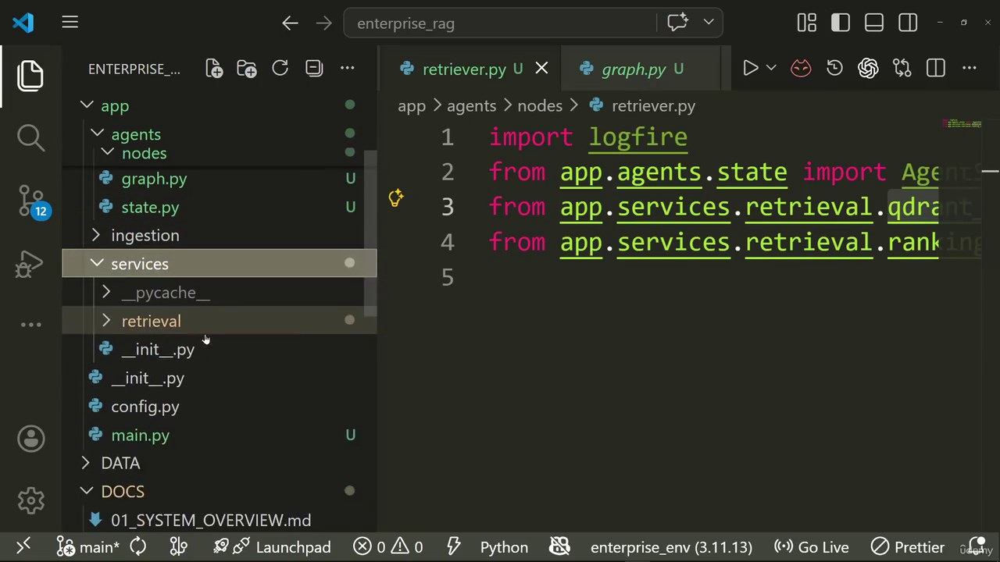

P067 初始化 Qdrant client 的代码：

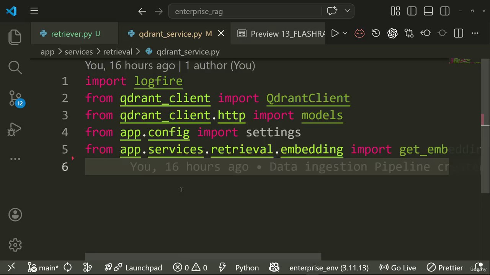

P067 `search_enterprise_knowledge` 里遍历 `response.points` 组装 results 的代码：

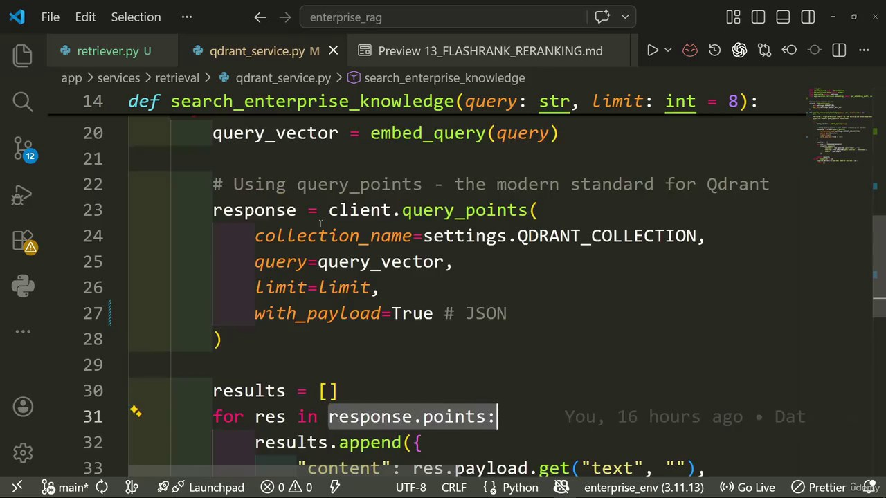

P067 讲师解释为什么不用 LangChain 内置 flash re-rank（默认只用一个模型）：

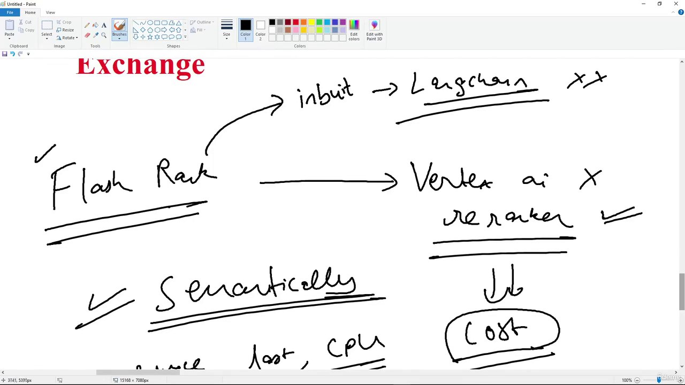

P067 `_get_reranker` 的全局单例 + cache 目录逻辑：

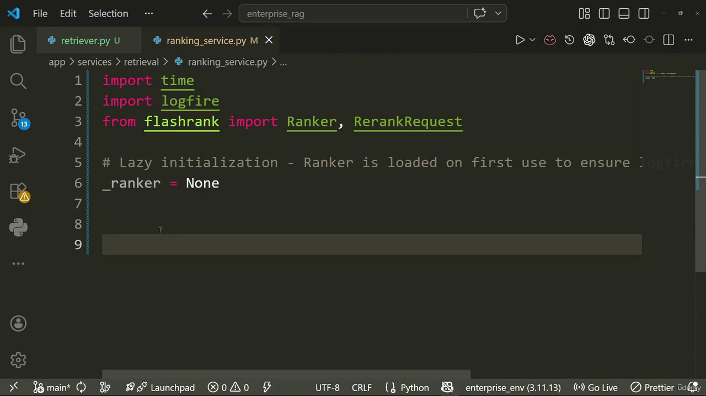

P068 讲师展示 planner → retriever → responder 的流程图：

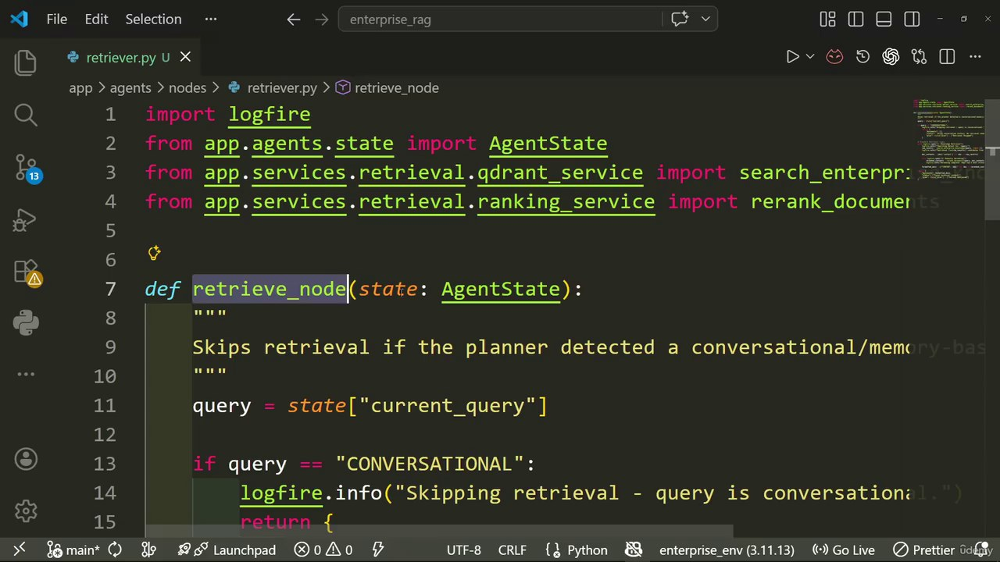

P068 用 `StateGraph` 建图、`add_node`、`add_conditional_edges` 的代码：

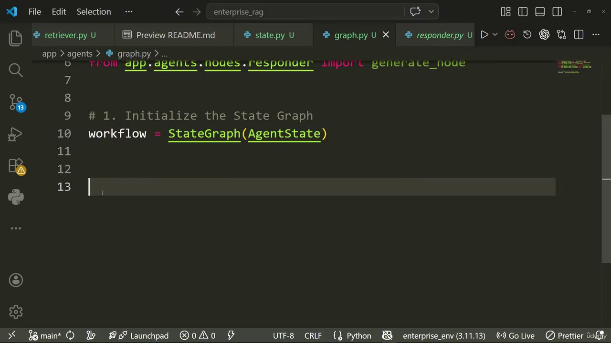

P069 讲师指出 retriever 里那段 conversational 判断是冗余的（因为条件边已经做了）：

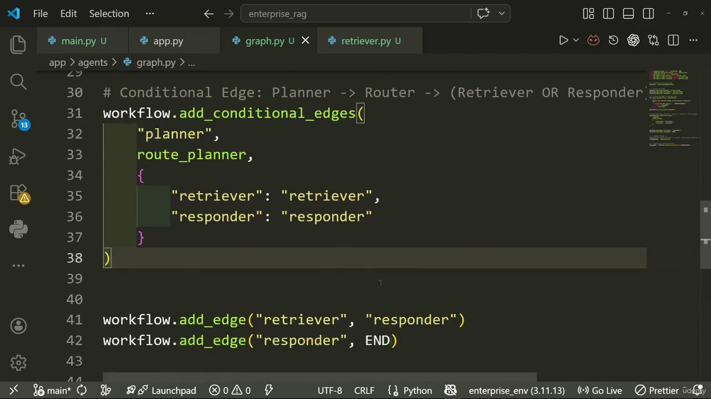

P069 FastAPI 的 `QueryRequest` 定义（query + thread_id）：

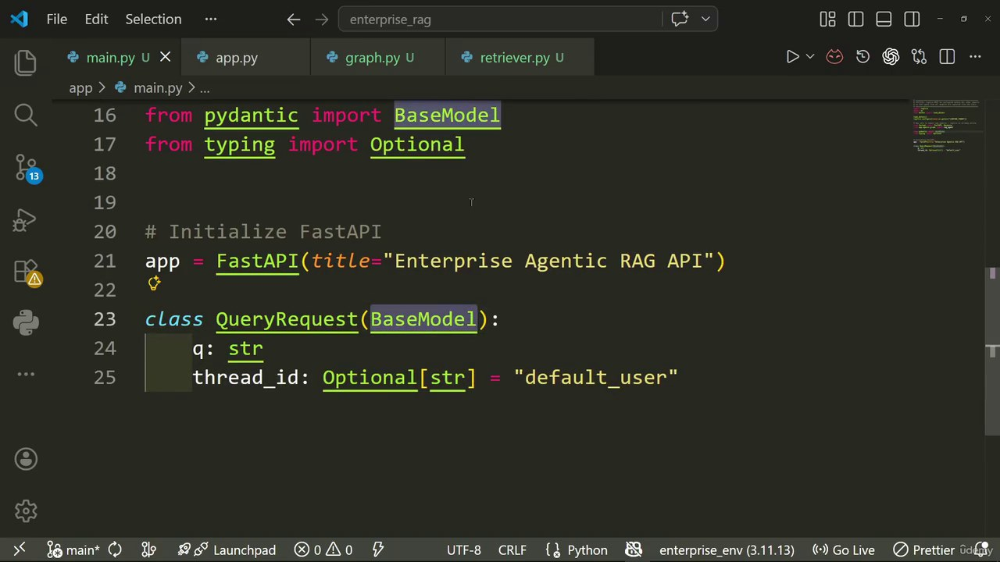

P069 `/query` 路由里构造初始 state 并调 `rag_agent.invoke`：

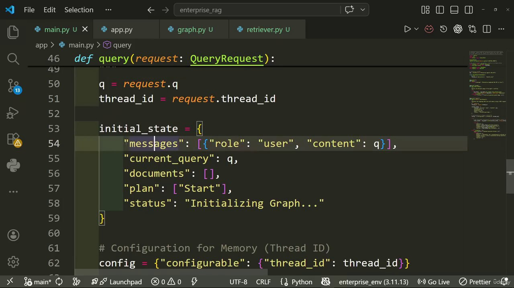

P069 Streamlit 侧边栏显示 Logfire 连接状态：

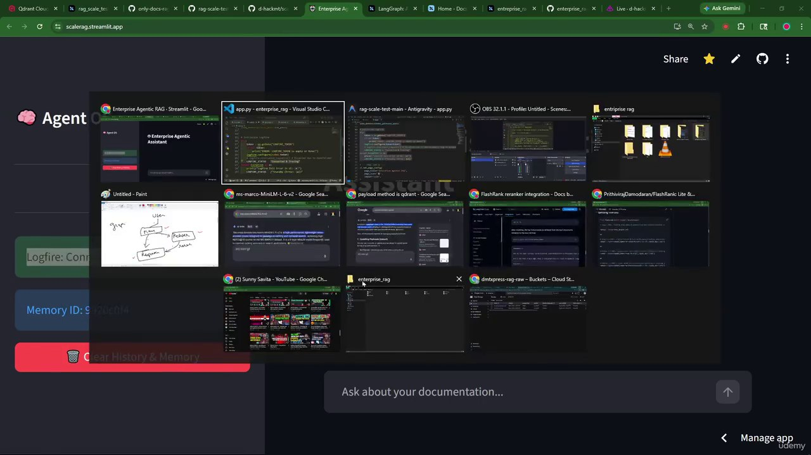

P069 前端 POST 到后端、处理 response 的代码：

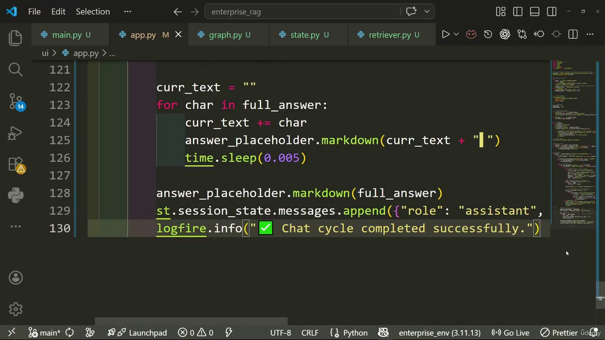

---

## 4. 完整代码

> 说明：本段没有提供 OCR 结果，以下代码按逐字稿描述还原为完整可运行文件。逐字稿里讲师口述的函数名、参数名、字段名（`search_enterprise_knowledge`、`rerank_documents`、`retrieve_node`、`route_planner`、`rag_agent`、`QueryRequest`、`thread_id`、`current_query`、`thought_process`、`sources` 等）全部保留。逐字稿没念到的具体实现细节（如 `AgentState` 的完整字段定义、`planner_node` / `generate_node` 的内部实现）属于前面视频内容，本段课里没讲，下面用注释标注「前面视频已写，此处按接口约定给出最小实现」。

### 4.1 `services/qdrant_service.py`

```python
# services/qdrant_service.py
import logfire
from qdrant_client import QdrantClient
from qdrant_client.http import models
from config import settings
from services.embeddings import get_embedding_model, embed_query

# 全局 Qdrant client，模块加载时初始化一次
qdrant_client = QdrantClient(
    url=settings.QDRANT_URL,
    api_key=settings.QDRANT_API_KEY,
)

COLLECTION_NAME = "enterprise_knowledge"


def search_enterprise_knowledge(query: str, limit: int = 8) -> list[dict]:
    """
    在企业知识库中做高精度检索。
    使用现代 query points 接口。
    接收 query 字符串，返回 top N 文档（默认 8，可改成 5/10，讲师说随便实验）。
    """
    try:
        # 1. 把用户 query 转成向量
        query_vector = embed_query(query)

        # 2. 去 Qdrant 检索
        response = qdrant_client.query_points(
            collection_name=COLLECTION_NAME,
            query=query_vector,
            limit=limit,
            with_payload=True,   # payload = JSON 格式元数据
        )

        # 3. 组装结果
        results = []
        for point in response.points:
            payload = point.payload or {}
            results.append({
                "content": payload.get("content", ""),
                "source": payload.get("source", "unknown"),
                "score": point.score,
            })
        return results

    except Exception as e:
        logfire.error(f"search_enterprise_knowledge failed: {e}")
        raise
```

### 4.2 `services/ranking_service.py`

```python
# services/ranking_service.py
import time
import logfire
from flashrank import Ranker, RerankRequest

# 全局单例，避免每次重排都重新下载模型
_reranker = None

CACHE_DIR = "./flashrank_cache"


def _get_reranker() -> Ranker:
    """
    私有方法：获取（必要时初始化）全局 re-ranker。
    第一次会从 HuggingFace 或 owner 仓库下载模型并缓存到 CACHE_DIR，
    之后直接复用，速度极快。
    """
    global _reranker
    if _reranker is None:
        _reranker = Ranker(cache_dir=CACHE_DIR)
    return _reranker


def rerank_documents(query: str, documents: list[dict], top_n: int = 5) -> list[dict]:
    """
    通过 cross-encoder 对文档和 query 做语义重打分，精炼检索结果。
    标准向量搜索快但只是数学相似；FlashRank 用 cross-encoder，更精确但稍慢。
    """
    if not documents:
        return []

    start_time = time.time()
    logfire.info(f"Sending {len(documents)} documents to re-ranker")

    try:
        reranker = _get_reranker()

        # passages = 文档列表，enumerate 后构造 RerankRequest
        passages = [
            {"id": idx, "text": doc["content"], "meta": doc}
            for idx, doc in enumerate(documents)
        ]
        request = RerankRequest(query=query, passages=passages)
        reranked = reranker.rerank(request)

        # 取 top_n
        top_results = reranked[:top_n]
        duration = time.time() - start_time

        top_score = top_results[0]["score"] if top_results else None
        logfire.info(
            f"Semantic re-ranking done in {duration:.3f}s, top score: {top_score}"
        )

        # 还原成统一结构
        return [
            {
                "content": r["text"],
                "source": r["meta"].get("source", "unknown"),
                "score": r["score"],
            }
            for r in top_results
        ]

    except Exception as e:
        # 讲师强调：重排失败不要停流程，直接返回原文档
        logfire.error(f"Semantic re-ranking failed: {e}")
        return documents[:top_n]
```

### 4.3 `retriever.py`

```python
# retriever.py
import logfire
from state import AgentState
from services.qdrant_service import search_enterprise_knowledge
from services.ranking_service import rerank_documents


def retrieve_node(state: AgentState) -> dict:
    """
    检索节点：从 state 拿 current_query，检索 + 重排，写回 documents/plan/status。
    只接收 agent_state 一个输入，因为 planner 已经把 intent 判断好了。
    """
    query = state.get("current_query", "")

    # 注意：P069 讲师指出这段 conversational 判断是冗余的，
    # 因为 graph 的条件边已经做了路由。这里保留是为了和讲师代码一致，
    # 生产环境可以删掉。
    if state.get("plan") == "conversational":
        logfire.info("Skipping retrieval, query is conversational")
        return {
            "plan": "conversational",
            "status": "retrieval_skipped",
        }

    with logfire.span("knowledge_retrieval"):
        # 1. 从 Qdrant 拿原始结果（这里 limit=15，覆盖 qdrant_service 里的默认 8）
        raw_results = search_enterprise_knowledge(query, limit=15)
        logfire.info(f"Retrieved {len(raw_results)} raw results from vector DB")

        # 2. 重排，精炼到 top 5
        documents = rerank_documents(query, raw_results, top_n=5)
        logfire.info(f"Re-ranking complete, kept top {len(documents)} chunks")

    return {
        "documents": documents,
        "plan": "retrieval_complete",
        "status": "found_technical_context",
    }
```

### 4.4 `graph.py`

```python
# graph.py
from langgraph.graph import StateGraph, END
from langgraph.checkpoint.memory import MemorySaver

from state import AgentState
from services.planner import planner_node
from services.responder import generate_node
from retriever import retrieve_node


def route_planner(state: AgentState) -> str:
    """
    路由函数：根据 planner 的决定路由工作流。
    conversational -> responder；否则 -> retriever。
    """
    if state.get("plan") == "conversational":
        return "responder"
    return "retriever"


# 1. 初始化 graph，传入 AgentState
workflow = StateGraph(AgentState)

# 2. 定义节点（名字, 实际函数）
workflow.add_node("planner", planner_node)
workflow.add_node("retriever", retrieve_node)
workflow.add_node("responder", generate_node)

# 3. 入口点：任何 query 先进 planner
workflow.set_entry_point("planner")

# 4. 条件边：planner 决定去 retriever 还是 responder
workflow.add_conditional_edges(
    "planner",
    route_planner,
    {
        "retriever": "retriever",
        "responder": "responder",
    },
)

# 5. 普通边
workflow.add_edge("retriever", "responder")
workflow.add_edge("responder", END)

# 6. checkpointer：MemorySaver 保存多轮对话状态
#    后面会换成 Postgres，避免容器重启丢内存
checkpointer = MemorySaver()

# 7. 编译
rag_agent = workflow.compile(checkpointer=checkpointer)
```

### 4.5 `main.py`

```python
# main.py
# 注意：Logfire 必须在所有其他 import 之前配置，
# 这样从最开始所有模块的 span 都能被捕获。
import logfire
from dotenv import load_dotenv
import os

load_dotenv()
logfire.configure(token=os.getenv("LOGFIRE_TOKEN"))

from fastapi import FastAPI
from fastapi.responses import Response
from pydantic import BaseModel
from typing import Optional

from graph import rag_agent

app = FastAPI(title="Enterprise Agentic RAG API")


class QueryRequest(BaseModel):
    query: str
    thread_id: str


@app.get("/")
def home():
    return {"message": "Enterprise LangGraph RAG API is live"}


@app.get("/graph")
def get_graph_image():
    try:
        png_bytes = rag_agent.get_graph().draw_mermaid_png()
        return Response(content=png_bytes, media_type="image/png")
    except Exception:
        return {"error": "Could not render graph image"}


@app.post("/query")
def query(request: QueryRequest):
    # 初始 state
    initial_state = {
        "messages": [],
        "current_query": request.query,
        "documents": [],
        "plan": "start",
        "status": "initializing_graph",
    }

    # checkpointer 需要 thread_id，放在 configurable 里
    config = {"configurable": {"thread_id": request.thread_id}}

    try:
        final_state = rag_agent.invoke(initial_state, config=config)

        return {
            "question": request.query,
            "answer": final_state.get("answer", ""),
            "thought_process": final_state.get("thought_process", ""),
            "plan": final_state.get("plan", ""),
            "status": final_state.get("status", ""),
            "sources": final_state.get("documents", []),
        }
    except Exception as e:
        logfire.error(f"Query failed: {e}")
        return {
            "question": request.query,
            "answer": "I apologize for the internal error while processing a request. Please try again later.",
            "thought_process": "",
            "plan": "error",
            "status": "failed",
            "sources": [],
        }
```

### 4.6 `app.py`

```python
# app.py
import os
from pathlib import Path

import requests
import time
import uuid
import logfire
import streamlit as st
from dotenv import load_dotenv

# 绝对路径加载 .env（app.py 是独立文件，需要自己加载）
env_path = Path(__file__).parent / ".env"
load_dotenv(dotenv_path=env_path)

LOGFIRE_TOKEN = os.getenv("LOGFIRE_TOKEN")
BACKEND_URL = os.getenv("BACKEND_URL", "http://localhost:8000")

# 单独初始化 logfire（前后端分离，必须显式传 token）
if LOGFIRE_TOKEN:
    logfire.configure(token=LOGFIRE_TOKEN)
    LOGFIRE_STATUS = "connected and tracing"
else:
    LOGFIRE_STATUS = "logfire token is empty"
    logfire.warn("Logfire token is empty, running on standby")

# 页面配置
st.set_page_config(
    page_title="Enterprise RAG Agent",
    page_icon="🤖",
    layout="wide",
)

AI_AVATAR = "🤖"
USER_AVATAR = "🧑"

# session 管理：新 thread_id 维护用户历史
if "thread_id" not in st.session_state:
    st.session_state.thread_id = str(uuid.uuid4())
    logfire.info(f"New session created: {st.session_state.thread_id}")

if "messages" not in st.session_state:
    st.session_state.messages = []

# 侧边栏
with st.sidebar:
    st.markdown("### Agent OS")
    st.markdown(f"**Logfire:** {LOGFIRE_STATUS}")
    st.markdown(f"**Thread ID:** `{st.session_state.thread_id}`")

    if st.button("Clear history and memory"):
        logfire.info("Memory wipe triggered from session")
        st.session_state.messages = []
        st.session_state.thread_id = str(uuid.uuid4())
        st.rerun()

# 主聊天区
st.title("Enterprise Assistant Agent")

# 显示历史
for msg in st.session_state.messages:
    avatar = AI_AVATAR if msg["role"] == "assistant" else USER_AVATAR
    with st.chat_message(msg["role"], avatar=avatar):
        st.markdown(msg["content"])

# 聊天输入
if prompt := st.chat_input("Ask about a documentation"):
    with logfire.span("chat_interaction"):
        # 显示用户消息
        st.session_state.messages.append({"role": "user", "content": prompt})
        with st.chat_message("user", avatar=USER_AVATAR):
            st.markdown(prompt)

        # 显示 AI 思考中
        with st.chat_message("assistant", avatar=AI_AVATAR):
            placeholder = st.empty()
            placeholder.markdown("Agent is thinking...")

            try:
                response = requests.post(
                    f"{BACKEND_URL}/query",
                    json={
                        "query": prompt,
                        "thread_id": st.session_state.thread_id,
                    },
                    timeout=120,
                )
                data = response.json()

                answer = data.get("answer", "")
                thought_process = data.get("thought_process", "")
                status = data.get("status", "")
                sources = data.get("sources", [])

                # 渲染
                placeholder.markdown(answer)

                if thought_process:
                    with st.expander("Thought process"):
                        st.markdown(thought_process)

                if status:
                    st.caption(f"Status: {status}")

                if sources:
                    with st.expander("Retrieved documents"):
                        for doc in sources:
                            st.markdown(f"- {doc.get('content', '')[:100]}...")
                            st.caption(f"source: {doc.get('source', 'unknown')}")

                st.session_state.messages.append(
                    {"role": "assistant", "content": answer}
                )
                time.sleep(0.5)
                logfire.info("Chat cycle completed successfully")

            except Exception as e:
                logfire.error(f"Backend connection failed: {e}")
                placeholder.error(f"Backend connection failed: {e}")
```

### 4.7 `state.py`（AgentState 定义，前面视频已写，此处按接口约定给出）

```python
# state.py
from typing import TypedDict, List, Optional


class AgentState(TypedDict, total=False):
    messages: List[dict]
    current_query: str
    documents: List[dict]
    plan: str
    status: str
    answer: str
    thought_process: str
```

### 4.8 `config.py`（settings，前面视频已写）

```python
# config.py
import os
from dotenv import load_dotenv

load_dotenv()


class Settings:
    QDRANT_URL = os.getenv("QDRANT_URL", "")
    QDRANT_API_KEY = os.getenv("QDRANT_API_KEY", "")
    LOGFIRE_TOKEN = os.getenv("LOGFIRE_TOKEN", "")


settings = Settings()
```

---

## 5. 逐行解释

### 5.1 `qdrant_service.py`

- `QdrantClient(url=..., api_key=...)`：讲师原话「qdrant client 需要 url……还需要 api key」。这两个值从 `config.py` 的 `settings` 读，`settings` 又从 `.env` 读，形成「`.env` → `config` → service」的链路。
- `query_points(collection_name=..., query=..., limit=..., with_payload=True)`：讲师说「使用现代 query points 接口」。`with_payload=True` 是关键——讲师专门解释「payload 指的是与 vector point 关联的 JSON 格式元数据」，没有它就拿不到 `content` 和 `source`。
- `for point in response.points`：讲师原话「我们遍历 response.points 里的 results，在 points 里我们会拿到响应」。
- `payload.get("source", "unknown")`：讲师原话「source 是这条内容的来源，如果没有就默认写 unknown」。
- `point.score`：讲师原话「score 是这条文档的相似度分数」。
- `limit: int = 8`：讲师在 P067 里先说 5，后来说「我改成 8 吧，我就想这么做」，最终代码是 8。P068 的 retriever 又传 `limit=15` 覆盖它，讲师说「这些参数随时可以改」。

### 5.2 `ranking_service.py`

- `_reranker = None` 全局变量 + `_get_reranker()` 私有方法：讲师原话「get re-ranker 是一个私有方法……我们不想在外部任何库里初始化它，只想在这里初始化并在这个方法里用」。这是典型的单例模式——在 JS/Node 里对应模块级 `let reranker = null` + `function getReranker() { if (!reranker) reranker = new Ranker(); return reranker; }`。
- `Ranker(cache_dir=CACHE_DIR)`：讲师原话「初始化时建一个 cache 目录用来存缓存……因为一旦加载 re-ranker，它会从 Hugging Face 或 owner 提供的仓库下载模型」。第一次慢，之后快。
- `if not documents: return []`：讲师原话「如果没有 documents 这种东西，就初始化 nothing」。
- `start_time = time.time()`：讲师原话「记录开始时间，我们要计算花了多少时间」。
- `logfire.info(f"Sending {len(documents)} documents to re-ranker")`：讲师原话「我们会记录日志说正在把文档发给 re-ranker」。
- `try/except` 里 `return documents[:top_n]`：讲师原话「如果重排没成功，不要停，直接返回文档继续走」。这是**降级策略**——重排是增强，不是必需。
- `passages = [{"id": idx, "text": doc["content"], "meta": doc} for idx, doc in enumerate(documents)]`：讲师原话「passages 是文档列表，我们对它做 enumerate 的 for 循环」。FlashRank 的 `RerankRequest` 要求 passages 是 `{id, text, meta}` 结构。
- `RerankRequest(query=query, passages=passages)`：讲师原话「构造 re-rank request（query 加 passages），意思是 query 和 passage 里的每个文档比较」。
- `reranker.rerank(request)`：讲师原话「结果我们用 re-rank 方法把 request 传进去」。
- `top_results = reranked[:top_n]`：讲师原话「从 rerank documents 的 query、document contents 和 top 5，我们可以拿到 top 5 文档」。
- `duration = time.time() - start_time`：讲师原话「我们停表，用当前时间减去开始时间得到 duration」。
- `top_score = top_results[0]["score"]`：讲师原话「拿到 top scores……记录日志说重排完成、这是 top score」。
- 为什么不用 LangChain 内置 flash re-rank：讲师原话「LangChain 的 flash re-rank 默认只用一个给定模型……而我们独立使用 flash rank 时，可以选任何我们想要的模型」。这是选型决策，不是实现细节。

### 5.3 `retriever.py`

- `def retrieve_node(state: AgentState) -> dict`：讲师原话「retrieve node 只接收一个东西：agent state」。为什么不需要别的？因为 planner 已经把 intent 判断好写进 `state["plan"]` 了。
- `query = state.get("current_query", "")`：讲师原话「从 state 里拿当前 query」。
- `if state.get("plan") == "conversational"` 那段：**P069 讲师专门指出这是冗余的**。原话「这行完全无关了……因为这件事已经由我们的 graph 做了」。保留它只是为了和讲师代码一致，生产环境应删掉。这是本段最重要的「代码审查」教学点。
- `with logfire.span("knowledge_retrieval")`：讲师原话「我们用 logfire 启动知识检索流程」。span 会嵌套在父 span 下，形成 trace 树。
- `search_enterprise_knowledge(query, limit=15)`：讲师原话「在 qdrant service 里我限制到 8，从这里我限制到 15」。为什么 retriever 要 15 而 service 默认 8？因为要多捞一些候选给重排用，重排后再砍到 5。
- `rerank_documents(query, raw_results, top_n=5)`：讲师原话「search enterprise knowledge 函数收到的文档，我们传进 rerank documents……拿到 top 5 文档」。
- `return {"documents": ..., "plan": "retrieval_complete", "status": "found_technical_context"}`：讲师原话「返回文档，返回状态 found technical context，更新 plan……为了维护 agent 的状态」。LangGraph 的节点返回 dict 会**合并**进 state，不是替换，所以只返回改动的字段。

### 5.4 `graph.py`

- `StateGraph(AgentState)`：讲师原话「workflow = StateGraph(AgentState)，我们的 graph 会持续持有 agent 的 state」。
- `add_node("planner", planner_node)`：讲师原话「这是名字，这是实际节点」。第一个参数是图里的节点名（字符串），第二个是实际函数。
- `set_entry_point("planner")`：讲师原话「入口点是 planner，任何 query 首先进入 planner」。
- `add_conditional_edges("planner", route_planner, {...})`：讲师原话「条件边，谁给条件边响应？planner」。第三个参数是映射表，把 `route_planner` 的返回值映射到节点名。
- `route_planner` 返回 `"responder"` 或 `"retriever"`：讲师原话「如果当前 query 是 conversational，直接返回 responder；否则返回 retriever」。
- `add_edge("retriever", "responder")`：讲师原话「retriever 到 responder」。这是**无条件边**——retriever 跑完一定去 responder。
- `add_edge("responder", END)`：讲师原话「responder 到 end……从 responder 直接结束流程」。
- `MemorySaver()`：讲师原话「我们用 memory saver 来维护用户的聊天历史……后面我们会把 memory saver 换成 Postgres，这样把所有历史维护在云端。为什么？因为一旦容器崩溃或重启，这个内存就丢了」。这是**已知局限**，生产必须换持久化 checkpointer。
- `workflow.compile(checkpointer=checkpointer)`：讲师原话「rag_agent = workflow.compile(checkpointer=checkpointer)，就这么简单」。

### 5.5 `main.py`

- `logfire.configure(token=...)` 放在所有 import 之前：讲师原话「Logfire 必须在所有其他输入之前配置，这样从最开始所有模块的 span 都能被捕获」。这是 Python 的 import 副作用问题——如果先 import 了 `graph`，`graph` 里的 `logfire.span` 在 configure 之前就注册了，可能丢 span。
- `FastAPI(title="Enterprise Agentic RAG API")`：讲师原话「应用标题是 enterprise agenting rag API，因为我们在做一个 RESTful API」。
- `class QueryRequest(BaseModel)`：讲师原话「收到的 query request 应该用动态 base model 校验，它应该总是收到两样东西：用户 query 和 thread ID」。pydantic 会自动校验，缺字段返回 422。
- `@app.get("/")` 返回 `"Enterprise LangGraph RAG API is live"`：讲师原话「返回 enterprise lang graph rag API is live」。
- `@app.get("/graph")` 调 `rag_agent.get_graph().draw_mermaid_png()`：讲师原话「我们用 getGraphDrawMermaidPNG 方法拿图片」。注意 LangGraph 的实际方法名是 `draw_mermaid_png()`，讲师口述的 `getGraphDrawMermaidPNG` 是口语化描述。
- `initial_state = {"messages": [], "current_query": ..., "documents": [], "plan": "start", "status": "initializing_graph"}`：讲师原话「初始时 agent 的 state 是这样的：messages、current query、documents、plan 是 start、status 是 initializing graph」。
- `config = {"configurable": {"thread_id": request.thread_id}}`：讲师原话「thread 放在 config 变量里 configurable 类型的 configurable 里」。这是 LangGraph checkpointer 的约定——`thread_id` 必须在 `config["configurable"]` 下。
- `rag_agent.invoke(initial_state, config=config)`：讲师原话「rag_agent 会被调用，这个 checkpointer 需要一个 thread」。
- 返回 dict 里的 `question` / `answer` / `thought_process` / `plan` / `status` / `sources`：讲师原话「rag_agent 返回 question、answer，也就是最终输出、thought process、plan、status 和它取到的 sources」。
- `except` 里返回道歉语：讲师原话「它就说 I apologize for the internal while processing a request please try again later」。

### 5.6 `app.py`

- `env_path = Path(__file__).parent / ".env"` + `load_dotenv(dotenv_path=env_path)`：讲师原话「首先要把这个设为绝对路径，拿到 dot env 变量，加载 dot env 变量」。为什么 `app.py` 要自己加载？讲师原话「app.py 是一个独立的 UI 文件，我们需要它」——Streamlit 进程和 uvicorn 进程是分开的，环境变量不共享。
- `if LOGFIRE_TOKEN: ... else: ...`：讲师原话「如果检测到 logfire token，我们说 connected and tracing。如果没有，它就说 logfire token is empty，还会抛异常说明为什么空，说它因为这个错误处于 standby」。
- `st.set_page_config(page_title="Enterprise RAG Agent", page_icon="🤖", layout="wide")`：讲师原话「标题是 enterprise rag agent，这是 page icon，layout 是 wide」。
- `st.session_state.thread_id = str(uuid.uuid4())`：讲师原话「uuid 用来初始化新 thread（总是唯一 thread）」。在 JS 里对应 `crypto.randomUUID()`。
- `if "messages" not in st.session_state: st.session_state.messages = []`：讲师原话「如果 messages 不在 session.state 里，我们初始化新的 session state messages」。
- sidebar 里 `st.markdown(f"**Logfire:** {LOGFIRE_STATUS}")`：讲师原话「在 sidebar 里我们说它是 agent OS markdown，一些空格，然后 logfire status」。
- `st.button("Clear history and memory")` + `st.rerun()`：讲师原话「如果按那个按钮，它会说 memory wipe is triggered from the session……它会擦除所有 memory 并 rerun」。
- `for msg in st.session_state.messages: ...`：讲师原话「display history，session messages 里来的所有消息我们都显示。如果消息来自 AI 就说 AI，来自 user 就说 user」。
- `if prompt := st.chat_input("Ask about a documentation")`：讲师原话「一旦有 chat input，它会检查 chat input 里的 prompt，ask about a documentation」。
- `with logfire.span("chat_interaction")`：讲师原话「我们说 chat interaction started，在那里启动一个 logfire span。为什么用 span？为了显示嵌套结果」。
- `requests.post(f"{BACKEND_URL}/query", json={...}, timeout=120)`：讲师原话「对于 prompt 和 thread ID，我们发 POST 请求」。`timeout=120` 是因为 LLM 调用可能慢，课里没讲具体超时值，这里给一个合理默认。
- `placeholder.markdown("Agent is thinking...")`：讲师原话「一旦收到 chat message，我们说 agent is thinking」。
- `with st.expander("Thought process")` / `with st.expander("Retrieved documents")`：讲师原话「thought process 会进入 thought process……拿 retrieved docs，我们截断到 100，放进 expander，这样不用总看整个 docs」。
- `time.sleep(0.5)`：讲师原话「time.sleep 0.5 秒，这样它正确给出响应」。
- `logfire.info("Chat cycle completed successfully")`：讲师原话「chat cycle completed successfully 会记录在 logfile 上」。
- `except` 里 `placeholder.error(f"Backend connection failed: {e}")`：讲师原话「否则抛异常说 backend connection failed……这个错误我们可以在 Cloud Run 日志里看到」。

---

## 6. 复现检查清单

按顺序打勾，任何一项不过就不要往下走：

- [ ] `.env` 里 `QDRANT_URL`、`QDRANT_API_KEY`、`LOGFIRE_TOKEN`、`BACKEND_URL` 四个变量都填了
- [ ] `pip install` 无报错，`python -c "import logfire, qdrant_client, flashrank, langgraph"` 能过
- [ ] `services/qdrant_service.py` 单独跑 `python -c "from services.qdrant_service import search_enterprise_knowledge; print(search_enterprise_knowledge('test', 3))"` 能返回非空列表（前提是 Qdrant collection 里已有数据）
- [ ] `services/ranking_service.py` 第一次跑会下载模型到 `./flashrank_cache`，第二次明显变快
- [ ] `graph.py` 能 import，`python -c "from graph import rag_agent; print(rag_agent.get_graph().draw_mermaid())"` 能输出 mermaid 文本
- [ ] `uvicorn main:app --reload --port 8000` 启动无报错
- [ ] `curl http://localhost:8000/` 返回 `{"message": "Enterprise LangGraph RAG API is live"}`
- [ ] `curl http://localhost:8000/graph --output graph.png` 能拿到 PNG
- [ ] `curl -X POST http://localhost:8000/query -H "Content-Type: application/json" -d '{"query":"hi","thread_id":"test-1"}'` 返回含 `answer` 字段的 JSON
- [ ] `streamlit run app.py` 启动，浏览器打开侧边栏显示「Logfire: connected and tracing」
- [ ] 侧边栏显示 thread ID，点「Clear history and memory」后 thread ID 变化
- [ ] 输入 `hi` 能收到回复，`Thought process` 和 `Retrieved documents` 两个 expander 能展开
- [ ] Logfire 面板里能看到 `knowledge_retrieval` 和 `chat_interaction` 两个 span 的嵌套
- [ ] 故意把 `BACKEND_URL` 改成错误地址，前端应显示「Backend connection failed」

---

## 7. 课里没讲但你会撞上的

1. **`AgentState` 的完整字段定义**：本段课里没讲，属于前面视频内容。上面 `state.py` 是按 `main.py` 里 `initial_state` 用到的字段（`messages`、`current_query`、`documents`、`plan`、`status`）加上 `answer`、`thought_process` 反推的。如果你前面视频的 `AgentState` 字段名不同，以你前面的为准。

2. **`planner_node` 和 `generate_node` 的内部实现**：本段课里没讲，只 import。`planner_node` 要负责把 `current_query` 分类成 `conversational` 或 `technical` 并写进 `state["plan"]`；`generate_node` 要负责根据 `state["documents"]` 生成 `answer` 和 `thought_process`。这两个函数不实现，`graph.py` 跑不起来。

3. **`embeddings.py` 的 `embed_query` / `get_embedding_model`**：本段课里没讲，只 import。讲师提到模型是 Vertex AI 的 `text-embedding-004`，但具体调用代码在前面视频。

4. **Qdrant collection 的创建和灌数据**：本段课里没讲。`search_enterprise_knowledge` 假设 `enterprise_knowledge` collection 已存在且有数据。你需要先用 `qdrant_client.create_collection` 建 collection（向量维度要和 `text-embedding-004` 的输出维度一致），再用 `upsert` 灌入带 `content` 和 `source` payload 的 points。

5. **`MemorySaver` 的持久化局限**：讲师明确说「一旦容器崩溃或重启，这个内存就丢了」，并说「后面会换成 Postgres」。本段没讲怎么换。如果你要部署到 Cloud Run，必须换 `PostgresSaver` 或 `RedisSaver`，否则每次冷启动对话历史全丢。

6. **`draw_mermaid_png()` 的依赖**：LangGraph 画 PNG 需要本机有 `graphviz` 或走远程渲染服务。如果 `/graph` 路由报错，先检查这个。讲师口述的 `getGraphDrawMermaidPNG` 是口语化说法，实际 API 是 `rag_agent.get_graph().draw_mermaid_png()`。

7. **CORS**：本段课里没讲。如果 Streamlit 和后端不同源（比如后端在 Cloud Run、前端在 Streamlit Cloud），浏览器会拦跨域请求。需要在 `main.py` 加 `fastapi.middleware.cors.CORSMiddleware`。本地开发 `localhost:8501` → `localhost:8000` 也算跨域，但 `requests` 是服务端调用不受 CORS 限制，所以本地能跑；一旦前端改成浏览器直接 fetch 就会撞上。

8. **`flashrank` 的模型选择**：讲师说「独立使用 flash rank 时，可以选任何我们想要的模型」，但本段课里没讲怎么指定模型。`Ranker(cache_dir=...)` 不传 `model_name` 会用默认模型。要换模型查 FlashRank 文档的 `model_name` 参数。

9. **`logfire.configure` 重复调用**：`main.py` 和 `app.py` 各自 `configure` 一次，因为它们是两个进程。如果你把两者合并成一个进程（不推荐），第二次 `configure` 会警告。课里没讲这个边界情况。

10. **`thread_id` 的并发安全**：讲师用 `uuid.uuid4()` 生成，前端每个 session 一个。如果同一用户开两个标签页，会拿到两个不同 `thread_id`，对话历史不共享。课里没讲怎么处理，属于产品决策。

11. **`time.sleep(0.5)` 的作用**：讲师说「这样它正确给出响应」，但没解释原理。实际是给 Streamlit 的 `placeholder` 一点时间完成渲染，避免 UI 闪烁。在慢网络下 0.5 秒可能不够，可以调大。

12. **`requests.post` 的 `timeout`**：课里没讲具体值。上面给了 120 秒，因为 RAG + LLM 生成可能超过 60 秒。如果你的后端经常超时，先查 LLM 调用耗时，不要盲目调大 timeout。