# AI Security Bootcamp Part 1：护栏 / 网关 / 可观测（P070–P072）复现文档

> 说明：本段课程（P070–P072）实际内容是**企业级 RAG 应用的本地联调、Docker 化、Artifact Registry 镜像托管、Cloud Run 部署、Streamlit Cloud 前端上线**这一整条链路。逐字稿里没有出现「护栏 / 网关 / 可观测」这三个词的具体实现代码，讲师把「可观测」落在三处：本地日志文件（logfire）、LangSmith 追踪、GCP Logs Explorer。本文严格按逐字稿与截图清单写，凡逐字稿没讲的，一律标注「课里没讲」。

---

## 1. 这一节做什么

这三节课是一条完整的「从本地跑通到云端上线」的部署流水线，分三段：

**P070：本地联调 + 验收 + 布置作业。** 讲师把已经写好的 FastAPI 后端（`uvicorn app.main`）和 Streamlit 前端同时跑起来，用浏览器逐项验收：API 首页、Swagger 文档页、`/graph` 路由返回的 LangGraph 流程图、`/query` 问答、LangSmith 上的 trace、logfire 日志文件里的检索/重排/语义分块记录、多轮对话的 thread_id 记忆。验收完布置三个作业：加 grader 节点做 self-correction RAG、加 Excel/CSV 数据源、换不同的 re-ranker。最后 `git add .` + `git commit` 推到 GitHub。

**P071：Docker 化 + 镜像推到 Google Artifact Registry。** 写 `Dockerfile` 和 `.dockerignore`，用 `gcloud builds submit` 在云端构建镜像并推到 Artifact Registry 的 `rag-repo` 仓库，镜像名 `rag-api:v1`。讲师用「杯面」比喻讲容器：容器里没有 OS、没有环境，只有你的代码和配置，谁泡都是同一个味道。

**P072：Cloud Run 部署 + Streamlit Cloud 前端上线。** 先建 VPC connector（`rag-vps`），再用 `gcloud run deploy` 把镜像部署到 Cloud Run，拿到 URL；把这个 URL 写进 Streamlit 前端的 `BACKEND_URL` 环境变量/代码里，推到 GitHub，在 Streamlit Cloud 上部署，把 logfire secret 配进 Streamlit Cloud 的 secrets，重启，全链路跑通。

一句话总结这条链路：**本地跑通 → 打包成镜像 → 镜像存进 Artifact Registry → Cloud Run 把镜像跑起来给出 URL → Streamlit Cloud 上的前端调这个 URL**。

---

## 2. 讲师原话

> "我们应用已经在本地开发完成、运行良好，现在要把它 Docker 化，也就是把整个应用放进一个 Docker 容器里。我们会把这个容器存到 Google Artifact Registry，然后从这里取出这个 Docker 镜像，在 Cloud Run 上运行。"
> —— p071 [00:00]

> "容器是什么？就像杯面。一个简单的 Maggi 面饼，你按你的做法煮、我按我的做法煮，味道不一样；但如果是杯面，你倒热水、我倒热水，两个人味道一样。容器就是这个意思——我们把应用打包进 Docker 容器。这个容器里什么都没有：没有环境、没有操作系统、什么都没有，我们只是把代码连同正确的配置一起放进去。"
> —— p071 [01:24]

> "在 Docker 容器里我们只跑后端，不跑前端。命令是 `uvicorn app.main`，host 是 `0.0.0.0`，端口 8080。8080 是容器对外跑的端口，平时本地是 8000，我们让 Docker 容器跑在 8080 上，这是开发者/测试常用的标准端口。"
> —— p071 [03:48]

> "创建仓库这件事非常简单。我可以点这个按钮，写仓库名字，指定区域——我的区域是 us-central1，因为我就在这个区域工作。名字一填，其他什么都不用动，直接创建。"
> —— p071 [05:12]

> "普通人会这么做（指在 UI 上点），但开发者会怎么做？他会打开 git bash。git bash 就是我们配置好 Google Cloud 的那个终端，在这里直接跑命令。"
> —— p071 [05:41]

> "一旦仓库建好，我们就用 Cloud Build 来构建并推送：`gcloud builds submit --region=us-central1 ...`。请理解这条命令，它很简单：我们在该区域构建一个 Docker 包，放在这个项目的这个仓库里，名字叫 rag-api:v1。"
> —— p071 [08:30]

> "Cloud Run 是 serverless 服务，你不需要自己管理，Google 帮你管。`gcloud run deploy rag-api`——rag-api 就是我们做好的 Docker 镜像，它会拉取这个镜像，给它 2GB 内存（因为可能有比较大的库），VPC connector 用我刚创建的 rag-vps，然后这些全是环境变量。"
> —— p072 [02:18]

> "手动传这些环境变量是一件很关键、也很有风险的事，稍微搞错一点就出问题。这是它的缺点，但我们先享受这个过程，先做，之后再找解决方案。"
> —— p072 [03:17]

> "VPC 是虚拟私有网络。现在不用 VPC 也完全没问题，但既然我们已经在用它、已经在养成这个习惯，那就用上。当我们想让系统安全性更高时，VPC 总是更优的选择。"
> —— p072 [00:52]

> "我们会在 Google Cloud Logs Explorer 上看云相关的日志；应用执行相关的日志我们看 logfire 日志文件；AI agent 相关的追踪我们放在 LangSmith。我们需要这些工具来查看应用状态、追踪应用，这非常重要。"
> —— p071 [09:54]

> "这就是日志的力量。重排花了 40 秒。"
> —— p070 [05:46]

> "除非你真的去做作业，否则你的开发之路不会往前走。作业是必须的。做这些作业，你的技能会直接上一个台阶。"
> —— p070 [10:32]

---

## 3. 从零复现

### 3.0 前置条件

- 一个 GCP 项目（讲师的项目 ID 是 `dmtxpace`，你换成自己的）
- 本机装好 `gcloud` CLI 并 `gcloud auth login`、`gcloud config set project <你的项目ID>`
- 本机装好 Docker（本地构建可选，P071 走的是 Cloud Build 云端构建，本机不一定要有 Docker）
- 一个 GitHub 账号（放后端代码 + 前端代码）
- 一个 Streamlit Cloud 账号
- 一个 LangSmith 账号（拿 API key）
- 一个 logfire 账号（拿 token，P072 里叫「logfire secret」）

### 3.1 目录结构（本地）

讲师在 P071 里说「我们有一个 Enterprise RAG 目录，所有项目都在里面；在 Docker 里我们建一个工作目录 `app`，把项目放进去」。按这个描述，本地目录长这样：

```
enterprise-rag/
├── app/
│   ├── main.py              # FastAPI 入口（uvicorn app.main 启动的就是它）
│   ├── ...                  # 其余后端代码（loader / chunking / retriever / agents 等）
├── requirements.txt
├── .env                     # 本地环境变量（LangSmith / logfire / LLM key）
├── .gitignore
├── Dockerfile               # P071 新建
├── .dockerignore            # P071 新建
└── ui/
    └── app_ui.py            # Streamlit 前端（P072 里叫 st_cloud_ui.py）
```

> 课里没讲后端 `app/` 下每个文件的完整内容（那是前面 P001–P069 的内容），本文只复现 P070–P072 新增/改动的部分。P070 里讲师提到的后端路由有：`/`（首页，返回 "Enterprise LangGraph RAG API is live"）、`/graph`（返回 LangGraph 流程图 PNG）、`/docs`（Swagger）、`/query`（问答）。这些路由在 P070 之前已经写好，本段只是验收。

### 3.2 第一步：本地联调（P070）

**终端 1 —— 起后端：**

```bash
# 在 enterprise-rag/ 目录下，虚拟环境已激活（讲师说 VS Code 里环境已自动激活）
uvicorn app.main:app --reload --port 8000
```

**终端 2 —— 起前端：**

```bash
streamlit run ui/app_ui.py
```

**验收清单（按讲师在 P070 里的操作顺序）：**

1. 浏览器打开 `http://localhost:8000` → 应看到 `Enterprise LangGraph RAG API is live`（讲师原话：enterprise langraff rag api is live，是语音识别把 LangGraph 听成了 langraff）。
2. 打开 `http://localhost:8000/docs` → Swagger 页面，可以直接在页面上 Try it out 测接口。
3. 打开 `http://localhost:8000/graph` → 返回 LangGraph 流程图，讲师说图上有 `start`、`planner`、`retriever`、`responder` 四个节点。**注意**：讲师在 P070 [02:22] 说「在 Swagger 里点 Try it out 能拿到图，但直接在浏览器地址栏敲 `/graph` 反而不行」——这是当时的现象，课里没解释原因，你复现时如果遇到同样现象，以 Swagger 里能拿到图为准。
4. Streamlit UI 打开后，先看 logfire 日志文件，应出现 `new user session has been created`。
5. 在 UI 里发 `hi` → 日志里应出现 `chat cycle completed`，LangSmith 上出现一条 trace，planner 判定 intent 为 `conversational`，retrieval 被 skip。
6. 发 `who are you` → 同样 intent 为 conversational、retrieval skipped。
7. 发 `how to autoscale pods on kubernetes` → 日志里应依次出现：`planner decision: knowledge retrieval` → `re-ranker sending 15 docs to flash cross encoder` → `initializing flash re-rank model` → `semantic chunking is also done` → `re-ranking took 40 seconds` → `answer synthesized`。讲师强调「重排花了 40 秒，这就是日志的力量」。
8. 发 `what scenarios you have encountered as a platform engineer` → 日志里 planner 判定 intent 为 `technical`，并输出一个 refined search query（`common scenarios by platform engineers in kubernetes environments`），检索到 `mastering kubernetes jobs` 等文档。
9. 发 `what was the last question I asked you` → retrieval skipped，模型答出上一个问题是「why do we need 100G now」——验证 LangGraph 的 memory saver 按 thread_id 记住了历史。
10. 点「clear history / new chat」→ thread_id 变化，再问 `what is my name`，模型答不出来——验证新 thread 是干净的。

> 讲师在 P070 里还演示了从「noisy data」（100G networking technologies 那份数据）里检索 `why do we need 100G now`，日志显示检索到 capacity / requirement / fiber link reuse / server capabilities 等 chunk。这一步只是验证多数据源都能检索，不需要额外配置。

### 3.3 第二步：写 Dockerfile 和 .dockerignore（P071）

讲师的原话拆解：

- 基础镜像：`python:3.10` 或 `python:3.11`，二选一，讲师说「whatever image you want to take」。
- 工作目录：`/app`（讲师原话「we will make a work directory app」）。
- `COPY . .`：把当前目录所有东西拷进去。
- `RUN pip install -r requirements.txt`：讲师原话「就像你 clone 一个项目然后跑起来一样」。
- 启动命令：`uvicorn app.main:app --host 0.0.0.0 --port 8080`。讲师强调**容器里只跑后端，不跑前端**，端口用 8080（本地是 8000）。

`.dockerignore`：讲师原话「把你在 `.gitignore` 里忽略的东西都在这里忽略一遍，注意别把重要的东西忽略了，否则会出问题」。

### 3.4 第三步：建 Artifact Registry 仓库（P071）

**方式 A（UI，讲师演示了但说「普通人才这么干」）：** GCP 控制台 → Artifact Registry → Create Repository → 名字填 `rag-repo` → 区域选 `us-central1` → 格式选 Docker → 其他不动 → Create。

**方式 B（CLI，讲师推荐）：** 在配好 gcloud 的终端里跑：

```bash
gcloud artifacts repositories create rag-repo \
  --repository-format=docker \
  --location=us-central1 \
  --description="Docker repository for RAG API"
```

讲师说这条命令的意思是：「我们在 Artifact Registry 里创建一个仓库，格式是 Docker，区域是这个，描述是这个，就这些。」跑完刷新页面能看到 `rag-repo`。讲师还演示了换个名字再建一个 `enterprise-rag-repo`，然后删掉——证明「不离开编辑器就能建仓库」。

> 讲师提到 Artifact Registry 支持多种格式（may be npm、python 等不同仓库），我们这里只用 Docker 格式。

### 3.5 第四步：Cloud Build 构建并推送镜像（P071）

```bash
gcloud builds submit \
  --region=us-central1 \
  --tag=us-central1-docker.pkg.dev/dmtxpace/rag-repo/rag-api:v1
```

讲师逐段解释这条命令：「我们在 us-central1 这个区域，构建一个 Docker 包，放在 dmtxpace 这个项目的 rag-repo 这个仓库里，名字叫 rag-api:v1。」（`dmtxpace` 换成你的项目 ID。）

跑起来后：

- 去 GCP 控制台 → Logs Explorer，能看到「创建仓库」「删除仓库」「Cloud Build 正在运行」这些云侧日志。讲师强调：**云相关日志看 Logs Explorer，应用执行日志看 logfire，AI agent 追踪看 LangSmith，三个工具各管一摊。**
- Cloud Build 页面能看到构建历史，可展开/折叠，能看到 create time、duration、status。讲师说构建成功后 status 是 `success`。
- 回到 Artifact Registry 刷新，能看到 `rag-api` 镜像，tag `v1`。

> 讲师原话：「这个容器现在什么都没有，它只是一个存着东西的容器。要吃杯面得倒热水，要跑这个容器得把它 power up。」——power up 就是下一步的 Cloud Run。

### 3.6 第五步：建 VPC connector（P072）

```bash
gcloud compute networks vpc-access connectors create rag-vps \
  --region=us-central1 \
  --network=default \
  --range=10.8.0.0/28
```

> 讲师在 P072 里只说了「这是创建名为 rag-vps 的 VPC connector 的命令」，**没有逐字念出完整参数**。上面这条是 `gcloud compute networks vpc-access connectors create` 的标准写法，`--network` 和 `--range` 的具体值课里没讲，你需要按自己项目的 VPC 填。讲师说「现在不用 VPC 也完全没问题，但既然已经在用、在养成习惯，就用上；想要更高安全性时 VPC 总是更优」。

验证 connector 是否建好：

```bash
gcloud compute networks vpc-access connectors describe rag-vps --region=us-central1
```

讲师说输出里能看到 `name: rag-vps`、`state: READY`。他还特意建了一个名字带双 s 的（`ragvpss`）来演示报错，提醒你「只挑 state 是 READY 的那个用，名字要记牢，因为下一步 Cloud Run 命令里要用」。

### 3.7 第六步：部署到 Cloud Run（P072）

```bash
gcloud run deploy rag-api \
  --image=us-central1-docker.pkg.dev/dmtxpace/rag-repo/rag-api:v1 \
  --region=us-central1 \
  --memory=2Gi \
  --vpc-connector=rag-vps \
  --allow-unauthenticated \
  --set-env-vars=LANGSMITH_API_KEY=...,LOGFIRE_TOKEN=...,OPENAI_API_KEY=...
```

讲师逐项解释：

- `rag-api`：服务名，也是镜像名。
- `--image`：从 Artifact Registry 拉刚推上去的镜像。
- `--memory=2Gi`：给 2GB 内存，「因为可能有比较大的库」。
- `--vpc-connector=rag-vps`：用刚建的 connector。
- 环境变量：讲师原话「这些全是环境变量，一定要替换成你自己的，这条命令非常关键，不传环境变量应用就跑不起来」。**讲师没有在逐字稿里念出具体有哪些环境变量名**，只说了「这些环境变量」。按 P070/P071 里出现过的依赖推断，至少要有 LangSmith 的 key、logfire 的 token、LLM 的 key；具体变量名以你 `.env` 里的为准，课里没逐个念。
- `--allow-unauthenticated`：讲师没提这个参数，课里没讲。如果你不加，Cloud Run 默认要求鉴权，Streamlit 前端调不通；加不加按你的安全要求定。

部署过程中同样去 Logs Explorer 看日志。部署成功后终端会打印一个 URL（形如 `https://rag-api-xxxxx-uc.a.run.app`）。

**验收：**

1. 浏览器打开这个 URL → 应看到 `Enterprise LangGraph RAG API is live`。
2. 打开 `<URL>/docs` → Swagger，Try it out 调 `/graph`，能拿到流程图 PNG。
3. 打开 `<URL>/query` 相关接口测问答。

### 3.8 第七步：Streamlit 前端上线（P072）

1. 在 GitHub 上新建一个仓库（讲师叫它 `rag-deployment` 之类，只放前端相关文件）。
2. 仓库里放两个文件：`requirements.txt` 和 `st_cloud_ui.py`。
   - `requirements.txt` 讲师念了：`streamlit`、`langsmith`、`logfire`、`fastapi`（他说「我可能连 fastapi 都不需要，但无所谓」）。
   - `st_cloud_ui.py`：就是本地那份 UI 代码，**只改一处**——把原来写死的 `http://localhost:8000` 换成你的 Cloud Run URL。
3. 讲师的做法：在 GitHub 网页上直接编辑 `st_cloud_ui.py`，把 `BACKEND_URL` 改成 Cloud Run 给的 URL，commit。
4. 打开 Streamlit Cloud → New app → 选这个仓库 → 部署。
5. 在 Streamlit Cloud 的 app settings → Secrets 里，把 logfire 的 secret 填进去（讲师原话「去 `.env` 里拿 logfire secret，粘到这里，保存」）。
6. 点 Reboot 重启应用。
7. 打开 Streamlit 给的公网 URL，发 `hi`、发 `tell me jokes on kubernetes pods`，应能收到回答；LangSmith 上能看到对应 trace（chat interaction → knowledge retrieval → 15 candidates → semantic chunking → re-ranking → top 5 docs）。

> 讲师在 P072 [05:06] 提到「在 `.env` 里新建一个环境变量 `BACKEND_URL`，把 URL 粘进去」，然后说「确认 UI 里也是同一个变量名」。也就是说前端代码里读的是 `BACKEND_URL` 这个变量。本地跑时它在 `.env` 里，云端跑时它在 Streamlit Cloud 的 Secrets 里（或直接写死在代码里，讲师演示的是直接改代码）。

### 3.9 第八步：提交代码（P070 结尾）

讲师在 P070 结尾演示了推代码：

```bash
git add .
git commit -m "agentic rag made and tested locally with fastapi and streamlit + docs updated"
git push
```

---

## 4. 完整代码

> 本节所有文件都是**完整可保存**的。凡逐字稿没念全、截图 OCR 也没有的部分，明确标注「课里没讲，以下为按讲师描述补全的最小可用版本」。

### 4.1 `Dockerfile`（P071）

```dockerfile
# 基础镜像：讲师说 python:3.10 或 python:3.11 都行，二选一
FROM python:3.11-slim

# 工作目录：讲师原话「make a work directory app」
WORKDIR /app

# 先拷依赖清单再装，利用 Docker 层缓存（讲师没讲缓存，这是通用做法）
COPY requirements.txt .
RUN pip install --no-cache-dir -r requirements.txt

# 讲师原话「copy dot dot，把这里所有东西都拷进去」
COPY . .

# 讲师原话：容器里只跑后端，不跑前端；host 0.0.0.0，端口 8080
EXPOSE 8080
CMD ["uvicorn", "app.main:app", "--host", "0.0.0.0", "--port", "8080"]
```

> 讲师在 P071 里描述的 Dockerfile 顺序是：取镜像 → 建 workdir → `COPY . .` → `pip install -r requirements.txt` → 跑 uvicorn。上面把 `COPY requirements.txt` 提前了一层做缓存优化，这是通用工程做法，**课里没讲**；如果你想严格照讲师顺序，把 `COPY requirements.txt .` 和 `RUN pip install` 挪到 `COPY . .` 之后即可，功能等价。

### 4.2 `.dockerignore`（P071）

```gitignore
# 讲师原话：把 .gitignore 里忽略的东西在这里也忽略一遍，别漏掉重要的
.git
.gitignore
.env
.venv
venv
__pycache__
*.pyc
*.pyo
.pytest_cache
.mypy_cache
.ruff_cache
.ipynb_checkpoints
.DS_Store
node_modules
*.log
```

> 课里没念出 `.dockerignore` 的具体条目，上面是按「和 `.gitignore` 对齐」的原则补的。**关键点：`.env` 必须 ignore**，否则你的密钥会被打进镜像。

### 4.3 `requirements.txt`（后端，P071 用）

> 课里没念后端 `requirements.txt` 的内容。按 P070/P071 里出现过的依赖，至少要有下面这些；版本号课里没讲，用你本地跑通的版本锁死即可。

```text
fastapi
uvicorn[standard]
streamlit
langchain
langgraph
langsmith
logfire
flashrank
python-dotenv
```

### 4.4 前端 `st_cloud_ui.py`（P072）

> 讲师在 P072 [09:23] 说「这个代码我给你们，就是我们在本地生成的那份 UI 代码，你只需要把 backend URL 换掉」。**逐字稿没有念出这份代码的正文**，截图清单里也没有对应 OCR。下面给出的是按讲师描述（读 `BACKEND_URL`、调 `/query`、显示回答）补全的**最小可用版本**，标注为「课里没讲，以下为示意」：

```python
# 课里没讲完整代码，以下为按讲师描述补全的示意版本
import os
import streamlit as st
import requests

# 讲师原话：只需要把这里换成你的 Cloud Run URL
BACKEND_URL = os.getenv("BACKEND_URL", "http://localhost:8000")

st.title("Enterprise LangGraph RAG")

if "messages" not in st.session_state:
    st.session_state.messages = []

for m in st.session_state.messages:
    with st.chat_message(m["role"]):
        st.markdown(m["content"])

if prompt := st.chat_input("Ask something..."):
    st.session_state.messages.append({"role": "user", "content": prompt})
    with st.chat_message("user"):
        st.markdown(prompt)

    with st.chat_message("assistant"):
        with st.spinner("Thinking..."):
            try:
                resp = requests.post(
                    f"{BACKEND_URL}/query",
                    json={"query": prompt},
                    timeout=120,
                )
                resp.raise_for_status()
                data = resp.json()
                answer = data.get("answer") or data.get("response") or str(data)
            except Exception as e:
                answer = f"请求失败：{e}"
            st.markdown(answer)
    st.session_state.messages.append({"role": "assistant", "content": answer})
```

> `/query` 的请求体字段名（`query`）和响应字段名（`answer` / `response`）**课里没讲**，上面用了兼容写法。你复现时以自己后端 `/docs` 里的 schema 为准。

### 4.5 前端 `requirements.txt`（P072）

讲师在 P072 [08:53] 念了这份清单：

```text
streamlit
langsmith
logfire
fastapi
```

> 讲师原话说「我可能连 fastapi 都不需要，但无所谓」。`requests` 是上面示意代码要用的，课里没提，按需加。

### 4.6 部署命令汇总（可直接复制改项目 ID）

```bash
# 0. 变量（换成你自己的）
PROJECT_ID=dmtxpace
REGION=us-central1
REPO=rag-repo
IMAGE=rag-api
TAG=v1

# 1. 建 Artifact Registry 仓库（P071）
gcloud artifacts repositories create $REPO \
  --repository-format=docker \
  --location=$REGION \
  --description="Docker repository for RAG API"

# 2. Cloud Build 构建并推送（P071）
gcloud builds submit \
  --region=$REGION \
  --tag=$REGION-docker.pkg.dev/$PROJECT_ID/$REPO/$IMAGE:$TAG

# 3. 建 VPC connector（P072，参数按你的 VPC 填）
gcloud compute networks vpc-access connectors create rag-vps \
  --region=$REGION \
  --network=default \
  --range=10.8.0.0/28

# 4. 验证 connector 是 READY（P072）
gcloud compute networks vpc-access connectors describe rag-vps --region=$REGION

# 5. 部署到 Cloud Run（P072）
gcloud run deploy $IMAGE \
  --image=$REGION-docker.pkg.dev/$PROJECT_ID/$REPO/$IMAGE:$TAG \
  --region=$REGION \
  --memory=2Gi \
  --vpc-connector=rag-vps \
  --allow-unauthenticated \
  --set-env-vars=LANGSMITH_API_KEY=YOUR_KEY,LOGFIRE_TOKEN=YOUR_TOKEN,OPENAI_API_KEY=YOUR_KEY

# 6. 本地起后端（P070）
uvicorn app.main:app --reload --port 8000

# 7. 本地起前端（P070）
streamlit run ui/app_ui.py

# 8. 推代码（P070）
git add .
git commit -m "agentic rag made and tested locally with fastapi and streamlit + docs updated"
git push
```

---

## 5. 逐行解释

### 5.1 Dockerfile

- `FROM python:3.11-slim`：讲师说 3.10 或 3.11 都行。`-slim` 是精简版，体积小；课里没讲 `-slim`，讲师只说「取一个 python 镜像」。
- `WORKDIR /app`：讲师原话「建一个 work directory app，项目都放里面」。之后所有相对路径都相对 `/app`。
- `COPY requirements.txt .` + `RUN pip install`：讲师原话「就像你 clone 项目然后 `pip install -r requirements.txt`」。先拷依赖再装，是为了改代码时不用重装依赖（Docker 层缓存），**课里没讲缓存原理**。
- `COPY . .`：讲师原话「copy dot dot，把这里所有东西拷进去」。注意 `.dockerignore` 会挡住 `.env`、`.git`、`__pycache__`。
- `EXPOSE 8080`：声明容器监听 8080。讲师强调「本地是 8000，容器里我们让它跑 8080，这是开发者/测试的标准端口」。
- `CMD ["uvicorn", "app.main:app", "--host", "0.0.0.0", "--port", "8080"]`：讲师原话「`uvicorn app.main`，host 0.0.0.0，端口 8080」。`0.0.0.0` 是必须的——容器里如果绑 `127.0.0.1`，容器外访问不到。**讲师没解释为什么用 0.0.0.0**，但这是容器网络的基本要求。

### 5.2 `.dockerignore`

- 讲师原话「把 `.gitignore` 里忽略的东西在这里也忽略一遍，注意别把重要的东西忽略了，否则会出问题」。最重要的一条是 `.env`——如果 `.env` 被打进镜像，你的 LangSmith key、logfire token、LLM key 就跟着镜像进了 Artifact Registry，任何能拉这个镜像的人都能看到。这是安全底线。
- `.venv` / `venv` 也要 ignore：本地虚拟环境动辄几百 MB，打进去镜像会巨大，而且和容器里的 Python 冲突。

### 5.3 Artifact Registry 命令

- `gcloud artifacts repositories create`：建仓库。
- `--repository-format=docker`：讲师原话「格式是 Docker」。Artifact Registry 还支持 npm、python 等格式（讲师提了一句），我们只用 Docker。
- `--location=us-central1`：讲师原话「我的区域是 us-central1，因为我就在这个区域工作」。区域要和后面 Cloud Run、Cloud Build 保持一致，否则跨区拉镜像慢且可能额外计费。
- `--description`：讲师原话「描述是这个，就这些」。

### 5.4 Cloud Build 命令

- `gcloud builds submit`：把当前目录作为构建上下文，在云端跑 `docker build` 再 `docker push`。讲师原话「我们在这个区域构建一个 Docker 包，放在这个项目的这个仓库里，名字叫 rag-api:v1」。
- `--region=us-central1`：构建所在的区域。
- `--tag=us-central1-docker.pkg.dev/<项目>/<仓库>/<镜像>:<tag>`：这是 Artifact Registry 的标准镜像地址格式，`<区域>-docker.pkg.dev` 是固定前缀。讲师逐段念了这个地址的每一部分，强调「请理解这条命令，它很简单」。
- 为什么用 Cloud Build 而不是本地 `docker build`：讲师没明说，但从他「开发者不离开编辑器」的偏好看，云端构建不依赖本机 Docker 环境。**课里没讲这个取舍**。

### 5.5 VPC connector

- 讲师原话「VPC 是虚拟私有网络」「现在不用也完全没问题，但既然已经在用、在养成习惯，就用上」「想要更高安全性时 VPC 总是更优」。
- `state: READY` 是关键：讲师特意建了一个名字带双 s 的来演示报错，提醒你「只挑 READY 的那个，名字要记牢，因为 Cloud Run 命令里要用」。
- 在 JS/Node 里对应什么：VPC connector 相当于给你的 Cloud Run 实例插一根「内网网线」，让它能访问 VPC 内的资源（数据库、内网服务）。前端同学可以理解为「给这个 serverless 函数配了一个私有网络的出口」。

### 5.6 Cloud Run 命令

- `gcloud run deploy rag-api`：讲师原话「rag-api 就是我们做好的 Docker 镜像，它会拉取这个镜像」。
- `--image=...`：镜像地址，和 Cloud Build 推上去的完全一致。
- `--memory=2Gi`：讲师原话「给它 2GB 内存，因为可能有比较大的库」。FlashRank、LangChain 这些库确实吃内存。
- `--vpc-connector=rag-vps`：讲师原话「VPC connector 用我刚创建的 rag-vps」。名字必须和上一步建的一致。
- `--set-env-vars=...`：讲师原话「这些全是环境变量，一定要替换成你自己的，这条命令非常关键，不传环境变量应用就跑不起来」。他还说「手动传环境变量很关键也很危险，稍微搞错一点就出问题，这是它的缺点，但先享受这个过程，之后再找解决方案」——这个「解决方案」就是后面课程要讲的 Secret Manager 之类，**本段课里没讲**。
- `--allow-unauthenticated`：**课里没讲**。不加的话 Cloud Run 默认要求 IAM 鉴权，Streamlit 前端调不通。加不加按你的安全要求定。

### 5.7 Streamlit Cloud

- 讲师原话「你只需要做一件事：把 backend URL 换掉，就这些」。
- `BACKEND_URL` 这个变量名：讲师在 P072 [05:06] 说「在 `.env` 里新建一个环境变量 `BACKEND_URL`，把 URL 粘进去」，然后「确认 UI 里也是同一个变量名」。所以前端代码读的是 `BACKEND_URL`。
- Streamlit Cloud 的 Secrets：讲师原话「去 `.env` 里拿 logfire secret，粘到这里，保存，然后 Reboot」。Secrets 在 Streamlit Cloud 里等价于环境变量，代码里用 `os.getenv` 或 `st.secrets` 读。
- 为什么前端要单独部署：讲师在 P071 明确说「容器里只跑后端，不跑前端」。前端是纯 Streamlit，放 Streamlit Cloud 免费托管，后端放 Cloud Run，两边通过 URL 通信。

### 5.8 可观测三件套（讲师反复强调）

讲师在 P071 [09:54] 把可观测拆成三块，这是本段课最核心的「架构判断」：

| 观测对象 | 工具 | 讲师原话 |
|---|---|---|
| 云侧操作（建仓库、删仓库、Cloud Build 运行） | GCP Logs Explorer | 「云相关的东西我们在 Google Cloud Explorer 上观察」 |
| 应用执行（检索、重排、语义分块、chat cycle） | logfire 日志文件 | 「应用执行相关的东西我们在 logfire 日志文件里观察」 |
| AI agent 追踪（planner 决策、token 消耗、latency） | LangSmith | 「AI agent 相关的追踪我们放在 LangSmith」 |

讲师原话：「我们需要这些工具来查看应用状态、追踪应用，这非常重要。」在 P070 里他演示了 LangSmith 上能看到 planner 判定 intent、走了哪条分支、token 数、latency，还说「你可以之后在这里加 evaluation」。

---

## 6. 复现检查清单

按顺序打勾，任何一项不过就别往下走：

**本地（P070）**

- [ ] `uvicorn app.main:app --reload --port 8000` 启动无报错
- [ ] `http://localhost:8000` 返回 `Enterprise LangGraph RAG API is live`
- [ ] `http://localhost:8000/docs` 能打开 Swagger
- [ ] Swagger 里 Try it out `/graph` 能拿到流程图 PNG（图上应有 start / planner / retriever / responder）
- [ ] `streamlit run ui/app_ui.py` 能打开 UI
- [ ] logfire 日志文件里出现 `new user session has been created`
- [ ] 发 `hi` → 日志出现 `chat cycle completed`，LangSmith 出现 trace，intent=conversational，retrieval skipped
- [ ] 发 `how to autoscale pods on kubernetes` → 日志出现 `re-ranker sending 15 docs`、`semantic chunking is also done`、`re-ranking took 40 seconds`、`answer synthesized`
- [ ] 发 `what was the last question I asked you` → 能答出上一个问题（thread_id 记忆生效）
- [ ] 点 clear history → thread_id 变化 → 再问 `what is my name` 答不出
- [ ] `git add . && git commit -m "..." && git push` 成功

**Docker + Artifact Registry（P071）**

- [ ] `Dockerfile` 存在，`CMD` 是 `uvicorn app.main:app --host 0.0.0.0 --port 8080`
- [ ] `.dockerignore` 存在，且包含 `.env`
- [ ] `gcloud artifacts repositories create rag-repo ...` 成功，控制台能看到 `rag-repo`
- [ ] `gcloud builds submit --region=us-central1 --tag=...` 成功，Cloud Build 历史里 status=success
- [ ] Artifact Registry 里能看到 `rag-api:v1`
- [ ] Logs Explorer 里能看到建仓库/删仓库/Cloud Build 的日志

**Cloud Run（P072）**

- [ ] `gcloud compute networks vpc-access connectors describe rag-vps` 输出 `state: READY`
- [ ] `gcloud run deploy rag-api ...` 成功，终端打印 URL
- [ ] 打开 URL 返回 `Enterprise LangGraph RAG API is live`
- [ ] 打开 `<URL>/docs`，Try it out `/graph` 能拿到图
- [ ] 打开 `<URL>/query` 测问答能通

**Streamlit Cloud（P072）**

- [ ] GitHub 仓库里有 `requirements.txt`（streamlit / langsmith / logfire / fastapi）和 `st_cloud_ui.py`
- [ ] `st_cloud_ui.py` 里 `BACKEND_URL` 已换成 Cloud Run URL
- [ ] Streamlit Cloud 部署成功，打开公网 URL 能发消息
- [ ] Streamlit Cloud Secrets 里配了 logfire secret，Reboot 后生效
- [ ] 发 `tell me jokes on kubernetes pods` → 能收到回答，LangSmith 上能看到完整 trace（15 candidates → semantic chunking → re-ranking → top 5）

---

## 7. 课里没讲但你会撞上的

1. **`/graph` 在浏览器地址栏打不开、Swagger 里能打开。** 讲师在 P070 [02:22] 遇到了这个现象（「here it is not working, but here it is working」），但没解释原因。常见原因是浏览器直接访问时 `Accept` 头和 Swagger 发出的不同，后端对返回类型做了判断。你复现时以 Swagger 能拿到图为准，别在这上面卡住。

2. **Cloud Run 默认要求鉴权。** 讲师没提 `--allow-unauthenticated`。如果你不加，Streamlit 前端调 Cloud Run 会 403。要么加这个参数，要么给 Cloud Run 配 IAM 让前端带 token——后者课里没讲。

3. **环境变量手动传容易错。** 讲师自己说了「手动传环境变量很关键也很危险，稍微搞错一点就出问题，这是它的缺点」。生产上应该用 Secret Manager + Cloud Run 的 `--set-secrets`，**课里没讲**，但这是你上线前一定会撞上的问题。

4. **Cloud Build 需要权限。** 第一次跑 `gcloud builds submit` 可能报权限错，需要给 Cloud Build 的服务账号授 Artifact Registry Writer 权限。课里没讲，但新项目第一次跑大概率遇到。

5. **VPC connector 的 `--network` 和 `--range`。** 讲师只说了「这是建 rag-vps 的命令」，没念参数。你得先 `gcloud compute networks list` 看自己项目有哪些 VPC，再选一个不和现有子网冲突的 `/28` 网段。填错会报 `range conflicts`。

6. **Streamlit Cloud 的 Secrets 和本地 `.env` 不是一回事。** 本地 `.env` 靠 `python-dotenv` 读，Streamlit Cloud 的 Secrets 靠 `st.secrets` 或环境变量注入。讲师演示的是「在 Secrets 里填 logfire secret」，但没说代码里怎么读。如果你的前端代码用 `os.getenv("LOGFIRE_TOKEN")`，Streamlit Cloud 的 Secrets 默认也会注入成环境变量，一般能读到；读不到就改用 `st.secrets["LOGFIRE_TOKEN"]`。

7. **`/query` 的请求/响应字段名。** 课里没念。你复现时打开自己后端的 `/docs` 看 schema，别照抄本文示意代码里的 `query` / `answer`。

8. **重排 40 秒是本地 CPU 跑 FlashRank 的正常耗时。** 讲师在 P070 说「重排花了 40 秒，这就是日志的力量」。上 Cloud Run 后如果还是慢，考虑换 Vertex AI re-ranker（讲师在作业里提了「Vertex AI re-ranker 是 GCP 原生托管服务，你甚至不用写 Python 文件，直接在 main 或 retriever 里调用就行」）——但那是作业，课里没给代码。

9. **作业三件事（讲师在 P070 布置，课里没给答案）：**
   - **加 grader 节点做 self-correction RAG**：在 responder 之后加一个 grader 节点，把 response 和 query 比对，相关才输出，不相关就回到 retriever 重来。讲师原话「这也属于 self-correction RAG，一个能自我纠正的 RAG」。
   - **加 Excel/CSV 数据源**：让 ChatGPT 生成一些 Kubernetes 相关的 noisy Excel 和 CSV，写解析逻辑，在 loader 部分加 CSV/Excel 解析，chunking 不变，重跑 ingestion pipeline。
   - **换 re-ranker**：在 `service/retrieval_service` 下建不同的 Python 文件（BM25 re-ranker、LangChain re-ranker、Vertex re-ranker），在 retriever 逻辑里切换。讲师还提了「contextual compression」这个主题（说 Sanisar 在 YouTube 上有 57 分钟视频），以及「BM25 等不同 ranking 技术」。

10. **前端同学注意：** 这条链路里没有 WebSocket、没有 ConfigMap、没有 K8s——讲师提 Kubernetes 只是作为 RAG 的问答内容（「how to autoscale pods on kubernetes」是测试问题），不是部署目标。部署目标是 Cloud Run（serverless），不是 K8s。别把两者搞混。

---

**参考截图（按文中出现顺序）：**

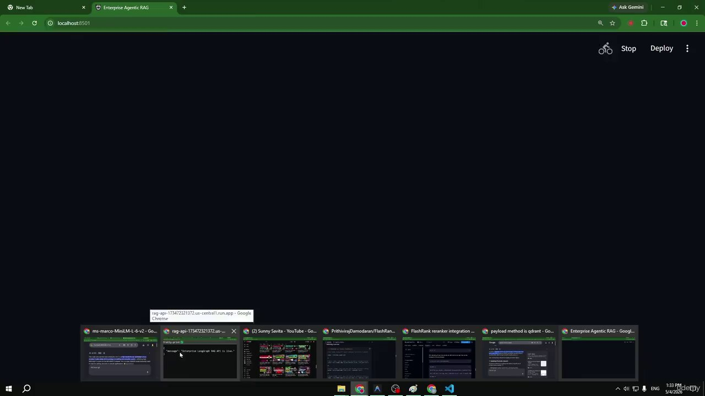

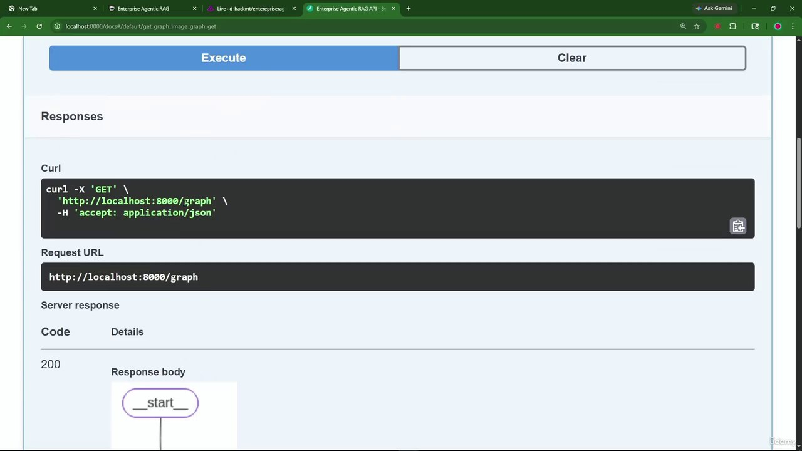

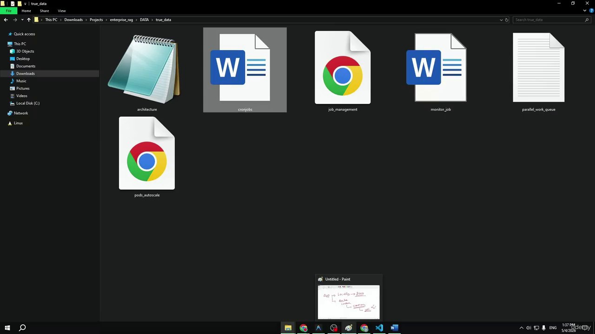

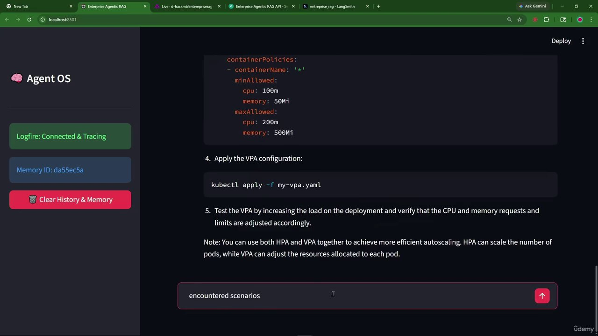

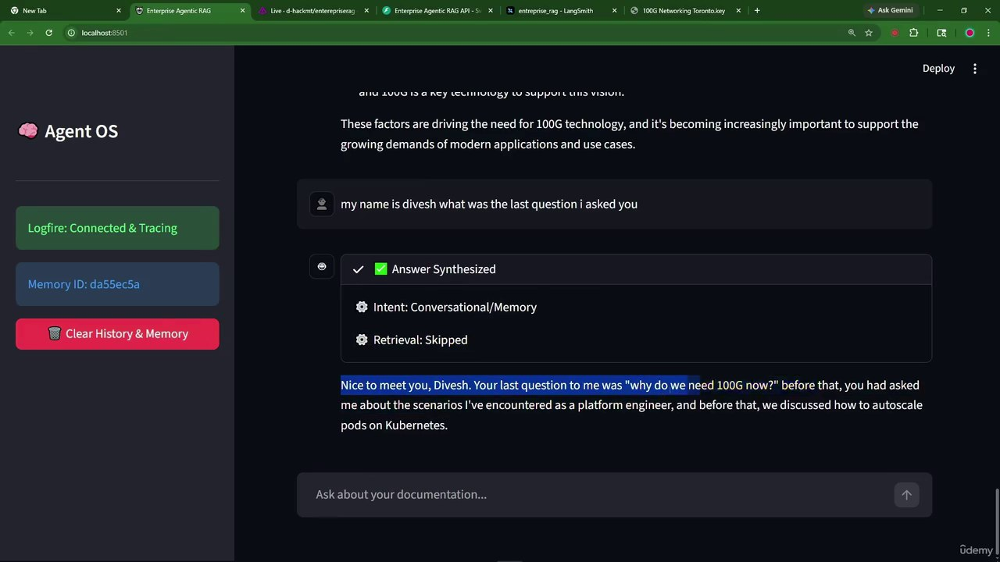

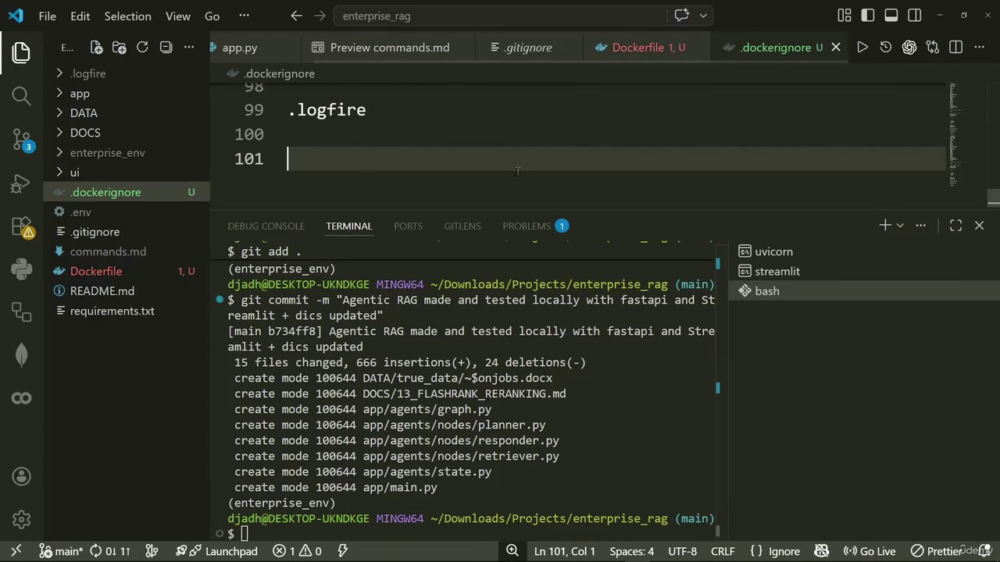

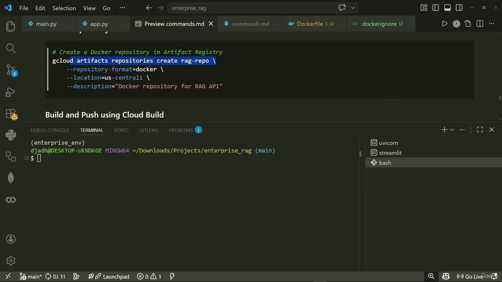

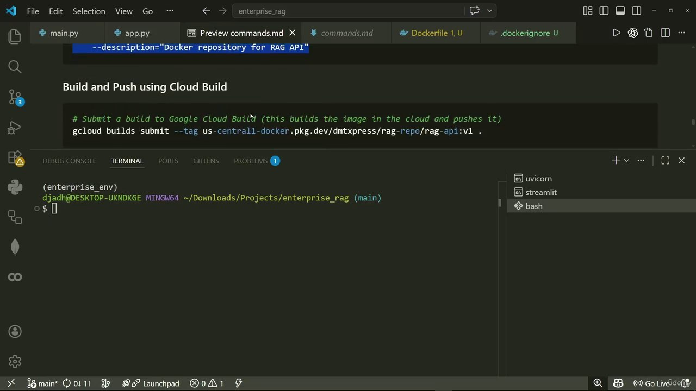

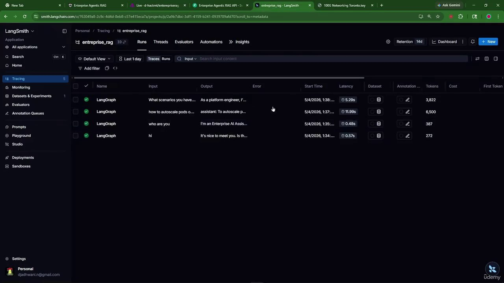

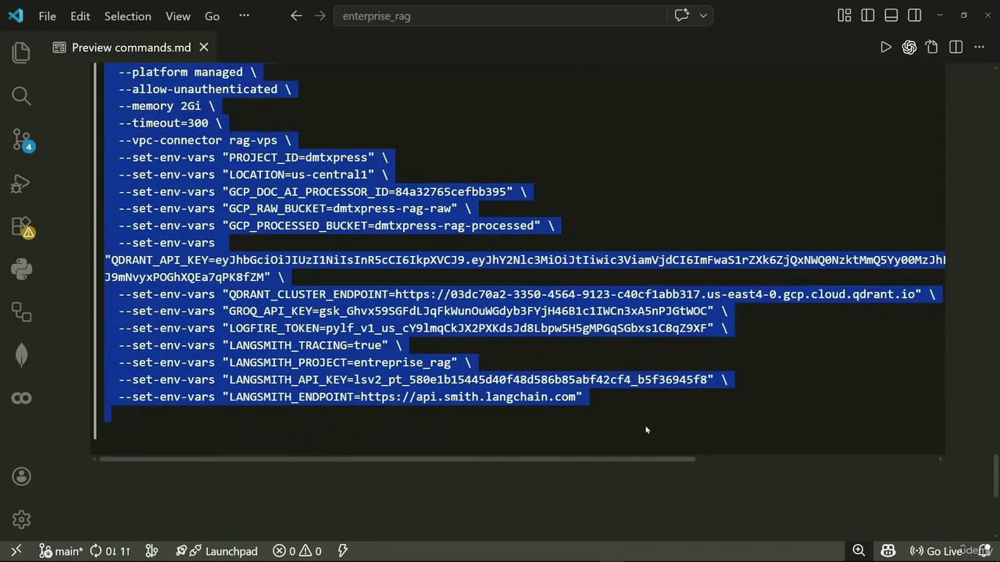

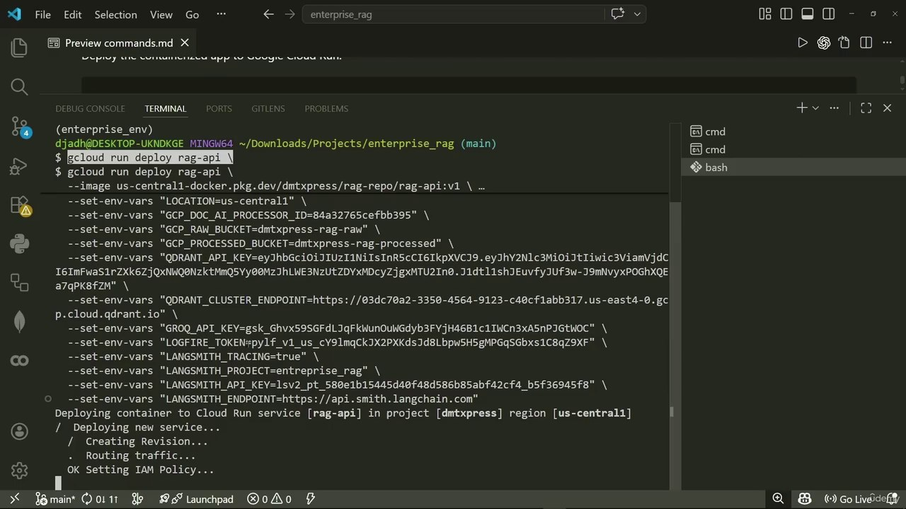

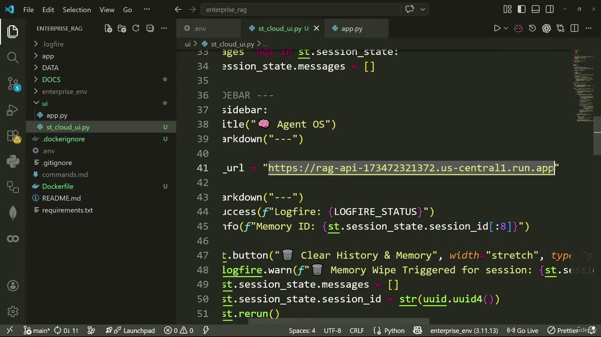