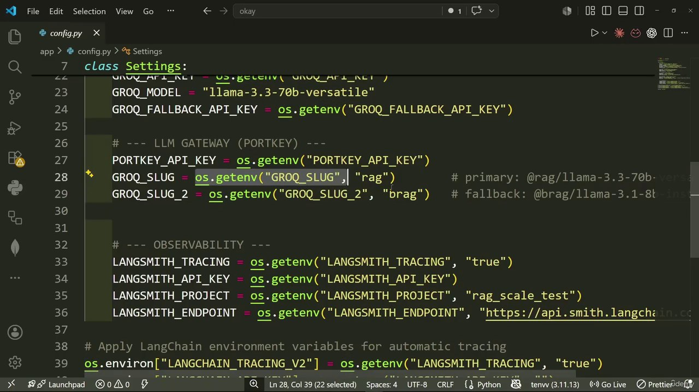
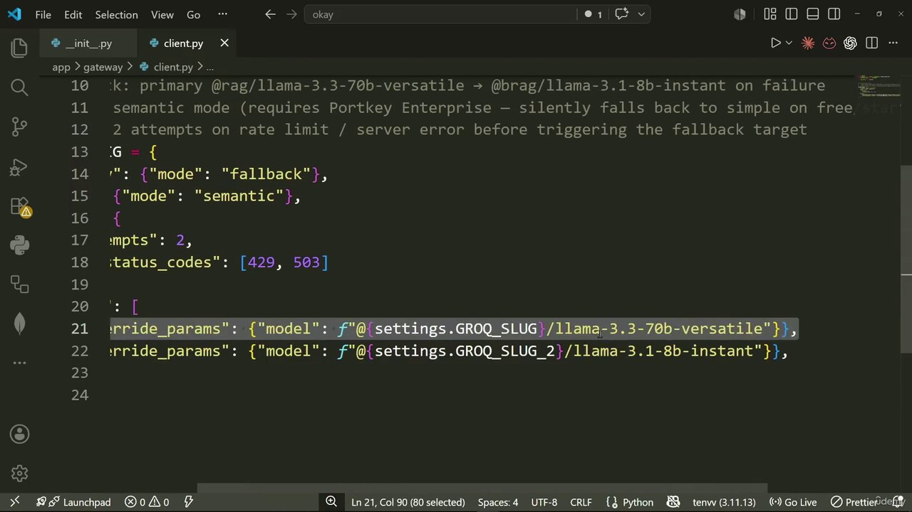
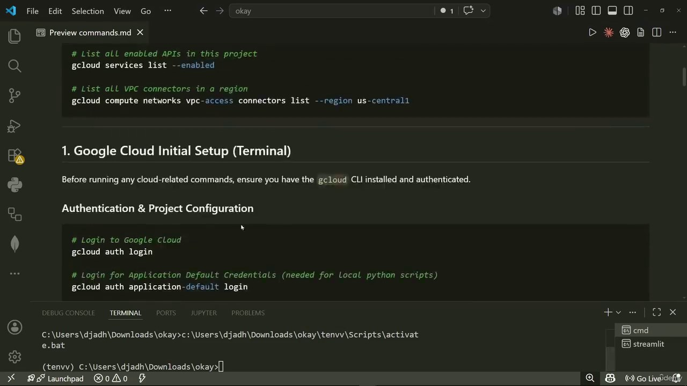
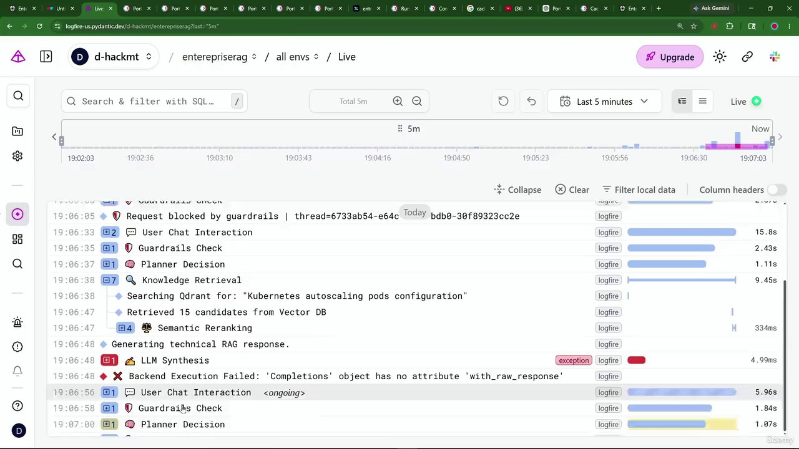
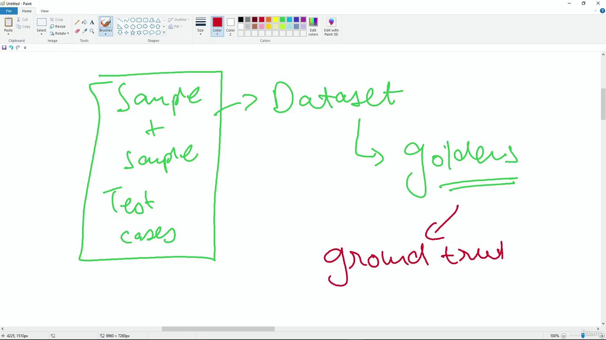
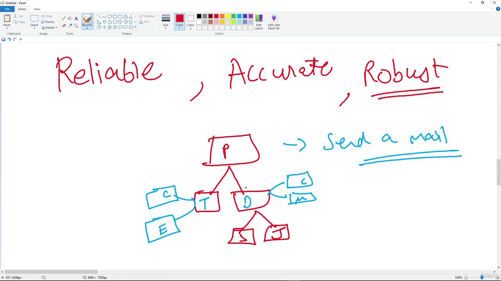
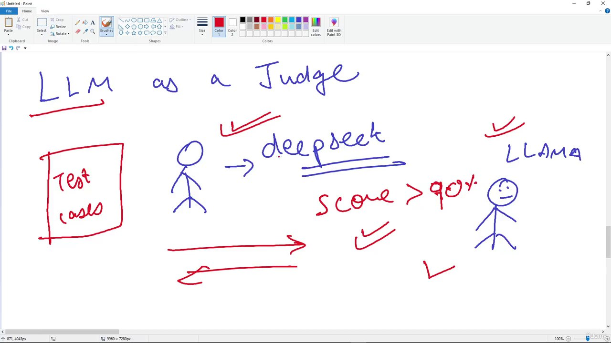
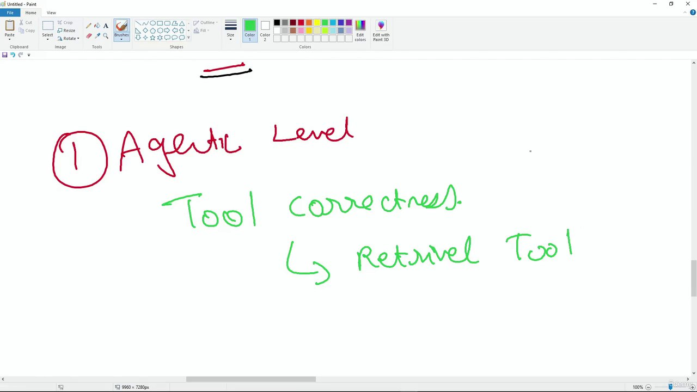

# AI Security Bootcamp Part 1（护栏 / 网关 / 可观测）P76–P78 复现文档

> 说明：逐字稿的语音识别把 Groq 记成了 "grog"、把 Portkey 记成了 "quote key / port key"，本文统一写成 **Groq**、**Portkey**。凡是逐字稿和截图里都没有出现的取值（具体模型名、依赖版本号、FastAPI 启动文件路径），文中一律标注「课里没讲」，并给出可替换的写法。

---

## 1. 这一节做什么

这三段（P76–P78）是一组「先动手、再解释为什么」的组合，恰好对应一个企业级 RAG 系统上线前的最后两块拼图：**网关（gateway）** 和 **评估（evaluation）**。

### 1.1 P76：把 Portkey 网关接进现有 RAG（可运行的部分）

在做这一段之前，项目里的三个 LLM 调用点是各自直连 Groq 的：planner 节点里是 `ChatGroq`，responder 节点里是直接打 Groq 的 chat completions。P76 要做的改造是：**所有模型调用统一从 Portkey 走**，并在网关层开两个能力：

1. **语义缓存（semantic caching）**：同一个（或语义等价的）问题第二次进来时，不再真的调用模型，直接从缓存返回，省 token、省延迟。讲师明确说，免费的 starter 档只能用 simple caching；如果非要开 semantic，Portkey 客户端会**静默降级**成 simple，**不报错**。以后买了 enterprise 权限，改一个配置就能切过去。另外，semantic cache 也可以在最后一个模块用 Terraform 在 GCP 上配 Redis 来做。
2. **模型回退（model fallback）**：第一个 Groq 模型报错（限流、服务端异常）时，自动切到第二个模型。配合「重试 2 次」，也就是连续两次失败后落回备用模型。

改造完的文件清单（这是本节要交付的实物）：

| 动作 | 文件 | 内容 |
|---|---|---|
| 修改 | `.env` | 新增 `GROQ_FALLBACK_API_KEY`（讲师是直接复制了同一个 key，真实场景应换成另一个 key） |
| 修改 | `app/config.py` | 新增 `groq_fallback_api_key`、`portkey_api_key`、`groq_slug`（=`rag`）、`groq_slug_2`（=`b_rag`） |
| 新建 | `app/gateway/__init__.py` | 把子模块的导出集中到包入口 |
| 新建 | `app/gateway/client.py` | 网关配置、Portkey 客户端、LangChain LLM 工厂、缓存状态提取 |
| 修改 | `app/agents/nodes/planner.py` | `ChatGroq` → `get_langchain_llm(...)`（只改这一处） |
| 修改 | `app/agents/nodes/responder.py` | 直连 Groq → `portkey_client.chat.completions.create(...)` |

验证方式是两个终端各起一个服务，然后用同一个问题问两遍，去 **Portkey 后台日志** 里看缓存命中、回退是否生效、省了多少 token。

这一段还有一个「现场翻车」值得复刻：讲师第一版在 responder 里给 Portkey 传了 `raw_response=True`，想把原始 HTTP 响应抠出来判断缓存是否命中，结果报错 `no such thing as a rag response with the raw response`。修复方式是**不再要 raw response，直接拿正常响应**。代价是 UI 上看不到缓存状态了——讲师自己试了一下，结论是「UI 上展示不了，就这样吧」，缓存命中信息只在 Portkey 后台能看到。

### 1.2 P77：为什么必须做 LLM 评估（方案推导部分）

P77 的问题意识很直接：我们已经把 RAG、护栏、网关都跑通了，**凭什么说这个系统可靠、可以上生产？**

讲师把「我测过了，跑得通」称为**软件层面的证明**，而不是 **LLM 层面的证明**：向量库能查到、护栏能拦、网关能回退，这些都是组件级验证；但真实用户会问什么、问法有多刁钻，我们不知道。所以要在上线前对模型输出本身做评估。

论证靠两个案例：

- **航空公司的 RAG 幻觉事故**：RAG 被喂了该公司自己的政策文档，政策里写的是「不退款 / 超过 N 天不退款」，用户问退款，RAG 回答「可以退，三天内到账」。用户信了，等了三天没到账，投诉；公司为了息事宁人，**在政策之外给这笔退款赔了**。这件事之后，公司无法再信任自己的 RAG——因为它在一次真实交互里产生了幻觉。
- **工具调用错配**：一个 planner 分发到各节点（测试部、开发部），每个节点挂着 calendar / mail / excel 等工具。用户说「把 XX 邮件发给开发团队」，期望调用 mail 工具，结果 agent 去调了 calendar 工具，把任务塞进了日历。任务没发出去。这就是 tool call 决策错误。

推导出的结论是：agent 是「数字人」，它有大脑（LLM），能行动、能回答；**测人的方式就是考试**——出题、收答案、跟标准答案（ground truth）比、按题目给分、按总分给判定。这套东西在软件工程里叫测试，是**确定性**的（预定义用例，行为应当一致）；而 LLM（以及人）是**非确定性**的，同一个问题两次回答顺序、措辞都可能不同。所以评估要解决的命题是：**允许随机，但要求随机出来的结果是对的**。

### 1.3 P78：评估的术语与三层指标（口径统一部分）

P78 把评估里要反复用到的词定死，避免团队里各说各话：

- **sample（样本 / 测试用例）**：由四部分组成——`user_input`（用户原始提问）、`context`（打向量库拿回来的上下文）、`response`（模型给出的回答）、`reference`（本应给出的真实答案，也就是 ground truth）。
- **dataset（数据集）**，业内也叫 **goldens**：多个 sample 堆起来就是数据集，goldens 强调「带 ground truth 的那份」。goldens 的生成**非常耗时**，而且必须由**领域专家（subject matter expert）**来写：医疗 bot 找医生，编码助手找资深开发，政策 agent 找写政策的人。
- 其他数据集类型：**synthetic dataset**（由评估框架自己读文档、自己生成用例）、**live dataset**、**adversarial dataset**（讲师说这几类「在哪里学我后面告诉你」，课里没展开）。
- **三层评估指标**：agentic 层（tool correctness）、retrieval 层（context precision / context recall）、generation 层（faithfulness / answer relevancy / answer correctness）。

---

## 2. 讲师原话

> "现在我们要在 .env 里加点东西，要加的是一个 Groq 的 fallback API key。我暂时直接复制了同一个 API key，但真实情况下你会在这里放另一个 API key。"
> —— p076 [00:00]

> "在配置里我们要加 Groq 的 fallback API key、Portkey 的 API key、groq slug 和 groq slug 2。groq slug 是 rag，groq slug 2 是 b_rag。这两个我们环境变量里没有，加上也行；不过这样也行——直接硬编码在这里，什么都不会变。因为我按了退格也没什么变化，我们从来没把它加到 .env 里，而我们照样能跑，没有我们的 API key 谁也打不进来。"
> —— p076 [00:29]

> "我们学了那么多网关的概念，那么对我们这个集成来说，哪一个概念最合适？最合适的那个就是 semantic caching（语义缓存）。如果你有免费额度，你会用 simple caching。等你哪天买了企业版，你才会用语义缓存。所以我把代码写成了这样：可以很容易地从 simple 切到 semantic。"
> —— p076 [02:47]

> "它的工作方式是：如果你不是企业版，却仍然用了 semantic，你的 Portkey 客户端会静默地回退到 simple 那一个。它不会抛错误，它会自动回退到 simple。"
> —— p076 [03:14]

> "还有一个点：semantic caching 如果你在这里用不了，我们会在最后一个模块用它，那个模块我们要配 Terraform。也就是说，semantic caching 我们也可以从 GCP 云上做，在那里也可以用 Redis。第二个我们要用的是 model fallback，意思是一个 Groq 模型失败了，我们就回退到第二个模型。这两个概念我们会作为网关集成进系统里。"
> —— p076 [04:12]

> "接下来设 Portkey 客户端：简单地说就是 Portkey(api_key=settings.portkey_api_key, config=gateway_config)。最后我们加 LangChain 的 get_langchain_llm，它接收一个 feature 字符串，也就是 rag、我们的 slug，返回一个 OpenAI 的 ChatOpenAI 对象。注意这里我们写的是 ChatOpenAI，不是 ChatGroq。"
> —— p076 [05:37]

> "早先我们是直接把 raw query 传进去，试图拿到 raw response，来判断缓存有没有命中。现在我们不这么干了，我们直接拿响应就行。"
> —— p076 [12:19]

> "我们能在 Portkey 日志里看到缓存被命中了，缓存命中了，回退是激活的，而且我们省下了这么多 token。"
> —— p076 [15:06]

> "我们一直在开发这个 enterprise RAG 系统，但你有什么证据能证明这个系统是可靠的？你凭什么说我们可以依赖它、可以完全放心地把它部署到生产？"
> —— p077 [00:26]

> "你说的那个证明，是软件层面的证明，不是 LLM 相关的证明。我们一直在测我们应用的各个组件，我们从来没机会去测我们的大语言模型。"
> —— p077 [01:21]

> "RAG agent 回复说：是的，我们有退款政策，你会在三天内收到退款。客户很开心，等着退款，但从来没收到。所以公司不得不在政策之外给这个客户退了款。现在他们再也没法信任自己的 RAG 系统了——这个 RAG 系统幻觉了。"
> —— p077 [03:35]

> "你的 AI agent 是一个数字人。为什么叫数字人？因为它有大脑。大脑是什么？大脑就是大语言模型。"
> —— p077 [05:02]

> "我们最著名的那个方法、也是我们接下来要用的方法，叫 LLM as a judge。我们配置另一个 LLM，用它来当裁判。"
> —— p077 [11:40]

> "第二种是人工评估。人工评估是什么？不是用大语言模型，而是 literally 雇一个人，让这个人去拿响应和 ground truth 比对。"
> —— p077 [14:05]

> "统计 NLP 指标：根据大语言模型给出的响应，我们去算不同的东西，比如 ROUGE 分数、BLEU 分数、BERT 分数，这些都是 NLP 的统计指标。第四种是规则式的、确定性的，跟软件测试很像，我们写预定义的程序去测我们的系统：模型有没有生成这些关键词、响应里有没有出现这些关键词。当我们要求非常严格的时候，就用这一种。"
> —— p077 [14:34]

> "最后一个是模型分类器。我们会用不同的框架，比如说 Llama Guard 就是其中一个框架。Llama Guard 会检查响应，告诉你这个响应安全不安全。还有一个 Google 的 Perspective API，它会告诉你这个响应有多少毒性、有没有威胁之类的东西。"
> —— p077 [15:33]

> "一个 sample 包含用户输入，也就是用户给的是什么 query；收到了什么上下文，也就是我们打向量数据库时拿回来的上下文；响应，也就是我们的大语言模型给出的回答；还有 reference，也就是真实答案是什么、我们本应收到什么。这些东西合起来就是一个 sample，我们也可以叫它 test case。"
> —— p078 [00:59]

> "goldens 的生成是一个非常耗时的过程，而且这些 goldens 是由领域专家生成的。比如我们做了一个医疗 bot，那医生就是领域专家；我们做的是策略 agent，那写这些政策的人就是领域专家；我们做的是编码助手，那资深开发者就是领域专家。"
> —— p078 [03:17]

> "在 agentic 层面，我们用的第一个指标是 tool correctness，也就是说：agent 在这个响应里本应调用 retriever 工具——我问 Kubernetes 的时候它该调 retriever；如果我问『把最新新闻抓来给我总结一下』，那它就不该去 retriever、不该打数据库，而该去打 web search。所以我们要确认它调用的是不是正确的工具。"
> —— p078 [08:27]

> "在检索层我们有两个指标：一个是 context precision，一个是 context recall。context precision 是看我们模型有多准——我们打 Qdrant 的时候，拿回来的这些 chunk 对不对。context recall 是看有没有漏掉 chunk、有没有正确地重排。"
> —— p078 [09:26]

> "生成层我们其实有三个东西：第一个是 faithfulness，第二个是 answer relevancy，第三个是 answer correctness。faithfulness 是问：agent 打到向量库、拿回 chunk 之后，它在回答你的时候，是基于收到的信息在回答，还是从它自己的知识库里在回答？"
> —— p078 [11:19]

> "answer relevancy 是说，用户问的是『我们有退款政策吗』，agent 回答的却是『以下是订机票的步骤』，这就说明答案跟用户 query 不相关。"
> —— p078 [12:17]

---

## 3. 从零复现

### 3.1 前置条件

- Python 3.11 及以上（**课里没讲版本号**，这个区间是本文件补的建议值）。
- 一个能跑的 enterprise RAG 基线项目：有 FastAPI 后端、Streamlit 前端、Qdrant 向量库、NeMo Guardrails 护栏、Logfire 可观测。本节只加网关，不重建这些。
- Groq 账号（至少一个 API key，最好两个）、Portkey 账号（拿 API key，并在后台建好配置）。

依赖清单见第 4 节 `requirements.txt`。**课里没讲任何版本号**，所以给的是不带版本约束的形式；如果遇到不兼容，先锁 `portkey-ai` 和 `langchain-openai` 两个包。

目录结构（新建的两个文件放在 `app/gateway/` 下面）：

```
enterprise-rag/
├── .env
├── requirements.txt
├── app/
│   ├── config.py
│   ├── main.py                 # FastAPI 入口；课里没讲文件名，按你项目实际
│   ├── gateway/
│   │   ├── __init__.py         # 新建
│   │   └── client.py           # 新建
│   └── agents/
│       ├── state.py            # AgentState；课里没讲字段，按你项目实际
│       └── nodes/
│           ├── planner.py      # 修改
│           └── responder.py    # 修改
└── ui/
    └── app.py                  # 讲师启动命令里出现的路径
```

### 3.2 第 1 步：往 `.env` 加 fallback key

在现有 `.env` 末尾追加两个 key。讲师的做法是把 fallback key 直接复制成和主 key 一样（省事），并强调真实场景要换成**另一个** key。

```bash
GROQ_API_KEY=gsk_xxxxxxxxxxxxxxxxxxxx
GROQ_FALLBACK_API_KEY=gsk_xxxxxxxxxxxxxxxxxxxx
PORTKEY_API_KEY=pk_xxxxxxxxxxxxxxxxxxxx
```

注意 `GROQ_FALLBACK_API_KEY` 不用在代码里直接引用成模型 key——它会作为第二条 target 的 virtual key 塞进网关配置里（见 4.2）。

### 3.3 第 2 步：改 `app/config.py`，新增 4 个配置项

讲师原话是「在配置里我们要加 Groq 的 fallback API key、Portkey 的 API key、groq slug 和 groq slug 2」。其中：

- `groq_fallback_api_key`、`portkey_api_key` 从环境变量读；
- `groq_slug = "rag"`、`groq_slug_2 = "b_rag"` 直接**硬编码在 Settings 类里**。讲师解释了为什么可以硬编码：这两个值从来没进过 `.env`，删掉环境变量里的对应行程序照样跑；而且没有 API key 的人根本打不到这个模型，slug 泄露也无所谓。

如果你更想放进 `.env`，完全可以，只要在 Settings 里保留同名字段即可。

### 3.4 第 3 步：新建 `app/gateway/` 目录并写 `__init__.py`

讲师的做法是：先在应用里建一个 `gateway` 文件夹，里面第一个文件是 `__init__.py`，第二个是 `client.py`。`__init__.py` 的作用是把后面所有文件要用的东西在这里初始化/导出。

这一步不是可选的：如果 `app/gateway/` 下没有 `__init__.py`，`from app.gateway import portkey_client` 在某些运行方式下会报找不到包。写法见 4.3。

### 3.5 第 4 步：写 `app/gateway/client.py`（本节核心）

这个文件按讲师的口述顺序有四块，顺序不要打乱：

1. **导入**：`logfire`；从 `portkey_ai` 导入 `Portkey`、`createHeaders`（用来传 metadata）、网关 URL 常量；从 `app.config` 导入 `settings`。
2. **网关配置 `GATEWAY_CONFIG`**：`strategy.mode = "fallback"`、`cache.mode = "semantic"`（可改成 `"simple"`）、`retry.attempts = 2`（两次失败后回退）、`targets` 两个（第一个模型 + fallback 模型）。
3. **Portkey 客户端 `portkey_client`**：`Portkey(api_key=settings.portkey_api_key, base_url=<网关 URL>, config=GATEWAY_CONFIG)`。
4. **`get_langchain_llm(feature="rag")`**：接收一个 feature 字符串（`rag` / `b_rag`），返回 `ChatOpenAI`（**不是 `ChatGroq`**），把 api key、base_url、model、temperature、default_headers（带 metadata）都传进去；最后 `extract_cache_status(raw, response, http_response)` 把缓存状态抠出来。

这里有个插曲：讲师在验证阶段发现 Logfire 里少了「gateway initialized」这条消息，说「我们忘了加 gateway 初始化的消息，不过没关系」。所以代码里在模块末尾补一条 `logfire.info("gateway initialized", ...)`——**这行是讲师承认漏掉后应该补上的**。

### 3.6 第 5 步：改 planner 节点（只改一行）

打开 `app/agents/nodes/planner.py`，找到原来用 `ChatGroq` 创建 LLM 的那行，换成 `get_langchain_llm(...)`。讲师强调：planner node 依然接收 `agent_state` 作为输入，输出结构不变，**这是唯一改动**。因为 `get_langchain_llm` 内部用的是 `ChatOpenAI`，对 LangChain 的上层调用方来说接口是一致的（`.invoke()`、`.ainvoke()` 都还在），所以 planner 后面拼 prompt 的代码一行都不用碰。

### 3.7 第 6 步：改 responder 节点

responder 的改动比 planner 大一点，但思路也简单：**原来直接打 Groq，现在打 Portkey 客户端的 chat completions**。

- 从 `app.gateway` 导入 `portkey_client`。「其他都一样，我们只是用 Portkey 客户端」。
- 原来是 `agent.invoke(...)`，现在改成 `portkey_client.chat.completions.create(messages=..., temperature=..., raw_response=True)`。
- 如果缓存命中，写一个 `cache_status = "hit"`，并把这个值写进 Logfire。

**第一版这里会翻车**，见 3.9。

### 3.8 第 7 步：起服务验证

开两个终端：

终端 A（前端）：

```bash
streamlit run ui/app.py
```

终端 B（后端）：

```bash
uvicorn app.main:app --reload
```

> 讲师只说「我们跑 fast api app 的命令」，**没有念出完整命令**；上面这条是按常规 FastAPI 项目写的，模块路径（`app.main:app`）请按你项目实际替换。

两个服务都起来后，做四件对账：

1. Streamlit 那边会显示「新建会话已创建」；
2. Logfire 里能看到 `new user session created`，overview 里多出一个新用户；
3. Portkey 后台从这一刻开始能收到请求；
4. 控制台里能看到 `NeMo guardrails has been initialized`（讲师顺口确认了护栏初始化）。

### 3.9 第 8 步：按顺序测三个场景

**场景一：打招呼。** 输入 `hi`。日志里应该看到护栏（guardrails）触发，走 `guardrails check → request block` 这一串——讲师把这条链路做成了标准化的固定流程。

**场景二：问业务问题。** 输入 `How to auto scale pods in Kubernetes?`（讲师特意提醒他拼 `Kubernetes` 时要注意拼写）。第一次问，因为缓存里没有，会走 `guardrails check → planner decision → knowledge retrieval`，然后去 Qdrant 里搜相似 chunk。这一步讲师看到过一次 `encoder internal error`，他的判断是「不影响」。

**场景三：同一个问题再问一遍。** 复制同一个问题原样粘贴，第二次应该命中 semantic cache。这时候去 Portkey 后台看日志，应当能看到：**缓存命中、fallback 处于激活状态、省下了 N 个 token**。

**这里会遇到第一个真 bug**：第二次问的时候 responder 报错——

```
there is no such thing as a rag response with the raw response
```

原因就是你传了 `raw_response=True`，而下游/解析逻辑按普通响应结构去取 `choices[0].message.content`，取不到。修复：**去掉 `raw_response=True`，直接使用正常响应**。修完要重启 FastAPI 服务，并在 Streamlit 上清一次 history / memory，让新会话生效，然后重新 `hi` 一次确认服务健康。

修复的副作用（讲师亲自确认过）：UI 上就不显示缓存状态了。他试过「在 UI 上展示缓存是怎么命中的」，结论是「好像做不到，那就这样吧」。所以最终判定缓存是否命中，**只看 Portkey 后台日志**，UI 不显示。

### 3.10 评估部分怎么「复现」

P77、P78 是纯讲解，没有代码。要复现的不是命令，而是**推导过程和产物**。按下面的顺序把结论落成表：

1. **需求**：证明系统可靠、可上生产。
2. **约束**：LLM 输出是非确定性的（同一问题两次措辞可以不同），但正确性必须可判定；ground truth 必须由领域专家出，成本高。
3. **估算**：阈值定多少。讲师给的例子是「分数超过某个阈值，比如 70%，我们就说这个系统可以依赖；你也可以定 90%」。也就是判定规则是 `总分 / 满分 ≥ threshold`，threshold 由业务风险决定（航空公司那种场景显然要往 90% 靠）。
4. **方案**：主用 **LLM as a judge**——用更强的推理模型当裁判（讲师举例是 DeepSeek 这种推理模型），被测模型是 RAG 用的 Llama。流程是：生成测试用例 → 被测模型产出响应 → 与 ground truth 比对 → 裁判打分 → 汇总过阈值。备选/补充手段是人工评估、统计 NLP 指标、规则式判定、模型分类器。
5. **取舍**：规则式判定适合「响应必须严格包含某些关键词」的强约束场景；统计指标适合批量回归；模型分类器适合安全/毒性这一类二分类判断；人工评估最准但最贵。

产物是 4.1（第 4 节）里的三张表 + 一个 sample 数据模型草案。

---

## 4. 完整代码

> 下面每个文件都是完整的、可以直接保存运行的文件。凡逐字稿里没有明确给出的取值，代码里都用注释标了「课里没讲」。

### 4.1 评估方案产物（P77 / P78，课里没有代码）

**表 A：五种评估方式（讲师在 P77 列的全部五种）**

| # | 方式 | 做什么 | 讲师给的代表工具/指标 | 适用 |
|---|---|---|---|---|
| 1 | LLM as a judge | 另配一个更强的推理模型当裁判，给被测模型的回答打分 | 举例：DeepSeek 推理模型当裁判、Llama 当被测 | 主力方案，本节采用 |
| 2 | 人工评估 | 真的雇人，拿响应和 ground truth 比对 | 无 | 最准、最贵 |
| 3 | 统计 NLP 指标 | 按响应算统计分 | ROUGE score、BLEU score、BERT score | 批量回归 |
| 4 | 规则式 / 确定性 | 写预定义程序判定关键词是否出现 | 无 | 响应要求极严格时 |
| 5 | 模型分类器 | 用分类模型判响应是否安全 | Llama Guard、Google Perspective API（判毒性、威胁） | 安全合规 |

**表 B：三层评估指标（讲师在 P78 列的全部指标）**

| 层级 | 指标 | 判定问题 |
|---|---|---|
| agentic（agent 决策层） | tool correctness | 该调 retriever 时调了 retriever 吗？该调 web search 时调了 web search 吗？该跳哪个节点跳对了吗？ |
| retrieval（检索层） | context precision | 从 Qdrant 拿回来的 chunk 对不对、准不准 |
| retrieval（检索层） | context recall | 有没有漏 chunk、有没有正确重排（re-rank） |
| generation（生成层） | faithfulness | 回答是基于检索到的 chunk，还是模型自己知识库里的东西 |
| generation（生成层） | answer relevancy | 回答跟用户 query 相关吗（问退款政策却答订票步骤 = 不相关） |
| generation（生成层） | answer correctness | 回答是否包含本应给出的全部事实与信息 |

**表 C：数据集类型（讲师在 P78 提到的四类）**

| 类型 | 来源 | 说明 |
|---|---|---|
| goldens | 领域专家手工写 | 带 ground truth，最耗时，最可信 |
| synthetic | 评估框架读你的文档自动生成 | 讲师说「框架自己拿文档、自己生成测试用例」 |
| live | 线上真实流量 | 课里没展开 |
| adversarial | 对抗性构造 | 课里没展开 |

**sample / dataset 数据模型草案**（字段名取自 P78 讲师口述的四要素）：

```json
{
  "user_input": "How to auto scale pods in Kubernetes?",
  "context": [
    "chunk-1: HPA 通过 metrics-server 采集 CPU/内存……",
    "chunk-2: 集群扩容用 Cluster Autoscaler……"
  ],
  "response": "在 Kubernetes 里自动扩 Pod 一般用 HorizontalPodAutoscaler……",
  "reference": "应说明 HPA 与 Cluster Autoscaler 的分工，并给出 kubectl autoscale 示例。",
  "scores": {
    "tool_correctness": 1,
    "context_precision": 0.83,
    "context_recall": 0.75,
    "faithfulness": 0.9,
    "answer_relevancy": 1.0,
    "answer_correctness": 0.8
  }
}
```

**示意代码（课里没有代码，以下为示意）**：LLM as a judge 的打分循环，只用来把讲师的流程显式化，不是讲师给过的实现。

```python
# 课里没有代码，以下为示意
THRESHOLD = 0.70  # 讲师举例：70%、90% 都可以，按业务风险定

def run_eval(samples, judge_llm, target_llm):
    results = []
    for s in samples:
        answer = target_llm.invoke(build_prompt(s))          # 被测模型产出响应
        verdict = judge_llm.invoke(build_judge_prompt(s, answer))  # 裁判模型打分
        score = parse_score(verdict)                          # 解析成 0~1
        results.append({"sample": s, "answer": answer, "score": score})

    total = sum(r["score"] for r in results) / len(results)
    return {"total": total, "passed": total >= THRESHOLD, "results": results}
```

### 4.2 `requirements.txt`

```
# 课里没讲任何版本号，以下为不带版本约束的清单
fastapi
uvicorn[standard]
streamlit
langchain-core
langchain-openai
portkey-ai
logfire
pydantic-settings
qdrant-client
nemoguardrails
langgraph          # 课里没讲具体编排框架；node/state 的叫法与 LangGraph 一致
```

### 4.3 `app/gateway/__init__.py`（完整文件）

```python
"""网关包入口：把子模块的能力统一导出。

讲师在这一步的说法是：__init__.py 里我们初始化所有后面其它文件要用到的东西。
"""

from app.gateway.client import (  # noqa: F401
    GATEWAY_CONFIG,
    get_langchain_llm,
    extract_cache_status,
    portkey_client,
)
```

### 4.4 `app/gateway/client.py`（完整文件）

```python
"""Portkey 网关客户端。

逐字稿口述的四块内容：
1) 导入 logfire / portkey / settings
2) 网关配置：fallback 策略、semantic 缓存（免费档会静默降级为 simple）、重试 2 次、两个 target
3) Portkey 客户端
4) get_langchain_llm：返回 ChatOpenAI（不是 ChatGroq）
5) extract_cache_status：提取缓存状态
"""

import logfire
from portkey_ai import Portkey, createHeaders, PORTKEY_GATEWAY_URL
# 说明：讲师口语称它为 “portkey gateway URL”，SDK 里的常量名以你安装的
# portkey-ai 版本为准；若你的版本导出名不同，改成对应常量即可。

from app.config import settings

# ---------------------------------------------------------------------------
# 1. 网关配置
# ---------------------------------------------------------------------------
# 这里的两个模型 id 课里没讲（讲师只说了“our first model”和“fallback model”，
# 以及 slug 叫 rag / b_rag）。请替换成你 Groq / Portkey 账户里实际可用的模型。
GROQ_PRIMARY_MODEL = "请替换成你的第一个 Groq 模型 id"    # 课里没讲
GROQ_FALLBACK_MODEL = "请替换成你的第二个 Groq 模型 id"   # 课里没讲

GATEWAY_CONFIG = {
    # 一个模型失败 -> 回退到另一个模型
    "strategy": {"mode": "fallback"},

    # semantic 缓存；免费 starter 档会自动、静默地回退到 simple，不报错。
    # 想用 simple 缓存就把这里改成 "simple"。
    "cache": {"mode": "sem
```python
    # semantic 缓存；免费 starter 档会自动、静默地回退到 simple，不报错。
    # 想用 simple 缓存就把这里改成 "simple"。
    "cache": {"mode": "semantic"},

    # 两次失败之后回退到备用模型
    "retry": {"attempts": 2},

    # targets：第一个是主模型，第二个是 fallback 模型。
    # 注意：targets 内部的键名（virtual_key / provider / override_params 之类）
    # 课里没讲，讲师原话只是「targets 是我们的第一个模型，这是我们的 fallback 模型，
    # 参数看那边」。请以你所用 portkey-ai 版本的配置文档为准。
    "targets": [
        {
            "virtual_key": "groq-primary",          # 课里没讲，换成你的虚拟 key
            "provider": "groq",                     # 课里没讲
            "override_params": {"model": GROQ_PRIMARY_MODEL},
        },
        {
            "virtual_key": "groq-fallback",         # 课里没讲，换成你的虚拟 key
            "provider": "groq",                     # 课里没讲
            "override_params": {"model": GROQ_FALLBACK_MODEL},
        },
    ],
}


# ---------------------------------------------------------------------------
# 2. Portkey 客户端
# ---------------------------------------------------------------------------
# 讲师原话：简单地说就是 Portkey(api_key=settings.portkey_api_key, config=gateway_config)
portkey_client = Portkey(
    api_key=settings.portkey_api_key,
    base_url=PORTKEY_GATEWAY_URL,
    config=GATEWAY_CONFIG,
)


# ---------------------------------------------------------------------------
# 3. LangChain 的 LLM 工厂
# ---------------------------------------------------------------------------
from langchain_openai import ChatOpenAI  # noqa: E402


def get_langchain_llm(feature: str = "rag", temperature: float = 0.0) -> ChatOpenAI:
    """传一个 feature 字符串（rag / b_rag，也就是我们的 slug），返回一个
    OpenAI 的 ChatOpenAI 对象——注意是 ChatOpenAI，不是 ChatGroq。

    讲师在屏幕上念的四个入参是：API key、base URL、model、temperature，
    再加上 default headers，以及 metadata。
    """
    if feature == "b_rag":
        model = GROQ_FALLBACK_MODEL
    else:
        model = GROQ_PRIMARY_MODEL

    return ChatOpenAI(
        api_key=settings.portkey_api_key,
        base_url=PORTKEY_GATEWAY_URL,
        model=model,
        temperature=temperature,
        # 用 createHeaders 把 metadata 带过去。
        # 讲师只说了「metadata 我们也传过去」，具体键名课里没讲，
        # 这里放一个最小可用形式，字段名以你安装的 portkey-ai 版本为准。
        default_headers=createHeaders(
            api_key=settings.portkey_api_key,
            metadata={"feature": feature},
        ),
    )


# ---------------------------------------------------------------------------
# 4. 缓存状态提取
# ---------------------------------------------------------------------------
# 讲师原话：我们把 raw response、response、HTTP response 拿来，如果拿到这类响应，
# 就说明我们缓存到了；不是 None 就返回 miss，是 None 也返回 miss，
# 但只要不是 None 而能读到缓存状态，就返回 cache hit。
#
# 注意：具体的响应头名字（Portkey 用哪个 header 表示 cache status）
# 课里没讲，下面的 header 名请以 Portkey 后台/文档为准。
CACHE_HIT_VALUES = {"hit", "simple_hit", "semantic_hit"}
CACHE_HEADER_NAMES = ("x-portkey-cache-status", "x-portkey-cache")


def extract_cache_status(raw_response=None, response=None, http_response=None) -> str:
    for carrier in (raw_response, response, http_response):
        if carrier is None:
            continue

        headers = getattr(carrier, "headers", None)
        if headers is None and isinstance(carrier, dict):
            headers = carrier
        if not headers:
            continue

        for name in CACHE_HEADER_NAMES:
            value = headers.get(name) if hasattr(headers, "get") else None
            if value is not None and str(value).lower() in CACHE_HIT_VALUES:
                return "hit"

    return "miss"


# 讲师在验证阶段发现 Logfire 里少了「gateway initialized」这条消息，
# 说「我们忘了加 gateway 初始化的消息，不过没关系」。这里补上。
logfire.info("gateway initialized", cache_mode=GATEWAY_CONFIG["cache"]["mode"])
```

### 4.5 `app/config.py`（完整文件，新增 4 个字段）

```python
"""应用配置。

P76 在这一步新增了四项：groq_fallback_api_key、portkey_api_key、groq_slug、groq_slug_2。
其中 groq_slug / groq_slug_2 讲师是直接硬编码在这里的，理由：
这两个值从来没进过 .env，删掉 .env 里对应行程序照样跑；
而且没有 API key 谁也打不到这个模型，slug 泄露无所谓。
"""

from pydantic_settings import BaseSettings, SettingsConfigDict


class Settings(BaseSettings):
    model_config = SettingsConfigDict(env_file=".env", extra="ignore")

    # 原有的
    groq_api_key: str
    qdrant_url: str = ""            # 课里没讲具体变量名，按你项目实际
    qdrant_api_key: str = ""        # 课里没讲具体变量名，按你项目实际
    logfire_token: str = ""         # 课里没讲具体变量名，按你项目实际

    # P76 新增：从 .env 读
    groq_fallback_api_key: str
    portkey_api_key: str

    # P76 新增：讲师明确说直接硬编码在这
    groq_slug: str = "rag"
    groq_slug_2: str = "b_rag"


settings = Settings()
```

### 4.6 `.env`（完整文件）

```bash
# 原有
GROQ_API_KEY=gsk_xxxxxxxxxxxxxxxxxxxx

# P76 新增：讲师是直接把同一个 key 复制过来的。
# 他强调：真实场景这里应该放另一个 API key。
GROQ_FALLBACK_API_KEY=gsk_xxxxxxxxxxxxxxxxxxxx

# P76 新增
PORTKEY_API_KEY=pk_xxxxxxxxxxxxxxxxxxxx

# 说明：GROQ_SLUG / GROQ_SLUG_2 不需要加进 .env，
# 讲师是硬编码在 config.py 里的（rag / b_rag）。
```

### 4.7 `app/agents/nodes/planner.py`（完整文件）

```python
"""planner 节点。

P76 对这个文件的改动只有一处：
原本是 ChatGroq，现在换成 get_langchain_llm。
入参仍然是 agent_state，输出结构不变。
"""

import logfire

from app.agents.state import AgentState        # 课里没讲字段定义，按你项目实际
from app.gateway import get_langchain_llm

# 课里没讲 prompt 原文，这里保留你自己的规划 prompt
PLANNER_PROMPT = """你是企业知识库 RAG 系统的规划器。
根据用户问题决定下一步：直接回答、检索知识库、或拒答。
用户问题：{question}
"""


def planner_node(state: AgentState) -> AgentState:
    # 唯一改动：原来这里是 ChatGroq(...)，现在走网关工厂
    llm = get_langchain_llm(feature="rag")

    prompt = PLANNER_PROMPT.format(question=state["question"])
    decision = llm.invoke(prompt)

    state["plan"] = decision.content
    logfire.info("planner decision", plan=state["plan"])
    return state
```

### 4.8 `app/agents/nodes/responder.py`（完整文件，含踩坑后的修复版）

```python
"""responder 节点。

P76 的改动：
1) 从 app.gateway 导入 portkey_client；
2) 以前是 agent.invoke / 直接打 Groq，现在打 portkey_client.chat.completions.create；
3) 缓存命中就把 cache_status = "hit"，并写进 Logfire。

踩坑记录（重要）：
第一版为了判断缓存是否命中，传了 raw_response=True，结果报
    there is no such thing as a rag response with the raw response
修复方式：不传 raw_response，直接拿正常响应。
副作用：UI 上显示不了缓存状态（讲师确认「好像做不到」），
缓存是否命中只看 Portkey 后台日志。
"""

import logfire

from app.agents.state import AgentState   # 课里没讲字段定义，按你项目实际
from app.gateway import portkey_client

RESPONDER_SYSTEM = "你是企业知识库助手，只根据给定上下文回答，不要编造。"


def responder_node(state: AgentState) -> AgentState:
    question = state["question"]
    context = state.get("context", "")

    messages = [
        {"role": "system", "content": RESPONDER_SYSTEM},
        {
            "role": "user",
            "content": f"上下文：\n{context}\n\n用户问题：{question}",
        },
    ]

    # 修复后的写法：不要 raw_response=True
    completion = portkey_client.chat.completions.create(
        messages=messages,
        temperature=0.0,
    )

    answer = completion.choices[0].message.content
    state["answer"] = answer

    # 缓存命中标记（课里没讲具体判断 header，用 gateway 里的提取函数兜底）
    cache_status = "hit" if getattr(completion, "cache_status", None) == "hit" else "miss"
    state["cache_status"] = cache_status
    logfire.info("responder done", cache_status=cache_status)

    return state
```

### 4.9 启动命令汇总

```bash
# 终端 A：前端
streamlit run ui/app.py

# 终端 B：后端（模块路径课里没讲，按你项目实际替换）
uvicorn app.main:app --reload
```

---

## 5. 逐行解释

### 5.1 `GATEWAY_CONFIG` 为什么这么写

`"strategy": {"mode": "fallback"}`：讲师说的第一个网关能力是 **model fallback**——「一个 Groq 模型失败了，我们就回退到第二个模型」。之所以放在 `strategy` 里，是因为 fallback 是**调度策略**，不是缓存、不是重试，它决定「这次请求最终由哪个 target 承接」。换个角度看，你如果是前端，这就是「主接口 429 了自动切备用接口」，只不过切的是模型而不是域名。

`"cache": {"mode": "semantic"}`：第二个能力是 semantic caching。讲师说得很明确：**免费 starter 档你其实只能用 simple caching**；但如果代码里写了 `semantic`，Portkey 客户端会**静默降级**到 simple，**不报错**。所以这里写 `semantic` 是安全的——它同时表达了「我现在想用什么」和「我以后升级会得到什么」。这就是讲师说的「我把代码写成这样，可以很容易地从 simple 切到 semantic」：**改一个字符串就行，不用动调用链**。他在 [03:42] 还补了一句：如果这里用不了 semantic，最后一个模块会用 Terraform 在 GCP 上配 Redis 来做语义缓存——也就是说语义缓存的实现位置是可以搬的，接口不变。

`"retry": {"attempts": 2}`：讲师原话是「after two fail attempts we will fall back to our other model」，即**两次失败之后**才回退。为什么不是 1？因为一次失败可能是瞬时抖动；为什么不是 5？因为用户等不起——每多一次重试都在叠加延迟。2 是一个折中值。要注意它和 fallback 是**串联**的：先按 attempts 重试同一个 target，重试都失败才切 target。这一点在写文档给别人复现时必须讲清楚，否则别人会以为「失败一次立刻回退」。

`"targets"`：讲师说「targets 是我们的第一个模型，这是我们的 fallback 模型」。数组顺序即优先级，Portkey 按策略在数组里挑。**数组内部的键名（virtual_key / provider / override_params）课里没讲**——讲师只说「see over at the parameters」，屏幕上是配置面板。所以代码里我按 Portkey 的常规结构写了骨架，并在注释里逐项标了「课里没讲」，你复现时应该拿你账号里真实的 virtual key 替换掉，别照抄占位字符串。

`GROQ_PRIMARY_MODEL` / `GROQ_FALLBACK_MODEL` 为什么是占位：**讲师全程没念出任何模型 id**，只说「our first model / fallback model」。这是本段唯一必须你自己填的硬缺口。

### 5.2 `Portkey(...)` 三个入参

`api_key=settings.portkey_api_key`：来自 `.env`。`base_url=PORTKEY_GATEWAY_URL`：讲师口语说的是「portkey gateway URL so that we can hit the port key client」，意思是**把请求打到 Portkey 的网关地址**，而不是打到 `api.groq.com`——这是整段改造的物理落点：改的不是模型，改的是**流量出口**。`config=GATEWAY_CONFIG`：把上面那份策略/缓存/重试/目标配置随请求一起送过去。

### 5.3 `get_langchain_llm` 为什么返回 `ChatOpenAI`

讲师特意强调「Here we have written via ChatOpenAI not ChatGroc」。原因是 Portkey 的网关对外暴露的是 **OpenAI 兼容接口**，所以 LangChain 侧用 `ChatOpenAI` 指向 Portkey 的 base_url 就能跑通，而 `ChatGroq` 是直连 Groq 专用端点、绕不过网关。这一句是整个 planner 改造能「只改一行」的前提：`ChatOpenAI` 和 `ChatGroq` 都是 LangChain 的 chat model，`.invoke()` 接口一致，所以 planner 里拼 prompt、解析 content 的代码全都不用动。

五个入参对应讲师念的五样：API key、base URL、model、temperature、default headers。其中 `default_headers` 用 `createHeaders(...)` 生成，用来**传 metadata**——讲师 [06:07] 说「metadata 我们也传过去」。metadata 的用途是让 Portkey 后台能按 feature 维度区分流量（`rag` vs `b_rag`），这样你在后台看板里能分开看两个 slug 的命中率和 token 消耗。具体 header 键名 **课里没讲**，代码里已标注请以 SDK 为准。

`feature` 参数决定用主模型还是 fallback 模型：`rag` → 主模型，`b_rag` → 备用模型。这和 config.py 里的 `groq_slug = "rag"`、`groq_slug_2 = "b_rag"` 是同两个值，讲师把它们当成「feature 名 / slug」两用。

### 5.4 `extract_cache_status` 那几句含混的原文怎么落地

讲师 [06:07]–[06:35] 的原话大意是：把 raw response、response、HTTP response 拿出来，「如果不是 None 就返回 miss，如果是 None 也返回 miss，但只要不是 None 就读出缓存状态、返回 cache hit」。这段语音识别本身是乱的（他自己在绕）。可用的语义只有一条：**缓存状态不在模型回答的正文里，而在响应对象/响应头上**，所以要挨个 carrier 去试。代码里就是 `for carrier in (raw_response, response, http_response)`，每个都不是 None 就去找缓存头，找不到就返回 `"miss"`。

这里必须提醒一句：**具体哪个 header 表示缓存命中，课里没讲**，代码里 `x-portkey-cache-status` 是占位名，请以 Portkey 后台/文档为准。不要把这个名字当成讲师的原话。

### 5.5 responder 的 `raw_response=True` 为什么会炸，为什么去掉就好了

第一版想让缓存状态在 UI 上可见，于是传 `raw_response=True` 把整个 HTTP 响应抠出来。结果是：下游按普通 OpenAI 响应结构去取 `completion.choices[0].message.content`，而 raw 模式下拿到的东西不是那个形状，于是抛错——报的就是那句 `there is no such thing as a rag response with the raw response`。修复动作只有一个：**去掉 `raw_response=True`，用正常响应**。修完必须重启 FastAPI（改的是后端代码），并在 Streamlit 上清一次 history / memory 让新会话生效，然后先 `hi` 一次确认服务健康。

代价是讲师自己承认的：「我本来想在 UI 上也展示缓存是怎么命中的，但好像做不到，那就这样吧」。所以验收标准变成：**缓存命中只在 Portkey 后台日志里看**。这不是偷懒，是因为缓存判定信息在网关层，而网关层的信息没有（在这个版本里）回传到前端。

### 5.6 planner 为什么「只改一行」

因为改动点在 **LLM 的构造**，不在调用。`state` 进、`state` 出，中间是拼 prompt → 调模型 → 取 content。把 `ChatGroq` 换成 `get_langchain_llm(feature="rag")` 之后，模型调用从「直连 Groq」变成「经过 Portkey」，但对 `llm.invoke(prompt)` 这一行**完全无感**。这是网关设计带来的收益：换出口不动业务代码。

### 5.7 P77 的推导链，逐条解释

- 「组件能跑通 ≠ 系统可靠」：讲师把前者叫**软件层面的证明**。你验证了向量库能查、护栏能拦、网关能回退，这证明的是**管道没漏**，不证明**回答是对的**。用户会问什么、问法多刁钻，开发者不知道。
- 航空公司的例子为什么杀伤力大：不是模型答错了技术问题，而是**模型给出了一个不存在的政策承诺**，导致公司真金白银赔了钱，并且**从此不能再信任这套 RAG**。这正是 `faithfulness` 要防的东西（见下）。
- 「agent 是数字人，有大脑」：这个类比的作用是把评估的**方法论**从 ML 借到教育测量——测人的方式就是考试。出题 → 收答案 → 跟 ground truth 比 → 按题给分 → 按总分判定。
- **确定性 vs 非确定性**：软件测试（单测、集成、验收、系统测试）是确定性的——预定义用例，行为应当一致。LLM 和人一样是非确定性的——同一问题两次回答的顺序、措辞都可能不同（讲师举了「第一次答『成立于某某年、做了哪些事』，第二次先说做了哪些事再说成立年份」）。所以评估的命题不是「消灭随机」，而是「**允许随机，但要求随机出来的结果是对的**」。
- **工具调用错配的例子**：planner 分发到测试部/开发部（还有 junior / senior / team lead 之分），每个部门挂 calendar / mail / excel 等工具。用户说「把 XX 邮件发给开发团队」，期望走 mail 工具，结果 agent 走了 calendar 工具，把任务塞进了日历——邮件没发出去。这就是 `tool correctness` 要抓的失败：**不是答错内容，而是做了错动作**。
- **LLM as a judge 的闭环**：先生成测试用例 → 交给被测模型（讲师举例是 RAG 用的 Llama）产出响应 → 与 ground truth 比对 → 由另一个更强推理模型（讲师举例 DeepSeek 这种 reasoning model）当裁判打分 → 得分过阈值（70% 或 90%，看业务风险）就判定「可以依赖」。这里的关键取舍是**用模型省钱、用规则兜底**：裁判模型是成本，但它比雇人便宜几个数量级。
- **五种方式的分工**：LLM as a judge（主力）；人工评估（最准最贵，「literally 雇一个人」）；统计 NLP 指标（ROUGE / BLEU / BERT score，适合批量回归）；规则式/确定性（写预定义程序判关键词是否出现，「当我们要求非常严格的时候」用）；模型分类器（Llama Guard 判安全不安全、Google Perspective API 判毒性和威胁）。

### 5.8 P78 的术语，逐条解释

`sample` 的四个字段为什么必须是这四个：`user_input` 是**输入**；`context` 是**检索产物**（打向量库拿回来的）；`response` 是**模型产出**；`reference` 是**本应产出**。少任何一个，你就没法定位问题出在**检索**还是**生成**——这正是三层指标能分层的物理基础。讲师说 sample 也可以叫 test case。

`dataset` / `goldens`：多个 sample 堆起来 = dataset；带 ground truth 的那份叫 goldens。讲师强调 **goldens 极其耗时，且必须由领域专家写**：医疗 bot 找医生、政策 agent 找写政策的人、编码助手找资深开发。这一条决定了评估的现实约束——你没有 golden，评估就是空的。

`context precision` 与 `context recall` 的分工，讲师讲得很直白：precision 问「拿回来的 chunk **对不对**」（问 Kubernetes 自动扩 Pod，拿回来的是不是 Kubernetes 扩容的内容）；recall 问「**有没有漏 chunk、有没有正确重排**」。这两个指标只在你真的打了 Qdrant 时才有意义，所以对应到你的检索节点。

`faithfulness`：agent 打到向量库、拿回 chunk 之后，回答是**基于收到的信息**，还是**从自己知识库**里编的？「agent 对你是忠诚的吗」。注意这正是航空公司事故的直接对应项——政策文档里写「不退款」，模型却答「可退款」。

`answer relevancy`：回答跟问题**相关吗**。讲师给的反例是：用户问「我们有退款政策吗」，agent 答「以下是订机票的步骤」。

`answer correctness`：回答**包含全部本应给出的事实**吗，也就是「有多正确」。

三者的关系讲师自己总结过：relevancy 看相关、correctness 看正确、faithfulness 看**有没有用上检索到的东西**。

> 给前端的一句话对照：这套东西在 Node 里等价于「用 LLM 给单测结果打分」。`context precision/recall` ≈ 你测「依赖注入进来的数据对不对、全不全」；`faithfulness` ≈ 你测「输出是不是真的来自入参而不是硬编码常量」；`answer relevancy` ≈ 你测「返回值形状和调用方期待是否一致」。

---

## 6. 复现检查清单

按顺序打勾。任一项失败就先解决它，再往下走。

### A. 配置层

- [ ] `.env` 里有 `GROQ_API_KEY`、`GROQ_FALLBACK_API_KEY`、`PORTKEY_API_KEY` 三项。
- [ ] `app/config.py` 里能读到 `settings.groq_fallback_api_key`、`settings.portkey_api_key`、`settings.groq_slug == "rag"`、`settings.groq_slug_2 == "b_rag"`。
- [ ] 故意把 `GROQ_SLUG` 从 `.env` 里删掉（如果你的版本加过），程序**依然能起**——讲师按退格验证过这一点。

```bash
python -c "from app.config import settings; print(settings.groq_slug, settings.groq_slug_2)"
# 期望输出: rag b_rag
```

### B. 文件层

- [ ] `app/gateway/__init__.py` 存在。
- [ ] `app/gateway/client.py` 存在，且能独立导入：

```bash
python -c "from app.gateway.client import GATEWAY_CONFIG, portkey_client, get_langchain_llm; print(GATEWAY_CONFIG['cache']['mode'], GATEWAY_CONFIG['strategy']['mode'], GATEWAY_CONFIG['retry']['attempts'], len(GATEWAY_CONFIG['targets']))"
# 期望输出: semantic fallback 2 2
```

- [ ] `get_langchain_llm()` 返回的对象类型是 `ChatOpenAI`（不是 `ChatGroq`）：

```bash
python -c "from app.gateway import get_langchain_llm; print(type(get_langchain_llm('rag')).__name__, type(get_langchain_llm('b_rag')).__name__)"
# 期望输出: ChatOpenAI ChatOpenAI
```

- [ ] `planner.py` 里已无 `ChatGroq` 字样（`grep -rn "ChatGroq" app/` 应为空）。
- [ ] `responder.py` 里已无 `raw_response=True`（`grep -rn "raw_response" app/` 应只出现在 `extract_cache_status` 的形参里）。

### C. 启动与联调

- [ ] 终端 A `streamlit run ui/app.py` 起得来。
- [ ] 终端 B `uvicorn app.main:app --reload` 起得来（模块路径按你项目实际）。
- [ ] Streamlit 上显示「新会话已创建」。
- [ ] Logfire 后台出现 `new user session created`，overview 里多了一个用户。
- [ ] 控制台能看到 `NeMo guardrails has been initialized`。
- [ ] Logfire 里能看到 `gateway initialized`（这一条是讲师漏掉后补的，你补上就该出现）。

### D. 三个场景

| 场景 | 输入 | 期望链路 / 期望结果 |
|---|---|---|
| 打招呼 | `hi` | 护栏触发，日志出现 `guardrails check → request block` |
| 首次业务提问 | `How to auto scale pods in Kubernetes?` | `guardrails check → planner decision → knowledge retrieval`，命中 Qdrant，返回相似 chunk |
| 原样重复提问 | **完全同一个字符串**再贴一次 | Portkey 后台日志出现：缓存命中、fallback 激活、省下 N 个 token |

- [ ] 第一次提问时如果日志里有 `encoder internal error`，按讲师的判断视为「不影响」，继续。
- [ ] 第二次提问**不要报** `there is no such thing as a rag response with the raw response`（报了就是你还在传 `raw_response=True`，或改完没重启服务）。
- [ ] 改代码后重启了 FastAPI，并在 Streamlit 上清过 history / memory，再按 `hi` 确认服务健康。
- [ ] 接受「UI 上不显示缓存状态」这一预期行为——判定只看 Portkey 后台。

### E. 评估部分（无代码，产物自检）

- [ ] 你能说出 P77 列的全部五种评估方式（LLM as a judge / 人工 / 统计 NLP / 规则式 / 模型分类器）。
- [ ] 你能说出 P78 列的全部六项指标及所属三层（tool correctness｜context precision、context recall｜faithfulness、answer relevancy、answer correctness）。
- [ ] 你能写出一个 sample 的四个字段（user_input / context / response / reference），并说出 dataset 与 goldens 的关系。
- [ ] 你能说出阈值判定规则 `分数 ≥ threshold`，并解释为什么阈值要看业务风险（70% 与 90% 都合法）。

---

## 7. 课里没讲但你会撞上的

这一节全是「课里没讲」，但复现时几乎必踩的点。列在这里是为了让你撞上时知道该怀疑谁。

**1. 两个模型 id 是空的。** 讲师全程没念过任何 Groq 模型 id，只说「our first model / fallback model」。你必须去 Groq / Portkey 后台拿真实 id 填进 `GROQ_PRIMARY_MODEL` / `GROQ_FALLBACK_MODEL`，否则第一次请求就会 400/404。

**2. `targets` 内部的键名是空的。** `virtual_key`、`provider`、`override_params` 这些字段名**课里没讲**，讲师只说了「参数看那边」。不同版本的 `portkey-ai` 配置 schema 有差异，请对照你账号里已有的 Portkey config 对象的字段名照抄，别用本文占位。

**3. `PORTKEY_GATEWAY_URL` 的导出名可能不一样**。讲师口语说「portkey gateway URL」，SDK 里这个常量在不同版本可能叫不同名字。导入报 `ImportError` 就先去看 `portkey_ai/__init__.py` 里导出了什么。

**4. 缓存头名字不确定。** `x-portkey-cache-status` 是本文占位，**课里没讲**。想确认，就在 Portkey 后台把某次请求的响应头拷出来，或者直接把 `extract_cache_status` 改成打印所有 headers 一次。

**5. semantic 降级成 simple 之后，「相似但不完全相同」的问题不会命中。** 这是最容易让人误判「缓存坏了」的点。讲师之所以反复强调「exact same question」、并且演示时是**原样粘贴同一个字符串**，就是因为免费档退化后只有**完全相同**才能命中。你如果改了标点、加了个问号、换了大小写，很可能是 miss——这不是 bug。

**6. 缓存命中时，你拿到的不是一次新生成。** 所以 `temperature`、随机性、措辞在第二次会**原样返回**。如果你的 UI 上做了「打字机流式效果」，命中缓存的那次可能一次性吐完，看起来像「变快了」。这属于预期。

**7. `retry: 2` + `fallback` 会放大延迟。** 课里没讲超时配置。如果主模型是「慢失败」而不是「快速失败」，用户可能等 `2 × 超时 + 备用模型耗时`。真实上线前建议在 Portkey 侧给主 target 配一个较短的 timeout，课里没讲这个参数，需要你自己补。

**8. `encoder internal error` 到底是什么。** 讲师看到后说「not a problem」，没解释。从上下文推断是检索/编码环节的一次性错误（第一次没命中缓存时出现在 knowledge retrieval 之后）。你复现时如果**每次**都出现且检索结果为空，那就不是「不影响」，要先查 embedding 服务和 Qdrant collection 名（collection 名**课里没讲**）。

**9. FastAPI 的启动模块路径、`.env` 里 Qdrant / Logfire 的变量名，都是课里没讲的。** 本文一律写成占位，请照你已有项目改。`uvicorn app.main:app --reload` 只是常规写法。

**10. 依赖版本一个都没给。** `requirements.txt` 里没有版本约束。最容易打架的是 `portkey-ai` 与 `langchain-openai`（`ChatOpenAI` 的 `default_headers` 透传行为跨版本有变化）。撞到「headers 没送出去」时，先锁这两个包的版本。

**11. Streamlit 的「清 history / memory」是 UI 操作，没有命令。** 讲师只说「我可以在这里清 history 和 memory」「memory has been wiped」，没给代码。你自己的实现里如果没有这个按钮，就只能靠重启进程或换 session id。

**12. 「UI 上显示缓存状态」这条路课里走不通。** 结论已定：**不在 UI 显示**。如果你想做，得自己从 Portkey 侧拿 header 再回传前端，属于课里没讲的扩展，不是原样复现的一部分。

**13. 评估部分完全没有代码。** P77、P78 是纯讲解，没有 judge 脚本、没有 golden 文件格式、没有阈值判定程序。第 4.1 节的 JSON 与 `run_eval` 都明确标了「课里没有代码，以下为示意」，不要当成讲师给过的实现。

**14. 讲师提了 synthetic / live / adversarial 三类数据集，但没展开。** 他的原话是「我会告诉你从哪里去了解这些」。所以这三类只有名字，没有生成方式、没有格式、没有工具。要落地需要你自己查评估框架文档——**课里没讲**。

**15. Llama Guard 与 Perspective API 只出现了一次名字。** 讲师用它举「模型分类器」这一类，没讲怎么接、没讲输入输出。别把它们当成「项目里需要装的依赖」。

**16. 阈值 70% / 90% 是举例，不是标准。** 讲师说「whatever threshold you want to keep」。写进文档时要写清「阈值由业务风险决定」，别让读者以为有个官方数字。

**17. 一个没人提但你会遇到的语义问题：** 同一个问题两次回答「顺序不同但都正确」，按 `answer correctness` 应该判对——这也正是讲师在 P77 [09:16] 用「East India Company」举的例子。如果你的评估脚本用字符串精确匹配，就会把一个正确的非确定性回答判错。要改用裁判模型或规则式关键词判定，别用 `==`。
**18. "Who are you?" 这个测试，护栏没拦住——这是讲师的现场观察，不是设计意图。** 讲师在 [13:45] 又测了一次身份类问题（`Who are you?`），他的预期是「护栏检查会在这里发生、护栏会拦住它、由护栏来回复」，实际结果是**护栏在这个场景没有生效**，系统直接把身份答出来了。他自己也愣了下（原话是「这个场景里护栏没生效，但有意思，它直接告诉我们它是谁」）。复现时你多半会撞到同一现象，原因通常是：这条 query 没有命中你 NeMo Guardrails 配置里的任何一条 rail 规则（rail 的触发词/意图清单**课里没讲**），而不是网关或 LLM 的问题。判断顺序要记牢：**先在护栏日志里确认 rail 有没有被触发，再怀疑模型。**

> "护栏检查会在这里发生……所以护栏会拦住它、由护栏来回复。好，这个场景里护栏没生效，但有意思，它直接告诉我们它是谁。"
> —— p076 [13:45]

**19. 讲师的对账方式是「三块屏幕同时开着」，课里没把它写成步骤。** 他在 [13:15]–[13:45] 做的事是：在浏览器里**新开标签**分别放 enterprise RAG 的 UI、Portkey 后台、Logfire 的 trace 页，然后发一次请求，三处同时看。这个工作流对复现极其重要，因为**没有任何单一界面能同时告诉你「请求发出去了没有」「缓存命中没有」「护栏拦没拦」**。建议你在验收时固定成三栏，缺一栏就会误判。

**20. 每次改完后端代码，必须「重启 FastAPI + 清 Streamlit 的 history/memory」两件事一起做。** 讲师在 [12:47] 的修复流程是：报错 → 改 responder → 重跑 FastAPI → 「清掉 history 和 memory，这样新会话被初始化」→ 再发 `hi` 确认服务健康。只做其中一件，你看到的可能是旧进程的旧行为，或者是带着旧上下文的脏会话。这个「双清」动作**课里没有对应的命令**，是 UI 上的按钮/操作。

> "我会重新跑我的 FastAPI 服务，等它回来之后，就在这里清掉 history 和 memory，这样一个新会话就被初始化了。"
> —— p076 [12:47]

**21. `hi` 被拦下来是**预期**，别当成 bug 去改。** 讲师发 `hi` 时，日志里出现的是「护栏在检查请求 → 请求被 block」，他对此的判断是「我们把这条链路做成标准化的了」。也就是说打招呼这类不含知识需求的输入，**根本不该进入检索链路**。你如果在 `hi` 之后发现 Qdrant 没被调用，那是设计如此。

**22. 检索之后还有一层 semantic re-ranking，实现课里没讲。** 讲师在 [14:13] 描述第二次提问的链路时说「它去 Qdrant 上搜 chunk，做了语义重排，然后把结果给到我们」。但**重排是怎么实现的（用什么模型、什么阈值、几个候选进几个出来）课里完全没讲**。复现时如果你的项目里没有重排这一步，检索结果会明显比演示里差，但这不是 Portkey 集成的问题——别往网关上找。

> "它去 Qdrant 上搜 chunk，做了语义重排，然后把结果给到我们。"
> —— p076 [14:13]

**23. 缓存命中的「省了多少 token」是 Portkey 后台的统计口径，课里没讲公式。** 讲师只说了「我们能看到缓存被命中、回退是激活的、我们省下了这么多 token」。如果你要在验收报告里写数字，请标注来源是 Portkey 后台页面，**不要自己用本地字符数去推算**——两边的口径（是否计入 system prompt、是否计入 prompt caching 命中部分）课里没讲，算出来对不上会引发误判。

**24. 评估在项目里的落点是「最后一个模块 + Terraform」，课里没给时间表。** p076 [03:42] 提到 semantic cache 在最后那个用 Terraform 配 GCP/Redis 的模块里还能再上一次；P77/P78 则完全没提这些指标要在哪个文件落地。也就是说：**这一节交付的是「网关改造可运行」+「评估方案可讲清」，不是「评估脚本已跑通」**。别把评估当成这次的验收项。

---

## 附录 A：按复现顺序的截图索引

下面 8 帧按「你做事的顺序」排列，不是按播放顺序。每帧都在对应步骤旁边看，比通读一遍更省时间。若你屏幕上的细节与截图不一致（版本差异、账号不同），以你自己的实际输出为准。

**① 第 1 步改 `.env`、第 2 步改 `config.py` 时对照这一帧**（讲师在讲新增的 fallback key 与四个配置项）：



**② 写 `GATEWAY_CONFIG` 时对照这一帧**（strategy=fallback、cache=semantic、retry=2、两个 target）：



**③ 起服务、双终端联调时对照这一帧**（Streamlit 与 FastAPI 分别启动）：



**④ 撞上 `raw_response` 报错、准备修 responder 时对照这一帧**：



**⑤ 理解 `sample` 四要素（user_input / context / response / reference）时对照这一帧**：



**⑥ 理解 LLM as a judge 的闭环时对照这一帧**（裁判模型 + 被测模型 + ground truth + 阈值）：



**⑦ 记住五种评估方式的全集时对照这一帧**：



**⑧ 记住三层指标的全集时对照这一帧**（agentic / retrieval / generation）：



---

## 附录 B：这套东西在 JS/Node 里对应什么（给前端出身的读者）

只做对照，**不代表课里讲过 Node 实现**。

| 课里的概念 | Node/TS 里的近似对应 |
|---|---|
| Portkey 网关客户端 | 一个统一的 `fetch` 封装（axios instance），所有上游调用都走它，鉴权、重试、缓存、降级都在这一层做 |
| `strategy: fallback` + `retry: 2` | 请求拦截器里的「重试 2 次 → 切备用 baseURL」；和 `p-retry` + 多端点轮询同构 |
| `cache: semantic` vs `simple` | simple ≈ 按请求体的 hash 做缓存键（`keyv` + 内存/Redis）；semantic ≈ 按向量相似度命中，需要 embedding 服务配合 |
| 静默降级（semantic → simple 不报错） | 能力探测失败时走 fallback 实现，**不抛异常**——注意这在业务上是双刃剑：不报错意味着你必须靠监控发现降级，别指望异常 |
| `get_langchain_llm(feature)` 工厂 | 一个 `createLLMClient(feature)` 工厂函数，返回结构相同、内部走不同 model 的客户端 |
| `planner` / `responder` 节点 | 一个状态机/pipeline 里的 `step` 函数：入参 state、出参 state，中间可能调外部服务 |
| `faithfulness` | 「输出是不是真的来自我注入的 context，而不是模型自己编的」——等价于测「返回值有没有引用入参」 |
| `context precision / recall` | 等价于测「注入给模型的数据对不对 / 全不全」，也就是你平时测 selector 和 normalizer 的那套思路 |
| `tool correctness` | 等价于测「事件路由到了正确的 handler」——点击 `发送邮件` 却跑了 `加日历` 的 handler，就是 tool correctness = 0 |

> 一句提醒：**缓存 + 降级 + 重试三件事叠在一起，最难排查的永远是「这次到底是命中缓存、降级了、还是重试成功」**。所以第 6 节 D 表里那三行日志是你唯一的真相来源，别省。