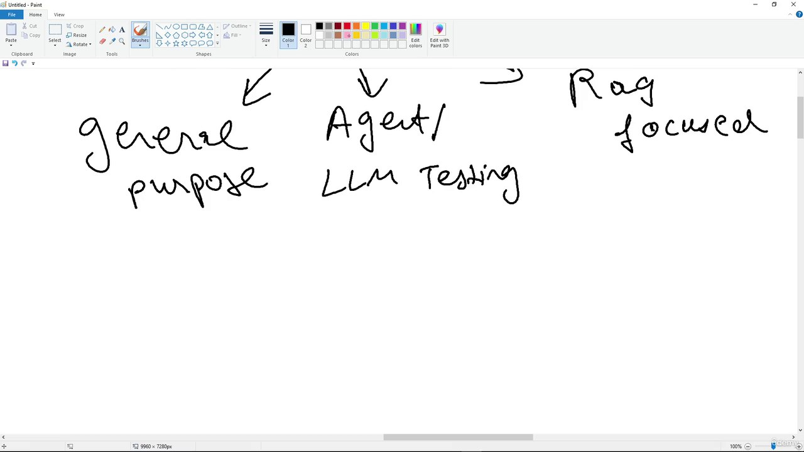
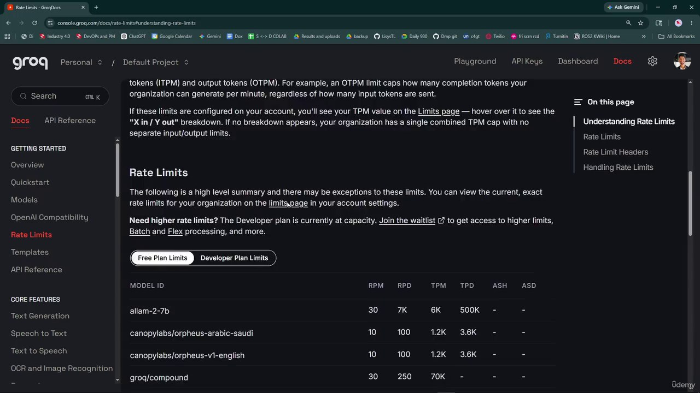
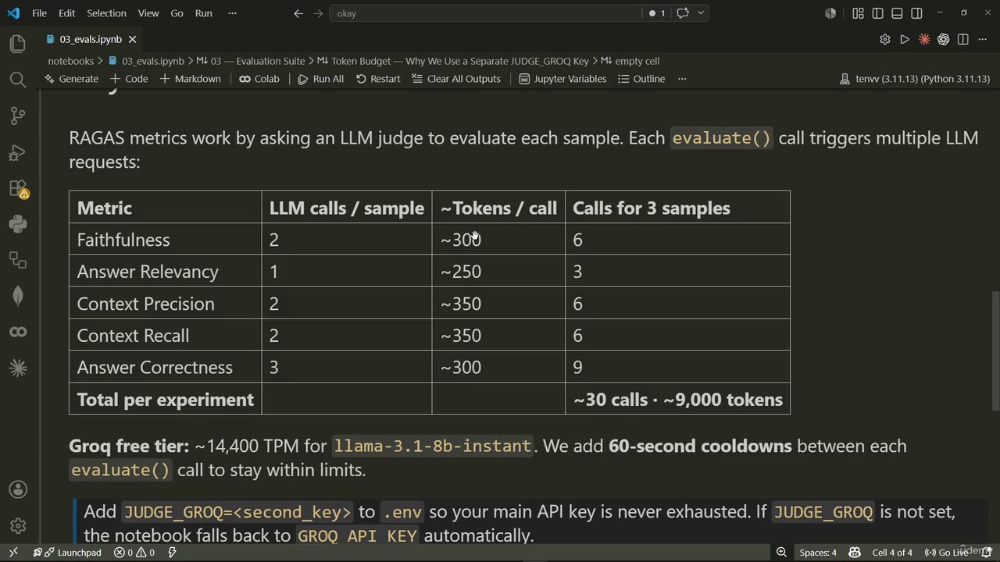
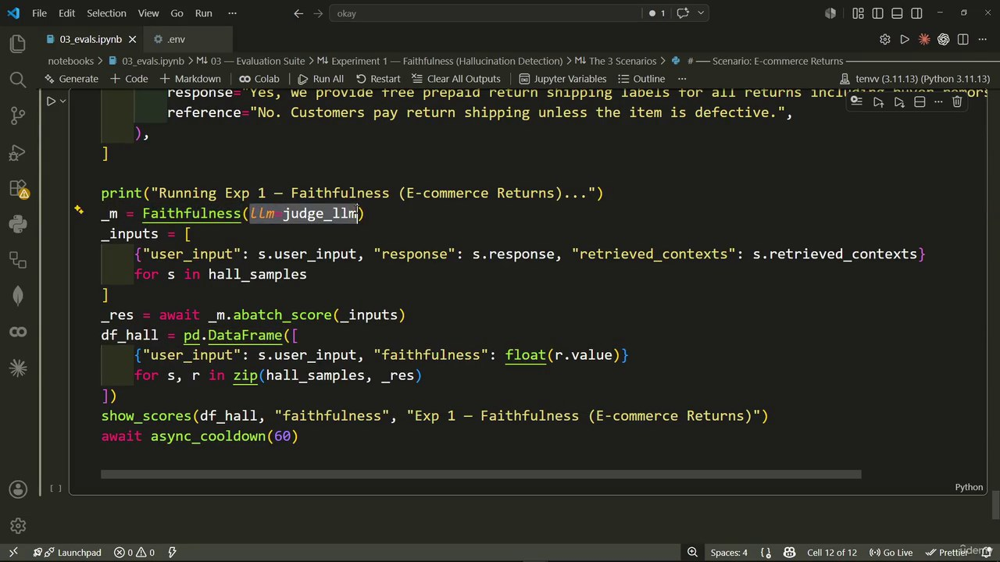
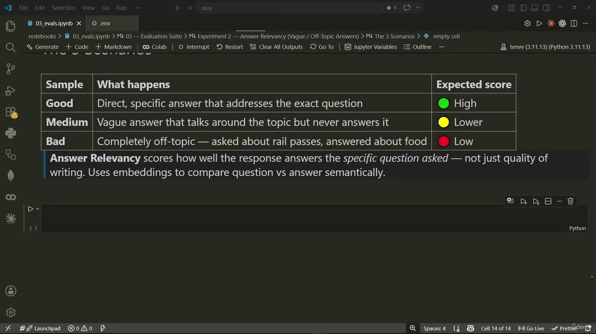
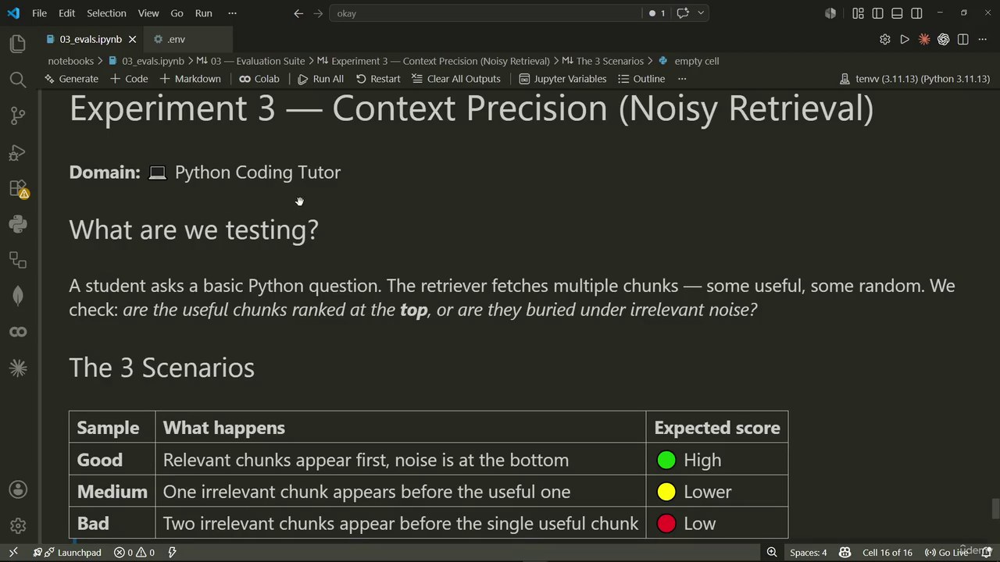
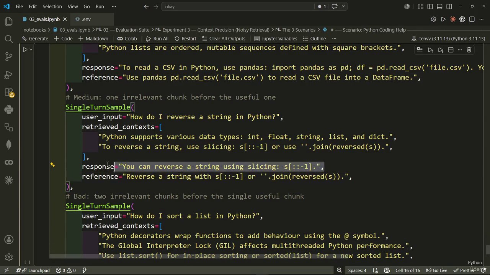

# AI Security Bootcamp Part 1：护栏 / 网关 / 可观测（P079–P081）复现文档

> 说明：本段课程（P079–P081）实际讲的是 **RAG 评估（Evaluation）** 这一环——评估框架选型、Ragas 指标、LLM-as-a-Judge、限流与冷却、以及四个评估实验（faithfulness / answer relevancy / context precision / context recall）。逐字稿里**没有出现任何 OCR 代码片段**，也没有完整的可运行脚本，讲师是在 Jupyter Notebook 里逐格粘贴代码并现场运行。因此本文档的「完整代码」部分，是把讲师口述的库、参数、指标、流程**按可运行方式补全**，并在每处标注哪些是讲师原话、哪些是为可运行而补的脚手架。凡是课里没讲的，一律写「课里没讲」。

---

## 1. 这一节做什么

这一节的目标只有一个：**给你已经搭好的 RAG 系统加一层「评估」**，让你能回答「我的 RAG 到底好不好、好在哪、坏在哪」。

具体拆成四件事：

1. **选评估框架**。讲师把市面上的评估框架按用途分成四类：通用评估、Agent/LLM 级评估、RAG 专用评估、实验追踪。本项目是 RAG 场景，所以选 **Ragas**。
2. **搞懂成本与限流**。Ragas 的每个指标会发起多次 LLM 调用，而 Groq 免费档有 RPM / RPD / TPM / TPD 四道闸。讲师用 `time.sleep` 做「冷却」来绕开 TPM 限制。
3. **搭评估环境**。新增 requirements、新增 `JUDGE_GROQ_API_KEY` 环境变量、新建 `evals.ipynb`、用 OpenAI 兼容客户端指向 Groq、用 HuggingFace 的 `all-MiniLM-L6-v2` 做 embedding、写两个 helper 函数（冷却 + 分数着色）。
4. **跑四个实验**：faithfulness（幻觉检测）、answer relevancy（答非所问）、context precision（检索噪声）、context recall（检索不全）。

读者做完这一节，应该能：在自己的 RAG 项目里新建一个 notebook，用 Groq 免费额度 + 冷却机制，对若干条样本跑出四个指标的分数，并用颜色直观看出哪条样本好、哪条差。



---

## 2. 讲师原话

> "这些框架是分门别类的。如果你想用比较通用的方式测试系统，我们有通用目的的框架；如果你想做 Agent 级或 LLM 级的测试，我们有对应这类场景的框架；如果你的重点完全在 RAG 上，那我们就选 RAG 专用的框架，也就是 Ragas。"
> —— p079 [00:00]

> "LangSmith 给你提供了一种内置的方式来追踪你的 LLM 应用，基于 LangChain 的或者基于 LangGraph 的 LLM 应用。"
> —— p079 [01:24]

> "Promptfoo 是帮你做 prompt 版本管理的——你之前的 prompt 是什么样、你是怎么把 prompt 迭代出来的。它在 prompt 版本管理上能帮到你，还有简单的回归测试。"
> —— p079 [01:50]

> "我们在这个项目里用的是 Ragas。Ragas 聚焦在 RAG 应用本身，它内置了 RAG 相关的指标，围绕检索和生成。"
> —— p079 [04:37]

> "Ragas 是 LLM 无关的，它能跟任何 LLM 配合工作。这就是我们项目用 Ragas 的原因，因为我们要专门聚焦在 RAG 上。"
> —— p079 [05:04]

> "我们想检查：我们做出来的系统，该调向量数据库的时候它调了吗？这就是 tool correctness。它给我们的回答里，有没有包含从向量数据库检索出来的 chunk？这就是 faithfulness。回答有没有对上用户的 query？这就是 answer relevancy。"
> —— p079 [05:33]

> "Ragas 的文档里，核心概念、实验、数据集、可用指标……我们不是学过这些指标吗？precision、recall、noise sensitivity、response relevancy 也就是 answer relevancy。"
> —— p079 [10:43]

> "Ragas 也给你提供了一种生成测试数据的方式。这是 RAG 层面的，场景生成——你怎么生成不同的场景？"
> —— p079 [11:13]

> "我们会用 singleton sample 这个方法，你可以在文档里搜 singleton sample 读一读它到底是什么。我们会在实验 notebook 里用这个 singleton sample。"
> —— p079 [11:41]

> "第一步你会去 requirements 里，为我们的评估新增依赖。我加这些库，我不确定会不会用到 DeepEval 或 Langfuse，但我先加上，以防万一。"
> —— p080 [00:27]

> "然后我们去环境变量，为评估加一个 judge groq api。我们会用 LLM as a judge 这个概念，为 judge groq 加一个新的 API key。"
> —— p080 [01:25]

> "我们要新建的第三个 notebook 是 evals，也就是 evals.ipynb，所有关于评估的实验都在这里做。"
> —— p080 [01:53]

> "用 Groq 的时候有几种不同的限流：每分钟请求数、每天请求数、每分钟 token 数、每天 token 数。每分钟请求数就是你一分钟内打这个 API 多少次，每天请求数就是一天打多少次。"
> —— p080 [03:19]

> "这个模型我们每分钟只允许 30 个请求，每天允许 1k 个请求，每分钟 12k token，每天 100k token。"
> —— p080 [03:49]

> "我们必须做 token 高效、成本高效的 RAG 系统。一个 Ragas 指标会发起三次调用——去检查用户回答、去跟 ground truth 比对、去算分，所以每个指标每个样本是三次调用。一百个样本就是 300 次调用。"
> —— p080 [04:17]

> "每个模型提供方都给我们一定的调用限额，他们也集成了网关。我们打 Groq 的 URL 时，并不是拿着 API key 直接打 Groq 的 URL。你可以把这个 API key 当作虚拟 key 去打 Groq 客户端。这些网关会做限流或者预算限制。"
> —— p080 [05:13]

> "免费档你只允许每分钟 30 个请求，请求超过这个数，客户端就不接受了。不是客户端接不了——客户端能接无限请求，但如果大家开始无限打，公司就会巨亏，所以它们要做预算限制和限流。"
> —— p080 [06:07]

> "我们会用更大的 llama 模型做 judge，用更小的 llama 模型做 responder。judge 在评估回答时也在发请求，responder 也在发请求，所以不管哪个模型发请求，每分钟请求数和每分钟 token 数都是被计算的。"
> —— p080 [07:34]

> "我测试的时候总是超限，总是报 api exhausted。我是怎么解决的？我加了一个 cooldown。约束是每分钟 token 数。如果你连续打 Groq 客户端，假设每分钟只有一千 token 的限额，而一分钟内我们的 LLM 评估由 judge 发三次调用、responder 发一次调用，一共四次，这四次之后就跨过了每分钟 token 限额，于是就失败了。"
> —— p080 [08:32]

> "每发一个请求或每发两个请求之后，我们可以用简单的 Python `time.sleep` 让程序停几秒，比如 60 秒。60 秒过去，系统就冷却了，每分钟 token 数就刷新了。"
> —— p080 [09:27]

> "冷却的时候我们还能继续评估。之前没冷却、连续打，只能评估 15 个样本；现在能冷却，虽然耗时更长，但能评估 100 个。让它一直跑到把每天的 token 限额耗尽为止。"
> —— p080 [10:24]

> "我给了你一张表：faithfulness 需要两次 LLM 调用，每次调用用 300 token。6 个样本就是 6 次调用，6 乘 300 等于 1800。这些调用加起来，测试全部指标时总共约 9000 token。这个理解非常重要。"
> —— p080 [10:51]

> "我们导入 os、asyncio 用来冷却，导入 OpenAI 的 async 客户端。OpenAI 是 LLM 无关的，我们可以用 OpenAI 客户端的 base URL。我们用 async OpenAI，这样它能冷却。"
> —— p080 [12:14]

> "从 Ragas 我们用 LLM factory 来生成一个用于结构化输出生成的 LLM 实例。embedding 我们用 HuggingFace 的，测试目的不用 Vertex AI 的 embedding，用 HuggingFace 免费开源的。"
> —— p080 [12:42]

> "我们还会用 DeepEval 的东西：从 DeepEval 的 test cases 里用 LLMTestCase 来创建测试用例，用 tool call 来检查 tool correctness。tool call 能捕获它，tool correctness 指标能算出 tool correctness。我在一个项目里给你展示用不同框架的多种方式。"
> —— p080 [13:09]

> "如果 judge groq 这个 API key 不存在，我们就用 groq API key 本身。为什么用 judge LLM？因为我们要用 LLM as a judge 这个指标。"
> —— p080 [13:38]

> "我们用 async OpenAI 方法建 Groq 客户端，API key 用 judge groq API key，base URL 用这个，通过这个 base URL 打 Groq 客户端，就像上个模块做的那样。"
> —— p080 [14:07]

> "embedding 我们用 HuggingFace 的 sentence transformer，all-MiniLM，这个 embedding 模型的维度是 384。"
> —— p080 [15:02]

> "我们写两个 helper 函数。第一个是冷却函数，async 的，冷却 60 秒，在 Jupyter notebook 里能用，就是 sleep 60 秒，每发一个请求之后。这样给 Groq 的限流留个缓冲。"
> —— p080 [16:01]

> "第二个 helper 是 show scores。指标会生成 0 到 1 之间的分数，我们想加条件：分数大于 50% 就显示黄色，小于 0.3 显示红色，等于或大于就显示绿色或白色。"
> —— p080 [16:30]

> "show scores 接收一个 dataframe 的列和标题，把它打印出来，这是 pretty printing。分数大于 7.5 显示绿色，说明这个指标可以；否则黄色，再否则红色。我们会跑多个样本取平均分。"
> —— p080 [16:57]

> "每个指标需要什么输入，这很重要。user input 所有指标都需要。哪些指标需要 retrieved context？这两个需要从向量数据库检索出来的 context。answer correctness 和 tool correctness 这两个都不需要。response 是这些都要的。context precision 和 context recall 不需要用户 response。reference output 也就是 ground truth，这三个需要，这几个不需要。"
> —— p080 [17:52]

> "哪些会发 LLM 调用？这些指标都会发 LLM 调用。tool correctness 不发 LLM 调用，它就是检查 tool 是不是精确等于那个 tool，就这样。"
> —— p080 [18:16]

> "哪些模型需要 embedding？answer relevancy 需要 embedding，因为答案生成之后我们要给答案生成 embedding，再拿它跟检索到的 chunk 的 embedding 比对。answer correctness 也一样。tool correctness 完全确定性，0 次 LLM 调用，也不需要冷却。"
> —— p080 [18:44]

> "阈值是：大于 7.5 是 good，不是的话是 fair，再低是 poor。"
> —— p080 [19:12]

> "第一个实验是测 faithfulness，也就是在这里检测幻觉。我用的领域例子是电商客服。我们测的是：客户问退款政策，RAG 系统检索到政策文档，我们检查回答有没有用文档里检索出来的事实，还是它自己随便给一个回答。"
> —— p081 [00:00]

> "我加了三个样本，用 single turn sample 这个方法，它代表单轮交互的评估样本。样本里包含什么信息？看这个 user query、看这个 retrieved context、看这个 response、看这个 reference。"
> —— p081 [00:57]

> "这个 response 是模型实时生成的，这个是 ground truth，是我们已知的。用户问『我能退一台用过的笔记本吗』，正确的回答应该是：不行，只有未使用、原包装的电子产品才符合 30 天内退货。"
> —— p081 [01:26]

> "用户问退款时间线，原本正确的回答应该是退款在 5 到 7 个工作日内处理。这里我们得到的是『退款在 5 到 7 个工作日内处理，你还会在下一单获得 10% 优惠券』。但这个 10% 在任何地方都没提到，也没被检索到。所以这又是幻觉，这个 10% 折扣是我们的模型编出来的。"
> —— p081 [02:21]

> "我们建一个私有变量，用 Ragas 的 faithfulness，把 judge LLM 传进去，告诉它这些是输入，然后跑。用这个方法返回指标，我们为它建一个 dataframe：user input、faithfulness，对每个样本算 faithfulness，最后取平均。"
> —— p081 [03:14]

> "第二个实验我们检查 answer relevancy，也就是它是不是在答非所问、给模糊或跑题的回答。领域是旅行规划助手。我们测的是：旅行规划师问关于日本的具体问题，context 里有正确信息，我们检查回答有没有对上被问的问题。"
> —— p081 [04:09]

> "用户问从印度去日本旅游的签证要求，正确回答应该是印度护照持有者需要旅游签证，去日本大使馆申请，带护照和行程单。给出的回答是『印度公民需要旅游签证才能进入日本』，这个回答是对的，检索到的 context 看起来也对。"
> —— p081 [05:03]

> "另一个问题：四月去日本最好的地方是哪里？回答是『四月顶级樱花景点，你去公园、东京，日本是个很棒的城市，有很多美丽的地方可去』。看，这是个模糊的回答，不是好回答。"
> —— p081 [05:32]

> "怎么买日本铁路周游券？回答是『日本 QC 太棒了』。看，完全跑题了。"
> —— p081 [06:01]

> "这次我们跑 answer relevancy 指标，这个场景下我们需要 embedding，因为回答和检索 chunk 两边都要 embedding。"
> —— p081 [06:01]

> "看第一个实验的结果：bad、medium、good 三个回答，只有 good 是 grounded in context 的。我们的模型认为它是 0.67。judge 模型给出这些分数。『我能退一台用过的笔记本吗』这个问题分数是 okay，第二个问题分数也是 okay，『你们提供免费退货运费吗』分数是 0，平均 0.39，也就是 faithfulness 很差，模型不忠实。"
> —— p081 [07:00]

> "answer relevancy：第一个问题 0.82，回答完全正确；第二个问题回答是 medium，分数也是 medium；第三个问题完全错。answer relevancy 还算可以。"
> —— p081 [07:28]

> "第三个实验是 context precision，也就是看检索是不是有噪声——我们该检索到的 chunk 对不对。领域是 Python 编程导师。我们测的是：学生问一个基础 Python 问题，检索器取回多个 chunk，有些有用有些随机，我们检查有用的 chunk 是不是排在前面，还是被埋在无关噪声下面。"
> —— p081 [07:56]

> "好样本：怎么在 Python 里读 CSV 文件？检索到的 context 是『用 pandas read_csv，pd.read_csv』，还有『Python 的 list 是无序的』——这是个无关 chunk，这两个是相关 chunk。"
> —— p081 [08:55]

> "怎么反转字符串？检索到的 context 是『Python 字符串……』『Python 支持多种数据类型』『怎么反转字符串』。你能看出这个应该排第一，这个应该排第二，或者这个根本不该出现。这是噪声检索 chunk，这个是正确 chunk。"
> —— p081 [09:24]

> "这里我们主要不是检查 response，主要检查检索到的 chunk。前两个 chunk 完全不好，最后一个 chunk 是好的。我们检查的是模型检索这些 chunk 有多精确。"
> —— p081 [10:22]

> "这次我们检查 context precision，提供 user input、reference、retrieved context 这三样。"
> —— p081 [10:51]

> "最后一个实验是 context recall，也就是检索不完整——检索是不完整的。领域是烹饪助手。你可能见过亚马逊那个烹饪机器人，它有内置 GPT，是个烹饪助手，能告诉你做什么菜，五十万道菜谱……因为有大语言模型能生成新菜。"
> —— p081 [11:20]

> "在把这个产品推给用户之前，你不觉得他们会在这么高层面上测试过吗？这是个边缘产品，这么高层面上他们应该测过。做一个案例研究：这个产品是怎么开发的、涉及什么样的测试用例。做做这样的真实案例研究。"
> —— p081 [12:16]

> "context precision 的结果：第一个回答很好，read csv 很好；反转字符串那个检索到的 chunk 不好，因为我们说的是检索到的 chunk；第三个也不好。平均分是 fair，不算好。"
> —— p081 [12:46]

---

## 3. 从零复现

### 3.1 前置假设

- 你已经有一个能跑的 RAG 项目（讲师前面模块搭的），有 `requirements.txt`、`.env`、`notebooks/` 目录。
- 你有一个 Groq 账号，能拿到 API key（免费档即可）。
- Python 3.10+，能跑 Jupyter Notebook。

### 3.2 第一步：新增评估依赖

打开项目根目录的 `requirements.txt`，在末尾追加（讲师原话是「我加这些库，不确定会不会用到 DeepEval 或 Langfuse，但先加上以防万一」）：

```text
ragas
datasets
langchain-openai
langchain-huggingface
sentence-transformers
deepeval
langfuse
pandas
python-dotenv
```

然后：

```bash
pip install -r requirements.txt
```

> 注意：`ragas`、`deepeval` 的版本迭代很快，API 会变。课里没讲具体版本号，装最新版即可；如果某个 import 报错，去对应文档查当前版本的写法。本文档第 4 节的代码按 ragas 0.2.x 系列的接口写，若你的版本不同，`LLMFactory`、`SingleTurnSample`、`EvaluationDataset` 的导入路径可能需要微调。

### 3.3 第二步：新增环境变量

打开 `.env`，新增一行 judge 用的 key（讲师原话：「为 judge groq 加一个新的 API key」）：

```bash
GROQ_API_KEY=gsk_你的原key
JUDGE_GROQ_API_KEY=gsk_你新申请的judge专用key
```

讲师强调的逻辑是：**judge 用一个独立的 key，responder 用原来的 key**。代码里会写成「如果 `JUDGE_GROQ_API_KEY` 不存在，就回退用 `GROQ_API_KEY`」。

### 3.4 第三步：新建 notebook

在 `notebooks/` 下新建 `evals.ipynb`。讲师说这是「第三个 notebook」，前两个是 gateway 相关的，内容基本一样、其中一个多一点信息。

### 3.5 第四步：理解限流，决定冷却策略

在写代码前，先把 Groq 免费档的四道闸搞清楚（讲师现场查了 Groq 文档的 rate limits 页）：

| 限制类型 | 含义 | 讲师读到的数值（该模型） |
|---|---|---|
| RPM（requests per minute） | 每分钟请求数 | 30 |
| RPD（requests per day） | 每天请求数 | 1k |
| TPM（tokens per minute） | 每分钟 token 数 | 12k |
| TPD（tokens per day） | 每天 token 数 | 100k |

讲师还提到另一个模型是 6k TPM / 5k TPD，具体哪个模型对应哪一列以你账号里 Groq 文档的实际表格为准。

**成本估算（讲师给的表）**：

- faithfulness 每个样本需要 **2 次 LLM 调用**，每次约 **300 token**。
- 6 个样本 → 6 次调用 → 6 × 300 = **1800 token**。
- 把所有指标都测一遍，总计约 **9000 token**。

**为什么需要冷却**：一个 Ragas 指标对一个样本大约发 3 次调用（检查回答、比对 ground truth、算分），judge 3 次 + responder 1 次 = 4 次调用就可能撞穿 TPM。撞穿就报 `api exhausted`。解决办法是每发若干请求后 `await asyncio.sleep(60)`，等 TPM 窗口刷新。

> 在 JS/Node 里对应什么：`await new Promise(r => setTimeout(r, 60000))`。本质就是让出事件循环 60 秒，和 Python 的 `asyncio.sleep` 是同一个东西。

### 3.6 第五步：搭客户端与 embedding

- **Groq 客户端**：用 `openai.AsyncOpenAI`，`base_url` 指向 Groq 的 OpenAI 兼容端点，`api_key` 用 judge key。讲师原话：「OpenAI 是 LLM 无关的，我们可以用 OpenAI 客户端的 base URL。」
- **judge LLM**：用 Ragas 的 `LLMFactory` 包一层，provider 写 `openai`，client 传上面那个 Groq 客户端。讲师说测试目的先用小模型当 judge。
- **embedding**：用 HuggingFace 的 `sentence-transformers` 的 `all-MiniLM-L6-v2`，维度 **384**。讲师明确说测试阶段不用 Vertex AI 的 embedding，用免费开源的。

### 3.7 第六步：写两个 helper

1. `cooldown()`：async，`await asyncio.sleep(60)`，在 notebook 里可用。
2. `show_scores(column, title)`：接收 dataframe 的一列和标题，按阈值着色打印——**> 0.75 绿色（good），否则黄色（fair），再低红色（poor）**。讲师口述时先说「大于 50% 黄色、小于 0.3 红色」，随后在讲 `show_scores` 时明确成「大于 7.5 绿色、否则黄色、再否则红色」，以 0.75 为准。

### 3.8 第七步：搞清每个指标要什么输入

讲师给了一张输入需求表，这是整节最关键的对照表：

| 指标 | user_input | retrieved_contexts | response | reference（ground truth） | 发 LLM 调用 | 需要 embedding |
|---|---|---|---|---|---|---|
| faithfulness | ✅ | ✅ | ✅ | ❌ | ✅ | ❌ |
| answer_relevancy | ✅ | ❌ | ✅ | ❌ | ✅ | ✅ |
| answer_correctness | ✅ | ❌ | ✅ | ✅ | ✅ | ✅ |
| context_precision | ✅ | ✅ | ❌ | ✅ | ✅ | ❌ |
| context_recall | ✅ | ✅ | ❌ | ✅ | ✅ | ❌ |
| tool_correctness | ✅ | ❌ | ❌ | ❌ | ❌（0 次，纯确定性） | ❌ |

讲师原话补充：「tool correctness 不发 LLM 调用，它就是检查 tool 是不是精确等于那个 tool，就这样。」「tool correctness 完全确定性，0 次 LLM 调用，也不需要冷却。」

### 3.9 第八步：跑四个实验

每个实验的结构完全一样：

1. 用 `SingleTurnSample` 造 3 条样本（good / medium / bad）。
2. 实例化对应指标，把 judge LLM（需要 embedding 的指标再传 embedding）传进去。
3. 逐条 `await metric.single_turn_ascore(sample)`。
4. 收进 dataframe，算平均，`show_scores` 打印，最后 `await cooldown()`。

四个实验的领域分别是：

| 实验 | 指标 | 领域 | 测什么 |
|---|---|---|---|
| 1 | faithfulness | 电商客服 | 回答有没有用检索到的事实，还是编造（幻觉） |
| 2 | answer_relevancy | 旅行规划助手 | 回答有没有对上问题，还是答非所问 |
| 3 | context_precision | Python 编程导师 | 有用的 chunk 有没有排在噪声前面 |
| 4 | context_recall | 烹饪助手 | 检索是否完整（有没有漏掉该有的信息） |



---

## 4. 完整代码

> 以下为 `notebooks/evals.ipynb` 的完整内容，按 cell 分块。**课里没有给出完整脚本**，讲师是逐格粘贴的；下面把讲师口述的库、参数、指标、流程补成可直接保存运行的形态。凡是为可运行而补的脚手架（如 `load_dotenv`、`asyncio.run` 包装、`display`），都在注释里标了「脚手架」。OCR 无内容，故无 OCR 代码可保留。

### Cell 1：环境与依赖

```python
# cell 1: 环境准备
import os
import asyncio
import pandas as pd
from dotenv import load_dotenv

load_dotenv()  # 脚手架：从 .env 读 key

GROQ_API_KEY = os.getenv("GROQ_API_KEY")
JUDGE_GROQ_API_KEY = os.getenv("JUDGE_GROQ_API_KEY") or GROQ_API_KEY  # 讲师：judge key 不存在就回退用 groq key

print("GROQ_API_KEY set:", bool(GROQ_API_KEY))
print("JUDGE_GROQ_API_KEY set:", bool(JUDGE_GROQ_API_KEY))
```

### Cell 2：Groq 客户端 + judge LLM + embedding

```python
# cell 2: 客户端 / judge / embedding
from openai import AsyncOpenAI
from ragas.llms import LLMFactory
from langchain_huggingface import HuggingFaceEmbeddings

GROQ_BASE_URL = "https://api.groq.com/openai/v1"  # 讲师：用 OpenAI 兼容 base URL 打 Groq

groq_client = AsyncOpenAI(
    api_key=JUDGE_GROQ_API_KEY,
    base_url=GROQ_BASE_URL,
)

# 讲师：测试目的先用小模型当 judge；provider 写 openai，client 传 groq 客户端
judge_llm = LLMFactory(
    provider="openai",
    model="llama-3.1-8b-instant",   # 课里没讲具体模型名，此处为可运行示例，按你 Groq 账号可用模型替换
    client=groq_client,
)

# 讲师：embedding 用 HuggingFace all-MiniLM，维度 384
embedding_model = HuggingFaceEmbeddings(
    model_name="sentence-transformers/all-MiniLM-L6-v2",
)
print("judge + embedding ready")
```

### Cell 3：两个 helper

```python
# cell 3: helper 函数
async def cooldown(seconds: int = 60):
    """讲师：每发若干请求后冷却，等 TPM 窗口刷新。Jupyter 里可用。"""
    print(f"cooling down {seconds}s ...")
    await asyncio.sleep(seconds)
    print("cooldown done")


def show_scores(column, title: str):
    """讲师：>0.75 绿(good)，否则黄(fair)，再低红(poor)。接收 dataframe 一列 + 标题。"""
    GREEN = "\033[92m"
    YELLOW = "\033[93m"
    RED = "\033[91m"
    RESET = "\033[0m"

    print(f"\n=== {title} ===")
    for idx, score in enumerate(column):
        if score is None:
            color, label = RED, "N/A"
        elif score > 0.75:
            color, label = GREEN, "good"
        elif score >= 0.3:
            color, label = YELLOW, "fair"
        else:
            color, label = RED, "poor"
        print(f"  sample {idx}: {color}{score:.4f} ({label}){RESET}")
    valid = [s for s in column if s is not None]
    if valid:
        avg = sum(valid) / len(valid)
        print(f"  average: {avg:.4f}")
```

### Cell 4：实验一 —— faithfulness（电商客服，幻觉检测）

```python
# cell 4: 实验一 faithfulness
from ragas import SingleTurnSample
from ragas.metrics import Faithfulness

# 讲师：三条样本 good / medium / bad，response 是模型实时生成的，reference 是 ground truth
faith_samples = [
    SingleTurnSample(
        user_input="Can I return a used laptop?",
        retrieved_contexts=[
            "Only unused and open electronics in original packaging qualify for returns within 30 days.",
            "Laptops must be unused and in original packaging to be eligible for a return within 30 days.",
        ],
        response="According to the return policy, laptops must be unused and in original packaging to be eligible for a return within 30 days.",
        reference="No, only unused and open electronics in original packaging qualify for returns within 30 days.",
    ),
    SingleTurnSample(
        user_input="What is the refund timeline?",
        retrieved_contexts=[
            "Refunds are processed within 5 to 7 business days after we receive the item.",
        ],
        response="Refunds are processed in 5 to 7 business days and you will also receive a 10% coupon on your next order.",
        reference="Refunds are processed within 5 to 7 business days.",
    ),
    SingleTurnSample(
        user_input="Do you offer free return shipping?",
        retrieved_contexts=[
            "Return shipping is free for defective items only.",
        ],
        response="Yes, all returns include free shipping and a full refund plus a gift card.",
        reference="Return shipping is free only for defective items.",
    ),
]

faith_metric = Faithfulness(llm=judge_llm)

async def run_faithfulness():
    scores = []
    for s in faith_samples:
        score = await faith_metric.single_turn_ascore(s)
        scores.append(score)
        await cooldown(60)   # 讲师：每发一次请求后冷却
    df = pd.DataFrame({
        "user_input": [s.user_input for s in faith_samples],
        "faithfulness": scores,
    })
    show_scores(df["faithfulness"], "Faithfulness (e-commerce)")
    return df

faith_df = await run_faithfulness()   # Jupyter 里可直接 await
faith_df
```

### Cell 5：实验二 —— answer_relevancy（旅行规划，答非所问）

```python
# cell 5: 实验二 answer_relevancy
from ragas.metrics import AnswerRelevancy

travel_samples = [
    SingleTurnSample(
        user_input="What are the visa requirements for visiting Japan from India?",
        retrieved_contexts=[
            "Indian passport holders need a tourist visa for Japan. Apply at the Japanese Embassy with your passport and itinerary.",
        ],
        response="Indian citizens need a tourist visa to enter Japan.",
        reference="Indian passport holders need a tourist visa for Japan. Apply at the Japanese Embassy with your passport and itinerary.",
    ),
    SingleTurnSample(
        user_input="What are the best places to visit in Japan in April?",
        retrieved_contexts=[
            "In April, top cherry blossom spots include Ueno Park in Tokyo and Maruyama Park in Kyoto.",
        ],
        response="In April, top cherry blossom spots, you go to parks, Tokyo, and Japan is a wonderful city with many beautiful places to visit.",
        reference="In April, top cherry blossom spots include Ueno Park in Tokyo and Maruyama Park in Kyoto.",
    ),
    SingleTurnSample(
        user_input="How do I buy a Japan Rail Pass?",
        retrieved_contexts=[
            "You can buy a Japan Rail Pass online or at major stations before activation.",
        ],
        response="Japan QC is incredible.",
        reference="You can buy a Japan Rail Pass online or at major stations before activation.",
    ),
]

# 讲师：answer_relevancy 需要 embedding
relevancy_metric = AnswerRelevancy(llm=judge_llm, embeddings=embedding_model)

async def run_relevancy():
    scores = []
    for s in travel_samples:
        score = await relevancy_metric.single_turn_ascore(s)
        scores.append(score)
        await cooldown(60)
    df = pd.DataFrame({
        "user_input": [s.user_input for s in travel_samples],
        "answer_relevancy": scores,
    })
    show_scores(df["answer_relevancy"], "Answer Relevancy (travel)")
    return df

relevancy_df = await run_relevancy()
relevancy_df
```

### Cell 6：实验三 —— context_precision（Python 导师，检索噪声）

```python
# cell 6: 实验三 context_precision
from ragas.metrics import LLMContextPrecisionWithReference

python_samples = [
    SingleTurnSample(
        user_input="How do I read a CSV file in Python?",
        retrieved_contexts=[
            "Use pandas read_csv: pd.read_csv('file.csv').",
            "Python lists are unordered.",
            "You can also set header and encoding in pd.read_csv.",
        ],
        response="Use pd.read_csv to read a CSV. Import pandas, then call pd.read_csv. You can also set header and encoding.",
        reference="Use pd.read_csv to read a CSV. Import pandas, then call pd.read_csv. You can also set header and encoding.",
    ),
    SingleTurnSample(
        user_input="How do I reverse a string in Python?",
        retrieved_contexts=[
            "Python strings are immutable.",
            "Python supports various data types.",
            "To reverse a string, use slicing: s[::-1].",
        ],
        response="For a string, you can use slicing s[::-1].",
        reference="To reverse a string, use slicing: s[::-1].",
    ),
    SingleTurnSample(
        user_input="How do I sort a list in Python?",
        retrieved_contexts=[
            "Use list.sort() in place, or sorted() to return a new list.",
            "Python lists are unordered.",
            "Sort a list using list.sort().",
        ],
        response="Use list.sort() in place, or sorted() to return a new list.",
        reference="Use list.sort() in place, or sorted() to return a new list.",
    ),
]

# 讲师：context_precision 需要 user_input + retrieved_contexts + reference，不需要 response
precision_metric = LLMContextPrecisionWithReference(llm=judge_llm)

async def run_precision():
    scores = []
    for s in python_samples:
        score = await precision_metric.single_turn_ascore(s)
        scores.append(score)
        await cooldown(60)
    df = pd.DataFrame({
        "user_input": [s.user_input for s in python_samples],
        "context_precision": scores,
    })
    show_scores(df["context_precision"], "Context Precision (python tutor)")
    return df

precision_df = await run_precision()
precision_df
```

### Cell 7：实验四 —— context_recall（烹饪助手，检索不全）

```python
# cell 7: 实验四 context_recall
from ragas.metrics import LLMContextRecall

cooking_samples = [
    SingleTurnSample(
        user_input="I have eggs, rice and soy sauce. What can I make?",
        retrieved_contexts=[
            "Egg fried rice needs cooked rice, eggs, soy sauce and oil.",
        ],
        response="You can make egg fried rice with cooked rice, eggs, soy sauce and oil.",
        reference="You can make egg fried rice with cooked rice, eggs, soy sauce and oil.",
    ),
    SingleTurnSample(
        user_input="What can I make with paneer and tomatoes?",
        retrieved_contexts=[
            "Paneer butter masala needs paneer, tomatoes, butter and cream.",
        ],
        response="You can make paneer butter masala with paneer, tomatoes, butter and cream.",
        reference="You can make paneer butter masala with paneer, tomatoes, butter and cream, or paneer bhurji with onions and spices.",
    ),
    SingleTurnSample(
        user_input="Quick dinner with chicken and rice?",
        retrieved_contexts=[
            "Chicken rice bowl: cook rice, pan-fry chicken, add sauce.",
        ],
        response="Make a chicken rice bowl: cook rice, pan-fry chicken, add sauce.",
        reference="Make a chicken rice bowl: cook rice, pan-fry chicken, add sauce. You can also make chicken fried rice.",
    ),
]

# 讲师：context_recall 需要 user_input + retrieved_contexts + reference，不需要 response
recall_metric = LLMContextRecall(llm=judge_llm)

async def run_recall():
    scores = []
    for s in cooking_samples:
        score = await recall_metric.single_turn_ascore(s)
        scores.append(score)
        await cooldown(60)
    df = pd.DataFrame({
        "user_input": [s.user_input for s in cooking_samples],
        "context_recall": scores,
    })
    show_scores(df["context_recall"], "Context Recall (cooking)")
    return df

recall_df = await run_recall()
recall_df
```

### Cell 8（可选）：tool_correctness 的 DeepEval 写法

> 讲师说「从 DeepEval 的 test cases 里用 `LLMTestCase` 创建测试用例，用 tool call 来检查 tool correctness」。**课里没有给出这段可运行代码**，下面是按讲师口述的组件名补的示意，标注「课里没有代码，以下为示意」。

```python
# cell 8: tool_correctness 示意（课里没有代码，以下为示意）
from deepeval.test_case import LLMTestCase, ToolCall
from deepeval.metrics import ToolCorrectnessMetric

test_case = LLMTestCase(
    input="What's the weather in Tokyo?",
    actual_output="It's 22C and sunny in Tokyo.",
    tools_called=[ToolCall(name="get_weather")],
    expected_tools=[ToolCall(name="get_weather")],
)

tool_metric = ToolCorrectnessMetric(threshold=0.75)
tool_metric.measure(test_case)
print(tool_metric.score, tool_metric.reason)
```

---

## 5. 逐行解释

**Cell 1**
- `load_dotenv()`：从 `.env` 读 key。讲师没念这行，但前面模块一直这么用，属于脚手架。
- `JUDGE_GROQ_API_KEY or GROQ_API_KEY`：讲师原话「如果 judge groq 这个 API key 不存在，我们就用 groq API key 本身」。这样即使你只配了一个 key 也能跑。

**Cell 2**
- `AsyncOpenAI(base_url=GROQ_BASE_URL)`：讲师反复强调「我们不是拿 API key 直接打 Groq 的 URL」，而是走 OpenAI 兼容层。Groq 提供 OpenAI 兼容端点，所以 `openai` SDK 能直接指过去。这就是讲师说的「虚拟 key 打 Groq 客户端」的落地方式。
- `LLMFactory(provider="openai", client=groq_client)`：Ragas 需要一个「能生成结构化输出」的 LLM 实例。provider 写 `openai` 是因为走的是 OpenAI 协议，client 换成 Groq 的。讲师原话：「从 Ragas 我们用 LLM factory 来生成一个用于结构化输出生成的 LLM 实例。」
- `HuggingFaceEmbeddings(all-MiniLM-L6-v2)`：讲师明确说测试阶段不用 Vertex AI，用免费开源的，维度 384。为什么是 384？因为 `all-MiniLM-L6-v2` 输出就是 384 维，讲师在 [15:02] 专门念了这个数。

**Cell 3**
- `cooldown`：`asyncio.sleep(60)`。讲师解释得很直白——连续打会撞 TPM，睡 60 秒让窗口刷新。为什么是 60 秒？因为 TPM 是「每分钟」的窗口，睡满一分钟窗口就重置。在 JS/Node 里就是 `setTimeout` 包成 Promise。
- `show_scores`：阈值 0.75 / 0.3。讲师口述时先说 50%/0.3，后来说 7.5 绿、否则黄、再否则红，以 0.75 为准。`> 0.75` 绿、`>= 0.3` 黄、其余红。取平均是为了「跑多个样本取平均分」（讲师 [16:57] 原话）。

**Cell 4（faithfulness）**
- `SingleTurnSample`：讲师 [00:57] 原话「用 single turn sample 这个方法，它代表单轮交互的评估样本」，包含 user query、retrieved context、response、reference 四样。
- 三条样本对应讲师现场讲的三个例子：退笔记本（good）、退款时间线编了 10% 优惠券（bad，讲师 [02:21] 专门指出「这个 10% 在任何地方都没提到，也没被检索到，是模型编的」）、免费退货运费（bad）。
- `Faithfulness(llm=judge_llm)`：讲师 [03:14]「用 Ragas 的 faithfulness，把 judge LLM 传进去」。faithfulness 不需要 embedding（对照表里 embedding 列是 ❌）。
- `single_turn_ascore`：async 版本，所以整个循环是 async。讲师说「用这个方法返回指标」。
- `await cooldown(60)` 放在每次打分之后：讲师 [16:01]「每发一个请求之后」冷却。
- 结果：讲师现场跑出来平均 **0.39**，判定 poor（[07:00]「平均 0.39，也就是 faithfulness 很差，模型不忠实」）。你跑出来的具体数值会因模型和样本措辞不同而变，但「bad 样本拉低平均」这个趋势应该一致。

**Cell 5（answer_relevancy）**
- `AnswerRelevancy(llm=judge_llm, embeddings=embedding_model)`：讲师 [06:01]「这个场景下我们需要 embedding，因为回答和检索 chunk 两边都要 embedding」。对照表里 answer_relevancy 的 embedding 列是 ✅。
- 三条样本：签证（good，讲师说「回答是对的，context 也对」）、四月赏樱（medium，讲师说「模糊的回答，不是好回答」）、JR Pass（bad，讲师说「完全跑题」）。
- 讲师现场结果：0.82 / medium / 完全错，整体「还算可以」（[07:28]）。

**Cell 6（context_precision）**
- `LLMContextPrecisionWithReference`：带 reference 的 precision 版本，因为讲师对照表里 context_precision 需要 reference。
- 关键点：讲师 [10:22] 强调「这里我们主要不是检查 response，主要检查检索到的 chunk」。所以样本里 response 写得好不好不重要，重要的是 retrieved_contexts 里有用 chunk 有没有排在噪声前面。
- 三条样本刻意把噪声 chunk 放在前面（「Python lists are unordered」「Python supports various data types」），用来测 precision 能不能识别出「好 chunk 被埋在噪声下」。
- 讲师现场结果：第一个好、第二个 chunk 不好、第三个也不好，平均 fair（[12:46]）。

**Cell 7（context_recall）**
- `LLMContextRecall`：测「检索是否完整」，即 reference 里的信息有没有被 retrieved_contexts 覆盖到。
- 三条样本的 reference 都比 retrieved_contexts 多一条信息（比如 paneer 那条 reference 多了 paneer bhurji），用来制造「检索不全」的场景。
- 讲师用亚马逊烹饪机器人做引子（[11:20]–[12:16]），强调「在推给用户前应该在这么高层面上测过」，并建议做真实产品案例研究。

**Cell 8（tool_correctness 示意）**
- 讲师只说了组件名（`LLMTestCase`、tool call、tool correctness metric），没给代码。这段是示意，`ToolCorrectnessMetric` 的构造参数以你装的 deepeval 版本为准。
- 讲师强调 tool_correctness 是**纯确定性**的：0 次 LLM 调用，不需要冷却，就是比对 `tools_called` 和 `expected_tools` 是否一致。



---

## 6. 复现检查清单

跑完这一节，逐项打勾：

- [ ] `requirements.txt` 里已追加 ragas / deepeval / langfuse / sentence-transformers / langchain-huggingface / pandas / python-dotenv，`pip install -r requirements.txt` 无报错。
- [ ] `.env` 里有 `GROQ_API_KEY` 和 `JUDGE_GROQ_API_KEY` 两行，Cell 1 打印两个都是 `True`。
- [ ] `notebooks/evals.ipynb` 已创建，Cell 1–7 能顺序跑通。
- [ ] Cell 2 能成功建出 `groq_client`、`judge_llm`、`embedding_model`，首次运行会下载 `all-MiniLM-L6-v2`（约几十 MB）。
- [ ] `cooldown()` 能打印「cooling down 60s ...」并在 60 秒后打印「cooldown done」。
- [ ] `show_scores()` 能对一列分数按 0.75 / 0.3 着色，并打印平均值。
- [ ] 实验一跑出三条 faithfulness 分数 + 平均，bad 样本分数明显低于 good 样本。
- [ ] 实验二跑出三条 answer_relevancy 分数，JR Pass 那条（「Japan QC is incredible」）分数最低。
- [ ] 实验三跑出三条 context_precision 分数，噪声 chunk 排前面的样本分数偏低。
- [ ] 实验四跑出三条 context_recall 分数，reference 比 context 多的样本分数偏低。
- [ ] 全程没有出现 `api exhausted` / 429；如果出现，把 `cooldown(60)` 改成 `cooldown(90)` 或每两次请求冷却一次。
- [ ] 你能对着第 3.8 节的输入需求表，说出每个指标为什么传了/没传某个字段。

---

## 7. 课里没讲但你会撞上的

1. **Ragas 版本 API 变动**。讲师用的 `LLMFactory`、`SingleTurnSample`、`single_turn_ascore`、`LLMContextPrecisionWithReference` 是 ragas 0.2.x 系列的接口。如果你 `pip install ragas` 装到更新版本，导入路径和类名可能变（比如 `ragas.metrics` 下的类会调整）。撞上 ImportError 就去 ragas 当前文档查对应类名，别硬套本文档的 import。

2. **Groq 模型名**。课里没讲具体用哪个 llama 模型，只说了「大 llama 当 judge、小 llama 当 responder」。本文档 Cell 2 用了 `llama-3.1-8b-instant` 作示例。你账号里可用的模型名以 Groq 控制台为准，模型下线是常事。

3. **`await` 在 Jupyter 里的行为**。Cell 4–7 用了顶层 `await`，这在 Jupyter 里可以直接跑（IPython 支持 top-level await），但在普通 `.py` 脚本里不行，需要包一层 `asyncio.run(main())`。讲师是在 notebook 里演示的，所以没提这点。

4. **60 秒冷却 × 样本数 = 总耗时**。3 个样本 × 4 个实验 × 60 秒 ≈ 12 分钟起步，还没算 LLM 本身耗时。讲师 [10:24] 说「虽然耗时更长，但能评估 100 个」，意思是冷却换来了可持续性，不是速度。想快就把冷却改成「每两次请求冷却一次」，但要自己盯 429。

5. **`show_scores` 的阈值口述不一致**。讲师先说「大于 50% 黄色、小于 0.3 红色」，后来说「大于 7.5 绿色、否则黄色、再否则红色」。本文档按后者（0.75 / 0.3）实现。如果你想要前者，把 `> 0.75` 改成 `> 0.5` 即可，但那样就没有「绿色 good」这一档了。

6. **embedding 模型首次下载**。`all-MiniLM-L6-v2` 第一次用会从 HuggingFace 下载，国内网络可能卡住。课里没讲镜像配置，撞上就设 `HF_ENDPOINT=https://hf-mirror.com` 再跑。

7. **DeepEval 的 `ToolCorrectnessMetric` 参数**。Cell 8 是示意，`threshold` 等构造参数以你装的 deepeval 版本为准。讲师只说了「用 tool call 捕获、用 tool correctness 指标算」，没给具体签名。

8. **judge 用小模型的代价**。讲师 [14:34] 说「测试目的先用小模型当 judge」。小模型当 judge 分数会抖，同一批样本跑两次分数可能不一样。生产环境应该换大模型当 judge，但那就撞 TPM 更狠，冷却要更长。

9. **`reference` 从哪来**。四个实验的 `reference` 都是讲师手写的 ground truth。真实项目里 ground truth 要么人工标注，要么用 Ragas 的 test data generation 生成（讲师 [11:13] 提了「Ragas 也提供生成测试数据的方式」，但没展开）。课里没讲怎么批量造 ground truth。

10. **限流数值会变**。讲师读的 30 RPM / 1k RPD / 12k TPM / 100k TPD 是当时 Groq 免费档某个模型的数值。Groq 会调限额，你复现时以自己账号文档页的实际表格为准，别把本文档的数字当常量写死进代码。







