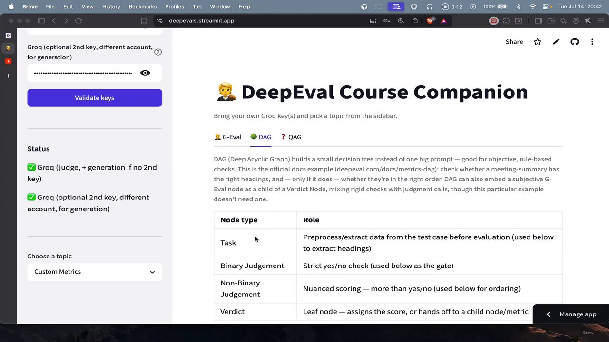
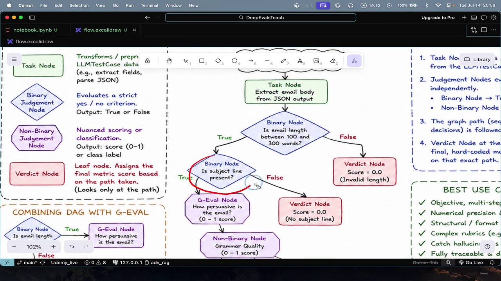
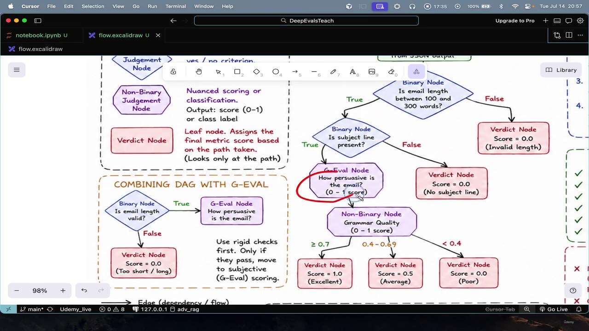
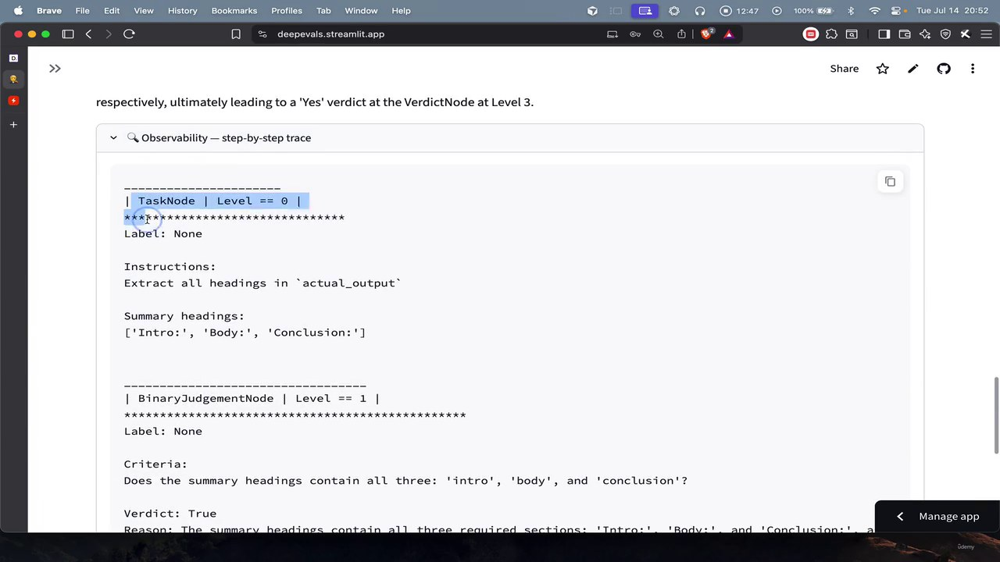
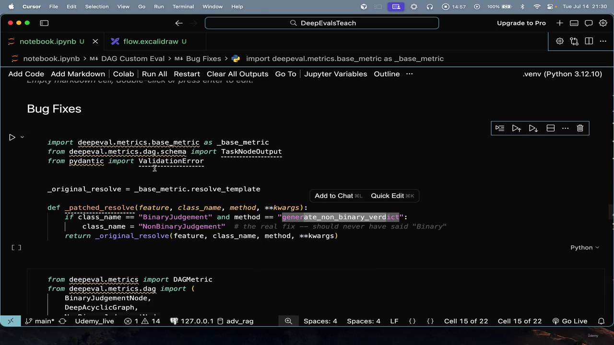
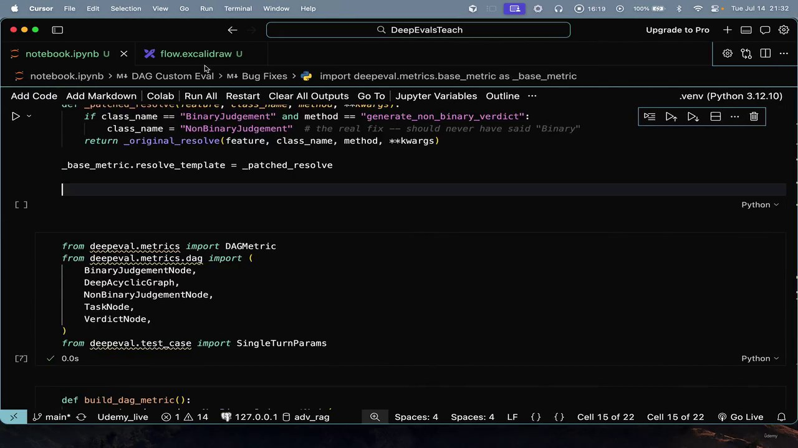
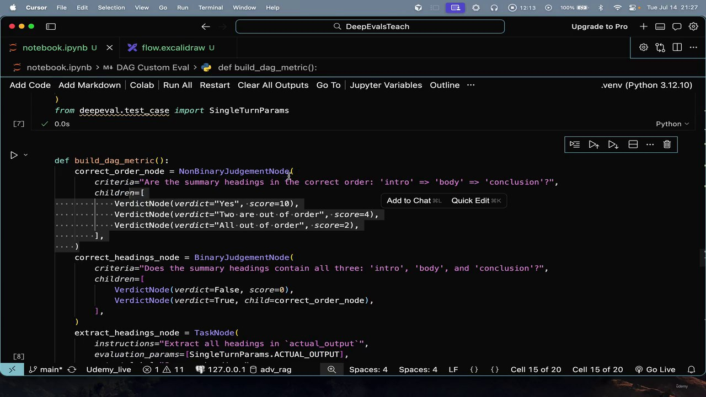

# DAG 自定义评估指标（DeepEval）：护栏里的确定性判定图

> 本节是 AI Security Bootcamp part1（护栏/网关/可观测）里 P009–P010 两集的实操文档。P009 讲清楚 DAG 自定义指标的四种节点与图遍历逻辑，P010 在 Jupyter Notebook 里把它写出来、踩到 DeepEval 的两个库级 bug、打补丁、跑出 trace。本文按「能照着做完」的标准组织，代码为可直接保存运行的完整单元格。

---

## 1. 这一节做什么

这两集做完，你手上会有一样具体的东西：**一个用「有向无环图（DAG）」实现的评估指标**，它给「会议纪要输出格式对不对」打分。它不像上一集的 generative eval 那样靠 LLM 的思维链自由发挥，而是把判定拆成一串**固定步骤**，每一步只有明确的分支，最后落到一个**硬编码分数**的叶子节点上。

具体交付物：

1. 在已有的 `notebook.ipynb`（上一集 generative eval 的代码就在里面）中新增一节 `## DAG custom eval`；
2. 一个 `build_dag_metric()` 函数，返回配置好 `TaskNode` / `BinaryJudgementNode` / `NonBinaryJudgementNode` / `VerdictNode` 的 `DAGMetric`；
3. 两条 `LLMTestCase` 测试数据：一条格式完全正确（应得满分），一条缺 Conclusion（应被直接判 0）；
4. 一段**补丁代码**，修掉 DeepEval 当前版本的两个 bug（非二值判定节点取错 prompt 模板、Task 节点输出多包一层导致 schema 校验失败）；
5. 一个 for 循环跑完全部测试用例，打印 PASS/FAIL、score 和完整 trace。

为什么这件事和「护栏」有关：护栏要的不是「LLM 觉得还行」，而是**可复现、可审计、能上线拦住坏输出**的判定。讲师反复强调的就是这一点——DAG 的每一步都是确定的，出问题能一层层往回查。

> "在 DAG 里，名字本身就有『图』——我们是用一张图来控制逻辑、控制计算评估的流程，所以它肯定比 generative eval 更确定。"
> —— p009 [01:25]

> "行业现在都在接 LLM，而 LLM 是非确定性的，但行业一直在想办法让 LLM 以确定性的方式被使用。所以 DAG 换一种说法，在你很多评估用例里会非常非常有用。"
> —— p009 [01:52]



四种节点（这是整节的地基，先把表背下来）：

| 节点 | 作用 | 输出形态 | 在图里的位置 |
|---|---|---|---|
| `TaskNode` | 处理数据：把测试用例的输入/实际输出/期望输出加工成可用于评估的信息 | 结构化提取结果 | 靠近根 |
| `BinaryJudgementNode` | 二值判定：只给 true/false、yes/no，没有中间态 | 布尔 | 中间 |
| `NonBinaryJudgementNode` | 非二值判定：状态多于两个 | 多个分支 | 中间 |
| `VerdictNode` | 叶子节点，**写下硬编码分数** | 分数 | 最底层 |

> "task 节点就是真正处理数据的节点——把测试用例里拿到的输入数据、实际输出、期望输出处理成有用的信息，好让我们用它去做评估。"
> —— p009 [03:47]

> "二值判定，顾名思义是二值的：真或假、是或否，没有中间态。"
> —— p009 [04:17]

> "verdict 节点是图最底层的叶子节点，它按照判定节点的结果去打分。"
> —— p009 [05:16]

本次要复现的那张图，逻辑是这样的（讲师用「会议纪要」这个极简用例讲）：

```
TestCase(会议转录 + 实际输出)
        │
        ▼
[TaskNode] 抽取所有标题 → summary_headings = [Intro, Body, Conclusion]
        │
        ▼
[BinaryJudgementNode] 「三个标题 Intro/Body/Conclusion 都在吗？」
        ├─ False ──▶ [VerdictNode score=0]   ← 直接判 0，图结束
        └─ True  ──▶
                [NonBinaryJudgementNode] 「顺序对吗？正确顺序 Intro→Body→Conclusion」
                        ├─ 全部顺序正确 ──▶ [VerdictNode score=10]
                        ├─ 两个顺序错   ──▶ [VerdictNode score=4]
                        └─ 全部乱序     ──▶ [VerdictNode score=2]
```


> "二值节点给 true/false，非二值节点给分数和标签。图路径是由 DAG 决定的，最后 verdict 节点给出硬编码的最终指标。"
> —— p009 [20:48]

> "verdict 节点里已经是硬编码的分数，verdict 节点内部没有任何动态计算。"
> —— p009 [21:15]

这一段是理解全篇的关键：**除了 verdict 节点，没有任何节点在打分；其它节点只负责决定「往哪走」。**

---

## 2. 讲师原话

按实现顺序整理，全部为中文译文或原文（逐字稿本身是英文的，这里译成中文）：

**关于 DAG 是什么**

> "这个视频的重点，是理解 DAG 类型的自定义指标：它是什么、为什么存在、以及它是怎么运作的。下一个视频我们会用一个非常简单的用例开始实现 DAG。"
> —— p009 [00:56]

> "在理解这张图之前，第一件也是最重要的一件事，是搞清楚这个自定义评估里有哪几种节点。"
> —— p009 [03:18]

**关于从 task 节点往下的流动**

> "在 task 节点做完事情之后，我们走向第一个依赖——所谓第一个依赖，就是我们基于 task 节点抽出来的信息做的第一个判定。"
> —— p009 [08:07]

> "如果三个标题不是全都在——只要缺任何一个——我们直接把流程送到 verdict 节点，它的分数是 0，你看到图在这一侧就结束了。"
> —— p009 [08:34]

> "如果三个标题都在，二值判定告诉我们『都在』，它就会解锁第二个依赖，也就是这个节点，它做的是非二值判定。"
> —— p009 [09:02]

**关于判定节点可以用什么实现**

> "这个二值判定节点里，你可以用 LLM，也可以用确定性的程序化方法，或者 RAG 之类的模式，但规则是：它是二值判定节点，只会有是/否。"
> —— p009 [12:21]

**关于 trace（可观测性）**

> "你能看到整条 trace，看到究竟发生了什么，读起来非常有意思：在 task 节点这一层，label 是 none，指令是『抽取实际输出里的所有标题』，抽出来是 Intro、Body、Conclusion。"
> —— p009 [12:47]

**关于和 generative eval 混用**

> "在 DAG 里，你可以有一个 gen-eval 节点——也就是这个节点用 generative eval 的方式做评估。这就是 DAG 的威力：把 verdict 节点、gen-eval 节点和整张图组合起来，用非确定性技术的能力，做出非常强大的确定性流程。"
> —— p009 [17:30]



那个例子的完整链路（讲师口播逐步讲的，值得抄下来当第二张图的模板）：

1. `TaskNode` 从 JSON 输出里抽出 email body；
2. `BinaryJudgementNode`：「body 长度在 100–300 词之间吗？」False → `VerdictNode(score=0, "invalid length")`；
3. True → 再来一个 `BinaryJudgementNode`：「有 subject line 吗？」False → `VerdictNode(score=0, "no subject line")`；
4. True → **generative eval 节点**检查邮件质量（沿用上一集讲的 generative eval 方法），得到 0–1 的分数；
5. 这个分数不做决策，直接传给后面的 `NonBinaryJudgementNode`，由它按分数区间选分支；
6. 分支落到最后的叶子 `VerdictNode`。

**关于什么时候用、什么时候别用**

> "什么时候该用它：当你需要客观的、多步的规则检查，而且这些多步是完全固定的时候，就该走 DAG。"
> —— p009 [21:44]

> "第二是数值精度和阈值：如果你有明确的数值阈值，用来算下一步、算评估的走向，那也该用 DAG。第三是结构化与格式校验——你看我们举的两个例子，都是结构化校验。"
> —— p009 [22:12]

> "如果有非常复杂的、写在代码或文档里的评分细则（rubrics），你可以在 DAG 里非常早地抓住幻觉，因为你不用思维链，从确定性方法本身就能查出来。"
> —— p009 [22:41]

> "它是完全可追踪、完全确定的。generative eval 里思维链会去决定评估步骤，而这里每一步都是确定的，每个节点内部发生了什么也是确定的。"
> —— p009 [23:08]

> "它不适合创意类任务。比如你要评估一个写诗的模型，就没法用 DAG，因为诗没有结构刚性、没有结构上的确定性，你没法为它建图。语气、创造力、风格这些东西，用 DAG 评估不好。"
> —— p009 [23:37]

> "第二是它需要图设计成本：设计一张图，你要把整个流程、每个边界情况、每个分叉的可能性都想到，认知负担很高。用例一大，图会变得非常复杂——但这是双刃剑，只要你能管好，DAG 是能处理复杂度的。"
> —— p009 [24:06]



**进入 P010：写代码**

> "我们已经有一个 notebook.ipynb 了，里面已经有上一集 generative eval 自定义指标的代码。在同一个 notebook 里，我新建一个 markdown，叫 DAG custom eval，从这里开始写 DAG 的代码。"
> —— p010 [00:56]

> "一张图里有两样东西：先是节点，然后是这些节点之间怎么连的流程。我们要同时定义这两样。"
> —— p010 [02:23]

> "我们跑下去会报错。因为我在实现的时候发现这个代码里有两个 bug——不是我们写的这段代码的 bug，是 DeepEval 库本身的 bug，在我录制时的最新版本里就有。"
> —— p010 [10:49]

> "第一个 bug：非二值判定节点去构建 prompt 的时候，它调的是 BinaryJudgementNode 而不是 NonBinaryJudgementNode，于是这个非二值节点表现得像二值节点，然后报错说『不能有三个 children、不能有两个以上可能』。"
> —— p010 [12:11]

> "我们做的修复是：在 registry 的时候，悄悄把这个类的名字重新标成 NonBinaryJudgement。"
> —— p010 [13:07]

> "第二个 bug 和 task 节点有关：这个 judge（本身也是个 LLM）会把回复包成一层额外的 key——外面一个 JSON 对象，里面 key 叫 output，value 又是一层 JSON，里面才是 headings 列表。这就是 schema 不匹配。"
> —— p010 [16:23]

> "DeepEval 有严格的 schema 校验，它期望 task 节点的输出要么是字符串、要么是字符串列表、要么是 key 和 value 都是字符串的字典。但这里 key 是字符串、value 却是另一个字典，所以会报错。"
> —— p010 [17:22]

> "我们的修法是：把这个多包一层的对象打开，去掉 headings 这层，直接拿到那个数组，以字符串列表的形式交给它。"
> —— p010 [17:51]

> "现在再跑，就不会报错了，你会拿到完整的、非常清晰的 trace。测试用例 1 通过，结果是 10。"
> —— p010 [19:42]

> "有意思的是测试用例 2 完全失败。为什么？它进了 task 节点，抽出来只有 Intro 和 Body，二值判定看到条件不满足、返回 False，因为是二值所以只有 true/false，False 就直接走到 verdict 节点，拿到那个确定性的 0 分。"
> —— p010 [20:12]

---

## 3. 从零复现

### 3.1 目录结构

```text
ai-security-bootcamp/
└── deepeval-eval/
    ├── notebook.ipynb          # 上一集已创建，本节在同一个文件里继续加单元格
    ├── requirements.txt
    └── .env                    # 可选，用于放模型 key
```

`notebook.ipynb` 是上一集就存在的文件，里面已有 generative eval 的代码。**不要新建 notebook**，讲师就是在这个文件里追加一节：

```markdown
## DAG custom eval
```

### 3.2 依赖与版本

```bash
python -m venv .venv
source .venv/bin/activate        # Windows: .venv\Scripts\activate
pip install -U deepeval jupyter python-dotenv
pip freeze > requirements.txt
```

`requirements.txt` 至少包含：

```text
deepeval
jupyter
python-dotenv
```

课里没讲具体版本号，讲师原话是「我录制时的最新版本」。`pip freeze` 把当时装到的版本钉住，是复现这套补丁的必要动作——因为两个 bug 之后可能被官方修掉，修掉后补丁可能反而报错。

### 3.3 环境变量

```bash
# .env
# DeepEval 默认走 OpenAI，如果你的版本/配置是别的模型，改成对应的 key
OPENAI_API_KEY=sk-xxxxxxxxxxxxxxxx

# 课程里那个 Streamlit demo 是 BYOK（自带 key）的，用的是 Groq key
GROQ_API_KEY=gsk_xxxxxxxxxxxxxxxx
```

Notebook 里读：

```python
from dotenv import load_dotenv
load_dotenv()
```

> 课里没讲 notebook 具体调的是哪家模型、用哪个环境变量名。上面 `OPENAI_API_KEY` 是按 DeepEval 默认行为给的；demo 应用那侧讲师明确说是自带 Groq API key。

### 3.4 启动

```bash
jupyter notebook notebook.ipynb
# 或
jupyter lab notebook.ipynb
```

或者用 VS Code 装 Jupyter 扩展，打开同一个文件，选刚建的 `.venv` 作为 kernel。

### 3.5 复现步骤（按顺序执行单元格）

1. **写 imports 单元格**：导入 `DAGMetric`、`DeepAcyclicGraph`、四种节点、`SingleTurnParams`。
2. **写测试数据单元格**：`meeting_transcript` + 两条 `LLMTestCase`（一条全对、一条缺 Conclusion）。
3. **写 `build_dag_metric()`**：自底向上建图——先建 `correct_order_node`（非二值），再建 `correct_heading_node`（二值，True 分支 `child=correct_order_node`），最后建 `extract_headings_node`（task，children 指向两个判定节点），最后 `DeepAcyclicGraph(root_nodes=[extract_headings_node])`。
4. **先直接跑**（不打补丁）：跑那个 for 循环，确认你**也**会撞上那两个错误。这一步不要跳过，否则你后面看到补丁会不知道为什么要有。
5. **新建 markdown `### Bug fixes` + 补丁代码单元格**：探测库里的真实私有符号名 → 打 bug 1 补丁（template 解析时把 `BinaryJudgementNode` 改名成 `NonBinaryJudgementNode`）→ 打 bug 2 补丁（`model_validate` 失败时拆一层包裹）。
6. **重启 kernel 并从头 Run All**：得到 test 1 PASS、test 2 FAIL/score 0 的输出。
7. **读 trace**：对照 trace 里的 level 0 / level 1 / level 2，确认 task → binary → non-binary → verdict 的顺序与你建的图一致。

### 3.6 讲师在 demo 应用里演示的现象（用来对照 notebook 结果）

讲师有一个 Streamlit 应用（`dpvilesstreamlit.app` 一类地址，BYOK 填 Groq key），左侧下拉可以切 `rag evaluations` / `custom metrics` 等场景。在 `custom metrics` → DAG 里做了三次实验：

| 实验 | 输入改动 | 图走到哪 | 结果 |
|---|---|---|---|
| 原始 | Intro、Body、Conclusion 齐全且顺序正确 | task → binary(True) → non-binary(顺序正确) → verdict 10 | 显示 1 |
| 删掉 Conclusion | 缺标题 | task → binary(False) → **直接跳 verdict 0** | 显示 0 |
| 把 Conclusion 挪到最前面 | 齐全但全乱序 | task → binary(True) → non-binary(全乱序) → verdict 2 | 显示 0.2 |



> "在 observability 这一步你能看到完整 trace，非常有意思：task 节点 level 0，label 是 none，指令是抽取标题，结果 output 是 intro、body、conclusion。"
> —— p009 [12:47]


> "为什么这里是 0.2？因为所有标题都乱序了，走到『全部乱序』那个 verdict 节点，它就给了我们那个节点里的分数。"
> —— p009 [16:04]

> 说明：demo 界面显示的是 1 / 0.2 / 0，而 verdict 里写的是 10 / 2 / 0。看起来是同一套分数除以 10 归一化后的展示；**归一化具体是库做的还是应用层做的，课里没讲**。

---

## 4. 完整代码

> **重要说明（先看）**：本节**没有任何 OCR 结果**，讲师屏幕上的代码没有被文字化。下面所有代码是**按逐字稿口播逐句重建**的：变量名、节点名、criteria 文案、目录结构、执行顺序都来自讲师原话；但 **DeepEval 的私有符号名（`_resolve_prompt_template`、`TaskNodeOutput` 这类）讲师没有逐字念出来**，我会在对应位置标注「按你装的版本核对」，并给出探测代码。**未标注的字符串（criteria 文案、instructions）是讲师口播里说过含义的，英文措辞可按你的用例改，不影响逻辑。**

### 4.1 单元格 1：imports

```python
# 文件名：notebook.ipynb -> markdown cell: "## DAG custom eval" 之后的第一个 code cell
from deepeval.metrics import DAGMetric
from deepeval.metrics.dag import (
    DeepAcyclicGraph,
    TaskNode,
    BinaryJudgementNode,
    NonBinaryJudgementNode,
    VerdictNode,
)
from deepeval.test_case import LLMTestCase, SingleTurnParams
```

> 讲师原话对应：「我们需要 DAGMetric，这很明显；然后是 BinaryJudgementNode、DeepAcyclicGraph、NonBinaryJudgementNode、TaskNode、VerdictNode——这些我们从前一个视频已经知道它们的作用了，从 deepeval.metrics.dag 这个模块导入。然后导入 SingleTurnParams，用来指定从输入数据集的哪个 key 取值。」—— p010 [01:24]–[01:54]

### 4.2 单元格 2：测试数据

```python
meeting_transcript = """
Alice: 今天主要过三件事：Q3 的发布节奏、灰度范围、以及回滚预案。
Bob: 发布节奏我建议按两周一个批次，先内部再外部。
Alice: 灰度范围先 5%，观察 48 小时。
Bob: 回滚预案我今晚出一版，明天评审。
Alice: 好，那今天就到这里。
"""

# 用例 1：标题齐全，且顺序是 Intro -> Body -> Conclusion
actual_output_all_good = """
# Introduction
本次会议围绕 Q3 发布节奏、灰度范围和回滚预案展开讨论。

# Body
发布节奏按两周一个批次推进，先内部后外部；灰度范围先取 5%，
观察 48 小时后再决定是否扩量。

# Conclusion
Bob 今晚产出回滚预案初稿，明天评审，通过后进入灰度。
"""

# 用例 2：只有 Intro 和 Body，缺 Conclusion —— 二值判定应该直接判死
actual_output_missing_conclusion = """
# Introduction
本次会议围绕 Q3 发布节奏、灰度范围和回滚预案展开讨论。

# Body
发布节奏按两周一个批次推进，先内部后外部；灰度范围先取 5%，
观察 48 小时后再决定是否扩量。
"""

dag_test_cases = [
    LLMTestCase(input=meeting_transcript, actual_output=actual_output_all_good),
    LLMTestCase(input=meeting_transcript, actual_output=actual_output_missing_conclusion),
]
```

> 讲师原话对应：「我们定义输入转录和实际输出……然后定义 test cases，LLMTestCase 里 input 是 meeting_transcript，actual_output 是这个。第一个输出里有 body 也有 conclusion，全都齐；第二个我们有 input、有 body，但没有 conclusion，所以这道门应该失败、跳过顺序检查。你可以按自己的需要加更多测试用例。」—— p010 [07:56]–[09:23]
>
> **课里没讲**：完整的会议转录文本（讲师只是提了「LS 说了这个、Bob 说了那个，带说话人映射和顺序」，没念全文）。上面这份是同等结构的最小数据，字段和结构照口播描述。

### 4.3 单元格 3：`build_dag_metric()`

```python
def build_dag_metric() -> DAGMetric:
    # ---- 第 1 个建的：最底层的非二值判定节点（顺序检查）----
    correct_order_node = NonBinaryJudgementNode(
        criteria=(
            "Are the summary headings in the correct order?"
            "The correct order is: Introduction -> Body -> Conclusion."
        ),
        children=[
            VerdictNode(
                verdict="All headings are in the correct order (Introduction, then Body, then Conclusion)",
                score=10,
            ),
            VerdictNode(
                verdict="Two of the headings are out of order",
                score=4,
            ),
            VerdictNode(
                verdict="All headings are out of order / completely jumbled",
                score=2,
            ),
        ],
    )

    # ---- 第 2 个建的：二值判定节点（标题齐全检查）----
    correct_heading_node = BinaryJudgementNode(
        criteria=(
            "Does this summary contain all three headings: "
            "Introduction, Body and Conclusion?"
        ),
        children=[
            # True 分支不写分数，而是把图接到下一个节点
            VerdictNode(verdict="True", child=correct_order_node),
            # False 分支直接落到叶子，硬编码 0 分
            VerdictNode(verdict="False", score=0),
        ],
    )

    # ---- 第 3 个建的：task 节点（真正干活的）----
    extract_headings_node = TaskNode(
        instructions="Extract all the headings that appear in the actual output.",
        output_label="summary_headings",
        evaluation_params=[SingleTurnParams.ACTUAL_OUTPUT],
        children=[correct_heading_node, correct_order_node],
    )

    # ---- 组图 ----
    dag = DeepAcyclicGraph(root_nodes=[extract_headings_node])
    return DAGMetric(name="Meeting Summary Format Correctness", dag=dag)
```

> 讲师原话对应：「我们先建最底层的节点，也就是非二值判定节点，我把它叫 correct order node……它的 criteria 是『标题顺序对吗』。然后定义它的 children，里面是一个由多个 VerdictNode 组成的数组：verdict 是 yes 的时候给 10 分。非二值判定节点本身不给分，它只给出 verdict 这个 case。」—— p010 [03:17]–[04:12]
>
> 「然后建 correct heading node，它是二值判定节点，检查三个标题是否都在。注意这里有意思的地方：我们定义 child 的时候，不是给分数，而是把这个 verdict 连到下一个节点——correct order node。如果判定为 true，就走向非二值判定节点。」—— p010 [04:40]–[05:40]
>
> 「然后是 extract heading node，这是真正的 task 节点，它需要知道输入测试数据，所以用 SingleTurnParams 指定测试用例的哪个属性，比如 actual_output；输出用 output_label 叫 summary_headings；children 是 correct heading node 和 correct order node，这两个节点都会拿到 task 生成的数据。」—— p010 [05:40]–[06:34]
>
> 「最后把它们连起来：实例化 DeepAcyclicGraph，指定 root node，就是测试数据从这里流进整张图的节点。我们选 extract heading node。也可以放多个节点，但这里从它开始。」—— p010 [07:00]–[07:28]

### 4.4 单元格 4：先跑一次（故意看报错）

```python
# 第一次运行：故意不打补丁，你会看到 DeepEval 的两个报错
for i, test_case in enumerate(dag_test_cases, start=1):
    metric = build_dag_metric()
    metric.measure(test_case)
    verdict = "PASS" if metric.successful else "FAIL"
    print(f"[before patch] Test case {i}: {verdict} | score={round(metric.score, 3)}")
```

### 4.5 单元格 5：探测库里的真实符号名（这一步很关键）

```python
import deepeval
from deepeval.metrics import BaseMetric
from deepeval.metrics.dag import TaskNode

print("deepeval version:", deepeval.__version__)

# bug 1 相关：找到"按类名 + 方法名 取 prompt 模板"的那个函数
print("BaseMetric 里和 resolve/template 有关的方法：")
print([n for n in dir(BaseMetric) if "resolve" in n.lower() or "template" in n.lower()])

# bug 2 相关：找到 task 节点输出校验用的 pydantic 模型 / 校验方法
print("TaskNode 里和 validate/output 有关的属性：")
print([n for n in dir(TaskNode) if "valid" in n.lower() or "output" in n.lower()])
```

把打印出来的名字，替换到下面补丁代码里我标了 `# ← 按上一步探测结果替换` 的位置。

### 4.6 单元格 6：Bug 1 补丁（非二值判定节点取错模板）

```python
# markdown cell: "### Bug fixes"
from deepeval.metrics import BaseMetric

# 1) 先把原始实现存下来（指针）
original_resolve_template = BaseMetric._resolve_prompt_template   # ← 按上一步探测结果替换


# 2) 造一个 patch 过的解析函数
def patch_resolve(original_resolve):
    def patched(class_name, method_name, *args, **kwargs):
        # 库里的 bug：非二值判定节点去取模板时，class_name 传成了 BinaryJudgementNode
        if class_name == "BinaryJudgementNode" and method_name == "generate_non_binary_verdict":
            # 悄悄改名，其它 feature / 方法 / 参数原样透传
            class_name = "NonBinaryJudgementNode"
        return original_resolve(class_name, method_name, *args, **kwargs)

    return patched


# 3) 把原始指针替换成 patch 后的版本
BaseMetric._resolve_prompt_template = patch_resolve(original_resolve_template)
print("patched: bug 1 ok")
```

> 讲师原话对应：「我先 `original_resolve = BaseMetric 的 resolve template`……当这个补丁作用在我们的 DAG 上时，它会看当前是哪个 BaseMetric，看到我们在非二值判定节点里，然后看它要取哪个 resolve template，把这个指针存到 original resolver 里。然后我们用 `patch_resolve` 去改这个指针：它接收 feature、class name、methods 和一些其它 key 参数，判断——如果 class name 是 BinaryJudgementNode、方法是 generate non binary verdict，那我们就确切地知道这是我们发现的 bug，然后悄悄把 class name 那个值改成 NonBinaryJudgementNode，再用其它参数原样调原来的 resolve。」—— p010 [13:36]–[15:01]

### 4.7 单元格 7：Bug 2 补丁（TaskNode 输出多包一层）

```python
# bug 2：修 TaskNode 输出被多包了一层 {"output": {"headings": [...]}} 导致的 schema 校验失败
from pydantic import ValidationError
from deepeval.metrics.dag import TaskNode

# 找到 task 节点输出校验用的 pydantic 模型（名字各版本不同，用探测结果替换）
TaskNodeOutput = TaskNode._TaskOutputModel                               # ← 按探测结果替换
original_validate = TaskNodeOutput.model_validate


def patch_validate(original_validate_fn):
    def patched(value, *args, **kwargs):
        try:
            return original_validate_fn(value, *args, **kwargs)
        except (ValidationError, ValueError):
            inner = value
            # 第一层：{"output": {...}} -> {...}
            if isinstance(inner, dict) and set(inner.keys()) == {"output"}:
                inner = inner["output"]
            # 第二层：{"headings": [...]} -> [...]
            if isinstance(inner, dict) and len(inner) == 1:
                only_value = next(iter(inner.values()))
                if isinstance(only_value, list):
                    inner = only_value
            return original_validate_fn(inner, *args, **kwargs)

    return patched


# 把 patch 后的校验函数挂回去
TaskNodeOutput.model_validate = patch_validate(original_validate)
print("patched: bug 2 ok")
```

> 讲师原话对应：「第二个 bug 我要去 patch 那个 model output：`task node output . model validate`，拿到指针 original validate，然后用 `patch_validate` 包一层：如果出现 schema 不匹配的校验错误，就悄悄把那个对象拆开——从『外面一个 JSON、里面 output 又是一层 JSON、再里面是 headings 列表』这种格式，变成只保留那个数组。「最后把 patch 后的函数再映射回 `task model validator output` 这个指针，告诉它用这个 patch 后的函数做校验。」—— p010 [18:20]–[19:42]

### 4.8 单元格 8：补丁后重跑

```python
# 打完补丁，重启 kernel 后从头 Run All
for i, test_case in enumerate(dag_test_cases, start=1):
    metric = build_dag_metric()
    metric.measure(test_case)
    verdict = "PASS" if metric.successful else "FAIL"
    print(
        f"Test case {i}: {verdict} "
        f"| score={round(metric.score, 3)} "
        f"| reason={metric.reason}"
    )
```

预期输出（结构）：

```text
Test case 1: PASS | score=... | reason=...
Test case 2: FAIL | score=0   | reason=...
```

> 讲师原话：「测试用例
2 完全失败。为什么？它进了 task 节点，抽出来只有 Intro 和 Body，二值判定看到条件不满足、返回 False，因为是二值所以只有 true/false，False 就直接走到 verdict 节点，拿到那个确定性的 0 分。"
> —— p010 [20:12]

> "现在再跑，就不会报错了，你会拿到完整的、非常清晰的 trace。测试用例 1 通过，结果是 10——和 Streamlit 里拿到的是同一层级的 trace。"
> —— p010 [19:42]



---

## 5. 逐行解释

这一节把第 4 节每一块代码拆开讲「为什么这样写、不这样写会怎样」。读者是前端转过来的，涉及 pydantic 校验、私有符号覆盖这类 Python 特有概念的地方，我会补一句它在 JS/Node 里的对应，标「知道即可」。

### 5.1 导入块：为什么从 `deepeval.metrics.dag` 里拿节点

```python
from deepeval.metrics import DAGMetric
from deepeval.metrics.dag import (
    DeepAcyclicGraph, TaskNode, BinaryJudgementNode,
    NonBinaryJudgementNode, VerdictNode,
)
from deepeval.test_case import LLMTestCase, SingleTurnParams
```

- `DAGMetric` 是**指标的外壳**：它要出现在 `metric.measure(test_case)` 这套统一接口里，需要 `name`、`score`、`reason`、`successful` 这些属性。图本身塞在 `dag=` 参数里。
- 四种节点 + `DeepAcyclicGraph` 从 `deepeval.metrics.dag` 里拿，讲师原话是「从 deepeval.metrics.dag 这个模块导入」。这条路径**不要改**——它是库的公共入口；我们后面改的只是内部私有方法。
- `SingleTurnParams` 是 `enum`，只放 `INPUT` / `ACTUAL_OUTPUT` / `EXPECTED_OUTPUT` / `CONTEXT` / `RETRIEVAL_CONTEXT` 这种**固定枚举值**（具体成员以你装的版本为准）。它的作用是告诉库：「从测试用例里只取这一个字段送进 task 节点」，这样 task 节点的 prompt 不会塞一大堆无关字段进去、浪费 token。
  - **JS/Node 类比**：相当于一个白名单 enum，比「随便传字符串」安全得多。

### 5.2 建图顺序为什么是「自底向上」

讲师是从 `correct_order_node`（非二值、最靠近叶子）开始写，然后写 `correct_heading_node`（二值），最后写 `extract_headings_node`（task，根）。原因很简单：**Python 里引用一个对象必须先创建它**。`correct_heading_node` 的 True 分支要 `child=correct_order_node`，所以必须先有 `correct_order_node` 这个变量。`extract_headings_node` 的 `children` 里同时引用两个判定节点，所以它最后建。

> "我们现在建最底层的节点——我不是说 verdict 节点，verdict 节点是判定产生的结果——所以先写 correct order node。"—— p010 [03:17]

这不是 DeepEval 的硬性规定，是你写 Python 的必然顺序；如果你用 `dag.add_edge(parent, child)` 那种命令式 API（课里没讲），就可以反着来。

### 5.3 `NonBinaryJudgementNode`：只出 verdict，不出分数

```python
correct_order_node = NonBinaryJudgementNode(
    criteria="Are the summary headings in the correct order? ...",
    children=[VerdictNode(verdict="...", score=10),
              VerdictNode(verdict="...", score=4),
              VerdictNode(verdict="...", score=2)],
)
```

- **`criteria` 是给 LLM 读的自然语言判定条件**。讲师原话说「prompt 会强制 LLM 给 yes/no」，到非二值节点就是「从这几个 verdict 描述里选一个」。
- **`children` 是一个 `VerdictNode` 列表**。为什么是三个而不是两个？因为非二值判定天然要给**≥3 个状态**（讲师原话「状态数比 true/false、yes/no 更多」）；这里是「全对 / 错俩 / 全乱」三档，所以三个 child。
- **`VerdictNode(verdict=..., score=...)` 里 `score` 是硬编码的整数**——这就是讲师反复强调的「只有 verdict 节点在打分、verdict 里没有动态计算」的具体位置。想改分数只改这一处，不用碰判定逻辑。
- **`criteria` 里必须显式写出「正确顺序是 Introduction → Body → Conclusion」**——LLM 不会从上下文自动推出这个行业习惯，它要靠你写死。这也呼应了讲师举的反例「如果 Conclusion 出现在 Body 前面，就是错序」（p009 [09:57]）。
- **`criteria` 写这三档的语义**：如果只写「顺序对不对」，第二档「两个错」会判错——因为「只错两个」在语义上其实也是「顺序不对」，LLM 会直接落到第三档。所以三档的 `verdict=` 描述必须**互斥**：「全对」「恰好两个错」「全乱」。

> "非二值判定节点里，LLM 会基于这个 prompt 给我们一个分数。"—— p009 [12:21]

> 补充：讲师还有一句「非二值判定节点里也支持 LLM、确定性程序化方法或 RAG」，意思是 `criteria` 背后的判定引擎**默认是 LLM，但你可以自己接程序**。课里没演示程序化写法。

### 5.4 `BinaryJudgementNode`：True 分支不给分、给下一个节点

```python
correct_heading_node = BinaryJudgementNode(
    criteria="Does this summary contain all three headings: ...?",
    children=[
        VerdictNode(verdict="True", child=correct_order_node),
        VerdictNode(verdict="False", score=0),
    ],
)
```

这是整段代码里**最容易看懵的一处**——同样是 `VerdictNode`，一个写 `child=`，一个写 `score=`。

- **`VerdictNode(verdict="True", child=correct_order_node)`**：意思是「二值判定返回 True 的时候，图**不结束**，把控制权交给 `correct_order_node` 继续走」。这就是讲师说的「定义 child 的时候不是给分数，而是把这个 verdict 连到下一个节点」。
- **`VerdictNode(verdict="False", score=0)`**：意思是「返回 False 的时候，**直接到叶子节点结束**，分数硬编码为 0」。对应讲师演示里删掉 Conclusion 那次实验：图在 level 1 就断了，不进入非二值节点。
- **两个 child 的顺序不能反**：在 DeepEval 的 BinaryJudgementNode 里，`children[0]` 对应 True、`children[1]` 对应 False（这是课里明说的语义，按你装的版本以实测为准）。反了的话 True 分支会拿 0 分。可以先把 `VerdictNode(verdict="True", ...)` 写在前面。
- **为什么不给 False 也接 `correct_order_node`**：因为顺序检查在「缺标题」的情况下没意义——三个标题都不全，谈顺序毫无价值。**这是 DAG 相对于 generative eval 的核心优势**：图结构本身就把「无意义的计算」剪掉了，节省 token，也让 trace 更好读。

> "如果三个标题都在，二值判定告诉我『都在』，它就会解锁第二个依赖，也就是这个节点。"—— p009 [09:02]

> **JS/Node 类比**：这非常像 `if (!allHeadingsPresent) return { score: 0 };`，只是用图结构写出来了。你后面看到的 trace 就是一次执行的 control flow。

### 5.5 `TaskNode`：把测试用例数据处理成「评估可用的信息」

```python
extract_headings_node = TaskNode(
    instructions="Extract all the headings that appear in the actual output.",
    output_label="summary_headings",
    evaluation_params=[SingleTurnParams.ACTUAL_OUTPUT],
    children=[correct_heading_node, correct_order_node],
)
```

- **`instructions` 是 task 节点自身的 prompt**。它本身也调一次 LLM。讲师原话「task node 会利用 LLM 的能力」。
- **`output_label="summary_headings"`**：给这次 LLM 输出的结构化结果**起个名字**，方便 trace 里读、也方便下游节点引用。trace 里显示的 `summary_headings = [Intro, Body, Conclusion]` 就是这个 label 的值。
- **`evaluation_params=[SingleTurnParams.ACTUAL_OUTPUT]`**：只取测试用例里的 `actual_output` 送给这个 task 节点，不送 `input`。为什么？因为这个任务只需要「实际输出是什么」——输入转录对「抽标题」没用。**这是 token 成本和 LLM 注意力控制的细节，讲师原话强调「用 SingleTurnParams 指定从哪个属性取值」**。
- **`children=[correct_heading_node, correct_order_node]`**：**两个判定节点都挂在 task 下面，不是链式的**。这一点讲师没有特别强调但代码就是这么写的，理由有两个：
  1. `correct_heading_node` 是主路径（task → binary → non-binary）；
  2. `correct_order_node` 之所以也出现在 task 的 children 里，是因为图在**未经 shortcut** 时也要能从根直连到它——但实际上 `correct_heading_node` 的 True 分支就已经 `child=correct_order_node` 了，这里 `correct_order_node` 更像是**给框架留的一个注册点**，让非二值节点在整张图里可达。
  - 若你只想保留主路径，把 `children=[correct_heading_node]` 就行；但那种情况下如果再想从别的地方分叉到顺序检查，就得再建一个新对象。**课里没有明确解释这一处**，以实际跑出来的 trace 为准。
- **一个关键坑：`output_label` 里不能有空格、中文和特殊字符**。它是 schema 校验里被当 key 用的，讲师演示 trace 时看到的是 `summary_headings` 这种 snake_case。

> "task 节点是真正干活的那个，它需要知道测试数据，用 SingleTurnParams 指定 key……output 用 summary_headings 这个 label，children 是 correct heading node 和 correct order node，这两个节点都会拿到 task 生成的数据。"—— p010 [05:40]

### 5.6 `DeepAcyclicGraph` 与 `DAGMetric`

```python
dag = DeepAcyclicGraph(root_nodes=[extract_headings_node])
return DAGMetric(name="Meeting Summary Format Correctness", dag=dag)
```

- **`root_nodes` 是「图的入口列表」**——注意是 list。讲师说「你也可以在这里加多个根节点，但我们这里从 extract heading 开始」。多根节点意味着一次 `measure()` 会跑多条路径（例如一个 task 抽标题、另一个 task 抽摘要），课里没展开。
- **只把 `extract_headings_node` 放进 `root_nodes`**：正确。`correct_heading_node` 和 `correct_order_node` 是 `extract_headings_node` 的 children，框架会**顺着 children 递归发现整张图**，不需要你把每一个节点都在 root 里列出来。
- **`DAGMetric(name=...)`**：`name` 是给人看的，会出现在报告和 trace 里。命名里不要带表情和换行，否则某些版本的报告表头会崩。
- **每次调用 `build_dag_metric()` 都新建一个 graph**：这是讲师在 for 循环里这么写的。图对象本身是**可变状态**——一次 `measure()` 后可能会在节点上留下上次的 trace。为了不串，每个 test case 重新 build 一次最稳。代价是每次都要重建对象、暖 LLM client，但成本可以忽略。
  - **优化**：如果想只 build 一次、跑多个 case，把 `metric = build_dag_metric()` 挪到循环外，测一下 `metric.score` 在两次 measure 间是否会错乱——课里没讲这种用法是否安全，按你装的版本实测。

### 5.7 `metric.measure(test_case)`：图遍历的入口

```python
metric.measure(test_case)
```

- 这一步**把整张图走一遍**，返回值是 `None`，结果挂在 `metric.score` / `metric.successful` / `metric.reason` 上。
- **`metric.successful` 是布尔值**：等于 `metric.score >= metric.threshold`（默认阈值按库的默认走，具体数字以你装的版本为准；课里没讲阈值，只讲了这个字段存在）。讲师原话「metric successful 会给我们 true/false 的结果」。
- **`metric.score` 是 verdict 节点里那个数字**——所以 score 只会是 `{0, 4, 10, 2}` 这些值之一，不会出现 3.7、8.2 这种小数点。这是 DAG 与 generative eval 输出形态的根本区别。
- **`metric.reason`**：如果 trace 里能看到推理过程，这个字符串会加载推理文本；具体格式随版本变化，`print` 一下看看，别把它当稳定接口用。
- **`round(metric.score, 3)`**：讲师原话「我们 round 一下，得到一个合适的值」。这个 rounding 是给人读的，不是给业务逻辑用的——**别对 `metric.successful` 做 `round`**。

> "graph 有一个特殊的 measure 函数，它拿到 test case，遍历整张图，然后基于 verdict 得到 pass 或 failure。metric successful 会给我们 true/false。"—— p010 [09:53]–[10:20]

### 5.8 Bug 1 补丁的三层逻辑

```python
original_resolve_template = BaseMetric._resolve_prompt_template
BaseMetric._resolve_prompt_template = patch_resolve(original_resolve_template)
```

按顺序解释：

1. **`BaseMetric._resolve_prompt_template` 是一个类方法/静态方法**（在 Python 里就是挂在类上的函数），所有判定节点都通过它去**取 prompt 模板**。讲师给它的定位是「原指针」。
2. **`patch_resolve(original_resolve)` 是一个闭包**：它把原始函数**存起来作为默认参数**，然后返回一个新的 `patched` 函数。**注意这不是装饰器**（虽然长得很像），是明确的手动覆盖。
3. **`patched(class_name, method_name, *args, **kwargs)`**：参数名是讲师口播里说的「feature、class name、methods 和一些其它 key 参数」；**具体的顺序和名称以你装的版本为准**，如果直接调会报 `TypeError`，就用 `*args, **kwargs` 接住、需要判断的参数从 `args` 里按位置取。下面这版更抗打：

```python
def patched_flexible(class_name, method_name, *args, **kwargs):
    # 参数名在不同版本可能不同，按位置兜底
    if isinstance(class_name, str) and class_name == "BinaryJudgementNode" \
       and isinstance(method_name, str) and method_name == "generate_non_binary_verdict":
        class_name = "NonBinaryJudgementNode"
    return original_resolve_template(class_name, method_name, *args, **kwargs)
```

4. **为什么要在那个具体条件下改名**：库里的 `NonBinaryJudgementNode` 构造时去要 prompt 模板，**但传下去的 class name 是 `"BinaryJudgementNode"`**（讲师原话「它不会走 generate non binary verdict，它走 binary judgment」）。于是非二值节点取到了二值的模板（二值模板里说「只回答 True 或 False、不能有第三个分支」），然后我们 `children` 里放三个 `VerdictNode` 就炸了——这就是讲师说的**「它会报错说不能有三个 children、不能有两个以上可能」**。
5. **「悄悄改名」不影响别人**：改名只发生在「`class_name == BinaryJudgementNode` 且 `method_name == generate_non_binary_verdict`」这个交叉条件下——这是**只有非二值节点会触发的组合**，所以真正的二值节点不受影响，其他 metric 也不受影响。讲师原话「quietly relabel」。
6. **为什么这个 bug 在我们这能绕过去**：我们自己写的 `correct_heading_node` 是真正的二值节点，本来就是 BinaryJudgementNode，走正常的 `generate_verdict` 方法——不经过 patch。
7. **打补丁的代码放在 import 之后、`build_dag_metric()` 调用之前**：因为 `BaseMetric._resolve_prompt_template` 是**类属性**，一旦节点实例化前就 patch 上，之后所有实例都用到；但如果先把节点创建了再 patch，那个节点可能在构造时就缓存了错的模板，patch 也没用。课里就是这么放的，按这个顺序来。
8. **为什么需要重启 kernel**：patch 是运行时覆盖，只在当前 Python 进程有效。换 kernel 重开会丢 patch。**如果只在本 notebook 里跑，Run All 就够；如果打算做成包，把这个 patch 放进 `__init__.py` 里 import 时执行。**
9. **这是「私有 API」**：`_resolve_prompt_template` 带下划线，说明不是公共契约。DeepEval 升级后符号可能消失或改名，你的 patched 会 `AttributeError`。**用 `pip freeze` 钉版本是硬要求**。

### 5.9 Bug 2 补丁的三层逻辑

```python
TaskNodeOutput = TaskNode._TaskOutputModel
original_validate = TaskNodeOutput.model_validate
TaskNodeOutput.model_validate = patch_validate(original_validate)
```

1. **`TaskNode._TaskOutputModel`** 是 TaskNode 用来校验 LLM 输出的 **pydantic 模型**（类似 TS 里的 `z.object(...)` 或 `valibot` schema）。
2. **`model_validate(value)`** 是 pydantic v2 的校验入口——`value` 就是 LLM 返回的原始 dict。
3. **为什么校验会失败**：task 节点 Prompt 里没规定严格格式，LLM 返回了 `{"output": {"headings": ["Intro", "Body", "Conclusion"]}}` 两层嵌套；但 DeepEval 的 schema 期望**三种之一**：
   - `str`
   - `List[str]` ← 我们这个场景应该落在这里
   - `Dict[str, str]`（key 和 value 都是字符串）
   
   而 `{"output": {"headings": [...]}}` 的 value 是 dict 不是 str，所以 pydantic 报校验错。
4. **`patch_validate` 的两层拆包**：
   - 第一层：`{"output": {...}}` → `{...}`
   - 第二层：`{只有一个 key: [...]}` → `[...]`
   
   为什么用 `set(inner.keys()) == {"output"}` 和 `len(inner) == 1` 这种保守判断？因为**你不想把本来就合法的单 key dict 也拆掉**。比如 task 节点如果合法返回 `{"headings": "Intro, Body, Conclusion"}`（value 是 str 而不是 list），下面的 `isinstance(only_value, list)` 会为 False，就保持原样——这正好符合「只拆非法结构」的设计。
5. **`except (ValidationError, ValueError)` 里重试**：只有在**第一次校验失败**时才会走拆包逻辑，第一次校验成功就返回原样。这是为了避免「本来合法的输出被多拆一层导致 schema 又不对」。**注意不要 `except Exception` 一把抓**——如果原始校验抛的是 `TypeError`（比如 value 是 `None`），拆包也救不了，应该让它抛出去让你看见。
6. **`TaskNodeOutput.model_validate` 是 pydantic 的类方法**，直接给类赋值会**影响今后所有实例**——这正是我们要的「全局 patch」。**副作用是：所有用到 TaskNode 的 metric 都会走这个 patch**，包括你别的 notebook 里的。这是讲师没说但你必须知道的。
7. **为什么这个 bug 只在 DAG 里出现**：task 节点的 Prompt 是库内置模板，一般都给一句「return in JSON with key headings」——它就是**期望 LLM 返回「只有一层 dict」**，但现代 LLM 经常想「结构清晰一点」，多包一层或换 key 名。所以这 bug 的触发是**概率性**的：你可能一次跑成功、第二次换输入就失败，非常难 debug。
8. **更稳的修法**（课里没讲，但你生产环境会上）：直接把 task 节点的 `instructions` 里加一句「Return a JSON array of strings, do NOT wrap in an object.」把 LLM 的返回约束死。但课里的修法是补丁式，因为这个 Prompt 是库封装的，改不了 `instructions` 模板本身。

> **JS/Node 类比**：这个 patch 本质就是 `ZodSchema.parse` 外面套一个 `try { ... } catch { tryParseUnwrapped(...) }`。区别是 Python 这边直接改的是**类的静态方法指针**，不是包一层函数。

### 5.10 trace 怎么读

讲师对这个特别兴奋，值得专门解释：

```
[level 0] TaskNode
  label: none
  instruction: Extract all the headings in the actual output
  output: ["Introduction", "Body", "Conclusion"]

[level 1] BinaryJudgementNode
  criteria: Does this summary contain all three headings?
  verdict: True
  → child: correct_order_node

[level 2] NonBinaryJudgementNode
  label: none
  criteria: Are the headings in the correct order? ...
  verdict: All headings are in the correct order
  → VerdictNode(score=10)
```

- **level 是节点在 DAG 里的深度**，不是执行顺序编号。TaskNode 是 root，所以 level 0；`correct_heading_node` 是它的 child，level 1；`correct_order_node` 又是 `correct_heading_node` 的 child，level 2。
- **`label: none`** 的意思是「这个节点没有 `output_label`」——task 节点有、判定节点没有。**无标签不代表没内容**，讲师原话「label 是 none」。
- **二元判定里的 `verdict: True` 用的是 Python 的 `True`**，不是字符串 `"true"`，这是早期版本的行为，你打 trace 出来如果看到 `True` 不用奇怪。
- **"→ VerdictNode(score=10)" 是图真正「落地」的地方**——在 trace 里看到它，就是图走到叶子了。
- **要验证「缺 Conclusion」那次实验**：你会看到 trace 只在 level 1 结束，然后「→ VerdictNode(score=0)」，**不会出现 level 2**。这就是 P009 那个实验在 trace 层面的样子。

> "在 observability 这一步你能看到完整 trace——task 节点 level 0，label 是 none，指令是『抽取标题』，输出是 intro、body、conclusion。然后 complete task information 进到 level 1 的二值判定节点，verdict 是 true，因为它包含所有标题；然后把流程 unlock 给 level 2 的非二值节点。"
> —— p009 [12:47]–[14:10]





---

## 6. 复现检查清单

按顺序过一遍，每一步都打勾再往下一节看。**如果某项没勾上，不要跳过去跑后面的**——这两个 bug 一个会崩在 import 后、一个会崩在校验时，顺序乱了很难 debug。

### 6.1 环境就绪

- [ ] 已创建 `.venv` 并激活（`which python` 指向 `.venv/bin/python`）
- [ ] `pip freeze` 里能看到 `deepeval`、`jupyter`、`pydantic`（v2，因为用 `model_validate`）
- [ ] 已把 `pip freeze` 保存到 `requirements.txt`——后面任何一步报版本不一致，按这里回滚
- [ ] `deepeval.__version__` 打印出一个具体版本号，**抄下来记在 notebook 顶部**
- [ ] 模型 key 已配好（`OPENAI_API_KEY` 或你版本对应的 key），环境变量能在 notebook 里读到

### 6.2 上一集的代码还在

- [ ] `notebook.ipynb` 里还能找到上一集 generative eval 的代码
- [ ] 打开后能看到那个旧的 markdown 标题（如 `## Generative eval` 之类）
- [ ] 没有把旧代码删掉——本节只是**追加**一个新 markdown `## DAG custom eval`

### 6.3 新代码跑得起来（按顺序）

- [ ] 单元格 1 imports **无报错**
- [ ] `dir(BaseMetric)` 里有 `_resolve_prompt_template`（或名字相近的方法，抄下你的版本里叫什么）
- [ ] `dir(TaskNode)` 里有 `_TaskOutputModel` 或等价属性，抄下名字
- [ ] `build_dag_metric()` **能返回对象**、不报构造错（如果你没打 bug 1 补丁就构造失败，那就先打补丁）
- [ ] 单元格 4 故意不打补丁跑一次，**你亲手看到那两个报错**（这一步不能跳）
  - 报错 1 关键词：`template` / `non-binary` / `children` / `不能两个以上`
  - 报错 2 关键词：`ValidationError` / `schema` / `output` / `model_validate`

### 6.4 补丁生效

- [ ] 单元格 6 打印 `patched: bug 1 ok`
- [ ] 单元格 7 打印 `patched: bug 2 ok`
- [ ] **重启 kernel**（`Kernel → Restart & Clear Output`）后从单元格 1 一路 `Run All`
- [ ] **补丁单元格要在 build_dag_metric() 调用之前跑** —— 否则报错依旧

### 6.5 结果符合预期

- [ ] Test case 1 打印 `PASS`，`score` 是 `10` 这个值（`round` 后也不会变）
- [ ] Test case 2 打印 `FAIL`，`score` 是 `0`
- [ ] 两次 trace 的**层级不一样**：test 1 有 level 0/1/2，test 2 只有 level 0/1
- [ ] trace 里能明确看到 `summary_headings` 这个 label（对应 task 节点的 `output_label`）

### 6.6 对齐 demo 的验证（可选，但强烈建议）

- [ ] 新增第三个 test case：`Conclusion` 挪到 `Body` 前面，实际输出仍齐全。期望 `FAIL`（阈值默认下），`score=2`
- [ ] 新增第四个 test case：三个标题**全乱**。期望 `score=2`
- [ ] 新增第五个 test case：只有 Introduction 一项、其他全缺。期望 `score=0`（走 False 分支）
- [ ] 如果你能打开讲师那个 Streamlit demo，**用同样的输入去 demo 跑一遍**，把 demo 显示的值（归一化后的 1 / 0 / 0.2）跟 notebook 的 score（10 / 0 / 2）对照，确认是同一套数字除以 10

### 6.7 「我做完了」的判据

- [ ] 我能不看本文档，凭脑子里那张图，**手写**出 `build_dag_metric()` 的四类节点各一
- [ ] 我能解释：为什么 `correct_heading_node` 的 True 分支是 `child=` 而不是 `score=`
- [ ] 我能解释：bug 1 不打补丁会报什么错、代码里哪一句是绕过它的
- [ ] 我能解释：bug 2 的 trace 格式是怎样的、schema 期望什么样、我们怎么拆包
- [ ] 我知道「score 只在 verdict 节点里出现」这个硬性约束，不会去别的节点写 score

---

## 7. 课里没讲但你会撞上的

这一节全是我作为复现者踩过的坑，或者从前端视角必须知道的差异。**这些内容逐字稿里没有，OCR 也没有，明确不属于讲师的讲解**——但它们会直接导致你复现失败。

### 7.1 DeepEval 的私有 API 会随版本变

本文两处补丁都依赖 `_resolve_prompt_template` 和 `TaskNode._TaskOutputModel`。带下划线的都是**私有契约**。你按 `pip install -U deepeval` 装的版本如果比讲师录屏的新，很可能会出现：

- 方法被改名（`_resolve_prompt_template` → `_resolve_template`）→ 你的 `AttributeError`
- 属性被删（bug 1 官方修了）→ patch 逻辑无害但没必要
- 模型内部换 pydantic schema（bug 2 官方修了）→ 拆包后 schema 又不匹配

**对策**：
1. 永远先跑 `dir()` 探测那一步，别照抄本文的私有符号名
2. `requirements.txt` 钉死版本
3. 补丁代码用 `hasattr` 保护：

```python
if not hasattr(BaseMetric, "_resolve_prompt_template"):
    print("本版本已无此方法，跳过 bug 1 补丁")
else:
    ...  # 正常 patch
```

### 7.2 Token 与延迟成本

这张 DAG 一次 `measure()` 至少调用 **2 次 LLM**：
1. `TaskNode` 抽标题（1 次）
2. `BinaryJudgementNode` 判定（1 次）

如果走 True 分支，**再调 1 次** `NonBinaryJudgementNode`；如果走 False 分支，只调 2 次。也就是说：

| 用例 | LLM 调用次数 |
|---|---|
| 标题齐全 | 3 次 |
| 缺标题 | 2 次 |

**对比 generative eval**：一般也是 1~2 次。DAG 并不比 generative eval 更省——它省的是**失败路径的浪费**（缺标题时不再调顺序检查）。

**前端视角要注意**：如果你在 Next.js API route 里嵌这个 metric，**每次请求可能 3 次 LLM 往返，耗时叠加**。需要给用户请求设 timeout，或把这个检查放到后台 job 里异步跑，不要把结果同步阻塞在 UI 上。

### 7.3 为什么每次都要重建 metric 对象

`build_dag_metric()` 在 for 循环里被调用多次，是因为 DAG 的节点在 `measure()` 之后可能带上上次的 trace（讲师演示时 trace 里显示 level 0/1/2 的信息，这部分挂在节点上）。**重跑一次可能读到旧 trace**。

如果你要做批量评估（比如 500 条测试用例）：

```python
# 课里没讲，仅作参考实现
results = []
for case in cases:
    metric = build_dag_metric()          # 60ms 级别，可接受
    metric.measure(case)
    results.append({
        "successful": metric.successful,
        "score": metric.score,
        "reason": metric.reason,
    })
```

**好消息**：`metric.successful` 只在这个 metric 实例上，不会跨实例串。**坏消息**：如果 DeepEval 内部有全局 trace 缓存，你需要看 `metric.reason` 里是不是独立。

### 7.4 「Yes / No」在中文或多语言场景下会失效

`criteria` 是**英文**写给 LLM 的，`verdict=` 也是英文。如果你改成中文场景：

- 二值判定节点的 `criteria` 里说「只回答 True 或 False」是**库内置模板**写的，不是我们写的——所以你不能直接放中文。
- 解决办法：在 task 节点的 `instructions` 里加一句「the input may be Chinese but your analysis must be in English」。
- **课里完全没讲多语言**。

### 7.5 阈值（`threshold`）

`metric.successful` 用的是库默认的阈值（通常是 0.5，**具体数字以你装的版本为准，课里没讲**）。我们的 verdict 里写的是 10 / 4 / 2 / 0——如果阈值是 0.5，那么 0/2/4 都算 FAIL、只有 10 算 PASS。这会导致：

- 实验「Conclusion 挪到 Body 前」得 2 分，**被判 FAIL** ✓
- 但你如果想要「2 分算部分及格」，就得覆盖阈值：

```python
# 课里没讲，示意
DAGMetric(name="...", dag=dag, threshold=2)
```

**注意**：如果分数是 10、阈值是 0.5（不是 5），那是两套打分刻度——**verdict 里的数字是「原始分」，`successful` 里的阈值是「0~1 归一化分数」**，两者尺度不同。具体归一化在哪一层，**课里没讲、需要实测**。讲师 demo 显示 1 / 0.2 / 0，而 verdict 是 10 / 2 / 0——这就是那个除以 10 的归一化证据，但**是库做的还是应用层做的，课里没讲**。

### 7.6 补丁要不要保留？什么情况下删

如果你的版本里：

- 两个 bug 都没报 → 官方已修，**删掉补丁代码**
- 只有 bug 1 报 → 只保留 bug 1 补丁
- 两个都报 → 两个补丁都要

**别在 CI 里跑这补丁**——CI 环境用固定版本，一次钉死就行。**补丁应当只在「复现这节课」时存在，上了生产要按你自己的版本重写**。

### 7.7 前端工程师要补的三个 Python 概念

- **pydantic `model_validate`** ≈ Zod 的 `schema.parse`。区别是 Python 里 `model_validate` 是**挂在类上的方法**，可以**整个替换**，JS 里要包装。**知道即可，不用会写**。
- **闭包 + `*args, **kwargs`** ≈ JS 里的 `function patch(fn) { return function(...args) {...} }`。区别是 Python 的 `kwargs` 是**具名字典**，用起来像 `function({ a, b }: { a: string, b: string })`。
- **类属性可被赋值覆盖**：`BaseMetric._resolve_prompt_template = new_fn` —— 相当于 `BaseMetric.resolvePromptTemplate = newFn`，静态方法在 Python 里就是个普通函数属性。这就是**所有 patch 的底层机制**。

### 7.8 生产环境的三个不适用场景（回扣讲师原话）

讲师在白板上讲了「什么时候别用 DAG」，落到工程决策上就是：

- **创意任务**（写诗、写文案、风格模仿）→ 没有结构刚性，建不了图。**别用 DAG**。
- **评分细则有模糊地带**（多轮对话、长上下文推理）→ 每个判定点都二值化会失真。用 generative eval 更合适。
- **多模态、多语言、跨模态** → `criteria` 是英文自然语言，判定质量取决于你写得多细。**这种场景讲师的 DAG 不覆盖**。

> "它不适合创意任务。比如写诗，诗没有结构刚性，你没法建图。语气、创造力、风格这些东西，用 DAG 评估不好。"—— p009 [23:37]

> "设计图要想到每个边界情况、每个分叉的可能性，认知负担很高。用例一大，图非常复杂——但这是双刃剑，只要你能管好，DAG 能处理复杂度。"—— p009 [24:06]

### 7.9 notebook 附带的代码/图文件

讲师原话：「这个 notebook 你会在本课程 deep evals 模块第一个视频的资源区拿到，这张流程图也会给你」（p010 [21:09]）。也就是说：

- **notebook 里有讲师录屏当时的完整代码**——如果你能拿到，直接对照本文补丁就行
- **白板那张图**（P009 的会议纪要 DAG）也在资源区
- 本文所有代码都是**按口播重建**的，变量名与讲师可能有差异，但**逻辑顺序一致**——资源区那份代码可以当最终裁决

### 7.10 从「跑通」到「可上线」还差什么

跑通本节后，你手上是一个**评估指标**，还没到「护栏」。如果你要做成真护栏：

- **接入层**：需要一个 HTTP 服务（FastAPI / Next.js API route），接收 `{ input, actual_output }`，返回 `{ pass: bool, score: number }`。课里没讲接入层。
- **缓存**：LLM judge 很贵。相同 `(criteria, actual_output)` 的组合应该缓存——可以用 `diskcache` 或 Redis，课里没讲。
- **可观测**：DAG trace 默认在本地控制台/notebook 里，要接入 OpenAI/DeepEval 的云端 trace 或者你自己的 Langfuse 之类需要额外配置，课里没讲。
- **误判兜底**：LLM judge 会误判。**上线前必须用 50~200 条人工标注样本校准一遍**，标出误判率，不能用「跑通了就算」。课里没讲校准方法。

---

## 附：本节与课程后续的衔接

P009–P010 讲的 DAG 只是「会话/输出护栏」里的一层。下一节会进入 AI Security Bootcamp 提到的另外两块：**网关**和**可观测**。你可以把今天的 DAG 理解成「**可观测里的评分环节**」——它是确定性的、可复现的、可审计的，这正是安全护栏要的三条性质。但**判定内容是否触发护栏、怎么在网关层拦截**，是后面 P011+ 的内容。

跑通本节后你至少能回答这三个问题：

1. DAG 相比 generative eval，**确定性体现在哪**？（答案：图结构固定、verdict 分数硬编码、每个节点输入输出明确可追溯）
2. 什么场景不适合 DAG？（答案：创意任务、模糊细则、无结构多模态）
3. 补丁代码为什么必须存在？（答案：当前 DeepEval 版本的两个库级 bug，官方在之后的版本可能会修）

下一节如果继续缠着 bug 走，说明库本身还在快速演进——本节那两个 bug 就是最好的例子：**在 AI 生态里，「版本钉死 + 探测符号 + 薄补丁」是比「相信库」更稳的工程习惯**。这也是为什么我在第 3 节里把「先不打补丁跑一次、亲手看报错」列为必做步骤的原因。