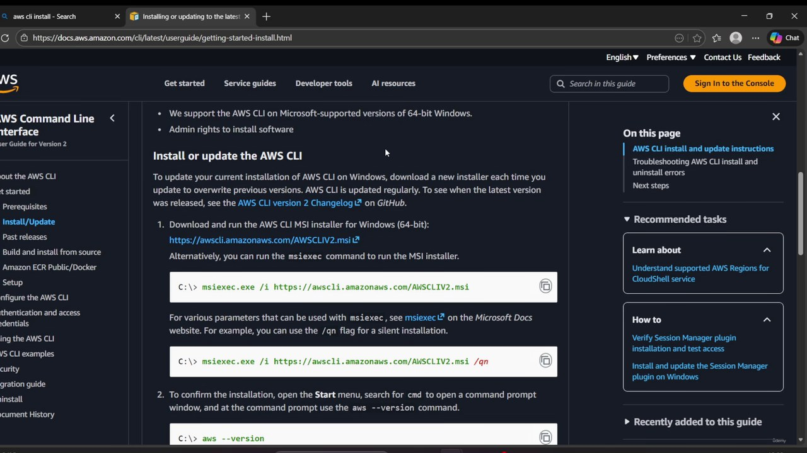
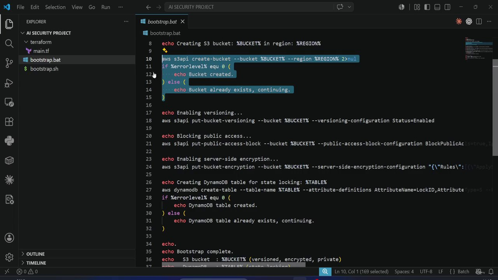
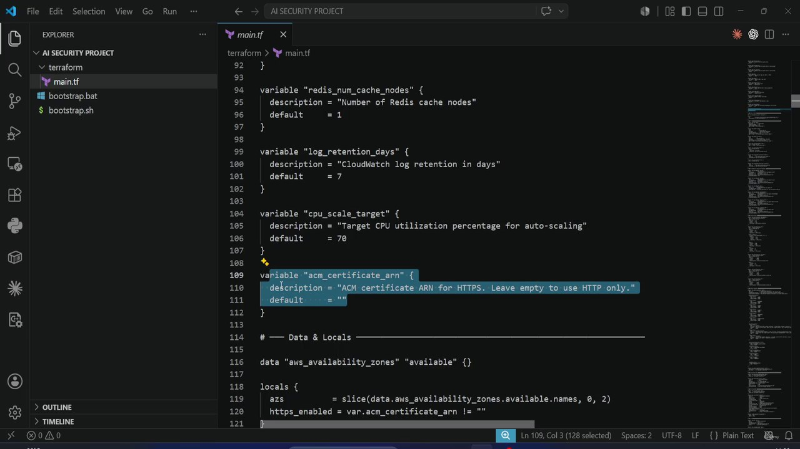
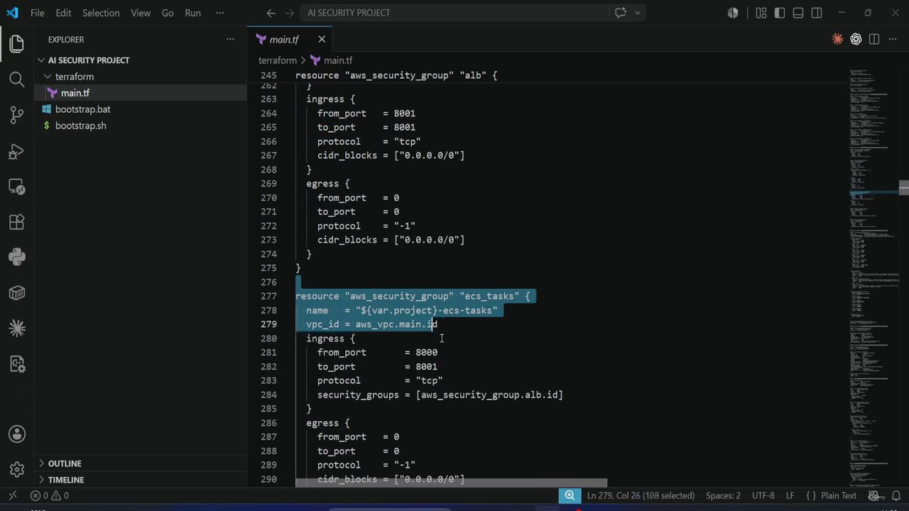
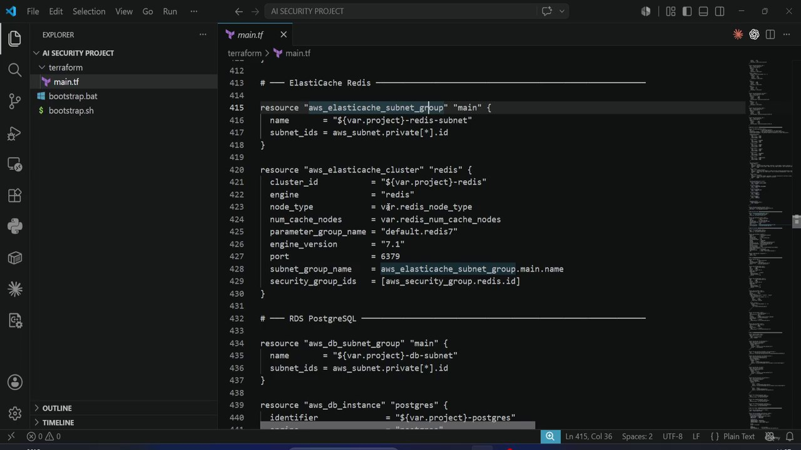
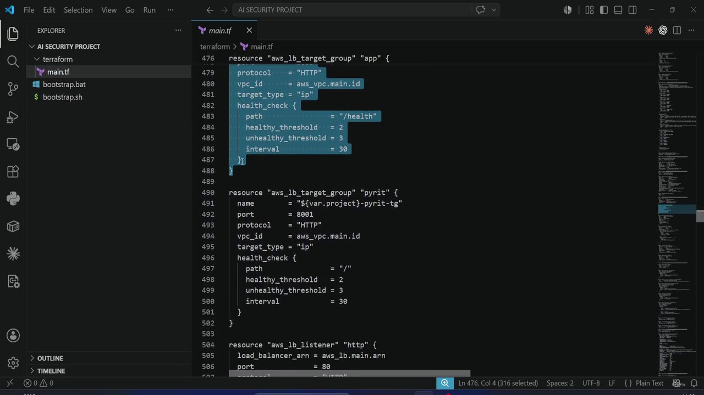
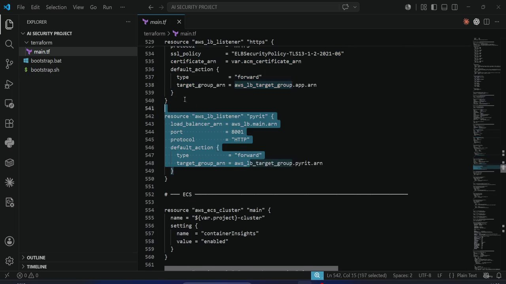
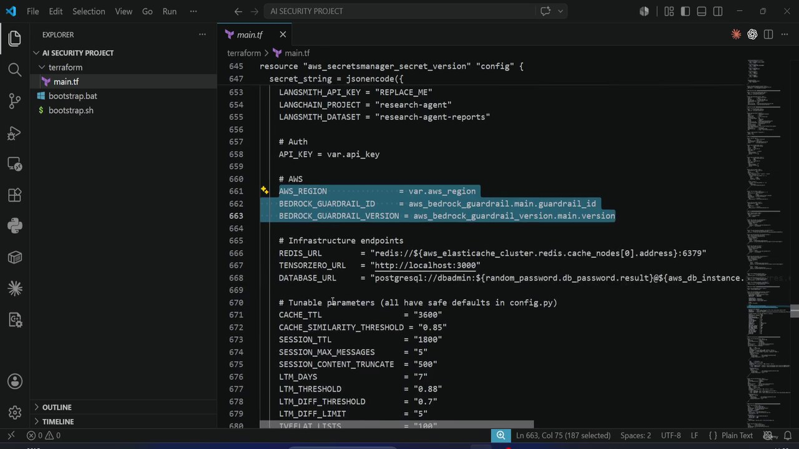

# AI Security Bootcamp Part 1：用 Terraform 把「护栏 / 网关 / 可观测」这套 AI 安全架构落到 AWS 上

> 覆盖 P091–P093。这三段是一条完整的「基础设施」主线：
> **P091** 讲清楚 IaC 是什么、Terraform 解决什么问题；**P092** 把 AWS CLI 与 Terraform 装到你本机并配好凭证；**P093** 逐块走读那个约 950 行的 `main.tf`，把 VPC、Bedrock Guardrails、Redis、Postgres+pgvector、ALB、ECS Fargate、ECR、EventBridge 定时红队全部声明出来。
>
> 重要说明（先看这段，能省你两小时）：P093 的截图 OCR 结果为空，逐字稿里也**没有**贴出任何一行 Terraform 源码，讲师是「一块一块口述这个块在干什么」。所以第 4 节的代码是**按讲师逐块口述复现的等价实现**，不是原仓库原文。凡是课里没给具体取值的地方（桶名、表名、镜像 tag、provider 版本、ALB 路由规则等），代码里都用占位值或注释标了「课里没讲」，你照着改一遍就能跑。

---

## 1. 这一节做什么

这三节做完，你手上会有三样东西：

1. **一台配好凭证的机器**：`aws --version` 有输出、`aws configure list` 能看到 access key / region / output format。
2. **一个远端状态仓库**：一个 S3 桶存 `terraform.tfstate`，一张 DynamoDB 表做状态锁。这两个东西不是 Terraform 建的，而是 bootstrap 脚本先用 AWS CLI 建的——因为 Terraform 的 backend 必须在你 `terraform init` 之前就存在（鸡生蛋问题，讲师用 `.bat` / `.sh` 解决）。
3. **一份能 `terraform apply` 的 `main.tf`**：把整套 AI 安全应用的基础设施声明出来——VPC 与子网、VPC Endpoint（省掉 NAT 网关的钱）、安全组、Bedrock Guardrails（护栏）、ElastiCache Redis（短期记忆 + 缓存 + 会话）、RDS Postgres + pgvector（长期记忆）、ALB（入口，按来源分流 app / pirate）、ECS Fargate 集群与两个 Service、Secrets Manager（所有 API Key）、ECR（三个镜像仓库）、EventBridge（每周一自动跑红队）、以及一堆 `output`。

### 目录结构（照这个建）

```text
ai-security-bootcamp/
└── infra/
    ├── bootstrap.bat          # Windows 用户：建 state 桶 + 锁表
    ├── bootstrap.sh           # macOS / Linux 用户：做同一件事
    └── terraform/
        └── main.tf            # 约 950 行，课里全部写在同一个文件里
```

讲师明确说过：`terraform` 目录里**只有** `main.tf`，变量块、输出块、资源块全塞在一个文件里；他也建议你自己拆成 `variables.tf` / `main.tf` / `outputs.tf`（见第 7 节）。

### 环境与依赖

| 依赖 | 版本 / 取值 | 说明 |
|---|---|---|
| AWS CLI | v2，`aws --version` 能出版本号即可 | 课里没讲具体版本号，只要求命令行能跑通 |
| Terraform | 讲师下载的是 `terraform 1.1 windows 386` 的 zip | 现在官方最新已经是 1.1x，本文件写 `required_version = ">= 1.1.0"`，语法兼容 |
| AWS Provider | 课里只说「用这个版本的 hashicorp aws」，**没讲版本号**；本文取 `~> 5.0` | 若报字段名不存在，先降/升 provider 主版本 |
| random provider | 课里没提，但 RDS 要生成 24 位随机密码，需要它 | `~> 3.6` |
| AWS 区域 | `us-east-1` | 讲师口述「US East 1」，变量默认值 |
| 本机 | Windows 10/11 或 macOS | Windows 的 Terraform 安装最麻烦，见第 3 节 |

---

## 2. 讲师原话

> "Terraform 是开源的，是 HashiCorp 这家公司做的。HashiCorp 出过很多工具，但最出名的两个，一个是我们这节课要讲的 Terraform，另一个是 HashiCorp Vault。"
> —— p091 [00:55]

> "Vault 是什么？说到 vault 你会想到什么？保险柜嘛。它的用途就是这个：假设你做了个应用，里面用了 OpenAI 的 API Key 或者其他 key，这些凭证平时放在 env 文件里，而 env 文件你是不会推到 GitHub 上的。那生产环境这些凭证放哪？就放 Vault 里。"
> —— p091 [01:25]

> "Terraform 是什么？它是一个 IaC 工具。IaC 是什么？Infrastructure as Code，基础设施即代码。"
> —— p091 [02:20]

> "所谓 IaaS，就是你租了一台虚拟机，但机器里的东西要你自己配：你要自己装 Python、自己装 Kubernetes、自己把代码部署进去，从开始到结束全是你自己做。"
> —— p091 [04:18]

> "PaaS 就不一样了，所有东西都由云厂商管理，你只要上传代码它就能跑，你不用管服务器，也不用管依赖。AWS Lambda 就是最好的例子。"
> —— p091 [05:14]

> "PaaS 只有在你的代码出错时才会崩。如果是服务器的问题、技术故障，AWS 会修；但如果是你自己代码里的逻辑错误，那得你自己修。而在 IaaS 里，每一个错误都得你自己修。"
> —— p091 [06:39]

> "SaaS 就是你什么都不用管，连代码都不用管。比如你在应用里集成了 Gmail，Gmail 的代码是你写的吗？不是。服务器是你管的吗？不是。Google 管。你只是把他们的软件集成进你的应用。"
> —— p091 [07:07]

> "就好比你要自己装一台游戏主机：第一种方式是你一家店一家店跑，买机箱、买 GPU、买内存、买显示器；第二种方式是你把配置单列好，交给仆人，他跑完所有店把整机给你配好。第二种就是 Terraform 的方式。"
> —— p091 [11:53]

> "现在真实场景来了：生产环境要 6 个 S3 桶、10 台虚拟机（里面还要装好 Python、Docker、Kubernetes）、4 条 CodePipeline、3 个 IAM 用户（一个 admin、一个只有 S3 权限、一个只有 EC2 权限）。手动点，1 到 2 小时跑不掉；Terraform 你只要写文件，然后 `terraform apply`，10 分钟搞定。"
> —— p091 [14:15]

> "Terraform 只有四五个命令：`terraform init`、`terraform plan`、`terraform apply`、`terraform destroy`。apply 把所有变更应用上去；destroy 把 Terraform 创建的东西全删掉——手动删要一个小时，`terraform destroy` 一两分钟。"
> —— p091 [18:33]

> "Terraform 文件里会有各种文件，比如 `main.tf`、`variables.tf`、`outputs.tf`。但前提是你本机得配好 AWS 账号才能用 Terraform，而且 Terraform 的安装有点麻烦，Windows 用户尤其麻烦，所以我会演示怎么装。"
> —— p091 [19:31]

> "这一节我们要装 AWS CLI，这样才能用命令行连到你的 AWS 账号；然后我们会在 IAM 里建一个新的、带 admin 权限的用户，用这个 IAM 用户通过 AWS CLI 访问主账号；第三件、也是这个项目最重要的部分，是把 Terraform 装好。"
> —— p092 [00:28]

> "装完 AWS CLI 之后，打开 cmd，敲 `aws --version` 回车，它应该给你版本号。如果出不来，说明你哪个步骤搞砸了。"
> —— p092 [02:54]

> "到 IAM 里，左边选 Users，新建用户，直接附加策略 administrator access，下一步，创建用户。然后给这个用户创建 access key，选 Command Line Interface。"
> —— p092 [05:20]

> "在命令行敲 `aws configure`，回车，它会问 access key ID，粘进去；再问 secret key，粘进去；然后问 region，你在浏览器右上角看到的那个区域名，`us-east-1`，粘进去；默认输出格式写 `json`，回车。"
> —— p092 [06:47]

> "想验证配好没有，敲 `aws configure list` 回车，如果你也能看到类似这样的输出，那你的 AWS CLI 就配好了。"
> —— p092 [07:43]

> "Terraform 安装：到 HashiCorp 官网下载 Windows 的二进制 zip 包，解压出来是一个 `terraform` 应用，把它拷到 `C:\Program Files\Terraform`，然后把这个路径加到系统环境变量的 Path 里，再回命令行敲 `terraform --version`。"
> —— p092 [10:07]

> "如果它没出版本号、而是报 `terraform command not found`，说明你有一步搞错了，回头去查。"
> —— p092 [12:29]

> "先说根目录下这两个文件：`.bat` 给 Windows 用户，`.sh` 给 Mac 或 Linux 用户，两个做的是同一件事——创建一个 S3 桶，再创建一张 DynamoDB 表。S3 桶用来存 Terraform 的 state，就是『当前已经创建了哪 5 台机器』这种信息；DynamoDB 用来做状态锁。"
> —— p093 [00:29]

> "状态锁是干什么的？如果你们是一个团队，两个人同时跑 Terraform，state 会被写坏、会损坏。Terraform 的锁机制就是为了避免多人同时修改同一份基础设施。"
> —— p093 [01:55]

> "进到 terraform 目录里你会看到 `main.tf`，所有东西都写在这一个文件里。别的项目一般会拆 `variables.tf`、`outputs.tf`，但这里我全写在 `main.tf` 里，变量、输出、资源全在里面。这个文件大概 950 行，所以我没法一行一行讲，我一块一块讲。"
> —— p093 [03:20]

> "私有子网里的东西是没有互联网访问的，你要让它出去，得再加一个叫 NAT Gateway 的服务，而 NAT Gateway 很贵，大概一个月 30 美元。所以这个项目因为是学习项目、原型项目，我们基本都用了公有子网。生产环境你应该用私有子网。"
> —— p093 [10:25]

> "我们没用 NAT Gateway，用的是 VPC Endpoint：这个是给 ECR 的，这个是给 ECR API 的，这个是给 S3 的，这个是给 Secrets Manager 的——你所有的 LLM API，像 LangSmith、OpenAI、Groq 的 key，都存在 Secrets Manager 里。"
> —— p093 [10:54]

> "为什么这里会有 Bedrock？因为 AWS Guardrails 是 AWS Bedrock 的一部分，我们用 AWS Guardrails 做 AI 安全规则，去拦掉有害的 prompt、敏感信息、暴力内容。"
> —— p093 [11:51]

> "在 Guardrails 里，对 hate 我们定义了规则，对 violence、对 sexual、对 insults 也都定义了，这些都是预置过滤器。对 misconduct 我们有 prompt attack 的过滤器。我们还能定义自己的东西，比如 weapons。"
> —— p093 [12:49]

> "在 weapons 这个类别下面你写描述，LLM 会理解这个描述、这个例子，然后判断这些也算被拒绝。这就是 denied topics，你也可以叫 topic policy。"
> —— p093 [13:48]

> "敏感信息这块，AWS Guardrails 是内置的：如果有人泄露了信用卡号、社保号、access key、邮箱，它会自动做匿名化。匿名化的意思是——假设你告诉 chatbot 你的信用卡号，这个卡号不会真的传给 LLM，它会被打成星号。LLM 知道你发了卡号，但看不到真实号码。"
> —— p093 [14:17]

> "Redis 我们用的不是开源 Redis，而是 ElastiCache，它是 AWS 提供的 Redis 替代品，比开源版更容易管理——开源版你得自己养服务器，ElastiCache 是 AWS 直接给你一个服务。1000 个 prompt 里有重复的，同样的答案我们不会反复调 API，存在 Redis 里，下次直接从 Redis 取，省钱。"
> —— p093 [15:43]

> "Redis 用来做短期记忆 STM，Postgres 加 pgvector 用来做长期记忆 LTM。RDS 放在私有子网里，数据库名、用户名、密码在这里，密码是随机生成的 24 位，你不用操心。"
> —— p093 [16:12]

> "ALB 是你整个系统的入口。用户请求先到 ALB，ALB 再转给正确的应用、正确的容器。我们有两个东西在跑：一个是应用，一个是 pirate。"
> —— p093 [17:09]

> "比如有人在 pirate 面板上点了『我要跑这个 skeleton attack』，请求从这边进来，ALB 会发现这个请求来自 pirate 面板，就把它转到 pirate 容器；如果是来自 app 的请求，就转到 app 容器。这就是 ALB 的用途，所以我们给 ALB 建了 app 的 target group，也建了 pirate 的 target group。"
> —— p093 [18:06]

> "ECS 是主角，或者说一切，所有东西都部署在 ECS 上。这是 ECS 集群，所有 Docker 容器都跑在这里，我们用的是 AWS Fargate。"
> —— p093 [19:35]

> "我们给 ECS 建了 IAM role，让它有需要的权限。ECS 要能访问 Secrets Manager 里的密钥、要能访问 Bedrock（因为 guardrails 在里面，你的应用跑在 ECS 上，不给权限就用不了 guardrails）、还要能访问 CloudWatch。"
> —— p093 [20:03]

> "ECS 里有 task definition：一个集群里有 Service，Service 里有 Task。我们要两个 Service，一个应用、一个 pirate。task definition 定义你要跑哪个 Docker 容器、CPU 内存多少、环境变量是什么、CloudWatch 日志配置是什么。"
> —— p093 [21:58]

> "这个 task 里会跑三个东西：一个是应用，一个是 tensor0，一个是 pirate。pirate 跑在 8001 端口；tensor0 是 LLM gateway，跑在 3000 端口，我们会自动把 LLM 请求发到 3000；第三个是 app，跑在默认的 8000 端口。"
> —— p093 [23:25]

> "为什么 tensor0 不挂负载均衡？因为不需要，它是独立的东西，不用把请求路由过去。真正挂负载均衡的只有 app 和 pirate。app 里调 LLM 会走 tensor0，tensor0 再走 OpenAI 这类 provider。"
> —— p093 [23:55]

> "EventBridge 的用途：你在做红队测试，这个红队工具每周自动跑一次，我设的是周一（MON）。这是一个 cron job，带周级定时器，通过 EventBridge 触发——每个周一它会自动跑，给你一份每周红队报告，你不用手动跑。"
> —— p093 [25:46]

> "Secrets Manager 里存了 openai key、groq key、langsmith key，还有项目名、dataset 名，以及应用鉴权用的 api key（这个不是 LLM 的 key，别搞混），还有 Bedrock 相关、Redis 相关的所有参数，包括 TTL。好处是你不用重跑整个代码，直接在 Secrets Manager 里改值，应用就会自动生效，不需要重新部署。"
> —— p093 [21:01]

> "最后是 outputs。`terraform apply` 跑完之后，你可以在终端直接看到：你的应用跑在哪个 DNS、ECR 在哪（app 镜像、pirate 镜像、tensor0 镜像各在哪）、Redis 的 endpoint、数据库在哪。这部分完全可选，删掉也行。"
> —— p093 [27:14]

> "建议你把这个 950 行的文件拆开：`variables.tf`、`main.tf`、`outputs.tf`，这样更模块化。文件太大调试会非常痛苦，拆小一点更好，尤其你想做真正的生产级基础设施。"
> —— p093 [27:43]

---

## 3. 从零复现

按顺序做，中间任何一步报错都别往下走。

### 步骤 0：准备 AWS 账号

讲师说得很直白：去 AWS 官网用邮箱注册，绑支付方式，新账号会给大约 **200 美元**额度，有效期大约 11 个月（以前是 11 个月免费套餐，现在改成给额度了）。他还强调：**一定要开 MFA**，他自己开了，所以即使录屏里露出 Gmail 也没事。

### 步骤 1：装 AWS CLI（v2）

1. 浏览器搜 `AWS CLI install`，进第一个官方文档页（AWS Documentation）。
2. 页面里分 Linux / macOS / Windows 三段，按你的系统选。讲师演示的是 Windows。
3. macOS：下载 **GUI installer**（pkg），双击一路装完。
4. Windows：点页面上的下载链接，拿到 `.msi`，双击 → next → next → next → install。讲师原话说「跟你装游戏一样，一路 next 就行」。
5. 如果本机已经装过，就别重复装。

### 步骤 2：验证 AWS CLI

打开开始菜单，搜 `cmd`，打开命令提示符：

```bat
aws --version
```

能打印出 `aws-cli/2.x.x ...` 就对了。打印不出来 = 有一步错了，重装。讲师还顺手把命令行的字号调大了，因为录屏里看不清。

### 步骤 3：建 IAM 用户（拿到 admin 权限的一套编程凭证）

1. 登录 AWS 控制台（用 root 邮箱登录，讲师强调他开了 MFA）。
2. 顶部搜索框搜 `IAM`，进 IAM 控制台。
3. 左侧栏点 `Users` → `Create user`。
4. 用户名随便给（讲师演示时写的是 `demo999` 这类）。「给管理控制台访问权限」这个勾**不勾**（讲师说保持默认就行）。
5. Next → 选 **Attach policies directly** → 勾 `AdministratorAccess` → Next → Create user。
6. 回到 Users 列表点进刚建的用户 → `Security credentials` → `Create access key`。
7. 用例选 **Command Line Interface (CLI)**，勾确认，Next → Create access key。
8. 这时候页面上给出 **Access key ID** 和 **Secret access key**。Secret 只显示一次，立刻复制走。

### 步骤 4：用 `aws configure` 把凭证写进本机

```bat
aws configure
```

交互式输入四项（讲师逐项念过）：

| 提示 | 填什么 |
|---|---|
| AWS Access Key ID | 步骤 3 的 Access key ID |
| AWS Secret Access Key | 步骤 3 的 Secret access key |
| Default region name | `us-east-1`（就是你控制台右上角显示的那个区域名） |
| Default output format | `json` |

验证：

```bat
aws configure list
```

能看到 `access_key`、`secret_key`、`region`、`output` 四行（`secret_key` 会显示成 `********************` 加一截尾巴），就说明配好了。到这一步，你已经可以在命令行里对 AWS 做操作了——建虚拟机、建 S3 桶，都是命令的事。

### 步骤 5：装 Terraform（Windows 版最麻烦，照抄）

1. 浏览器搜 `terraform install`，进 **HashiCorp 官方** 的 Install Terraform 页面。
2. macOS：页面给了命令行安装方式（brew 之类）。讲师原话是「macOS 我真不熟，但它本身是 Unix 系、半个 Linux，用页面上的命令装就行」。
3. Windows：下载 **Windows 386 架构** 的二进制 zip（讲师说他下的是 `terraform 1.1 windows 386`）。下载完在「下载」目录得到一个 zip。
4. 解压 → 里面是一个叫 `terraform` 的**可执行文件**（`.exe`）。
5. 打开 `C:\Program Files`，**新建文件夹 `Terraform`**（注意拼写：`T-e-r-r-a-f-o-r-m`，首字母大写，两个 r），会弹 UAC 权限确认，点继续。
6. 把第 4 步那个 `terraform.exe` 复制（或剪切）进 `C:\Program Files\Terraform`。
7. 在文件资源管理器地址栏里复制这个路径：`C:\Program Files\Terraform`。
8. 开始菜单搜 `environment variables` → 打开 **Edit the system environment variables** → 右下角 **Environment Variables** → 下半部分 **System variables** 里找到 `Path` → **Edit** → **New** → 粘贴 `C:\Program Files\Terraform` → OK → OK → OK。
9. 回到 cmd（**必须新开一个窗口**，旧窗口不认新 PATH）：

```bat
terraform --version
```

能打印 `Terraform v1.x.x on windows_386` 就成功了。如果
报 `terraform command not found`，说明有一步搞错了，回头去查。讲师是在 Windows 11 上录的，他判断 Windows 10 / 11 都没问题，「Windows Fine（8/10）应该也行」，但更老的系统他建议直接去 YouTube 搜对应版本的安装视频。另外注意：他下载的是 **386** 架构的包，不是 amd64——在 64 位 Windows 上 386 包同样能跑，只是没必要；如果你机器是 ARM 或遇到奇怪问题，改下 amd64 版本即可。



### 步骤 6：建远端 state 仓库（bootstrap，必须手动先跑）

这是全课最关键的一个顺序问题：你的 `main.tf` 里 backend 指向一个 S3 桶 + 一张 DynamoDB 表，但这两个东西**不能由 Terraform 自己创建**——Terraform 要先连上 backend 才能干活，backend 不存在它就 `init` 失败。讲师用两个脚本解决：Windows 跑 `.bat`，Mac / Linux 跑 `.sh`，做的是同一件事。

进到 `infra/` 目录，Windows：

```bat
bootstrap.bat
```

macOS / Linux：

```bash
chmod +x bootstrap.sh
./bootstrap.sh
```

脚本里做了两件事，对应讲师原话「它创建了两样东西：一个 S3 桶，一张 DynamoDB 表」：

- **S3 桶**：存 `terraform.tfstate`。讲师把它比作「Terraform 的版本控制 / 基础设施的版本控制」——现在有 5 台机器，state 里就写着 5；你要求 6 台，Terraform 一比对"已经有 5 台了，只需要再建 1 台"，这个判断就是靠 state 做出来的。
- **DynamoDB 表**：做 state 锁。讲师举的例子很具体：「两个人同时跑 Terraform，state 会被写坏；锁机制就是避免多人同时修改同一份基础设施。」表的主键必须叫 `LockID`，类型 String——这是 Terraform S3 backend 硬编码要求，不是你自己起的名字。



### 步骤 7：`terraform init`

```bash
cd infra/terraform
terraform init
```

这一步会下载 provider 插件（`hashicorp/aws`、`hashicorp/random`），并且**真正去连 S3 backend**。所以：如果 `init` 报 `Error loading state: ... NoSuchBucket`，说明步骤 6 没跑或者桶名写错了。

### 步骤 8：`terraform plan`

```bash
terraform plan
```

讲师说这是「给你看将要创建哪些东西」，不实际动手。

### 步骤 9：`terraform apply`

```bash
terraform apply
```

输入 `yes` 确认。讲师的说法是「apply 把所有变更应用上去」，跑完终端会打印那一堆 `output`：ALB 的 DNS、三个 ECR 地址、Redis endpoint、数据库地址。

跑完之后**第一次 apply 会有已知的"半成品"状态**：ECS Service 起来了但拉不到镜像，因为 ECR 里还是空的。这是正常的，见第 7 节。

### 步骤 10：`terraform destroy`

```bash
terraform destroy
```

讲师对比得很狠：「手动删要一个小时，AWS 每一次删除都要你确认，还得复制粘贴；`terraform destroy` 一两分钟全没了。只要是 Terraform 创建的东西，全都会被销毁。」

---

## 4. 完整代码

> ⚠️ 必读：P093 的 OCR 结果为空，逐字稿里讲师**只做了逐块口述，没有贴出任何一行源码**。下面三个文件是按他口述的**块结构、字段含义、端口、容量、阈值、策略类别**复现出来的等价实现，凡是课里没给具体字面量的地方，都在注释里标了 `# 课里没讲`。跑之前把三处占位改掉：① state 桶名 / 锁表名；② 三个镜像地址；③ 各种 API Key。

### 4.1 `infra/bootstrap.bat`（Windows）

```bat
@echo off
REM ============================================================
REM bootstrap.bat —— 对应 p093 [00:29]
REM 作用：创建 Terraform 的远端 state 桶 + state 锁表
REM 必须在 terraform init 之前跑，且只跑一次
REM ============================================================

REM 课里没讲具体桶名/表名，下面三个值请改成你自己的
REM 注意：S3 桶名全球唯一，建议前面加上你的账号 ID 或随机串
set BUCKET=research-agent-tfstate-CHANGE-ME-0001
set TABLE=research-agent-tflock
set REGION=us-east-1

echo [1/2] Creating S3 bucket: %BUCKET%
aws s3api create-bucket --bucket %BUCKET% --region %REGION%

REM 课里没讲是否开了版本控制；开启后可以回滚到任意历史 state，建议开
aws s3api put-bucket-versioning --bucket %BUCKET% --versioning-configuration Status=Enabled

echo [2/2] Creating DynamoDB table: %TABLE%
REM 主键必须叫 LockID，类型 S —— 这是 Terraform backend 的硬性要求
aws dynamodb create-table ^
  --table-name %TABLE% ^
  --attribute-definitions AttributeName=LockID,AttributeType=S ^
  --key-schema AttributeName=LockID,KeyType=HASH ^
  --billing-mode PAY_PER_REQUEST ^
  --region %REGION%

echo Done.
```

### 4.2 `infra/bootstrap.sh`（macOS / Linux）

```bash
#!/usr/bin/env bash
# ============================================================
# bootstrap.sh —— 对应 p093 [02:21]，与 bootstrap.bat 完全等价
# ============================================================
set -euo pipefail

BUCKET="research-agent-tfstate-CHANGE-ME-0001"   # 课里没讲具体名字，必须全球唯一
TABLE="research-agent-tflock"                    # 课里没讲具体名字
REGION="us-east-1"

echo "[1/2] Creating S3 bucket: $BUCKET"
aws s3api create-bucket --bucket "$BUCKET" --region "$REGION"

# 课里没讲是否开了版本控制，建议开
aws s3api put-bucket-versioning --bucket "$BUCKET" \
  --versioning-configuration Status=Enabled

echo "[2/2] Creating DynamoDB table: $TABLE"
aws dynamodb create-table \
  --table-name "$TABLE" \
  --attribute-definitions AttributeName=LockID,AttributeType=S \
  --key-schema AttributeName=LockID,KeyType=HASH \
  --billing-mode PAY_PER_REQUEST \
  --region "$REGION"

echo "Done."
```

### 4.3 `infra/terraform/main.tf`

```hcl
###############################################################################
# main.tf
# 对应 p093：讲师把 provider / variables / data / resources / outputs
# 全部写在这一个文件里，约 950 行。下面按他口述的块顺序组织。
###############################################################################


###############################################################################
# 块 1：terraform 块 —— p093 [03:20] "这个选中的就是你的 terraform 块"
#   · required_providers：声明用 hashicorp/aws
#   · backend "s3"：把 state 存到 bootstrap 建的那个桶里，锁用 DynamoDB
###############################################################################
terraform {
  required_version = ">= 1.1.0"   # 讲师装的是 1.1 的二进制

  required_providers {
    aws = {
      source  = "hashicorp/aws"
      version = "~> 5.0"          # 课里没讲具体版本号，只说是 hashicorp aws
    }
    random = {
      source  = "hashicorp/random"
      version = "~> 3.6"          # 课里没提这个 provider，但 RDS 要 24 位随机密码
    }
  }

  backend "s3" {
    bucket         = "research-agent-tfstate-CHANGE-ME-0001"  # 与 bootstrap 一致
    key            = "ai-security/terraform.tfstate"
    region         = "us-east-1"
    dynamodb_table = "research-agent-tflock"                  # state 锁
    encrypt        = true
  }
}

provider "aws" {
  region = var.aws_region
}


###############################################################################
# 块 2：variables 块 —— p093 [04:46] "变量就像容器，可以在正式代码里复用"
#   讲师逐条念过的变量，默认值全部按他口述填
###############################################################################
variable "aws_region" {
  description = "AWS 区域，讲师用的是 US East 1"
  type        = string
  default     = "us-east-1"
}

variable "project_name" {
  description = "项目名，讲师口述为 research agent"
  type        = string
  default     = "research-agent"
}

# --- 三个镜像：讲师明确说"现在是占位，后面写代码时再设" ---
variable "app_image" {
  description = "主应用镜像，p093 [05:13] 说先留空"
  type        = string
  default     = ""
}

variable "pirate_image" {
  description = "pirate（红队 / 攻击面板）镜像，先留空"
  type        = string
  default     = ""
}

variable "tensor0_image" {
  description = "tensor0（LLM 网关）镜像，先留空"
  type        = string
  default     = ""
}

# --- 应用鉴权 key：讲师特别强调这不是 OpenAI / Groq 的 key ---
variable "app_api_key" {
  description = "应用自身的接口鉴权 key，不是 LLM 的 key（p093 [05:42]）"
  type        = string
  sensitive   = true
  default     = "change-me-app-auth-key"
}

# --- 容量与规格：讲师逐条念过的数值 ---
variable "desired_count" {
  description = "应用副本数，讲师只跑 1 个，因为没流量"
  type        = number
  default     = 1
}

variable "min_capacity" {
  description = "自动扩缩容下限"
  type        = number
  default     = 1
}

variable "max_capacity" {
  description = "自动扩缩容上限，讲师说最多扩到 5 个"
  type        = number
  default     = 5
}

variable "app_cpu" {
  description = "2048 = 2 vCPU（p093 [06:40]）"
  type        = number
  default     = 2048
}

variable "app_memory" {
  description = "4096 = 4GB（p093 [06:40]）"
  type        = number
  default     = 4096
}

variable "db_instance_class" {
  description = "RDS 机型，讲师用 t3.micro"
  type        = string
  default     = "db.t3.micro"
}

variable "multi_az" {
  description = "多可用区，讲师明确设 false；生产环境应设 true"
  type        = bool
  default     = false
}

variable "redis_node_type" {
  description = "ElastiCache 机型，讲师也用 t3.micro，起始 1 个节点"
  type        = string
  default     = "cache.t3.micro"
}

variable "redis_num_nodes" {
  description = "起始节点数"
  type        = number
  default     = 1
}

variable "log_retention_days" {
  description = "CloudWatch 日志保留天数，讲师设 7"
  type        = number
  default     = 7
}

variable "cpu_scale_target" {
  description = "自动扩缩容的 CPU 目标利用率，讲师设 70（%）"
  type        = number
  default     = 70
}

variable "acm_certificate_arn" {
  description = "讲师明确说没有域名、没有 ACM 证书，所以留空（p093 [08:34]）"
  type        = string
  default     = ""
}

variable "db_username" {
  description = "RDS 用户名，课里没讲具体值"
  type        = string
  default     = "appuser"
}

variable "db_name" {
  description = "RDS 数据库名，课里没讲具体值"
  type        = string
  default     = "appdb"
}


###############################################################################
# 块 3：data + locals —— p093 [09:04]
#   "它会去取你的 AWS 信息，比如哪些可用区在跑，然后把值存起来供全项目使用"
###############################################################################
data "aws_availability_zones" "available" {
  state = "available"
}

data "aws_caller_identity" "current" {}

locals {
  # 课里没讲他用了几个 AZ，下面取前两个
  azs = slice(data.aws_availability_zones.available.names, 0, 2)

  # 讲师提到有个 "https enable" 的东西，课里没讲具体怎么用
  https_enabled = var.acm_certificate_arn != ""

  tags = {
    Project   = var.project_name
    ManagedBy = "terraform"
  }
}


###############################################################################
# 块 4：VPC —— p093 [09:32] "我们在创建项目的私有网络"
#   公有子网（有 IGW 出口）+ 私有子网（无 NAT，靠 VPC Endpoint）
###############################################################################
resource "aws_vpc" "main" {
  cidr_block           = "10.0.0.0/16"   # 课里没讲具体网段
  enable_dns_support   = true
  enable_dns_hostnames = true
  tags                 = merge(local.tags, { Name = "${var.project_name}-vpc" })
}

# --- 公有子网 ×2：ALB 放这里 ---
resource "aws_subnet" "public" {
  count                   = 2
  vpc_id                  = aws_vpc.main.id
  cidr_block              = cidrsubnet(aws_vpc.main.cidr_block, 8, count.index)
  availability_zone       = local.azs[count.index]
  map_public_ip_on_launch = true
  tags = merge(local.tags, {
    Name = "${var.project_name}-public-${count.index}"
    Tier = "public"
  })
}

# --- 私有子网 ×2：RDS / Redis / ECS 放这里 ---
resource "aws_subnet" "private" {
  count             = 2
  vpc_id            = aws_vpc.main.id
  cidr_block        = cidrsubnet(aws_vpc.main.cidr_block, 8, count.index + 10)
  availability_zone = local.azs[count.index]
  tags = merge(local.tags, {
    Name = "${var.project_name}-private-${count.index}"
    Tier = "private"
  })
}

# --- 互联网网关 ---
resource "aws_internet_gateway" "main" {
  vpc_id = aws_vpc.main.id
  tags   = merge(local.tags, { Name = "${var.project_name}-igw" })
}

# --- 公有路由表：默认路由指向 IGW ---
resource "aws_route_table" "public" {
  vpc_id = aws_vpc.main.id
  route {
    cidr_block = "0.0.0.0/0"
    gateway_id = aws_internet_gateway.main.id
  }
  tags = merge(local.tags, { Name = "${var.project_name}-rt-public" })
}

resource "aws_route_table_association" "public" {
  count          = 2
  subnet_id      = aws_subnet.public[count.index].id
  route_table_id = aws_route_table.public.id
}

# --- 私有路由表：注意这里【没有】默认路由 ---
# 讲师：私有子网没网，要出网得加 NAT Gateway，约 $30/月，所以本项目不用
resource "aws_route_table" "private" {
  vpc_id = aws_vpc.main.id
  tags   = merge(local.tags, { Name = "${var.project_name}-rt-private" })
}

resource "aws_route_table_association" "private" {
  count          = 2
  subnet_id      = aws_subnet.private[count.index].id
  route_table_id = aws_route_table.private.id
}


###############################################################################
# 块 5：VPC Endpoint —— p093 [10:54]
#   讲师逐个念过：ECR、ECR API、S3、Secrets Manager、Bedrock Runtime、
#   CloudWatch Logs。安全组在后面统一定义
###############################################################################
resource "aws_security_group" "vpc_endpoints" {
  name   = "${var.project_name}-vpce-sg"
  vpc_id = aws_vpc.main.id

  ingress {
    description = "HTTPS from inside VPC"
    from_port   = 443
    to_port     = 443
    protocol    = "tcp"
    cidr_blocks = [aws_vpc.main.cidr_block]
  }
  egress {
    from_port   = 0
    to_port     = 0
    protocol    = "-1"
    cidr_blocks = ["0.0.0.0/0"]
  }
  tags = local.tags
}

locals {
  interface_endpoints = {
    ecr_api         = "com.amazonaws.${var.aws_region}.ecr.api"
    ecr_dkr         = "com.amazonaws.${var.aws_region}.ecr.dkr"
    secretsmanager  = "com.amazonaws.${var.aws_region}.secretsmanager"
    bedrock_runtime = "com.amazonaws.${var.aws_region}.bedrock-runtime"  # Guardrails 走这里
    logs            = "com.amazonaws.${var.aws_region}.logs"
  }
}

resource "aws_vpc_endpoint" "interface" {
  for_each            = local.interface_endpoints
  vpc_id              = aws_vpc.main.id
  service_name        = each.value
  vpc_endpoint_type   = "Interface"
  subnet_ids          = aws_subnet.private[*].id
  security_group_ids  = [aws_security_group.vpc_endpoints.id]
  private_dns_enabled = true
  tags                = merge(local.tags, { Name = "${var.project_name}-vpce-${each.key}" })
}

# S3 用 Gateway 类型（不花钱、不用安全组）
resource "aws_vpc_endpoint" "s3" {
  vpc_id            = aws_vpc.main.id
  service_name      = "com.amazonaws.${var.aws_region}.s3"
  vpc_endpoint_type = "Gateway"
  route_table_ids   = [aws_route_table.private.id]
  tags              = merge(local.tags, { Name = "${var.project_name}-vpce-s3" })
}


###############################################################################
# 块 6：安全组 —— p093 [11:51]
#   "你只定义了 endpoint，没有安全组它们根本访问不了"
#   ALB、ECS(8000/8001)、Redis(6379)、RDS(5432)
###############################################################################
resource "aws_security_group" "alb" {
  name   = "${var.project_name}-alb-sg"
  vpc_id = aws_vpc.main.id

  ingress {
    description = "HTTP"
    from_port   = 80
    to_port     = 80
    protocol    = "tcp"
    cidr_blocks = ["0.0.0.0/0"]
  }
  ingress {
    description = "HTTPS"
    from_port   = 443
    to_port     = 443
    protocol    = "tcp"
    cidr_blocks = ["0.0.0.0/0"]
  }
  egress {
    from_port   = 0
    to_port     = 0
    protocol    = "-1"
    cidr_blocks = ["0.0.0.0/0"]
  }
  tags = local.tags
}

resource "aws_security_group" "ecs" {
  name   = "${var.project_name}-ecs-sg"
  vpc_id = aws_vpc.main.id

  # app 默认 8000
  ingress {
    description     = "app port 8000 from ALB"
    from_port       = 8000
    to_port         = 8000
    protocol        = "tcp"
    security_groups = [aws_security_group.alb.id]
  }
  # pirate 8001（讲师：在 8001 端口跑你的 pirate）
  ingress {
    description     = "pirate port 8001 from ALB"
    from_port       = 8001
    to_port         = 8001
    protocol        = "tcp"
    security_groups = [aws_security_group.alb.id]
  }
  egress {
    from_port   = 0
    to_port     = 0
    protocol    = "-1"
    cidr_blocks = ["0.0.0.0/0"]
  }
  tags = local.tags
}

resource "aws_security_group" "redis" {
  name   = "${var.project_name}-redis-sg"
  vpc_id = aws_vpc.main.id

  # 讲师：Redis 一般就跑在 6379
  ingress {
    description     = "Redis 6379 from ECS"
    from_port       = 6379
    to_port         = 6379
    protocol        = "tcp"
    security_groups = [aws_security_group.ecs.id]
  }
  tags = local.tags
}

resource "aws_security_group" "rds" {
  name   = "${var.project_name}-rds-sg"
  vpc_id = aws_vpc.main.id

  # 讲师：RDS 一般就跑在 5432
  ingress {
    description     = "Postgres 5432 from ECS"
    from_port       = 5432
    to_port         = 5432
    protocol        = "tcp"
    security_groups = [aws_security_group.ecs.id]
  }
  tags = local.tags
}


###############################################################################
# 块 7：Bedrock Guardrails —— p093 [12:28] ~ [14:46]
#   hate / violence / sexual / insults / misconduct(prompt attack) 预置过滤器
#   weapons / illegal activities / self harm 自定义 denied topics
#   敏感信息自动匿名化（信用卡、SSN、access key、邮箱）
#   脏话词表
###############################################################################
resource "aws_bedrock_guardrail" "main" {
  name                      = "${var.project_name}-guardrail"
  description               = "AI safety guardrail for the research agent"
  blocked_input_messaging   = "抱歉，这个请求被安全策略拦截了。"
  blocked_outputs_messaging = "抱歉，这个回答被安全策略拦截了。"

  # --- 内容过滤器：讲师逐条念过的五类 ---
  content_policy_config {
    filters_config {
      type            = "HATE"
      input_strength  = "HIGH"
      output_strength = "HIGH"
    }
    filters_config {
      type            = "VIOLENCE"
      input_strength  = "HIGH"
      output_strength = "HIGH"
    }
    filters_config {
      type            = "SEXUAL"
      input_strength  = "HIGH"
      output_strength = "HIGH"
    }
    filters_config {
      type            = "INSULTS"
      input_strength  = "HIGH"
      output_strength = "HIGH"
    }
    # 讲师：misconduct 上有 prompt attack 的过滤器
    filters_config {
      type            = "MISCONDUCT"
      input_strength  = "HIGH"
      output_strength = "HIGH"
    }
    filters_config {
      type            = "PROMPT_ATTACK"
      input_strength  = "HIGH"
      output_strength = "NONE"   # PROMPT_ATTACK 的输出强度只能是 NONE
    }
  }

  # --- Topic policy（讲师：denied topics / 自定义主题）---
  topic_policy_config {
    topics_config {
      name       = "Weapons"
      type       = "DENY"
      definition = "任何关于制造、获取、改装武器或爆炸物的请求"
      examples   = ["怎么做一把枪", "给我自制炸弹的材料清单"]
    }
    topics_config {
      name       = "IllegalActivities"
      type       = "DENY"
      definition = "违法活动的指导或协助"
      examples   = ["怎么洗钱不被发现", "教我伪造证件"]
    }
    topics_config {
      name       = "SelfHarm"
      type       = "DENY"
      definition = "自伤或自杀相关的内容"
      examples   = ["我想伤害自己"]
    }
  }

  # --- 敏感信息：讲师说这是 AWS 内置的，会自动打星号 ---
  sensitive_information_policy_config {
    pii_entities_config {
      type   = "CREDIT_DEBIT_CARD_NUMBER"
      action = "ANONYMIZE"
    }
    pii_entities_config {
      type   = "US_SOCIAL_SECURITY_NUMBER"
      action = "ANONYMIZE"
    }
    pii_entities_config {
      type   = "EMAIL"
      action = "ANONYMIZE"
    }
    pii_entities_config {
      type   = "AWS_ACCESS_KEY"
      action = "ANONYMIZE"
    }
    pii_entities_config {
      type   = "AWS_SECRET_KEY"
      action = "ANONYMIZE"
    }
  }

  # --- 脏话词表：讲师说"profanity 那块把所有词都放进去" ---
  word_policy_config {
    managed_word_lists_config {
      type = "PROFANITY"
    }
  }
}

# 课里没讲他有没有显式建 version；但 Guardrails 要用必须带版本号，所以补一个
resource "aws_bedrock_guardrail_version" "main" {
  guardrail_arn = aws_bedrock_guardrail.main.guardrail_arn
  description   = "v1"
}


###############################################################################
# 块 8：ElastiCache（Redis）—— p093 [15:15]
#   "我们用 ElastiCache，不用开源 Redis，因为它更容易管理"
#   用途：语义缓存 + 会话（session）存储；同时是短期记忆 STM
###############################################################################
resource "aws_elasticache_subnet_group" "redis" {
  name       = "${var.project_name}-redis-subnets"
  subnet_ids = aws_subnet.private[*].id
  tags       = local.tags
}

resource "aws_elasticache_replication_group" "redis" {
  replication_group_id       = "${var.project_name}-redis"
  description                = "Redis for cache + session + STM"
  engine                     = "redis"
  engine_version             = "7.1"            # 课里没讲具体版本
  node_type                  = var.redis_node_type
  num_cache_clusters         = var.redis_num_nodes
  port                       = 6379
  subnet_group_name          = aws_elasticache_subnet_group.redis.name
  security_group_ids
```hcl
  security_group_ids         = [aws_security_group.redis.id]
  automatic_failover_enabled = false            # 单节点，开不了 failover
  tags                       = merge(local.tags, { Name = "${var.project_name}-redis" })
}


###############################################################################
# 块 9：Secrets Manager —— p093 [21:01]
#   讲师逐个念过：openai key、groq key、langsmith key、项目名、dataset 名、
#   应用鉴权 api key、Bedrock 相关、Redis 相关（含 TTL）
#   "改值不用重跑整个代码，应用会自动生效，不需要重新部署"
###############################################################################
resource "aws_secretsmanager_secret" "app" {
  name                    = "${var.project_name}/app-secrets"
  recovery_window_in_days = 0    # 课里没讲；设 0 才能立刻删掉重建，方便反复练习
  tags                    = local.tags
}

resource "aws_secretsmanager_secret_version" "app" {
  secret_id = aws_secretsmanager_secret.app.id
  secret_string = jsonencode({
    # ---- LLM 厂商 key：讲师明确说这三个放在这里 ----
    OPENAI_API_KEY   = "sk-CHANGE-ME"
    GROQ_API_KEY     = "gsk_CHANGE-ME"
    LANGSMITH_API_KEY = "lsv2_CHANGE-ME"

    # ---- LangSmith 的两个标识：讲师说"默认就给项目名和 dataset 名" ----
    LANGCHAIN_PROJECT    = var.project_name
    LANGCHAIN_DATASET    = "redteam-evals"

    # ---- 应用自身鉴权 key：讲师强调"这不是 LLM 的 key" ----
    APP_API_KEY = var.app_api_key

    # ---- Bedrock / Guardrails ----
    GUARDRAIL_ID      = aws_bedrock_guardrail.main.guardrail_id
    GUARDRAIL_VERSION = aws_bedrock_guardrail_version.main.version
    BEDROCK_REGION    = var.aws_region

    # ---- Redis 连接信息 + TTL：讲师说 TTL 这类参数也存在这里 ----
    REDIS_HOST = aws_elasticache_replication_group.redis.primary_endpoint_address
    REDIS_PORT = "6379"
    CACHE_TTL_SECONDS = "3600"      # 课里没讲具体 TTL 数值

    # ---- 数据库连接信息（密码由 Terraform 随机生成，见块 10）----
    POSTGRES_HOST = aws_db_instance.main.address
    POSTGRES_PORT = "5432"
    POSTGRES_DB   = var.db_name
    POSTGRES_USER = var.db_username
    POSTGRES_PASSWORD = random_password.db.result
  })
}


###############################################################################
# 块 10：RDS Postgres —— p093 [16:12]
#   "Redis 做短期记忆 STM，Postgres + pgvector 做长期记忆 LTM"
#   "RDS 放在私有子网里，密码随机生成 24 位，你不用操心"
###############################################################################
resource "random_password" "db" {
  length  = 24          # 讲师明确说 24 位
  special = true
}

resource "aws_db_subnet_group" "main" {
  name       = "${var.project_name}-db-subnets"
  subnet_ids = aws_subnet.private[*].id
  tags       = local.tags
}

resource "aws_db_instance" "main" {
  identifier             = "${var.project_name}-pg"
  engine                 = "postgres"
  engine_version         = "16.3"        # 课里没讲具体版本
  instance_class         = var.db_instance_class   # db.t3.micro
  allocated_storage      = 20            # 课里没讲
  storage_type           = "gp3"         # 课里没讲

  db_name  = var.db_name
  username = var.db_username
  password = random_password.db.result   # 24 位随机

  db_subnet_group_name   = aws_db_subnet_group.main.name
  vpc_security_group_ids = [aws_security_group.rds.id]

  multi_az            = var.multi_az     # 讲师明确设 false；生产要 true
  publicly_accessible = false            # 私有子网，不给公网
  skip_final_snapshot = true             # 课里没讲；练习环境必须设 true，否则 destroy 会卡住

  tags = merge(local.tags, { Name = "${var.project_name}-pg" })
}

# 课里没讲 pgvector 具体怎么开。RDS Postgres 支持 vector 扩展，
# 常见做法是建库后连上去执行 CREATE EXTENSION vector;（见第 7 节）


###############################################################################
# 块 11：IAM —— p093 [20:03]
#   "ECS 要能访问 Secrets Manager、要能访问 Bedrock（guardrails 在里面）、
#    还要能访问 CloudWatch。不给权限，应用就用不了 guardrails"
###############################################################################
resource "aws_iam_role" "ecs_task_execution" {
  name = "${var.project_name}-ecs-execution-role"
  assume_role_policy = jsonencode({
    Version = "2012-10-17"
    Statement = [{
      Effect    = "Allow"
      Principal = { Service = "ecs-tasks.amazonaws.com" }
      Action    = "sts:AssumeRole"
    }]
  })
  tags = local.tags
}

# 拉镜像 + 写日志，AWS 有托管策略，直接挂
resource "aws_iam_role_policy_attachment" "ecs_execution_managed" {
  role       = aws_iam_role.ecs_task_execution.name
  policy_arn = "arn:aws:iam::aws:policy/service-role/AmazonECSTaskExecutionRolePolicy"
}

resource "aws_iam_role" "ecs_task" {
  name = "${var.project_name}-ecs-task-role"
  assume_role_policy = jsonencode({
    Version = "2012-10-17"
    Statement = [{
      Effect    = "Allow"
      Principal = { Service = "ecs-tasks.amazonaws.com" }
      Action    = "sts:AssumeRole"
    }]
  })
  tags = local.tags
}

# 讲师逐条念过的三块权限：secrets / bedrock / logs
resource "aws_iam_policy" "ecs_task" {
  name = "${var.project_name}-ecs-task-policy"
  policy = jsonencode({
    Version = "2012-10-17"
    Statement = [
      {
        Sid    = "ReadSecrets"
        Effect = "Allow"
        Action = ["secretsmanager:GetSecretValue", "secretsmanager:DescribeSecret"]
        Resource = [aws_secretsmanager_secret.app.arn]
      },
      {
        Sid    = "UseGuardrails"
        Effect = "Allow"
        Action = [
          "bedrock:ApplyGuardrail",
          "bedrock:InvokeModel",
          "bedrock:InvokeModelWithResponseStream"
        ]
        Resource = ["*"]     # 课里没讲具体 resource 粒度
      },
      {
        Sid    = "WriteLogs"
        Effect = "Allow"
        Action = [
          "logs:CreateLogStream",
          "logs:PutLogEvents",
          "logs:DescribeLogStreams"
        ]
        Resource = ["${aws_cloudwatch_log_group.app.arn}:*"]
      }
    ]
  })
}

resource "aws_iam_role_policy_attachment" "ecs_task" {
  role       = aws_iam_role.ecs_task.name
  policy_arn = aws_iam_policy.ecs_task.arn
}


###############################################################################
# 块 12：CloudWatch 日志组 —— p093 [07:39]
#   "日志存在 CloudWatch，我们设成存 7 天"
###############################################################################
resource "aws_cloudwatch_log_group" "app" {
  name              = "/ecs/${var.project_name}"
  retention_in_days = var.log_retention_days   # 7
  tags              = local.tags
}


###############################################################################
# 块 13：ECR —— p093 [25:17]
#   "你要为应用 build Docker 镜像，就需要 ECR 存镜像。
#    app、pirate、tensor0 三个镜像都要有仓库"
###############################################################################
resource "aws_ecr_repository" "app" {
  name                 = "${var.project_name}/app"
  image_tag_mutability = "MUTABLE"     # 课里没讲
  force_delete         = true          # 课里没讲；练习环境方便 destroy
  tags                 = local.tags
}

resource "aws_ecr_repository" "pirate" {
  name                 = "${var.project_name}/pirate"
  image_tag_mutability = "MUTABLE"
  force_delete         = true
  tags                 = local.tags
}

resource "aws_ecr_repository" "tensor0" {
  name                 = "${var.project_name}/tensor0"
  image_tag_mutability = "MUTABLE"
  force_delete         = true
  tags                 = local.tags
}


###############################################################################
# 块 14：ECS 集群 —— p093 [19:35]
#   "这是 ECS 集群，所有 Docker 容器都跑在这里，我们用 AWS Fargate"
###############################################################################
resource "aws_ecs_cluster" "main" {
  name = "${var.project_name}-cluster"
  setting {
    name  = "containerInsights"
    value = "enabled"      # 课里没讲；关了能省钱
  }
  tags = local.tags
}


###############################################################################
# 块 15：ALB + target group + listener —— p093 [17:09] ~ [19:35]
#   "ALB 是你整个系统的入口。两个 target group：app 和 pirate。
#    来自 pirate 面板的请求转 pirate 容器，来自 app 的转 app 容器。
#    listener 我们 HTTP 和 HTTPS 都定义了"
###############################################################################
resource "aws_lb" "main" {
  name               = "${var.project_name}-alb"
  internal           = false
  load_balancer_type = "application"
  security_groups    = [aws_security_group.alb.id]
  subnets            = aws_subnet.public[*].id     # ALB 必须放公有子网
  tags               = local.tags
}

# --- app 的 target group：8000 ---
resource "aws_lb_target_group" "app" {
  name        = "${var.project_name}-tg-app"
  port        = 8000
  protocol    = "HTTP"
  vpc_id      = aws_vpc.main.id
  target_type = "ip"          # Fargate 用 ip 模式

  health_check {
    path                = "/health"   # 课里没讲具体健康检查路径
    matcher             = "200"
    interval            = 30
    timeout             = 5
    healthy_threshold   = 2
    unhealthy_threshold = 3
  }
  tags = local.tags
}

# --- pirate 的 target group：8001 ---
resource "aws_lb_target_group" "pirate" {
  name        = "${var.project_name}-tg-pirate"
  port        = 8001           # 讲师：pirate 跑在 8001
  protocol    = "HTTP"
  vpc_id      = aws_vpc.main.id
  target_type = "ip"

  health_check {
    path                = "/health"
    matcher             = "200"
    interval            = 30
    timeout             = 5
    healthy_threshold   = 2
    unhealthy_threshold = 3
  }
  tags = local.tags
}

# --- HTTP listener：按路径前缀分流（课里没讲具体路径，这里是占位）---
# 讲师只说"ALB 会识别请求来自 pirate 面板还是 app"，没说用什么规则区分。
# 实践中最常见是按路径前缀或按 Host 头，下面用路径前缀。
resource "aws_lb_listener" "http" {
  load_balancer_arn = aws_lb.main.arn
  port              = 80
  protocol          = "HTTP"

  default_action {
    type             = "forward"
    target_group_arn = aws_lb_target_group.app.arn
  }
}

resource "aws_lb_listener_rule" "pirate" {
  listener_arn = aws_lb_listener.http.arn
  priority     = 10

  action {
    type             = "forward"
    target_group_arn = aws_lb_target_group.pirate.arn
  }

  condition {
    path_pattern {
      values = ["/pirate/*"]      # 课里没讲具体路径
    }
  }
}

# --- HTTPS listener：讲师说 HTTP 和 HTTPS 都定义了，但我们没有 ACM 证书 ---
# variable acm_certificate_arn 默认是空串，这里用 count 兜住：
# 空 -> 0 个 HTTPS listener；填了证书 -> 自动创建。
resource "aws_lb_listener" "https" {
  count             = local.https_enabled ? 1 : 0
  load_balancer_arn = aws_lb.main.arn
  port              = 443
  protocol          = "HTTPS"
  ssl_policy        = "ELBSecurityPolicy-2016-08"
  certificate_arn   = var.acm_certificate_arn

  default_action {
    type             = "forward"
    target_group_arn = aws_lb_target_group.app.arn
  }
}


###############################################################################
# 块 16：ECS Task Definition —— p093 [22:26]
#   "task definition 定义：跑哪个 Docker 容器、CPU 内存多少、
#    环境变量是什么、CloudWatch 日志怎么配"
#   讲师口述：应用、tensor0(3000)、pirate(8001)、app(8000)
#
#   ⚠️ 逐字稿表述有一处歧义：他说"这个 task 里跑三个东西：app、tensor0、pirate"，
#      但紧接着又说"两个 service，一个 app 一个 pirate，每个 service 一个 task"。
#      下面按"tensor0 作为 app 的 sidecar 同 task 部署"实现（这样 app 可以
#      通过 localhost:3000 调 tensor0，符合他说"app 调 LLM 走 tensor0"）；
#      pirate 单独一个 task definition。
#      若你想三个容器塞同一个 task，把 pirate 的 container_definitions 追加进去即可。
###############################################################################
resource "aws_ecs_task_definition" "app" {
  family                   = "${var.project_name}-app"
  requires_compatibilities = ["FARGATE"]
  network_mode             = "awsvpc"        # Fargate 必须
  cpu                      = tostring(var.app_cpu)       # 2048
  memory                   = tostring(var.app_memory)    # 4096
  execution_role_arn       = aws_iam_role.ecs_task_execution.arn
  task_role_arn            = aws_iam_role.ecs_task.arn

  container_definitions = jsonencode([
    # ---------- 容器 1：主应用，8000 ----------
    {
      name      = "app"
      image     = var.app_image               # 先空，build 完再填
      essential = true
      portMappings = [{ containerPort = 8000, protocol = "tcp" }]

      environment = [
        { name = "PORT",          value = "8000" },
        { name = "LLM_GATEWAY_URL", value = "http://localhost:3000" },  # 走 tensor0
        { name = "AWS_REGION",    value = var.aws_region }
      ]

      # 所有密钥从 Secrets Manager 注入，不写在环境变量里
      secrets = [
        { name = "OPENAI_API_KEY",    valueFrom = "${aws_secretsmanager_secret.app.arn}:OPENAI_API_KEY::" },
        { name = "GROQ_API_KEY",      valueFrom = "${aws_secretsmanager_secret.app.arn}:GROQ_API_KEY::" },
        { name = "LANGSMITH_API_KEY", valueFrom = "${aws_secretsmanager_secret.app.arn}:LANGSMITH_API_KEY::" },
        { name = "APP_API_KEY",       valueFrom = "${aws_secretsmanager_secret.app.arn}:APP_API_KEY::" },
        { name = "REDIS_HOST",        valueFrom = "${aws_secretsmanager_secret.app.arn}:REDIS_HOST::" },
        { name = "POSTGRES_PASSWORD", valueFrom = "${aws_secretsmanager_secret.app.arn}:POSTGRES_PASSWORD::" }
      ]

      logConfiguration = {
        logDriver = "awslogs"
        options = {
          "awslogs-group"         = aws_cloudwatch_log_group.app.name
          "awslogs-region"        = var.aws_region
          "awslogs-stream-prefix" = "app"
        }
      }
    },

    # ---------- 容器 2：tensor0，LLM 网关，3000 ----------
    {
      name      = "tensor0"
      image     = var.tensor0_image
      essential = false                       # 网关挂了不拖垮整个 task
      portMappings = [{ containerPort = 3000, protocol = "tcp" }]

      environment = [
        { name = "PORT",       value = "3000" },
        { name = "AWS_REGION", value = var.aws_region }
      ]
      secrets = [
        { name = "OPENAI_API_KEY", valueFrom = "${aws_secretsmanager_secret.app.arn}:OPENAI_API_KEY::" },
        { name = "GROQ_API_KEY",   valueFrom = "${aws_secretsmanager_secret.app.arn}:GROQ_API_KEY::" }
      ]

      logConfiguration = {
        logDriver = "awslogs"
        options = {
          "awslogs-group"         = aws_cloudwatch_log_group.app.name
          "awslogs-region"        = var.aws_region
          "awslogs-stream-prefix" = "tensor0"
        }
      }
    }
  ])

  tags = local.tags
}

resource "aws_ecs_task_definition" "pirate" {
  family                   = "${var.project_name}-pirate"
  requires_compatibilities = ["FARGATE"]
  network_mode             = "awsvpc"
  cpu                      = "1024"       # 课里没讲 pirate 的规格，这里取一半
  memory                   = "2048"
  execution_role_arn       = aws_iam_role.ecs_task_execution.arn
  task_role_arn            = aws_iam_role.ecs_task.arn

  container_definitions = jsonencode([{
    name      = "pirate"
    image     = var.pirate_image
    essential = true
    portMappings = [{ containerPort = 8001, protocol = "tcp" }]

    environment = [
      { name = "PORT", value = "8001" },
      { name = "TARGET_APP_URL", value = "http://${aws_lb.main.dns_name}" }
    ]
    secrets = [
      { name = "APP_API_KEY", valueFrom = "${aws_secretsmanager_secret.app.arn}:APP_API_KEY::" }
    ]

    logConfiguration = {
      logDriver = "awslogs"
      options = {
        "awslogs-group"         = aws_cloudwatch_log_group.app.name
        "awslogs-region"        = var.aws_region
        "awslogs-stream-prefix" = "pirate"
      }
    }
  }])

  tags = local.tags
}


###############################################################################
# 块 17：ECS Service —— p093 [23:25]
#   "ECS 里有两个 service：app 挂 LB，pirate 也挂 LB。
#    tensor0 不挂 LB，因为它不需要被路由"
###############################################################################
resource "aws_ecs_service" "app" {
  name            = "${var.project_name}-app-svc"
  cluster         = aws_ecs_cluster.main.id
  task_definition = aws_ecs_task_definition.app.arn
  desired_count   = var.desired_count        # 1
  launch_type     = "FARGATE"

  network_configuration {
    subnets          = aws_subnet.private[*].id
    security_groups  = [aws_security_group.ecs.id]
    assign_public_ip = false                 # 无 NAT，靠 VPC Endpoint 出网
  }

  load_balancer {
    target_group_arn = aws_lb_target_group.app.arn
    container_name   = "app"
    container_port   = 8000
  }

  # 镜像还没推进 ECR 时，别让 apply 卡死在这里
  lifecycle {
    ignore_changes = [task_definition]
  }

  depends_on = [aws_lb_listener.http]
  tags       = local.tags
}

resource "aws_ecs_service" "pirate" {
  name            = "${var.project_name}-pirate-svc"
  cluster         = aws_ecs_cluster.main.id
  task_definition = aws_ecs_task_definition.pirate.arn
  desired_count   = 1
  launch_type     = "FARGATE"

  network_configuration {
    subnets          = aws_subnet.private[*].id
    security_groups  = [aws_security_group.ecs.id]
    assign_public_ip = false
  }

  load_balancer {
    target_group_arn = aws_lb_target_group.pirate.arn
    container_name   = "pirate"
    container_port   = 8001
  }

  lifecycle {
    ignore_changes = [task_definition]
  }

  depends_on = [aws_lb_listener.http]
  tags       = local.tags
}


###############################################################################
# 块 18：Auto Scaling —— p093 [24:24]
#   "CPU 超过 70% 就自动加应用数量，降下来就减"
###############################################################################
resource "aws_appautoscaling_target" "app" {
  service_namespace  = "ecs"
  resource_id        = "service/${aws_ecs_cluster.main.name}/${aws_ecs_service.app.name}"
  scalable_dimension = "ecs:service:DesiredCount"
  min_capacity       = var.min_capacity    # 1
  max_capacity       = var.max_capacity    # 5
}

resource "aws_appautoscaling_policy" "cpu" {
  name               = "${var.project_name}-cpu-scaling"
  policy_type        = "TargetTrackingScaling"
  service_namespace  = aws_appautoscaling_target.app.service_namespace
  resource_id        = aws_appautoscaling_target.app.resource_id
  scalable_dimension = aws_appautoscaling_target.app.scalable_dimension

  target_tracking_scaling_policy_configuration {
    target_value = var.cpu_scale_target    # 70
    predefined_metric_specification {
      predefined_metric_type = "ECSServiceAverageCPUUtilization"
    }
    scale_in_cooldown  = 60   # 课里没讲
    scale_out_cooldown = 60
  }
}


###############################################################################
# 块 19：EventBridge 每周一自动跑红队 —— p093 [25:46]
#   "red teaming 工具每周自动跑一次，我设的是周一（MON）。
#    这是 cron job，带周级定时器，通过 EventBridge 触发"
###############################################################################
resource "aws_iam_role" "events_run_task" {
  name = "${var.project_name}-events-run-task"
  assume_role_policy = jsonencode({
    Version = "2012-10-17"
    Statement = [{
      Effect    = "Allow"
      Principal = { Service = "events.amazonaws.com" }
      Action    = "sts:AssumeRole"
    }]
  })
}

resource "aws_iam_role_policy" "events_run_task" {
  name = "${var.project_name}-events-run-task-policy"
  role = aws_iam_role.events_run_task.id
  policy = jsonencode({
    Version = "2012-10-17"
    Statement = [{
      Effect   = "Allow"
      Action   = ["ecs:RunTask"]
      Resource = ["*"]
    }]
  })
}

resource "aws_cloudwatch_event_rule" "weekly_redteam" {
  name                = "${var.project_name}-weekly-redteam"
  description         = "每周一自动跑一次红队测试"
  schedule_expression = "cron(0 9 ? * MON *)"   # 讲师只说 MON，具体时间课里没讲
}

resource "aws_cloudwatch_event_target" "weekly_redteam" {
  rule     = aws_cloudwatch_event_rule.weekly_redteam.name
  arn      = aws_ecs_cluster.main.arn
  role_arn = aws_iam_role.events_run_task.arn

  ecs_target {
    task_count          = 1
    task_definition_arn = aws_ecs_task_definition.pirate.arn
    launch_type         = "FARGATE"

    network_configuration {
      subnets         = aws_subnet.private[*].id
      security_groups = [aws_security_group.ecs.id]
    }
  }
}


###############################################################################
# 块 20：outputs —— p093 [27:14]
#   "apply 完之后终端会显示：应用 DNS、三个 ECR 地址、
#    Redis endpoint、数据库地址。这部分完全可选"
###############################################################################
output "alb_dns" {
  description = "应用访问地址"
  value       = aws_lb.main.dns_name
}

output "ecr_app_url" {
  value = aws_ecr_repository.app.repository_url
}

output "ecr_pirate_url" {
  value = aws_ecr_repository.pirate.repository_url
}

output "ecr_tensor0_url" {
  value = aws_ecr_repository.tensor0.repository_url
}

output "redis_endpoint" {
  value = aws_elasticache_replication_group.redis.primary_endpoint_address
}

output "db_endpoint" {
  value     = aws_db_instance.main.address
  sensitive = true     # 课里没讲；输出带密码的 secret 时建议加
}

output "guardrail_id" {
  value = aws_bedrock_guardrail.main.guardrail_id
}
```

以上就是 `main.tf` 的全部块。**再强调一次**：讲师在 P093 里从头到尾只做口述，没有贴源码，OCR 也是空的。上面每一块的**结构、端口、容量、阈值、策略类别**都能对上他念过的原话，但**具体字面量（桶名、表名、网段、健康检查路径、ALB 分流路径、cron 的具体小时、镜像 tag、provider 版本）他一个都没给**，我在注释里逐处标了 `课里没讲`。跑之前至少改三处：state 桶名、三个 `*_image`、Secrets Manager 里的假 key。













---

## 5. 逐行解释

按块走，每块说清楚「为什么这么定」和「不这么定会怎样」。你是前端出身，涉及锁和并发的地方我会顺手给你一个 JS/Node 的类比。

### 块 1：`terraform` 块与 S3 backend

`required_version = ">= 1.1.0"` 是最低版本门槛，讲师装的是 1.1 的二进制。**为什么必须写**：Terraform 的大版本之间语法会变，同事用 1.5、你用 0.12，同一个文件两边都跑不了。写上之后版本不对会直接报错，而不是莫名其妙地 plan 出奇怪结果——这就是所谓「版本钉死」。

`required_providers` 里的 `source = "hashicorp/aws"` 是 provider 的**完整地址**（命名空间 / 类型）。讲师原话「如果你用 GCP，就用 GCP 的 provider；用 Azure，就用 Azure 的 provider」——换云就是换这一行，下面的资源类型跟着换，这是 Terraform 最大的价值。

`backend "s3"` 这一段是整份文档里**最容易翻车**的地方：

- `bucket` 必须和 `bootstrap.bat/sh` 里创建的桶名**逐字符一致**。不一致 → `terraform init` 报 `Error loading state: NoSuchBucket`。
- `key` 是桶里对象的路径，可以随便起，但一旦定下来就别改，改了等于丢了 state（Terraform 以为所有东西都不存在，会重新建一遍）。
- `dynamodb_table` 指向锁表。**为什么需要锁**：state 是一个 JSON 文件，两个人在同一秒各自读到「现有 5 台机器」、各自加上 1、各自写回「6 台」，结果你要求 6 台实际却建了 7 台。DynamoDB 的锁是**条件写入**（只有当 LockID 这一行不存在时才能写成功），谁先拿到谁干活，第二个人直接报错退出。

> **在 JS/Node 里对应什么**：这就是一个分布式互斥锁。单进程内你写 `if (locked) throw; locked = true;` 就够了；跨机器就得靠外部存储做原子操作——DynamoDB 的条件写、Redis 的 `SET key val NX PX 30000`、Postgres 的 `SELECT ... FOR UPDATE` 或 advisory lock，都是同一件事的不同实现。Terraform 选了 DynamoDB 而已。

`encrypt = true`：state 里有数据库密码、随机生成的密码、ARN 等，S3 默认加密现在其实已经强制开了，但这行显式写出来更保险。

### 块 2：variables

讲师把变量比作「容器，可以在正式代码里复用」。这段话对应的是 HCL 的插值：`${var.aws_region}` 在 plan 阶段就被替换成 `us-east-1`。

逐条对照他的原话：

- `project_name = "research-agent"` —— 他说「项目名 research agent」，然后所有资源名都用 `${var.project_name}-xxx` 拼出来。**好处**：改一个变量，全栈资源名一起改。
- `app_image` / `pirate_image` / `tensor0_image` 默认空串 —— 他明确说「我现在不设，等后面写代码时再设」。**代价**：第一次 `terraform apply` 时 ECS 会拿空镜像去拉，必然失败。这是设计上的分阶段，不是 bug（见第 7 节）。
- `app_api_key` —— 他特别强调「这个 API key 不是你 Groq、OpenAI 的 key，是应用鉴权的 key，别搞混」。前端同学应该很熟：就像你自己服务端的 session/JWT 签发密钥，和第三方 OAuth 的 client secret 完全是两回事。
- `desired_count = 1` —— 「我网站没那么多流量，设 1 就行」。
- `app_cpu = 2048` / `app_memory = 4096` —— Fargate 的 CPU 单位是 1/1024 vCPU，所以 2048 = 2 vCPU；内存单位是 MiB，4096 = 4GB。**注意这是硬编码的组合约束**：Fargate 规定 2 vCPU 只能用 4GB~16GB 内存，你写 `cpu=2048, memory=1024` 会直接报错。
- `db_instance_class = "db.t3.micro"` —— 讲师原话「就像 T3 micro、T2 mini 这些 AWS 机型」。注意 RDS 的机型前缀是 `db.`，EC2 是 `t3.micro`，**少写 `db.` 前缀会报 invalid instance class**。
- `multi_az = false` —— 「生产环境肯定要设 true」。Multi-AZ 会让 RDS 在主备两个 AZ 各放一份，成本翻倍但故障自动切换。
- `cpu_scale_target = 70` —— 对应他讲的那段扩缩容动画：「CPU 超过 70%，1 个变 2 个；再超 70%，2 个变 3 个……一直到 5 个」。
- `acm_certificate_arn = ""` —— 「我们没域名，没有 ACM 证书，就靠负载均衡的域名访问」。ACM 是 AWS 的免费证书服务，但**必须要有域名才能签**，没有域名就只能 HTTP。

### 块 3：data 与 locals

`data "aws_availability_zones"` 是**查询**不是创建——去问 AWS「你有哪些可用区」，拿到一个列表。讲师原话「它会去取你的 AWS 信息，比如在哪个可用区跑」。这跟 `resource` 的区别是：`data` 不改任何东西，只读。

`local.https_enabled = var.acm_certificate_arn != ""` —— 讲师说「HTTPS enable 那块，我们没域名，所以里面没多少东西」，其实就是在做这个条件判断。这个布尔值后面控制 HTTPS listener 的 `count`。

### 块 4：VPC 与子网

`cidr_block = "10.0.0.0/16"` 给了 65536 个地址，够切出很多子网。`cidrsubnet(aws_vpc.main.cidr_block, 8, count.index)` 的意思是「在 /16 里按 /24 切，取第 0 个和第 1 个」→ `10.0.0.0/24`、`10.0.1.0/24`。私有子网我用了 `count.index + 10`，避免和公有子网撞段。

**公有 vs 私有，本质差别只有一条路由**：

- 公有路由表里有 `0.0.0.0/0 → igw`，所以能出网、也能被外网访问。
- 私有路由表里**一条 route 都没有**，所以完全出不去。

讲师那段「NAT Gateway 一个月 30 美元左右」就是在解释：私有子网想主动出网（比如 ECS 要拉 Docker 镜像），传统做法是加 NAT Gateway 做地址转换，但那玩意儿按小时计费还挺贵。他选了另一条路——VPC Endpoint。

> 前端类比：公有子网像你直接连公网；私有子网像公司内网；NAT Gateway 像公司统一出口的代理网关（要钱）；VPC Endpoint 像给内网专门拉了一条到 AWS 服务的专线（S3 的 Gateway 型 endpoint 甚至免费）。

### 块 5：VPC Endpoint

这里逐个对应讲师念过的清单：

| Endpoint | 服务名 | 为什么需要 |
|---|---|---|
| ECR API | `ecr.api` | 拉镜像前先调 API 拿认证 token |
| ECR DKR | `ecr.dkr` | 真正下载镜像层 |
| S3 | `s3`（Gateway 型） | ECR 的镜像层实际存在 S3 里，**少了这个镜像拉不下来** |
| Secrets Manager | `secretsmanager` | 应用启动时读密钥 |
| Bedrock Runtime | `bedrock-runtime` | Guardrails 和模型调用 |
| CloudWatch Logs | `logs` | 写日志 |

**这是最容易踩的坑**：很多人只加了 `ecr.api` 和 `ecr.dkr`，忘了 S3 Gateway endpoint，结果 ECS task 一直卡在 `CannotPullContainerError`。讲师念清单时头两个是 ECR，然后「这个是给 S3 的」，顺序正好说明他清楚这套依赖。

`private_dns_enabled = true` 让 endpoint 在 VPC 内接管对应服务的 DNS，应用代码不用改 endpoint 地址。

### 块 6：安全组

讲师原话「你只定义了 endpoint，没定义安全组，它们根本访问不了」。安全组是**白名单 + 有状态**：只写出站规则，回来的包自动放行。

四个组的关键点：

- `alb`：对 `0.0.0.0/0` 开 80/443 —— 这是唯一对公网开的。
- `ecs`：只允许**来自 ALB 安全组**的流量，`security_groups = [aws_security_group.alb.id]`。这样外网无法直接打容器。
- `redis`：只允许来自 ECS 的 6379。
- `rds`：只允许来自 ECS 的 5432。

讲师念的端口逐个对上：pirates 8001、app 默认 8000、Redis 6379、RDS 5432。

### 块 7：Bedrock Guardrails —— 这门课标题里「护栏」的全部实现

这是**整门课的安全核心**，讲师花了将近两分钟讲它，值得逐条拆：

1. **`content_policy_config` 的 6 个 filter**：HATE / VIOLENCE / SEXUAL / INSULTS / MISCONDUCT / PROMPT_ATTACK。前五个是他逐字念的；`PROMPT_ATTACK` 来自他那句「对于 misconduct，我们有 prompt attack 的 guardrail 过滤器」。`input_strength = "HIGH"` 表示拦得严。
   - **技术细节**：`PROMPT_ATTACK` 这个类型的 `output_strength` **只能是 `NONE`**（因为 prompt attack 是输入侧的攻击，输出侧没意义）。写成 HIGH 会报 `ValidationException`。代码里我标了注释。
2. **`topic_policy_config`**：讲师说「我们可以定义自己的东西，比如 weapons」「这叫 denied topics，也可以叫 topic policy」。我写了三个：Weapons、IllegalActivities、SelfHarm，正好对应他念过的「weapons / illegal activities / self harm」。
   - `definition` 是自然语言描述，`examples` 是示例。讲师原话「LLM 会理解这个描述、这个例子，然后判断这些也算被拒绝」——**Guardrails 的 topic 判定本身就是用小模型做语义匹配**，不是关键词匹配，所以描述写得好不好直接决定误杀率。
3. **`sensitive_information_policy_config`**：对应他那段精彩的解释——「你告诉 chatbot 你的信用卡号，卡号不会真的传给 LLM，会被打成星号。LLM 知道你发了卡号，但看不到真实号码」。`action = "ANONYMIZE"` 就是打星号；另一个可选值是 `BLOCK`（直接整条拒掉）。
4. **`word_policy_config`**：`managed_word_lists_config { type = "PROFANITY" }` 用 AWS 托管的脏话词表。讲师原话「profanity 那块……有脏话就避开」。

**为什么单独建 `aws_bedrock_guardrail_version`**：Guardrails 是不可变资源，改了配置会生成新版本；调用时必须指定版本号，所以得有这一步。讲师没提，但不加就调不了（见第 7 节）。

### 块 8：ElastiCache

讲师明确对比了开源 Redis 和 ElastiCache：「开源版你得自己养服务器，ElastiCache 是 AWS 直接给你一个服务」。这一点对前端同学很好理解——就像你自己在 VPS 上 `npm i` 起个服务，和直接用 Vercel 托管，运维成本天差地别。

`aws_elasticache_subnet_group` 是必须的：ElastiCache 和 RDS 一样，**不能直接指定 subnet_id，必须先建一个 subnet group**。这是这两个服务的统一套路，很多人第一次写会去找 `subnet_id` 字段然后找不到。

`num_cache_clusters = 1` + `automatic_failover_enabled = false`：单节点不能开 failover，这是硬约束。

用途三合一（讲师都提过）：
- **缓存**：「1000 个 prompt 有重复的，同样的答案不反复调 API，存 Redis 里」。
- **session 存储**：他说「我们会做 session storage」。
- **短期记忆 STM**：对应「Redis 做短期记忆 STM，Postgres 做长期记忆 LTM」。

### 块 9：Secrets Manager

这张 `secret_string` 的 JSON 就是整个应用的**配置中心**。讲师逐个念过的项：openai key、groq key、langsmith key、项目名、dataset 名、应用鉴权 key、Bedrock 相关、Redis 相关（含 TTL）。

最有价值的一句是他说的：「你在 Secrets Manager 里改个值，应用会自动生效，**不用重跑整个代码、不用重新部署**」。**怎么做到的**——两种：一是应用每次启动时读一次（那还是要重启 task）；二是应用运行期定期/按需去拉。讲师说的是后者，但 ECS 的 `secrets` 注入机制其实是启动时注入的（即前者）。所以严格讲他这句有点理想化，实操里改完 secret 通常要 `aws ecs update-service --force-new-deployment` 才生效。这点他课里没讲，我放在第 7 节。

`recovery_window_in_days = 0`：AWS 默认删 secret 后有 30 天「软删除」恢复窗口，这期间同名 secret 建不回来。练习环境反复 apply/destroy 会被卡住，所以设 0。

### 块 10：RDS Postgres

逐项对应讲师的话：

- 「RDS 放在私有子网里」→ `db_subnet_group` 用 `aws_subnet.private[*]`。
- 「密码随机生成 24 位，你不用操心」→ `random_password { length = 24 }`。**注意**：`random_password` 的结果存在 state 里，所以 state 桶必须加密（块 1 的 `encrypt = true`）。这也是为什么 state 绝不能进 Git。
- 「多可用区我们设 false」→ `multi_az = var.multi_az`。

我额外加的 `skip_final_snapshot = true` 是练习环境必须的：不设的话 `terraform destroy` 会要求你给最终快照起个名，非交互执行直接失败。

pgvector 这块，讲师只说「Postgres + pgvector 做 LTM」，**怎么装扩展他一个字没讲**。第 7 节我给具体做法。

### 块 11：IAM

两个 role，区别很重要，很多人混：

- **execution role**（`ecs_task_execution`）：ECS