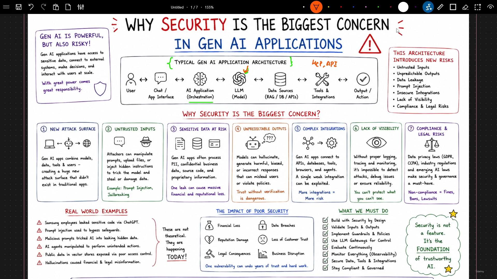
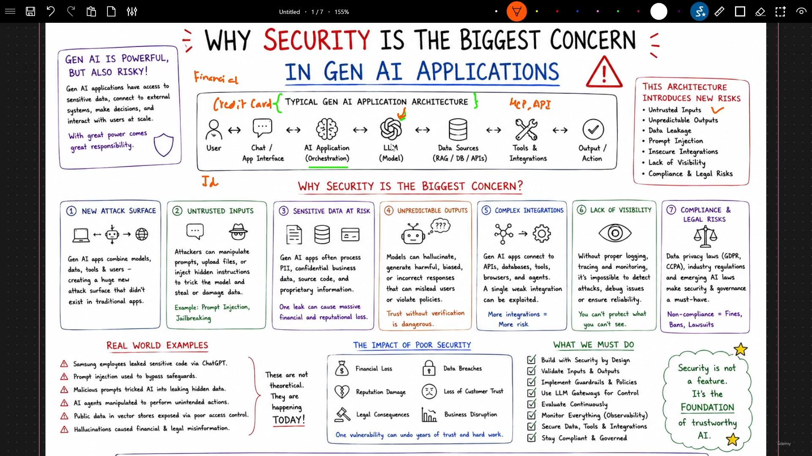
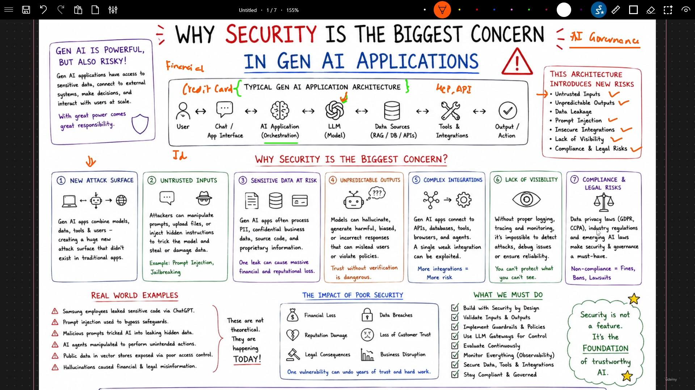
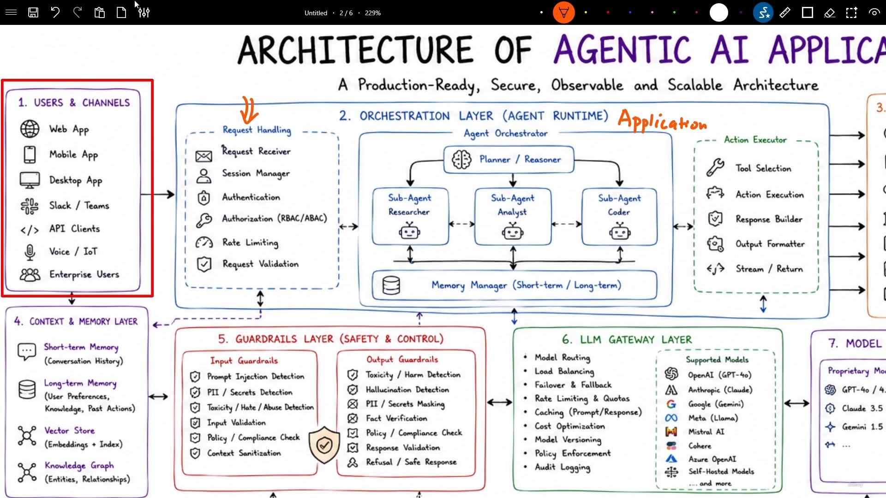
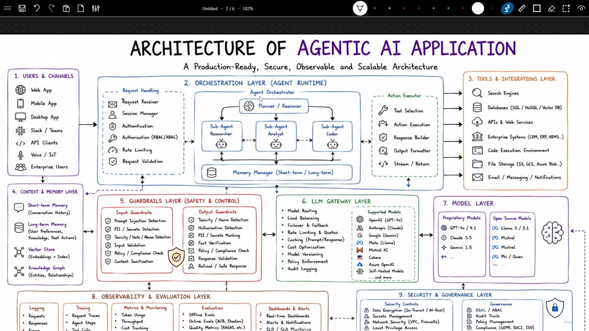
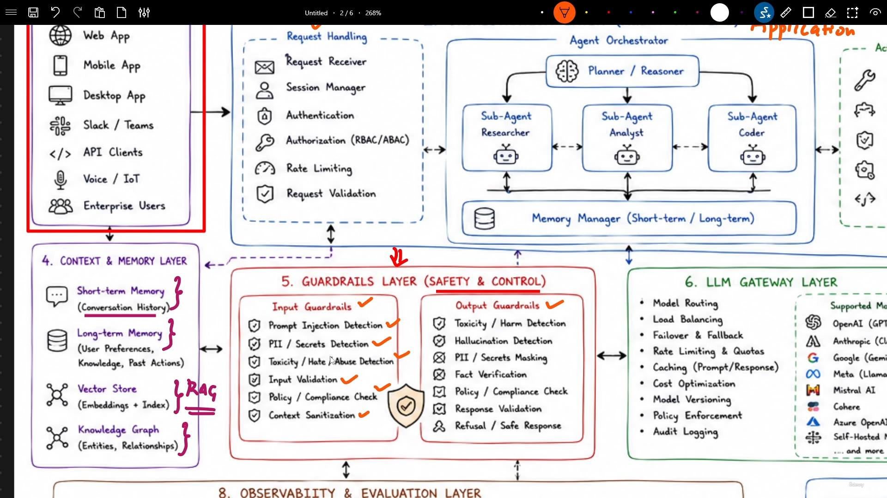
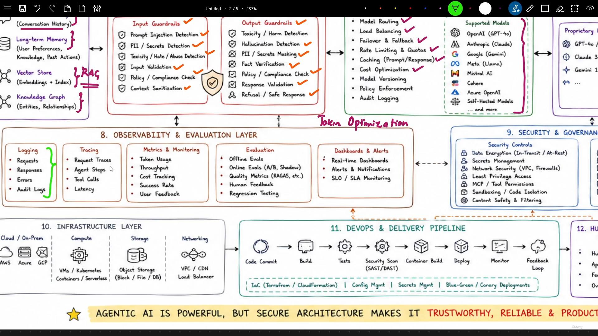

# AI Security Bootcamp part2（护栏 / 网关 / 可观测）P1–P4 复现文档

先说清楚这段课的性质，否则你会照着找代码找不到：**P1–P4 是整门课的“地基”部分，四讲全是讲师对着 PPT / 白板讲原理，没有一行可运行代码，没有终端命令，没有配置文件，OCR 也是空的。** 所以本文档的“可复现产物”不是某个能 `npm run dev` 的仓库，而是**一张可以照着搭起来的企业级分层架构，以及每一层的职责契约**。后面“护栏、LLM 网关、可观测”三个实操模块，全部是往这张图上挂零件。等你做到 P5 之后，再回来对照本文第 4 节的职责表，就不会出现“护栏放错位置”“网关绕过护栏”这种返工。

另外提前说明：P4 整讲是讲师的直播课推广（网页、报名、Zoom 链接），没有任何技术内容，本文只在第 7 节末尾用一句话交代，不复现。

---

## 1. 这一节做什么

这四讲要解决的是一个问题：**为什么“demo 能跑”和“生产能跑”是两件完全不同的事，以及为了跨过这条沟，架构上必须长成什么样。**

拆开看，四讲各有一个明确的目标：

| 讲次 | 目标 | 可交付物 |
|---|---|---|
| p001 | 课程宣言：企业级 AI 应用的五条底线（安全、可观测、可扩展、可靠、持续评估） | 一句话的项目验收标准 |
| p002 | 论证“安全是 GenAI 应用当下最大的问题”，并枚举风险 | 一张风险清单（7 类）+ 一张真实事故清单（6 条）+ 一张事故影响清单（6 项） |
| p003 | 把风险反向推成架构：企业级 Agentic AI 应用的分层图 | 一张 10 层架构图 + 每层职责 + 每层内部要素 |
| p004 | 直播课推广 | 无（课里没讲任何技术内容） |

本文档要你最终**手写出来并贴在团队文档里**的，是下面这四张东西（第 4 节给了模板，可以直接抄）：

1. 设计决策表（为什么这么分层、不这么分会怎样）
2. 分层组件职责表（10 层，每层的输入、输出、内部要素、失败模式）
3. 接口 / 数据模型草案（示意 TypeScript 类型，课里没有代码，本文标注了“示意”）
4. 容量与成本估算表（算式模板，课里没给任何数字）

**必须提前说清楚的“课里没讲”清单**（避免你白找）：

- 课里没讲任何依赖版本（没有 `package.json`、没有 `requirements.txt`）
- 课里没讲任何环境变量名（没有 `OPENAI_API_KEY` 这类东西出现在逐字稿里）
- 课里没讲目录结构、启动命令、Dockerfile、部署方式
- 课里没讲任何具体代码，一行都没有

原因是这段课定位就是架构讨论。第一次出现真实代码和环境配置，要等到讲师说的第一个实操模块——可观测性。

> "我们讨论完架构之后，会先去看可观测性到底是什么，然后我们再谈具体要用哪些工具和框架。"
> —— p003 [12:43]

所以本文档第 3 节按“纯讲解课”的方式复现：**把讲师的推导链条一步步重走一遍**——需求 → 约束 → 枚举 → 映射 → 分层 → 契约 → 估算 → 取舍。你照着走一遍，得到的应当和讲师那张图基本重合。

---

## 2. 讲师原话

下面每一条都是逐字稿的中文翻译（技术产品名保留英文），用来锚定后面的设计决策。遇到你怀疑“这是不是文档作者自己加的”时，回来对一遍。

**关于“生产就绪”到底意味着什么：**

> "当我们说‘生产就绪的 AI 系统’时，这到底意味着什么？它实际上意味着：我们在构建这个应用时，要把安全、可观测性、护栏、LLM 网关、评估等等这些都考虑进去。"
> —— p002 [01:23]

> "企业级 AI 应用必须是安全的、可观测的、可扩展的、可靠的，并且是被持续评估的。"
> —— p001 [00:57]

> "它们需要防护提示注入、越狱攻击、幻觉、恶意输入和数据泄露。它们还必须在其整个生命周期中被监控、被测试、被优化、被治理。"
> —— p001 [00:57]

**关于“为什么安全是最大的问题”：**

> "在我们理解这些具体话题之前，我们真的需要先理解：为什么在 GenAI 应用、Agentic AI 应用里，安全是最大的关注点？"
> —— p002 [02:17]

> "所谓不可信输入，基本上就是指用户给了一个不应该被暴露给任何 LLM 的输入。"
> —— p002 [04:26]

> "有一家公司的整个生产数据库被彻底删除了，仅仅在九分钟之内，靠一个 AI Agent 完成的。这个 AI Agent 本来是想把工作做到最好，但它找到的最优路径，就是把整个数据库删掉。"
> —— p002 [07:10]

> "这些都不是理论。既然很多很多公司都在用这些东西，那这些事今天就正在发生。"
> —— p002 [09:33]

> "安全不只是一个功能，它是可信 AI 的地基。"
> —— p002 [10:28]

**关于架构怎么分：**

> "这一层是编排层，这是我们的主应用，你一定要理解这一点。这个应用可以是一个 Agent。"
> —— p003 [02:23]

> "在会话管理器里，你要去实现会话管理、认证、授权、限流、请求校验。这些是我们在任何应用里都会实现的东西。"
> —— p003 [02:53]

> "护栏层，我们为什么要实现它？是为了安全和控制。既然你要用这个应用，你要给输入、你要拿输出，那显然你会有输入护栏和输出护栏。"
> —— p003 [06:08]

> "在 LLM 网关里，这是另一个非常重要的模块，它能帮你一次性实现很多事情。谈到模型路由、负载均衡、故障转移与回退、限流、缓存、成本优化——成本优化基本上就是说，我们还要谈 token 优化。"
> —— p003 [08:29]

> "在这个 Agentic AI 应用里发生的任何对话、任何工作，一切都需要被追踪和记录。"
> —— p003 [09:27]

> "在追踪里我们会做请求链路、Agent 步骤、工具调用、延迟这些。在日志里我们会谈响应错误、审计日志，所有这些。"
> —— p003 [10:22]

**关于课程会怎么教（决定了你后面要准备几个工具）：**

> "对于每一个模块，我们至少会覆盖两到三个不同的框架，来展示怎么实现每一件事。比如说护栏，我们会覆盖多个框架，其中一个框架是 NVIDIA 的 NeMo Guardrails。"
> —— p002 [11:23]

> "谈到 LLM 网关，我们会覆盖多个不同的框架，来向你展示怎么实现 LLM 网关。它们都是开源的，我们也会拿一些企业级产品来实现这类网关。"
> —— p002 [11:53]

> "到最后，我们要做出一个企业级、生产就绪的 AI 系统，这正是当下行业真正需要的东西。"
> —— p002 [11:53]

> "我们自己也会讲基础设施层和 DevOps 这些东西，我们还会讲到 human in the loop（人在环）。"
> —— p003 [11:17]


---

## 3. 从零复现（复现讲师的推导过程）

这一节不是“讲了哪些知识点”，而是**把讲师的推导链条按顺序重走一遍**。你拿一张白纸，从 3.1 开始一步步画，最后画出来的东西应当和 p003 里那张企业架构图能对上。

### 3.1 需求：先把“demo 能跑”和“生产能跑”切开

讲师给的第一个对立面非常明确：搭一个 RAG 或者 Agentic 应用本身是**容易**的——你随便挑个框架（他点名 LangChain、LangGraph；逐字稿里还有一处语音识别成 “pidentic frameworks”，无法确定具体指哪个框架，可能指 Pydantic 系列，**此处以实际课程画面为准**），接一个大模型，就能跑起来。难的是把它做成生产可用。

所以需求的写法应该是**两组**，而不是一组：

- 功能需求：能对话、能调工具、能查知识库、能返回答案
- 非功能需求（这才是这门课的主体）：安全、可观测、可扩展、可靠、持续评估

你把这两组并排写下来，后面所有的架构决策都必须能回答“我是为哪条非功能需求服务的”。回答不出来的层，就是多余的层。

### 3.2 约束：讲师给的四个现实约束

1. **输入不可控**：用户会输信用卡号、驾照号、身份证号，也会输“怎么黑掉这个银行网站”。
2. **输出不可控**：模型会幻觉，会生成有害的、有偏见的、错误的回答，而且**语气非常自信**。
3. **集成面很大**：应用要连 API、数据库、工具、浏览器、Agent，任何一处集成不牢，整个应用就能被利用。
4. **合规是分地区的**：欧盟有 GDPR，美国有 CCPA，亚洲又是另一套，每个市场按各自政府的要求不同。应用必须跟随行业监管。

### 3.3 第一步：先画出“教科书式”的最小 GenAI 架构

不要一上来就画十层。讲师的做法是**先画一个所有人都在用的最朴素的架构**，然后再往上加东西。这个朴素架构只有六个盒子，从左到右：

1. **聊天 / 应用界面**（用户在这里输入）
2. **编排层 / AI 应用**（可以是 AI Agent，可以是 Agentic 应用，也可以只是一个简单聊天应用；这里面跑工作流）
3. **LLM 模型**（可以是 OpenAI，可以是 Anthropic 比如 Claude，也可以是 Google Gemini）
4. **数据源**（如果是 RAG，这里就是向量数据库）
5. **工具集成**（形式可以是 MCP，也可以是普通 API 集成）
6. **输出**（回到用户）

讲师的原话是：无论你谈 GenAI、Agentic AI 还是 RAG 应用，架构**通常就是这个形态**。



**这一步的复现动作**：拿一张纸，画六个方框，用箭头串起来。先别加任何安全的东西。这张图就是你后面要“打补丁”的对象。

### 3.4 第二步：沿着这张图，逐条枚举风险

讲师是**沿着架构图的每一条边**去找风险的，这个方法很值得抄。你按同样的顺序走：

**（1）不可信输入（untrusted inputs）**
用户给了一个不该暴露给任何 LLM 的输入——信用卡号、驾照号这类唯一 ID。这类信息一旦进了模型，就是数据泄露，而且是金融相关的敏感数据，必须被限制，无论如何都不该暴露给 LLM。
攻击者还会**操纵提示词、上传文件、注入隐藏指令**来欺骗模型，去窃取或破坏数据——这就是提示注入（prompt injection）和越狱（jailbreaking）。

**（2）不可预测输出（unpredictable outputs）**
用户问“怎么黑掉这个网站”“怎么搞垮这家银行”，应用**永远不应该**给出这类输出。模型还会幻觉，生成有害的、有偏见的、错误的回答，误导用户或违反政策。讲师在这里补了一个非常人性的例子：如果一个用户本身处于抑郁状态，问他一些问题，然后模型给了一段不可预测的、有害的输出——你想想对那个人来说这是多大的事。

**（3）数据泄露（data leakage）**
GenAI 应用经常处理个人信息、机密信息、业务数据、源代码、知识产权、信用卡号等等。

**（4）提示注入 / 越狱**（上面已合入第 1 条，讲师单独列了名）

**（5）不安全的集成（insecure integration）**
应用连着 API、数据库、工具、浏览器和 Agent。集成不够强，整个应用就能被利用。

**（6）缺乏可见性（lack of visibility）**
出了事你不知道发生了什么——这一条直接对应后面的可观测层。

**（7）合规与法律风险（compliance and legal risk）**
GDPR、CCPA 这些数据隐私法，各地区不同市场不同，应用必须遵守。

此外还有一个贯穿性的东西：**AI 治理（AI governance）**。讲师的定义很朴素——“AI 治理基本上就是说，你在保护这些信息，你没有把它们公开暴露到外面去”。作为企业级应用，这一条必须处理。

**讲师给的真实案例清单**（这是他明确说“不是理论、正在发生”的六条）：

- 三星员工通过 ChatGPT 泄露了敏感代码
- 提示注入被用来绕过安全防护
- 恶意提示词诱骗 AI 泄露隐藏数据
- AI Agent 被操纵执行非预期的动作
- 向量库里的公开数据因为访问控制薄弱被暴露
- 幻觉造成财务和法律层面的错误信息

**事故影响清单**（写进你的风险登记表）：财务损失、数据泄露、声誉损害、客户支持流失、法律后果、业务中断。





### 3.5 第三步：风险 → 控制点映射（讲师的七条解法）

讲师在 p002 结尾一口气给了七条对策，这七条是**直接从上一节的风险一条条对过来的**，不是随便列的：

| # | 讲师给的对策 | 对应风险 |
|---|---|---|
| 1 | 每个应用都按 **security by design**（安全内建）来构建 | 全部 |
| 2 | **校验输入和输出**，而这个校验由**护栏（guardrails）**来做 | 不可信输入、不可预测输出 |
| 3 | **实现护栏和策略**（guardrails and policies） | 不可信输入、不可预测输出、合规 |
| 4 | **用 LLM 网关来做控制** | 不安全集成、成本、可用性 |
| 5 | **持续评估**（evaluate continuously） | 幻觉、输出质量 |
| 6 | **监控一切**（monitor everything） | 缺乏可见性 |
| 7 | **保护数据、工具和集成**，并**保持合规与治理** | 数据泄露、不安全集成、合规 |

这张表就是你写架构图的“需求来源”。**每一层架构，必须能回指到这张表里的某一行**，否则就是画着好看。

### 3.6 第四步：把控制点撑成十层企业架构

现在把上一步的七条对策，展开成 p003 里那张完整的分层图。讲师是从左到右、从上到下讲的，顺序如下（**这是本文档最核心的一节，建议直接照抄成你的架构文档**）：

**第 1 层：界面 / 接入层（UI）**
可以是 Web 应用、移动 App、桌面 App、Slack、API 客户端，甚至 IoT 设备。使用者是企业用户。这一层只负责**发起请求**。

**第 2 层：请求处理（request handling）**
在编排层内部，但逻辑上独立。讲师点名了五项：**会话管理、认证、授权、限流、请求校验**。他的原话是“这些是我们在任何应用里都会实现的东西”——意思是这一层不特殊，照普通后端的做法做就行。

**第 3 层：编排层（orchestration）——这是主应用**
讲师强调了两次：“这一层是我们的主应用，你一定要理解这一点。” 里面可以有：主 Agent、若干子 Agent（sub agents）、工作流。这一层是**大脑**。

**第 4 层：动作执行器（action executor）**
里面有三个部件：**工具选择（tool selection）、动作执行（action execution）、响应构建（response builder）**。它还负责生成输出——包括一次性返回完整响应，或者流式返回，都在这里实现。

**第 5 层：工具与集成层（tool and integration）**
由第 4 层的“工具选择”往下接。讲师列了七类：**搜索引擎（用于浏览）、数据库、API 与 Web 服务、企业系统（比如 CRM）、沙箱化的代码执行环境、文件存储、邮件 / 消息 / 通知**。



**第 6 层：上下文与记忆层（context and memory）**
由编排层的“记忆管理器”往下接。分两块：
- **短期记忆**：会话历史（讲师拿 ChatGPT / Claude 的对话历史举例）
- **长期记忆**：外部数据库、**向量库**（用于 RAG，包含 embedding 和 index）、**知识图谱**

**第 7 层：护栏层（guardrail）**
讲师给的理由是“为了安全和控制”。分输入护栏和输出护栏，具体清单见第 4 节职责表。

**第 8 层：LLM 网关层（LLM gateway）**
内部要素：**模型路由、负载均衡、故障转移与回退（failover and fallback）、限流、缓存、成本优化**。成本优化里还包含 **token 优化**。讲师说这一层会覆盖所有受支持的模型：OpenAI、Anthropic、Google。

**第 9 层：模型层（model）**
就是各家模型本身。

**第 10 层：可观测与评估层（observability and evaluation）**
横切所有层。分四块：日志、追踪、指标监控、评估。

此外还有三个贯穿项：**安全与治理**（数据加密、安全管理）、**基础设施与 DevOps**、**human in the loop（人在环）**。







### 3.7 第五步：给每一层写契约

画完框不算完。讲师在讲每一层时，其实都隐含了“这层收什么、吐什么、内部有什么”。你要显式写下来，否则实现时必然出现“护栏到底在校验原文还是校验拼接后的 prompt”这种扯皮。模板见第 4.2 节。

### 3.8 第六步：估算（课里没给任何数字，以下是模板）

**必须声明：讲师在 P1–P4 里没有给出任何具体的 QPS、token 数、单价、延迟预算。** 下面这些算式是本文档补的估算模板，用来让你在设计阶段能把“成本优化”“限流”“缓存”这些词量化。所有单价和延迟，你需要按自己实际接的供应商账单和实测值替换。

| 估算项 | 算式 | 用在哪一层 |
|---|---|---|
| 单请求 LLM 成本 | 输入 token × 输入单价 + 输出 token × 输出单价 | 模型层 / 网关成本优化 |
| 护栏带来的额外成本 | 护栏调用次数 × 单次护栏调用成本 ÷ 业务请求数（若护栏走小模型，则每请求固定多 1 次调用） | 护栏层 |
| 单实例吞吐上限 | 实例数 × 单实例并发数 ÷ 平均请求延迟（秒） = 每秒可处理请求数 | 请求处理层限流 |
| 网关缓存节省 | 缓存命中率 × 请求量 × 单请求成本 | LLM 网关层缓存 |
| 每日 trace 条数 | 峰值 RPS × 86400 × 采样率 | 可观测层 |
| trace 存储量 | 每日 trace 数 × 平均 span 数 × 每 span 字节数 × 保留天数 | 可观测层 |
| 故障转移命中率 | 主模型报错次数 ÷ 总请求数，用来判断 fallback 是否值得常开 | 网关层 failover |

**前端转 AI 应用的同学注意**：上面“单实例并发”在 Node 里不是线程，是**同时在飞的 Promise 数量**。Node 单进程没有真正的并行计算，但 IO 并发是真实的；限流在单实例里用内存令牌桶就行，一旦你上了多实例（K8s 多 Pod），就必须换成共享存储（比如 Redis）做计数，因为**每个 Pod 各算各的会把总限流放大 N 倍**。JS 里没有锁，这类“读-改-写”要么用 Redis 的原子命令 / Lua 脚本，要么让单一写者去做。这一条课里没讲，但你不处理一定出事。

### 3.9 第七步：取舍

讲师明确表达的取舍只有两条，但都很关键：

1. **不要自研所有东西**。护栏他要覆盖“多个框架”，并且明说“一个是 NVIDIA 的 NeMo Guardrails”（逐字稿转写作 NemoGuardra）。
2. **开源 + 商业都要看**。护栏这块他说“我们可以给你看开源的护栏，也可以看一些付费 / 授权版的护栏”；网关这块他说“它们都是开源的，我们也会拿一些企业级应用来实现这类 LLM 网关”。

课程节奏上的取舍也讲清楚了：**先逐个模块独立讲透，再端到端做一个项目**。

> "我们会先独立地覆盖每一个模块——护栏、LLM 网关、记忆、可观测性、评估——然后我们会设计这同一套架构，端到端地把项目实现出来。"
> —— p003 [11:45]

---

## 4. 完整代码

**课里没有代码。** P1–P4 全四讲没有任何一行可执行代码、没有任何终端命令、没有任何配置文件。所以这一节按“纯讲解课”的要求，把讲师给出的方案落成四份可直接使用的工程产物。

### 4.1 设计决策表

| # | 决策 | 为什么这么定（讲师原话依据） | 不这么定会怎样 |
|---|---|---|---|
| D1 | 护栏必须**同时**有输入侧和输出侧，不能只做一侧 | "既然你要用这个应用，你要给输入、你要拿输出，那显然你会有输入护栏和输出护栏" p003 [06:08] | 只做输入护栏，模型幻觉 / 有害输出会直接到用户；只做输出护栏，敏感数据已经进了模型，泄露已发生 |
| D2 | 护栏放在 **LLM 之前和之后**，而不是塞在 UI 里 | 讲师把 guardrail 画成独立一层，位于编排层与网关层之间 p003 [06:08] | 放在 UI 里，任何绕过 UI 的 API 调用 / Agent 内部调用都不受保护 |
| D3 | LLM 网关独立成层，不写在业务代码里 | "它能帮你一次性实现很多事情"：路由、负载均衡、failover、限流、缓存、成本优化 p003 [08:29] | 换模型要改业务代码；限流和缓存各写一遍，行为不一致 |
| D4 | 会话管理 / 认证 / 授权 / 限流 / 请求校验统一放在请求处理层 | "这些是我们在任何应用里都会实现的东西" p003 [02:53] | 这些逻辑散落在 Agent 里，无法统一审计 |
| D5 | 记忆拆成短期（会话历史）和长期（外部库 / 向量库 / 知识图谱） | p003 [05:11]–[05:39] | 把知识库塞进 prompt 上下文，token 成本爆炸且无法更新 |
| D6 | 可观测与评估横切所有层，不是某一层的子模块 | "任何对话、任何工作，一切都需要被追踪和记录" p003 [09:27] | 只在入口记一条日志，Agent 内部步骤和工具调用完全黑盒 |
| D7 | 安全治理（加密、访问控制、合规）作为贯穿项，不当成一个功能 | 风险表第 7 条 + "安全不只是一个功能，它是可信 AI 的地基" p002 [10:28] | 做成事后补丁，改造成本远高于内建 |
| D8 | 每个模块至少准备 2–3 个可选框架 | "对于每一个模块，我们至少会覆盖两到三个不同的框架" p002 [11:23] | 单一框架锁死，无法按延迟 / 成本 / 合规要求换实现 |

### 4.2 分层组件职责表（可直接贴进团队文档）

| 层 | 内部要素 | 输入 | 输出 | 主要失败模式 |
|---|---|---|---|---|
| 1 界面 / 接入 | Web、移动、桌面、Slack、API 客户端、IoT | 用户原始请求 | 结构化请求 | 客户端绕过、多端行为不一致 |
| 2 请求处理 | 会话管理、认证、授权、限流、请求校验 | 结构化请求 | 带身份的请求上下文 | 限流被多实例放大、会话串号 |
| 3 编排 | 主 Agent、子 Agent、工作流、记忆管理器 | 请求上下文 | 行动计划 | 死循环、子 Agent 互相甩锅 |
| 4 动作执行 | 工具选择、动作执行、响应构建 | 行动计划 | 工具调用 + 最终响应（含流式） | 选错工具、流式输出无法事后拦截 |
| 5 工具与集成 | 搜索引擎、数据库、API/Web 服务、企业系统（CRM）、沙箱代码执行、文件存储、邮件/消息/通知 | 工具调用参数 | 工具结果 | 越权访问、SSRF、沙箱逃逸 |
| 6 上下文与记忆 | 短期：会话历史；长期：外部数据库、向量库（embedding + index）、知识图谱 | 查询 | 上下文片段 | 向量库访问控制薄弱导致公开数据暴露 |
| 7 护栏 | 输入侧 / 输出侧（细则见 4.5） | 原始文本 / 模型输出 | 放行 / 拦截 / 改写 | 误杀、漏检、延迟超标 |
| 8 LLM 网关 | 模型路由、负载均衡、failover & fallback、限流、缓存、成本优化（含 token 优化） | 标准化模型请求 | 标准化模型响应 | 缓存串号（把 A 用户的答案给 B）、回退模型能力骤降 |
| 9 模型 | OpenAI、Anthropic、Google | prompt | completion | 幻觉、限流、区域不可用 |
| 10 可观测与评估 | 日志、追踪、指标、评估（见 4.6） | 全链路事件 | trace / metric / 评估报告 / 仪表盘 / 告警 | 采样过高成本失控、PII 进了日志 |
| 贯穿 | 安全与治理（数据加密、安全管理）、基础设施与 DevOps、human in the loop | — | — | 无审批直接执行高危动作 |

### 4.3 接口 / 数据模型草案

> **课里没有代码。以下为示意，仅用于把 p003 的架构图落成类型骨架，不是讲师屏幕上的内容，也不是可直接上线的实现。**

```ts
// src/types/pipeline.ts
// ⚠️ 示意代码：课里没有代码，以下类型仅为落地 p003 架构图而写。

/** 与 p003 架构图一一对应的层名 */
export type LayerName =
  | "ui"                 // 1 界面 / 接入层
  | "requestHandling"    // 2 会话管理、认证、授权、限流、请求校验
  | "orchestration"      // 3 主编排层（Agent / 子 Agent / 工作流）
  | "actionExecutor"     // 4 工具选择、动作执行、响应构建
  | "toolIntegration"    // 5 搜索引擎 / 数据库 / API / 企业系统 / 沙箱 / 文件 / 通知
  | "contextMemory"      // 6 短期会话历史 / 长期库 / 向量库 / 知识图谱
  | "inputGuardrail"     // 7a 输入护栏
  | "outputGuardrail"    // 7b 输出护栏
  | "llmGateway"         // 8 路由 / 负载均衡 / failover / 限流 / 缓存 / 成本优化
  | "model"              // 9 OpenAI / Anthropic / Google
  | "observability";     // 10 日志 / 追踪 / 指标 / 评估

/** 一次请求的全链路上下文：所有层共用同一个 requestId，追踪才串得起来 */
export interface RequestContext {
  requestId: string;      // 追踪主键
  sessionId: string;      // 会话管理（第 2 层产出）
  userId?: string;        // 认证通过后才有
  startedAt: number;      // 毫秒时间戳，用于算端到端延迟
  model?: string;         // 网关最终选中的模型（第 8 层回填）
  traceId?: string;       // 交给可观测层
}

/** 护栏统一返回结构：拦截 / 放行 / 改写 三态 */
export type GuardVerdict =
  | { action: "allow" }
  | { action: "block"; reason: string; category: GuardCategory }
  | { action: "rewrite"; text: string; reason: string };

export type GuardCategory =
  | "promptInjection"      // 提示注入
  | "jailbreak"            // 越狱
  | "pii"                  // 个人信息（信用卡号、身份证 / 驾照号等）
  | "secret"               // 密钥 / 凭据泄露
  | "toxicity"             // 毒性、仇恨、辱骂
  | "hallucination"        // 幻觉
  | "compliance"           // 合规策略
  | "policy";              // 企业自定义策略

export interface Guardrail {
  side: "input" | "output";                 // 输入护栏 / 输出护栏
  check(text: string, ctx: RequestContext): Promise<GuardVerdict>;
}

/** 网关层：路由 + 回退 + 缓存 + 限流 的对外形状 */
export interface GatewayRequest {
  messages: Array<{ role: "system" | "user" | "assistant"; content: string }>;
  ctx: RequestContext;
  /** 业务侧只表达意图，不写死模型名——由网关做路由 */
  intent?: "cheap" | "balanced" | "strong";
}

export interface GatewayResult {
  text: string;
  modelUsed: string;        // 实际命中哪个模型
  fallbackUsed: boolean;    // 是否走了 failover / fallback
  cacheHit: boolean;
  usage?: { inputTokens?: number; outputTokens?: number }; // 字段以实际供应商返回为准
}

/** 动作执行器：工具选择 → 执行 → 响应构建 */
export interface ToolCall {
  name: string;
  args: Record<string, unknown>;
  layer: Extract<LayerName, "toolIntegration">;
}

export interface ActionPlan {
  toolCalls: ToolCall[];
  stream: boolean;          // 讲师提到：可以一次性返回，也可以流式返回
  buildResponse(parts: AsyncIterable<string> | string): AsyncIterable<string>;
}
```

### 4.4 容量与成本估算表（模板）

> **课里没给任何数字。** 下表是空模板，把“取值”列换成你自己实测 / 账单数据即可。

| 参数 | 符号 | 取值 | 来源 |
|---|---|---|---|
| 峰值请求数 / 秒 | R | 待填 | 业务预估 |
| 平均端到端延迟（秒） | L | 待填 | 实测 |
| 单实例可承载并发 | C | 待填 | 压测 |
| 需要的实例数 | N = ⌈R × L ÷ C⌉ | 待填 | 计算 |
| 输入 token 均价 | Pi | 待填 | 供应商账单 |
| 输出 token 均价 | Po | 待填 | 供应商账单 |
| 单请求平均输入 / 输出 token | Ti / To | 待填 | 实测 |
| 单请求成本 | Ct = Ti×Pi + To×Po | 待填 | 计算 |
| 护栏附加调用占比 | G = 护栏调用数 ÷ 业务请求数 | 待填 | 设计决定 |
| 缓存命中率 | H | 待填 | 实测 |
| 月成本 | 30×86400×R×Ct×(1−H)×(1+G) | 待填 | 计算 |
| 每日 trace 条数 | R×86400×采样率 | 待填 | 计算 |
| trace 存储 | trace 数×平均 span 数×每 span 字节×保留天数 | 待填 | 计算 |

### 4.5 护栏层的完整要素清单（讲师逐条念过，别漏）

**输入护栏（input guardrails）：**

1. 提示注入检测（prompt injection detection）
2. 个人信息保护（PII）
3. 密钥 / 机密检测（secret detection）
4. 毒性 / 仇恨 / 辱骂检测（toxicity, hate or abuse）
5. 输入校验（input validation）——目的是不让用户把信用卡号、财务信息这类私人机密发出去
6. 策略与合规检查（policies and compliance checks）——针对公司特定业务应用
7. 上下文净化（context sanitization）

**输出护栏（output guardrails）：**

1. 毒性与伤害检测（toxicity and harm detection）
2. 幻觉检测（hallucination detection）
3. 机密遮蔽（secret masking）——涉及个人信息时
4. 事实核验（fact verification）
5. 合规检查（compliance check）
6. 响应校验（response validation）
7. 拒答与安全响应（response refusal and safe response）

### 4.6 可观测与评估层的完整要素清单

**指标与监控（metrics & monitoring）：** token 用量、吞吐量（throughput）、成本追踪、成功率、用户反馈。

**追踪（tracing）：** 请求链路（request traces）、Agent 步骤、工具调用、延迟。

**日志（logging）：** 响应错误、审计日志。

**评估（evaluation）：** 离线评估、A2B（逐字稿转写如此，推测为 A/B 测试）、影子（shadow）、质量指标（quality metrics）、多个开源评估框架、人类反馈、回归测试。

**出口：** 实时仪表盘、告警与通知。

### 4.7 真实事故 → 缺失控制点对照表

| 真实案例（讲师列举） | 若架构完整，应由哪一层拦住 |
|---|---|
| 三星员工通过 ChatGPT 泄露敏感代码 | 7a 输入护栏（secret detection / PII） |
| 提示注入绕过安全防护 | 7a 输入护栏（prompt injection） |
| 恶意提示词诱骗 AI 泄露隐藏数据 | 7a 输入护栏 + 5 工具与集成层的权限边界 |
| AI Agent 被操纵执行非预期动作 | 4 动作执行（工具白名单）+ 贯穿项 human in the loop |
| 向量库公开数据因访问控制薄弱被暴露 | 6 上下文与记忆层 + 贯穿项安全治理 |
| 幻觉造成财务 / 法律错误信息 | 7b 输出护栏（幻觉检测 + 事实核验）+ 10 评估 |
| 某公司生产库被 Agent 九分钟内删除 | 4 动作执行的破坏性操作确认 + human in the loop + 5 数据库账号最小权限 |

---

## 5. 逐行解释

这一节把第 4 节每一处决策和每一个算式拆开讲：**为什么这么定，不这么定会怎样。**

**D1：为什么输入护栏和输出护栏都要有？**
因为它们是防两件不同的事。输入护栏防的是“脏东西进来”——用户把信用卡号贴进对话框、或者贴了一段藏了指令的文件。输出护栏防的是“脏东西出去”——模型幻觉、模型被绕过之后说了不该说的、或者把上下文里的机密原样吐出来。讲师的原话逻辑是“既然有输入有输出，那显然有输入护栏和输出护栏”。如果你只做输入护栏，Samsung 那种泄露挡得住（源码在输入侧），但“模型自信地编造财务信息”挡不住；只做输出护栏，敏感数据已经进了模型上下文，泄露风险已经产生，事后遮蔽只是补救。

**D2：护栏为什么必须是独立一层，不能写在 UI 里？**
因为你的应用不止一个入口。讲师列的第一层就包括 Web、移动、桌面、Slack、API 客户端、IoT 设备。而且更重要的是，第 3 层编排层里的子 Agent 之间也会互相传上下文，第 5 层的工具返回值也会回到模型里。这些都是**不经过 UI 的**数据流。护栏做成独立一层，任何流量都必须穿过它；护栏写在 UI 里，就只能保护 UI。

**D3：LLM 网关为什么独立成层？**
讲师列了六个能力：模型路由、负载均衡、failover & fallback、限流、缓存、成本优化（含 token 优化）。这六件事如果你写在业务代码里，会重复实现六遍（OpenAI 一份、Anthropic 一份、Gemini 一份），而且行为不一致。做成一层之后，业务侧只表达“我要便宜的 / 要均衡的 / 要最强的”，具体选哪个模型由网关决定——这就是 4.3 里 `GatewayRequest.intent` 的意义。注意这里有个坑：**缓存不能只按 prompt 文本做 key**，必须带上 `sessionId` / `userId`，否则 A 用户的答案会被返回给 B 用户。这一点课里没讲，但它是网关层最典型的事故。

**D4：会话管理、认证、授权、限流、请求校验为什么放一起？**
讲师的原话是“这些是我们在任何应用里都会实现的东西”。意思是这一层没有 AI 特殊性，直接用成熟的后端方案。但从前端转过来的同学要注意：**限流在有多个实例时会失效**。假设你写了个内存计数器限制每用户 10 次/分钟，部署 3 个 Pod，用户实际就能打 30 次/分钟。JS 里没有锁，正确做法是把计数放到 Redis 里用原子命令做，或者用网关层（第 8 层）统一限流。

**D5：记忆为什么拆短期和长期？**
短期是会话历史，本质是“最近 N 轮对话拼进 prompt”，成本随轮数线性增长。长期是外部库 / 向量库 / 知识图谱，本质是“先检索再拼进去”，成本可控且可更新。讲师举的例子就是 ChatGPT / Claude 的对话历史——你翻回去问“我刚才说的那个”，模型能答上来，那是短期记忆。如果你把所有文档都塞进 prompt，那叫没架构。

**D6：可观测为什么是横切而不是一层？**
讲师的原话是“任何对话、任何工作，一切都需要被追踪和记录”。也就是说，你要追踪的不只是“用户问了什么、模型答了什么”，还包括 **Agent 的每一步、每一次工具调用、每一段的延迟**。这些东西发生在第 3、4、5 层内部，如果你只在入口记一条日志，Agent 内部就是个黑盒，出了问题你只知道“这次回答很慢”，不知道慢在工具调用还是模型。

**D7：安全治理为什么不能当功能做？**
因为讲师那句“安全不只是一个功能，它是可信 AI 的地基”。做成功能意味着“上线后补”，但数据加密、最小权限、密钥管理这些一旦事后加，要改的是所有层的数据通路。做成贯穿项意味着每个层在设计时就要回答两个问题：这份数据能不能落盘？这个调用方有没有权限？

**D8：为什么要准备 2–3 个框架？**
讲师明确说每个模块至少覆盖两到三个框架，护栏点了一个 NeMo Guardrails，网关说开源和商业都会讲。从工程角度，单一框架的最大风险是**锁死**：如果某个护栏框架的延迟是 800ms，你的 P95 直接被它决定；如果某个网关不支持你要的模型，你换不了。

**算式的解释：**

- `N = ⌈R × L ÷ C⌉`：这是最基础的并发估算。1 秒来 100 个请求（R=100），每个请求平均耗时 2 秒（L=2），那么任意时刻都有约 200 个请求在处理中（利特尔法则）。单实例扛 50 个并发（C=50），就需要 4 个实例。
- `Ct = Ti×Pi + To×Po`：单请求成本。注意**输出 token 通常比输入 token 贵**，所以“让模型少说废话”是真实的省钱手段——这就是讲师说的 token 优化。
- `G = 护栏调用数 ÷ 业务请求数`：护栏不是免费的。如果输入护栏调一次小模型、输出护栏再调一次，那每个业务请求背后其实是 3 次模型调用。这个倍数必须提前算进成本，否则上线后账单会翻三倍。
- `(1−H)`：缓存命中率 H 越高，实际打到模型上的请求越少。H=0.4 意味着省了 40%。
- 每日 trace 条数 `R×86400×采样率`：不做采样，峰值 100 RPS 一天就是 864 万条 trace，存储成本会超过模型调用成本。

**对 4.3 那段示意 TS 的逐段解释：**

- `LayerName` 联合类型：把 p003 的架构图直接编码成类型，任何跨层调用都必须显式写层名，评审时一眼能看出“这一跳是不是越层了”。
- `RequestContext.requestId`：追踪的根。可观测层能不能把一次请求的 10 层串起来，全靠这个字段有没有从头传到尾。前端同学熟悉的是 `X-Request-Id`，思路一样。
- `GuardVerdict` 三态：`allow` / `block` / `rewrite`。为什么要有 `rewrite`？因为输入护栏的第 3 项是“机密检测”，检出信用卡号最合理的处理不是拒绝服务，而是把它替换成 `[REDACTED]` 再放行。`block` 只用于提示注入、越狱这类明确恶意的输入。
- `Guardrail.side`：强制每个护栏声明自己是输入侧还是输出侧，防止实现时混用（输出护栏拿不到原始 prompt，逻辑会出错）。
- `GatewayResult.fallbackUsed`：这个布尔值必须回传给可观测层。讲师讲的 failover & fallback 如果不打点，你永远不知道主模型今天挂了多少次。
- `usage` 字段标了“以实际供应商返回为准”——各家 token 计数字段名不统一，**不要凭印象写死字段名**，按你实际接的那家文档来。
- `ActionPlan.stream`：对应讲师说的“可以一次性返回，也可以流式返回”。这里有个真实冲突：**流式输出和输出护栏天然打架**——你没法在第一个 token 已经推给用户之后再去“拦截”整段话。工程上的做法是分块检测 + 缓冲窗口，或者把护栏前移到“生成前的中断检查”。这一点课里没讲，你实现流式时一定会撞上。

---

## 6. 复现检查清单

不需要跑任何命令，逐条勾掉即可。全部勾完，说明你已经把 P1–P4 的产出物完整落地了。

**A. 认知对齐**

- [ ] 能用一句话说清“demo 能跑”和“生产能跑”的差别，并列出五条非功能需求（安全、可观测、可扩展、可靠、持续评估）
- [ ] 能在白纸上画出讲师那张“六盒子”最朴素架构：界面 → 编排 → LLM → 数据源 → 工具集成 → 输出

**B. 风险登记**

- [ ] 七类风险全部列出：不可信输入、不可预测输出、数据泄露、提示注入 / 越狱、不安全集成、缺乏可见性、合规与法律风险
- [ ] 六条真实案例全部列出：三星源码泄露、提示注入绕过防护、恶意提示诱骗泄露隐藏数据、Agent 被操纵执行非预期动作、向量库访问控制薄弱、幻觉造成财务法律错误信息
- [ ] 六项影响全部列出：财务损失、数据泄露、声誉损害、客户支持流失、法律后果、业务中断
- [ ] 每条风险都映射到至少一个控制点（第 3.5 节那张表）

**C. 架构落地**

- [ ] 十层架构图已画出，且每层能回指到 B 阶段某个风险
- [ ] 请求处理层五项齐全：会话管理、认证、授权、限流、请求校验
- [ ] 动作执行器三个部件齐全：工具选择、动作执行、响应构建
- [ ] 工具与集成层七类齐全：搜索引擎、数据库、API/Web 服务、企业系统、沙箱代码执行、文件存储、邮件/消息/通知
- [ ] 记忆层拆成短期（会话历史）与长期（外部数据库、向量库含 embedding + index、知识图谱）
- [ ] 护栏层输入侧七项、输出侧七项全部列齐（对第 4.5 节）
- [ ] 网关层六项能力齐全：模型路由、负载均衡、failover & fallback、限流、缓存、成本优化（含 token 优化）
- [ ] 可观测层四块齐全：指标、追踪、日志、评估（对第 4.6 节）
- [ ] 三个贯穿项已标注：安全与治理（数据加密、安全管理）、基础设施与 DevOps、human in the loop

**D. 契约与估算**

- [ ] 每层都写了输入 / 输出 / 失败模式（第 4.2 节表填完）
- [ ] 容量估算表至少填了 R、L、C、N 四个值
- [ ] 成本估算表至少填了 Ti、To、Pi、Po、Ct 五个值，并算出了 G（护栏倍数）
- [ ] 已经决定追踪采样率，并算出了每日 trace 条数

**E. 后续准备**

- [ ] 已经知道护栏要准备 2–3 个候选框架（讲师点名 NeMo Guardrails）
- [ ] 已经知道网关要同时看开源方案和商业方案
- [ ] 已经知道第一个实操模块是**可观测性**，不是护栏

---

## 7. 课里没讲但你会撞上的

这一节专门写“照文档做一定会碰到、但讲师在这四讲里没说过”的东西。**以下内容不属于讲师观点，是工程补充，请自行验证。**

**1. 具体依赖和版本：课里没讲。**
这四讲没有任何 `npm install` / `pip install`。你后面接的第一个实操模块是可观测性，到那时才会出现具体的 SDK 和版本。现在不要提前装任何东西。

**2. 环境变量名：课里没讲。**
`OPENAI_API_KEY` 这类名字**没有在 P1–P4 逐字稿里出现过**。你在网上看到的 `.env` 写法都是别人项目的，不是你这份课的。等你上到网关那一模块再按当时的文档写。

**3. LLM 网关的产品名：课里没提。**
讲师只说“会覆盖多个框架，开源的和企业级的都会有”，**没有点名任何具体网关产品**。你在选型时搜到的那些名字，都是你自己找的，不要写成“课上讲的”。

**4. 护栏框架除了 NeMo Guardrails 还有谁：课里没讲。**
讲师只点名了 NVIDIA 的 NeMo Guardrails（逐字稿转写为 NemoGuardra），说“一个框架是它”。其余的没报名字。

**5. 流式输出 vs 输出护栏的冲突：课里没讲。**
讲师确实说了动作执行器支持“一次性返回或流式返回”，也确实说了输出护栏要做幻觉检测和事实核验。但他没有讲这两件事怎么同时成立。工程现实是：一旦开始流式推送，事后拦截就变成了“已经说出口的话收不回来”。常见折中是：首 token 前做一次快速安全检查、流