# AI Security Bootcamp part2：结构化输出与中间件（P12–P15）

下面这份文档按“能照着把代码跑起来”的标准组织，覆盖 P12–P15 四段内容：P12 用 Pydantic 做结构化输出，P13 换成 TypedDict 并顺手看模型 `profile`，P14 把 schema 交给 `create_agent` 的 `response_format`（Pydantic / TypedDict / dataclass 三种写法），P15 讲 middleware，重点是 `SummarizationMiddleware` 的三种触发方式（消息数、token 数、上下文占比 fraction）。

> 说明：课程标题写的是“护栏/网关/可观测”，但 P12–P15 逐字稿实际讲的是**结构化输出**与**中间件**两块。本文档按逐字稿实际内容写，不硬套标题。课里没讲的实现细节，一律在第七节标注“课里没讲”。

---

## 1. 这一节做什么

P12–P15 解决的是两个实际问题。

第一是**让 LLM 的输出可被程序消费**。默认情况下，你问模型“给我 Inception 的细节”，它会返回一段自然语言散文——人能读，程序不能直接用。结构化输出就是给模型套一个 schema：你定义一个 `Movie` 类，里面有 `title`、`year`、`director`、`rating` 四个字段，然后要求模型必须在这些字段里填内容，返回一个可以直接 `response.title` 访问的对象。课里给了三种定义 schema 的方式：

| 方式 | 来源 | 有运行时校验吗 | 适合场景 |
|---|---|---|---|
| Pydantic `BaseModel` | `pydantic` 第三方库 | 有，字段类型不对直接报错 | 生产环境、需要严格校验 |
| TypedDict | Python 内置 `typing`（课里用 `typing_extensions` 导入） | 没有 | 快速原型、不需要校验 |
| dataclass | Python 3.7+ 内置 `dataclasses` | 没有 | 只想拿一个简单数据容器 |

第二是**在 agent 内部插入钩子**。Middleware 让你在“agent 启动前、模型调用前、工具调用时、模型调用后、agent 结束后”这些位置插逻辑。课里重点演示的是 `SummarizationMiddleware`：对话历史越滚越长，token 会爆，这个中间件在到达阈值时自动把旧消息压成一段摘要，保留最近几条，让对话能一直继续下去。触发方式有三种：消息条数、token 数、上下文占比 fraction。

学完这四段，你应该能独立写出：一个带 schema 的抽取脚本、一个带结构化返回的 agent、一个带自动摘要的长期对话 agent。

---

## 2. 讲师原话

下面这些是讲师在这四段里对关键概念下的判断，译文尽量保留原语气。技术产品名（Pydantic、TypedDict、LangChain、Groq、Qwen、GPT-5）保留英文。

> "模型可以被要求以匹配给定 schema 的格式返回响应。这对于确保输出能被轻松解析、并在后续流程中被使用非常有用。LangChain 支持多种 schema 类型和强制结构化输出的方法。"
> —— p012 [01:23]

> "我们要用的第一种类型叫 Pydantic。Pydantic 模型提供了最丰富的特性集合：字段校验、描述信息和嵌套结构。"
> —— p012 [01:37]

> "这个 title 在这里只能有字符串值，如果给它一个数值，它就会报错，因为 Pydantic 也会做这种字段校验。"
> —— p012 [05:07]

> "我们的主要目标就是：模型可以被要求以匹配给定 schema 的格式返回响应。而这里我的 schema 就是照着这个类来的。"
> —— p012 [10:39]

> "TypedDict 提供了一个简单的替代方案，使用 Python 内置的 typing，适用于你不需要运行时校验的时候。"
> —— p013 [00:18]

> "每当我们创建某种结构化输出时，在那里我们看不到 profile。但如果我写 model.profile（也就是我的基础模型），你就能看到所有必要的信息，比如最大输入 token 数是多少、最大输出 token 数是多少、这个特定模型能不能做图像输入。"
> —— p013 [04:56]

> "dataclass 是一个通常包含很多数据的类，虽然它没有像数据校验这样的限制，也没有那类输入数据校验，但你可以直接通过这个装饰器创建它。"
> —— p014 [00:18]

> "中间件提供了一种更紧密地控制 agent 内部发生的事情的方式。中间件对以下这些很有用：通过日志、分析和调试来追踪 agent 行为，转换提示词，选择工具，格式化输出，添加重试、回退、提前终止逻辑，应用限流、护栏和 PII 检测。"
> —— p015 [00:24]

> "在这些 agent 之前，我们做了一些事情……它可以是普通检查，可以是日志，可以是异常处理，可以是模型调用。"
> —— p015 [03:12]

> "中间件暴露了 hooks，我们一般叫它钩子。钩子意味着什么？意味着触发点：在 agent 之前我们可以加点东西，在模型之前可以加点东西，在工具调用时可以加点东西，在模型调用之后可以加点东西，在 agent 之后也可以加点东西。"
> —— p015 [05:05]

> "摘要中间件就是在接近 token 限制时自动对对话历史做摘要，保留最近的消息、压缩更早的上下文。"
> —— p015 [10:15]

> "用成本更低的模型来做摘要总是更好的做法，因为只要消息数涨到某个数量，我们就会再摘要一次。"
> —— p015 [14:22]

> "这次我的触发条件不再基于消息数，而是基于 token 数。所以我要指定 token 和 token 长度，我把它设成 550。"
> —— p015 [21:35]

> "如果我把 fraction 设成 0.005，那基本上就是模型上下文窗口的 0.5%。"
> —— p015 [25:18]

---

## 3. 从零复现

### 3.1 目录与环境

新建一个目录，结构如下：

```
ai-bootcamp-p12-p15/
├── .env
├── .env.example
├── requirements.txt
├── p12_pydantic_structured.py
├── p13_typeddict_structured.py
├── p14_dataclass_agent.py
├── p15_middleware_messages.py
├── p15_middleware_tokens.py
└── p15_middleware_fraction.py
```

Python 版本建议 3.10 以上（`create_agent`、`SummarizationMiddleware` 这些 API 来自 LangChain 1.x 和 langgraph，低版本跑不起来）。创建虚拟环境后安装依赖：

```bash
python -m venv .venv
source .venv/bin/activate       # Windows 用 .venv\Scripts\activate
pip install -r requirements.txt
```

`requirements.txt` 内容见第 4 节。安装完成后，复制 `.env.example` 为 `.env`，填入两个 key：

```
GROQ_API_KEY=你的_groq_key
OPENAI_API_KEY=你的_openai_key
```

P12、P13 用 Groq（跑 Qwen3-32B），P14、P15 用 OpenAI（跑 GPT-5 / GPT-4o-mini）。两套 key 都需要，因为课里就是分开用的。

`init_chat_model` 是从 `langchain.chat_models` 导入的。讲师在 p012 [02:47] 录课当时遇到了 `cannot import a name in chat models` 的导入错误，屏幕上报错一行，他临时用了另一种导入把模型加载上来。你在本地如果复现同样报错，先确认 `pip show langchain` 的版本是 1.x，再检查是不是有别的 `langchain` 命名冲突；报错原文和具体修法课里没讲。

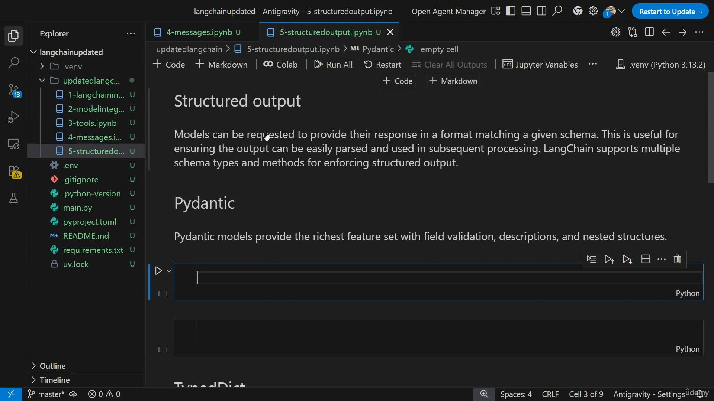

### 3.2 P12：用 Pydantic 定义 Movie schema

Pydantic 是这一节的“正餐”。先 `from pydantic import BaseModel, Field`，再继承 `BaseModel` 写一个类。每个字段用 `Field(description="...")` 给模型提示这个字段是什么意思——这段描述会进入发给模型的 schema，模型就靠它判断往哪塞值。

字段类型决定校验规则：`title: str` 只能字符串，`year: int` 只能整数，`rating: float` 整数或浮点都行。类型不对，Pydantic 直接抛错，不会悄悄塞进去。讲师在 p012 [05:07] 专门强调过这一点。

定义好之后调 `model.with_structured_output(Movie)`，得到一个“绑定好 parser 的模型”。讲师在 p012 [08:07] 打印过这个对象，显示它是 `RunnableBinding`，里面挂了 `ChatGroq` 和 Pydantic 的输出解析器（讲师口述“pydent tool parser”，实际对象名请以你本地打印结果为准）。然后 `.invoke("Provide details about the movie Inception")`，返回的不再是 `AIMessage`，而是 `Movie` 实例。

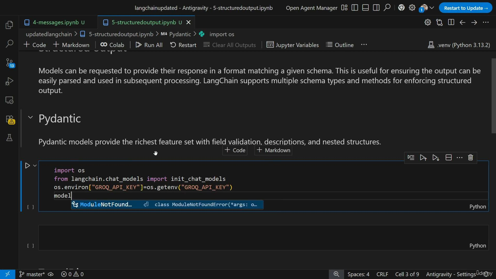

代码跑通后，`print(response)` 输出形如 `title='Inception' year=2010 director='Christopher Nolan' rating=8.8`（p012 [10:03] 讲师屏幕上就是这个结果）。同样的问题用未绑定的 `model.invoke(...)` 问，返回的是一大段关于“植梦”概念的散文，不能直接取值。

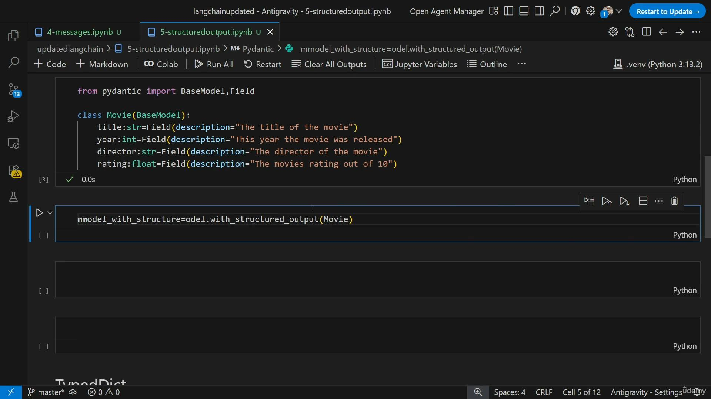

接着看 `include_raw=True`。在 `with_structured_output(Movie, include_raw=True)` 里加上这个参数后，返回值从 `Movie` 变成 dict，包含两个键：`raw` 是模型原始返回的 `AIMessage`，`parsed` 是解析后的 `Movie` 对象。讲师在 p012 [12:55] 演示过，原始消息也会一起打出来，方便你在解析失败时排查是模型没按格式答、还是 parser 出了问题。

再往后是嵌套结构（nested structure）。定义一个 `Actor`，里面有 `name` 和 `role`；再定义一个 `MovieDetails`，其中 `cast: List[Actor]` 引用前面那个 `Actor`。这样模型返回的 cast 就是一个 Actor 对象的列表，每个 Actor 又有自己的 name 和 role。讲师在 p012 [14:47] 演示时，输出里能看到 Leonardo DiCaprio / Dom Cobb、Joseph Gordon-Levitt / Arthur 这样的成对结构，genres 是 `['Science Fiction', 'Action']`，budget 是 `160.0`（单位百万美元）。

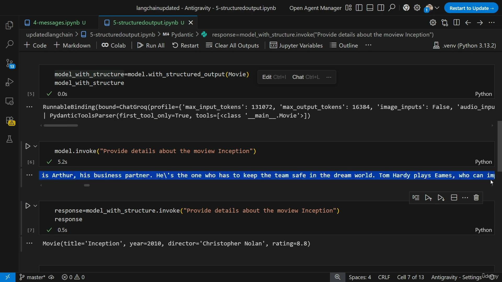

一个小坑：讲师写 budget 时用了 `budget: float = Field(default=None, description="Budget in million USD")`。严格说 `float` 类型不接受 `None`，Pydantic v2 会警告或直接在校验时报错，正确写法是 `Optional[float]` 或 `float | None`。课里没讲这个细节，照抄可能会撞上。

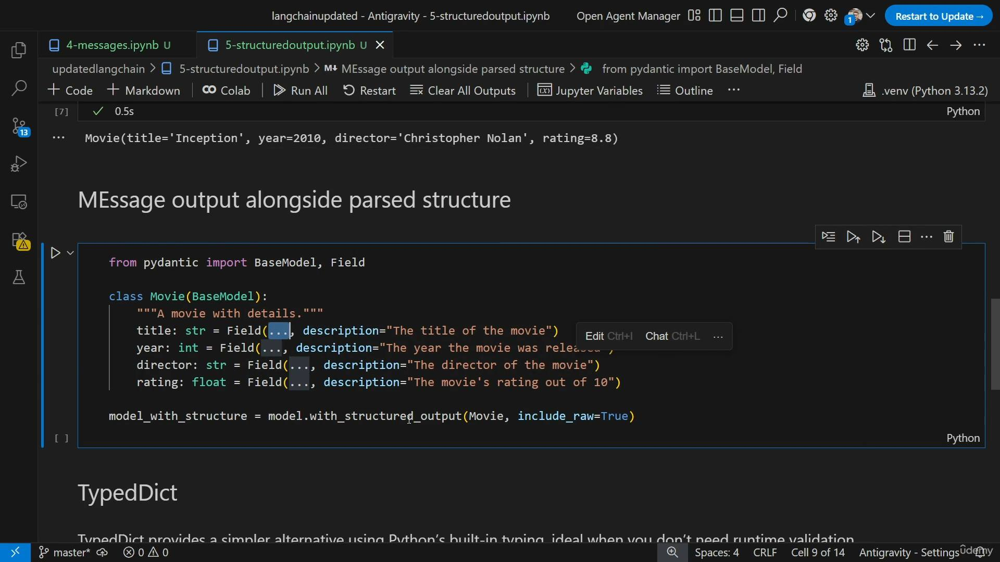

### 3.3 P13：换成 TypedDict

P13 的目标是“同一件事换个更轻的写法”。`TypedDict` 本质是一个带类型注解的 dict，**运行时不做校验**——你声明 `title: str`，模型真返回一个整数也没人拦你。讲师在 p013 [00:18] 说得很直白：TypedDict 适合你不需要 runtime validation 的时候。

导入是 `from typing_extensions import TypedDict, Annotated`（课里用的 `typing_extensions`，不是标准库 `typing`，两者混用有时会踩坑，见第七节）。声明字段时通过 `Annotated` 把描述文本挂上去：

```python
class MovieDict(TypedDict):
    title: Annotated[str, "The title of the movie"]
    year: Annotated[int, "The year the movie was released"]
    director: Annotated[str, "The director of the movie"]
    rating: Annotated[float, "The movie's rating out of 10"]
```

调 `model.with_structured_output(MovieDict)` 得到的对象和 P12 那个用法完全一样，只是 `.invoke()` 返回的是普通 dict 而不是 Pydantic 对象。讲师问 Avengers 得到 `director='Joss Whedon', rating=8, title='Avengers', year=2012`（p013 [03:11]）。

嵌套结构也能用 TypedDict 写：`cast: List[ActorDict]`，`genres: List[str]`，逻辑和 P12 一致，只是没有校验。讲师在这里补了一句：TypedDict 里“director 给个整数也能过”，因为不做输入校验。

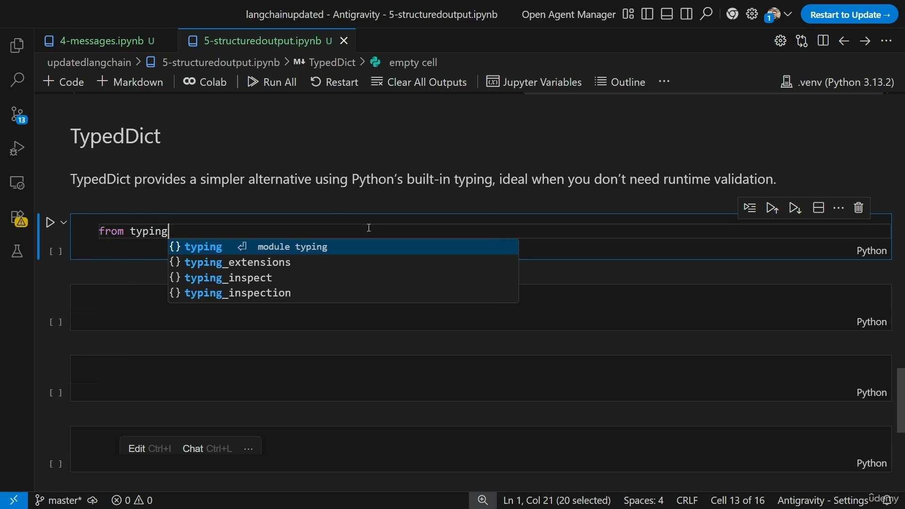

P13 后半段讲师顺手看了 `profile`。`model_with_structure.profile` 会报错 `RunnableSequence has no attribute profile`（p013 [04:56] 屏幕上显示的就是这个错误），原因是 `with_structured_output` 返回的是一个绑定层，不是原始模型。要看模型的元信息，得回到 `model.profile`：返回一个 dict，里面有 `max_input_tokens`、`max_output_tokens`、`image_inputs`、`audio_inputs`、`video_inputs`、`reasoning_output`、`tool_calling` 等字段。Qwen3-32B 在 Groq 上的 profile 里，image/audio/video 输入都是 `False`，reasoning output 和 tool calling 都是 `True`。讲师说这段信息能帮你判断一个模型适不适合当前任务，比如要做多模态，photo 输入为 `False` 的模型直接 pass。

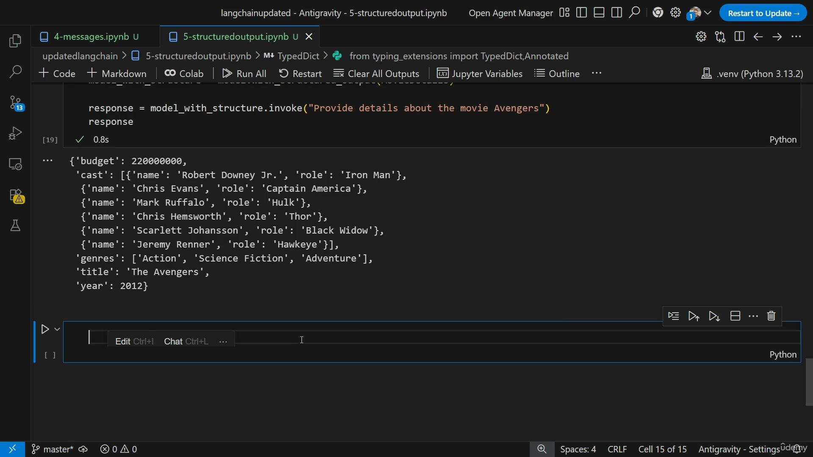

### 3.4 P14：把 schema 交给 create_agent

P14 的切换点是把结构化输出从“直接调模型”改到“agent 层”。模型换成 `GPT-5`，schema 换成一个 `ContactInfo`（`name`、`email`、`phone` 三个字符串字段），但不再是 `model.with_structured_output(...)`，而是：

```python
agent = create_agent(
    model="gpt-5",
    response_format=ContactInfo,
)
```

`response_format` 参数告诉 agent：“无论这一轮对话怎么走，最终交付的结果必须符合这个 schema。”讲师在 p014 [01:56] 说得比较清楚：之前是 `with_structured_output`，这次是直接把 `response_format` 交给 agent，由 agent 在内部保证。

调用方式也变了：

```python
result = agent.invoke({
    "messages": [{"role": "user", "content": "Extract contact info from: John Doe, john@example.com"}]
})
print(result["structured_response"])
```

`result` 是个 dict，键 `messages` 放对话历史，键 `structured_response` 放解析后的对象。p014 [03:25] 讲师打印出来的结果是：`ContactInfo(name='John Doe', email='john@example.com', phone=...)`。Pydantic 版本对每个字段做校验，所以字段类型不对会在这一步报错。

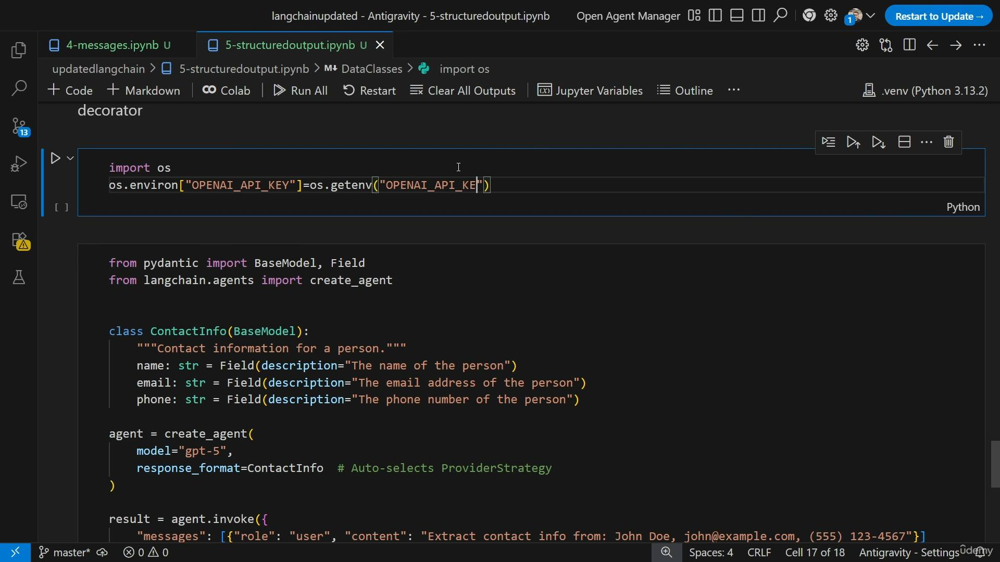

同一条路，换成 TypedDict：

```python
from typing_extensions import TypedDict

class ContactInfo(TypedDict):
    name: str
    email: str
    phone: str

agent = create_agent(model="gpt-5", response_format=ContactInfo)
```

结果里的 `structured_response` 是一个普通 dict。再到 dataclass：

```python
from dataclasses import dataclass

@dataclass
class ContactInfo:
    name: str
    email: str
    phone: str
```

`@dataclass` 是 Python 3.7 就有的装饰器，讲师在 p014 [00:18] 强调它没有数据校验——字段类型写 `str` 纯粹是给人看的，不会拦整数。`create_agent(..., response_format=ContactInfo)` 的用法和上面完全一致。

讲师在 P14 结尾说了一句很重要的判断：这三种是**同一件事的不同写法**，选一个就够用，主要看你对运行时校验的容忍度。

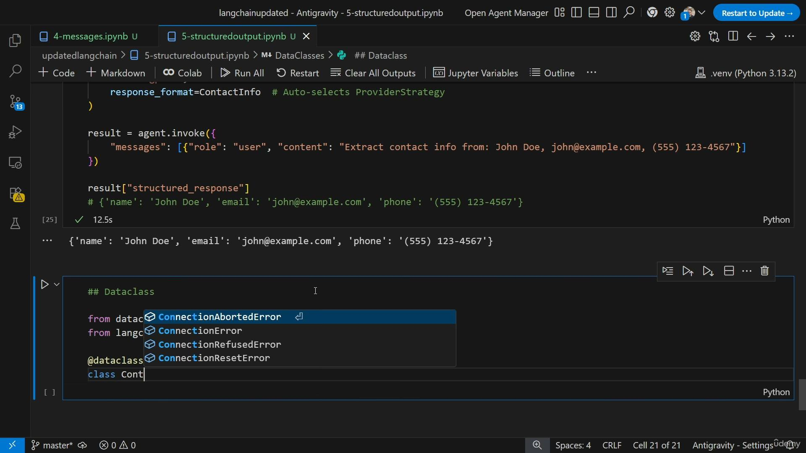

### 3.5 P15：Middleware 与 SummarizationMiddleware

P15 是整个 part2 的重点。讲师先讲概念：middleware 是一层“套在 agent 外面的控制层”，你可以在 agent 生命周期的固定位置插逻辑。为了让这个概念落地，他用机场安检打比方——从进机场到登机要经过安检、边检、登机牌核验三个关卡，每个关卡就是一层 middleware，分别检查行李、护照有效期、登机牌。对应到 agent 上就是：在 agent 启动前、模型调用前、工具调用时、模型调用后、agent 结束后，各可以插一段逻辑。这一段讲师在 p015 [05:05] 原话叫“exposes hooks”。

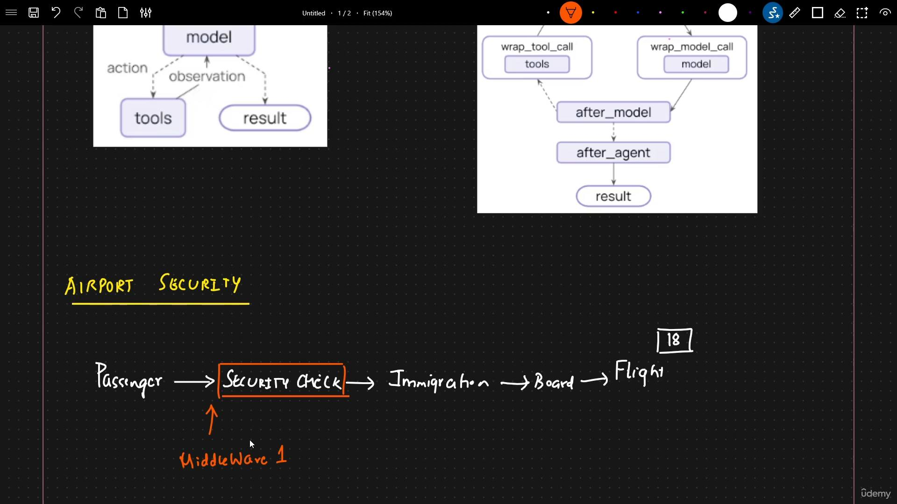

课里提到、但没展开写代码的内置中间件有这些：

- **SummarizationMiddleware**：对话历史接近 token 限制时自动摘要，保留最近消息。
- **Human in the loop**：暂停执行，等人工批准工具调用。
- **Model call limit**：限制模型调用次数，防止成本失控。
- **Tool call limit**：限制工具执行次数。
- **Model fallback**：主模型不可用时切到备用模型（讲师举的例子是 API key 挂掉时 fallback）。
- **To-do list**：任务清单管理。
- **LLM tool selector**：由 LLM 挑工具。
- **Tool retry**：工具失败重试。

只有 SummarizationMiddleware 在 P15 里给了完整代码，其余“课里没讲”具体怎么写。

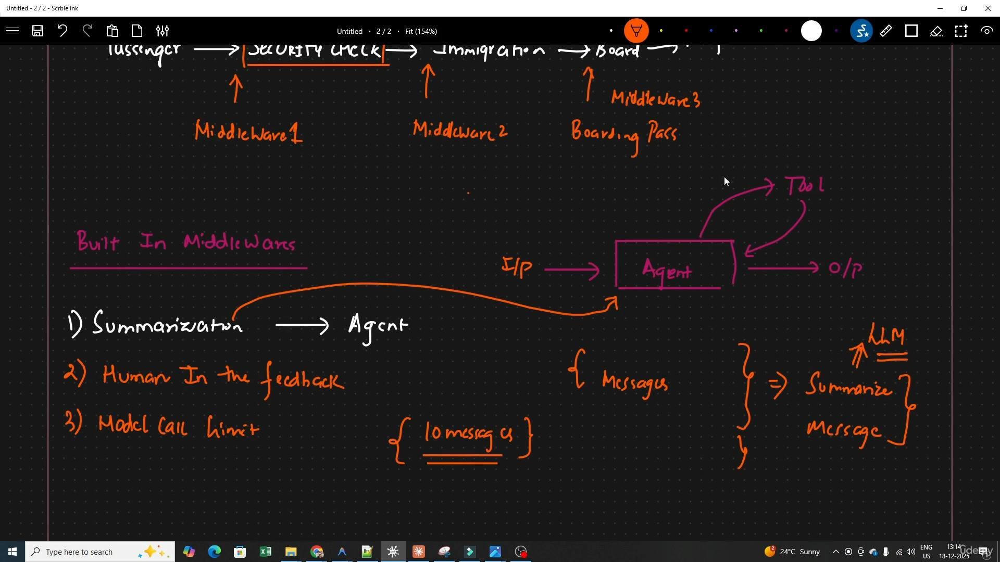

#### 3.5.1 触发方式一：消息条数

核心代码：

```python
agent = create_agent(
    model="gpt-4o-mini",
    tools=[],
    checkpointer=InMemorySaver(),
    middleware=[
        SummarizationMiddleware(
            model="gpt-4o-mini",
            trigger={"messages": 10},
            keep={"messages": 4},
        )
    ],
)
```

`checkpointer=InMemorySaver()` 是把对话历史存在本地内存里，这样 `thread_id` 相同的历史能连起来——这是摘要能生效的前提，因为中间件需要看到完整历史才能判断要不要压。`trigger={"messages": 10}` 表示“消息达到 10 条时触发”，`keep={"messages": 4}` 表示“摘要完成后保留最近 4 条”。讲师在 p015 [14:59] 特意说明：真实产品里这个数字会大得多，这里设 10 纯粹是为了演示时能快速触发。

跑测试时先建一个 config：

```python
config = {"configurable": {"thread_id": "test-1"}}
```

`thread_id` 相当于用户 ID，同一 thread 的对话共享历史。然后循环问四个算术题（2+2、10×5、100÷4、15-7），每次 `agent.invoke({"messages": [HumanMessage(content=q)]}, config=config)`，打印回复内容和 `len(response["messages"])`。

p015 [18:17] 讲师观察到的现象是：消息数一路涨到 10，然后触发摘要，历史被压缩成一段“Human asked several arithmetic questions. AI responded 2+2 equals 4. 10 multiplied by 5 equals 50...”这样的总结，消息数随之下降。

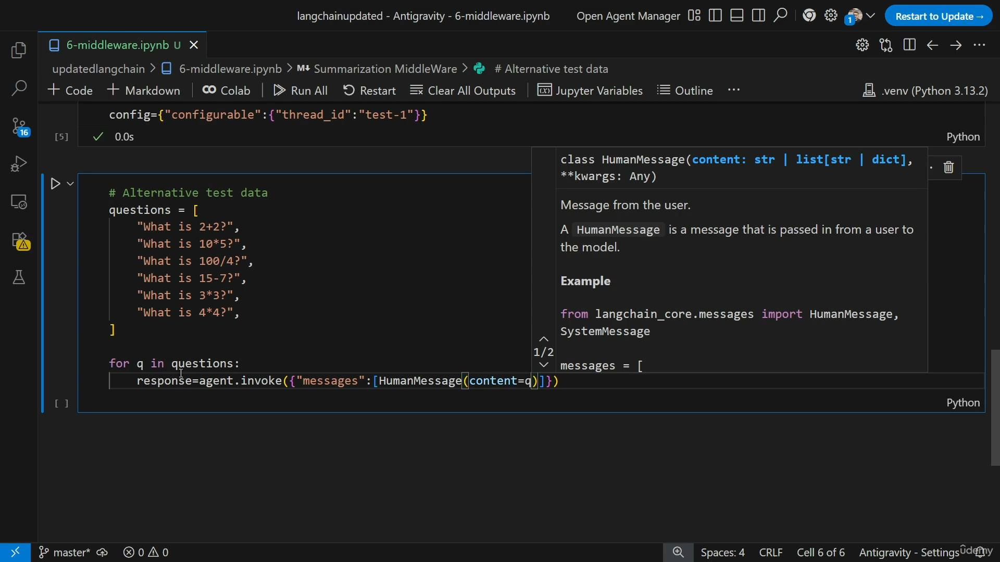

#### 3.5.2 触发方式二：token 数

第二种是 token 触发。这个版本多了一个 `search_hotels` 工具，返回硬编码的城市酒店列表（讲师在 p015 [20:11] 强调“就当它是从某个 API 返回的”）。agent 配置：

```python
agent = create_agent(
    model="gpt-4o-mini",
    tools=[search_hotel],
    checkpointer=InMemorySaver(),
    middleware=[
        SummarizationMiddleware(
            model="gpt-4o-mini",
            trigger={"tokens": 550},
            keep={"tokens": 200},
        )
    ],
)
```

`trigger={"tokens": 550}` 是“累计 token 超过 550 时触发”，`keep={"tokens": 200}` 是“摘要后保留最近 200 token 的原文”。

课里用了一个很朴素的 token 估算函数：

```python
def count_tokens(text: str) -> int:
    return len(text) // 4
```

`4 characters = 1 token`，讲师在 p015 [22:32] 明确说了这个假设。它不精确，但用来演示“token 在涨到阈值时被压下去”足够了。

跑测试时准备了六个城市（Paris、London、Tokyo、New York、Dubai、Singapore），每个城市问一次“Find hotels in ...”。p015 [23:58] 讲师屏幕上的 token 走势是：149 → 302 → 456 → 396（触发摘要）→ 232（又触发一次摘要）。两个下降点就是两次摘要发生的时刻。

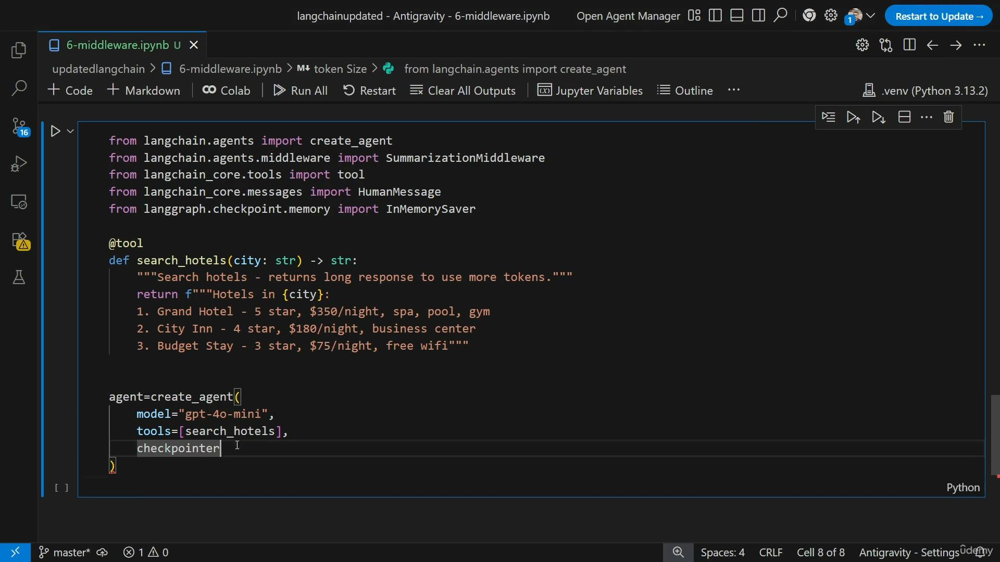

#### 3.5.3 触发方式三：上下文占比 fraction

第三种最“自适应”：不写死 token 数，而是写一个占上下文窗口的比例。`trigger={"fraction": 0.005}` 表示“当前对话占模型上下文窗口的 0.5% 时触发”。如果模型上下文是 128k，0.5% 就是 640 token——讲师在 p015 [25:18] 口算时说的是“640 token”，屏幕叙述里提到了 160k 上下文，两者对不太上，以你本地模型的实际上下文窗口换算为准。

fraction 的好处是换模型不用改阈值：从 128k 的模型换到 1M 上下文的模型，0.5% 的绝对值自动跟着变大。p015 [25:51] 讲师演示的趋势是 0.09 → 0.15 → 0.21 → 突破 0.5% 后触发摘要。

---

## 4. 完整代码

下面七个文件都能直接保存运行。每个文件顶部都显式设置环境变量（照抄课里的写法），但更推荐用 `.env` + `python-dotenv`，两种方式在代码里都保留了。

### 4.1 requirements.txt

```txt
langchain>=1.0.0
langchain-openai>=1.0.0
langchain-groq>=1.0.0
langgraph>=1.0.0
pydantic>=2.0.0
python-dotenv>=1.0.0
typing-extensions>=4.8.0
jupyter>=1.0.0
```

### 4.2 .env.example

```bash
GROQ_API_KEY=your_groq_api_key_here
OPENAI_API_KEY=your_openai_api_key_here
```

### 4.3 p12_pydantic_structured.py

```python
"""P12: 用 Pydantic 做结构化输出（含 include_raw 与嵌套结构）。"""

import os
from typing import List, Optional

from dotenv import load_dotenv
from langchain.chat_models import init_chat_model
from pydantic import BaseModel, Field

load_dotenv()


# ---------- 1. 加载 Groq 上的 Qwen3-32B ----------
model = init_chat_model(
    "qwen/qwen3-32b",
    model_provider="groq",
    temperature=0,
)


# ---------- 2. 定义 Movie schema ----------
class Movie(BaseModel):
    title: str = Field(description="The title of the movie")
    year: int = Field(description="The year the movie was released")
    director: str = Field(description="The director of the movie")
    rating: float = Field(description="The movie's rating out of 10")


model_with_structure = model.with_structured_output(Movie)
print("structured model:", model_with_structure)

question = "Provide details about the movie Inception"

# 不给 schema 的默认输出（自然语言散文）
plain = model.invoke(question)
print("\n--- plain output ---")
print(plain.content)

# 给 schema 的结构化输出
response = model_with_structure.invoke(question)
print("\n--- structured output ---")
print(response)
print(type(response))


# ---------- 3. include_raw=True：同时拿原始消息和解析结果 ----------
model_with_raw = model.with_structured_output(Movie, include_raw=True)
raw_result = model_with_raw.invoke(question)
print("\
n--- raw message ---")
print(raw_result["raw"].content)
print("\n--- parsed object ---")
print(raw_result["parsed"])
print(type(raw_result))


# ---------- 4. 嵌套结构：MovieDetails 里放 List[Actor] ----------
class Actor(BaseModel):
    name: str = Field(description="The name of the actor")
    role: str = Field(description="The role played by the actor")


class MovieDetails(BaseModel):
    title: str = Field(description="The movie title")
    release_date: str = Field(description="The movie release date")
    cast: List[Actor] = Field(description="List of actors in the movie")
    genres: List[str] = Field(description="List of genres")
    budget: Optional[float] = Field(
        default=None,
        description="Budget in million USD",
    )


model_with_details = model.with_structured_output(MovieDetails)
details = model_with_details.invoke(question)

print("\n--- nested output ---")
print(details)
print("cast[0]:", details.cast[0])
print("genres:", details.genres)
print("budget:", details.budget)


if __name__ == "__main__":
    print("\nGROQ_API_KEY set:", bool(os.getenv("GROQ_API_KEY")))
```

### 4.4 p13_typeddict_structured.py

```python
"""P13: 用 TypedDict 做结构化输出，并对比 model.profile 与结构化模型的 profile。"""

import os
from typing import List, Optional

from dotenv import load_dotenv
from langchain.chat_models import init_chat_model
from typing_extensions import Annotated, TypedDict

load_dotenv()


# ---------- 1. 同一个 Groq Qwen3-32B ----------
model = init_chat_model(
    "qwen/qwen3-32b",
    model_provider="groq",
    temperature=0,
)


# ---------- 2. TypedDict 版 Movie schema ----------
class MovieDict(TypedDict):
    title: Annotated[str, "The title of the movie"]
    year: Annotated[int, "The year the movie was released"]
    director: Annotated[str, "The director of the movie"]
    rating: Annotated[float, "The movie's rating out of 10"]


model_with_typeddict = model.with_structured_output(MovieDict)
print("structured model:", model_with_typeddict)

response = model_with_typeddict.invoke("Provide details about the movie Avengers")
print("\n--- structured output (dict) ---")
print(response)
print(type(response))
print("title:", response["title"])
print("year:", response["year"])
print("director:", response["director"])
print("rating:", response["rating"])


# ---------- 3. TypedDict 也能做嵌套结构 ----------
class ActorDict(TypedDict):
    name: Annotated[str, "The name of the actor"]
    role: Annotated[str, "The role played by the actor"]


class MovieDetailsDict(TypedDict):
    title: Annotated[str, "The movie title"]
    release_date: Annotated[str, "The movie release date"]
    cast: Annotated[List[ActorDict], "List of actors in the movie"]
    genres: Annotated[List[str], "List of genres"]
    budget: Annotated[Optional[float], "Budget in million USD"]


model_with_nested = model.with_structured_output(MovieDetailsDict)
nested = model_with_nested.invoke("Provide details about the movie Inception")
print("\n--- nested output (dict) ---")
print(nested)


# ---------- 4. profile：结构化模型上没有，原始模型上有 ----------
print("\n--- structured model .profile ---")
try:
    print(model_with_typeddict.profile)
except Exception as e:
    print("报错:", e)

print("\n--- base model .profile ---")
print(model.profile)
```

### 4.5 p14_dataclass_agent.py

```python
"""P14: 用 create_agent 的 response_format 做结构化输出，三种 schema 写法并列。"""

from dataclasses import dataclass

from dotenv import load_dotenv
from langchain.agents import create_agent
from pydantic import BaseModel, Field
from typing_extensions import Annotated, TypedDict

load_dotenv()

USER_INPUT = "Extract contact info from: John Doe, john@example.com, 555-0100"


# ---------- 版本 1：Pydantic（有运行时校验） ----------
class ContactInfoPydantic(BaseModel):
    name: str = Field(description="The name of the person")
    email: str = Field(description="The email of the person")
    phone: str = Field(description="The phone number of the person")


agent_pydantic = create_agent(
    model="gpt-5",
    response_format=ContactInfoPydantic,
)

result = agent_pydantic.invoke(
    {"messages": [{"role": "user", "content": USER_INPUT}]}
)
print("--- pydantic ---")
print(result["messages"])
print(result["structured_response"])
print(type(result["structured_response"]))


# ---------- 版本 2：TypedDict（无运行时校验，结果是 dict） ----------
class ContactInfoTypedDict(TypedDict):
    name: Annotated[str, "The name of the person"]
    email: Annotated[str, "The email of the person"]
    phone: Annotated[str, "The phone number of the person"]


agent_typeddict = create_agent(
    model="gpt-5",
    response_format=ContactInfoTypedDict,
)

result = agent_typeddict.invoke(
    {"messages": [{"role": "user", "content": USER_INPUT}]}
)
print("--- typeddict ---")
print(result["structured_response"])
print(type(result["structured_response"]))
print("name:", result["structured_response"]["name"])


# ---------- 版本 3：dataclass（无运行时校验） ----------
@dataclass
class ContactInfoDataclass:
    name: str
    email: str
    phone: str


agent_dataclass = create_agent(
    model="gpt-5",
    response_format=ContactInfoDataclass,
)

result = agent_dataclass.invoke(
    {"messages": [{"role": "user", "content": USER_INPUT}]}
)
print("--- dataclass ---")
print(result["structured_response"])
print(type(result["structured_response"]))
```

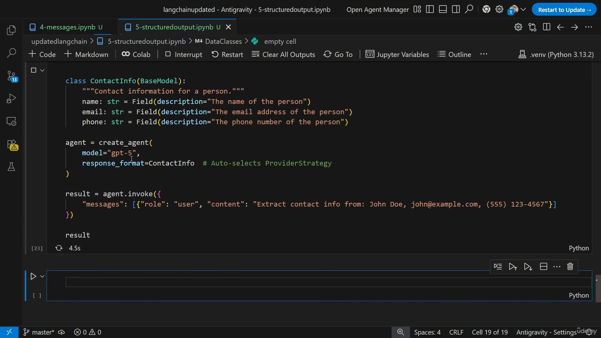

### 4.6 p15_middleware_messages.py

```python
"""P15.1: SummarizationMiddleware —— 按消息条数触发摘要。"""

from dotenv import load_dotenv
from langchain.agents import create_agent
from langchain.agents.middleware import SummarizationMiddleware
from langchain_core.messages import HumanMessage
from langgraph.checkpoint.memory import InMemorySaver

load_dotenv()

agent = create_agent(
    model="gpt-4o-mini",
    tools=[],
    checkpointer=InMemorySaver(),
    middleware=[
        SummarizationMiddleware(
            model="gpt-4o-mini",
            trigger={"messages": 10},
            keep={"messages": 4},
        )
    ],
)

config = {"configurable": {"thread_id": "test-1"}}

questions = [
    "What is 2 plus 2?",
    "What is 10 multiplied by 5?",
    "What is 100 divided by 4?",
    "What is 15 minus 7?",
]

for q in questions:
    response = agent.invoke(
        {"messages": [HumanMessage(content=q)]},
        config=config,
    )
    print("Q:", q)
    print("A:", response["messages"][-1].content)
    print("message count:", len(response["messages"]))
    print("-" * 40)
```

### 4.7 p15_middleware_tokens.py

```python
"""P15.2: SummarizationMiddleware —— 按 token 数触发摘要。"""

from dotenv import load_dotenv
from langchain.agents import create_agent
from langchain.agents.middleware import SummarizationMiddleware
from langchain_core.messages import HumanMessage
from langchain_core.tools import tool
from langgraph.checkpoint.memory import InMemorySaver

load_dotenv()


# ---------- 课里说“就当它是从某个 API 返回的” ----------
@tool
def search_hotel(city: str) -> str:
    """Search hotels in a given city."""
    hotels = {
        "Paris": ["Grand Hotel Paris", "Hotel Lumiere", "Ritz Paris"],
        "London": ["The Savoy", "Claridge's", "The Ritz London"],
        "Tokyo": ["Park Hyatt Tokyo", "Imperial Hotel", "Mandarin Oriental Tokyo"],
        "New York": ["The Plaza", "Waldorf Astoria", "The Peninsula New York"],
        "Dubai": ["Burj Al Arab", "Atlantis The Palm", "Address Downtown"],
        "Singapore": ["Marina Bay Sands", "Raffles Hotel", "Fullerton Hotel"],
    }
    return ", ".join(hotels.get(city, ["No hotels found"]))


def count_tokens(text: str) -> int:
    """课里的估算方式：4 characters = 1 token。"""
    return len(text) // 4


agent = create_agent(
    model="gpt-4o-mini",
    tools=[search_hotel],
    checkpointer=InMemorySaver(),
    middleware=[
        SummarizationMiddleware(
            model="gpt-4o-mini",
            trigger={"tokens": 550},
            keep={"tokens": 200},
        )
    ],
)

config = {"configurable": {"thread_id": "test-2"}}

cities = ["Paris", "London", "Tokyo", "New York", "Dubai", "Singapore"]

for city in cities:
    question = f"Find hotels in {city}"
    response = agent.invoke(
        {"messages": [HumanMessage(content=question)]},
        config=config,
    )
    text = response["messages"][-1].content
    print("Q:", question)
    print("A:", text)
    print("tokens:", count_tokens(text))
    print("message count:", len(response["messages"]))
    print("-" * 40)
```

### 4.8 p15_middleware_fraction.py

```python
"""P15.3: SummarizationMiddleware —— 按上下文占比 fraction 触发摘要。"""

from dotenv import load_dotenv
from langchain.agents import create_agent
from langchain.agents.middleware import SummarizationMiddleware
from langchain_core.messages import HumanMessage
from langchain_core.tools import tool
from langgraph.checkpoint.memory import InMemorySaver

load_dotenv()


@tool
def search_hotel(city: str) -> str:
    """Search hotels in a given city."""
    hotels = {
        "Paris": ["Grand Hotel Paris", "Hotel Lumiere", "Ritz Paris"],
        "London": ["The Savoy", "Claridge's", "The Ritz London"],
        "Tokyo": ["Park Hyatt Tokyo", "Imperial Hotel", "Mandarin Oriental Tokyo"],
        "New York": ["The Plaza", "Waldorf Astoria", "The Peninsula New York"],
        "Dubai": ["Burj Al Arab", "Atlantis The Palm", "Address Downtown"],
        "Singapore": ["Marina Bay Sands", "Raffles Hotel", "Fullerton Hotel"],
    }
    return ", ".join(hotels.get(city, ["No hotels found"]))


def count_tokens(text: str) -> int:
    return len(text) // 4


agent = create_agent(
    model="gpt-4o-mini",
    tools=[search_hotel],
    checkpointer=InMemorySaver(),
    middleware=[
        SummarizationMiddleware(
            model="gpt-4o-mini",
            trigger={"fraction": 0.005},
        )
    ],
)

config = {"configurable": {"thread_id": "test-3"}}

cities = ["Paris", "London", "Tokyo", "New York", "Dubai", "Singapore"]

for city in cities:
    question = f"Find hotels in {city}"
    response = agent.invoke(
        {"messages": [HumanMessage(content=question)]},
        config=config,
    )
    text = response["messages"][-1].content
    print("Q:", question)
    print("A:", text)
    print("tokens:", count_tokens(text))
    print("message count:", len(response["messages"]))
    print("-" * 40)
```

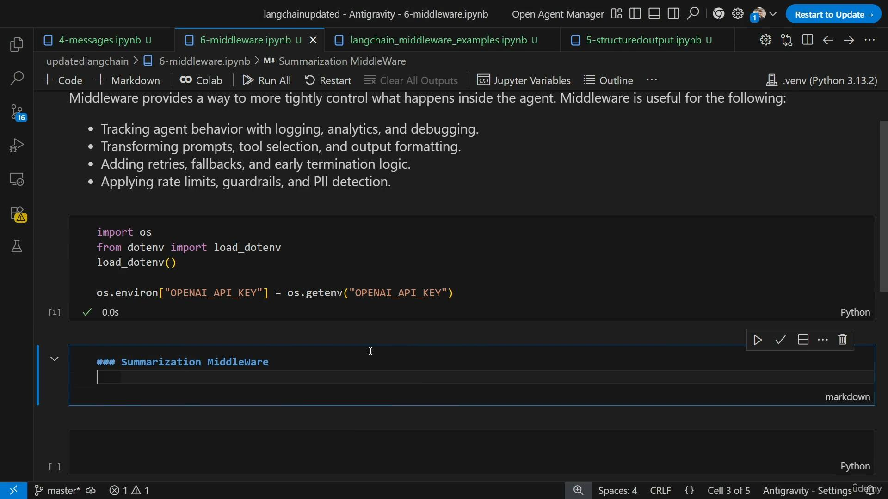

---

## 5. 逐行解释

### 5.1 为什么每个文件都要 `load_dotenv()`

讲师在 p012 [02:21] 的原始写法是 `os.environ["GROQ_API_KEY"] = os.getenv("GROQ_API_KEY")`——先把环境变量读出来再写回环境变量，这在 Jupyter 里能用，但在 `.py` 文件里没意义，因为 `os.getenv` 读不到东西时写回去也是 `None`。所以文档里改成 `load_dotenv()`：它从同目录的 `.env` 文件加载键值对进 `os.environ`，之后 LangChain 的 Groq / OpenAI 集成会自动去 `os.environ` 里找 key，你不用显式传 `api_key=`。这是课里没讲但必须做的替换，否则脚本直接 401。

### 5.2 `init_chat_model` 与 `temperature=0`

`init_chat_model("qwen/qwen3-32b", model_provider="groq")` 是 LangChain 的统一入口：第一个参数是模型 ID，第二个参数告诉它走哪个 provider 的 SDK。讲师在 p012 [02:47] 遇到 `cannot import a name in chat models` 的报错，是因为当时 `langchain.chat_models` 里没有导出他想要的那个名字，最后他用 `init_chat_model` 把模型加载上来了。所以文档统一用 `init_chat_model`，避免撞同一个坑。

`temperature=0` 不是讲师显式讲的，但他所有结构化输出示例都是“要稳定格式”的场景。结构化输出本质是让模型填表，采样温度越高越容易瞎填或格式跑偏。在 JS/Node 里类比就是：你不会用 `Math.random()` 生成 JSON 的键名。

### 5.3 Pydantic 的字段类型为什么等于校验规则

`title: str` 这一行同时干三件事：声明 schema 里有个叫 `title` 的字段、告诉模型这个字段该填什么类型、告诉 Pydantic 校验时该比对什么类型。讲师在 p012 [05:07] 强调的“给数值就报错”就是第三件事在起作用。

`Field(description="...")` 是给模型的说明书。这段文字会随 schema 一起发给 LLM，模型靠它区分“title 是电影名”还是“title 是人名”。讲师在 p012 [06:11] 说“这些描述对 LLM 非常重要”，原因就在这里——如果只给字段名不给描述，模型只能靠猜。

`rating: float` 而不是 `int`，是因为评分可能是 8.8 这种小数；Pydantic 对 `float` 字段接受整数输入（会自动转成 8.0），所以写成 float 覆盖面更广。讲师在 p012 [11:28] 的原话是“rating 你可以给整数也可以给浮点”。

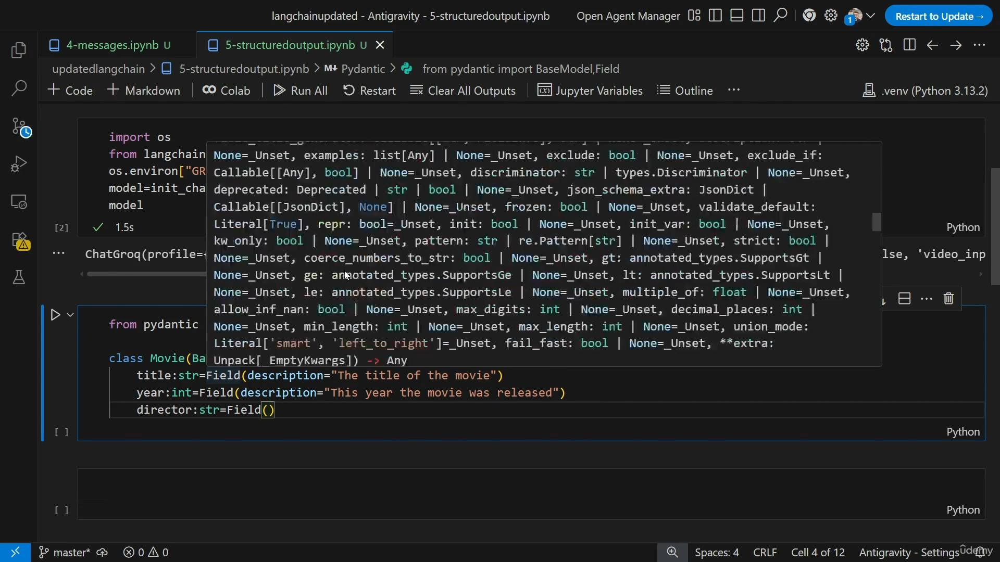

### 5.4 `with_structured_output` 到底返回了什么

`model.with_structured_output(Movie)` 不是“给模型加个开关”，而是**新建了一个 Runnable**：里面串了“调用模型 → 拿到文本 → 用 Pydantic parser 解析成 Movie 对象”三步。讲师在 p012 [08:07] 打印这个对象时看到 `RunnableBinding`，里面挂着 `ChatGroq` 和解析器，就是这三步被包在一起的表现。

所以 `.invoke()` 的返回值类型完全变了：未绑定的 `model.invoke()` 返回 `AIMessage`（要 `.content` 取文本），绑定后的 `model_with_structure.invoke()` 直接返回 `Movie` 实例（可以直接 `.title`）。讲师在 p012 [09:05] 先跑了一遍未绑定版本，拿到一大段关于“植梦”的散文，就是为了让你看到这个差异。

### 5.5 `include_raw=True` 是给调试用的

正常情况下解析失败你只能看到一句 `ValidationError`，不知道模型到底返回了什么。`include_raw=True` 让返回值变成 `{"raw": AIMessage, "parsed": Movie}`，原始文本和解析结果一起给你。讲师在 p012 [12:55] 的描述是“初始的原始消息也会显示出来，然后这是我的解析后消息”。

注意加上这个参数后返回值从对象变成 dict，所以 `raw_result["parsed"].title` 才对，直接 `raw_result.title` 会报 AttributeError。

### 5.6 嵌套结构的机制

`cast: List[Actor]` 这一行的意思是：这个字段是一个列表，列表里每一项都要符合 `Actor` 的 schema（有 name 和 role 两个字符串）。Pydantic 会把它展开成 JSON Schema 里的嵌套对象数组，模型看到的是一棵结构化的“表格”，于是它会按 `[{name: ..., role: ...}, {...}]` 的形式返回。

讲师在 p012 [14:47] 演示时看到了 Leonardo DiCaprio / Dom Cobb、Joseph Gordon-Levitt / Arthur 这样的成对结果，说明模型正确理解了“每个 actor 都有名字和角色”这层嵌套关系。课程原文里把 “Joseph Gordon-Levitt” 识别成了 “Joseph Levitt”、把 “Leonardo DiCaprio” 识别成了 “Leonor DeCorpore”，是语音识别的问题，代码不受影响。

`budget: Optional[float] = Field(default=None, ...)` 这里用 `Optional` 是对讲师原写法的修正。他原话是 `float` 类型加 `default=None`，Pydantic v2 会认为“默认值是 None 但类型声明不允许 None”，运行时会告警甚至报错。加 `Optional` 之后语义才自洽：这个字段可以为空。

### 5.7 TypedDict 为什么没有校验

`class MovieDict(TypedDict)` 在运行时**就是一个 `dict` 的别名**。Python 解释器执行到这一行时只记了个类型注解，不做任何检查。你 `MovieDict(title=123, ...)` 或者模型真返回 `{"title": 123}`，都不会报错。讲师在 p013 [00:52] 说的“如果整数也出现在输出里也没关系”就是这个意思。

`Annotated[str, "The title of the movie"]` 是唯一能把描述传给模型的方式——TypedDict 没有 `Field`，只能靠 `Annotated` 的第二个参数挂字符串。这个字符串同样会进 schema。

`from typing_extensions import TypedDict` 而不是 `from typing import TypedDict`：`Annotated` 从 3.9 才有，`TypedDict` 从 3.8 才有，用 `typing_extensions` 能保证低版本 Python 也能跑。代价是两个 `TypedDict` 在某些库眼里不是同一个东西，混用会踩坑（见第七节）。

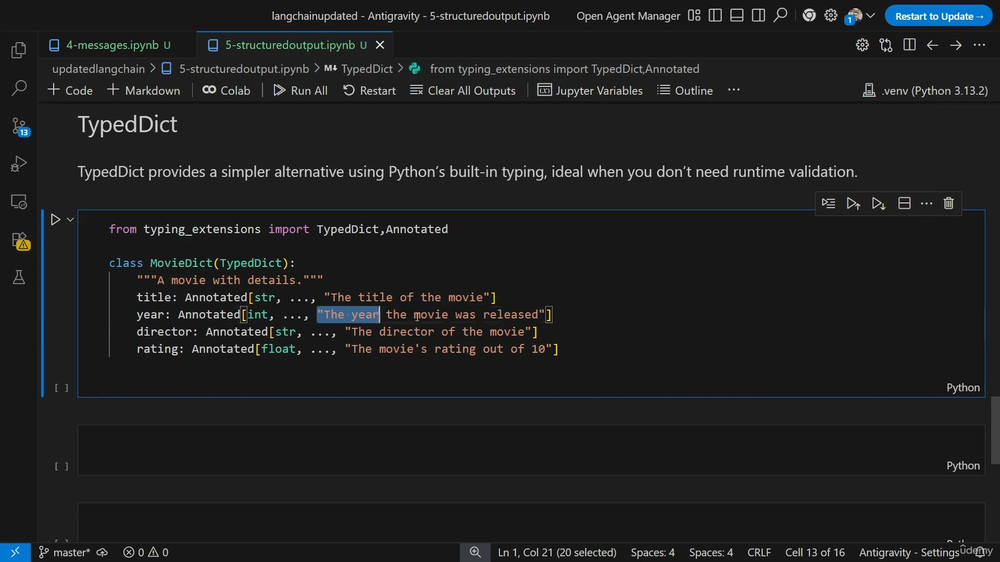

### 5.8 `model.profile` 和结构化模型的差别

`with_structured_output` 返回的是 `RunnableSequence` / `RunnableBinding` 这一层包装，它本身没有 `profile` 属性，所以 `model_with_typeddict.profile` 抛 `RunnableSequence has no attribute profile`。讲师在 p013 [04:56] 就是拿这个报错当教学点：**要看模型元信息，必须回到原始模型对象**。

`model.profile` 返回的 dict 里，`max_input_tokens` / `max_output_tokens` 是上下文和输出上限，`image_inputs` / `audio_inputs` / `video_inputs` 是模态支持情况，`reasoning_output` 表示这个模型会不会输出思维链，`tool_calling` 表示能不能调工具。Qwen3-32B 在 Groq 上的 profile 里图片/音频/视频都是 `False`，reasoning 和 tool calling 都是 `True`。不同库版本里这些键名可能有差异，**该字段名请以实际输出为准**。

### 5.9 `create_agent` 的 `response_format` 和模型级结构化有什么不同

模型级 `with_structured_output` 只在“这一次模型调用”上加约束；agent 级 `response_format` 是在**整个 agent 执行流程结束时**保证最终交付物符合 schema。差别在于：agent 中间可能调了好几次模型、跑了好几个工具，`response_format` 管的是最后那个结果。

调用结果的结构也因此不同：`agent.invoke()` 返回一个 dict，`messages` 键是完整对话历史，`structured_response` 键才是解析后的对象。讲师在 p014 [02:56] 打印 `result.structured_response`（口述 “result of structured response”）拿到的就是 `ContactInfo` 实例。如果你按 `result.content` 去取值会拿到 `None` 或报错——这是从模型级切到 agent 级最容易忘的一处。

三个版本（Pydantic / TypedDict / dataclass）除了 schema 类本身，`create_agent(...)` 的调用完全一样，所以讲师在 p014 结尾说“选一个就够用”。区别只在结果类型：Pydantic 版是对象、TypedDict 版是 dict、dataclass 版是 dataclass 实例。

### 5.10 `InMemorySaver` 和 `thread_id` 在干什么

`checkpointer=InMemorySaver()` 让 agent 把每一轮的对话历史存下来。没有它，`agent.invoke()` 每次都从零开始，历史根本不会累积，摘要中间件也就没有东西可摘要。

`config = {"configurable": {"thread_id": "test-1"}}` 里的 `thread_id` 是会话标识。同样的 `thread_id` 调用多次，历史会串起来；换个 `thread_id` 就是全新的对话。在 JS/Node 里这相当于 `sessionId` 或者 `req.session.id`——Express 里你用 `express-session` 干的事，LangGraph 用 checkpointer 干。

`InMemorySaver` 存在进程内存里，**进程一退出历史就没了**。课里只用了内存版，生产环境要换持久化方案（如数据库版 checkpointer），具体怎么换课里没讲。

### 5.11 `trigger` 和 `keep` 的配对关系

`trigger={"messages": 10}` 是“什么时候动手”，`keep={"messages": 4}` 是“动手之后留多少”。这两个必须配对理解：不是“到 10 条就把前 6 条删掉”，而是“到 10 条时，把前面 6 条压成一段摘要，最近 4 条保持原文”。摘要本身也是一条消息，所以压完之后消息总数会变少但不会归零。

`model="gpt-4o-mini"` 这个参数指的是“用哪个模型做摘要”，和 agent 主模型是分开的。讲师在 p015 [14:22] 明确建议：摘要模型要选便宜的，因为对话越长摘要次数越多，用贵模型做摘要成本会失控。

`trigger={"tokens": 550}` 和 `keep={"tokens": 200}` 单位换成 token；`trigger={"fraction": 0.005}` 单位换成“占模型上下文窗口的比例”。fraction 版本不需要写 keep，因为保留多少由中间件自己按比例算，课里也没给它配 keep。

### 5.12 `count_tokens` 为什么这么简陋还能用

`len(text) // 4` 这个估算假设“平均 4 个字符 = 1 个 token”。英文文本大概在 3.5–4.5 之间浮动，中文差得更远（一个汉字常常 1–2 token）。讲师在 p015 [22:32] 明确说了这是他随手写的估算，目的只是“让你看到数字涨上去又掉下来”。

它不影响中间件本身的判断——中间件内部有自己的 token 计数器。这个函数只是你在外面做日志观察用的。真要精确计数，得用 tiktoken 之类的库，课里没讲。

### 5.13 中间件概念和 Express 的对应

讲师用机场安检打比方：安检查行李、边检查护照、登机口查登机牌，三道关卡都夹在“旅客”和“登机”之间。对应到 Express 就是 `app.use((req, res, next) => { ... next() })`——请求进来先过一层中间件，再进路由处理函数。LangChain 的 middleware 是同一个模式，只是钩子点更多：`before_agent`、`before_model`、`wrap_tool_call`、`after_model`、`after_agent`。讲师在 p015 [05:05] 用 “hooks” 这个词描述的正是这些挂载点。

SummarizationMiddleware 挂的是“模型调用前”这个点：每次调模型之前先看看历史有多长，超阈值就先摘要再发请求。

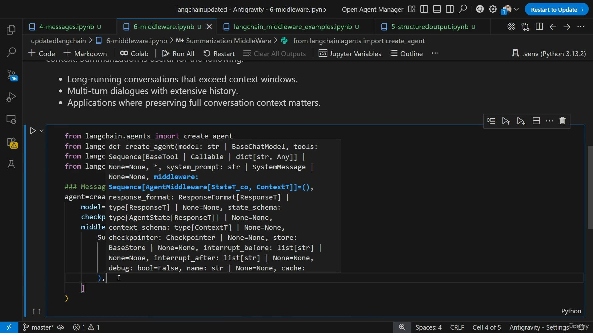

---

## 6. 复现检查清单

按顺序勾，每一步不通过就别往下走。

**环境层**

- [ ] Python ≥ 3.10，`python --version` 能打出来
- [ ] 虚拟环境已激活，`which python` 指向 `.venv`
- [ ] `pip install -r requirements.txt` 无报错
- [ ] `pip show langchain` 版本是 1.x（0.x 没有 `create_agent` 和 `langchain.agents.middleware`）
- [ ] `.env` 文件存在，且 `GROQ_API_KEY`、`OPENAI_API_KEY` 都有值
- [ ] `python -c "import os; from dotenv import load_dotenv; load_dotenv(); print(bool(os.getenv('GROQ_API_KEY')), bool(os.getenv('OPENAI_API_KEY')))"` 输出 `True True`

**P12 检查点**

- [ ] `python p12_pydantic_structured.py` 能跑到底不抛异常
- [ ] `plain output` 那段是一大段自然语言散文（不是字段列表）
- [ ] `structured output` 那段是 `title='Inception' year=2010 director='Christopher Nolan' rating=8.8` 形状的对象
- [ ] `type(response)` 打印出来是 `<class '__main__.Movie'>`，不是 `AIMessage`
- [ ] `raw` 段能打印出原始文本，`parsed` 段是 Movie 对象
- [ ] `cast[0]` 打印出 `name='...' role='...'` 形状的 Actor 对象
- [ ] `genres` 是一个字符串列表，`budget` 是一个浮点数（约 160.0）

**P13 检查点**

- [ ] `python p13_typeddict_structured.py` 能跑到底
- [ ] 结构化输出打印出来是 `{'title': 'Avengers', 'year': 2012, ...}` 这样的 dict 字面量，带花括号
- [ ] `type(response)` 是 `<class 'dict'>`
- [ ] 嵌套输出也是 dict 套 list 套 dict
- [ ] `structured model .profile` 那段打出“报错: ...”而不是崩掉整个脚本
- [ ] `base model .profile` 打印出一个含 `max_input_tokens` 等键的 dict

**P14 检查点**

- [ ] `python p14_dataclass_agent.py` 能跑到底
- [ ] pydantic 段 `structured_response` 打印出 `name='John Doe' email='john@example.com' phone=...`
- [ ] pydantic 段 `type(...)` 是 `ContactInfoPydantic` 类
- [ ] typeddict 段打印出 dict 字面量，`["name"]` 能取到值
- [ ] dataclass 段打印出 `ContactInfoDataclass(name='John Doe', ...)` 形状
- [ ] 三段用的 model 名字是 `"gpt-5"`，没有拼成 `"gtp-5"` 或 `"gpt-40"`（讲师在 p015 就踩过这个拼写坑）

**P15 检查点**

- [ ] `python p15_middleware_messages.py` 跑完，`message count` 序列里出现过“增大后突然变小”的拐点
- [ ] 拐点后的输出里能看到形如 “Here is a summary of the conversation to date...” 的文本
- [ ] `python p15_middleware_tokens.py` 跑完，`tokens` 序列里至少出现两次下降（讲师实测是 149 → 302 → 456 → 396 → 232）
- [ ] 工具被真正调用过：输出里能看到酒店名（Grand Hotel Paris、The Savoy 之类）
- [ ] `python p15_middleware_fraction.py` 跑完，能看到 summary 文本出现
- [ ] 三个脚本用的 `thread_id` 各不相同（`test-1` / `test-2` / `test-3`），否则历史会串

**结构层**

- [ ] 文档里 4.3–4.8 六个 `.py` 文件都保存到磁盘，目录结构和 3.1 一致
- [ ] `requirements.txt` 和 `.env.example` 也建了
- [ ] 每个文件都是独立可运行的，不依赖其他文件的导入

---

## 7. 课里没讲但你会撞上的

**1. 模型 ID 要自己去控制台核对。**
讲师口述的模型是“Groq 上的 Qwen3 32B 推理模型”，语音识别成了 “grog puller”、“quen three 32 billion”。文档里写的是 `qwen/qwen3-32b`，但 Groq 的实际模型 ID 可能带版本后缀或大小写差异。跑之前去 Groq 控制台的模型列表里抄准确的 ID，填进 `init_chat_model` 第一个参数。同理，`"gpt-5"` 和 `"gpt-4o-min