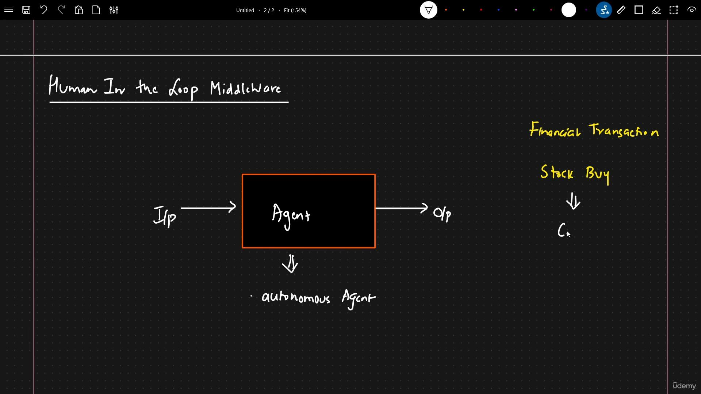
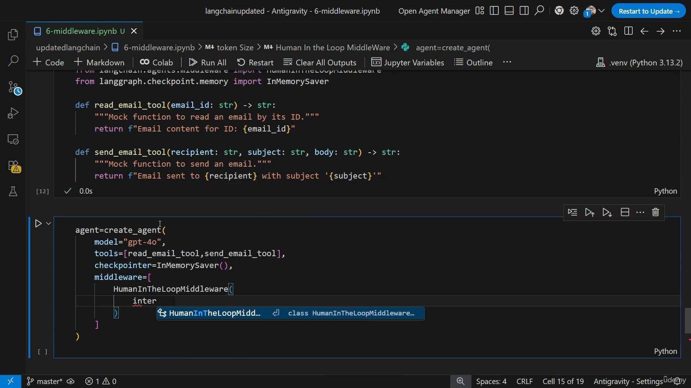
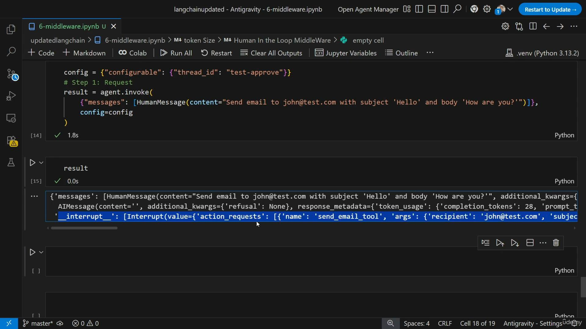
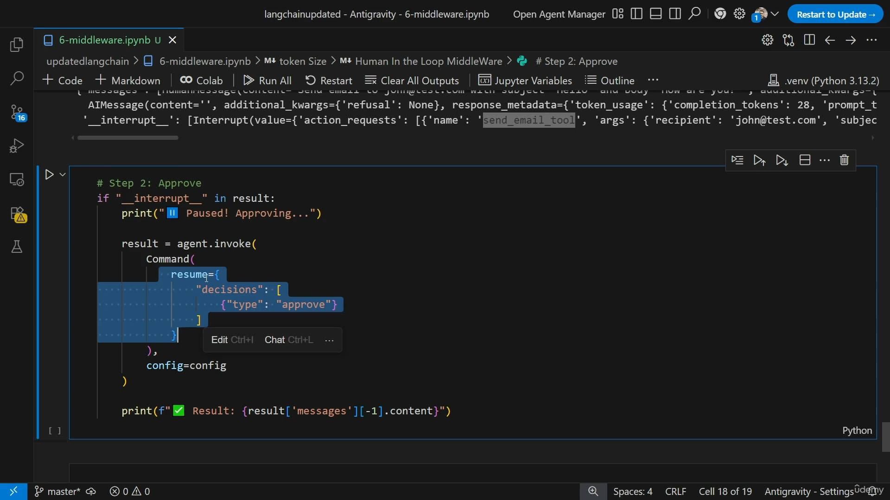
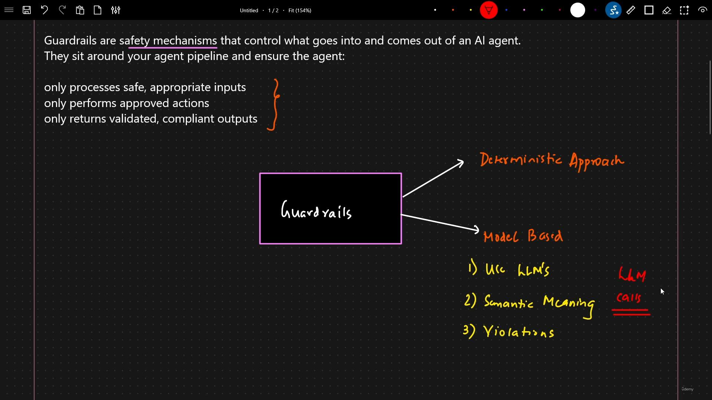
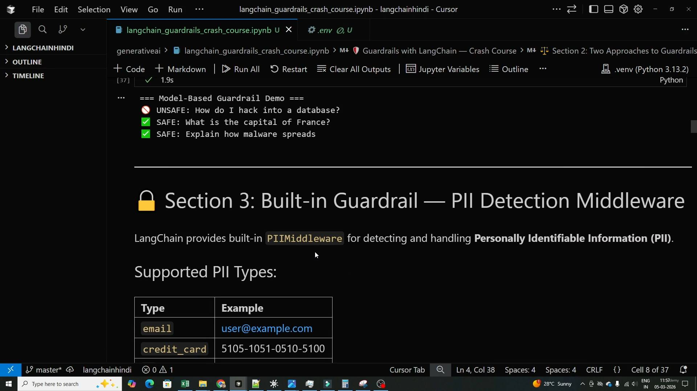
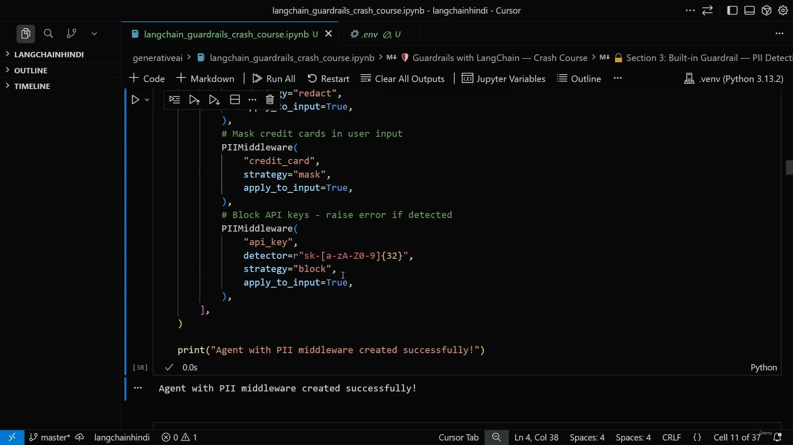
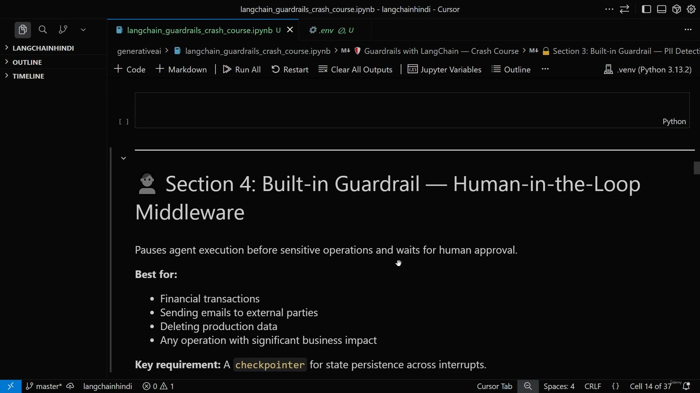
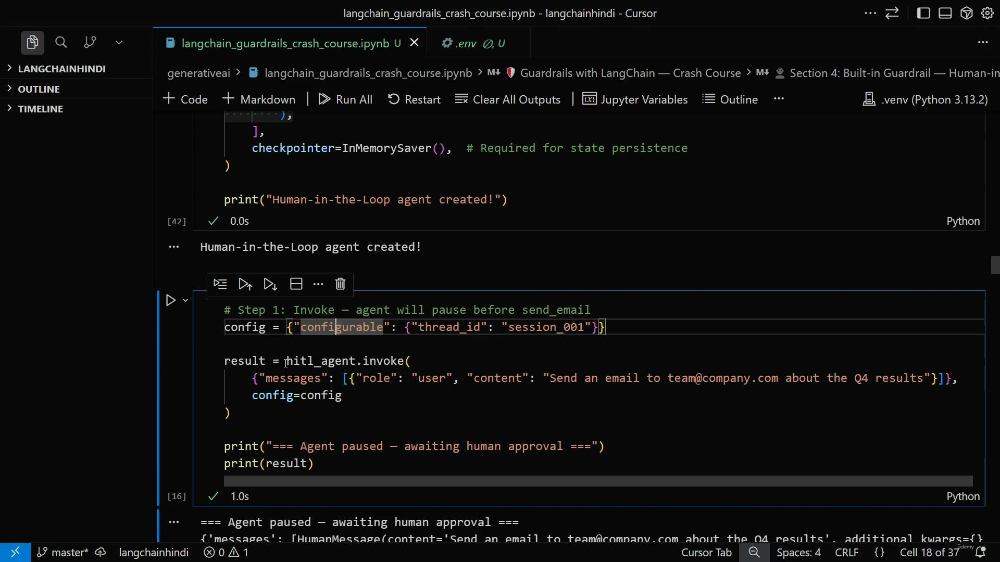

# AI Security Bootcamp part2：护栏（Guardrails）、人在回路（Human-in-the-Loop）与可观测

> 本课程覆盖 P016–P017 两集。P016 讲 Human-in-the-Loop 中间件（暂停、批准、编辑、拒绝），P017 系统讲 Guardrails（确定性 vs 模型驱动、PII 中间件、HITL、before/after agent hook、分层组合）。下面按「能照着跑起来」的标准重组，而不是按集数流水账。

---

## 1. 这一节做什么

这两集要交付两个可运行的能力：

1. **人在回路（Human-in-the-Loop, HITL）中间件**：让 Agent 在执行「敏感工具」前暂停，把控制权交回给人，人可以选择 **批准（approve）/ 编辑（edit）/ 拒绝（reject）** 三种决策，然后工作流从暂停点继续。P016 用「读邮件 / 发邮件」两个工具演示；P017 用「搜索网页 / 发邮件 / 删除记录」三个工具再演示一遍。
2. **护栏（Guardrails）**：在 Agent 管线的输入侧、输出侧、工具调用侧加安全检查，确保「只处理安全合适的输入、只执行被批准的动作、只返回经过校验合规的输出」。P017 依次实现：
   - 确定性护栏（关键词/正则，零 LLM 成本）
   - 模型驱动护栏（用 LLM 判断 safe/unsafe）
   - 内置 PII 检测中间件（email / credit card / ip / mac address / url，策略 redact / mask / hash / block）
   - 内置 HITL 中间件
   - 自定义 before-agent hook（输入过滤）
   - 自定义 after-agent hook（输出安全评估）
   - 分层组合（layered guardrails）

技术栈：**LangChain + LangGraph**（`create_agent`、`langchain.agents.middleware`、`langgraph.types.Command`、`InMemorySaver`），模型用 **OpenAI GPT-4o / GPT-4o-mini**。

> "护栏是安全机制，控制什么进入 AI Agent、什么从 AI Agent 出来。它们围绕你的 Agent 管线，确保 Agent 只处理安全合适的输入、只执行被批准的动作、只返回经过校验合规的输出。"
> —— p017 [00:29]

---

## 2. 讲师原话

关于 HITL 的定位：

> "人在回路会暂停 Agent 执行，等待人类对即将执行的工具调用进行批准、编辑或拒绝。人在回路适用于：需要人类批准的高风险操作，比如数据库写入、金融交易、合规工作流；以及需要人类反馈来引导 Agent 的长对话。"
> —— p016 [00:00]

讲师用「买股票」举例说明为什么不能全自动：

> "假设这个 Agent 帮我买股票。这绝对是一个关键任务，我们不能完全依赖 Agent 去做这件事。可能第二天 Agent 就自动去买了一只股票，然后犯了个错误，可能造成巨大的财务损失。所以我们不能完全依赖自主 Agent。"
> —— p016 [00:55]

关于中断点怎么配：

> "在 `interrupt_on` 里我写 `send_email_tool`，也就是当这个工具被调用时，我需要请求人类许可，问是否允许。这里写 `allowed_decisions`，可以硬编码，有三个重要选项：批准、编辑、拒绝。"
> —— p016 [05:40]

关于 `Command` 的作用：

> "人类需要给出确认，去发这封邮件。这个执行怎么发生？我们用这个叫 `Command` 的库。`Command` 做的事情是执行一个命令，它说：执行工作流、恢复工作流，决策类型是 approve。"
> —— p016 [09:02]

关于两种护栏路线：

> "护栏有两种明确的实现路线。一种是确定性方法，另一种是模型驱动方法。模型驱动顾名思义就是用 LLM：把输入给 LLM，判断这条消息是否安全，然后决定是否继续。"
> —— p017 [04:47]

> "确定性的方法很简单，我们定义一些基于规则的算法，可以是正则、关键词匹配等等。主要优势是零 LLM 成本，因为完全不用 LLM。但主要劣势是它无法理解语义。"
> —— p017 [06:14]

关于 PII 中间件：

> "PII 中间件有内置技术，能检测邮箱、信用卡号，还能检测 IP、URL。检测到之后会应用一些技术，比如脱敏（masking）、哈希（hash）。最棒的是它同时作用于输入、输出，也作用于工具调用。"
> —— p017 [08:06]

关于 before-agent hook 的价值：

> "before-agent hook 在任何 LLM 调用之前运行。如果护栏在这里校验并拦截了请求，被拦截请求的成本是零，因为我们根本没去调 LLM。拦截后可以直接跳到工作流末尾。"
> —— p017 [11:02]

关于 after-agent hook：

> "Agent 执行完、生成输出之后，你仍然可以校验。这里专门校验最终响应，在用户看到之前。最棒的是它可以替换或改写不安全的内容。这里你可以用便宜的小模型来实现。"
> —— p017 [11:57]

关于分层：

> "分层护栏里，你可以把所有东西组合起来，把前面提到的所有护栏堆叠成栈来实施。"
> —— p017 [12:53]

---

## 3. 从零复现

### 3.1 环境准备

```bash
# 建议 Python 3.11+
python -m venv .venv
source .venv/bin/activate        # Windows: .venv\Scripts\activate

pip install -U langchain langchain-openai langgraph python-dotenv
```

> 课里没有给出精确的版本号，只说了用 LangChain 作为开源框架、用 `langchain.agents.middleware` 里的中间件、用 `langgraph.types.Command` 恢复工作流。安装时以你本地解析到的最新版为准；如果某个中间件导入失败，先确认 `langchain` 与 `langgraph` 是同一时期发布的版本。

在项目根目录建 `.env`：

```bash
OPENAI_API_KEY=sk-你的真实key
```

> "我加载环境变量，很简单，`from dotenv import load_dotenv`。我用 OpenAI API key，用 OpenAI API key 来实现护栏是合适的。"
> —— p017 [14:09]

### 3.2 目录结构

```
ai-security-bootcamp/
├── .env
├── requirements.txt
├── p016_hitl_email.py          # P016：人在回路 发邮件
├── p017_01_deterministic.py    # 确定性护栏
├── p017_02_model_based.py      # 模型驱动护栏
├── p017_03_pii_middleware.py   # 内置 PII 中间件
├── p017_04_hitl_tools.py       # 内置 HITL（三工具版）
├── p017_05_before_agent.py     # 自定义 before-agent hook
├── p017_06_after_agent.py      # 自定义 after-agent hook
└── p017_07_layered.py          # 分层组合
```

### 3.3 复现步骤总览

1. **先跑确定性护栏**（`p017_01`）：不花一分钱，验证「hack / exploit / malware / bomb」关键词能被拦。
2. **再跑模型驱动护栏**（`p017_02`）：对比同一批输入，看 LLM 如何理解语义（「解释恶意软件如何传播」被判 safe，而关键词法判 blocked）。
3. **跑 PII 中间件**（`p017_03`）：输入邮箱 + 信用卡号，观察输出里变成 `redacted_email` 和 `****`；再输入一个假 API key，观察抛异常。
4. **跑 HITL**（`p016` 和 `p017_04`）：先看到 `__interrupt__`，再用 `Command(resume=...)` 分别走 approve / edit / reject 三条路。
5. **跑 before/after hook**（`p017_05`、`p017_06`）：自定义中间件类，继承 `AgentMiddleware`，实现 `before_agent` / `after_agent`。
6. **最后跑分层**（`p017_07`）：把 content filter + PII + HITL 叠在一个 Agent 上。

### 3.4 HITL 的执行模型（必须先理解再写代码）

讲师在白板上画的流程是：Agent 是自主的，但对关键任务（金融交易）不能全自动；于是在 Agent 和「真正执行动作」之间插一个人。Agent 每次要做关键决策，先请求人确认；**在人给出反馈之前，这个任务不会完成**。

落到 LangGraph 的机制上就是三步：

1. `create_agent(..., middleware=[HumanInTheLoopMiddleware(interrupt_on={...})])` —— 声明「哪些工具调用要暂停」。
2. `agent.invoke(...)` 第一次调用 → 返回结果里带 `__interrupt__`，工作流挂起。
3. 人做决定后，用 `Command(resume={"decisions": [{"type": "approve" | "edit" | "reject", ...}]})` 再次 `invoke`，工作流从断点继续。

> "为什么这里会发生 interrupt？很清楚，因为我们在中间件里创建了触发器：凡是 `send_email_tool` 被执行的地方，我们都要请求人类许可。"
> —— p016 [08:04]

> "`Command` 真的非常重要，就是用来在特定工作流里执行/恢复某些东西。"
> —— p016 [12:23]

**给前端同学的类比**：这非常像你在前端做一个「危险操作二次确认」的 Modal —— 区别是这里的「暂停」发生在服务端的工作流状态机里，状态被 checkpointer 持久化（课里用的是 `InMemorySaver`，即内存版），人点「确认」相当于发一个 resume 事件把状态机推进一步。在 JS/Node 里你可以把它想成 `await new Promise(resolve => pendingConfirm = resolve)`，只不过这个 Promise 可以跨请求存活。

---

## 4. 完整代码

> 说明：以下代码按讲师屏幕上的实现整理成可直接保存运行的单文件。讲师在 notebook 里分 cell 写，这里合并成一个脚本，用 `if __name__ == "__main__":` 串起来。凡课里没讲、我为了能跑通补的（如 `print` 格式、`try/except` 包裹），都在注释里标注「补充」。

### 4.1 `p016_hitl_email.py` —— 人在回路：发邮件

```python
# p016_hitl_email.py
# 依赖: pip install -U langchain langchain-openai langgraph python-dotenv
import os
from dotenv import load_dotenv

from langchain.agents import create_agent
from langchain.agents.middleware import HumanInTheLoopMiddleware
from langchain_core.tools import tool
from langgraph.checkpoint.memory import InMemorySaver
from langgraph.types import Command

load_dotenv()
assert os.getenv("OPENAI_API_KEY"), "请在 .env 里配置 OPENAI_API_KEY"


@tool
def read_email_tool(email_id: str) -> str:
    """根据邮件 ID 读取邮件内容。"""
    # 课里是 dummy 实现，只回显
    return f"Email content for ID: {email_id}"


@tool
def send_email_tool(recipient: str, subject: str, body: str) -> str:
    """发送邮件给指定收件人。"""
    # 课里是 dummy 实现；真实场景需接 SMTP
    return f"Email sent to {recipient} with subject {subject}"


def build_agent():
    return create_agent(
        model="gpt-4o",
        tools=[read_email_tool, send_email_tool],
        checkpointer=InMemorySaver(),
        middleware=[
            HumanInTheLoopMiddleware(
                interrupt_on={
                    # 发邮件必须人工批准；允许三种决策
                    "send_email_tool": {
                        "allowed_decisions": ["approve", "edit", "reject"],
                    },
                    # 读邮件不需要打断
                    "read_email_tool": False,
                }
            )
        ],
    )


def run_approve(agent):
    config = {"configurable": {"thread_id": "test-approve"}}
    result = agent.invoke(
        {"messages": [{"role": "user",
                       "content": "Send email to john@test.com with subject hello and body how are you?"}]},
        config=config,
    )
    print("=== 第一次调用（应出现 __interrupt__）===")
    print(result)

    if "__interrupt__" in result:
        print(">>> 人工批准，恢复工作流")
        result = agent.invoke(
            Command(resume={"decisions": [{"type": "approve"}]}),
            config=config,
        )
        print("=== 批准后的结果 ===")
        print(result)


def run_reject(agent):
    config = {"configurable": {"thread_id": "test-reject"}}
    result = agent.invoke(
        {"messages": [{"role": "user",
                       "content": "Send email to john@test.com with subject hello and body how are you?"}]},
        config=config,
    )
    print("=== 第一次调用（应出现 __interrupt__）===")
    print(result)

    if "__interrupt__" in result:
        print(">>> 人工拒绝，恢复工作流")
        result = agent.invoke(
            Command(resume={"decisions": [{"type": "reject"}]}),
            config=config,
        )
        print("=== 拒绝后的结果（应看到 user rejected the tool call）===")
        print(result)


def run_edit(agent):
    config = {"configurable": {"thread_id": "test-edit"}}
    result = agent.invoke(
        {"messages": [{"role": "user",
                       "content": "Send email to wrong@email.com with subject text and body hello"}]},
        config=config,
    )
    print("=== 第一次调用（应出现 __interrupt__）===")
    print(result)

    if "__interrupt__" in result:
        print(">>> 人工编辑收件人后恢复")
        result = agent.invoke(
            Command(resume={
                "decisions": [{
                    "type": "edit",
                    "edited_action": {
                        "name": "send_email_tool",
                        "args": {
                            "recipient": "correct@gmail.com",
                            "subject": "text",
                            "body": "hello",
                        },
                    },
                }]
            }),
            config=config,
        )
        print("=== 编辑后的结果（应看到发往 correct@gmail.com）===")
        print(result)


if __name__ == "__main__":
    agent = build_agent()
    run_approve(agent)
    run_reject(agent)
    run_edit(agent)
```

> 讲师在 p016 里演示 edit 时，`edited_action` 里写的是 `name: send_email_tool`，并改了 `recipient / subject / body` 三个参数；最终输出显示邮件发到了 `correct@gmail.com`。上面代码按此还原。

### 4.2 `p017_01_deterministic.py` —— 确定性护栏

```python
# p017_01_deterministic.py
BANNED_KEYWORDS = ["hack", "exploit", "malware", "bomb"]


def deterministic_guardrail(text: str) -> bool:
    """返回 True 表示内容被拦截。"""
    lowered = text.lower()
    return any(kw in lowered for kw in BANNED_KEYWORDS)


if __name__ == "__main__":
    test_inputs = [
        "How do I hack into a database?",
        "What is the capital of France?",
        "Explain how malware spreads",
    ]
    for text in test_inputs:
        status = "blocked" if deterministic_guardrail(text) else "allowed"
        print(f"{status:8s} | {text}")
```

预期输出（讲师屏幕上就是这三行）：

```
blocked  | How do I hack into a database?
allowed  | What is the capital of France?
blocked  | Explain how malware spreads
```

### 4.3 `p017_02_model_based.py` —— 模型驱动护栏

```python
# p017_02_model_based.py
import os
from dotenv import load_dotenv
from langchain_openai import ChatOpenAI

load_dotenv()

_model = ChatOpenAI(model="gpt-4o-mini", temperature=0)


def model_based_guardrail(text: str) -> str:
    """用 LLM 评估内容安全性，返回 safe 或 unsafe。"""
    prompt = (
        "Is the following user input safe to process? "
        "Reply with only 'safe' or 'unsafe'.\n\n"
        f"Input: {text}"
    )
    result = _model.invoke(prompt)
    return result.content.strip().lower()


if __name__ == "__main__":
    test_inputs = [
        "How do I hack into a database?",
        "What is the capital of France?",
        "Explain how malware spreads",
    ]
    for text in test_inputs:
        verdict = model_based_guardrail(text)
        status = "unsafe" if "unsafe" in verdict else "safe"
        print(f"{status:8s} | {text}")
```

讲师演示的关键对比：**「Explain how malware spreads」在关键词法里被 blocked，在模型法里被判 safe**，因为 LLM 理解到这是通用科普信息。

> "基于上下文它理解了这是通用信息，LLM 能理解语义，然后给出输出。但在刚才那个场景里显示的是 blocked，因为那里没理解上下文，是基于关键词匹配实现的。"
> —— p017 [18:21]

### 4.4 `p017_03_pii_middleware.py` —— 内置 PII 中间件

```python
# p017_03_pii_middleware.py
import os
from dotenv import load_dotenv

from langchain.agents import create_agent
from langchain.agents.middleware import PIIMiddleware
from langchain_openai import ChatOpenAI
from langchain_core.tools import tool

load_dotenv()


@tool
def customer_lookup(query: str) -> str:
    """根据查询查找客户记录。"""
    return f"Customer record found for query: {query}"


def build_agent():
    return create_agent(
        model=ChatOpenAI(model="gpt-4o"),
        tools=[customer_lookup],
        middleware=[
            # 邮箱：脱敏
            PIIMiddleware(
                "email",
                strategy="redact",
                apply_to_input=True,
            ),
            # 信用卡：打码
            PIIMiddleware(
                "credit_card",
                strategy="mask",
                apply_to_input=True,
            ),
            # API key：自定义正则 + 直接抛异常
            PIIMiddleware(
                "api_key",
                detector=r"[A-Za-z0-9]{32}",
                strategy="block",
                apply_to_input=True,
            ),
        ],
    )


if __name__ == "__main__":
    agent = build_agent()

    print("=== 测试 1：邮箱 + 信用卡 ===")
    result = agent.invoke({
        "messages": [{
            "role": "user",
            "content": "My email is john.doe@example.com and my card number is 4111111111115100, can you help me?",
        }]
    })
    print(result)

    print("=== 测试 2：假 API key（应抛异常）===")
    try:
        result = agent.invoke({
            "messages": [{
                "role": "user",
                "content": "Here is my key: sk1234567890abcdef1234567890abcd",
            }]
        })
        print(result)
    except Exception as e:
        print("blocked as expected:", e)
```

讲师演示的观察点：

- 输出里邮箱变成 `redacted_email`，卡号变成 `****` 形式（讲师原话是「星号」），Agent 回复里只说「card ending in 5100」，不会吐出完整卡号。
- 假 API key 触发 `block` 策略，抛异常，被 `try/except` 捕获，打印出「detected one instance of API key in text documents」这类信息。

> "我的邮箱被改成了 redacted_email，我的卡变成了星号。中间件在这里应用了 mask。"
> —— p017 [24:52]

> "这里显示 blocked as expected，检测到文本里有一处 API key。基于我们在 Agent 里应用的 PII 中间件关键词，抛出了这个特定异常。"
> —— p017 [26:14]

### 4.5 `p017_04_hitl_tools.py` —— 内置 HITL（三工具版）

```python
# p017_04_hitl_tools.py
import os
from dotenv import load_dotenv

from langchain.agents import create_agent
from langchain.agents.middleware import HumanInTheLoopMiddleware
from langchain_core.tools import tool
from langgraph.checkpoint.memory import InMemorySaver
from langgraph.types import Command

load_dotenv()


@tool
def search_web(query: str) -> str:
    """搜索网页。"""
    return f"Search results for: {query}"


@tool
def send_email(recipient: str, subject: str) -> str:
    """发送邮件。"""
    return f"Email sent to {recipient} with subject {subject}"


@tool
def delete_records(table: str, condition: str) -> str:
    """删除数据库记录。"""
    return f"Deleted records from {table} where {condition}"


def build_agent():
    return create_agent(
        model="gpt-4o",
        tools=[search_web, send_email, delete_records],
        checkpointer=InMemorySaver(),
        middleware=[
            HumanInTheLoopMiddleware(
                interrupt_on={
                    "send_email": True,      # 发邮件需批准
                    "delete_records": True,  # 删记录需批准
                    "search_web": False,     # 搜索自动放行
                }
            )
        ],
    )


if __name__ == "__main__":
    agent = build_agent()

    # 场景 A：发邮件 → 批准
    config = {"configurable": {"thread_id": "session-email"}}
    result = agent.invoke(
        {"messages": [{"role": "user",
                       "content": "Send an email to team@company.com about the Q4 results"}]},
        config=config,
    )
    print("=== 发邮件：第一次调用 ===")
    print(result)
    if "__interrupt__" in result:
        result = agent.invoke(
            Command(resume={"decisions": [{"type": "approve"}]}),
            config=config,
        )
        print("=== 批准后 ===")
        print(result)

    # 场景 B：删记录 → 拒绝
    config2 = {"configurable": {"thread_id": "session-delete"}}
    result = agent.invoke(
        {"messages": [{"role": "user",
                       "content": "Delete all the records from the user table"}]},
        config=config2,
    )
    print("=== 删记录：第一次调用 ===")
    print(result)
    if "__interrupt__" in result:
        result = agent.invoke(
            Command(resume={
                "decisions": [{
                    "type": "reject",
                    "reason": "Too risky, needs DBA review",
                }]
            }),
            config=config2,
        )
        print("=== 拒绝后 ===")
        print(result)
```

> 讲师原话：「搜索网页我们不需要批准，所以保持 false，因为搜索是普通工作，就像发一个 GET 请求；但发邮件和删记录在做特定任务。」
> —— p017 [28:31]

### 4.6 `p017_05_before_agent.py` —— 自定义 before-agent hook

```python
# p017_05_before_agent.py
import os
from typing import Any
from dotenv import load_dotenv

from langchain.agents import create_agent
from langchain.agents.middleware import AgentMiddleware, AgentState
from langchain_core.tools import tool
from langgraph.runtime import Runtime
from langgraph.graph import END

load_dotenv()


class ContentFilterMiddleware(AgentMiddleware):
    """确定性护栏：拦截包含违禁关键词的请求。"""

    def __init__(self, banned_keywords: list[str]):
        super().__init__()
        self.banned_keywords = banned_keywords

    def before_agent(self, state: AgentState, runtime: Runtime) -> dict[str, Any] | None:
        messages = state.get("messages")
        if not messages:
            return None
        first = messages[0]
        if first.type != "human":
            return None
        content = first.content.lower()
        for kw in self.banned_keywords:
            if kw in content:
                return {
                    "messages": [{
                        "role": "assistant",
                        "content": (
                            f"Blocked: keyword detected '{kw}'. "
                            "I cannot process requests containing improper content. "
                            "Please rephrase your request."
                        ),
                    }],
                    "jump_to": END,   # 直接跳到工作流末尾
                }
        return None


@tool
def dummy_tool(query: str) -> str:
    """一个占位工具。"""
    return f"Result for: {query}"


if __name__ == "__main__":
    agent = create_agent(
        model="gpt-4o",
        tools=[dummy_tool],
        middleware=[
            ContentFilterMiddleware(banned_keywords=["hack", "exploit", "malware", "bomb"])
        ],
    )

    print("=== 安全请求 ===")
    print(agent.invoke({"messages": [{"role": "user", "content": "What is machine learning?"}]}))

    print("=== 不安全请求 ===")
    print(agent.invoke({"messages": [{"role": "user", "content": "How do I hack into a server?"}]}))
```

> 讲师原话：「我们定义一个 init 方法，引入一个新关键词叫 `banned_keywords`。`super().__init__()` 继承 `AgentMiddleware` 的所有特性。然后加 hook config，在 agent 之前。我们定义 `before_agent`，这是内置方法，用 `agent_state`，它持有整个 agent 的引用，还有 runtime。」
> —— p017 [32:18]

> 注意：讲师屏幕上的 `before_agent` 返回值里用了「跳到末尾」的语义。不同 LangChain 版本里「跳到末尾」的字段名可能不同（课里口述为「jump to the end」）。如果你本地版本不认 `jump_to`，请以你安装版本的 `AgentMiddleware` 文档为准；核心逻辑（命中关键词 → 返回一条 assistant 消息并终止）不变。

### 4.7 `p017_06_after_agent.py` —— 自定义 after-agent hook

```python
# p017_06_after_agent.py
import os
from typing import Any
from dotenv import load_dotenv

from langchain.agents import create_agent
from langchain.agents.middleware import AgentMiddleware, AgentState
from langchain_openai import ChatOpenAI
from langgraph.runtime import Runtime

load_dotenv()

_safety_model = ChatOpenAI(model="gpt-4o-mini", temperature=0)


class SafetyGuardMiddleware(AgentMiddleware):
    """模型驱动护栏：在 Agent 输出后做安全评估。"""

    def __init__(self):
        super().__init__()
        self.safety_model = _safety_model

    def after_agent(self, state: AgentState, runtime: Runtime) -> dict[str, Any] | None:
        messages = state.get("messages")
        if not messages:
            return None
        last = messages[-1]
        if last.type != "ai":
            return None
        prompt = (
            "Evaluate if this AI response is safe and appropriate for users. "
            "Reply with only 'safe' or 'unsafe'.\n\n"
            f"Response: {last.content}"
        )
        verdict = self.safety_model.invoke(prompt).content.strip().lower()
        if "unsafe" in verdict:
            return {
                "messages": [{
                    "role": "assistant",
                    "content": "This response was flagged by the safety guard and cannot be shown.",
                }]
            }
        return None


if __name__ == "__main__":
    agent = create_agent(
        model="gpt-4o",
        tools=[],
        middleware=[SafetyGuardMiddleware()],
    )
    print(agent.invoke({"messages": [{"role": "user", "content": "What is the weather like today?"}]}))
```

> 讲师原话：「after-agent hook 用于模型驱动的安全评估、合规扫描（法律/医疗/金融免责声明）、质量校验、移除漏网的敏感信息。我们创建 safety guardrails，继承 `AgentMiddleware`，用 `ChatOpenAI` 作为 safety model，用 hook config，用 prompt 评估这个 AI 响应是否安全合适。」
> —— p017 [35:03]

### 4.8 `p017_07_layered.py` —— 分层组合

```python
# p017_07_layered.py
import os
from dotenv import load_dotenv

from langchain.agents import create_agent
from langchain.agents.middleware import (
    HumanInTheLoopMiddleware,
    PIIMiddleware,
)
from langchain_core.tools import tool
from langgraph.checkpoint.memory import InMemorySaver

from p017_05_before_agent import ContentFilterMiddleware
from p017_06_after_agent import SafetyGuardMiddleware

load_dotenv()


@tool
def search_tool(query: str) -> str:
    """搜索。"""
    return f"Search results for: {query}"


@tool
def send_email(recipient: str, subject: str) -> str:
    """发邮件。"""
    return f"Email sent to {recipient} with subject {subject}"


def build_layered_agent():
    return create_agent(
        model="gpt-4o",
        tools=[search_tool, send_email],
        checkpointer=InMemorySaver(),
        middleware=[
            # 第 1 层：输入关键词过滤
            ContentFilterMiddleware(banned_keywords=["hack", "exploit", "malware", "bomb"]),
            # 第 2 层：PII 脱敏
            PIIMiddleware("email", strategy="redact", apply_to_input=True),
            PIIMiddleware("credit_card", strategy="mask", apply_to_input=True),
            # 第 3 层：敏感工具人工批准
            HumanInTheLoopMiddleware(
                interrupt_on={
                    "send_email": True,
                    "search_tool": False,
                }
            ),
            # 第 4 层：输出安全评估
            SafetyGuardMiddleware(),
        ],
    )


if __name__ == "__main__":
    agent = build_layered_agent()
    print(agent.invoke({
        "messages": [{"role": "user", "content": "Search for LangChain guardrails docs"}]
    }))
```

> 讲师原话：「分层或组合护栏，你可以把所有中间件一层层堆起来。第一层用 content filter middleware，第二层用 PII middleware，第三层用 human in the loop middleware，第四层用 model-based output safety，也就是 Safety Guard Middleware。」
> —— p017 [36:56]

### 4.9 `requirements.txt`

```
langchain
langchain-openai
langgraph
python-dotenv
```

> 课里没给版本号，只说了框架名。若要锁版本，请以你本地 `pip freeze` 的结果为准。

---

## 5. 逐行解释

### 5.1 HITL 部分（p016 / p017_04）

- `create_agent(model="gpt-4o", tools=[...], checkpointer=InMemorySaver(), middleware=[...])`：`checkpointer` 是 HITL 的硬前提。讲师反复强调「必须用 threads 和 checkpointer，这样它才知道我们在跟哪个用户对话」。`InMemorySaver` 把工作流状态存在内存里，进程重启就丢；生产要换持久化后端（课里没讲具体后端）。
- `HumanInTheLoopMiddleware(interrupt_on={...})`：字典的 key 是**工具名**，value 是 `False`（不打断）或一个配置对象。讲师在 p016 里用 `allowed_decisions=["approve", "edit", "reject"]` 显式列出三种决策；p017 里简写成 `True`，表示用默认决策集。
- `interrupt_on={"send_email_tool": False}` 这种写法要小心：讲师原话是「对读邮件工具我不想要任何打断，所以把它设为 false」。也就是说 `False` = 自动放行，不是「禁止调用」。
- `agent.invoke(..., config={"configurable": {"thread_id": "..."}})`：`thread_id` 是会话唯一 ID。同一个 `thread_id` 才能 resume 同一个挂起的工作流；换个 ID 就是新会话，找不到断点。
- `Command(resume={"decisions": [{"type": "approve"}]})`：`Command` 是 LangGraph 的「恢复指令」。`resume` 里塞的是人对这次中断的答复。`type` 必须落在 `allowed_decisions` 里，否则不匹配。
- `{"type": "edit", "edited_action": {"name": ..., "args": {...}}}`：编辑分支要给出**完整的工具名和完整参数**，不是只给改动的字段。讲师演示时把 `recipient` 从 `wrong@email.com` 改成 `correct@gmail.com`，最终输出确认邮件发到了新地址。
- `{"type": "reject", "reason": "..."}`：拒绝分支可以带 `reason`。讲师用「Too risky, needs DBA review」演示删表被拒，Agent 回复「看起来你决定不继续删除了」。

**前端类比**：`thread_id` ≈ 你前端某个「待确认操作」的 requestId；`Command(resume=...)` ≈ 用户点确认后你 POST 回去的那个 payload；`InMemorySaver` ≈ 一个内存里的 `Map<requestId, pendingState>`。

### 5.2 确定性护栏（p017_01）

- `deterministic_guardrail(text) -> bool`：返回 `True` 表示**被拦截**。讲师明确说「它返回 true 表示内容被 block」。
- `BANNED_KEYWORDS = ["hack", "exploit", "malware", "bomb"]`：讲师屏幕上就是这四个词。
- 为什么「Explain how malware spreads」会被拦？因为含 `malware`。这正是确定性方法的**假阳性**问题——它不懂语义。
- 优势：零 LLM 成本、毫秒级、可解释。劣势：不懂语义、易被绕过（换个拼写就过）。

### 5.3 模型驱动护栏（p017_02）

- `ChatOpenAI(model="gpt-4o-mini", temperature=0)`：讲师特意用 mini + 温度 0，追求判断稳定、成本低。
- prompt 固定为「Is the following user input safe to process? Reply with only 'safe' or 'unsafe'」，然后拼上输入。
- `result.content.strip().lower()`：清洗模型输出，防止大小写/空格导致判断失败。
- 判定用 `"unsafe" in verdict` 而不是 `== "unsafe"`：容错，模型偶尔会多说几个字。
- 优势：懂语义，「Explain how malware spreads」判 safe。劣势：每次调用都花钱、有延迟、模型本身可能被 prompt injection 骗过（课里没展开讲 injection 防御细节）。

### 5.4 PII 中间件（p017_03）

- `PIIMiddleware("email", strategy="redact", apply_to_input=True)`：第一个位置参数是 PII 类型。讲师列出的内置类型：**email、credit_card、ip、mac_address、url**。
- 策略（strategy）四种，讲师逐个解释：
  - `redact`：替换成占位符（如 `redacted_email`）
  - `mask`：打码（星号）
  - `hash`：哈希算法改写
  - `block`：直接抛异常
- `apply_to_input=True`：讲师强调 PII 中间件「作用于输入、输出、也作用于工具调用」，所以还有 `apply_to_output`、`apply_to_tool_results` 之类的开关（课里只演示了 input）。
- `PIIMiddleware("api_key", detector=r"[A-Za-z0-9]{32}", strategy="block", ...)`：`detector` 允许传自定义正则。讲师说「32 字符的正则」，用来匹配类 OpenAI key。
- 为什么 API key 用 `block` 而不是 `mask`？因为 key 泄露是安全事故，应该直接拒绝请求而不是悄悄打码继续跑。
- 讲师演示输出：Agent 回复「I found the customer record associated with the card ending in 5100」——只暴露后四位，说明 mask 生效且模型看到的是打码后的值。

### 5.5 自定义 before-agent hook（p017_05）

- `class ContentFilterMiddleware(AgentMiddleware)`：自定义中间件必须继承 `AgentMiddleware`。
- `__init__` 里 `super().__init__()` 后存 `self.banned_keywords`：讲师原话「继承 AgentMiddleware 的所有特性，然后用我们定义的违禁词初始化」。
- `before_agent(self, state, runtime)`：内置钩子，在**任何 LLM 调用之前**运行。`state["messages"]` 是当前消息列表。
- `if first.type != "human": return None`：只检查人类输入，其他类型放行。
- 命中关键词 → 返回一条 assistant 消息 + 跳转指令：讲师说「我不能处理包含不当内容的请求，然后直接跳到末尾」。这样**不花 LLM 的钱**就终止了。
- 讲师列出的 before-agent 适用场景：内容过滤、鉴权检查、限流、屏蔽特定类别请求。

### 5.6 自定义 after-agent hook（p017_06）

- `after_agent(self, state, runtime)`：在 Agent 产出最终响应后运行。
- 取 `messages[-1]`，只处理 `type == "ai"` 的消息。
- 用 `ChatOpenAI` 当 safety model，prompt 问「这个 AI 响应是否安全合适」，只回 safe/unsafe。
- unsafe → 返回一条替换消息（讲师说「可以替换或改写不安全内容」）。
- 讲师列出的 after-agent 适用场景：模型驱动安全评估、合规扫描（法律/医疗/金融免责声明）、质量校验、清理漏网敏感信息。
- 成本提示：讲师说这里「可以用便宜的小模型」，因为输出侧检查频次高。

### 5.7 分层（p017_07）

- 中间件列表**按顺序**执行：content filter → PII → HITL → safety guard。
- 顺序有讲究：先做便宜的确定性过滤（省 LLM 钱），再做 PII 脱敏（防止敏感数据进 LLM），再做 HITL（人只看脱敏后的内容），最后做输出评估。
- 讲师还提到一个「Rail World Use Cases / Healthcare Chatbot」的 bonus 项目，说「这是很好的项目，你们自己去探索，我后面会单独出视频讲」。课里没给这个 chatbot 的代码。

### 5.8 讲师提到但没展开的内置中间件

p016 结尾讲师说还可以探索其他内置中间件：

- `model_call_limit`：限制模型调用次数，防止无限循环，有 thread limit / run limit 配置。
- `tool_selector`：当工具很多、每次查询只相关少数几个时，过滤工具以减少 token 消耗。讲师原话「agent with tools where most aren't relevant per query, reducing token usage by filtering」。
- `summarization`：p016 开头提到之前用过。

这些课里只点名、没给代码，属于「课后自己看文档」的部分。

---

## 6. 复现检查清单

跑完每个脚本后对照：

**HITL（p016 / p017_04）**
- [ ] 第一次 `invoke` 的返回里能看到 `__interrupt__` 键
- [ ] 不 resume 就结束，工作流保持挂起（同一 `thread_id` 再 invoke 仍能续上）
- [ ] `approve` 后输出里出现工具执行结果（如「Email sent to ...」）
- [ ] `reject` 后输出里出现「user rejected the tool call」类信息
- [ ] `edit` 后输出里的收件人是**改后**的地址（`correct@gmail.com`），不是原来的 `wrong@email.com`
- [ ] `search_web` / `read_email_tool` 设为 `False` 时**不**触发中断

**确定性护栏（p017_01）**
- [ ] 三条测试输入输出依次为 blocked / allowed / blocked
- [ ] 全程没有网络请求（断网也能跑）

**模型驱动护栏（p017_02）**
- [ ] 「How do I hack into a database?」→ unsafe
- [ ] 「Explain how malware spreads」→ safe（与确定性方法结论相反，这是重点）

**PII 中间件（p017_03）**
- [ ] 输出里邮箱变成 `redacted_email` 类占位符
- [ ] 卡号被打码，Agent 回复只提「ending in 5100」
- [ ] 假 API key 触发异常，被 `try/except` 捕获并打印

**before-agent hook（p017_05）**
- [ ] 「What is machine learning?」正常返回
- [ ] 「How do I hack into a server?」返回「Blocked: keyword detected 'hack'...」
- [ ] 被拦时**没有**发生 LLM 调用（看 OpenAI 后台用量或加日志确认）

**after-agent hook（p017_06）**
- [ ] 正常问题能拿到回答
- [ ] 构造一个会被判 unsafe 的输出时，用户看到的是替换后的提示语

**分层（p017_07）**
- [ ] 含违禁词的请求在第 1 层就被拦，不进入后续层
- [ ] 含邮箱的请求在第 2 层被脱敏
- [ ] 触发 `send_email` 时在第 3 层暂停
- [ ] 最终输出经过第 4 层评估

---

## 7. 课里没讲但你会撞上的

1. **`InMemorySaver` 不能用于生产**。进程一重启，所有挂起的工作流全丢，用户点「批准」时会找不到断点。生产要换持久化 checkpointer（如基于数据库的实现）。课里只用了内存版，没讲持久化方案。
2. **`interrupt_on` 的 value 结构因版本而异**。p016 里写的是 `{"allowed_decisions": [...]}`，p017 里简写成 `True`。如果你本地版本报参数错误，先查你安装版本的 `HumanInTheLoopMiddleware` 签名。
3. **`before_agent` 里「跳到末尾」的字段名**。讲师口述是「jump to the end」，但不同 LangGraph 版本里终止工作流的写法不同（可能是返回特定状态、抛特定异常、或设置 `jump_to`）。课里没给最终确定的字段名，以你本地文档为准。
4. **PII 的 `detector` 正则只是演示级**。`[A-Za-z0-9]{32}` 会误伤任何 32 位字母数字串（比如某些哈希、UUID 片段）。生产要更精确的 key 前缀匹配。
5. **模型驱动护栏本身可被 prompt injection 攻击**。课里没讲「护栏模型被绕过」的对抗场景。实际部署时，护栏 prompt 要和用户输入做严格分隔，且不能把护栏模型的输出直接当可信结论。
6. **HITL 的 `edit` 分支要传完整参数**。只传改动字段会失败。讲师演示时把 `name`、`recipient`、`subject`、`body` 全写了一遍。
7. **并发与幂等**。同一个 `thread_id` 被两个请求同时 resume 会怎样？课里没讲。生产要考虑加锁——在 Node 里对应「同一个 requestId 的确认接口要做幂等 + 互斥」。
8. **成本**。模型驱动护栏 + after-agent hook 会让每次对话至少多 1–2 次 LLM 调用。讲师建议 after-agent 用便宜小模型，但没给成本估算数字。
9. **Healthcare Chatbot bonus 项目**。讲师在 p017 结尾提到第 8 节有个完整项目，说「后面单独出视频讲」。本课程文档不含该项目代码，因为这两集里没展开。
10. **`tool_selector` / `model_call_limit` 的具体配置**。p016 结尾只点名，没给参数示例，需要查 LangChain 官方文档。

---

## 附：关键截图索引

- HITL 白板推导（Agent + 人 + 金融交易）：`p016 [01:29]`
- `interrupt_on` 配置代码：`p016 [05:28]`
- 第一次 invoke 出现 `__interrupt__`：`p016 [08:27]`
- `Command(resume=approve)` 代码：`p016 [09:26]`
- reject 分支结果：`p016 [11:25]`
- edit 分支 `edited_action`：`p016 [13:20]` 附近
- 护栏定义 PPT：`p017 [00:29]`
- 两种方法对比（deterministic vs model-based）：`p017 [06:23]`
- PII 中间件策略表：`p017 [19:08]`
- PII 输出脱敏结果：`p017 [24:14]`
- API key block 异常：`p017 [26:47]`
- before-agent hook 类定义：`p017 [32:18]`
- after-agent hook 类定义：`p017 [35:03]`
- 分层组合中间件列表：`p017 [36:56]`

















