# LangGraph 从零搭建第一个 Chatbot：环境、StateGraph 与流式运行（P018–P020）

> 说明：本段课程标题写作「AI Security Bootcamp part2（护栏/网关/可观测）」，但 P018–P020 的逐字稿实际内容是 **LangGraph Crash Course 的开场**：三部分路线图、用 UV 初始化 Python 项目、以及用 Graph API 写出第一个 chatbot。护栏、网关、可观测这些主题只在 P018 的路线图里被提到（Part 3 会用 MLflow / AWS / Grafana），P018–P020 并没有展开实现。本文严格按逐字稿写，不替讲师补他没讲的内容。

---

## 1. 这一节做什么

这三段课要交付的东西非常具体：**在你的电脑上，从空文件夹开始，做出一个能跑、能看见图结构、能拿到回复、能逐事件流式打印的 LangGraph chatbot。**

拆成可验收的产物，一共四件：

1. **一个 UV 管理的 Python 项目工作区**。不用 Conda，改用 UV（Rust 写的 Python 包与项目管理器）。初始化后有 `.gitignore`、`.python-version`、`main.py`、`pyproject.toml`，Python 版本 3.13，虚拟环境 `.venv` 用 3.13.2 创建。
2. **一份依赖清单并完成安装**。`requirement.txt` 里放 `langgraph`、`langchain`、`langsmith`，后面再补 `python-dotenv`、`langchain-groq`，以及跑 Jupyter 必需的 `ipykernel`；用 `uv add -r requirement.txt` 安装（等价于 pip 的 `pip install -r requirement.txt`）。
3. **一个 notebook：`one/basic_chatbot/basic_chatbot.ipynb`**。里面按顺序完成：导入 → 定义 `State` → 建 `StateGraph` → 加载 `.env` → 初始化 LLM（两种写法任选）→ 定义 `chatbot` 节点函数 → `add_node` / `add_edge` → `compile()` → 可视化 → `invoke` → `stream`。
4. **两个可观测结果**：`invoke` 返回的完整 state（`messages` 列表里同时有 human 的「hi」和 AI 的回复），以及 `stream` 逐事件打印出来的 `{节点名: 状态更新}`。

在写代码之前，P020 花了大约前 12 分钟讲清 LangGraph 的三个组件——**edge、node、state**，并用「YouTube 视频 → 博客」这个 workflow 做例子：

- 输入是 YouTube URL；
- 第一个节点把视频转成 transcript；
- 第二个节点用 transcript 生成 title；
- 第三个节点用 title + transcript 生成正文；
- 最后到 end 输出。

这个例子的价值不在于它本身，而在于它把三个概念落到了具体位置上：节点是「有实现的功能单元」，边是「信息从哪个节点流向哪个节点」，state 是「所有节点都能读写的共享变量集合（transcript / title / content）」。后面写的 chatbot 只是把这个结构简化成 `START → chatbot → END` 一条链。

另外要提前说清一件事：LangGraph 有 **Graph API** 和 **Functional API** 两套写法。讲师明确说他选 Graph API，理由是「最容易、最好」，Functional API 等有了足够经验再用。本段全部代码都用 Graph API。

---

## 2. 讲师原话

**关于这三部分课要覆盖什么：**

> "这门完整的速成课分成了三个重要的部分，每一部分大约两到三个小时。"
> —— p018 [00:00]

> "第一部分我们会覆盖构建 agentic AI 应用非常非常重要的各种基础技术，比如怎么构建 chatbot、怎么集成工具、怎么在 chatbot 里集成多个工具、怎么加 memory、怎么加 human in the loop（执行整个图状态时接收人类反馈）、怎么用不同的 streaming 技术、怎么用 MCP、怎么从零把 MCP 构建出来。"
> —— p018 [00:29]

> "第一部分还会讨论 states、什么是 graphs、nodes、edges，以及怎么用 Graph API 来做这些事。"
> —— p018 [00:58]

> "第二部分覆盖高级 LangGraph 概念，重点是各种工作流和 agent，也就是 agent 与 agent 通信去解决复杂工作流；还会讲多 agent 下的多状态管理，介绍怎么直接用 Functional API 而不是只走 Graph API，并且我会演示怎么在 LangGraph Studio 里调试和监控，为此还会用 LangSmith。"
> —— p018 [01:24]

> "第三部分聚焦端到端项目、LLM-Ops pipeline、部署技术；还有我最近在研究的评估技术和指标，特别是 LLM 的评估，以及怎么配合 LangGraph 和一些开源工具来做，比如 MLflow、怎么用 AWS 跟踪这些指标、怎么用 Grafana 展示这些报告。我们还会用 Hugging Face Spaces 做部署。"
> —— p018 [02:50]

**关于为什么用 UV、怎么初始化项目：**

> "开始任何项目、构建任何应用时，都必须先创建一个环境。我大多数视频里用的是 Conda，但这个视频里我们用 UV 包管理器。你可以继续用 Conda，但 UV 是一个极快的 Python 包和项目管理器，完全用 Rust 写的，所以非常非常快。"
> —— p019 [00:29]

> "它比 pip 快 10 到 100 倍。它是一个单一工具，替代 pip、pip-tools、pipx、Poetry、pyenv、virtualenv 等等。它提供完整的项目管理，也能在同一个项目里安装和管理不同版本的 Python。"
> —— p019 [01:23]

> "安装的话，Mac OS 或 Linux 从终端复制这条命令执行；Windows 就打开 PowerShell，把这条命令粘贴进去；如果你用 pip，直接写 pip install uv 就行。"
> —— p019 [01:52]

> "初始化项目工作区，只需要写 uv init。写完之后你能看到工作区里创建了 .gitignore、.python-version、main.py、pyproject.toml 这些文件。Python 版本是 3.13。pyproject.toml 里是项目的简要信息，你可以改版本、加自己的描述，这里要求最低 Python 3.13，依赖现在是空的，因为还没装任何包。"
> —— p019 [02:19]

> "创建 requirement.txt，里面装 langgraph、LangChain，再加上 LangSmith。LangGraph 和 LangChain 用来构建生成式 AI 应用、chatbot、agentic 应用；LangSmith 用来在 LangGraph cloud 里跟踪和评估你的应用。"
> —— p019 [03:17]

> "创建虚拟环境写 uv venv，这个 venv 就是虚拟环境的名字。环境用 3.13.2 这个版本创建，位置在 .venv。"
> —— p019 [04:14]

> "用 pip 的话是 pip install -r requirement.txt，我们这里写 uv add -r requirement.txt。"
> —— p019 [04:44]

> "因为我在用 Jupyter Notebook 做前期开发，还得再加一个库：uv add ipykernel。ipykernel 是你在 Jupyter Notebook 里跑任何东西都必需的。"
> —— p019 [05:42]

**关于 Graph API 与 Functional API 的选择：**

> "在 LangGraph 里，解决这类工作流有两种方式：一种是直接用 Graph API，另一种是直接用 Functional API。但根据我的经验，Graph API 是最容易、最好的方式。如果你对 Graph API 已经很熟，当然可以直接用 Functional API，两者的区别我们后面会看到。"
> —— p020 [03:17]

**关于三个组件和「YouTube → 博客」这个例子：**

> "LangGraph 有三个重要组件：第一是 edge，第二是 nodes，第三是 state。"
> —— p020 [00:00]

> "第一步从 YouTube 视频里取出 transcript；第二步基于这个 transcript 生成博客标题；第三步用标题和 transcript 生成博客正文。"
> —— p020 [01:26]

> "edge 的本质就是信息从这边流到那边，从一个节点到另一个节点。而创建节点的同时，还必须创建节点实现——也就是这个节点到底做什么。"
> —— p020 [05:40]

> "state 的意思是，我们定义的这些变量可以被这个图里任何一个节点访问。比如 transcript 这个变量，第一个节点执行完输出就存进去；它同时也是第三个节点需要的。"
> —— p020 [09:28]

> "整个图我们叫它 state graph，因为它能在每个节点维护 state 的上下文。不要和外部 memory 混淆，memory 也可以用，那部分后面再讲。"
> —— p020 [10:51]

**关于 reducer 和 messages 为什么要追加：**

> "如果我在 state 里创建一个 messages 变量，把它做成 list 类型，那么每次输入都应该自动追加进去。它不应该替换之前的消息。比如第一轮我说 hi，它回 I am good；第二轮我问你叫什么，它回我没有名字。这些消息不能被替换，而要随着对话不断追加，这样才能维持信息。"
> —— p020 [15:07]

> "为了追加，我们用一个叫 reducer 的东西。其中一个 reducer 就是 add_messages。它的作用只有一个：往我们定义的变量里加消息，而不是替换。"
> —— p020 [16:58]

> "messages 的类型是 list，Annotated 里的 add_messages 定义了这个 state key 该怎么更新。在这个例子里，它是把消息追加到列表，而不是覆盖它们。"
> —— p020 [17:26]

> "TypedDict 在运行时等价于普通字典。"
> —— p020 [17:50]

**关于 LLM 初始化、invoke 与 stream：**

> "创建 LLM 有两种方式。第一种很直接，用 ChatGroq，把模型名给进去；第二种更通用，用 init_chat_model，写 groq:llama-3-8b-8192 这样的名字。如果你用 OpenAI，就换成 langchain_openai，写 openai:你的模型名。"
> —— p020 [24:20]

> "定义 chatbot 节点：def chatbot(state: State)，然后 return {'messages': llm.invoke(state['messages'])}。state['messages'] 就是输入消息，节点把 LLM 的响应追加到 messages 变量里。"
> —— p020 [25:47]

> "这里要写节点名，而不是函数名：从 START 连到 llm_chatbot，再从 llm_chatbot 连到 END。最后必须 compile，不编译就没法执行。"
> —— p020 [29:01]

> "重启 kernel 之后它就能跑了——因为我是在后面才把 API key 加到 .env 里的，所以必须重启 kernel 才会重新加载。"
> —— p020 [32:43]

> "你给的 hi 被当成 human message，回复是 AI message。取最后一条消息就是 response['messages'][-1]，再加 .content 就拿到文本。"
> —— p020 [35:04]

> "用 graph.stream 而不是 graph.invoke，就能逐事件拿到输出；再遍历 event.values()，只打印每个事件里最后一条消息的内容。"
> —— p020 [36:57]

---

## 3. 从零复现

下面按「你坐在自己电脑前」的顺序走。每一步都给出验收标准，达不到就别往下走。

### 3.1 前置条件

- 一台能联网的电脑，macOS / Linux / Windows 均可。
- 装好 VS Code（讲师全程用 VS Code 写代码、开终端）。
- 一个 Groq 账号，用来拿 API key（讲师用的是 Groq 的模型）。
- 会打开终端 / PowerShell。

讲师在 P019 开头做的事，就是在一个**空文件夹**里打开命令提示符，再用 VS Code 打开这个工作区：

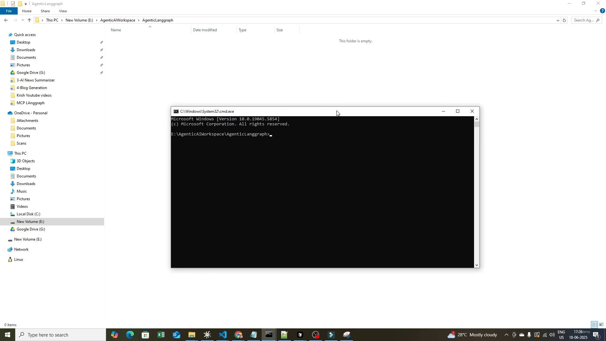

### 3.2 安装 UV

讲师在课里说的是「复制官网那条命令执行」，**没有把命令文本念出来**。所以这里给 UV 官方的标准安装方式，并明确标注：这是课外补充，不是逐字稿里的原话。

macOS / Linux：

```bash
curl -LsSf https://astral.sh/uv/install.sh | sh
```

Windows PowerShell：

```powershell
powershell -ExecutionPolicy ByPass -c "irm https://astral.sh/uv/install.ps1 | iex"
```

已经装有 Python 和 pip 的环境，也可以按讲师说的：

```bash
pip install uv
```

验收：

```bash
uv --version
```

能打印出版本号即可。

### 3.3 初始化项目工作区

在项目空文件夹里执行：

```bash
uv init
```

讲师在敲完这条命令后，特意让你看工作区里多出来的文件：

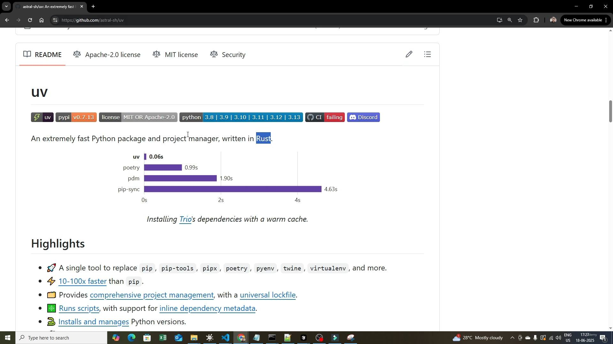

你应该能看到：

- `.gitignore`
- `.python-version`（内容是 `3.13`）
- `main.py`
- `pyproject.toml`

> 注意：不同版本的 uv 生成的文件名可能略有差异（有的版本会生成 `hello.py` 而不是 `main.py`）。**以你本地实际生成的文件为准**，这不影响后续步骤。

`pyproject.toml` 里是项目基本信息，可以改版本号、加描述；里面写明了要求的最低 Python 版本是 3.13，此时 `dependencies` 还是空的，因为一个包都没装。

### 3.4 写依赖清单

在工作区根目录新建 `requirement.txt`。讲师念的包名是：`langgraph`、`langchain`、`langsmith`。

> 讲师的口音把 `langgraph` 说成「langraph」，实际 PyPI 包名是 **`langgraph`**（有 g）。这一点写错会直接 `uv add` 失败。

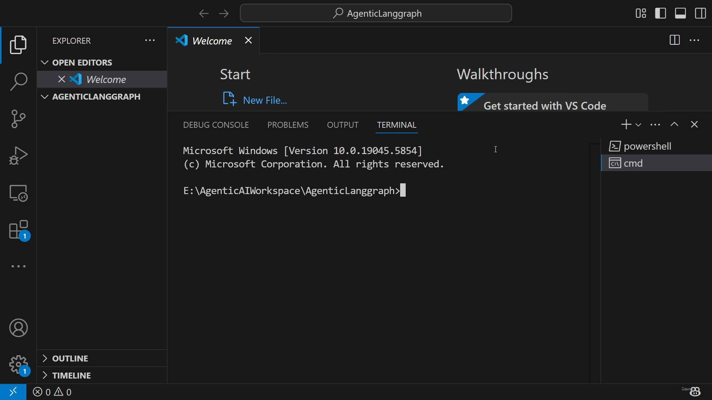

后面讲师又往这个文件里补了 `python-dotenv`（讲 `load_dotenv()` 那一段）和 `langchain-groq`（讲 `ChatGroq` 那一段）。所以这个文件最终包含五项；再加上 Jupyter 必需的 `ipykernel`，一共六项。完整内容见第 4 节。

### 3.5 创建并激活虚拟环境

```bash
uv venv
```

讲师演示时，环境是用 Python **3.13.2** 创建的，位置在 `.venv`。

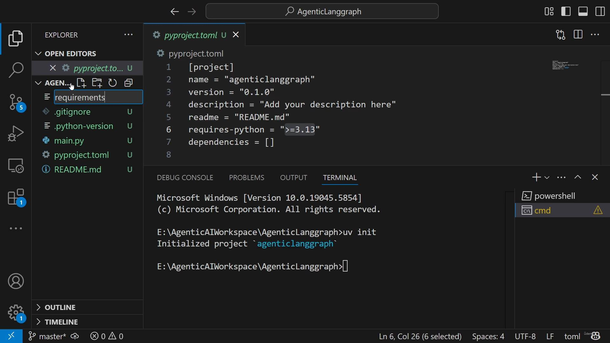

激活命令**课里没有念出来**（讲师是直接复制终端提示的那一行）。按平台对照：

macOS / Linux：

```bash
source .venv/bin/activate
```

Windows PowerShell：

```powershell
.venv\Scripts\Activate.ps1
```

Windows cmd：

```bat
.venv\Scripts\activate.bat
```

验收：命令行提示符前面出现 `(.venv)` 之类的标记；讲师演示时激活后提示符显示的是项目名 `agentic_langgraph`。只要前缀变了，就说明环境已激活。

> 前端同学注意：这一步相当于 Node 里「切到项目自己的 `node_modules` 作用域」。不激活的话，你 `uv add` 装的东西虽然仍会写进 `pyproject.toml`，但你后面直接敲 `python` / `jupyter` 时可能用到的是系统 Python，包找不到。

### 3.6 安装依赖

```bash
uv add -r requirement.txt
```

讲师的原话对照：pip 是 `pip install -r requirement.txt`，这里换成 `uv add -r requirement.txt`。

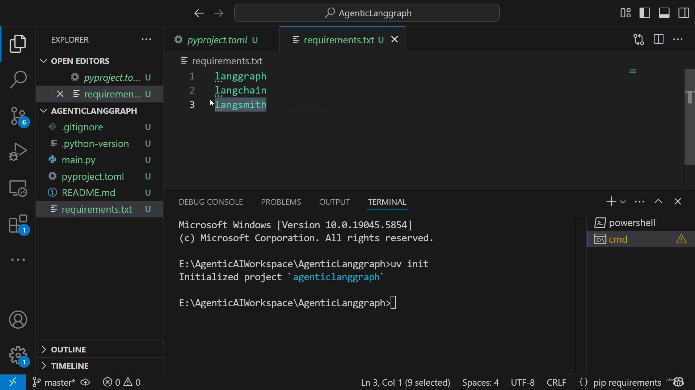

装完后回到 `pyproject.toml`，`dependencies` 里就能看到刚装的库。这一步 UV 还会生成/更新 `uv.lock`（课里没有展示这个文件，但它是 uv 的正常产物）。

### 3.7 建目录、建 notebook、装 ipykernel

讲师新建一个文件夹 `one`，再建子目录 `basic_chatbot`，然后在里面创建 notebook：`basic_chatbot.ipynb`。

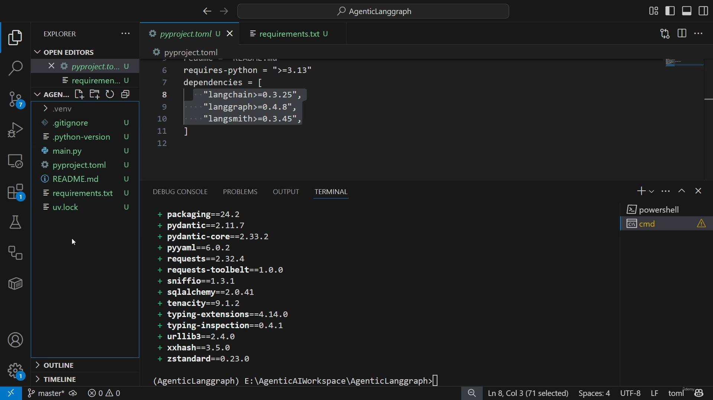

打开 notebook 后它会让你选 kernel。因为要用 Jupyter，必须先装 kernel 包：

```bash
uv add ipykernel
```

验收：notebook 右上角能选中当前 `.venv` 对应的 kernel。

### 3.8 验证 kernel 是否真的连通

讲师先故意敲了一个非法表达式：

```python
1 + !
```

预期结果：报 `invalid syntax`。这**不是出错**，而是证明「notebook 已经连上 kernel，代码真的被送去执行了」。

然后再敲：

```python
1 + 1
```

预期输出 `2`。到这一步，kernel 正常。

### 3.9 配置 Groq API Key

去 `console.groq.com` 登录，创建 API Key（建的时候可以给 key 起个名字），复制出来。

在工作区根目录新建 `.env`，把 key 放进去。**变量名课里没有念出来**，这里用 `ChatGroq` 默认读取的 `GROQ_API_KEY`（课外补充，标注一下）：

```dotenv
GROQ_API_KEY=gsk_你的key
```

### 3.10 按顺序写 notebook 的每一个 cell

从这里开始就是 P020 的内容。顺序不能乱：**先定义 State，再建 StateGraph，再初始化 LLM，再定义节点函数，再连线，再编译，最后才 invoke**。每个 cell 的完整代码都在第 4 节，这里只说逻辑顺序和验收点。

**(1) 导入。** `Annotated`、`TypedDict`、`StateGraph / START / END`、`add_messages`。

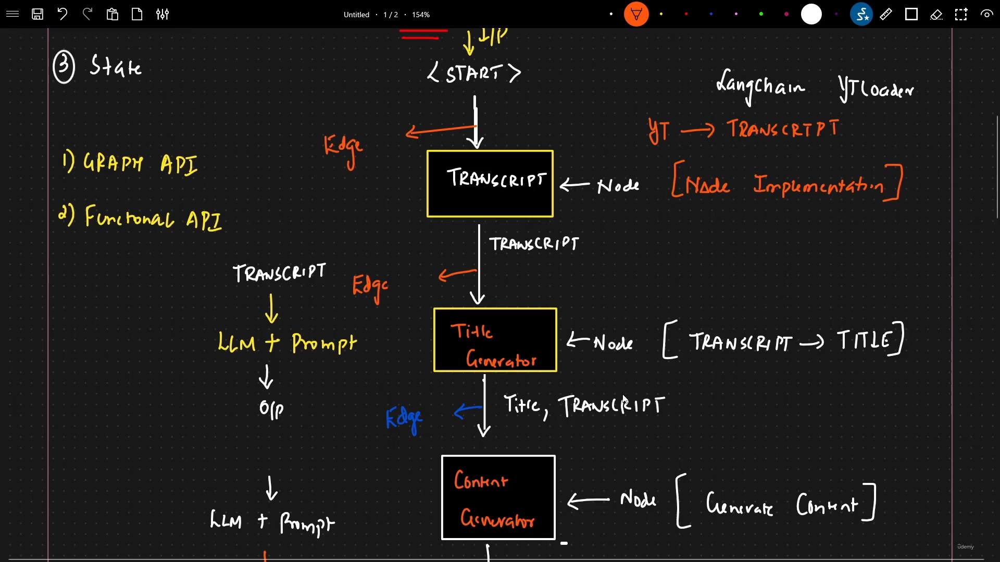

**(2) 定义 State 并建图构建器。** `class State(TypedDict)`，里面只有 `messages: Annotated[list, add_messages]`；然后 `graph_builder = StateGraph(State)`。

**(3) 加载 .env。** `load_dotenv()`，让 `.env` 里的 key 进入环境变量。

**(4) 初始化 LLM。** 两种写法二选一：

- `ChatGroq(model="llama-3-8b-8192")`
- `init_chat_model("groq:llama-3-8b-8192")`

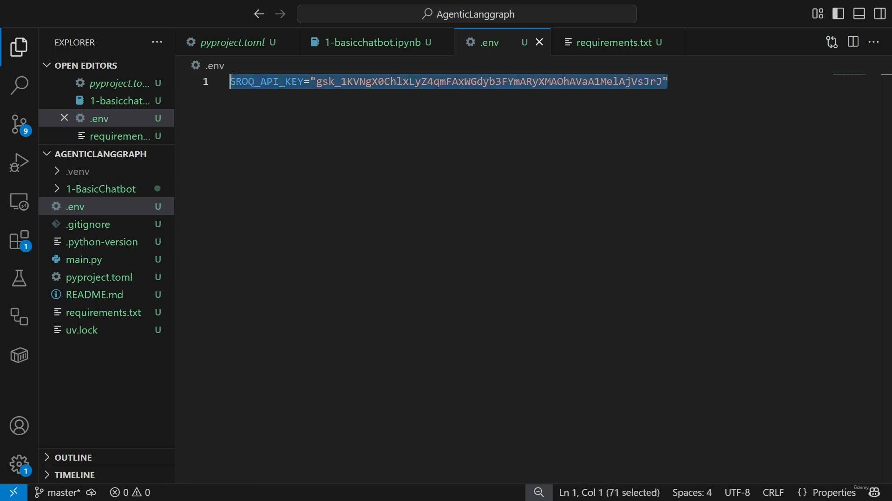

**(5) 定义节点函数。**

```python
def chatbot(state: State):
    return {"messages": llm.invoke(state["messages"])}
```

**(6) 连图。**

```python
graph_builder.add_node("llm_chatbot", chatbot)
graph_builder.add_edge(START, "llm_chatbot")
graph_builder.add_edge("llm_chatbot", END)
```

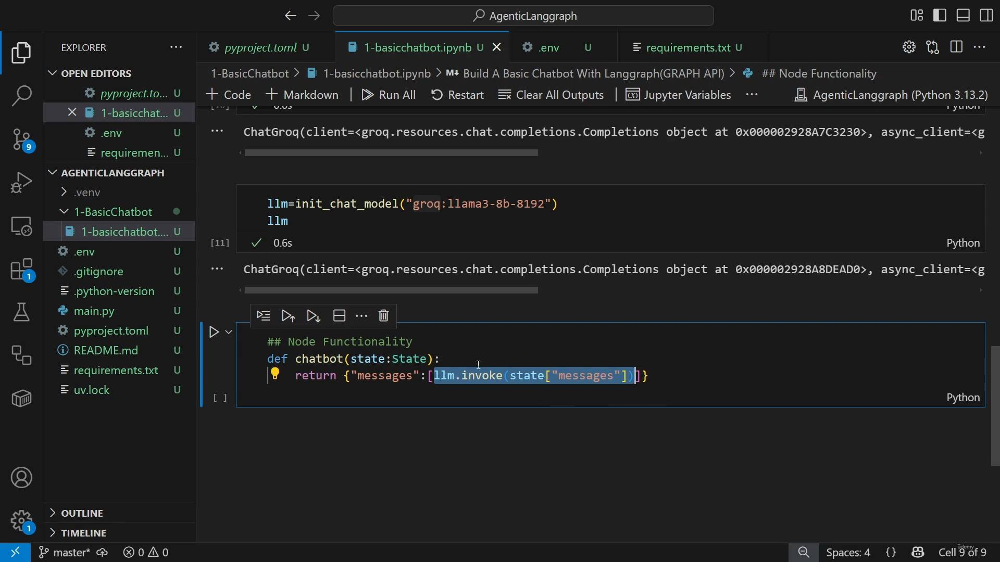

**(7) 编译。**

```python
graph = graph_builder.compile()
```

**(8) 可视化。** `graph.get_graph().draw_mermaid_png()` 包在 `try/except` 里用 `display(Image(...))` 显示。预期看到 `START → llm_chatbot → END` 三个框。

**(9) 第一次 invoke。** 注意：**必须把输入放进 `messages` 这个 key 里**。讲师第一次失败就是因为直接传了字符串，节点里 `state["messages"]` 取不到。

```python
response = graph.invoke({"messages": [("user", "hi")]})
```

如果此时报 `invalid API key`，讲师的处置是：**重启 kernel**。原因是 `.env` 是在 kernel 启动之后才写的，`load_dotenv()` 已经跑过一次，不会自动重读。

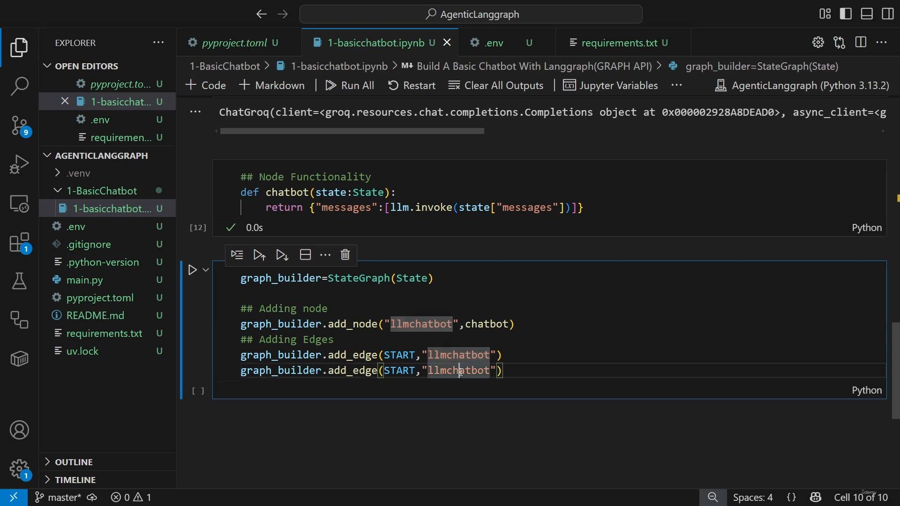

**(10) 取回复。**

```python
response["messages"][-1].content
```

**(11) 流式打印。**

```python
for event in graph.stream({"messages": [("user", "hi, how are you?")]}):
    print(event)
```

**(12) 流式里只取文本。**

```python
for event in graph.stream({"messages": [("user", "hi, how are you?")]}):
    for value in event.values():
        print(value["messages"][-1].content)
```

### 3.11 整条链路的输入输出长什么样

- `invoke` 的返回值是**完整 state**：一个 dict，`messages` 里第 0 条是 human 的「hi」，第 1 条是 AI 的回复。
- `stream` 的每个 `event` 是 **`{节点名: 该节点产生的状态更新}`**。因为图里只有一个节点 `llm_chatbot`，所以你会看到 key 就是 `llm_chatbot`，value 里带 `messages`。
- 用 `event.values()` 遍历后，`value["messages"][-1].content` 就是这一轮 AI 说的话。

这三条对上，本段课的验收就完成了。

---

## 4. 完整代码

本段**没有 OCR 结果**，以下代码全部来自逐字稿里讲师现场敲出的片段，加上为「能直接保存运行」而做的必要整理。凡是我补的、逐字稿没有逐字念出的部分（例如 `.env` 变量名、Windows 激活命令），都会在代码注释或第 7 节里标注。

### 4.1 目录结构

```
agentic_langgraph/                 # 你的项目工作区（讲师激活后提示符显示 agentic_langgraph）
├── .env                           # Groq API Key
├── .gitignore                     # uv init 生成
├── .python-version                # uv init 生成，内容 3.13
├── .venv/                         # uv venv 生成，Python 3.13.2
├── main.py                        # uv init 生成
├── pyproject.toml                 # uv init 生成，uv add 会往里写依赖
├── uv.lock                        # uv 自动生成（课里未展示）
├── requirement.txt                # 讲师手写
└── one/
    └── basic_chatbot/
        ├── basic_chatbot.ipynb    # 课里实际用的文件
        └── basic_chatbot.py       # 等价单文件版（课里没有，为直接运行而整理）
```

### 4.2 `requirement.txt`（完整文件）

```text
langgraph
langchain
langsmith
python-dotenv
langchain-groq
ipykernel
```

> 课里讲师口头念的是前三个，`python-dotenv` 和 `langchain-groq` 是他在后面讲 `load_dotenv()` 和 `ChatGroq` 时补进这个文件的；`ipykernel` 是他明确说要单独 `uv add` 的。文件名叫 `
> 课里讲师自己写的文件名是 **`requirement.txt`**（不是常见的 `requirements.txt`，注意那个 s）。这个名字必须和 `uv add -r requirement.txt` 里的参数**逐字一致**，写错就是找不到文件、装不上任何东西。

### 4.3 `pyproject.toml`（`uv init` 生成，`uv add` 之后的样子）

讲师只念了其中几项：「项目的简要信息，你可以改版本、加自己的描述，这里要求最低 Python 3.13，依赖现在是空的」。完整结构以你本地生成为准，安装前后大致是这样：

```toml
[project]
name = "agentic-langgraph"
version = "0.1.0"
description = "Add your description here"
readme = "README.md"
requires-python = ">=3.13"
dependencies = []
```

执行完 3.6 的 `uv add -r requirement.txt` 与 3.7 的 `uv add ipykernel` 之后，`dependencies` 里会被写成类似：

```toml
dependencies = [
    "langgraph",
    "langchain",
    "langsmith",
    "python-dotenv",
    "langchain-groq",
    "ipykernel",
]
```

> 字段顺序和是否带版本号，UV 会自己决定。**以你本地实际生成的 `pyproject.toml` 为准**，不要手改锁文件。

### 4.4 `.env`（完整文件）

```dotenv
GROQ_API_KEY=gsk_xxxxxxxxxxxxxxxxxxxxxxxx
```

> 变量名 `GROQ_API_KEY` 是**课外补充**：逐字稿里讲师只说「把 Groq API 的 key 粘到这里」，没有把变量名念出来。如果你改成别的名字，`ChatGroq()` 就找不到 key，会抛出 `invalid API key during the task` 这类错误（讲师在 P020 里确实撞到过这个报错）。这个文件必须被 `.gitignore` 忽略，别把 key 提交上去。

### 4.5 `one/basic_chatbot/basic_chatbot.ipynb` 的完整 cell 内容

下面每一个 cell 对应讲师在 notebook 里执行的一步。**cell 顺序 = 执行顺序**，逐个运行，不要跳。

**Cell 1 — 导入**

```python
from typing import Annotated
from typing_extensions import TypedDict

from langgraph.graph import StateGraph, START, END
from langgraph.graph.message import add_messages
```

**Cell 2 — 定义 State 并创建图构建器**

```python
class State(TypedDict):
    """整段会话的消息列表。

    messages 的类型是 list。
    Annotated 里的 add_messages 定义了这个 state key 该怎么更新：
    在这个例子里，它把新消息追加到列表，而不是覆盖它们。
    """
    messages: Annotated[list, add_messages]


graph_builder = StateGraph(State)
```

**Cell 3 — 加载 `.env`**

```python
import os
from dotenv import load_dotenv

load_dotenv()
```

**Cell 4（写法 A）— 直接用 `ChatGroq` 初始化 LLM**

```python
from langchain_groq import ChatGroq

llm = ChatGroq(model="llama-3-8b-8192")
```

**Cell 4'（写法 B）— 用通用的 `init_chat_model` 初始化 LLM**

```python
from langchain.chat_models import init_chat_model

llm = init_chat_model("groq:llama-3-8b-8192")
```

> 两种写法二选一，**都只留一个 `llm` 变量**。讲师原话说「这两种方式都能拿到同一个 LLM」。如果你要换成 OpenAI，他的话是：用 `langchain_openai`，然后写 `openai:你的模型名`。

**Cell 5 — 定义节点函数**

```python
def chatbot(state: State):
    return {"messages": llm.invoke(state["messages"])}
```

**Cell 6 — 加节点、连边**

```python
graph_builder.add_node("llm_chatbot", chatbot)

graph_builder.add_edge(START, "llm_chatbot")
graph_builder.add_edge("llm_chatbot", END)
```

**Cell 7 — 编译**

```python
graph = graph_builder.compile()
```

**Cell 8 — 可视化图结构**

```python
from IPython.display import Image, display

try:
    display(Image(graph.get_graph().draw_mermaid_png()))
except Exception:
    pass
```

**Cell 9 — 第一次 `invoke`**

```python
response = graph.invoke({"messages": [("user", "hi")]})
response
```

**Cell 10 — 取最后一条消息的文本**

```python
response["messages"][-1].content
```

**Cell 11 — `stream` 逐事件打印**

```python
for event in graph.stream({"messages": [("user", "hi, how are you?")]}):
    print(event)
```

**Cell 12 — `stream` 里只打印文本**

```python
for event in graph.stream({"messages": [("user", "hi, how are you?")]}):
    for value in event.values():
        print(value["messages"][-1].content)
```

### 4.6 `one/basic_chatbot/basic_chatbot.py`（等价单文件版）

> **课里没有这个文件**。讲师全程在 `.ipynb` 里逐 cell 跑。这里把 12 个 cell 合成一个可执行脚本，是给「不想开 Jupyter、想直接 `python` 跑」的人准备的等价整理版，逻辑与课里完全一致。

```python
"""basic_chatbot.py —— 与课里 notebook 等价的单文件版本。

课里讲师在 one/basic_chatbot/basic_chatbot.ipynb 中逐 cell 执行；
这里合成为一个文件，方便直接运行：

    uv run python one/basic_chatbot/basic_chatbot.py
"""

import os

from typing import Annotated
from typing_extensions import TypedDict

from dotenv import load_dotenv
from langgraph.graph import StateGraph, START, END
from langgraph.graph.message import add_messages
from langchain_groq import ChatGroq


# 1) 把 .env 里的 key 加载进环境变量
load_dotenv()


# 2) 定义 State：messages 是 list，add_messages 负责追加而不是覆盖
class State(TypedDict):
    messages: Annotated[list, add_messages]


# 3) 初始化 LLM（写法 A）
llm = ChatGroq(model="llama-3-8b-8192")

#    写法 B（二选一，用时把上面两行注释掉）：
#    from langchain.chat_models import init_chat_model
#    llm = init_chat_model("groq:llama-3-8b-8192")


# 4) 节点实现：拿 state 里的 messages 调 LLM，把回复作为 messages 的更新返回
def chatbot(state: State):
    return {"messages": llm.invoke(state["messages"])}


# 5) 建图：一个节点，两条边
graph_builder = StateGraph(State)
graph_builder.add_node("llm_chatbot", chatbot)
graph_builder.add_edge(START, "llm_chatbot")
graph_builder.add_edge("llm_chatbot", END)

# 6) 编译，不编译无法执行
graph = graph_builder.compile()


if __name__ == "__main__":
    # 7) 一次性运行，拿完整 state
    response = graph.invoke({"messages": [("user", "hi")]})
    print("=== invoke 返回的完整 state ===")
    print(response)
    print("=== 最后一条消息的文本 ===")
    print(response["messages"][-1].content)

    # 8) 流式：打印每一个事件
    print("=== stream 原始事件 ===")
    for event in graph.stream({"messages": [("user", "hi, how are you?")]}):
        print(event)

    # 9) 流式：只打印文本
    print("=== stream 里的文本 ===")
    for event in graph.stream({"messages": [("user", "hi, how are you?")]}):
        for value in event.values():
            print(value["messages"][-1].content)
```

---

## 5. 逐行解释

这一节按「为什么要写这一行、不写会怎样」来讲，顺带补上讲师强调的判断。**本段课关注的是图的结构，不是并发与事务**；多轮对话里 state 是每次调用传进去的一份数据，不是全进程共享的全局变量，所以这里不需要锁。

**`from typing import Annotated`**
讲师专门停下来解释过这个：它用来给某个类型**附加额外的元数据**，而运行时这个类型本身还能被正常当普通类型使用。在 LangGraph 里，它承担的作用是「把 reducer 绑到某个 state key 上」。不写 `Annotated`、只写 `messages: list`，LangGraph 就不知道该怎么合并更新——默认行为会变成**覆盖**，你的第二条消息会把第一条冲掉。

> "Annotated 就是加一个标签；它表示一个假设性的运行时检查模型。这个类型的其他所有消费者都可以忽略这段元数据，把它当成普通类型处理。"
> —— p020 [18:16]

**`from typing_extensions import TypedDict`**
讲师说 `TypedDict` 「在运行时等价于一个普通字典」。他举的例子是：

```python
class X(TypedDict):
    x: int
    y: int
    label: str
```

然后你可以用 `{"x": 1, "y": 2, "label": "good"}` 这种键值对形式提供值。这解释了为什么 `graph.invoke()` 的入参必须是个 dict、为什么节点的返回值也要返回 dict。

> "TypedDict 是一个简单的类型命名空间，运行时它等价于一个普通字典。"
> —— p020 [17:50]

> 补一句：课里用的是 `typing_extensions` 里的 `TypedDict`，**没有讲**它和标准库 `typing.TypedDict` 的区别。照课里的写法导入即可。

**`from langgraph.graph import StateGraph, START, END`**
`StateGraph` 代表「整个图」；`START` / `END` 对应讲师画的两个起止节点。

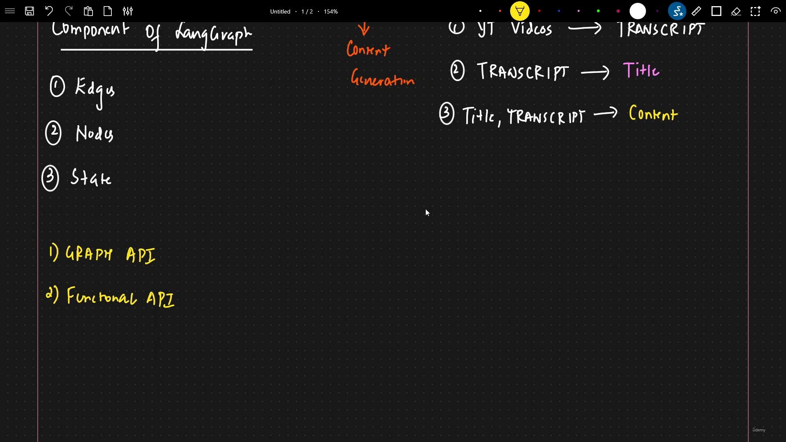

> "在 LangGraph 里解决这类工作流有两种方式：一种是直接用 Graph API，另一种是直接用 Functional API。但根据我的经验，Graph API 是最容易、最好的。"
> —— p020 [03:17]

**`class State(TypedDict): messages: Annotated[list, add_messages]`**
这四行是整个文件的核心。讲师给 state 下的定义是：**state 里的变量，图里任何一个节点都能访问**。「YouTube → 博客」例子里他定义了 `transcript`、`title`、`content` 三个变量；这里 chatbot 只需要一个 `messages`。

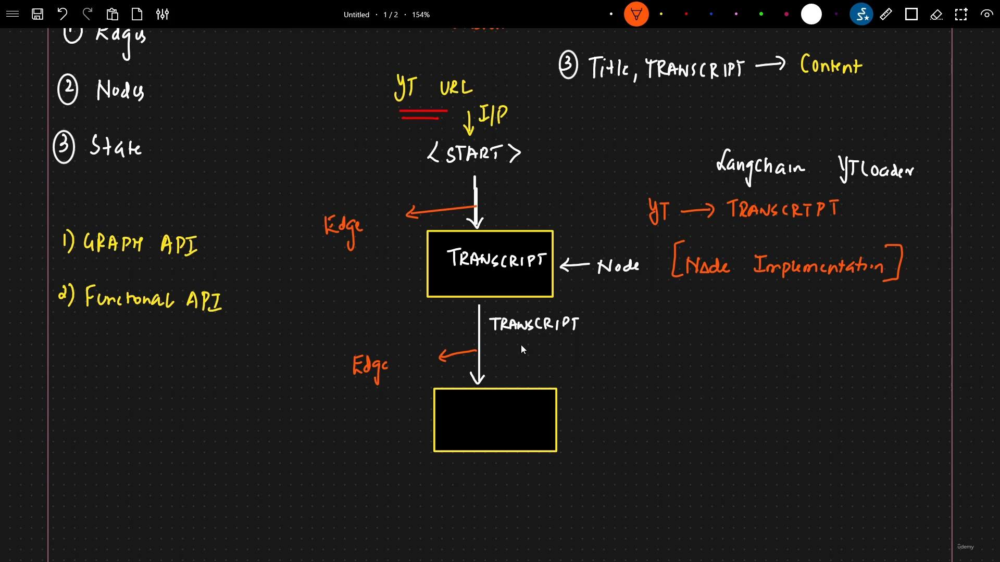

> "state 的意思是，我们定义的这些变量可以被这个图里任何一个节点访问。整个图我们叫它 state graph，因为它能在每个节点维护 state 的上下文。"
> —— p020 [10:51]

为什么要 `add_messages`：讲师用两轮对话举例说明——第一轮「hi / I am good」，第二轮「你叫什么 / 我没有名字」，**这些消息不能被替换，必须不断追加**。

> "为了追加，我们用 reducer。其中一个 reducer 就是 add_messages，它只做一件事：往我们定义的变量里加消息，而不是替换。"
> —— p020 [16:58]

`messages` 只写成 `list` 而不是 `Annotated[list, add_messages]`，就是这个课里最好的反面教材：第一条消息会被第二条覆盖，context 直接丢。

**`graph_builder = StateGraph(State)`**
把 `State` 交给构建器，等于声明「这张图在任何节点执行时都能拿到这份 state 的结构」。后端同学可以理解为「把 schema 注册到运行时」，前端同学可以理解为「定好 store 的 shape 再挂 handler」。

**`load_dotenv()`**
作用是「`.env` 里写的 key 能被程序读到」。**这行必须在使用 LLM 之前执行**，否则 `ChatGroq()` 初始化时拿不到 key。

**`llm = ChatGroq(model="llama-3-8b-8192")` 或 `llm = init_chat_model("groq:llama-3-8b-8192")`**
讲师给了两种写法，还顺带说了换成 OpenAI 怎么改。这里的关键是**模型名的前缀**：用 `init_chat_model` 时要写成 `groq:llama-3-8b-8192`，用 `ChatGroq` 时不需要前缀。

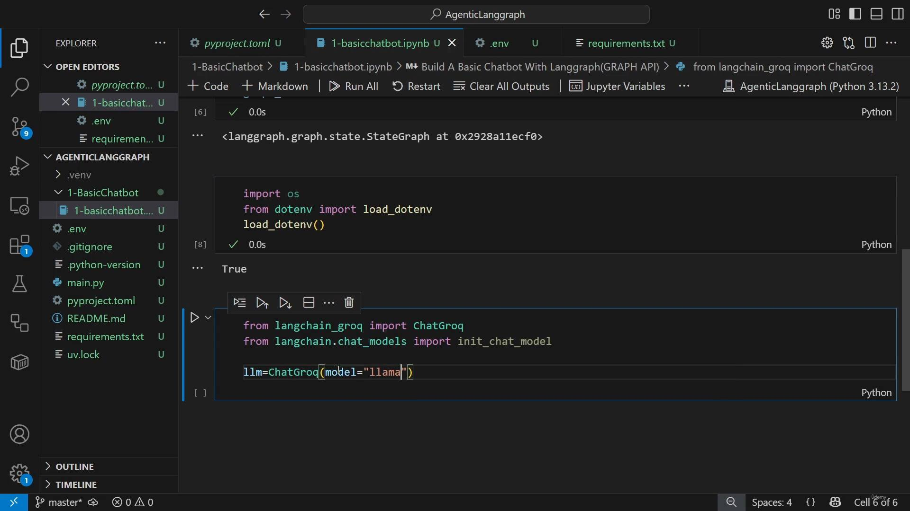

> "你可以用 ChatGroq 直接初始化；另一种更通用：用 init_chat_model，给模型名 `groq:llama-3-8b-8192`。如果你用 OpenAI，就换成 langchain_openai，写 `openai:模型名`。"
> —— p020 [24:20]

**`def chatbot(state: State): return {"messages": llm.invoke(state["messages"])}`**
这是「节点实现」。讲师的说法是：创建节点的同时必须写清这个节点到底干什么。三件事要点：

1. 参数是 `state`，类型标注成 `State`——节点声明自己「能读到整份 state」。
2. `state["messages"]` 就是**输入消息**，直接喂给 LLM。
3. 返回的是**一个 dict**，key 必须叫 `messages`——这是「对 state 的更新」，不是整份新 state。`add_messages` 这个 reducer 拿到它之后做追加，而不是整体替换。

> "返回 `{'messages': llm.invoke(state['messages'])}`。`state['messages']` 就是输入消息，节点把 LLM 的响应追加到 messages 变量里。"
> —— p020 [25:47]

**`graph_builder.add_node("llm_chatbot", chatbot)`**
两个参数必须分清：**第一个是节点名（字符串），第二个才是节点函数**。名字是你后面连线时用的句柄，所以起名要能对上。

**`graph_builder.add_edge(START, "llm_chatbot")` / `add_edge("llm_chatbot", END)`**
讲师专门警告过：**这里写节点名，不是函数名**。

> "这里要写节点名，而不是函数名：从 START 连到 llm_chatbot，再从 llm_chatbot 连到 END。最后必须 compile，不编译就没法执行。"
> —— p020 [29:01]

写错成 `add_edge(START, chatbot)`（传函数）会导致找不到节点。这个错误和前端路由注册里「用 handler 当路由名」一个性质。

**`graph = graph_builder.compile()`**
编译是必须的一步，讲师说得很直接：不编译就没有可执行的图对象。编译出来的 `graph` 才是你后面 `.invoke()` / `.stream()` / `.get_graph()` 的对象。

**`display(Image(graph.get_graph().draw_mermaid_png()))` + `try/except`**
把图渲染成一张 mermaid png 显示出来。讲师的原话是「这些是文档里提供的功能」。外面套 `try/except: pass` 的意思是**渲染失败不影响后面运行**，直接跳过画图。

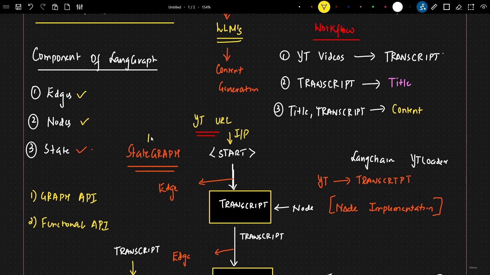

预期画面：`START` → `llm_chatbot` → `END` 三个节点，两条边。

**`graph.invoke({"messages": [("user", "hi")]})`**
两个坑，讲师都现场踩过：

1. **入参必须是 dict，且 key 要和 State 里定义的一致（`messages`）**。他第一次直接传字符串，节点里 `state["messages"]` 取不到东西。
2. **先报 `invalid API key during the task`**。他的处置：重启 kernel。原因是 key 是在 kernel 启动之后才写进 `.env` 的，`load_dotenv()` 已经跑过一次，不会自己重读。

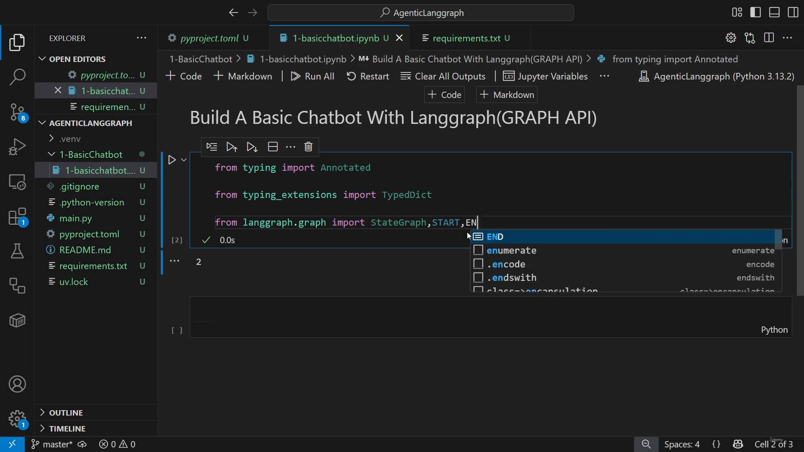

> "重启 kernel 之后它就能跑了——因为我是在后面才把 API key 加到 .env 里的，所以必须重启 kernel 才会重新加载。"
> —— p020 [32:43]

`("user", "hi")` 这种二元组会被自动转成一条 human message：

> "你给的 hi 被当成 human message，回复是 AI message。取最后一条消息就是 `response['messages'][-1]`，再加 `.content` 就拿到文本。"
> —— p020 [35:04]

**`response["messages"][-1].content`**
`invoke` 返回的是**完整 state**，不是一条消息。所以要 `[-1]` 取最后一条，再 `.content` 拿文本。讲师演示拿到的回复原文类似「Hi, it's nice to meet you. Is there something I can help you with?」。别直接 `print(response)` 指望拿到字符串。

**`for event in graph.stream(...)` / `print(event)`**
把 `invoke` 换成 `stream`，就能**逐事件**拿输出而不是一次性等全部结束。讲师打印出来的东西形状是「节点名 + 该节点的状态更新」，key 就是 `llm_chatbot`。

> "用 graph.stream 而不是 graph.invoke，就能逐事件拿到输出；再遍历 event.values()，只打印每个事件里最后一条消息的内容。"
> —— p020 [36:57]

**`for value in event.values(): print(value["messages"][-1].content)`**
两层循环：外层遍历事件，内层只取每个事件的 value，再取最后一条消息的文本。这样输出的是干净的一句话，而不是整个 JSON 结构。

讲师在这里明确说了：**stream 还有很多类型、很多参数，这一段只是抛个例子，后面再展开**。本段课里他只演示了这一个用法。

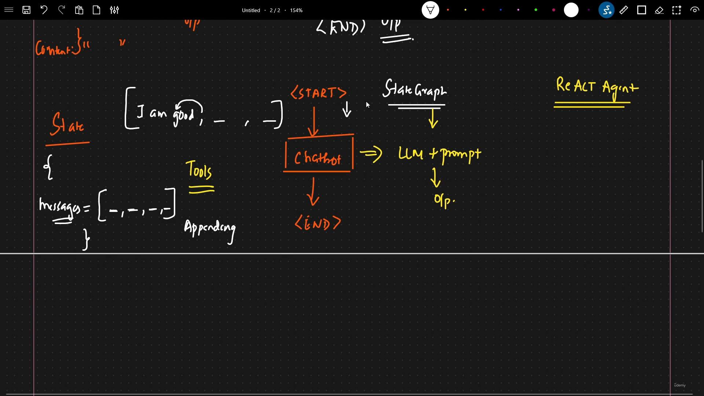

---

## 6. 复现检查清单

按顺序勾，前一项不过关不要往下走。

| # | 检查项 | 怎么验 | 预期 |
|---|---|---|---|
| 1 | UV 安装成功 | `uv --version` | 打印版本号 |
| 2 | 项目已初始化 | 看工作区 | 有 `.gitignore`、`.python-version`（内容 `3.13`）、`main.py`、`pyproject.toml` |
| 3 | `requirement.txt` 存在且拼写正确 | 打开文件 | 六行：`langgraph`、`langchain`、`langsmith`、`python-dotenv`、`langchain-groq`、`ipykernel` |
| 4 | 虚拟环境已创建 | `uv venv` 输出 / 目录 | 出现 `.venv`，Python 版本 3.13.2 |
| 5 | 环境已激活 | 看提示符前缀 | 出现 `(.venv)` 之类的标记 |
| 6 | 依赖装完 | `uv add -r requirement.txt` | 安装完成，`pyproject.toml` 的 `dependencies` 非空 |
| 7 | ipykernel 已装 | 打开 notebook 选 kernel | 能选中 `.venv` 对应的 kernel |
| 8 | kernel 连通 | 跑 `1 + !` 再跑 `1 + 1` | 前者 `invalid syntax`，后者输出 `2` |
| 9 | `.env` 就位 | 打开文件 | 有一行 `GROQ_API_KEY=...`，未被提交到 git |
| 10 | 导入全部通过 | 跑 Cell 1 | 无报错 |
| 11 | State 定义 + 构建器 | 跑 Cell 2 | 无报错，`graph_builder` 存在 |
| 12 | `.env` 已加载 | 跑 Cell 3 | 无报错 |
| 13 | LLM 初始化（只留一种写法） | 跑 Cell 4 或 Cell 4' | `llm` 变量存在 |
| 14 | 节点函数定义 | 跑 Cell 5 | 无报错 |
| 15 | 节点与边已注册 | 跑 Cell 6 | 无报错 |
| 16 | 编译成功 | 跑 Cell 7 | `graph` 存在 |
| 17 | 图可视化 | 跑 Cell 8 | 看到 `START → llm_chatbot → END` |
| 18 | `invoke` 成功 | 跑 Cell 9 | 返回完整 state，`messages` 里有 human「hi」和一条 AI 回复 |
| 19 | 取文本成功 | 跑 Cell 10 | 打印一句自然语言回复 |
| 20 | `stream` 成功 | 跑 Cell 11 | 打印出以 `llm_chatbot` 为 key 的事件结构 |
| 21 | `stream` 取文本成功 | 跑 Cell 12 | 打印干净的一句话 |

**排障对照（只列讲师在本段真正遇到/说过的）：**

- 敲 `1 + !` 报 `invalid syntax` —— 正常，说明 kernel 通了。
- `invoke` 报 `invalid API key during the task` —— 按讲师的做法**重启 kernel** 再从头执行各个 cell。
- 节点里取不到 `state["messages"]` —— 检查 `invoke` 的入参是不是漏了 `messages` 这个 key。
- 忘了 `compile()` —— 没有可执行的 graph 对象，后面 `.invoke()` / `.stream()` / `.get_graph()` 全用不了。
- `add_edge` 里传了函数而不是节点名字符串 —— 改用 `"llm_chatbot"`。

---

## 7. 课里没讲但你会撞上的

这一节全部是**课外补充**，明确不是讲师在这三段里说过的内容。标出来是为了让你遇到时报错能自己定位，而不是以为课讲错了。

**7.1 `uv init` 生成的文件名不一定是 `main.py`**
讲师演示时是 `main.py`，但不同版本的 uv 会生成 `hello.py` 之类。**以你本地实际生成的文件为准**，这不影响流程。同理，`.python-version` 里如果不是 `3.13`，说明你的 uv 选中了别的解释器版本。

**7.2 `requirement.txt` 里少一个 g 就装不上**
讲师口音把 `langgraph` 读成「langraph」，PyPI 上的包名是 `langgraph`。写成 `langraph` 会直接报包不存在。

> "LangGraph 和 LangChain 用来构建生成式 AI 应用、chatbot、agentic 应用；LangSmith 用来在 LangGraph cloud 里跟踪和评估你的应用。"
> —— p019 [03:17]

三个包名分别是 `langgraph`、`langchain`、`langsmith`，一个字母都不能省。

**7.3 模型名可能已经不在 Groq 的可用列表里**
课里用的是 `llama-3-8b-8192`。如果你照抄后报「model not found / decommissioned」之类，那是供应商的模型清单变了，**不是你的代码错了**。课里没讲模型下线这件事，也没有给出「怎么查当前可用模型名」的步骤；遇到就去 Groq 控制台看当前模型列表，把 `ChatGroq(model="...")` 或 `init_chat_model("groq:...")` 里的名字换掉。换名字时注意 `init_chat_model` 的 `groq:` 前缀要保留。

**7.4 kernel 选错 → `ModuleNotFoundError`**
notebook 右上角如果选的是系统 Python 而不是 `.venv`，`langgraph` / `langchain_groq` 全都 import 不到。课里只说了「要装 ipykernel 才能跑 Jupyter」，**没说「选错 kernel 会怎样」**。装完 `ipykernel` 后回 notebook 重新选一次 kernel 即可。

**7.5 `.env` 改了但没生效**
这是课里唯一明确讲过的运行陷阱：`load_dotenv()` 只在执行那一刻读文件，之后你改了 `.env` 它不会重读，**必须重启 kernel**。同理，在脚本里跑就不存在这个问题，每次 `uv run` 都是新进程。

**7.6 `.env` 千万别提交**
`.gitignore` 是 `uv init` 生成的，但**课里没有演示把 `.env` 加进忽略列表**。如果你的 `.gitignore` 里没有 `.env`，自己补一行，否则 key 会跟着仓库走。

**7.7 `draw_mermaid_png()` 渲染失败**
外面套了 `try/except: pass` 是有原因的——渲染依赖外部条件，失败时你只会看到「什么都没画出来」，但图本身是好的，`invoke` 照样能跑。课里只说「这是文档里提供的功能」，**没讲渲染失败的具体原因**。看到空白不用慌，跳过可视化直接往下跑。

**7.8 Windows 上激活脚本被拦**
PowerShell 默认策略可能不允许执行 `.venv\Scripts\Activate.ps1`。课里讲的是「Windows 就打开 PowerShell 粘贴安装命令」，**没讲激活脚本的权限问题**。遇到就按报错提示调整执行策略，或者改用 cmd 的 `.venv\Scripts\activate.bat`。

**7.9 `TypedDict` 从哪导入**
课里写的是 `from typing_extensions import TypedDict`。标准库 `typing` 里也有 `TypedDict`，**课里没讲两者的区别**，也没说必须用哪一个。照课里的写即可，不用纠结。

**7.10 给前端同学的类比（非课里内容）**
讲师的 `add_messages` 用了 reducer 这个词，你可以直接对上 Redux：**state 是 store，节点是处理函数，reducer 决定新数据是覆盖还是合并**。`add_messages` 就是一个「只追加、不覆盖」的 reducer。另外 LangGraph 官方也有 JS 版本，但**这三段课全程是 Python，没提过 JS/Node 生态**，别把两边的 API 名混着用。

**7.11 课里明确说「后面再讲」而本段没展开的内容**
下面这些讲师在本段点过名，但**没有给出实现**，不属于你要在这一段复现的东西：

- 加 memory、加 human in the loop、集成（多个）外部工具、ReAct agent —— P020 结尾提到，说后面讲；
- MCP、从零构建 MCP —— 属于 Part 1 的路线图；
- Functional API 的具体写法与 Graph API 的差别 —— 说了「区别我们后面会看到」，本段没讲；
- streaming 的其他类型与参数 —— 讲师原话是「stream 还有很多类型、很多参数，后面再展开」，本段只演示了 `graph.stream` + `event.values()` 这一种；
- 在 LangGraph Studio 里调试、用 LangSmith 追踪 —— Part 2 的内容；
- MLflow / AWS 跟踪指标、Grafana 展示报告、Hugging Face Spaces 部署 —— Part 3 的内容。

所以如果你的目标是「护栏 / 网关 / 可观测」，**这三段只是把 LangGraph 的骨架立起来了**：你手上现在有的是一张可编译、可可视化、可 invoke、可 stream 的状态图。后面接网关（在节点前加校验）、接护栏（对 LLM 输入输出做拦截）、接可观测（把每个 stream 事件的节点名和状态更新打点上报），都是在这个骨架上挂东西——