# AI Security Bootcamp Part 2：用 LangGraph 构建带工具调用的 Chatbot（ReAct Agent）

> 课程编号：BV1PSGA6SETb ｜ 覆盖 P：21 ｜ 主题：工具调用、Tool Node、条件边、ReAct Agent 循环

---

## 1. 这一节做什么

这一节从一个非常具体的问题出发：**普通 Chatbot 回答不了「最近的 AI 新闻」这类需要实时信息的问题**，因为 LLM 的训练数据是静态的，它没有「实时信息」。讲师由此引出「外部工具」的必要性，然后用 LangGraph 从零搭出一个带工具调用的 Chatbot：

1. 用 Tavily（讲师念作 "Tavili"）接入一个真实的 Web 搜索 API 作为外部工具；
2. 自己写一个 `multiply` 自定义函数，并给它写 doc string，让 LLM 能「看懂」这个工具要什么参数；
3. 用 `llm.bind_tools(tools)` 把工具绑定到 LLM 上；
4. 用 `StateGraph` 搭出 `START → tool_calling_LLM → (条件边) → tools / END` 的图；
5. 用 `tools_condition` 做条件路由：LLM 发出 tool call 就去 tools 节点，否则直接去 END；
6. 先跑通「一问一工具」的版本，再发现「一句话里有两个问题」时只回答了第一个——于是把 `tools → END` 改成 `tools → tool_calling_LLM`，形成循环，这就是 **ReAct Agent**（Reason → Act → Observe 循环）。

最终产物是一个可以连续调用多个工具、由 LLM 自己决定「还要不要再调一次工具」的 agent。这一节是整个 Bootcamp 里「agent 行为」真正落地的一节。

---

## 2. 讲师原话

> "答案很简单：不能。为什么？因为 LLM 没有任何和生活相关的信息，任何实时信息它都没有，它可能没有用最近的数据训练过。所以这里就产生了对外部工具的依赖。"
> —— p021 [00:58]

> "Tavily 就是一个 Web 搜索，它提供一个 Web 搜索 API。"
> —— p021 [01:23]

> "每当你定义任何自定义工具时，你也必须提供 doc string。借助这个 doc string，LLM 就能知道这里需要哪些输入、哪些参数。"
> —— p021 [03:49]

> "当我们把 LLM 和工具绑定在一起时，这实际上是在帮助 LLM 理解它拥有哪些工具。就好像 LLM 有一些武器来解决你的输入。"
> —— p021 [14:54]

> "如果 assistant 的最新消息是一个 tool call，那么 tools_condition 就路由到 tool node；如果 assistant 的最新消息不是 tool call，tools_condition 就路由到 end。"
> —— p021 [20:13]

> "一旦 tool node 给你输出，我们能不能把这个输出再送回给 LLM，而不是直接送到 end 状态？一旦把这个响应送回 LLM，LLM 就成了主要的决策者。"
> —— p021 [30:11]

> "这种 LLM 与工具交互的方式，使用了一种非常重要的 agent，叫做 ReAct Agent。"
> —— p021 [31:02]

> "在 ReAct 里有三个关键术语：act、observe、reason。act 是指输入进来时 LLM 能发起 tool call；工具输出回来后 LLM 去 observe，判断还要不要再调一次工具；reason 是指拿到输出后由 LLM 来做决策。"
> —— p021 [33:53]

> "从 tools 出发，不再是回到 end，而是回到 tool calling LLM。这样它可以一直重复，直到答案完全满足、由 LLM 来做决定。"
> —— p021 [35:21]

---

## 3. 从零复现

### 3.1 环境与目录

讲师用的是 Jupyter Notebook（有 kernel、需要 restart kernel），依赖用 `uv` 管理。目录结构按讲师的操作还原如下：

```
ai-security-bootcamp/
├── .env                  # 存放 TAVILY_API_KEY
├── requirements.txt      # 依赖清单
└── part2/
    └── langgraph_tools.ipynb   # 本节所有代码都在这个 notebook 里
```

### 3.2 第一步：装依赖

`requirements.txt` 里加一行（讲师原话是「在 requirement.txt 里 import 一个库，叫 langchain_tavily」）：

```text
langchain-tavily
```

然后在终端执行（讲师原命令）：

```bash
uv add -r requirements.txt
```

> 注意：讲师口述的包名是 `lanchin underscore tably`，即 `langchain_tavily`，在 pip/uv 里对应的发行包名是 `langchain-tavily`。如果你用的版本里这个包还不存在，可以退回 `langchain-community` 里的 Tavily 封装——**课里没讲这个 fallback，这里只是提示**。

### 3.3 第二步：拿 Tavily API Key

1. 打开 `tavily.com`（讲师原话：「它让你的 AI 应用拥有为 LLM 和 RAG 量身定制的、实时的、准确的搜索结果，就像互联网搜索一样」）；
2. 登录后页面会给一个 key，讲师强调「它是免费的，你可以打很多次请求，所以你不必依赖我的 API key」；
3. 把 key 写进 `.env`，变量名（讲师原话）：

```text
TAVILY_API_KEY=你的key
```

### 3.4 第三步：重启 kernel

讲师特别强调：**改完 `.env` 必须 restart kernel**，否则新的环境变量读不进来，「原因很简单，因为我们需要重新 import」。这是 Jupyter 里非常容易踩的坑。

### 3.5 第四步：初始化 LLM

notebook 里先执行一个 cell 得到 LLM 对象（讲师说「这可以是你的 LLM，没问题」）。课里没有念出这个 cell 的具体代码，**课里没讲**用的是哪家模型；从后面输出里出现 "ChatGroq" 字样看，讲师用的是 Groq 的 chat 模型。复现时按你自己的 key 填即可，例如：

```python
# 课里没有贴出这个 cell 的完整代码，以下为按讲师口述（ChatGroq）还原的示意
from langchain_groq import ChatGroq

llm = ChatGroq(model="llama-3.3-70b-versatile")
```

### 3.6 第五步：创建 Tavily 搜索工具并单独验证

讲师先单独把 Tavily 工具跑通，再往下走：

```python
from langchain_tavily import TavilySearch

tavily_tool = TavilySearch(max_results=2)
```

`max_results=2` 是讲师明确给的参数。然后单独 invoke 一次验证：

```python
tavily_tool.invoke({"query": "what is line graph"})
```

讲师现场看到的输出：能拿到 title、来自不同来源的 URL，内容是「line graph 是一个 Python 库」这类信息。**这一步的意义是先确认工具本身能用，再去接 LLM**。

### 3.7 第六步：写自定义工具 multiply + doc string

讲师手写了一个 `multiply(a: int, b: int) -> int`，并强调 doc string 的写法：summary 写「multiply a and b」，然后说明 A 是第一个整数、B 是第二个整数、返回一个整数输出。

> 讲师原话：「这个 doc string 非常重要，因为一旦你把任何函数绑定到 LLM，或者把这些函数转成工具再绑定，LLM 就能通过它理解这个工具能做什么。」

### 3.8 第七步：组装 tools 列表并绑定到 LLM

```python
tools = [tavily_tool, multiply]
llm_with_tools = llm.bind_tools(tools)
```

讲师现场检查了 `llm_with_tools` 的类型，看到它是一个 runnable binding（屏幕上显示类似 "RunnableBinding ChatGroq"），并且能看到它连接了哪些函数：Tavily search、multiply。

> 讲师把这一步讲得很形象：「绑定就是告诉 LLM 它有哪些武器。」

### 3.9 第八步：搭 StateGraph

节点两个：`tool_calling_LLM` 和 `tools`。边三条：

- `START → tool_calling_LLM`（普通边）
- `tool_calling_LLM → tools / END`（**条件边**，用 `tools_condition` 判断）
- `tools → END`（第一版；后面改成 `tools → tool_calling_LLM`）

讲师强调：**一个节点出去有两条边时，必须用 `add_conditional_edges`**，不能直接 `add_edge`。

### 3.10 第九步：编译、画图、调用

```python
graph = builder.compile()
```

画图用 `display(Image(...))`——讲师第一次跑报 `image is not defined`，补 import 后正常，图上显示 `start → tool_calling_LLM → tools → end`。

然后调用：

```python
response = graph.invoke({"messages": [("user", "hey, what is the recent AI news")]})
```

讲师现场看到的输出结构（这是本节最关键的观察点）：

- 一条 human message；
- 一条 AI message，**content 为空**，但带 tool_calls：有 id、function name、query 参数（query 是 "recent AI news" 之类）；
- 一条 tool message，内容是搜索结果（NVIDIA 自动驾驶软件平台等新闻）。

讲师接着演示取最后一条消息的 `.content`，以及用 `m.pretty_print()` 把整条消息链打印得更可读。

### 3.11 第十步：测试 multiply，发现 bug 并修复

问「what is 2 multiplied by 3」，LLM 正确发出 multiply 的 tool call，但**结果是 null**。讲师定位到原因：`multiply` 函数体里忘了写 `return a * b`。补上后，**还必须重新 compile graph**（讲师原话：「我还得重新编译我的图」），再跑「what is 5 multiplied by 2」，tool message 显示 name 是 multiply、answer 是 10。

> 这一段是很好的教学点：改了工具函数 → 必须重建 tools 列表 → 必须重新 bind → 必须重新 compile。notebook 里顺序错了就会拿到旧图。

### 3.12 第十一步：暴露问题——一句话两个问题只答一个

讲师问：「what is 5 multiplied by 2 and then multiply by 10」——这个能过，因为 LLM 把参数抓对了。但换成：

> "give me the recent AI news and then multiply five by 10"

结果只做了 Tavily 搜索就结束了，**multiply 那半句被丢掉了**。讲师用图解释：LLM 拿到输入 → 发 tool call → 进 tool node → 直接到 END，第二个问题没有机会被处理。

### 3.13 第十二步：改成 ReAct Agent

改动只有一处：**把 `tools → END` 改成 `tools → tool_calling_LLM`**。

新图变成：`START → tool_calling_LLM → tools → tool_calling_LLM → ... → END`，可以循环任意次，直到 LLM 认为没有待处理的子问题，自己走到 END。

再跑同一句「give me the recent AI news and then multiply five by 10」：先 Tavily 搜索拿到新闻 → 响应回到 LLM → LLM 发现还有 multiply 5×10 → 再发一次 tool call → 拿到 50 → 汇总输出。讲师原话：「这就是你的整个 ReAct Agent 的工作方式。」

最后讲师收尾：**你可以继续加任意多个工具，由 LLM 来决定具体调哪一个。**

---

## 4. 完整代码

> 说明：本节所有代码都在 notebook 里逐 cell 执行，讲师没有贴出一个完整的 `.py` 文件。下面按 cell 顺序整理成**可直接保存运行的完整文件**，并保留讲师现场写出的每一行。凡是讲师没念、OCR 也没有的部分（如 LLM 初始化那行），都明确标注「课里没讲，示意」。

### 4.1 `requirements.txt`

```text
langchain-tavily
langchain-groq
langgraph
python-dotenv
ipython
```

> `langchain-tavily` 是讲师明确要求加的；`langchain-groq` 是按讲师屏幕上出现的 ChatGroq 推断的（课里没念出这一行）；`langgraph`、`python-dotenv`、`ipython`（用于 `display`/`Image`）是运行下面代码所必需。

### 4.2 `.env`

```text
TAVILY_API_KEY=你的TavilyKey
GROQ_API_KEY=你的GroqKey
```

> `TAVILY_API_KEY` 是讲师明确给的变量名；`GROQ_API_KEY` 课里没讲，按你实际用的模型供应商填。

### 4.3 主文件 `part2/langgraph_tools.py`（notebook 内容按 cell 顺序整理）

```python
# ============================================================
# Cell 1: 加载环境变量 + 初始化 LLM
# 课里没有贴出这个 cell 的完整代码，以下为按讲师口述（ChatGroq）还原的示意
# ============================================================
import os
from dotenv import load_dotenv

load_dotenv()

from langchain_groq import ChatGroq

llm = ChatGroq(model="llama-3.3-70b-versatile")


# ============================================================
# Cell 2: 导入 Tavily 工具并创建实例
# ============================================================
from langchain_tavily import TavilySearch

tavily_tool = TavilySearch(max_results=2)


# ============================================================
# Cell 3: 单独验证 Tavily 工具（先确认工具本身能用）
# ============================================================
tavily_tool.invoke({"query": "what is line graph"})


# ============================================================
# Cell 4: 自定义工具 multiply + doc string
# 讲师强调：doc string 是 LLM 理解工具入参的唯一依据
# ============================================================
def multiply(a: int, b: int) -> int:
    """Multiply a and b.

    Args:
        a: first int
        b: second int

    Returns:
        output int
    """
    return a * b


# ============================================================
# Cell 5: 组装 tools 列表并绑定到 LLM
# ============================================================
tools = [tavily_tool, multiply]

llm_with_tools = llm.bind_tools(tools)


# ============================================================
# Cell 6: 导入 LangGraph 相关组件
# ============================================================
from langgraph.graph import StateGraph, START, END
from langgraph.prebuilt import ToolNode, tools_condition
from typing import Annotated
from typing_extensions import TypedDict
from langgraph.graph.message import add_messages


# ============================================================
# Cell 7: 定义 State
# 讲师口述：StateGraph 里要用一个 state class
# ============================================================
class State(TypedDict):
    messages: Annotated[list, add_messages]


# ============================================================
# Cell 8: 创建 builder 并添加两个节点
# ============================================================
builder = StateGraph(State)

builder.add_node("tool_calling_LLM", tool_calling_LLM)
builder.add_node("tools", ToolNode(tools))


# ============================================================
# Cell 9: 节点定义 —— tool_calling_LLM
# 注意：这里调的是 llm_with_tools，不是裸 llm
# ============================================================
def tool_calling_LLM(state: State):
    return {"messages": [llm_with_tools.invoke(state["messages"])]}


# ============================================================
# Cell 10: 添加边
# ============================================================
# 普通边：START -> tool_calling_LLM
builder.add_edge(START, "tool_calling_LLM")

# 条件边：tool_calling_LLM -> tools 或 END
builder.add_conditional_edges(
    "tool_calling_LLM",
    tools_condition,
)

# 第一版：tools -> END
# builder.add_edge("tools", END)

# 第二版（ReAct Agent）：tools -> tool_calling_LLM
builder.add_edge("tools", "tool_calling_LLM")


# ============================================================
# Cell 11: 编译 + 画图
# ============================================================
graph = builder.compile()

from IPython.display import Image, display
display(Image(graph.get_graph().draw_mermaid_png()))


# ============================================================
# Cell 12: 调用 —— 单工具场景
# ============================================================
response = graph.invoke(
    {"messages": [("user", "hey, what is the recent AI news")]}
)

# 取最后一条消息（tool message）的 content
response["messages"][-1].content

# 更可读地打印整条消息链
for m in response["messages"]:
    m.pretty_print()


# ============================================================
# Cell 13: 调用 —— 自定义工具场景
# ============================================================
response = graph.invoke(
    {"messages": [("user", "what is 5 multiplied by 2")]}
)
for m in response["messages"]:
    m.pretty_print()


# ============================================================
# Cell 14: 调用 —— 一句话两个问题（ReAct 循环的关键验证）
# ============================================================
response = graph.invoke(
    {"messages": [("user", "give me the recent AI news and then multiply five by 10")]}
)
for m in response["messages"]:
    m.pretty_print()
```

> 关于 Cell 8 和 Cell 9 的顺序：讲师现场是先 `add_node("tool_calling_LLM", tool_calling_LLM)` 再定义函数，notebook 里因此报过 "node already present" 之类的错，后来补上定义才跑通。上面整理成「先定义函数、再 add_node」的合法顺序，行为等价。

### 4.4 启动命令

```bash
# 安装依赖
uv add -r requirements.txt

# 启动 notebook（讲师用的是 Jupyter）
jupyter notebook part2/langgraph_tools.ipynb
```

如果整理成 `.py` 直接跑：

```bash
python part2/langgraph_tools.py
```

---

## 5. 逐行解释

**`TavilySearch(max_results=2)`**
`max_results=2` 控制每次搜索返回几条结果。讲师选 2 是为了让 tool message 不至于太长、把上下文撑爆——这是接外部搜索 API 时最实用的一个旋钮。在 JS/Node 里对应「限制 API 返回条数再塞进 prompt」，道理一样。

**`def multiply(a: int, b: int) -> int:` + doc string**
类型注解 + doc string 是 LLM 判断「这个工具要不要调、参数怎么填」的全部依据。讲师反复强调 doc string 里要写清 summary、每个参数是什么、返回什么。**doc string 写得含糊，LLM 就会乱填参数或者干脆不调**。这一点和 OpenAPI schema 给 function calling 用是同一个思路。

**`tools = [tavily_tool, multiply]`**
一个列表装所有工具。讲师说「我可以定义任意多个工具」，但这一节只用了两个：一个外部 API、一个本地纯函数。这个组合很典型——**外部工具负责实时信息，本地工具负责确定性计算**。

**`llm.bind_tools(tools)`**
绑定不等于调用。绑定只是把工具的 schema（名字 + doc string + 参数类型）塞进 LLM 的上下文，让它在生成时能输出结构化的 tool_calls。讲师用「给 LLM 发武器」来比喻。绑定后的对象是 runnable，可以直接 `.invoke()`。

**`class State(TypedDict): messages: Annotated[list, add_messages]`**
LangGraph 的 State 是节点之间传递的数据。`add_messages` 这个 reducer 的作用是**追加而不是覆盖**消息列表——这一点是 ReAct 循环能工作的前提：每一轮 LLM 的输出、工具的返回都要累积进 messages，LLM 下一轮才能看到「我之前调过什么、拿到了什么」。在 JS 里你可以理解成 `messages = [...messages, newMsg]` 而不是 `messages = newMsg`。

**`builder.add_node("tool_calling_LLM", tool_calling_LLM)`**
节点名是字符串，第二个参数是函数。讲师特别提醒：**tools 节点的名字必须叫 `tools`**，因为 `tools_condition` 默认就往名为 `tools` 的节点路由；你换个名字，条件边就找不到目标。

**`builder.add_node("tools", ToolNode(tools))`**
`ToolNode` 是 LangGraph 预置的节点，它接收一个工具列表，内部负责「解析 LLM 发来的 tool_call → 找到对应工具 → 执行 → 把结果包成 ToolMessage」。讲师说「所有工具需要被转成一个 tool node，因为每个 tool node 都有自己的实现」。

**`def tool_calling_LLM(state): return {"messages": [llm_with_tools.invoke(state["messages"])]}`**
注意这里调的是 `llm_with_tools` 而不是 `llm`——调裸 llm 的话它根本不知道有工具，永远不会发 tool_call。返回值是 dict，key 是 `messages`，LangGraph 会用 `add_messages` 把它追加进 State。

**`builder.add_edge(START, "tool_calling_LLM")`**
普通边，无条件。图从这里开始跑。

**`builder.add_conditional_edges("tool_calling_LLM", tools_condition)`**
这是本节的核心。讲师原话解释 `tools_condition` 的两条分支：
- 如果 assistant 的最新消息是 tool call → 路由到 `tools` 节点；
- 如果不是 tool call → 路由到 `END`。

所以「LLM 决定要不要用工具」这件事，在代码层面就是这一个函数。**一个节点出去有两条边，就必须用 `add_conditional_edges`**，这是讲师反复强调的规则。

**第一版 `builder.add_edge("tools", END)`**
工具执行完直接结束。这就是为什么「新闻 + 乘法」那句话只答了一半——tool node 拿到搜索结果后没有回到 LLM，第二个子问题根本没机会被处理。

**第二版 `builder.add_edge("tools", "tool_calling_LLM")`**
只改这一行，图就从「线性」变成「循环」。这就是 ReAct Agent 的全部秘密。讲师用 act / observe / reason 三个词总结：
- **act**：LLM 拿到输入，发 tool call；
- **observe**：工具结果回到 LLM，LLM 看结果；
- **reason**：LLM 判断还有没有没处理的子问题，有就再 act，没有就 END。

**`graph.compile()`**
把 builder 编译成可执行的图。讲师踩过的坑：**改了工具函数或边之后必须重新 compile**，否则跑的还是旧图。notebook 里尤其容易忘。

**`graph.invoke({"messages": [("user", "...")]})`**
`("user", "...")` 是 LangChain 消息的简写元组形式，等价于 `HumanMessage(content="...")`。返回的 dict 里 `messages` 是完整消息链：HumanMessage → AIMessage(tool_calls=[...]) → ToolMessage →（ReAct 版还会有更多轮）。

**`m.pretty_print()`**
把每条消息按类型格式化打印，比直接看 dict 清楚得多。讲师用它来展示「AI message 的 content 是空的但带 tool_calls」这个关键现象——**LLM 决定调工具时，正文是空的，信息全在 tool_calls 字段里**。

---

## 6. 复现检查清单

按顺序打勾，任何一步不过就别往下走：

- [ ] `requirements.txt` 里有 `langchain-tavily`，`uv add -r requirements.txt` 成功
- [ ] `.env` 里有 `TAVILY_API_KEY`，且**改完后 restart 了 kernel**
- [ ] `TavilySearch(max_results=2).invoke({"query": "what is line graph"})` 能返回带 title / url 的结果
- [ ] `multiply` 函数体里有 `return a * b`（讲师就是漏了这行导致输出 null）
- [ ] `llm_with_tools = llm.bind_tools([tavily_tool, multiply])` 执行后能看到绑定了两个工具
- [ ] `State` 里的 `messages` 用了 `add_messages` reducer
- [ ] tools 节点的名字**就是** `"tools"`（否则 `tools_condition` 路由不到）
- [ ] `add_conditional_edges("tool_calling_LLM", tools_condition)` 已加
- [ ] 画出来的图是 `start → tool_calling_LLM → tools → end`（第一版）
- [ ] 问「recent AI news」，消息链里有 AIMessage(tool_calls) + ToolMessage
- [ ] 问「5 multiplied by 2」，ToolMessage 里 answer 是 10（不是 null）
- [ ] 把 `tools → END` 改成 `tools → tool_calling_LLM` 后**重新 compile**
- [ ] 问「recent AI news and then multiply five by 10」，消息链里出现**两次** tool call（Tavily + multiply），最终输出包含新闻和 50

---

## 7. 课里没讲但你会撞上的

1. **`langchain_tavily` 这个包名**。讲师口述的是 `langchain_tavily`，但 PyPI 上的发行名可能是 `langchain-tavily`；不同版本里 Tavily 的封装也可能在 `langchain_community.tools.tavily_search` 下。装不上时先 `pip index versions langchain-tavily` 确认，别硬抄。
2. **LLM 初始化那行课里没讲**。讲师只说了「这可以是你的 LLM」，屏幕上出现过 ChatGroq。你换 OpenAI / Anthropic / 本地模型都可以，但 `bind_tools` 的支持程度不一样——**不是所有模型都支持 tool calling**，选之前确认一下。
3. **`max_results` 调大之后上下文会爆**。讲师用 2 是有道理的；调到 10 再叠几轮 ReAct 循环，很容易超 context window。这是接搜索类工具最常见的生产事故。
4. **ReAct 循环没有硬性上限**。讲师这一版没有加 `recursion_limit`，理论上 LLM 可以一直调工具。LangGraph 默认有个递归上限（具体数值以你装的版本为准），超了会抛错。生产里应该显式设置并在 prompt 里约束「不要重复调同一个工具」。
5. **notebook 的 cell 执行顺序陷阱**。讲师自己就踩了两次：restart kernel 后 State 没定义、`Image` 没 import、改了函数没重新 compile。整理成 `.py` 文件跑能避开一大半这类问题。
6. **`add_messages` 是追加语义**。如果你自己写 State 时用了普通 `list` 而不是 `Annotated[list, add_messages]`，每轮消息会互相覆盖，ReAct 循环会「失忆」——这是从 LangGraph 教程抄代码时最容易漏的一行。
7. **tool_calls 里 content 为空是正常的**。第一次看到 AIMessage 正文空白容易以为出 bug，其实信息都在 `tool_calls` 字段。用 `pretty_print()` 看最清楚。
8. **在 JS/Node 里的对应**：LangGraph 有 JS 版本（`@langchain/langgraph`），`StateGraph`、`ToolNode`、`tools_condition` 的概念一一对应；`bind_tools` 在 JS 里是 `model.bindTools(tools)`。如果你是从前端转过来，消息追加那部分可以类比成 Redux 的 reducer——`add_messages` 就是一个「append 型 reducer」。

---

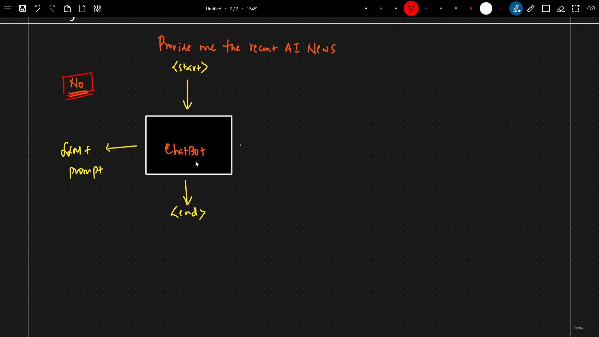

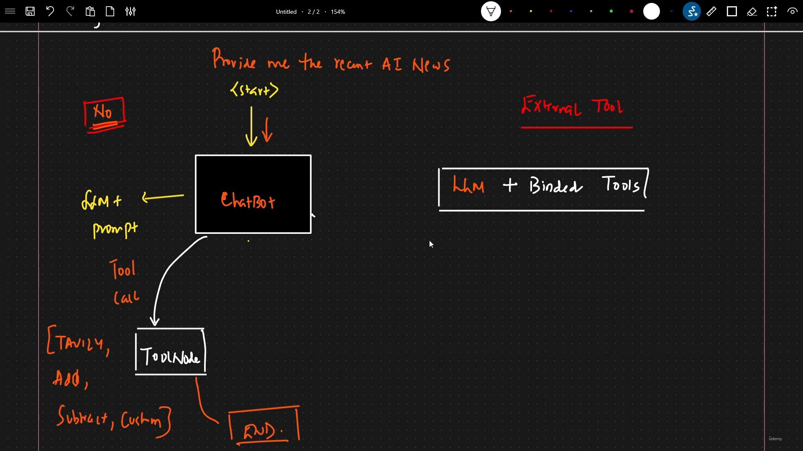

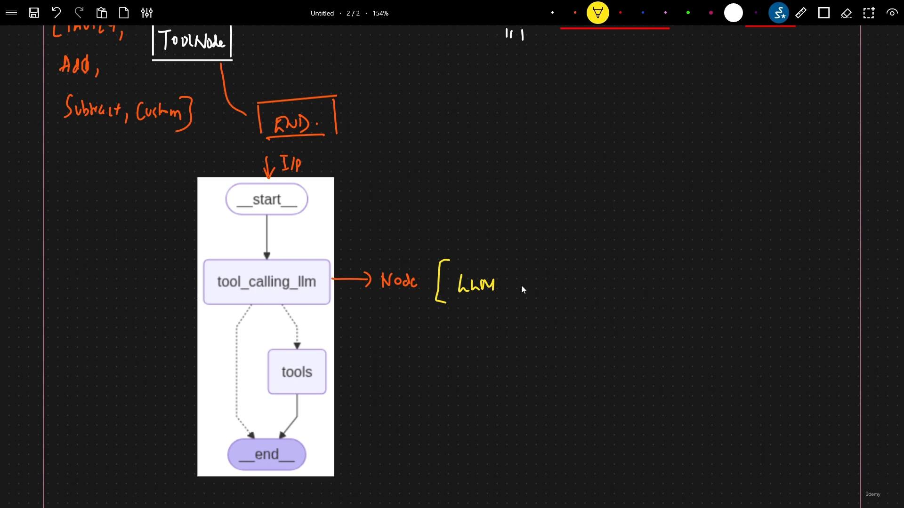

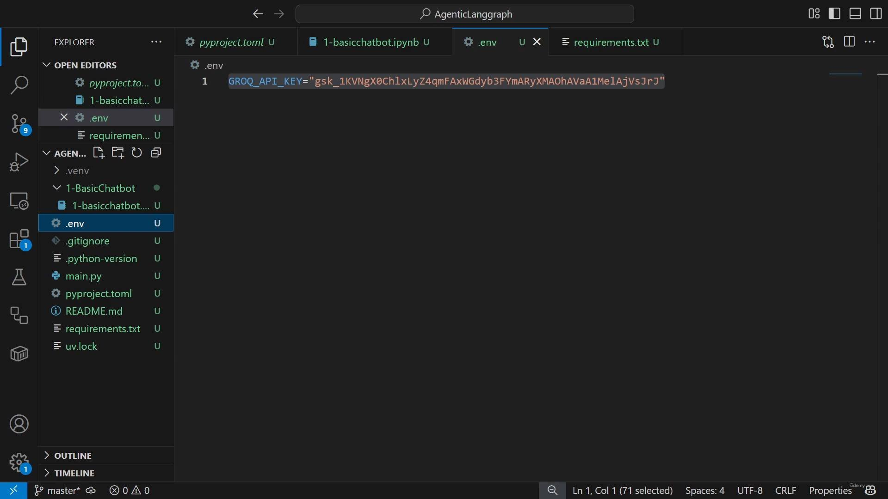

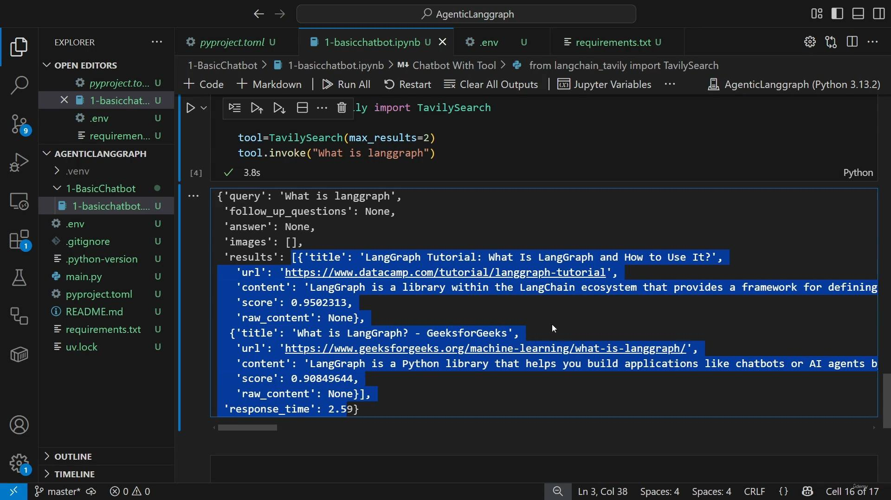

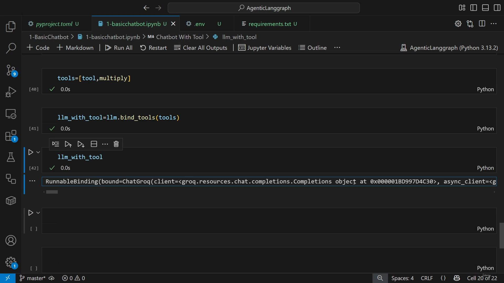

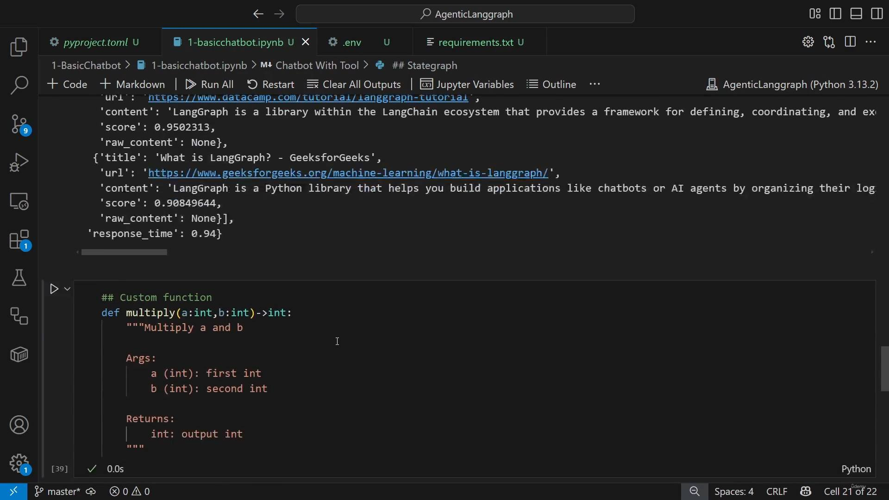

![p021 18:23 定义 tool_calling_LLM 节点，内部调用 llm_with_tools.invoke(state["messages"])](images/p021_1103s.jpg)

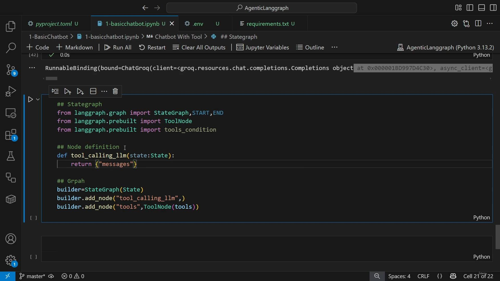

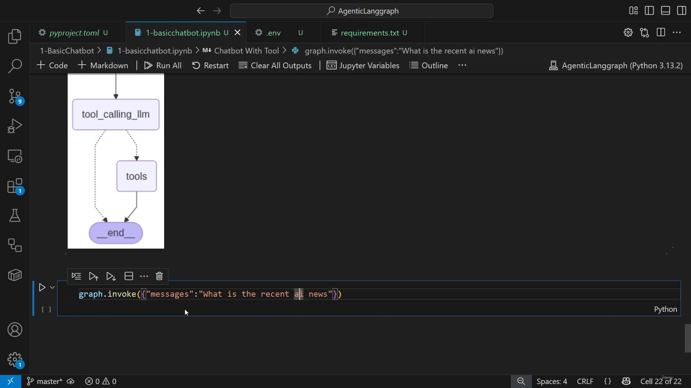

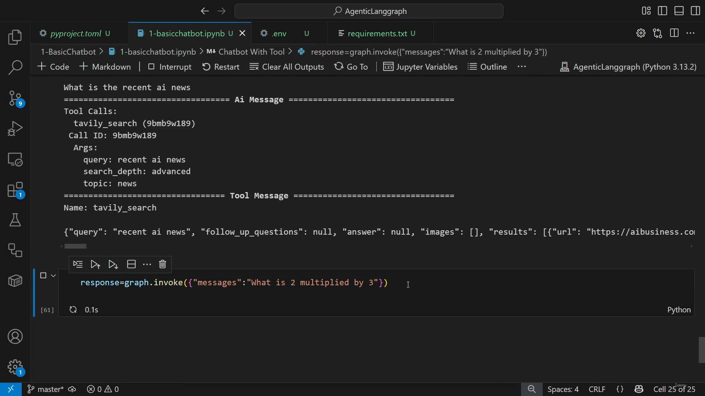

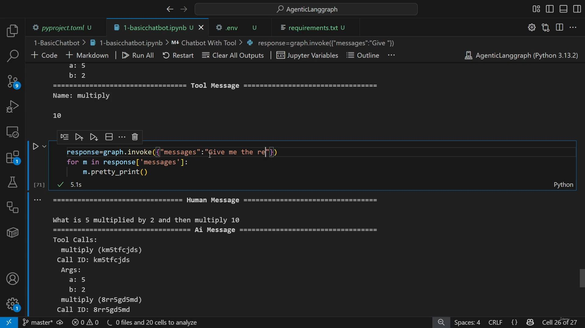