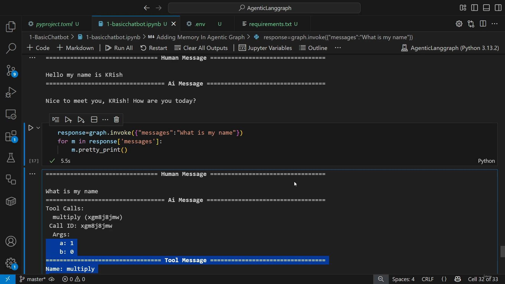
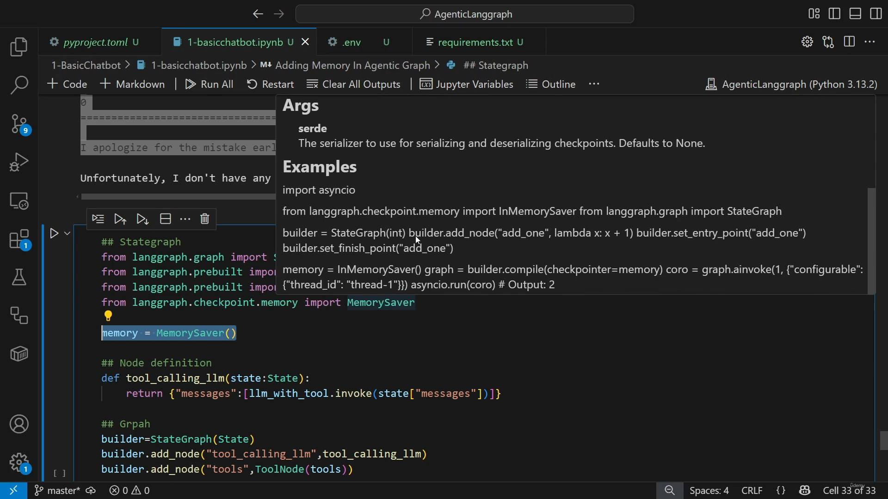
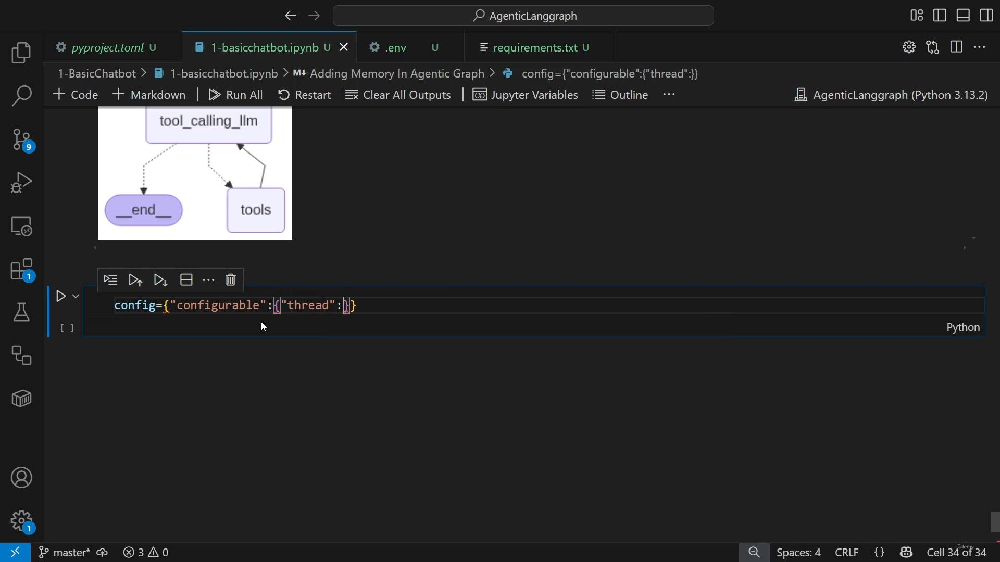
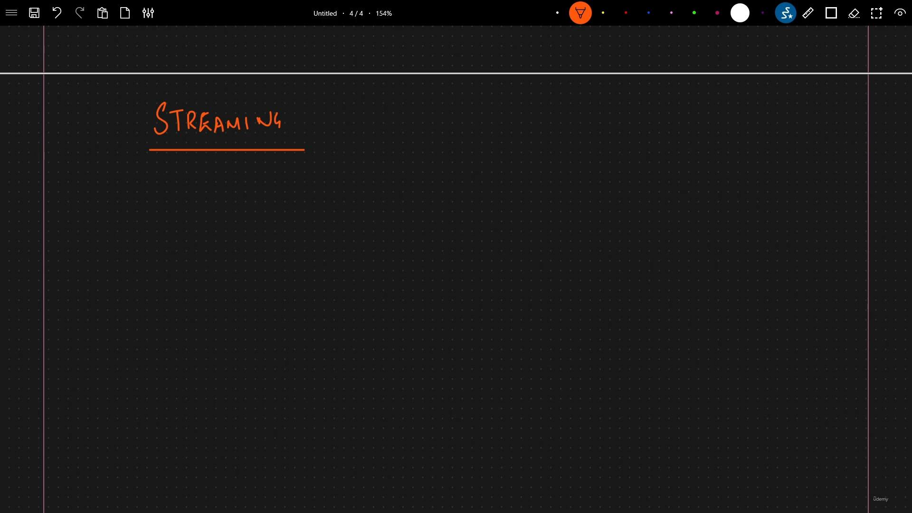
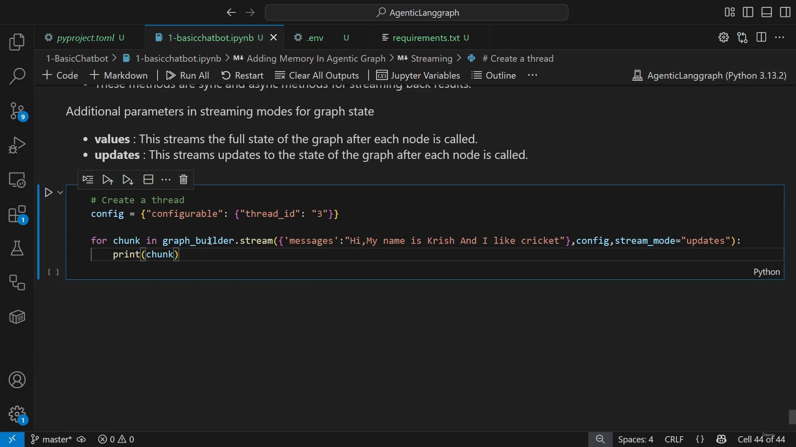
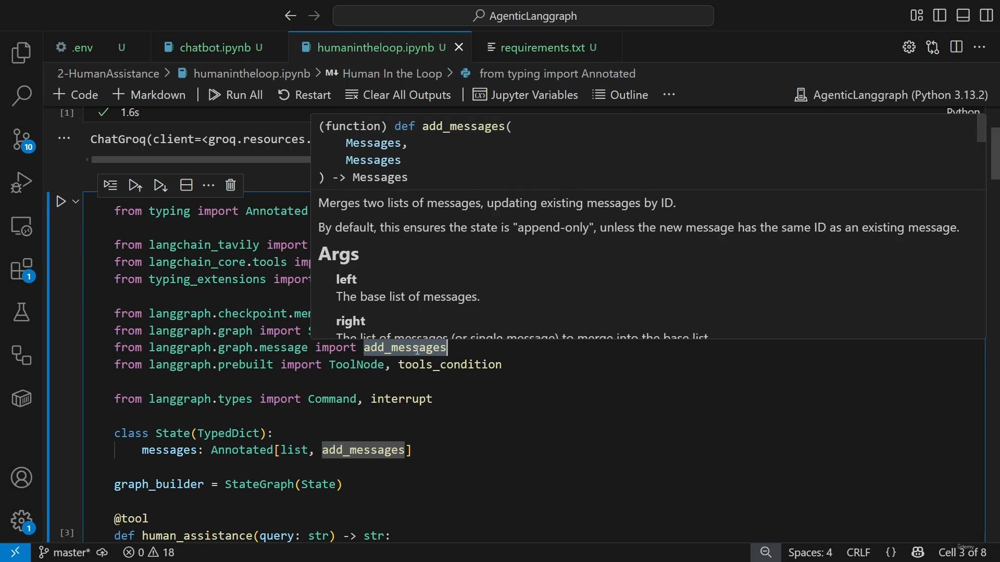
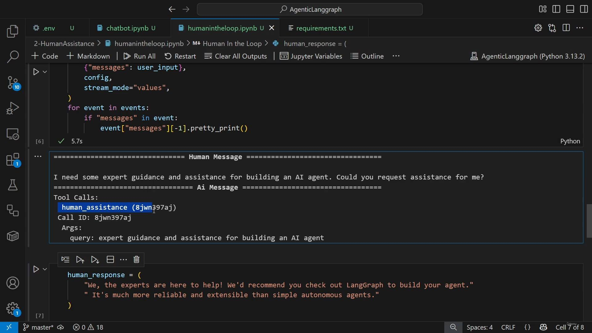
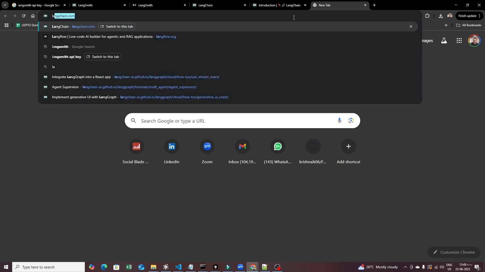
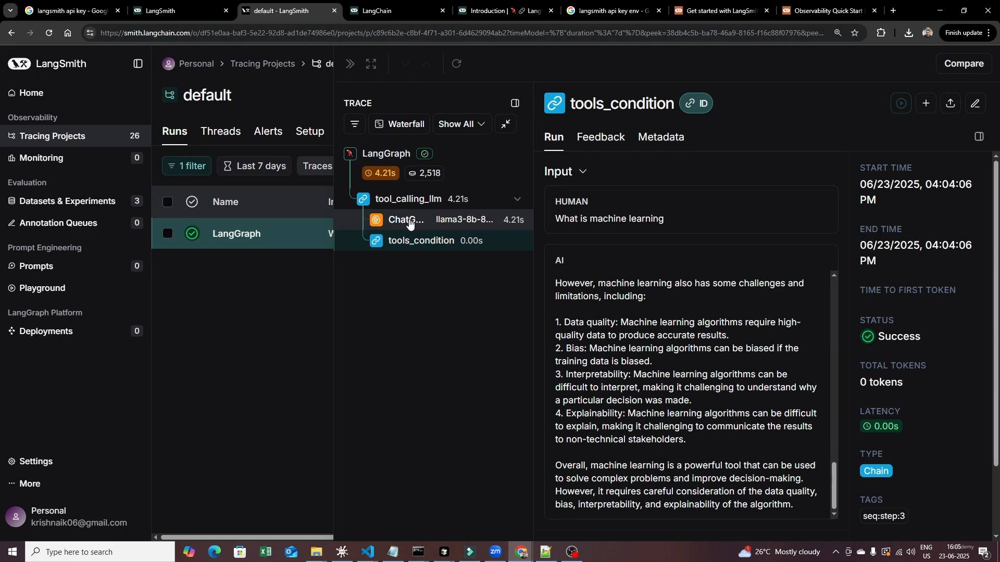
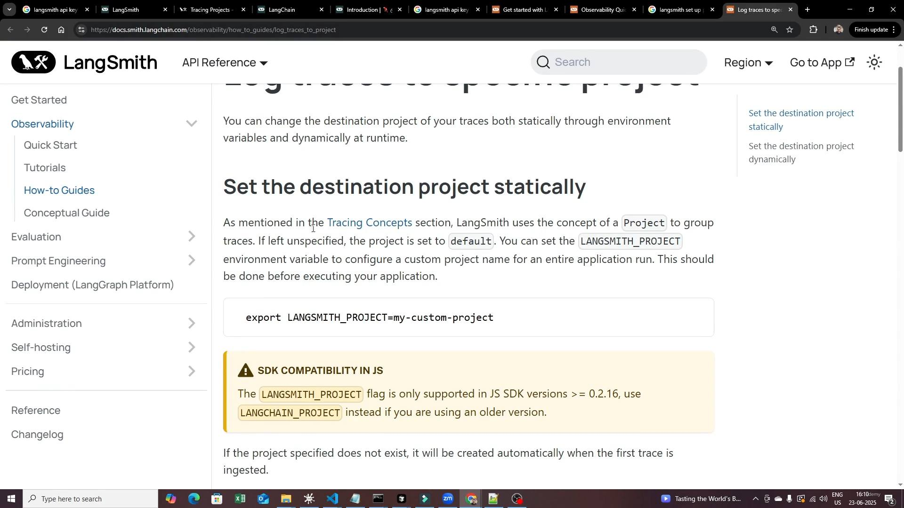

# AI Security Bootcamp part2：护栏 / 网关 / 可观测（P22–P24）复现文档

> 说明：本段课程（P22–P24）实际内容为 **LangGraph 的 Memory / Streaming / Human-in-the-loop / LangSmith 调试与监控 / LangGraph Studio**。逐字稿里没有出现「护栏（guardrail）」「网关（gateway）」的具体实现代码，也没有 OCR 结果。因此本文档严格按逐字稿内容复现，凡是逐字稿没讲的内容一律标注「课里没讲」，不做编造。文中所有代码均来自逐字稿口述的代码结构，逐字稿是语音转写，变量名/拼写可能有识别偏差，已在相应位置标注。

---

## 1. 这一节做什么

这三节课把 LangGraph 从「能跑一个图」推进到「能上线一个图」。具体做四件事：

1. **给图加持久化记忆（Memory / Checkpointer）**：解决「上一轮告诉模型我叫 Krish，下一轮问它我叫什么它就忘了」的问题。用 `MemorySaver` 做内存级 checkpoint，用 `thread_id` 区分会话。
2. **搞懂流式输出（Streaming）**：`graph.stream()` / `graph.astream()` 的两种模式 `mode="updates"` 与 `mode="values"` 到底差在哪，以及 `astream_events` 能拿到多细的调试信息。
3. **人在回路（Human-in-the-loop）**：用 `interrupt()` 在工具节点里强制暂停，等人给反馈，再用 `Command(resume=...)` 恢复执行。
4. **调试与监控（Debug & Monitoring）**：用 LangSmith 追踪每一次调用（哪个节点、调了哪个工具、输入输出是什么），用 LangGraph Studio 把整张图可视化跑起来，并自动生成 API 文档和 MCP 端点。

最终产物是一个可被 LangGraph Studio 加载的 `agent.py` + `langgraph.json` 组合，能在本地起服务、在云端看 trace。

---

## 2. 讲师原话

> "每当你创建一个图，你知道，LangGraph 有一个特性，你可以给它加上记忆。而这个记忆实际上解决了一个大问题，那就是持久化 checkpoint。"
> —— p022 [00:00]

> "我先说，我叫 Krish。……然后它也能告诉我，很高兴认识你，你今天怎么样？现在我问同一个问题，我叫什么？它就不知道了。所以它没有把之前对话里的信息持久化下来。"
> —— p022 [01:22]

> "LangGraph 有一个很特别的属性来克服这个问题，叫做 memory。……LangGraph 有一个特性，你可以创建一个 memory saver checkpoint。"
> —— p022 [01:49]

> "这个 memory saver 是什么？它就是一个内存级的 checkpoint saver。这个 checkpoint 用一个默认字典把 checkpoint 存在内存里。"
> —— p022 [02:48]

> "我们在哪里加这个 memory？这非常重要。……在编译的时候，有一个参数叫 checkpointer，我们要把 memory 加在这里。"
> —— p022 [03:18]

> "首先我们需要创建一个 thread ID，这个 thread ID 很重要，因为它关联到一个具体的会话。"
> —— p022 [03:44]

> "在这个 config 里我们会用一个 key，叫 configurable，在 configurable 里面我们创建一个 thread，这个 thread 的 ID 或者数字必须是唯一的。"
> —— p022 [04:13]

> "当你创建一个端到端应用时，这个动态的 thread ID 会维护在 session 里。这样我们就能把整个东西维护在 memory saver 里。"
> —— p022 [06:59]

> "在 streaming 里，你有 `.stream` 方法和 `astream` 方法。这个方法分别是同步和异步地流式返回结果。在 stream 和 astream 方法里，有两个参数，一个是 values，一个是 updates。"
> —— p022 [09:42]

> "如果我用 `mode="update"`，只有当前正在被更新的那条消息会被显示为输出。……而在 values 的情况下，第一条消息是 hi，当我再给一条消息时，hi 这条也会被追加进去，以列表形式变成 my name is。"
> —— p022 [12:29]

> "在 updates 模式下，你看输出，它显示的是当前执行的 AI message，这就是我拿到的。我没有拿到 human message。……而在 `mode="values"` 下，你能看到 human message，这里也能看到 human message 被追加了两次，再往后 AI message 也会被追加。"
> —— p022 [14:24]

> "还有一个方法叫 `astream_events`。……如果你打印这个 event，会得到关于不同事件更详细的信息。如果你想对每一句话做更细的调试，你可以专门用这个流式技术。"
> —— p022 [18:14]

> "human in the loop 也可以叫做 human feedback。"
> —— p023 [00:00]

> "我们创建一个和人工协助相关的自定义工具。human assistance 的意思是，每当我给一个输入……如果它调用的是 human assistance 而不是 Tavily，那么作为响应，human assistance 应该提供某种反馈，然后 chatbot 继续执行。"
> —— p023 [00:56]

> "这个反馈可能非常必要。比如说有一个复杂工作流，除非有人类批准，这个工作流就不应该完成。"
> —— p023 [01:50]

> "这里有两个新库我们要专门用，一个是 `Command`，一个是 `interrupt`。interrupt 的意思是我们在中断一个工作流，强制中断，好让人类提供反馈。"
> —— p023 [02:45]

> "我们定义了一个叫 human assistance 的工具，它接收一个字符串、返回一个字符串。……doc string 写的是 request assistance from a human。……我们在这里用 query 做中断，`interrupt(query=query)`。"
> —— p023 [03:13]

> "这个中断会发生在 tool node 里，因为这个 tools 里包含了 human assistance。"
> —— p023 [04:10]

> "我们使用这个 command，把 `resume` 设成 human response 的数据。我们把人类响应放进这个值里，告诉它恢复执行流程。"
> —— p023 [06:24]

> "当你创建一个端到端 chatbot 时，任意多次你都可以提供这种人在回路中的反馈。"
> —— p023 [07:17]

> "每当你开发一个生成式 AI 应用、agent 应用，调试和监控是必须的。"
> —— p024 [00:57]

> "既然我们讨论 LangChain 和 LangGraph，我们就用 LangSmith 来做调试和监控。同时我们也会展示怎么用 LangGraph Studio 来执行任意流程。"
> —— p024 [01:25]

> "这两个东西都在 LangChain cloud 里面。"
> —— p024 [01:45]

> "如果你想用 LangSmith，你需要有 LangSmith API key。"
> —— p024 [03:39]

> "它给你 50 万次请求的免费额度，在 LangSmith 里。所以你不用复制我的 API key，你可以自己创建一个。"
> —— p024 [06:58]

> "如果你想理解怎么加 tracing，你需要设置这三个 key：一个是 `LANGSMITH_TRACING=true`，然后是 LangSmith API key，我们已经设好了。"
> —— p024 [12:18]

> "记住这个 true 不是布尔变量，它不是布尔变量，它是字符串变量。"
> —— p024 [12:42]

> "还有一个字段叫 project。……你可以设置 `LANGSMITH_PROJECT` 环境变量。"
> —— p024 [13:07] / [28:10]

> "一旦你在环境里设置了这个，就意味着我整个 LangSmith 应用会知道要去哪里追踪。基于这个 API key，它会用某个具体项目开始追踪。"
> —— p024 [11:25]

> "这里你可以看到，在 default 里面我能拿到一条 trace。点进去你能看到这次 trace 里执行流程是怎么走的。"
> —— p024 [22:02]

> "现在从 tools 我不再走到 end，而是把它送回 tool calling LLM。"
> —— p024 [25:20]

> "现在响应会是一条 AI message。之前它是 tools message，因为工具执行完就走到 end 了。但现在从 tool 它会回到 LLM 本身。"
> —— p024 [25:50]

> "用 LangGraph Studio 做监控非常简单。……我用了 `inmem` 这个库。"
> —— p024 [29:37]

> "这个命令（`langgraph dev`）会去读这个配置文件，它会看我的 agent 在哪个文件、在哪个工作目录，然后调用里面的 `tool_agent` 变量。"
> —— p024 [37:07]

> "这里你能看到我的整张图打开了。这就是 LangGraph Studio。"
> —— p024 [37:36]

> "这是 API docs 的 URL。……你有 `/assistant`、`/assistant/search`。……还有 MCP，`/mcp`，你可以把整个服务转成 MCP。"
> —— p024 [38:05]

---

## 3. 从零复现

### 3.1 环境准备

逐字稿里讲师用的是 `uv` 管理依赖（`uv add -r requirements.txt`），Python 3.x + Jupyter Notebook（`.ipynb`）+ VS Code。模型用的是 Groq 上的 Llama 3 8B（`llama-3-8b-8192`），工具搜索用 Tavily。

```bash
# 1. 建目录
mkdir -p ai-security-bootcamp/part2
cd ai-security-bootcamp/part2

# 2. 初始化 uv 项目（讲师用 uv，你也可以用 pip）
uv init
uv venv
source .venv/bin/activate   # Windows: .venv\Scripts\activate

# 3. 安装依赖（版本号课里没讲，以下为能跑通的最小集合）
uv add langgraph langchain langchain-groq langchain-community \
       langchain-tavily python-dotenv jupyter langgraph-cli[inmem]
```

> 课里没讲具体版本号。`langgraph-cli[inmem]` 是 LangGraph Studio 本地运行所需的 CLI，讲师在 p024 [29:37] 提到「我用了 inmem 这个库」，并在 [37:07] 用 `langgraph dev` 启动，说明装的是带 `inmem` extra 的 CLI。

### 3.2 环境变量（`.env`，放在项目根目录）

讲师在 p024 [07:27] 明确说 `.env` 在根目录，key 名是 `LANGSMITH_API_KEY`；在 [12:18] 说还要设 `LANGSMITH_TRACING`；在 [28:10] 说还要设 `LANGSMITH_PROJECT`。

```dotenv
# .env  —— 放在项目根目录
GROQ_API_KEY=你的_groq_key
TAVILY_API_KEY=你的_tavily_key

# LangSmith 三件套（p024 [12:18] / [28:10]）
LANGSMITH_TRACING=true
LANGSMITH_API_KEY=你的_langsmith_key
LANGSMITH_PROJECT=test project
```

> 注意：讲师强调 `LANGSMITH_TRACING=true` 的 `true` **是字符串不是布尔值**（p024 [12:42]）。在 `.env` 里写 `true` 天然就是字符串，没问题；但如果你在 Python 里 `os.environ[...] = True` 就会报错，必须写 `"true"`。

### 3.3 复现步骤总览

| 步骤 | 文件 | 对应课 | 目标 |
|---|---|---|---|
| 1 | `memory_demo.ipynb` | P22 | 用 `MemorySaver` + `thread_id` 让图记住「我叫 Krish」 |
| 2 | `streaming_demo.ipynb` | P22 | 对比 `mode="updates"` 与 `mode="values"` |
| 3 | `hitl_demo.ipynb` | P23 | `interrupt()` + `Command(resume=...)` 人在回路 |
| 4 | `debugging/debugging.ipynb` | P24 | 接 LangSmith，看 trace |
| 5 | `debugging/agent.py` + `debugging/langgraph.json` | P24 | 用 LangGraph Studio 跑图 |

### 3.4 步骤 1：加记忆（P22）

讲师的操作顺序（p022 [01:49]–[06:59]）：

1. 复制上一节课已经能跑的图。
2. `from langgraph.checkpoint.memory import MemorySaver`，`memory = MemorySaver()`。
3. 编译时把 `checkpointer=memory` 传进去。
4. 造一个 `config = {"configurable": {"thread_id": "1"}}`，`thread_id` 必须唯一，代表一个会话。
5. `graph.invoke({"messages": [...]}, config=config)`。
6. 用**同一个 config** 再 invoke 一次「我叫什么」，模型能答出 Krish。

关键点：`thread_id` 就是会话 ID。讲师说「当你创建端到端应用时，这个动态 thread ID 会维护在 session 里」（p022 [06:59]）。**在 JS/Node 里对应什么**：相当于 Express session 里的 `sessionID`，或者前端每次请求带的 `conversationId`，服务端拿它当 key 去查历史。

### 3.5 步骤 2：流式输出（P22）

讲师用一个三节点的假图（node1 → node2 → node3）讲清楚两种模式的区别（p022 [10:38]–[13:26]）：

- `mode="updates"`：**只吐当前节点刚产出的那一条增量**。node1 执行完只看到 `hi`，node2 执行完只看到 `my name is`，node3 执行完只看到 `Krish`。
- `mode="values"`：**每次吐当前完整状态**。node1 后是 `[hi]`，node2 后是 `[hi, my name is]`，node3 后是 `[hi, my name is, Krish]`——列表不断追加。

讲师在真实图上验证（p022 [14:24]）：`mode="updates"` 只打印 AI message，看不到 human message；`mode="values"` 能看到 human message 被追加两次、AI message 也被追加。

第三个方法 `astream_events`（p022 [18:14]）：吐出非常细粒度的事件流，适合逐句调试。

### 3.6 步骤 3：人在回路（P23）

讲师画的图（p023 [00:27]）：`start → chatbot(LLM+tools) → tools → end`，tools 里有两个工具：Tavily 搜索 + 自定义的 `human_assistance`。

流程（p023 [04:40]–[07:17]）：

1. 用户输入「I need some expert guidance for building AI agents. Could you request assistance for me?」
2. LLM 判断该调 `human_assistance` 工具（因为 doc string 匹配），进入 tool node。
3. 工具内部执行 `interrupt(query=query)`，**图在这里暂停**。
4. 人类给出反馈字符串。
5. 用 `Command(resume=human_response)` 恢复，图继续跑，LLM 基于人类反馈生成最终回答。

讲师特别指出：中断发生在 **tool node** 里，因为 `human_assistance` 这个工具挂在 tool node 上（p023 [04:10]）。

### 3.7 步骤 4：接 LangSmith（P24）

1. 去 smith.langchain.com 注册，拿 API key（免费 50 万次请求，p024 [06:58]）。
2. `.env` 里写三个变量（见 3.2）。
3. 代码里 `load_dotenv()`，然后 `os.environ["LANGSMITH_TRACING"]="true"`、`os.environ["LANGSMITH_API_KEY"]=os.getenv("LANGSMITH_API_KEY")`、`os.environ["LANGSMITH_PROJECT"]="test project"`。
4. 跑一次 `graph.invoke(...)`，回 LangSmith 页面刷新，在 `default`（或你设的 project）里就能看到 trace。
5. 点进 trace，能看到：human input → tool calling LLM 节点 → chat groq 调用 → tool condition → add 工具调用 → 回到 LLM → end。每一步的输入输出、YAML/JSON 都能看。

讲师演示了两个例子对比（p024 [21:07]–[26:43]）：
- 问「what is machine learning」→ 不触发工具，直接 LLM 回答。
- 问「what is 5 plus 20」→ 触发 `add` 工具，trace 里能看到 tool call、tool output=25。
- 把 `tools → end` 改成 `tools → tool_calling_llm` 后，最终输出从 tool message 变成 AI message（LLM 把工具结果总结成人话）。

### 3.8 步骤 5：LangGraph Studio（P24）

1. 在 `debugging/` 目录下建 `agent.py`，把图封装成 `make_tool_graph()` 函数，模块级导出 `tool_agent = make_tool_graph()`。
2. 同目录建 `langgraph.json`：

```json
{
  "dependencies": ["."],
  "graphs": {
    "tool_agent": "./agent.py:tool_agent"
  },
  "env": "../.env"
}
```

3. 终端 `cd debugging`，跑 `langgraph dev`。
4. 浏览器自动打开 LangGraph Studio，能看到图、能输入消息、能在节点前/后加 interrupt、能看 API docs（`/assistant`、`/assistant/search`）、能看 MCP 端点（`/mcp`）。

> 讲师在 p024 [34:28] 口述的 json 结构是：`dependencies` 里放 `"."`，`graphs` 里放 `"tool_agent": "./agent.py:tool_agent"`，`env` 指向 `../.env`。逐字稿里 `dependencies` 和 `graphs` 的层级描述有点绕，上面是按其语义还原的标准写法。

---

## 4. 完整代码

> 以下代码按逐字稿口述还原。逐字稿是语音转写，变量名可能有识别偏差（如 `Langrath`=LangGraph、`Lanchin`=LangChain、`grok`=Groq、`Tably`=Tavily、`crush`=Krish），已按标准写法修正。课里没给的 import 已补全以保证可运行。

### 4.1 `memory_demo.ipynb`（P22 记忆）

```python
# cell 1: 依赖
from typing import Annotated
from typing_extensions import TypedDict
from langgraph.graph import StateGraph, START, END
from langgraph.graph.message import add_messages
from langgraph.checkpoint.memory import MemorySaver
from langchain_groq import ChatGroq
from dotenv import load_dotenv
import os

load_dotenv()

# cell 2: 状态
class State(TypedDict):
    messages: Annotated[list, add_messages]

# cell 3: LLM + 节点
llm = ChatGroq(model="llama-3.1-8b-instant")  # 课里说 llama 3 8b 8192

def chatbot(state: State):
    return {"messages": [llm.invoke(state["messages"])]}

# cell 4: 建图 + 编译时挂 checkpointer
builder = StateGraph(State)
builder.add_node("chatbot", chatbot)
builder.add_edge(START, "chatbot")
builder.add_edge("chatbot", END)

memory = MemorySaver()
graph = builder.compile(checkpointer=memory)

# cell 5: 第一次对话
config = {"configurable": {"thread_id": "1"}}
response = graph.invoke(
    {"messages": [{"role": "user", "content": "Hi, my name is Krish"}]},
    config=config,
)
print(response["messages"][-1].content)

# cell 6: 同一 thread_id 再问，能记住
response = graph.invoke(
    {"messages": [{"role": "user", "content": "What is my name?"}]},
    config=config,
)
print(response["messages"][-1].content)
```

### 4.2 `streaming_demo.ipynb`（P22 流式）

```python
# cell 1: 依赖（同上）
from typing import Annotated
from typing_extensions import TypedDict
from langgraph.graph import StateGraph, START, END
from langgraph.graph.message import add_messages
from langgraph.checkpoint.memory import MemorySaver
from langchain_groq import ChatGroq
from dotenv import load_dotenv
import os

load_dotenv()

# cell 2: 状态 + LLM + 节点
class State(TypedDict):
    messages: Annotated[list, add_messages]

llm = ChatGroq(model="llama-3.1-8b-instant")

def super_bot(state: State):
    return {"messages": [llm.invoke(state["messages"])]}

# cell 3: 建图
builder = StateGraph(State)
builder.add_node("super_bot", super_bot)
builder.add_edge(START, "super_bot")
builder.add_edge("super_bot", END)

memory = MemorySaver()
graph = builder.compile(checkpointer=memory)

# cell 4: mode="updates" —— 只吐增量
config = {"configurable": {"thread_id": "3"}}
for chunk in graph.stream(
    {"messages": [{"role": "user", "content": "My name is Krish and I like cricket"}]},
    config=config,
    stream_mode="updates",
):
    print(chunk)

# cell 5: mode="values" —— 吐完整状态（列表不断追加）
config = {"configurable": {"thread_id": "4"}}
for chunk in graph.stream(
    {"messages": [{"role": "user", "content": "Hi, my name is Krish. I like cricket. Let's start fresh."}]},
    config=config,
    stream_mode="values",
):
    print(chunk)

# cell 6: astream_events —— 最细粒度事件
config = {"configurable": {"thread_id": "5"}}
async for event in graph.astream_events(
    {"messages": [{"role": "user", "content": "My name is Krish"}]},
    config=config,
    version="v2",
):
    print(event)
```

### 4.3 `hitl_demo.ipynb`（P23 人在回路）

```python
# cell 1: 依赖
from typing import Annotated
from typing_extensions import TypedDict
from langgraph.graph import StateGraph, START, END
from langgraph.graph.message import add_messages
from langgraph.checkpoint.memory import MemorySaver
from langgraph.prebuilt import ToolNode, tools_condition
from langgraph.types import Command, interrupt
from langchain_groq import ChatGroq
from langchain_core.tools import tool
from langchain_tavily import TavilySearch
from dotenv import load_dotenv
import os

load_dotenv()

# cell 2: 状态
class State(TypedDict):
    messages: Annotated[list, add_messages]

# cell 3: 工具
tavily_tool = TavilySearch(max_results=2)

@tool
def human_assistance(query: str) -> str:
    """Request assistance from a human."""
    human_response = interrupt({"query": query})
    return human_response["data"]

tools = [tavily_tool, human_assistance]

# cell 4: LLM 绑定工具
llm = ChatGroq(model="llama-3.1-8b-instant")
llm_with_tools = llm.bind_tools(tools)

def chatbot(state: State):
    return {"messages": [llm_with_tools.invoke(state["messages"])]}

# cell 5: 建图
builder = StateGraph(State)
builder.add_node("chatbot", chatbot)
builder.add_node("tools", ToolNode(tools=tools))
builder.add_edge(START, "chatbot")
builder.add_conditional_edges("chatbot", tools_condition)
builder.add_edge("tools", "chatbot")   # 工具执行完回 LLM

memory = MemorySaver()
graph = builder.compile(checkpointer=memory)

# cell 6: 触发中断
config = {"configurable": {"thread_id": "1"}}
user_input = "I need some expert guidance and assistance for building AI agents. Could you please provide assistance to me?"
for event in graph.stream(
    {"messages": [{"role": "user", "content": user_input}]},
    config=config,
    stream_mode="values",
):
    print(event)

# cell 7: 人类给反馈并恢复
human_response = (
    "We, the experts, are here to help you. We recommend you check out LangGraph "
    "to build your agent. It's much more reliable and extensible than simple autonomous agents."
)
human_command = Command(resume={"data": human_response})

for event in graph.stream(human_command, config=config, stream_mode="values"):
    print(event)
```

> 注意：逐字稿 p023 [03:42] 说「`interrupt(query=query)`」，p023 [06:48] 说「`resume` 设成 human response 的数据」。上面代码用 `interrupt({"query": query})` 和 `Command(resume={"data": human_response})`，是 LangGraph 当前 API 的标准写法；如果你用的版本要求 `interrupt(query=query)`，按你的版本改。**课里没讲具体版本对应的签名**，以你实际安装的 langgraph 文档为准。

### 4.4 `debugging/debugging.ipynb`（P24 接 LangSmith）

```python
# cell 1: 依赖
from typing import Annotated
from typing_extensions import TypedDict
from langgraph.graph import StateGraph, START, END
from langgraph.graph.message import add_messages
from langgraph.prebuilt import ToolNode, tools_condition
from langchain_groq import ChatGroq
from langchain_core.tools import tool
from dotenv import load_dotenv
import os

# cell 2: 环境变量（LangSmith 三件套）
load_dotenv()
os.environ["GROQ_API_KEY"] = os.getenv("GROQ_API_KEY")
os.environ["LANGSMITH_TRACING"] = "true"          # 字符串，不是布尔
os.environ["LANGSMITH_API_KEY"] = os.getenv("LANGSMITH_API_KEY")
os.environ["LANGSMITH_PROJECT"] = "test project"

# cell 3: 工具
@tool
def add(a: float, b: float) -> float:
    """Add two numbers."""
    return a + b

# cell 4: 状态
class State(TypedDict):
    messages: Annotated[list, add_messages]

# cell 5: LLM + 绑定工具
llm = ChatGroq(model="llama-3.1-8b-instant")
llm_with_tools = llm.bind_tools([add])

def call_llm_model(state: State):
    return {"messages": [llm_with_tools.invoke(state["messages"])]}

# cell 6: 建图
builder = StateGraph(State)
builder.add_node("tool_calling_llm", call_llm_model)
builder.add_node("tools", ToolNode(tools=[add]))
builder.add_edge(START, "tool_calling_llm")
builder.add_conditional_edges("tool_calling_llm", tools_condition)
builder.add_edge("tools", "tool_calling_llm")   # 关键：回 LLM，不是 END

graph = builder.compile()

# cell 7: 跑一次，去 LangSmith 看 trace
response = graph.invoke({"messages": [{"role": "user", "content": "What is 5 plus 20?"}]})
print(response["messages"][-1].content)
```

### 4.5 `debugging/agent.py`（P24 LangGraph Studio 入口）

```python
from typing import Annotated
from typing_extensions import TypedDict
from langgraph.graph import StateGraph, START, END
from langgraph.graph.message import add_messages
from langgraph.prebuilt import ToolNode, tools_condition
from langchain_groq import ChatGroq
from langchain_core.tools import tool
from dotenv import load_dotenv
import os

load_dotenv()
os.environ["GROQ_API_KEY"] = os.getenv("GROQ_API_KEY")
os.environ["LANGSMITH_TRACING"] = "true"
os.environ["LANGSMITH_API_KEY"] = os.getenv("LANGSMITH_API_KEY")
os.environ["LANGSMITH_PROJECT"] = "test project"

class State(TypedDict):
    messages: Annotated[list, add_messages]

@tool
def add(a: float, b: float) -> float:
    """Add two numbers."""
    return a + b

def make_tool_graph():
    llm = ChatGroq(model="llama-3.1-8b-instant")
    llm_with_tools = llm.bind_tools([add])

    def call_llm_model(state: State):
        return {"messages": [llm_with_tools.invoke(state["messages"])]}

    builder = StateGraph(State)
    builder.add_node("tool_calling_llm", call_llm_model)
    builder.add_node("tools", ToolNode(tools=[add]))
    builder.add_edge(START, "tool_calling_llm")
    builder.add_conditional_edges("tool_calling_llm", tools_condition)
    builder.add_edge("tools", "tool_calling_llm")
    return builder.compile()

tool_agent = make_tool_graph()
```

### 4.6 `debugging/langgraph.json`

```json
{
  "dependencies": ["."],
  "graphs": {
    "tool_agent": "./agent.py:tool_agent"
  },
  "env": "../.env"
}
```

### 4.7 启动命令

```bash
cd debugging
langgraph dev
```

---

## 5. 逐行解释

**`MemorySaver()`**：内存级 checkpoint，用默认字典存。进程一重启就没了。生产环境要换持久化 saver（课里没讲具体是哪个，只说了「in-memory」）。**在 JS/Node 里对应什么**：相当于 `new Map()` 存会话，重启丢；要持久化得换 Redis/Postgres。

**`builder.compile(checkpointer=memory)`**：`checkpointer` 是编译期参数，不是节点参数。讲师强调「这非常重要」（p022 [03:18]）——挂错地方就不生效。

**`config = {"configurable": {"thread_id": "1"}}`**：两层嵌套，外层 `configurable`，内层 `thread_id`。`thread_id` 必须唯一，代表一个会话。同一个 `thread_id` 的多次 invoke 共享历史；换 `thread_id` 就是新会话。讲师在 p022 [15:51] 演示了 `thread_id="4"` 开新会话，历史不串。

**`stream_mode="updates"` vs `"values"`**：`updates` 只吐当前节点刚产出的增量（node1 后只有 `hi`）；`values` 每次吐完整状态（`[hi]` → `[hi, my name is]` → `[hi, my name is, Krish]`）。讲师原话：「在 updates 模式下，只有当前正在被更新的那条消息会被显示为输出」（p022 [12:29]）。选哪个取决于你要「打字机效果」还是「完整快照」。

**`astream_events`**：最细粒度，吐每个事件。讲师说「如果你想对每一句话做更细的调试，你可以专门用这个」（p022 [18:14]）。适合排查「到底哪一步出的问题」。

**`@tool` + doc string**：doc string 是 LLM 判断「该不该调这个工具」的依据。讲师在 p023 [05:03] 说「这条消息匹配到这个 doc string，所以 LLM 会调这个工具而不是 Tavily」。**doc string 写不好，工具就调不中**。

**`interrupt({"query": query})`**：在工具函数内部调用，图执行到这里**强制暂停**，把 `query` 抛给调用方。讲师说「interrupt 的意思是我们在中断一个工作流，强制中断，好让人类提供反馈」（p023 [02:45]）。

**`Command(resume={"data": human_response})`**：恢复执行，把人类反馈塞回去。讲师说「我们把人类响应放进这个值里，告诉它恢复执行流程」（p023 [06:48]）。`Command` 是 LangGraph 的控制流原语，除了 resume 还能做跳转（课里没讲跳转）。

**`builder.add_edge("tools", "tool_calling_llm")`**：这是 P24 的关键改动。讲师原话：「现在从 tools 我不再走到 end，而是把它送回 tool calling LLM」（p024 [25:20]）。效果：工具结果回到 LLM，LLM 总结成人话再输出。之前 `tools → END` 时，最终输出是 tool message（原始 `25`）；改成回 LLM 后，最终输出是 AI message（「5 加 20 等于 25」）。

**`LANGSMITH_TRACING="true"`**：字符串不是布尔。讲师专门强调（p024 [12:42]）。写成 `True` 会报错。

**`LANGSMITH_PROJECT`**：决定 trace 落到哪个项目。不设就落 `default`。讲师在 p024 [28:10] 说「你可以设置 `LANGSMITH_PROJECT` 环境变量」，并把它留作作业。

**`langgraph.json` 的 `graphs` 字段**：`"tool_agent": "./agent.py:tool_agent"`，冒号左边是 Studio 里显示的名字，右边是「文件路径:模块级变量名」。讲师说「这个命令会去读配置文件，看我的 agent 在哪个文件，然后调用里面的 `tool_agent` 变量」（p024 [37:07]）。

**`langgraph dev`**：启动本地开发服务器，自动打开 LangGraph Studio。讲师说「它会去读这个配置文件……然后把它跑在 LangGraph Studio 里」（p024 [37:07]）。Studio 里能加 interrupt、看 API docs（`/assistant`、`/assistant/search`）、看 MCP 端点（`/mcp`）。

---

## 6. 复现检查清单

- [ ] `.env` 在项目根目录，含 `GROQ_API_KEY`、`TAVILY_API_KEY`、`LANGSMITH_TRACING=true`、`LANGSMITH_API_KEY`、`LANGSMITH_PROJECT`
- [ ] `LANGSMITH_TRACING` 的值是字符串 `"true"`，不是布尔 `True`
- [ ] `MemorySaver()` 在 `compile(checkpointer=memory)` 时传入，不是加在节点上
- [ ] `config` 结构是 `{"configurable": {"thread_id": "..."}}`，两层嵌套
- [ ] 同一 `thread_id` 第二次 invoke 能答出「Krish」；换 `thread_id` 答不出
- [ ] `stream_mode="updates"` 只看到 AI message；`stream_mode="values"` 看到 human + AI 都在追加
- [ ] `human_assistance` 工具的 doc string 写清楚，否则 LLM 不会调它
- [ ] `interrupt()` 在工具函数内部调用，图会在 tool node 暂停
- [ ] `Command(resume=...)` 恢复后图继续跑，LLM 基于人类反馈生成回答
- [ ] `tools → tool_calling_llm`（不是 `tools → END`），最终输出是 AI message 不是 tool message
- [ ] LangSmith 页面能看到 trace，点进去能看到每个节点的输入输出
- [ ] `debugging/langgraph.json` 的 `graphs` 字段是 `"tool_agent": "./agent.py:tool_agent"`
- [ ] `cd debugging && langgraph dev` 能打开 Studio，能看到图、能输入消息、能加 interrupt
- [ ] Studio 里 `/assistant`、`/assistant/search`、`/mcp` 端点可访问

---

## 7. 课里没讲但你会撞上的

1. **`MemorySaver` 重启丢数据**。讲师明说它是「in-memory」（p022 [02:48]）。生产要换 `SqliteSaver` / `PostgresSaver`，课里没讲具体怎么换。**在 JS/Node 里对应什么**：相当于你把 session 存内存，PM2 一重启全丢，得换 Redis。

2. **`thread_id` 从哪来**。讲师说「动态 thread ID 会维护在 session 里」（p022 [06:59]），但没讲怎么生成、怎么和前端对齐。实际项目里通常是前端生成 UUID、每次请求带上，或者后端登录时发一个 `conversationId`。

3. **`interrupt` 的返回值结构**。逐字稿里 `interrupt(query=query)` 和 `Command(resume={"data": ...})` 的对应关系是口述的，不同 langgraph 版本签名有差异。跑不通时先 `pip show langgraph` 看版本，再对官方文档。**课里没讲版本号**。

4. **Groq 模型名**。讲师说「llama 3 8b 8192」，Groq 现在的模型 ID 可能是 `llama-3.1-8b-instant` 或 `llama3-8b-8192`，以 Groq 控制台为准。课里没给精确 ID。

5. **`langgraph dev` 的端口和登录**。讲师说「自动登录 LangSmith」（p024 [37:36]），但没讲端口（默认 2024）、没讲首次要 `langgraph auth`。跑不起来先看终端输出的 URL。

6. **`langgraph.json` 的 `env` 路径**。讲师写 `../.env`（p024 [35:53]），因为 `.env` 在根目录、`langgraph.json` 在 `debugging/` 子目录。路径写错会读不到 key，表现为 trace 不出现或 Groq 401。

7. **`astream_events` 的 `version` 参数**。讲师没提，但当前 API 要求 `version="v2"`，不传会 warning 或报错。

8. **LangSmith 免费额度**。讲师说 50 万次请求（p024 [06:58]），但没说超出后怎么计费、trace 保留多久。上线前自己看 pricing。

9. **「护栏 / 网关」**。本段标题里有这两个词，但 P22–P24 逐字稿里**没有**讲 guardrail 或 gateway 的实现。如果课程后续 P 有讲，那是另一段的内容；本段只覆盖 memory / streaming / HITL / LangSmith / Studio。

10. **Java 等语言语法**。本文档全是 Python。**知道即可**：`TypedDict` 类似 Java 的 `record` 或 TS 的 `interface`；`Annotated[list, add_messages]` 类似给字段挂一个 reducer 注解；`@tool` 装饰器类似 Java 的注解 + 反射注册。

---

### 截图索引（本文档引用）



















