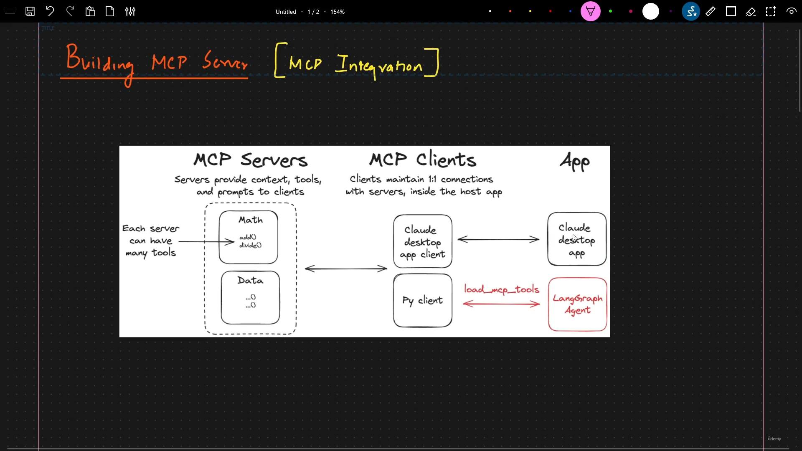
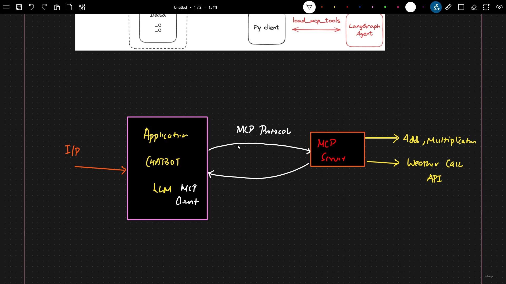
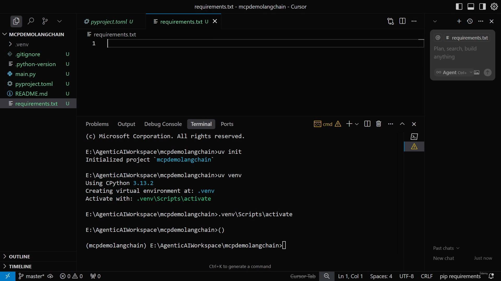
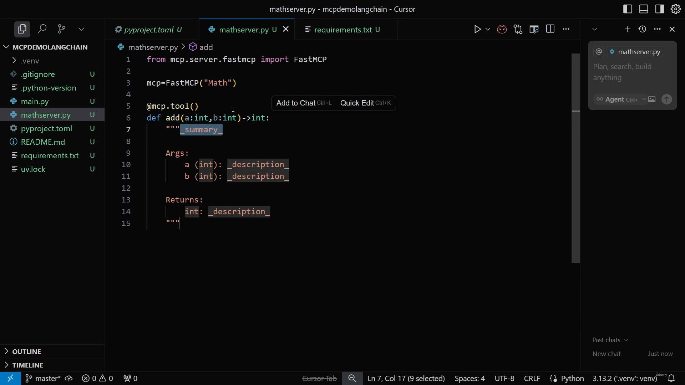
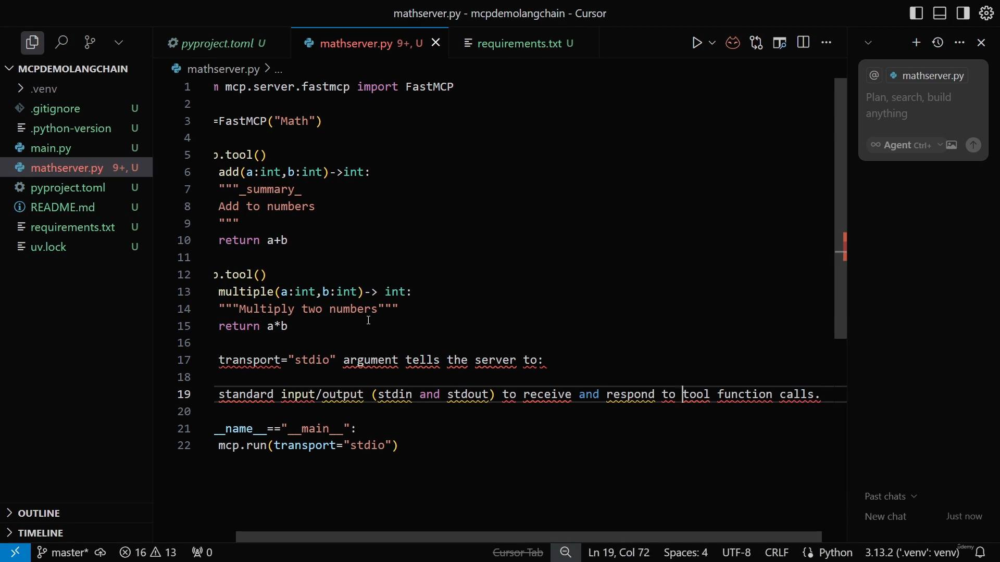
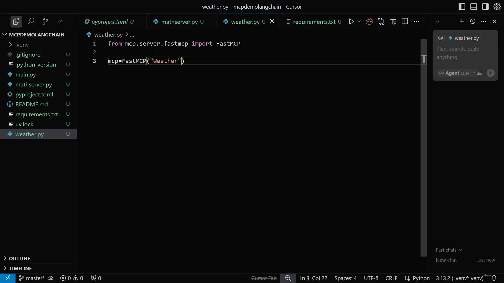
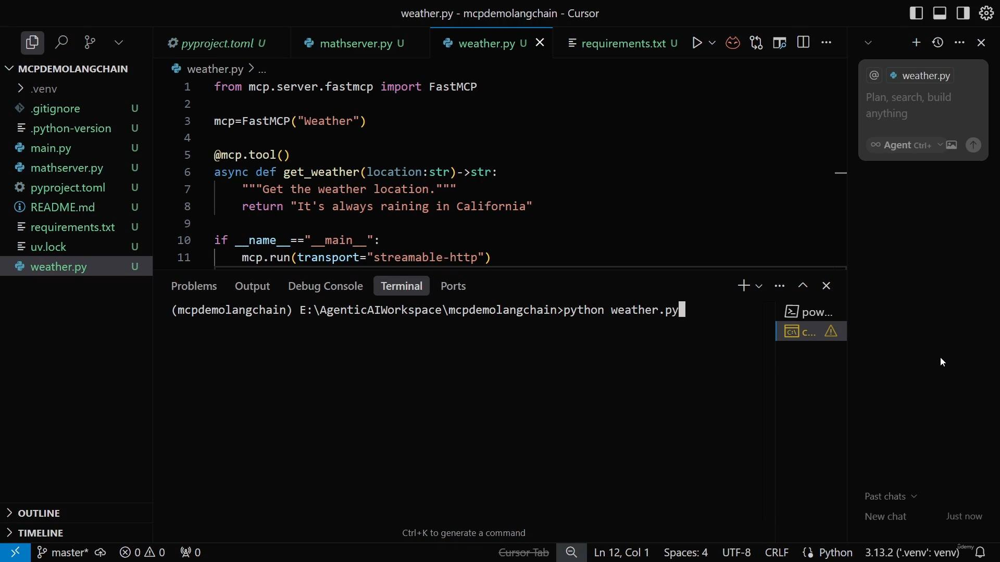
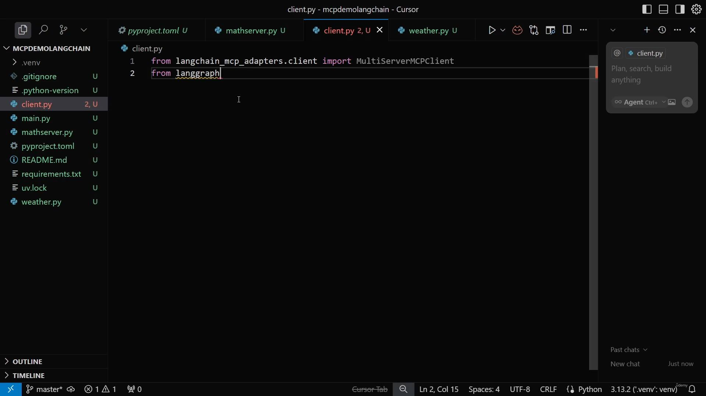
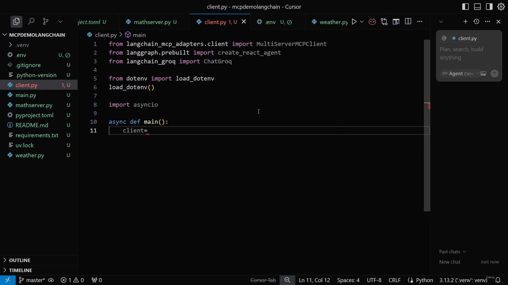
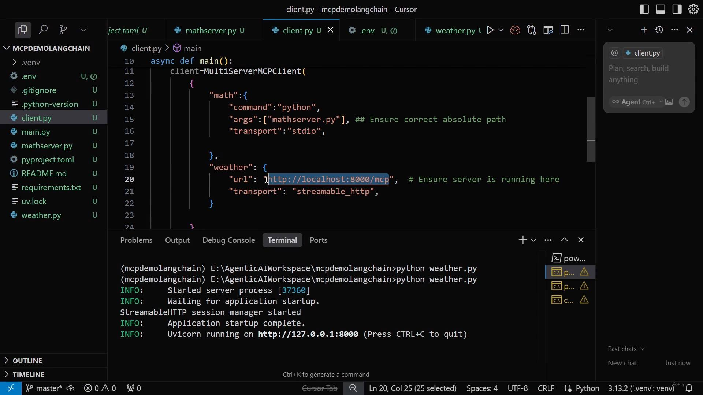

# AI Security Bootcamp Part 2 —— 从零构建 MCP Server 与多服务器 MCP Client（LangChain / LangGraph 版）

> 课程：AI Security Bootcamp part2 (护栏/网关/可观测)（BV1PSGA6SETb）
> 覆盖 P：26（本课只有这一集，全程约 34 分钟）
> 读者画像：前端转 AI 应用工程师，会 JS/TS，Python 只要求能读懂、能跑起来。

---

## 1. 这一节做什么

这一集是「MCP 实战」：讲师从空文件夹开始，用 Python 的 `uv` 建工程，用 `fastmcp` 写两个 MCP Server，再用 `langchain-mcp-adapters` + LangGraph 写一个 **多服务器 MCP Client**，把两个 Server 同时挂到一个 Agent 上，最后用一句自然语言问题让 LLM 自动选工具、自动调用、自动回填答案。

具体交付物是 4 个文件 + 1 个环境文件：

| 文件 | 作用 | 传输方式 |
|---|---|---|
| `math_server.py` | MCP Server，提供 `add`、`multiply` 两个数学工具 | `stdio`（标准输入输出） |
| `weather.py` | MCP Server，提供 `get_weather` 工具（课里返回硬编码字符串） | `streamable-http`（跑成本地 HTTP 服务） |
| `client.py` | 多服务器 MCP Client + LangGraph ReAct Agent | 同时连上面两个 Server |
| `requirements.txt` | 依赖清单 | — |
| `.env` | 放 `GROQ_API_KEY` | — |

学完你能回答三个问题：

1. MCP 的三大件（Server / Client / App）到底谁连谁；
2. `stdio` 和 `streamable-http` 两种 transport 的本质区别是什么、什么时候用哪个；
3. 怎么把「一个跑在命令行里的 Server」和「一个跑在 URL 上的 Server」塞进同一个 Agent。

这一集**不讲**护栏、网关、可观测的具体实现（那是本 Bootcamp 其他集的内容），只讲 MCP 的搭建与集成。讲师在结尾提了一句「最后也会讲怎么上生产」，但实际只给了口头概述，没有演示云端部署——这一点在第 7 节会明确标出。

---

## 2. 讲师原话

开篇讲师先给整体架构图，讲三大组件：

> "这里你能看到有三个主要组件：一个是 MCP server，一个是 MCP client，还有一个是 app。当我在这里说 MCP server 的时候，它里面可以有多个工具。你就想象有另一家公司、第三方公司在开发这类服务，它可以是简单的数学计算，可以是第三方 API 集成，任何东西都可以专门写在这里。"
> —— p026 [00:00]

> "这个 MCP server 向 client 提供上下文、工具和提示词。类似地，你还有 MCP client。client 在宿主 app 内部与 server 维持一对一的连接。最后你还有一个 app，它可以是云端的、桌面的，或者任何你自己在开发的应用。"
> —— p026 [00:29]

讲通信流程时，讲师用「问天气」举例：

> "假设我问一个问题：嘿，纽约或者班加罗尔的天气怎么样？LLM 显然答不上来，因为 LLM 没有实时信息。所以它会做一次工具调用，而这次工具调用是借助 MCP 协议完成的。内部会有一个 client，叫做 MCP client。一旦这次通信建立，对应那个 API 工具就会被调用，你最终拿到响应。"
> —— p026 [02:23]

> "整个通信是这样发生的：首先拿到输入，调用直接走到 MCP server，MCP server 把它拥有的所有工具以及关于这些工具的信息给你，然后 LLM 做决定，LLM 把这个输入传给 MCP server 去拿响应。"
> —— p026 [03:20]

关于本集要用的库：

> "这里我们要用一个非常流行的库，叫 LangChain，LangChain 里面有一个库叫 langchain adapters，我们就用它。第二，我会演示怎么创建你的 MCP client。当我们谈 MCP 协议、谈与 MCP server 的通信时，我们会用到不同的传输协议。"
> —— p026 [03:50]

> "我们要用的其中一个传输是 STDIO，另一个和 HTTP 协议相关。我们会理解它们之间的区别，也会从写代码的角度把它们都用一遍。"
> —— p026 [04:49]

关于 `fastmcp`：

> "fastmcp 是用 Python 风格构建 MCP server 和 client 的方式。这是创建 MCP 工具非常非常简单的方法。"
> —— p026 [08:50]

关于 `stdio` 的本质，讲师专门停下来解释，因为他说很多人写得出代码但讲不清：

> "`transport=stdio` 告诉服务器使用标准输入输出去接收和响应工具函数调用。所谓标准输入输出，就是：如果这个 server 在运行，它就跑在某个命令行里。假设我有一个 client 想和这个 server 交互，因为我们写了 `transport=stdio`，我们就直接在命令行里运行这个文件，在那里拿输入、拿输出。"
> —— p026 [14:59]

> "这种模式非常适合你在本地测试：server 在本地执行，你想用 client 去测它，这个时候你就可以用 STDIO。"
> —— p026 [15:57]

关于 `streamable-http`，讲师是跑起来对比给你看的：

> "当我们用 streamable HTTP 传输时，它会作为一个 API 服务运行。"
> —— p026 [19:42]

> "如果我直接执行 `python math_server.py`，你看，什么都没发生。也就是说它内部是在命令行里执行的。但在这个场景里，我们用 `weather.py` 加上 `transport=streamable-http`，你看它在工作，它以 API 的形式跑在这个 URL 上。默认它会用 localhost，默认端口是 8000。"
> —— p026 [20:07]

关于 Client 的定位：

> "这个 client 应该按照 LangGraph 文档来写，它应该是一个多服务器 MCP client，也就是说支持多服务器。"
> —— p026 [21:30]

> "在 LangGraph 里，每当我想调用这个 client，我们需要创建一个 agent。这个 agent 负责把所有这些模型、LLM 模型或者工具——工具就是指这些 MCP 工具——集成起来。"
> —— p026 [21:58]

关于工具描述（docstring）的作用：

> "这里我会写一段 docstring，基于这段 docstring，LLM 才能理解该调用哪个工具。"
> —— p026 [12:38]

结尾总结：

> "这些是一些独立运行的 server，你把它们集成到一个 client 里。这就是两种调用方式：一种是 STDIO 传输，一种是 streamable HTTP 传输。"
> —— p026 [33:12]

> "这个 MCP server 用 `transport=stdio` 通信，这个 MCP server 用 HTTP 协议通信。整个东西都是基于 MCP 协议搭起来的。"
> —— p026 [33:42]

---

## 3. 从零复现

### 3.0 前置条件

- 装好 **Cursor**（讲师全程用 Cursor，说「希望大家都已经有 Cursor 了」）——用 VS Code 也行，命令完全一样。
- 装好 **uv**（Python 包管理器）。讲师强调它「比传统方式快很多，包管理会非常快」。
- 一个 **Groq API Key**（讲师用的是 Groq，模型是 `qwen/qwq-32b`）。没有 Groq 的话，把 `ChatGroq` 换成任意 OpenAI 兼容的 chat 模型即可，但**课里没讲**怎么换，属于你自己要补的部分。

### 3.1 建目录、初始化 uv 工程

讲师在本地建了一个文件夹 `MCP demo lang chain`，用 Cursor 打开这个文件夹作为项目根目录。

```bash
mkdir "MCP demo lang chain"
cd "MCP demo lang chain"
uv init
```

`uv init` 之后会自动生成几个文件。讲师特意让你检查一件事：

> "有一件很重要的事：你要去看这个基础包是用哪个 Python 版本创建的。这里你能看到 Python 版本是 3.13，这里是 `pyproject.toml`。现在依赖是空的，因为我们还没装任何依赖。"

所以打开 `pyproject.toml`，确认 `requires-python` 是 `>=3.13`（或你本机装得到的版本）。**如果你的本机没有 3.13，把这一行改成你有的版本**，否则后面 `uv sync` 会去下载解释器。

### 3.2 创建并激活虚拟环境

```bash
uv venv
```

讲师原话是「它会告诉你 venv 环境已经创建好了」。然后**激活**：

```bash
# macOS / Linux
source .venv/bin/activate

# Windows PowerShell
.venv\Scripts\Activate.ps1
```

讲师的做法是「把这个命令复制过来粘进去」，激活后终端提示符前面会出现 `(.venv)`。

> 前端类比：这一步等价于 `nvm use` + 项目内 `node_modules`，只不过 Python 的虚拟环境是显式激活的，不像 npm 那样自动找本地依赖。

### 3.3 写 requirements.txt

讲师先建 `requirements.txt`，再往里写库名。**注意：讲师口述时把包名说成过 `langchain adapters`、`langtian adapters`，实际写进文件的是 `langchain-mcp-adapters`**（这是 PyPI 上的真实包名，也是他屏幕上敲的那个）。

```text
langchain-groq
langchain-mcp-adapters
fastmcp
langgraph
```

> 讲师在 [22:28] 又补了一次 `langgraph`，因为他写 client 时发现要 `from langgraph.prebuilt import create_react_agent`。所以这里一次性写全，省得来回装。

### 3.4 安装依赖

```bash
uv add -r requirements.txt
```

讲师装完后的动作是「清屏，然后确认安装是否都成功」——也就是回看输出，确认所有包都解析并安装完成。他原话是「到这里一切看起来都正常，安装完全成功，我们需要的包都装好了」。

> 注意 `uv add -r requirements.txt` 会把依赖写进 `pyproject.toml` 并生成/更新 `uv.lock`。这和 `pip install -r` 不一样：`uv` 会锁定版本。想复现得一模一样，就把 `uv.lock` 一起提交。

### 3.5 写 math_server.py（stdio 传输）

新建 `math_server.py`。结构是：

1. `from mcp.server.fastmcp import FastMCP`
2. `mcp = FastMCP("math")` —— 注意讲师特别纠正自己：「这里只是 server 名字，不是 tool 名字，因为 math 只是个基础 server 名」
3. 用 `@mcp.tool()` 装饰器定义 `add` 和 `multiply`
4. `if __name__ == "__main__": mcp.run(transport="stdio")`

讲师对 `add` 的签名讲得很细：「第二个参数 `b: int`，返回值我写成 int，然后我给一段 docstring，写 `Add two numbers`，基于这段 docstring，LLM 才能判断该调哪个工具。」

`multiply` 同理，docstring 写 `Multiply two numbers`。

最后在 `mcp.run` 上方，讲师让你**写两行注释**（他说「这样你在材料里就能读到」）：

```python
# transport="stdio" 告诉服务器使用标准输入输出去接收和响应工具函数调用
mcp.run(transport="stdio")
```

### 3.6 写 weather.py（streamable-http 传输）

新建 `weather.py`，和 math 几乎一样，区别三点：

1. server 名改成 `"weather"`；
2. 工具叫 `get_weather`，参数 `location: str`，返回 `str`，docstring 写 `Get the weather location`；
3. `mcp.run(transport="streamable-http")`。

函数体里讲师**没有真的调第三方 API**，而是硬编码返回：

```python
return "It's always raining in California"
```

他的原话是「这可以是一段和第三方 API 交互的代码，但现在我只返回一个常量值……它可能不是真实天气，我只是想给你一个概念」。

### 3.7 先跑一下，看两种 transport 的差别

这是本集最关键的一步「眼见为实」。讲师在终端里做了两次对比：

**跑 weather（HTTP）：**

```bash
python weather.py
```

输出里会出现一个 URL，讲师说「整个 server 跑在这个 URL 上」「默认 localhost，默认端口 8000」。**这个进程会一直挂着不退出**，因为它是个 HTTP 服务。

**跑 math（stdio）：**

```bash
python math_server.py
```

讲师原话：「你看，什么都没发生。」——因为 stdio 模式下 server 在等标准输入，终端里看不到任何 HTTP 监听信息。**它同样会挂着**，只是不打印 URL。

> 复现提示：这两个命令都要各开一个终端窗口。weather 那个必须**保持运行**，否则 client 连不上（讲师在 client 里写死了 `http://localhost:8000/mcp`）。

### 3.8 写 .env

```bash
GROQ_API_KEY=你的_groq_key
```

讲师说「这只是给我的 LLM 模型用的」。

### 3.9 写 client.py（多服务器 MCP Client + Agent）

这是全课代码量最大的一段，按讲师敲的顺序拆成 6 步：

**第 1 步：导入**

```python
import os
import asyncio
from dotenv import load_dotenv
from langchain_mcp_adapters.client import MultiServerMCPClient
from langgraph.prebuilt import create_react_agent
from langchain_groq import ChatGroq
```

讲师逐个念了这些 import：`from langchain_mcp_adapters.client`（他说「我们得先创建一个 client」）、`from langgraph.prebuilt import create_react_agent`（「为了创建 agent，让 LLM 基于导入去行动」）、`from langchain_groq import ChatGroq`（「我也要用 ChatGroq」）。他还提了一句「`langchain_openai` 我不用」，以及「`from langchain_core` 我也要用」——但最终代码里 `langchain_core` 没有实际 import 语句出现，属于口述时顺带提到。

**第 2 步：加载环境变量**

```python
load_dotenv()
```

**第 3 步：定义 async main，创建多服务器 client**

```python
async def main():
    client = MultiServerMCPClient(
        {
            "math": {
                "command": "python",
                "args": ["math_server.py"],
                "transport": "stdio",
            },
            "weather": {
                "url": "http://localhost:8000/mcp",
                "transport": "streamable_http",
            },
        }
    )
```

讲师对每个字段都做了解释：

- `"math"` / `"weather"` 是 **client 里的 key**，一个 key 对应一个 server；
- math 用 `command` + `args` + `transport: "stdio"`。`command` 可以是 `python` 也可以是 `uv`，「随你」；`args` 里放文件名。讲师强调：「**请确保给的是正确的路径**。因为这是当前工作目录，我直接给文件名；如果它在某个文件夹里，我就得给完整路径。」他先说了「相对路径」，马上自己纠正成「**绝对路径**」。
- weather 用 `url` + `transport: "streamable_http"`。URL 是 `http://localhost:8000/mcp`。讲师解释：「`/mcp` 这个后缀，就是能找到整个 MCP 运行的地方。」

> 注意拼写：server 端写的是 `transport="streamable-http"`（连字符），client 端写的是 `"transport": "streamable_http"`（下划线）。这是两个不同位置的字符串，**不要互相抄错**。课里就是这么写的。

**第 4 步：设置环境变量给 Groq SDK**

```python
    os.environ["GROQ_API_KEY"] = os.getenv("GROQ_API_KEY")
```

讲师原话是「我先 import os，然后设置我的环境，`os.environ` 就是 `GROQ_API_KEY`，值用 `os.getenv` 拿」。

**第 5 步：拿工具、建模型、建 agent**

```python
    tools = await client.get_tools()

    model = ChatGroq(model="qwen/qwq-32b")

    agent = create_react_agent(model, tools)
```

讲师解释 `client.get_tools()`：「这个 client 就是上面那个 client，写 `.get_tools()` 我就能拿到这两个工具的信息，math 和 weather。」`create_react_agent` 的两个参数就是 `model` 和 `tools`——「这是创建 agent 必须给的两个重要参数」。

**第 6 步：invoke 两次，分别测 math 和 weather**

```python
    math_response = await agent.invoke(
        {"messages": [{"role": "user", "content": "what is 3 + 5 multiplied by 12"}]}
    )
    print("Maths response:", math_response["messages"][-1].content)

    weather_response = await agent.invoke(
        {"messages": [{"role": "user", "content": "what is the weather in California"}]}
    )
    print("Weather response:", weather_response["messages"][-1].content)
```

讲师对取值的写法讲得很明确：「我拿 `messages` 这个 key，拿最后一条消息，读它的 `content`，`.content` 就会给我 math 的响应。」

**收尾：**

```python
if __name__ == "__main__":
    asyncio.run(main())
```

讲师解释：「因为 main 是 async 的，所以要用 `asyncio.run` 来跑。每当我们定义 async 方法，就得用这个库来运行它。」

### 3.10 运行

确保 weather 那个终端还挂着，然后新开终端：

```bash
python client.py
```

讲师第一次跑的时候遇到过一次报错，他的处理是：「有时候会出现这类错误，你重启一下就行。」重启后正常。

预期输出（讲师屏幕上出现的）：

- 先打印 math 的结果：模型自己拆解成「3 + 5 = 8，8 × 12 = 96」，最终答案 96；
- 再打印 weather 的结果：工具返回「It's always raining in California」，LLM 还会补一句「但现实中加州气候多样」之类的说明。

讲师对 weather 这段的点评很值得记：「工具返回的就是这个。LLM 还能补充一些信息，这很好。但这也取决于你实现的是什么 API 功能。」

---

## 4. 完整代码

> 说明：本集**没有 OCR 结果**，以下代码全部依据逐字稿中讲师口述的每一行重建。逐字稿里讲师念代码时有个别口误（例如把 `a + b` 念成「a plus b」、把 `__main__` 念成「underscore underscore name underscore underscore」），下面按 Python 正确语法还原，并在第 5 节逐行对照说明。凡是逐字稿没念到的细节（如 `MultiServerMCPClient` 的完整 import 路径），按讲师明确说出的模块名 `langchain_mcp_adapters.client` 补全。

### 4.1 `requirements.txt`

```text
langchain-groq
langchain-mcp-adapters
fastmcp
langgraph
```

### 4.2 `math_server.py`

```python
from mcp.server.fastmcp import FastMCP

# 创建一个名为 math 的 MCP server
mcp = FastMCP("math")


@mcp.tool()
def add(a: int, b: int) -> int:
    """Add two numbers"""
    return a + b


@mcp.tool()
def multiply(a: int, b: int) -> int:
    """Multiply two numbers"""
    return a * b


if __name__ == "__main__":
    # transport="stdio" 告诉服务器使用标准输入输出去接收和响应工具函数调用
    mcp.run(transport="stdio")
```

### 4.3 `weather.py`

```python
from mcp.server.fastmcp import FastMCP

# 创建一个名为 weather 的 MCP server
mcp = FastMCP("weather")


@mcp.tool()
def get_weather(location: str) -> str:
    """Get the weather location"""
    # 真实场景这里会去调第三方天气 API
    # 课里为了演示，直接返回一个常量
    return "It's always raining in California"


if __name__ == "__main__":
    mcp.run(transport="streamable-http")
```

### 4.4 `client.py`

```python
import os
import asyncio

from dotenv import load_dotenv
from langchain_mcp_adapters.client import MultiServerMCPClient
from langgraph.prebuilt import create_react_agent
from langchain_groq import ChatGroq

load_dotenv()


async def main():
    # 多服务器 MCP client：一个 key 对应一个 MCP server
    client = MultiServerMCPClient(
        {
            "math": {
                "command": "python",
                "args": ["math_server.py"],
                "transport": "stdio",
            },
            "weather": {
                "url": "http://localhost:8000/mcp",
                "transport": "streamable_http",
            },
        }
    )

    os.environ["GROQ_API_KEY"] = os.getenv("GROQ_API_KEY")

    # 拿到两个 server 提供的全部工具
    tools = await client.get_tools()

    # 初始化模型
    model = ChatGroq(model="qwen/qwq-32b")

    # 用模型 + 工具创建 ReAct agent
    agent = create_react_agent(model, tools)

    # 测试 math server（stdio）
    math_response = await agent.invoke(
        {"messages": [{"role": "user", "content": "what is 3 + 5 multiplied by 12"}]}
    )
    print("Maths response:", math_response["messages"][-1].content)

    # 测试 weather server（streamable-http）
    weather_response = await agent.invoke(
        {"messages": [{"role": "user", "content": "what is the weather in California"}]}
    )
    print("Weather response:", weather_response["messages"][-1].content)


if __name__ == "__main__":
    asyncio.run(main())
```

### 4.5 `.env`

```text
GROQ_API_KEY=你的_groq_api_key
```

### 4.6 `pyproject.toml`（`uv init` 生成，讲师只让你确认 Python 版本）

```toml
[project]
name = "mcp-demo-lang-chain"
version = "0.1.0"
requires-python = ">=3.13"
dependencies = []
```

> 执行 `uv add -r requirements.txt` 之后，`dependencies` 会被自动填上四个包，`uv.lock` 也会生成。**不要手改 `dependencies`**，让 uv 自己写。

### 4.7 目录结构

```text
MCP demo lang chain/
├── .env
├── .venv/
├── pyproject.toml
├── uv.lock
├── requirements.txt
├── math_server.py
├── weather.py
└── client.py
```

---

## 5. 逐行解释

### 5.1 `math_server.py`

**`from mcp.server.fastmcp import FastMCP`**
讲师念的是「from MCP dot server dot fast mcp，import fast mcp」。这是 `fastmcp` 包对外暴露的入口类。注意包名是小写 `fastmcp`，类名是 `FastMCP`。

**`mcp = FastMCP("math")`**
讲师在这里自我纠正了一次：「我给它我的工具名，其实就是 math……不对，是 server 名，不是 tool 名，因为 math 只是个基础 server 名。」这个字符串是**服务器标识**，会出现在 MCP 握手信息里，不是给 LLM 看的工具名。

**`@mcp.tool()`**
讲师原话：「然后我写 `@mcp.tool`，这就是我们在 MCP server 里创建第一个工具的方式。」装饰器把普通 Python 函数注册成 MCP 工具，函数签名（参数名、类型注解）和 docstring 会被序列化成工具 schema 发给 client。

**`def add(a: int, b: int) -> int:`**
讲师逐字念了：「第二个参数 `b: int`，这个我返回成 integer 形式。」**类型注解不是装饰**——MCP 会把它转成 JSON Schema 的 `integer`，LLM 靠它决定传什么类型的值。前端类比：相当于给一个函数写 TypeScript 类型，然后这份类型被拿去生成 OpenAI function calling 的 `parameters`。

**`"""Add two numbers"""`**
讲师强调：「我大概给一段 docstring，基于这段 docstring，LLM 才能理解该具体调用哪个工具。」这是**工具选择的核心依据**。写「Add two numbers」而不是「加法」，是因为模型对英文描述更敏感——但课里没讲语言选择的影响，这是讲师的默认做法。

**`return a + b`**
讲师念成「return a plus b」，就是加法。

**`multiply` 同理**，docstring 是 `Multiply two numbers`，函数体 `return a * b`。讲师说「你可以定义任意多个工具」。

**`if __name__ == "__main__":`**
讲师念得磕磕巴巴（「underscore underscore name underscore underscore double equal to underscore underscore main underscore underscore」），就是 Python 的标准入口判断。前端类比：类似 `if (require.main === module)`。

**`mcp.run(transport="stdio")`**
讲师在这里停下来专门解释，因为「很多人写得出这段代码，但讲不清 `mcp.run` 是什么」。他的定义：

> "`transport=stdio` 告诉服务器使用标准输入输出去接收和响应工具函数调用。"

展开说：stdio 模式下，MCP 协议消息通过**进程的 stdin/stdout** 传输，一行一条 JSON-RPC。所以你在终端里 `python math_server.py` 看不到任何输出——它在等 stdin。**这也是为什么它必须由 client 以子进程方式拉起**，而不是你自己手动跑。

### 5.2 `weather.py`

**`mcp = FastMCP("weather")`** —— server 名换成 weather。

**`def get_weather(location: str) -> str:`**
讲师说「我想要一个输入，给出某个位置的天气」。参数名 `location` 会出现在工具 schema 里，LLM 从用户问题里抽「California」填进去。

**`"""Get the weather location"""`**
讲师念的是「get the get the get the weather location」，重复是口吃，实际写的是 `Get the weather location`。

**`return "It's always raining in California"`**
讲师明确说这是假的：「它可能不是真实天气，我只是想给你一个概念。这里你可以写任何和 API 交互的代码。」**注意这个返回值里写死了 California**，所以不管你问哪个城市，工具都返回加州——第 6 节会提醒你这一点。

**`mcp.run(transport="streamable-http")`**
注意是**连字符** `streamable-http`。讲师跑起来后说：「它会作为一个 API 服务运行……默认 localhost，默认端口 8000。」所以 client 里连的 `http://localhost:8000/mcp` 就是这么来的。`/mcp` 这个路径是 fastmcp 的默认挂载点，讲师解释为「能找到整个 MCP 运行的地方」。

**两种 transport 的本质区别（讲师用两个终端演示出来的）：**

| | `stdio` | `streamable-http` |
|---|---|---|
| 进程形态 | 被 client 当子进程拉起 | 独立 HTTP 服务，自己监听端口 |
| 手动 `python xxx.py` 跑 | 看起来「什么都没发生」 | 打印出监听 URL |
| 通信通道 | stdin / stdout | HTTP 请求 |
| 适用场景 | 本地测试、单机工具 | 跨进程/跨机器、要给别人调 |
| 讲师原话 | 「非常适合本地测试」 | 「以 API 形式跑在这个 URL 上」 |

### 5.3 `client.py`

**`from langchain_mcp_adapters.client import MultiServerMCPClient`**
讲师说「从 `langchain_mcp_adapters.client` 导入」，并强调「这个 client 要按 LangGraph 文档来写，应该是多服务器 MCP client，也就是支持多服务器」。类名 `MultiServerMCPClient` 就是「多服务器」的落地。

**`from langgraph.prebuilt import create_react_agent`**
讲师：「从 `langgraph.prebuilt` 导入 `create_react_agent`，为了创建 agent，让 LLM 基于导入去行动。」ReAct = Reasoning + Acting，agent 会循环「想一步 → 调工具 → 看结果 → 再想」，直到能回答。

**`from langchain_groq import ChatGroq`**
讲师：「从 `langchain_groq` 导入 `ChatGroq`，我也要用 ChatGroq。」他顺口提了「`langchain_openai` 我不用」「`from langchain_core` 我也要用」，但最终代码里没有 `langchain_core` 的 import 行——属于口述时带过。

**`load_dotenv()`**
把 `.env` 里的键值读进 `os.environ`。

**`client = MultiServerMCPClient({...})`**
字典的每个 key 是一个 server 的逻辑名，value 是该 server 的连接配置。讲师：「第一个我想创建的 server 就是 math server。」

**math 的配置：**

- `"command": "python"` —— 讲师：「用来执行 math server 的命令，就是 python。你可以用 python 也可以用 uv，随你。」
- `"args": ["math_server.py"]` —— 讲师：「在 args 里我给另一个参数，就是我的文件名。**请确保给对位置**。因为这是当前工作目录，我直接给文件名；如果它在某个文件夹里，我就得给完整路径。」他先说「相对路径」，立刻改口「**绝对路径**」。
- `"transport": "stdio"` —— 和 server 端一致。

**weather 的配置：**

- `"url": "http://localhost:8000/mcp"` —— 讲师：「weather 就是 localhost:8000/mcp，确保 server 跑在这里。`/mcp` 就是能找到整个 MCP 运行的地方。」
- `"transport": "streamable_http"` —— **下划线**，和 server 端的连字符不同。这是两个不同库的字符串约定，照抄即可。

**`os.environ["GROQ_API_KEY"] = os.getenv("GROQ_API_KEY")`**
讲师：「我先 import os，然后设置环境，`os.environ` 就是 `GROQ_API_KEY`，值用 `os.getenv` 拿。」这行其实是把 `.env` 读进来的值再显式写回环境变量，确保 Groq SDK 能读到。

**`tools = await client.get_tools()`**
讲师：「为了拿工具，我用 `client.get_tools()`。这个 client 就是上面那个 client，写 `.get_tools()` 我就能拿到这两个工具的信息，math 和 weather。」返回的是一个工具列表，直接喂给 agent。

**`model = ChatGroq(model="qwen/qwq-32b")`**
讲师念的是「qan qwq 32 billion parameter」，实际模型 ID 是 `qwen/qwq-32b`。这是 Groq 上托管的 Qwen QwQ 32B。

**`agent = create_react_agent(model, tools)`**
讲师：「这个 agent 用 `create_react_agent` 创建，我写 `model, tools`。这是创建 agent 必须给的两个重要参数。」

**`math_response = await agent.invoke({"messages": [{"role": "user", "content": "..."}]})`**
讲师：「我可以直接用这个 agent，对任何消息调 `invoke`。」消息格式和 OpenAI Chat Completions 一致：`{"role": "user", "content": "..."}`。前端类比：就是你在前端调 `/v1/chat/completions` 时发的那个 `messages` 数组。

**`print("Maths response:", math_response["messages"][-1].content)`**
讲师：「我拿 `messages` 这个 key，拿最后一条消息，读它的 `content`，`.content` 就会给我 math 的响应。」`[-1]` 是 Python 的「最后一项」，等价于 JS 的 `.at(-1)`。

**weather 那段完全同构**，只是问题换成 `"what is the weather in California"`。

**`asyncio.run(main())`**
讲师：「因为 main 是 async 的，所以要用 `asyncio.run` 来跑。每当我们定义 async 方法，就得用这个库来运行它。」前端类比：等价于在顶层 `await`，或者 `main().then(...)`。

### 5.4 运行结果为什么是 96

讲师第一次跑 math 时，屏幕上的推理链是：

1. 先算加法：3 + 5 = 8
2. 再算乘法：8 × 12 = 96
3. 最终答案 96

这说明 **LLM 没有把「3 + 5 multiplied by 12」当成一个工具调用一次搞定**，而是拆成了两次工具调用（先 `add` 再 `multiply`）。这正是 ReAct agent 的价值：它自己规划调用顺序。讲师的原话是「这里是分步的：先做加法，3 加 5 等于 8；再做乘法，8 乘以 2 等于 19……不对，是 8 乘以 12 等于 96」——他口播时把 12 说成了 2，但结论 96 是对的。

---

## 6. 复现检查清单

按顺序打勾，任何一项不过就别往下走：

**环境层**

- [ ] `uv --version` 有输出
- [ ] `uv init` 后 `pyproject.toml` 存在，`requires-python` 是你本机装得到的版本
- [ ] `uv venv` 成功，`.venv/` 目录出现
- [ ] 虚拟环境已激活（终端提示符前有 `(.venv)`）
- [ ] `uv add -r requirements.txt` 无报错，`pyproject.toml` 的 `dependencies` 里出现四个包
- [ ] `uv.lock` 已生成

**Server 层**

- [ ] `python weather.py` 能跑起来，终端里能看到监听在 `localhost:8000`（**这个终端别关**）
- [ ] 另开终端 `python math_server.py`，确认「什么都没发生」但进程不退出（这是 stdio 的正常表现，不是报错）
- [ ] 浏览器或 `curl http://localhost:8000/mcp` 能打到 weather 服务（课里没演示 curl，属于验证手段）

**Client 层**

- [ ] `.env` 里有 `GROQ_API_KEY=...`，且 key 有效
- [ ] `client.py` 里 math 的 `args` 路径对——如果 `client.py` 和 `math_server.py` 不在同一目录，必须改成绝对路径
- [ ] `client.py` 里 weather 的 URL 是 `http://localhost:8000/mcp`，端口和 weather 实际监听端口一致
- [ ] `python client.py` 能打印出 `Maths response: ...96...`
- [ ] 能打印出 `Weather response: ...raining in California...`

**常见坑（讲师亲历或明确提醒的）**

- [ ] 第一次跑报错 → 讲师说「重启一下就行」，先 Ctrl+C 再重跑
- [ ] weather 终端被关了 → client 连不上，报连接错误
- [ ] 问的不是 California 但答案还是 California → 正常，因为 `get_weather` 硬编码了返回值，不是 bug
- [ ] `transport` 拼写：server 端 `streamable-http`（连字符），client 端 `streamable_http`（下划线），抄错就连不上

---

## 7. 课里没讲但你会撞上的

**1. `MultiServerMCPClient` 的完整 import 路径**
讲师只说了「从 `langchain_mcp_adapters.client` 导入」，没念完整的 `from ... import MultiServerMCPClient`。上面第 4 节按模块名补全了，但如果你的 `langchain-mcp-adapters` 版本较新，类名或路径可能变——**以你装的那个版本的官方文档为准**。

**2. `langchain-mcp-adapters` 的版本**
课里没锁版本，`uv add` 会装最新版。这个包迭代较快，API 有过变动。想完全复现，建议在 `requirements.txt` 里钉版本（具体钉哪个版本课里没讲，需要你查 PyPI 历史）。

**3. Groq 之外的模型怎么换**
课里只用 `ChatGroq` + `qwen/qwq-32b`。换成 OpenAI / Anthropic / 本地 Ollama 的写法**课里没讲**。思路是把 `ChatGroq(...)` 换成对应的 `ChatXxx(...)`，`create_react_agent` 的调用不变——但具体参数名要查各自文档。

**4. weather 工具真的调第三方 API**
课里是硬编码 `return "It's always raining in California"`。要接真实天气 API（如 OpenWeatherMap），需要：申请 key、放进 `.env`、在函数体里发 HTTP 请求、处理错误。**课里没讲**这部分实现。

**5. 生产部署**
讲师在 [16:54] 说「最后我也会讲怎么把它带到生产、生产里到底要放什么」，但实际只说了「我不会直接在云上执行给你看，但我会给你一个简要概念」——**然后就没有然后了**，直接进入写代码。所以「MCP server 怎么上生产」这一集**没有实质内容**，属于本 Bootcamp 其他集或后续内容。

**6. 并发与锁**
本集是单 client 顺序 `await` 两次 `invoke`，没有并发。如果你要同时打多个 server，`asyncio.gather` 可以并行——**课里没讲**。前端类比：`await` 是串行，`Promise.all` 是并行，Python 里对应 `asyncio.gather`。

**7. 错误处理**
`client.py` 里没有任何 `try/except`。server 挂了、key 失效、网络超时，都会直接抛异常。**课里没讲**怎么优雅处理。

**8. 安全相关（本 Bootcamp 的主题）**
这一集标题属于「AI Security Bootcamp」，但内容纯粹是 MCP 搭建，**没有涉及**护栏、网关、可观测、权限控制、prompt 注入防护。这些应该是同 Bootcamp 其他集的内容，本集不覆盖。

**9. `langchain_core` 的 import**
讲师口述时提了一句「`from langchain_core` 我也要用」，但最终代码里没有这一行。如果你照着敲发现不需要它也能跑，那就是不需要——**以能跑为准**。

**10. Python 3.13 的兼容性**
`uv init` 默认可能给你 3.13。如果你的某个依赖（尤其是 `fastmcp` 的某些版本）在 3.13 上装不上，把 `requires-python` 降到 3.11 或 3.12 再 `uv sync`。**课里没讲**这个降级操作，但这是实际会撞上的。

---

## 附：本集截图索引（按出现顺序，均取自 p026）





















