# AI Security Bootcamp part2（P27–P30）复现文档：可观测性、LangSmith 自动追踪与自定义追踪

## 1. 这一节做什么

这部分课程从“AI 应用已经能跑”继续往前走，进入**可观测性（observability）**。目标不是再做一个聊天机器人，而是让你能回答下面这些问题：

- 用户请求进来后，经过 orchestration layer、LLM layer、retrieval layer、tool integration，每一步到底发生了什么？
- 这次请求用了哪个模型、输入 token 多少、输出 token 多少、延迟多少、成本多少？
- RAG 应用从向量库取回了什么上下文？工具调用返回了什么？
- Agent 工作流从哪个节点走到哪个节点？哪里是瓶颈？
- 线上是生产环境还是开发环境？是哪个用户、哪个 session、哪个功能触发的？
- 评估信号怎么样：幻觉、忠实度/groundedness、答案相关性、上下文召回、精确率、安全、毒性分数。

课程最终落到的实操是：**用 LangSmith 给 LangChain / LangGraph 应用做自动追踪和自定义追踪**。你会创建 Python 项目、虚拟环境、`.env`、`requirements.txt`、Jupyter Notebook 或等价 Python 脚本，先让一个 `ChatGroq` 调用自动出现在 LangSmith，再用 `@traceable` 手写 tool / chain 追踪，最后用 `get_current_run_tree()` 给 trace 加 tags 和 metadata。

学完 P27–P30，你应该能在本地复现出：

1. 一个 LangSmith 项目（课程里叫 `Udemy`）。
2. 一个 `.env`，包含 LangSmith、Groq、Gemini、Serper 的 key。
3. 一次自动追踪的 `ChatGroq` 调用。
4. 一条自定义 trace：`doc_qa` chain 下面挂 `document_keyword_search` tool。
5. 一组带 `user_id`、`session_id`、`feature`、`environment` 的 support query trace。
6. 在 LangSmith 的 Traces / Runs / Threads 页面看到树状视图、waterfall 视图、输入输出、延迟和成本信息。

课程里还提到了 Pydantic Logfire、Langfuse、Arize、Phoenix、Helicone、DataDog、Grafana 等工具；但 P29–P30 实际动手的是 LangSmith。Logfire 在 P28 是平台介绍，P29–P30 没有写它的实现代码，所以本文档不会伪造 Logfire 代码。

---

## 2. 讲师原话

下面引用均来自逐字稿，已翻译成中文；技术产品名保留英文。

> "可观测性是通过检查系统的外部输出来理解系统内部状态的能力。对 LLM 或 AI 系统来说，它意味着收集、关联、分析流水线每一步的数据。"
> —— p027 [01:55]

> "为什么它重要？因为你可以更容易地调试、改善用户体验、降低延迟和成本、确保安全与合规、衡量质量与可靠性、建立信任和透明。"
> —— p027 [02:21]

> "日志基本上意味着发生了什么：请求和响应、错误和异常、模型输入输出、工具调用和结果、系统事件；它帮助调试和审计。"
> —— p027 [03:20]

> "追踪是端到端请求轨迹，它可视化工作流/agent 步骤，追踪 LLM 调用、工具调用、数据库查询，识别延迟和瓶颈。"
> —— p027 [03:49]

> "当解决方案里实现评估时，你可以追踪评估信号，比如幻觉检测、忠实度或 groundedness、答案相关性、上下文召回、精确率、安全、毒性分数。"
> —— p027 [05:14]

> "你可以追踪你偏好的框架，或用 Python、TypeScript、Go 或 Java SDK 把 LangSmith 集成到任何 agent 栈。"
> —— p028 [02:10]

> "LangSmith 可以观察模型的执行，追踪延迟、成本等，可以比较，也可以评估模型和 evals。"
> —— p029 [04:21]

> "run 是 trace 的单个单元。"
> —— p029 [06:13]

> "当我们把多个 run 组合起来，n 个 run 组成一个 trace。"
> —— p029 [06:42]

> "traceable 是一个装饰器，我们用它来做自定义 trace；把 @ 符号放在 traceable 前面。"
> —— p029 [07:11]

> "我们只需要把 LANGCHAIN_TRACING_V2 设为 true；如果这个追踪为 true，任何方法、任何 invoke 运行都会自动记录到 LangSmith。"
> —— p030 [02:13]

> "如果我们不在函数上面指定 traceable 关键字，LangSmith 不会识别出它需要被追踪。"
> —— p030 [07:58]

> "我们可以给 trace 加元数据：标签、字符串标签、生产或开发环境；元数据包括用户是谁、我们在测试哪个功能。"
> —— p030 [12:37]

---

## 3. 从零复现

### 3.1 先复现讲师的理解框架：可观测性到底观测什么

讲师先把一个 AI 应用拆成这些层：用户客户端、应用 UI、orchestration layer、LLM layer、retrieval / tools / integration、response output。一个请求从用户侧进来，中间会经过 agent layer、LLM layer、可能是 RAG 的 retrieval layer、向量数据库、托管或自托管模型、多个工具调用，最后才生成输出。

可观测性层要追踪的不是只有“最后答案”，而是这整条链路：

- agent 怎么工作、workflow 怎么执行；
- 输入和输出分别花了多少 token；
- 向量数据库送出了什么上下文；
- 工具集成返回了什么上下文；
- 每一步的延迟、成本、错误和异常；
- 用户反馈和评估信号。

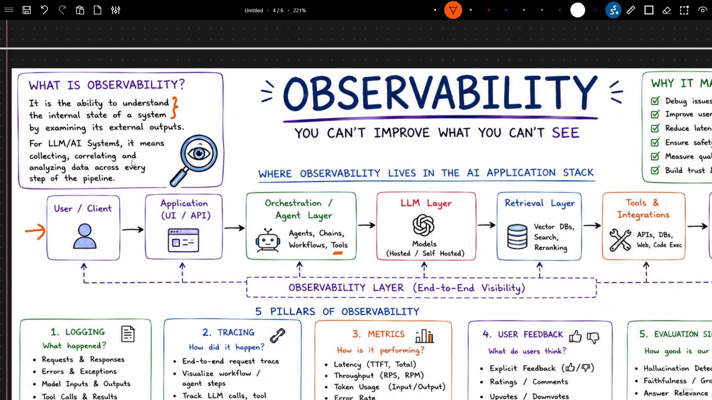

讲师给出五个支柱，必须全部理解，因为后面 LangSmith 的页面就是围绕这些维度展开的：

1. **Logging 日志**：发生了什么。包括请求和响应、错误和异常、模型输入输出、tool calls 和 results、系统事件。它用于调试和审计。
2. **Tracing 追踪**：端到端请求轨迹。可视化 workflow / agent 步骤，追踪 LLM calls、tool calls、DB queries，识别延迟和瓶颈，提供跨组件上下文。
3. **Metrics 指标**：性能怎么样。包括延迟、吞吐、token 使用、错误率、每次请求/总成本、缓存命中率，用来监控健康和性能。
4. **User feedback 用户反馈**：显式反馈、评分、评论、点赞/点踩。
5. **Evaluation signals 评估信号**：幻觉检测、faithfulness / groundedness、answer relevance、context recall、precision、safety、toxic scores，用来持续衡量质量和可靠性。

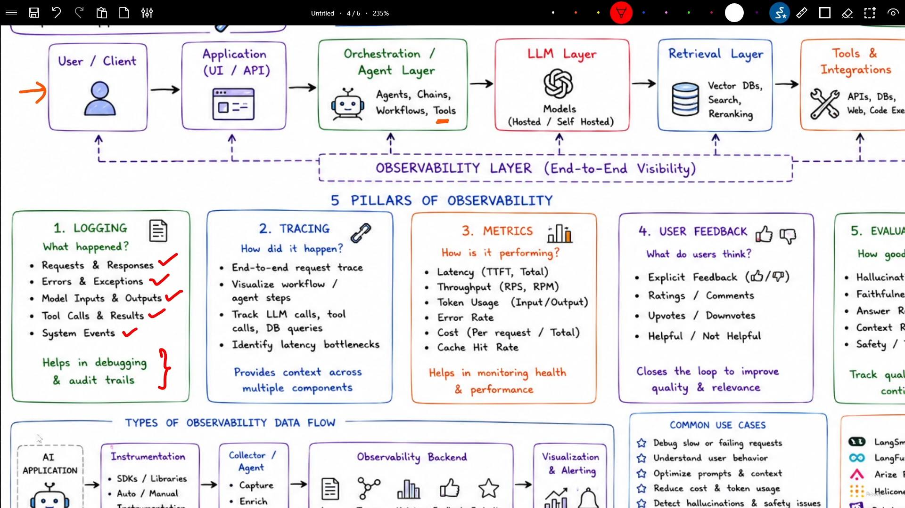

数据流也要复现出来：AI 应用先做 instrumentation，也就是接入 SDK、库；然后 collector / agent 捕获事件；再产生 logs、traces、metrics、feedback、evaluation；最后进入 dashboard 做可视化和告警。常见用例包括：调试失败请求、理解用户行为、优化 prompt 和上下文、降低成本和 token 使用、检测幻觉、监控 agents/tools/workflows、持续衡量并提升质量。

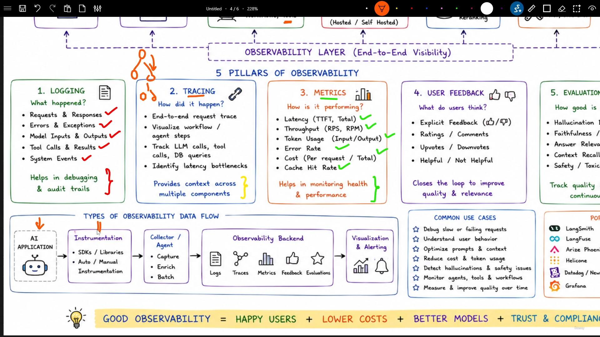

课程提到的流行工具包括：LangSmith、Langfuse、Arize（逐字稿听写为 Aries）、Phoenix、Helicone、DataDog、Grafana。P28 进一步说明，这个 bootcamp 主要选两个平台：**LangSmith** 和 **Pydantic Logfire**。LangSmith 属于 LangChain 生态，可以 observe、evaluate、deploy agents，甚至 no-code 构建 agent；支持 Python、TypeScript、Go、Java SDK。Logfire 是面向 LLM 应用和 AI agent 的 AI observability platform，有 dashboard，可以写查询、连接多个 DB，追踪从 guardrails 到 LLM gateways 到 LLM 调用、API 请求的每一次调用，并且集成了 evaluations。

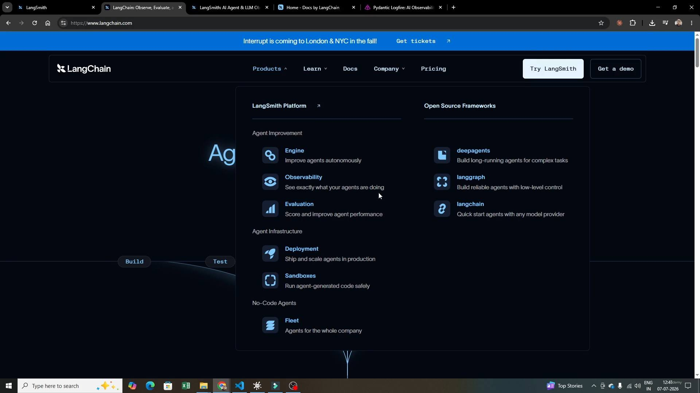

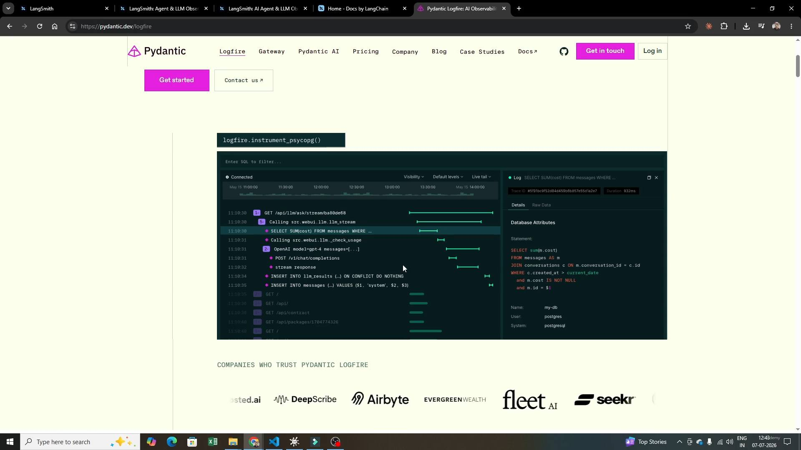

### 3.2 创建项目目录与 Python 虚拟环境

讲师新建了一个文件夹叫 `Lang Smith`，用 VS Code 打开，然后在命令提示符里创建虚拟环境：

```bash
uv venv langsmith-env
```

> 对前端读者：`uv` 可以粗略理解为 Python 侧的 npm/pnpm；`uv venv` 是创建隔离环境，避免污染全局 Python。

激活命令：

```bash
# macOS / Linux
source langsmith-env/bin/activate

# Windows PowerShell
langsmith-env\Scripts\Activate.ps1
```

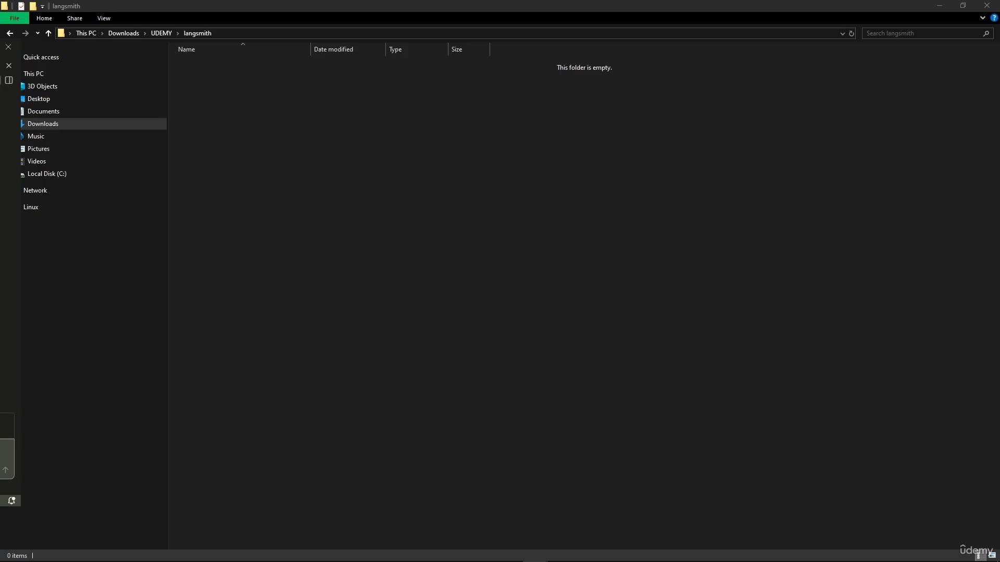

### 3.3 准备 `.env`、`requirements.txt` 和 Jupyter 内核

讲师在项目根目录创建 `.env`，并准备 `requirements.txt`。依赖按逐字稿里报出的包名整理如下：LangChain 相关依赖、`ChatGroq` 集成、`langchain-openai`、`langchain-community`、`langchain-text-splitters`、`langsmith`、`python-dotenv`、`faiss-cpu`（逐字稿听写为 fire cpu，用于向量库）、`langgraph`、`streamlit`、`openai`、`langgraph-cli`，以及 Jupyter notebook 需要的 kernel。逐字稿里“streamlate ipy kernel”是听写结果，实际常见包是 `ipykernel`；课里没有给出准确包名，本文档按 Jupyter 内核用途补 `ipykernel`。

安装：

```bash
uv pip install -r requirements.txt
```

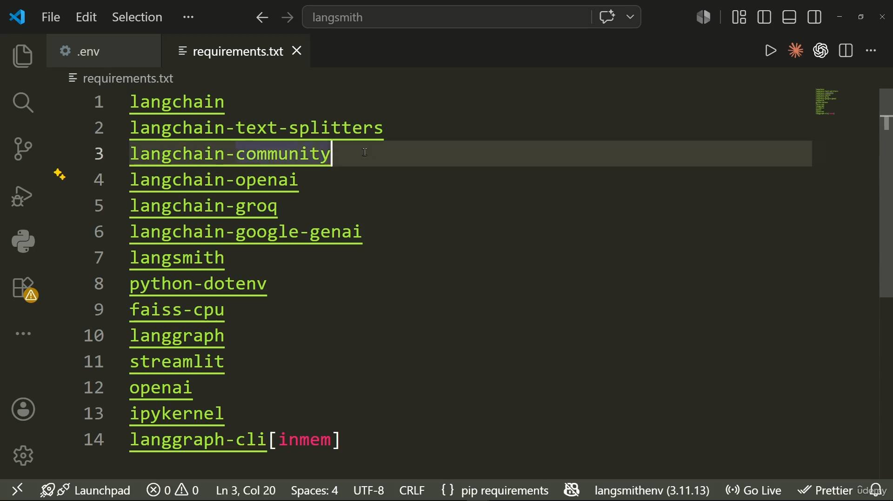

讲师随后新建 `langsmith_basics.ipynb`，选择 kernel，并打印环境检查结果。若 VS Code 没有自动补全，讲师的处理是重启 VS Code；这属于编辑器问题，不是代码问题。

### 3.4 登录 LangSmith，创建项目与 API key

步骤按讲师演示复现：

1. 打开 LangSmith 官方文档，进入 LangSmith 的 Get Started。
2. 创建账号并登录。
3. 进入 Tracing，创建一个新项目，课程里命名为 `Udemy`。
4. 生成 LangSmith API key。
5. 在项目页面点击 ENV，复制环境变量块，粘贴到 VS Code 的 `.env`。
6. 讲师强调：只需要三个变量就能让 LangChain / LangGraph 应用自动追踪：
   - `LANGCHAIN_TRACING_V2=true`
   - `LANGCHAIN_API_KEY=...`
   - `LANGCHAIN_PROJECT=Udemy`

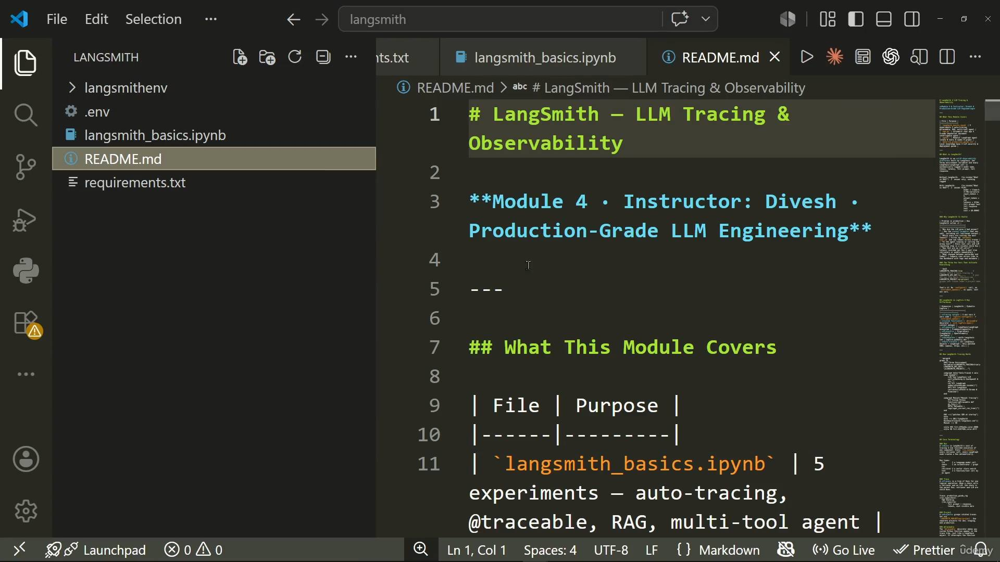

然后补齐其他 key：

- **Groq API key**：登录 Groq，进入 API Keys，新建 key，写入 `GROQ_API_KEY`。
- **Gemini API key**：进入 Google AI Studio，新建 key，写入 `GOOGLE_API_KEY`；讲师说后面会用于 embeddings。
- **Serper API key**：搜索 Google Serper API，登录后创建 key，写入 `SERPER_API_KEY`。Serper 是 Google 的产品，用于 web search；讲师在它的 playground 里查询 “evals in LLMs”，能看到 OpenAI evals、Evidently AI、Arize AI、Anthropic 等结果，还能设置 date range、查看 logs 和每日 usage。

注意：P29–P30 的代码实际只用到 LangSmith 和 Groq；Gemini 与 Serper 是为后续 RAG / 搜索功能准备的，课里没有在这两页写出调用它们的代码。

### 3.5 实验一：自动追踪 LangChain 调用

自动追踪的关键是 `.env` 里的 `LANGCHAIN_TRACING_V2=true`。讲师原话是：只要这个值为 true，任何方法、任何 `invoke` 运行都会自动记录到 LangSmith。LangChain / LangGraph 和 LangSmith 属于同一生态，所以不需要重 setup。

代码使用 `ChatGroq`：

```python
from langchain_groq import ChatGroq

llm = ChatGroq(
    model="llama-3.3-70b-versatile",
    temperature=0.3,
)
response = llm.invoke("What is a LangSmith run? Answer in two sentences only.")
print(response.content)
```

逐字稿里讲师说的是 “lama” 和 “70 billion versatile model”，并从 Groq playground 选择模型。本文档用 Groq 当前常见的 `llama-3.3-70b-versatile` 作为可运行示例；如果这个模型在你的账号下不可用，去 Groq playground 换一个可用模型即可。`temperature` 讲师明确设为 `0.3`。`invoke` 是调用方法，最后用 `.content` 只取回复文本。

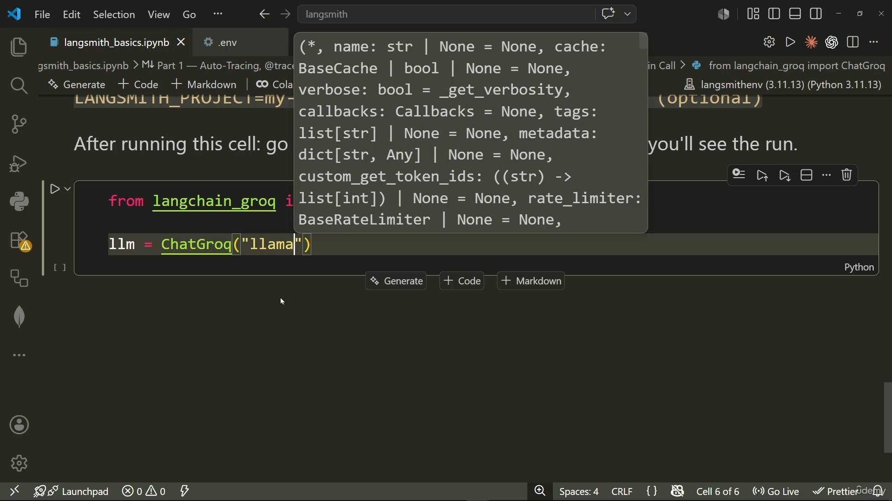

讲师还演示了换成 reasoning 模型后会多出 “think” 过程，随后又换成 GPT 模型。课里没有给出这两个模型的具体名称，所以本文档不伪造这两个模型名，只保留 Groq 的可运行主路径。

运行后去 LangSmith 项目 `Udemy`：

- 能看到 Traces、Runs、Threads；
- 打开一条 trace，能看到用户输入、模型输出；
- 能切换 waterfall 视图；
- 能看到 OpenAI、Qwen、Llama 等模型维度的信息；
- 输入、输出、总量等可见；
- 免费模型下成本可能显示为空或 0，讲师说明“现在用免费模型，所以没有成本”。

### 3.6 实验二：自定义追踪 tool 与 chain

自动追踪只覆盖 LangChain / LangGraph 自带调用。讲师要我们写自己的 Python 函数并追踪，所以用 `@traceable`。他强调：如果函数上面不写 `traceable`，LangSmith 不会识别它需要被追踪。类比是：把函数变成 tool 用 `@tool`，做成 chain 用 chain 装饰器；这里用 `@traceable` 把普通函数变成可追踪函数。

先准备一个 mock 文档：`data/llm_production_guide.txt`。讲师说它包含多个章节，例如 Chapter 1、Chapter 2、LLM threats、RAG patterns。这个函数做 keyword search：读文档、抽取段落和关键词、排序，返回最相关段落。讲师明确说这是 mock data，后面会替换成 vector search。

两个装饰器：

```python
@traceable(run_type="tool", name="document_keyword_search")
def search_documents(question: str) -> str:
    ...

@traceable(run_type="chain", name="doc_qa")
def doc_qa(question: str) -> str:
    ...
```

- `run_type="tool"`：这个函数在 trace 里显示为 tool。
- `run_type="chain"`：这个函数在 trace 里显示为 chain，负责编排“先检索文档，再让 LLM 回答”。
- `search_documents` 被 `doc_qa` 内部调用，所以 LangSmith 里会形成父子关系：chain 下面挂 tool。

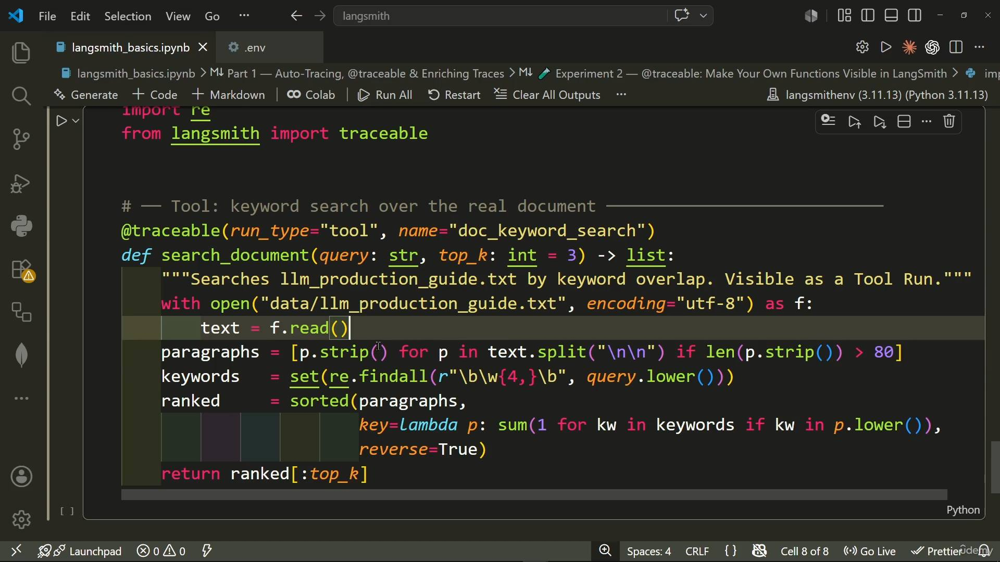

讲师问的问题是：

```python
question = "What are the main LLM security threats?"
answer = doc_qa(question)
```

在 LangSmith 里可以看到自定义函数、最终响应、chain 结构，也可以切 waterfall 视图。

### 3.7 实验三：用 tags 和 metadata 增强 trace

讲师说 trace 已经有了，但生产环境还需要知道“是谁、在什么环境、测什么功能”。所以用：

```python
from langsmith import get_current_run_tree
```

创建 `support_query` chain，参数包括 `user_id`、`session_id`、`feature`、`environment`，环境可以是 `production`，也可以改成 `dev`。然后把这些信息写进当前 run tree 的 metadata，并把 environment、feature 作为 tags。

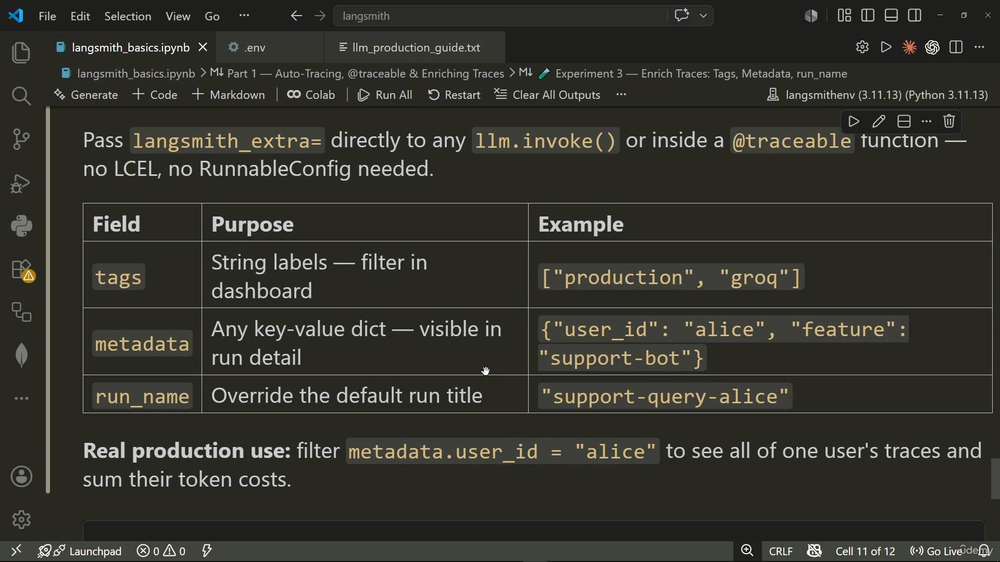

讲师给了一组 list of queries，用户包括 Priya、Aditi、Sheetal，每个有 session id 和问题；循环调用 `support_query`。运行后 LangSmith 里能看到 `support_query`，每条 response 可见，Priya、Aditi、Sheetal 的响应被截断展示；这些调用还会形成 thread。讲师特别说明：thread 可能还在运行，所以页面不会立刻加载完整。

### 3.8 启动与验证顺序

推荐按下面顺序执行：

```bash
# 1. 进入项目目录
cd ai-security-observability

# 2. 创建并激活虚拟环境
uv venv langsmith-env
source langsmith-env/bin/activate        # Windows: langsmith-env\Scripts\activate

# 3. 安装依赖
uv pip install -r requirements.txt

# 4. 检查 .env 是否存在且 key 已填
# 不要提交 .env 到 git

# 5. 运行完整脚本
python langsmith_basics.py

# 或者启动 Jupyter，把 langsmith_basics.py 里的 # %% 区块逐格粘进 notebook
jupyter notebook
```

---

## 4. 完整代码

> 说明：讲师在视频里主要是在 `.ipynb` 中分格演示，逐字稿没有逐字展示完整源码；下面的 `langsmith_basics.py` 是把讲师口述的导入、参数、函数、装饰器、metadata 逻辑落成一个可直接保存运行的文件。正则表达式具体写法、`data/llm_production_guide.txt` 的正文属于“复现补齐”，不是逐字稿原文；所有讲师明确给出的变量名、模型参数、装饰器参数、环境变量名均保留。依赖版本课里没有给，下面给出一组参考锁定版本，并在注释中标注“非讲师原话”。

### 4.1 目录结构

```text
ai-security-observability/
├── .env
├── requirements.txt
├── langsmith_basics.py
└── data/
    └── llm_production_guide.txt
```

### 4.2 `.env`

```dotenv
# LangSmith：讲师强调只需要这三个变量就能自动追踪
LANGCHAIN_TRACING_V2=true
LANGCHAIN_API_KEY=lsv2_pt_xxxxxxxxxxxxxxxxxxxxxxxx
LANGCHAIN_PROJECT=Udemy

# Groq：实验一、二、三实际使用
GROQ_API_KEY=gsk_xxxxxxxxxxxxxxxxxxxxxxxx

# Gemini：讲师说后面用于 embeddings，P29-P30 未写调用代码
GOOGLE_API_KEY=AIzaSyxxxxxxxxxxxxxxxxxxxxxxxx

# Serper：讲师用于 web search playground，P29-P30 未写调用代码
SERPER_API_KEY=xxxxxxxxxxxxxxxxxxxxxxxx
```

### 4.3 `requirements.txt`

```txt
# 课里只报了包名，没有报版本号。
# 下面是本文档为“可复现”给出的参考锁定版本，不是讲师原话。
# 如果安装冲突，可以删掉 == 后面的版本，让 pip 重新解析。

langchain==0.2.16
langchain-groq==0.1.9
langchain-openai==0.1.23
langchain-community==0.2.16
langchain-text-splitters==0.2.4
langsmith==0.1.147
python-dotenv==1.0.1
faiss-cpu==1.8.0
langgraph==0.2.16
streamlit==1.37.1
openai==1.40.6
langgraph-cli==0.1.44
ipykernel==6.29.5
```

### 4.4 `data/llm_production_guide.txt`

```text
Chapter 1: LLM Production Basics

Large language model applications need observability because the final answer is only the visible surface. Behind the answer there are prompts, model calls, retrieval steps, tool calls, token usage, latency, and cost. A production system should collect logs, traces, metrics, user feedback, and evaluation signals so that engineers can debug failures, understand user behavior, optimize prompts and context, reduce cost, detect hallucination, and monitor agents, tools, and workflows.

Chapter 2: LLM Security Threats

The main LLM security threats include prompt injection, insecure output handling, training data poisoning, model denial of service, supply chain risks, sensitive information disclosure, insecure plugin design, excessive agency, overreliance, and model theft. Prompt injection happens when untrusted input changes the model behavior. Insecure output handling happens when model output is passed to downstream systems without validation. Sensitive information disclosure can happen when the model reveals private data from context or training data. Excessive agency means the agent is allowed to take actions that are too powerful or too broad.

Chapter 3: RAG Patterns

Retrieval augmented generation, or RAG, combines a retriever with a language model. A typical RAG pipeline splits documents into chunks, creates embeddings, stores vectors in a vector database, retrieves relevant chunks for a question, and passes the retrieved context to the model. RAG patterns should be evaluated with context recall, context precision, answer relevance, faithfulness, and groundedness. A RAG system should also trace which chunks were retrieved, which prompt was sent to the model, and which tool calls were made.

Chapter 4: Observability and Evaluation

Observability is the ability to understand the internal state of a system by examining its external output. For LLM systems, observability means collecting, correlating, and analyzing data across every step of the pipeline. Evaluation signals include hallucination detection, faithfulness or groundedness, answer relevance, context recall, precision, safety, and toxic scores. Logs, traces, metrics, user feedback,
被排除。第四个章节只覆盖评估信号和日志，因此在某些评估维度上不如其他章节相关。")

# 第三个实验：tags + metadata（讲师原话：enrich our trace）
def experiment_3_metadata():
    # 讲师给的 list of queries：用户 Priya / Aditi / Sheetal，各有 session id 和问题
    list_of_queries = [
        {
            "user_id": "priya",
            "session_id": "priya-session-001",
            "question": "What are the main LLM security threats?",
        },
        {
            "user_id": "aditi",
            "session_id": "aditi-session-001",
            "question": "How should a RAG application be evaluated?",
        },
        {
            "user_id": "sheetal",
            "session_id": "sheetal-session-001",
            "question": "What does observability mean for an LLM system?",
        },
    ]

    for item in list_of_queries:
        answer = support_query(
            question=item["question"],
            user_id=item["user_id"],
            session_id=item["session_id"],
            feature="support-qa",
            environment="production",   # 讲师的 production 环境
        )
        print("=" * 60)
        print(item["user_id"], item["session_id"])
        print(answer[:200])   # 讲师在页面里看到的是被截断的 response

# 可选：把环境切到 dev 再跑一遍，验证 tags 里 environment 变成 dev
def experiment_3_metadata_dev():
    answer = support_query(
        question="What is prompt injection?",
        user_id="priya",
        session_id="priya-session-002",
        feature="support-qa",
        environment="dev",
    )
    print(answer[:200])

if __name__ == "__main__":
    if not check_env():
        raise SystemExit("请先把 .env 里的 key 填完整")
    print("\n--- 实验一：自动追踪 ChatGroq ---")
    experiment_1_auto_trace()
    print("\n--- 实验二：自定义追踪 tool + chain ---")
    experiment_2_custom_trace()
    print("\n--- 实验三：tags + metadata ---")
    experiment_3_metadata()
    experiment_3_metadata_dev()
```

### 4.6 `.gitignore`

```gitignore
.env
langsmith-env/
__pycache__/
.ipynb_checkpoints/
*.pyc
```

---

## 5. 逐行解释

**`warnings.filterwarnings("ignore")`**
讲师在 P30 开头的导入部分明确说“忽略所有警告”。这条要在导入第三方库之前执行，否则 LangChain 的弃用警告会先刷屏。

**`load_dotenv()`**
把 `.env` 里的键值对灌进 `os.environ`。必须在 `from langchain_groq import ChatGroq`、`from langsmith import traceable` 之前调用，因为 LangSmith 的 SDK 和 LangChain 是在导入/首次调用时读取 `LANGCHAIN_TRACING_V2`、`LANGCHAIN_API_KEY`、`LANGCHAIN_PROJECT` 这三个变量的。顺序错了就会“明明写了 true 却没有 trace”。

**`check_env()`**
对应讲师在 notebook 里“打印一下环境是否 OK”的动作。他只说“如果得到 true，就打印我们有全部环境变量”，没有展示具体实现，这里补成逐项列出缺失 key 的版本，复现时更容易定位问题。

**三个 LangSmith 变量**
`LANGCHAIN_TRACING_V2=true` 是总开关，讲师原话是“这是唯一一件我们必须做的事”；`LANGCHAIN_API_KEY` 决定 trace 写到哪个账号；`LANGCHAIN_PROJECT=Udemy` 决定写到哪个项目。少任何一个，页面上就看不到东西。这就是“自动追踪只需要三个变量”的完整含义。

**`ChatGroq(model=..., temperature=0.3)`**
讲师从 Groq playground 里挑模型，明确说“70 billion versatile model”，并把 temperature 设为 `0.3`。本文档写 `llama-3.3-70b-versatile` 是为了可运行；模型名属于会随时间下线的东西，属于“课里没讲版本细节”的部分，按 Groq 控制台当前可用模型替换即可。`temperature` 越低越确定，0.3 保留一点变化但不会乱飘。

**`llm.invoke(question)` 与 `.content`**
`invoke` 是讲师点名的调用方法；`response.content` 是他用来“只看到回复”的取值方式。只要走 `invoke`，自动追踪就生效，不需要额外套一层 `@traceable`——这正是实验一和实验二的分界线。

**`@traceable(run_type="tool", name="document_keyword_search")`**
讲师讲得很清楚：`traceable` 是装饰器，加 `@` 才能用；`run_type` 决定它在树上显示成 tool 还是 chain；`name` 就是页面上那行标签。去掉这行装饰器，函数照常能跑，但 LangSmith 里不会出现这个节点——讲师原话“LangSmith 不会识别它需要被追踪”。

**`@traceable(run_type="chain", name="doc_qa")` 里调用 `search_documents`**
这是父子关系的来源：被装饰的函数内部再调用另一个被装饰的函数，LangSmith 会自动把内层挂到外层下面。所以页面上是 chain → tool → 最终响应，讲师演示的“自定义函数在这里、最终响应在这里”就是这个结构。

**`search_documents` 的正则匹配**
`re.split(r"\n\s*\n", text)` 按空行切段落；`re.findall(r"[A-Za-z]{3,}", question)` 从问题里抽长度 ≥3 的英文词当关键词；`low.count(k)` 做词频打分并倒序。讲师的描述是“抽取段落、关键词并排序”“用正则写的简单函数”“现在是 mock data，后面会换成 vector search”，本文档的正则实现就是在兑现这几句话，没有引入 embedding 或向量库。

**`top_k` 与“没命中就退回前几段”**
纯关键词检索在问法不匹配时会全零分，这时返回空上下文会让模型直接说“不知道”。退回前几段能保证 demo 有输出。这一点课里没讲，属于复现补齐，注释里已标注。

**`from langsmith import get_current_run_tree`**
讲师点名要这个导入，用途是“帮助我们 enrich trace”。它是拿当前正在执行的 run 对象，所以只能在被 `@traceable` 装饰的函数内部调用；在普通函数里调用会拿到 `None`。

**`run_tree.tags` / `run_tree.extra` / `run_tree.patch()`**
讲师讲的是语义：tags 放 environment、feature 这类字符串标签；metadata 放 user_id、session_id、feature、environment 这类“谁、在哪个环境、测什么功能”的信息。他没有逐行展示怎么写进 run tree，所以这三行是按 SDK 语义补的：`tags` 是列表，`extra` 是字典（LangSmith 里 metadata 存在这个字段），改完必须 `patch()` 才会发出去。**如果 `patch()` 在你安装的版本里报错，请以你本地 `langsmith` 包的 API 为准**——课里没讲版本，也没讲方法名。

**`support_query` 的循环与 `session_id`**
讲师为什么要传 `session_id`：一是做会话维度的排查，二是他演示里这些调用“还会形成一个 thread”。按 session 循环调用，页面左侧才会把同一会话的多条 trace 归到一起。至于 LangSmith 按哪个字段分 thread，讲师只说“会变成 thread”，没讲底层规则，本文档不编。

**`environment="production"` 与 `experiment_3_metadata_dev()`**
讲师明确说“这是 production 环境，你可以改成 dev 等等”。补一个 dev 调用，是为了让你能在 LangSmith 里按 tag 过滤出两条不同环境的 trace，验证 tags 真的写进去了。

---

## 6. 复现检查清单

按顺序勾，全部通过再往下走。

**环境层**
- [ ] 已安装 `uv`，`uv --version` 有输出；没装就用 `pip install -r requirements.txt` 作为退路。
- [ ] 项目目录名为 `ai-security-observability`（或你自定的名字），内部有 `.env`、`requirements.txt`、`langsmith_basics.py`、`data/`。
- [ ] `uv venv langsmith-env` 成功，激活后 `python -c "import sys; print(sys.prefix)"` 指向 `langsmith-env`。
- [ ] `uv pip install -r requirements.txt` 无报错；若版本冲突，删掉 `==` 后的版本号重装。
- [ ] VS Code 里没有自动补全时，按讲师做法重启一次 VS Code。

**密钥层**
- [ ] LangSmith 已登录，Tracing 下存在项目 `Udemy`。
- [ ] 已生成 LangSmith API key，并整块粘贴 ENV 到 `.env`。
- [ ] `.env` 里 `LANGCHAIN_TRACING_V2=true`、`LANGCHAIN_API_KEY`、`LANGCHAIN_PROJECT=Udemy` 三项齐全。
- [ ] Groq 控制台已建 key，写入 `GROQ_API_KEY`；在 Groq playground 里确认你写的模型名当前可用。
- [ ] Gemini key 写入 `GOOGLE_API_KEY`、Serper key 写入 `SERPER_API_KEY`（这两步 P29–P30 不参与运行，但讲师要求配好，为后续 RAG / web search 做准备）。
- [ ] `.env` 已在 `.gitignore` 里，没被提交。

**实验一**
- [ ] `python langsmith_basics.py` 打印出 `[env] OK` 或等价输出。
- [ ] 终端打印出两句话的模型回答（提到 run 是 traced execution，捕获 inputs / outputs / metadata 之类）。
- [ ] LangSmith 项目 `Udemy` 的 Traces 列表出现一条记录，打开能看到输入和输出。
- [ ] 能切到 waterfall 视图，能看到模型维度的信息。
- [ ] 用免费模型时，成本列显示为空或 0，这属于预期，不是配置失败。

**实验二**
- [ ] `data/llm_production_guide.txt` 存在，包含 Chapter 1–4 段落。
- [ ] 运行后终端打印出“主要 LLM 安全威胁”的回答。
- [ ] LangSmith 里该 trace 显示 `doc_qa`（chain）→ `document_keyword_search`（tool）的父子结构。
- [ ] 能看到 tool 节点返回的上下文文本，确认检索真的命中了 Chapter 2。

**实验三**
- [ ] 三条 `support_query` 都跑完，终端依次打印 Priya / Aditi / Sheetal。
- [ ] LangSmith 里能看到 `support_query` 这个 chain 名。
- [ ] 打开任一 trace，能看到 tags 里包含 `production` 和 `support-qa`。
- [ ] 能看到 metadata 里的 `user_id`、`session_id`、`feature`、`environment`（若看不到，回看第 5 节关于 `patch()` 的说明）。
- [ ] dev 那条 trace 的 `environment` 标签是 `dev`，与 production 区分开。
- [ ] Threads 页面能看到按 session 归组的结果；若暂时为空，讲师的说法是“还在运行，所以还没加载”，刷新等一会。

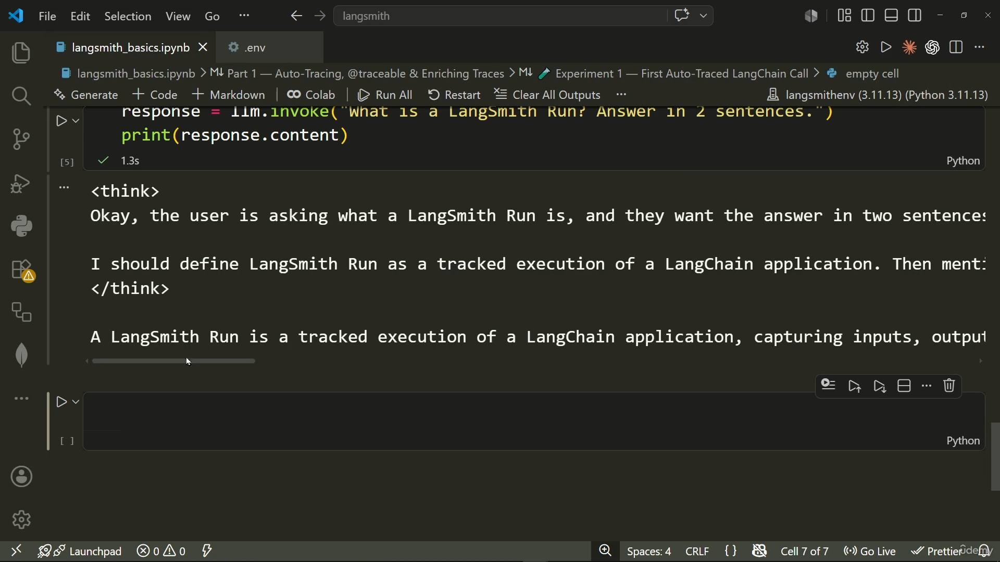

---

## 7. 课里没讲但你会撞上的

**1）`LANGCHAIN_TRACING_V2` 与新版 `LANGSMITH_*` 前缀**
课里从头到尾用的是 `LANGCHAIN_TRACING_V2` / `LANGCHAIN_API_KEY` / `LANGCHAIN_PROJECT`，照抄就能跑。但如果你装的 `langsmith` 版本较新，可能会发现官方文档改成 `LANGSMITH_TRACING` / `LANGSMITH_API_KEY` / `LANGSMITH_PROJECT` 这套前缀。课里没讲这件事。撞上了就去对照你安装版本对应的官方文档，别把两套前缀混着写。

**2）Groq 模型下线**
讲师在视频里现场从 playground 挑模型，说明模型名是可换的。你复现时如果报“model not found / decommissioned”，去 Groq 控制台按当前可用模型替换 `ChatGroq(model=...)`，其他代码一行都不用改。课里没讲模型的生命周期。

**3）`@traceable` 的导入位置必须在 `load_dotenv()` 之后（或用环境变量显式传入）**
课里没讲这个顺序坑。表现是：脚本能跑、终端有回答、LangSmith 里一条 trace 都没有。修法是把 `load_dotenv()` 提到所有 LangChain / LangSmith 导入之前，与第 4 节代码的组织顺序保持一致。

**4）`get_current_run_tree()` 返回 `None`**
只在被 `@traceable` 装饰的函数体内调用才有值。如果你把它挪到一个普通 helper 里，就会静默拿到 `None`，metadata 一条都写不进去，而且不报错。课里没讲这个失败模式。

**5）metadata 写入后看不到**
两个常见原因：一是改完没有 `patch()`；二是你在 LangSmith 页面看的是父 run，而 metadata 写在子 run 上。课里只讲了“写在当前 run tree 上”，没讲页面哪一层显示。

**6）Threads 迟迟不出现**
讲师自己演示时也说了“还没加载，因为还在运行”。除此之外，thread 依赖 `session_id` 这类会话字段的一致性——三条查询如果 session id 各不相同，自然会分成三条 thread 而不是一条。课里没讲分组规则，别把“每人一个 session”误当成“所有人一个 thread”。

**7）免费模型的成本与 token 数字**
课里明确说了“现在用的是免费模型，所以没有成本”。Groq 免费额度下，LangSmith 的成本列基本是空的，token 数也可能缺失。做“成本观测”的验收时请换成付费模型或 LangSmith 支持的计价模型，否则你会误以为追踪坏了。

**8）Notebook 与 `.py` 的差异**
讲师在 `.ipynb` 里逐格运行，格子之间共享内存，所以他把 `llm` 建一次就能反复 `invoke`。本文档把 `llm` 收进 `get_llm()` 惰性创建，是为了让 `python langsmith_basics.py` 能一键跑完。如果你照讲师用 notebook，可以把 `get_llm()` 展开成模块级 `llm = ChatGroq(...)`，行为一致。

**9）Gemini 和 Serper 的 key 配了但没用上**
P29–P30 里这两个 key 只完成了“配置 + playground 验证”，没有任何调用代码。Gemini 讲师说“后面做 embeddings 用”，Serper 讲师在 playground 里演示了搜 “evals in LLMs” 并看到 OpenAI evals、Evidently AI、Arize AI、Anthropic 等结果，还能按 date range 过滤、看 logs 和每日 usage。真正把它们接进代码属于后续课程内容，课里在这两页没写。

**10）P28 提到的 Logfire 没有实现代码**
P28 是平台选型介绍，讲了 LangSmith 和 Pydantic Logfire 两个平台、讲了 LangSmith 有 Python / TypeScript / Go / Java SDK、讲了 Logfire 有 dashboard 和 evaluations 集成。但 P29–P30 的实操全部是 LangSmith，Logfire 一行代码都没有。想练 Logfire 的话，课里没讲怎么装、怎么配 key、怎么初始化，只能去官方文档自学。

**11）给前端读者的对照**
本文档没有锁、事务、并发这类后端话题，但有一个概念可以直接类比：`trace` 和 `run` 的关系就是前端 Performance 面板里 `navigation` 和它下面每个 `fetch` / `script` 的关系——一个请求是一条 trace，里面每次调用是一个 run，父子嵌套就是 waterfall。LangSmith 的 waterfall 视图和 Chrome DevTools 的 Performance 瀑布图看的是同一件事。metadata / tags 则类似你在埋点里打的 `userId`、`env`、`feature` 字段。

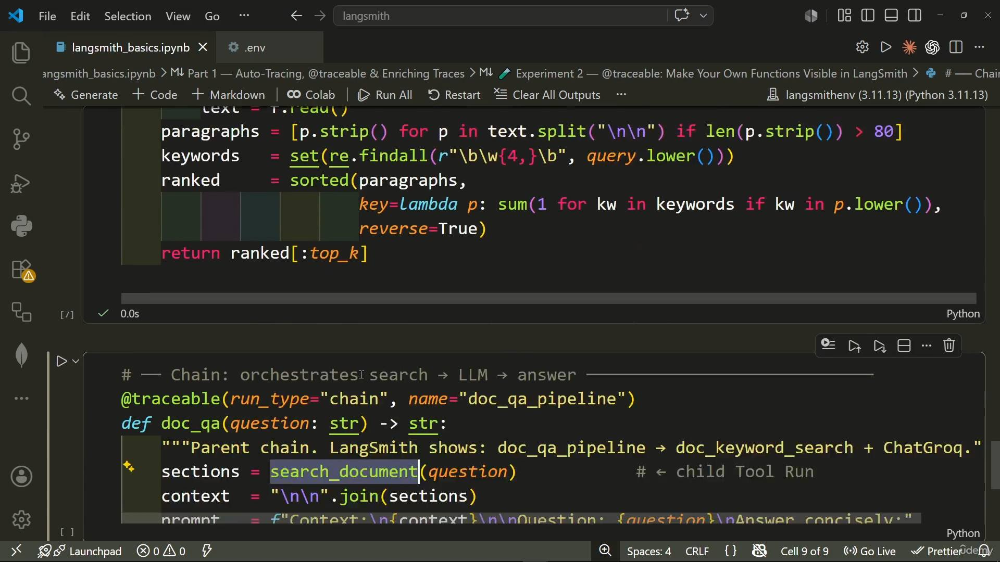

---

至此 P27–P30 的可复现部分收尾：P27 给出可观测性的定义、五个支柱、数据流和常见用例；P28 完成 LangSmith 与 Logfire 的选型；P29 讲清 run / trace / traceable 三个术语，搭好项目骨架、配好四类 key；P30 用三个实验把自动追踪、自定义 tool + chain 追踪、tags + metadata 增强 trace 全部跑通。下一步课程会进入 RAG 的追踪实验，那部分不在本次范围内。