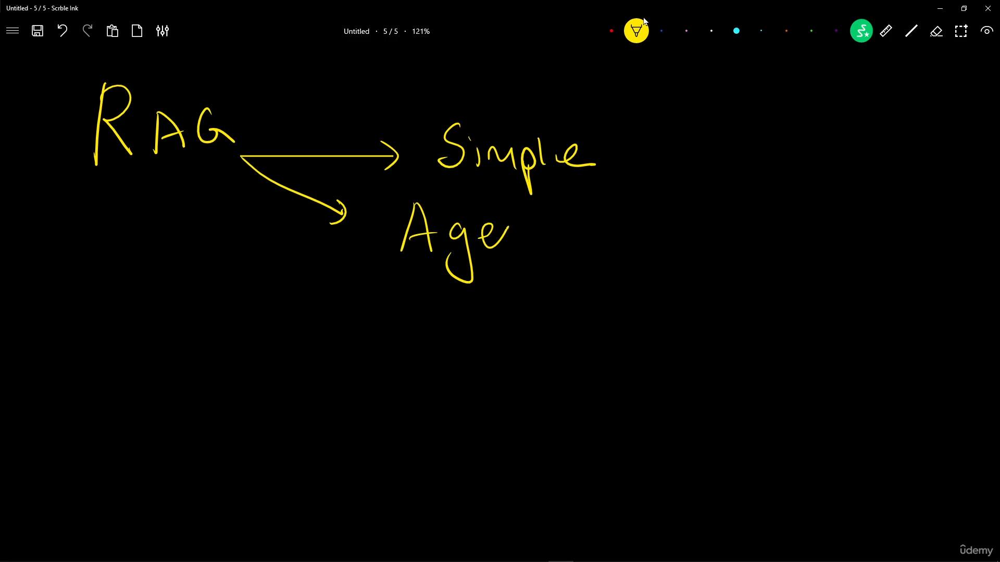
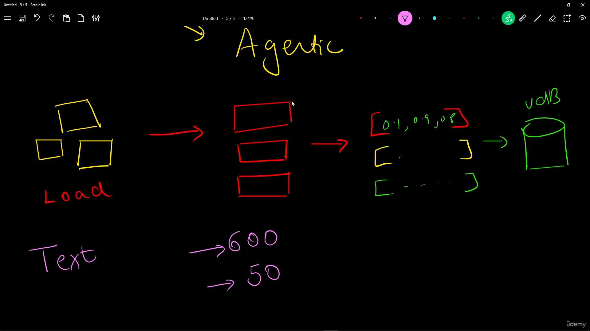
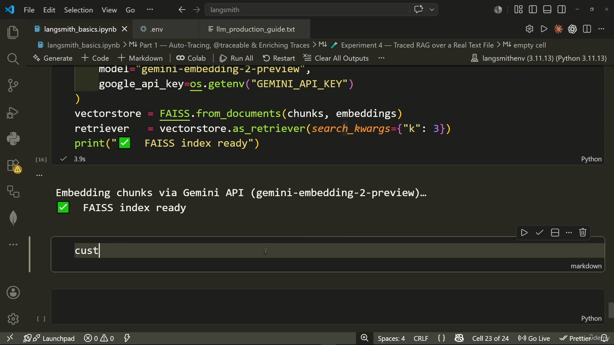
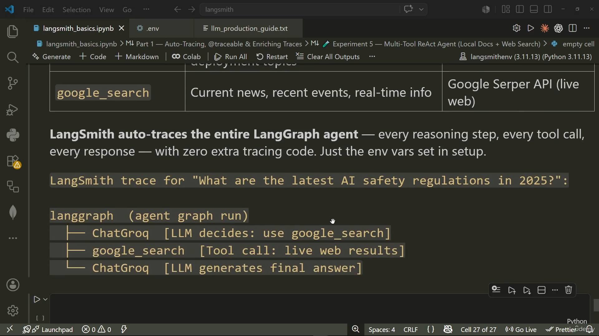
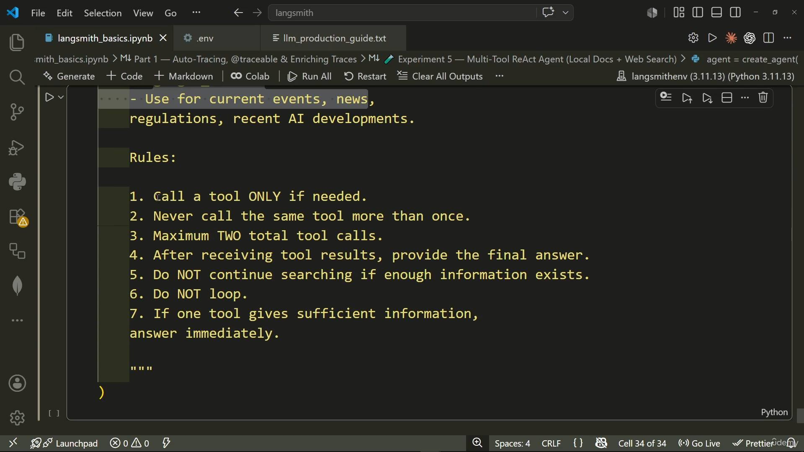
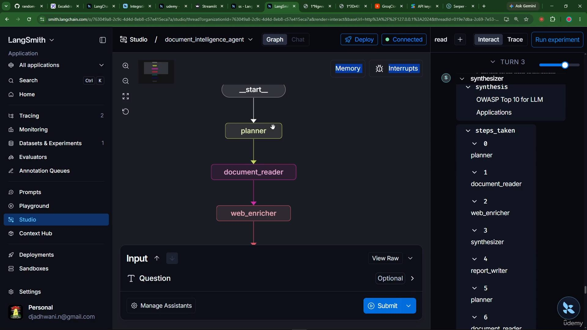
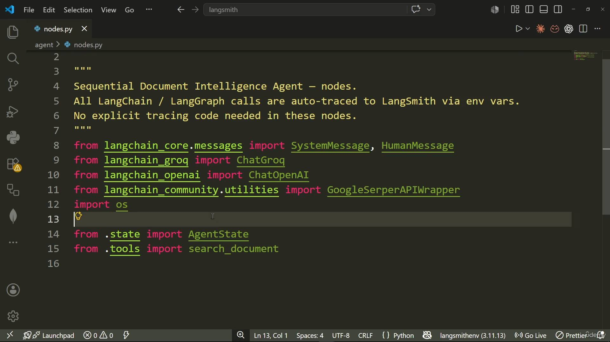
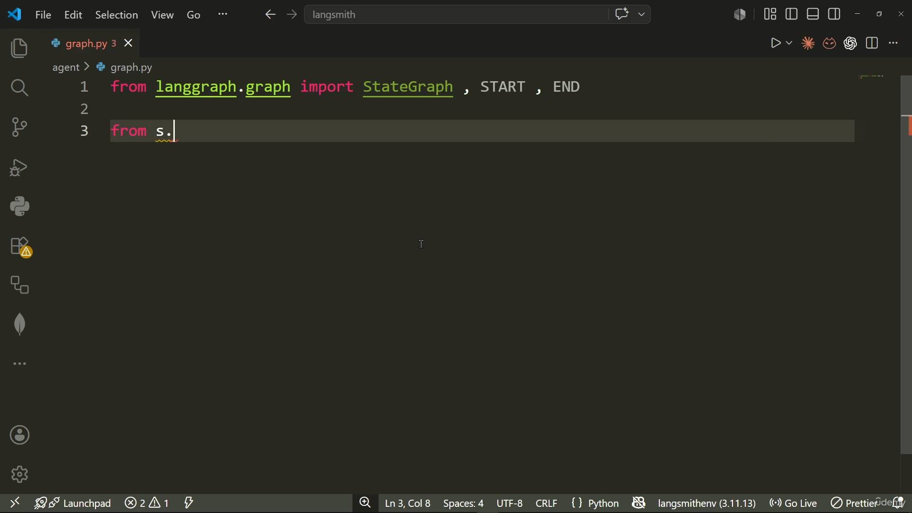

# AI Security Bootcamp Part 2：护栏/网关/可观测（P031–P032）

> 本课程文档覆盖 P031（追踪一个 RAG 应用：简单 RAG + 智能体 RAG）与 P032（用 LangGraph 搭建一个可观测的多节点研究智能体应用）。读者按本文档从头到尾操作，可以复现出两个可运行、可在 LangSmith / LangGraph Studio 中看到完整执行瀑布图的 RAG 与智能体应用。

---

## 1. 这一节做什么

这两节课的核心目标只有一个：**让你亲手做出一个"能被完整观测"的 AI 应用**，而不是停留在"知道 RAG 是什么"。

- **P031**：先讲清两种 RAG 的形态——**简单 RAG（simple RAG）** 与 **智能体 RAG（agentic RAG）**，然后动手做两个实验：
  1. 一个"生产指南 RAG"（production guide RAG）：文本加载 → 切块 → Google 嵌入 → FAISS 向量库 → 检索 → 提示词 → LLM 回答，全程用 LangSmith 追踪。
  2. 一个"多工具智能体 RAG"：把"检索本地文档"和"Google 搜索"做成两个工具，交给一个 ReAct 智能体自主决定用哪个，并观察它的 agentic 循环（reason → act → reason → act）。
- **P032**：把上一节的思路升级成一个**模块化的 LangGraph 应用**：`planner → document_reader → web_enricher → synthesizer → report_writer` 五个节点串成一张图，用 Groq 做规划/检索/综合，用 Gemini（通过 OpenAI 兼容的 base_url）写最终报告，最后在 LangGraph Studio / LangSmith 里看到整张图的执行瀑布。

讲师反复强调的一点是：

> "这个应用的主要目标不是教你如何写智能体工作流——那是次要目标。主要目标是让你看到如何在 LangGraph Studio 或 LangSmith 中观测整个智能体流程的执行。"
> —— p032 [00:28]

所以本文档的复现重点，是**让每一步都能在追踪面板里被看见**：状态（state）、节点（node）、边（edge）、工具调用、递归上限、成本分解。

---

## 2. 讲师原话

下面按主题摘录讲师的关键判断（英文原话已译为中文，产品名保留英文）。

**关于两种 RAG 的差别：**

> "简单 RAG 是这样的：用户给出一个查询，查询立刻被转成向量，和向量库里的向量比较，取回相关片段，再和系统提示词一起送给大模型。但问题是——如果用户的查询是'怎么做一杯咖啡'这种无关问题呢？这时候模型应该知道它不该去查向量库。"
> —— p031 [03:45]

> "智能体 RAG 是这样的：查询直接发给大模型，而大模型连接了一堆工具——可以是查向量库，可以是网页搜索。如果用户问的是最新 AI 新闻，这个信息不在向量库里，大模型就会去网上搜；如果问题完全无关，它就直接回答，一个工具都不用。"
> —— p031 [05:06]

> "当我们把多个这样的智能体组合起来——每个智能体都是 LLM + 工具——这就变成了多智能体工作流（multi-agent workflow）。你可以做一个研究智能体，也可以做一个 boss 智能体，它根据收到的查询把任务分给研究员智能体或编码智能体，再把响应汇总回用户。"
> —— p031 [06:00]

**关于切块与嵌入参数：**

> "切块我打算做成 600 大小，重叠 50 个词——这只是我的策略，你可以用任意大小。转成数字我用 Google embeddings，向量库我用 FAISS，它是一个本地向量存储。"
> —— p031 [01:52]

> "切块大小是 600，重叠是 80。这些参数你可以自己玩。我们得到了 27 个块。"
> —— p031 [08:22]

（注意：讲师在讲解示意图时说的是重叠 50，实际写代码时用的是 80，以代码为准。）

**关于 ReAct 智能体：**

> "这个流程叫 ReAct 智能体，ReAct 就是 reason and act——先推理'这是什么问题、我该去哪个工具'，然后行动。所有智能体工作流本质上都是 ReAct 性质的，但 ReAct 是最简单的形式，它们可以更复杂。"
> —— p031 [12:36]

**关于递归上限：**

> "这里我们多传了一个配置：recursion limit。什么是递归上限？它去了这里拿到响应，又去那里拿到响应，又回来……这种连续无限循环我们绝对不想要，因为那会烧掉 token，而且永远拿不到响应。所以我们说：10 轮之后就停。"
> —— p031 [17:15]

**关于系统提示词（防循环）：**

> "你是一个研究助手，你有两个工具：search local docs 和 google search。你的规则是：只在需要时调用工具，且不要只调用一次就完事；同一个工具不要调用超过一次；最多两次工具调用；如果信息不存在就不要继续搜索；不要循环。"
> —— p031 [16:19]

**关于"预期 vs 实际"的评估雏形：**

> "现在你会问：我们是不是在程序里写死了要去哪里搜？那智能体还有什么意义？不——我们是在创建一个'预期是什么、实际发生了什么'的场景。我们预期它用这个工具，它真的用了吗？这就是我们想造出来的场景。"
> —— p031 [18:14]

> "我们预期它用 search local docs，它确实用了；第二个我们预期它用 google search，但它两个都用了；第三个我们预期两个都用，它两个都用了。看，我们其实也在做一个小规模的评估。这不是评估的完整做法，但和评估是相关的。"
> —— p031 [20:11]

**关于 P032 应用的目标与流程：**

> "先有一个 start 节点，用户查询进来；然后一个 planner 节点决定下一步——要么直接回答，要么去读文档；文档读完后，我们从文档和网页搜索里丰富信息；信息丰富后，我们把文档和网页的信息综合成一个单元；最后 report writer 智能体把这一切变成输出。"
> —— p032 [00:56]

> "这个工作流不是最好的工作流，但那不是重点。重点是看你怎么观测这个智能体工作流。"
> —— p032 [01:52]

**关于为什么用 ChatOpenAI 调 Gemini：**

> "用 ChatOpenAI 这个类，它有一个参数叫 base_url。在这个类里，通过 base_url 我们可以打到任何 API——只要给出 API key 和模型名，就能用 ChatOpenAI 打到任何 API。我甚至可以用 base_url 打到 Groq，也完全没问题。但我想演示两个不同的用例：即使它不是 Chat Google Generative AI，我们依然可以通过打 API URL 来用它。"
> —— p032 [08:31]

**关于状态（state）为什么重要：**

> "我们还要维护一个 state.py，用来维护智能体的状态，因为智能体必须知道自己处在哪个状态。只有状态被维护了，我们才能像这样正确地看到执行过程。"
> —— p032 [03:19]

**关于图（graph）的结构：**

> "这正好就是一张图，这些就是节点。这是一张图，这是节点一、节点二、节点三，连接它们的叫边（edge）。"
> —— p032 [02:51]

**关于给学生的作业：**

> "给你一个小作业：有一种方法可以把这张图打印出来，用 mermaid。有个 show diagram 之类的方法……我们可以把整个工作流打印成图片格式。这就是你的作业：把我们做的这张图打印出来。"
> —— p032 [18:02]

---

## 3. 从零复现

下面按"环境 → 实验 4（简单 RAG）→ 实验 5（智能体 RAG）→ P032 模块化 LangGraph 应用"的顺序，给出可直接照做的步骤。

### 3.1 环境准备

**Python 版本**：课里没讲具体版本，建议 3.10+（LangGraph / LangChain 生态的常规要求）。

**目录结构**（按 P032 的模块化要求组织，P031 的两个实验也放进同一工程）：

```
ai-security-bootcamp/
├── .env
├── requirements.txt
├── data/
│   └── llm_production_guide.txt        # 你的知识库文本（P031 用 TextLoader 加载）
├── experiment4_simple_rag.py           # P031 简单 RAG
├── experiment5_agentic_rag.py          # P031 智能体 RAG
└── agent/                              # P032 模块化应用
    ├── __init__.py
    ├── state.py
    ├── tools.py
    ├── nodes.py
    ├── graph.py
    └── app.py                          # Streamlit 入口
```

**依赖**（`requirements.txt`，版本号课里没讲，以下为写作时的可用版本，安装时如遇冲突以实际为准）：

```txt
langchain
langchain-community
langchain-google-genai
langchain-groq
langchain-openai
langgraph
langsmith
faiss-cpu
python-dotenv
streamlit
google-search-results
```

安装：

```bash
pip install -r requirements.txt
```

**环境变量**（`.env`，变量名按讲师在代码里提到的名字）：

```bash
# LangSmith 追踪（P031 用 LangSmith，P032 用 LangSmith / LangGraph Studio）
LANGCHAIN_TRACING_V2=true
LANGCHAIN_API_KEY=你的_langsmith_key
LANGCHAIN_PROJECT=ai-security-bootcamp

# Google 嵌入（P031 的 Google Generative AI Embeddings）
GOOGLE_API_KEY=你的_google_key

# Groq（P031 的 ChatGroq、P032 的规划/综合节点）
GROQ_API_KEY=你的_groq_key

# SerpAPI（Google 搜索工具，讲师用的是 google-search-results 包里的 GoogleSerperAPIWrapper）
SERPER_API_KEY=你的_serper_key

# Gemini（P032 的 report writer，通过 ChatOpenAI + base_url 调用）
GEMINI_API_KEY=你的_gemini_key
```

> 说明：讲师在 P031 提到 "Google Surfer API key"、"surper.run" 这些是语音识别对 **Serper / SerpAPI** 的误写；代码里实际用的是 `GoogleSerperAPIWrapper`（来自 `langchain_community.utilities`），对应环境变量是 `SERPER_API_KEY`。课里没讲具体用哪家搜索服务商的账号，按 Serper 注册即可。

### 3.2 实验 4：简单 RAG（P031）

**步骤 1：准备知识库文本**

把你要检索的文本放到 `data/llm_production_guide.txt`（UTF-8 编码）。讲师演示时用的是一份"LLM 生产指南"文档，加载后显示"这么多字符"，切块后得到 27 个块。

**步骤 2：加载 → 切块 → 嵌入 → 建向量库**

- 用 `TextLoader` 加载，`encoding="utf-8"`。
- 用 `RecursiveCharacterTextSplitter`，`chunk_size=600`、`chunk_overlap=80`。
- 用 `GoogleGenerativeAIEmbeddings`（模型名课里没讲具体值，按你账号可用的嵌入模型填）。
- 用 `FAISS.from_documents(chunks, embeddings)` 建库。讲师特别说明：这一步在内存里，屏幕上不会生成文件；等应用真正跑起来时才会用到。

**步骤 3：写一个可追踪的 RAG 函数**

用 `@traceable` 装饰器，`run_type="chain"`，函数名 `production_guide_rag`，参数 `question` 和 `user_id`（默认 `"anonymous"`）。内部：`retriever.invoke(question)` 取相似块 → 拼一个"只根据下面上下文回答"的提示词 → 调 LLM → 返回。

**步骤 4：跑两个问题**

讲师演示的两个问题是：
- "What is the main LLM security risk in production?"
- "Should we evaluate LLM outputs for quality?"

跑完后打开 LangSmith（讲师是在 Udemy 课程页面里点开的），能看到两条 trace，名字都是 `production_guide_rag`，点进去能看到 **waterfall（瀑布图）**：先命中向量库、返回 1/2/3 个文档，再由 GPT 模型（讲师口述为 "OpenAI GPT model from the grog"，即通过 Groq 调用的模型）给出最终响应。

### 3.3 实验 5：智能体 RAG（P031）

**步骤 1：准备两个工具**

- 工具一 `search_local_docs`：把查询转成向量，在向量库里做相似度检索，取 **top 3**；没有相关块就返回 "nothing found"；否则把相关块打印/返回。工具描述里明确写"每个问题只用一次，不要总是打向量库"。
- 工具二 `google_search`：用 `GoogleSerperAPIWrapper` 的 `run(query)` 打搜索。

**步骤 2：建 ReAct 智能体**

用 `langchain.agents.create_agent`，传：
- `model`：`ChatGroq` 实例；
- `tools`：上面两个工具；
- `system_prompt`：讲师给的那段"研究助手 + 两条工具规则 + 不循环"的提示词（见第 4 节完整代码）。

**步骤 3：写 runner**

`run_agent(query)` 内部 `agent.invoke({"messages": [HumanMessage(content=query)]}, config={"recursion_limit": 10})`，然后从结果里取出：用了哪些工具、所有消息、最终答案（以字典形式返回便于日志）。

**步骤 4：跑三条查询并对照预期**

讲师给的三条查询与预期：
1. "What is LLM prompt injection?" → 预期 `search_local_docs`
2. "What are the latest AI rules and regulations?" → 预期 `google_search`
3. "How does RAG work and latest open source frameworks?" → 预期两个都用

跑的时候打开 LangSmith，能看到 **agentic loop** 在跑：model → google search → model → search local docs → …… 还能看到 **cost breakdown（成本分解）**。最后对照"预期 vs 实际"：第一条符合，第二条实际两个都用了，第三条符合。

### 3.4 P032：模块化 LangGraph 应用

**步骤 1：建 `agent/` 包**

新建 `agent/` 目录，先写 `__init__.py`（讲师原话说"init.py 帮我们把文件夹变成包"，实际文件名是 `__init__.py`）。然后依次建：`graph.py`、`nodes.py`、`tools.py`、`state.py`，最后 `app.py`（Streamlit 入口）。

**步骤 2：写 `state.py`**

定义 `AgentState(TypedDict)`，追踪字段：原始问题、精炼后的问题、文档片段、网页结果、综合结果、最终报告、session_id、已走步骤（steps_taken，用于审计）。

**步骤 3：写 `tools.py`**

- `DOCUMENT_PATH = os.path.join(..., "data", "llm_production_guide.txt")`（讲师用 `os.path.join` 拼路径找文档）。
- `load_documents()`：打开文本文件读全文。
- `search_document(query, top_k=3)`：**纯关键词搜索**——用正则从查询里抽词，在文档里找相似词，算分、排序、取 top_k。讲师明确说：这里不用向量库，就是为了把 demo 聚焦在 LangSmith 追踪上；也可以用 retriever，但本 demo 故意用这个简单工具。

**步骤 4：写 `nodes.py`**

五个节点函数，每个都接收 `AgentState`、返回要合并进 state 的字典：
- `planner_node`：用 Groq，系统提示词"你是研究问题精炼器，把用户问题改写成更具体、更可搜索的问题，只返回改写后的问题"。
- `document_reader_node`：调 `search_document`，把结果写进 `document_sections`。
- `web_enricher_node`：调 Serper 搜索，把结果写进 `web_results`。
- `synthesizer_node`：用 Groq，把文档知识和网页结果合成结构化分析。
- `report_writer_node`：用 **Gemini**（通过 `ChatOpenAI` + `base_url`），把综合结果写成"一句话 TL;DR + 要点列表 + 400 词以内"的报告。

**步骤 5：写 `graph.py`**

`StateGraph(AgentState)` → `add_node` 五个 → `add_edge(START, "planner")` → 依次串到 `report_writer` → `add_edge("report_writer", END)` → `compile()`。外面 `graph = build_graph()`。

**步骤 6：写 `app.py`**

Streamlit 简单页面：输入框收 query → 调 `graph.invoke(...)` → 展示报告。讲师说"保持 Streamlit，简单就好，不是这里的重点"。

**步骤 7：跑起来并观测**

```bash
streamlit run agent/app.py
```

然后在 LangSmith / LangGraph Studio 里看这张图的执行：planner → document_reader → web_enricher → synthesizer → report_writer，每一步的输入输出、耗时、成本都能看到。

**步骤 8（作业）**：用 mermaid 把这张图打印成图片。讲师提到 `show diagram` / `show mermaid diagram` 之类的方法，具体 API 名课里没讲清，按你安装的 LangGraph 版本查 `graph.get_graph().draw_mermaid()` 一类方法即可。

---

## 4. 完整代码

> 说明：本段课程**没有提供 OCR 结果**，以下代码依据逐字稿里讲师口述的导入、参数、提示词、节点逻辑重建，能直接保存运行。凡是逐字稿没讲清的细节（如具体模型名、嵌入模型名），在代码里用注释标注"课里没讲，按你的账号填"。

### 4.1 `experiment4_simple_rag.py`（P031 简单 RAG）

```python
"""
P031 实验 4：简单 RAG（simple RAG）
流程：TextLoader 加载 -> RecursiveCharacterTextSplitter 切块 -> Google 嵌入 -> FAISS -> 检索 -> 提示词 -> LLM
全程用 LangSmith 追踪（@traceable, run_type="chain"）
"""
import os
from dotenv import load_dotenv

from langsmith import traceable
from langchain_community.document_loaders import TextLoader
from langchain_text_splitters import RecursiveCharacterTextSplitter
from langchain_google_genai import GoogleGenerativeAIEmbeddings
from langchain_community.vectorstores import FAISS
from langchain_groq import ChatGroq
from langchain_core.prompts import ChatPromptTemplate

load_dotenv()

# ---------- 1. 加载数据 ----------
DATA_PATH = os.path.join("data", "llm_production_guide.txt")
loader = TextLoader(DATA_PATH, encoding="utf-8")
documents = loader.load()
print(f"加载完成，共 {len(documents)} 个文档，字符数：{sum(len(d.page_content) for d in documents)}")

# ---------- 2. 切块 ----------
splitter = RecursiveCharacterTextSplitter(
    chunk_size=600,
    chunk_overlap=80,
)
chunks = splitter.split_documents(documents)
print(f"切块完成，共 {len(chunks)} 个块")   # 讲师演示时是 27 个块

# ---------- 3. 嵌入 + 向量库 ----------
# 课里没讲具体嵌入模型名，按你 Google 账号可用的嵌入模型填
embeddings = GoogleGenerativeAIEmbeddings(
    model="models/embedding-001",
    google_api_key=os.getenv("GOOGLE_API_KEY"),
)
vectorstore = FAISS.from_documents(chunks, embeddings)
retriever = vectorstore.as_retriever(search_kwargs={"k": 3})

# ---------- 4. LLM ----------
# 讲师口述为 "OpenAI GPT model from the grog"，即通过 Groq 调用的模型
llm = ChatGroq(
    model="llama-3.1-8b-instant",   # 课里没讲具体模型名，按你 Groq 账号可用模型填
    groq_api_key=os.getenv("GROQ_API_KEY"),
)

# ---------- 5. 可追踪的 RAG 函数 ----------
@traceable(run_type="chain", name="production_guide_rag")
def production_guide_rag(question: str, user_id: str = "anonymous") -> str:
    # 检索相似块
    docs = retriever.invoke(question)

    # 拼提示词：只根据下面上下文回答
    prompt = ChatPromptTemplate.from_messages([
        ("system", "Answer only based on the context below."),
        ("human", "Context:\n{context}\n\nQuestion: {question}"),
    ])
    context = "\n\n".join(d.page_content for d in docs)
    messages = prompt.format_messages(context=context, question=question)

    # 调 LLM
    response = llm.invoke(messages)
    return response.content

# ---------- 6. 执行 ----------
if __name__ == "__main__":
    questions = [
        ("What is the main LLM security risk in production?", "student-1"),
        ("Should we evaluate LLM outputs for quality?", "student-2"),
    ]
    for question, session_id in questions:
        answer = production_guide_rag(question, user_id=session_id)
        print(f"\nQ: {question}\nA: {answer}\n")
```

### 4.2 `experiment5_agentic_rag.py`（P031 智能体 RAG）

```python
"""
P031 实验 5：智能体 RAG（agentic RAG / 多工具 ReAct 智能体）
两个工具：search_local_docs（本地向量库检索）、google_search（Serper 网页搜索）
用 create_agent 建 ReAct 智能体，recursion_limit=10 防无限循环
"""
import os
from dotenv import load_dotenv

from langchain.agents import create_agent
from langchain_core.tools import tool
from langchain_core.messages import HumanMessage
from langchain_groq import ChatGroq
from langchain_google_genai import GoogleGenerativeAIEmbeddings
from langchain_community.vectorstores import FAISS
from langchain_community.document_loaders import TextLoader
from langchain_text_splitters import RecursiveCharacterTextSplitter
from langchain_community.utilities import GoogleSerperAPIWrapper

load_dotenv()

# ---------- 复用实验 4 的向量库 ----------
DATA_PATH = os.path.join("data", "llm_production_guide.txt")
documents = TextLoader(DATA_PATH, encoding="utf-8").load()
chunks = RecursiveCharacterTextSplitter(chunk_size=600, chunk_overlap=80).split_documents(documents)
embeddings = GoogleGenerativeAIEmbeddings(
    model="models/embedding-001",
    google_api_key=os.getenv("GOOGLE_API_KEY"),
)
vectorstore = FAISS.from_documents(chunks, embeddings)
retriever = vectorstore.as_retriever(search_kwargs={"k": 3})

# ---------- 工具一：检索本地文档 ----------
@tool
def search_local_docs(query: str) -> str:
    """Search the local docs / internal LLM production guide.
    Use only once per question. Do not always hit this vector store.
    """
    docs = retriever.invoke(query)
    if not docs:
        return "Nothing found."
    return "\n\n".join(d.page_content for d in docs)

# ---------- 工具二：Google 搜索 ----------
serper = GoogleSerperAPIWrapper()

@tool
def google_search(query: str) -> str:
    """Search the web for recent information."""
    return serper.run(query)

# ---------- LLM ----------
llm = ChatGroq(
    model="llama-3.1-8b-instant",   # 课里没讲具体模型名
    groq_api_key=os.getenv("GROQ_API_KEY"),
)

# ---------- 系统提示词（讲师原文） ----------
SYSTEM_PROMPT = """You are a research assistant. You have two tools: search_local_docs and google_search.
Your rules:
- Never call a tool only once and only when needed.
- Never call the same tool more than once.
- Maximum two tool calls.
- Do not continue searching if the information does not exist.
- Do not loop."""

# ---------- 建 ReAct 智能体 ----------
agent = create_agent(
    model=llm,
    tools=[search_local_docs, google_search],
    system_prompt=SYSTEM_PROMPT,
)

# ---------- Runner ----------
def run_agent(query: str) -> dict:
    result = agent.invoke(
        {"messages": [HumanMessage(content=query)]},
        config={"recursion_limit": 10},   # 10 轮后强制停，防无限循环
    )
    messages = result["messages"]
    tools_used = [m.name for m in messages if getattr(m, "name", None)]
    final_answer = messages[-1].content
    return {
        "query": query,
        "tools_used": tools_used,
        "final_answer": final_answer,
        "messages": messages,
    }

# ---------- 执行 + 预期对照 ----------
if __name__ == "__main__":
    cases = [
        ("What is LLM prompt injection?", ["search_local_docs"]),
        ("What are the latest AI rules and regulations?", ["google_search"]),
        ("How does RAG work and latest open source frameworks?", ["search_local_docs", "google_search"]),
    ]
    for query, expected in cases:
        out = run_agent(query)
        print(f"\nQ: {query}")
        print(f"预期工具: {expected}")
        print(f"实际工具: {out['tools_used']}")
        print(f"A: {out['final_answer']}")
```

### 4.3 `agent/__init__.py`

```python
# 让 agent/ 成为一个 Python 包
```

### 4.4 `agent/state.py`

```python
"""P032：智能体状态定义"""
from typing import TypedDict, List

class AgentState(TypedDict):
    question: str                 # 用户原始问题
    refined_question: str         # 精炼后的问题（用于更好的搜索）
    document_sections: List[str]  # 从本地文档检索到的片段
    web_results: List[str]        # 网页搜索结果
    synthesis: str                # 文档 + 网页的综合分析
    report: str                   # 最终报告
    session_id: str               # 用户会话 ID
    steps_taken: List[str]        # 已走步骤（用于审计）
```

### 4.5 `agent/tools.py`

```python
"""P032：工具函数（纯关键词搜索，不用向量库，聚焦 LangSmith 追踪）"""
import os
import re
from typing import List

# 数据路径：data/llm_production_guide.txt
DOCUMENT_PATH = os.path.join(
    os.path.dirname(os.path.dirname(os.path.abspath(__file__))),
    "data",
    "llm_production_guide.txt",
)

def load_documents() -> str:
    """加载完整知识库文本"""
    with open(DOCUMENT_PATH, "r", encoding="utf-8") as f:
        return f.read()

def search_document(query: str, top_k: int = 3) -> List[str]:
    """
    简单关键词搜索：
    1. 用正则从 query 抽出词
    2. 在文档里找相似词
    3. 算分、排序、取 top_k
    """
    text = load_documents()
    # 按段落切分
    paragraphs = [p.strip() for p in text.split("\n\n") if p.strip()]
    # 从 query 抽词（小写、去标点）
    terms = set(re.findall(r"\w+", query.lower()))

    scored = []
    for para in paragraphs:
        para_lower = para.lower()
        score = sum(1 for t in terms if t in para_lower)
        if score > 0:
            scored.append((score, para))

    scored.sort(key=lambda x: x[0], reverse=True)
    return [para for _, para in scored[:top_k]]
```

### 4.6 `agent/nodes.py`

```python
"""P032：五个节点（planner / document_reader / web_enricher / synthesizer / report_writer）"""
import os
from langchain_core.messages import SystemMessage, HumanMessage
from langchain_groq import ChatGroq
from langchain_openai import ChatOpenAI
from langchain_community.utilities import GoogleSerperAPIWrapper

from .state import AgentState
from .tools import search_document

# ---------- LLM 客户端 ----------
# 1) Groq：planner / synthesizer 用
groq_llm = ChatGroq(
    model="llama-3.1-8b-instant",   # 课里没讲具体模型名
    groq_api_key=os.getenv("GROQ_API_KEY"),
)

# 2) Gemini：report_writer 用，通过 ChatOpenAI + base_url 调用
gemini_llm = ChatOpenAI(
    model="gemini-1.5-flash",       # 课里没讲具体模型名
    api_key=os.getenv("GEMINI_API_KEY"),
    base_url="https://generativelanguage.googleapis.com/v1beta/openai/",
)

# 3) 搜索工具
serper = GoogleSerperAPIWrapper()

# ---------- 节点 1：planner ----------
def planner_node(state: AgentState) -> dict:
    """用 Groq 精炼用户问题，使其更具体、更可搜索"""
    response = groq_llm.invoke([
        SystemMessage(content=(
            "You are a research question refiner. "
            "Rewrite the user question to be more specific and searchable. "
            "Return only the rewritten question and nothing else."
        )),
        HumanMessage(content=state["question"]),
    ])
    return {
        "refined_question": response.content.strip(),
        "steps_taken": state.get("steps_taken", []) + ["planner"],
    }

# ---------- 节点 2：document_reader ----------
def document_reader_node(state: AgentState) -> dict:
    """用关键词搜索本地文档"""
    query = state.get("refined_question") or state["question"]
    sections = search_document(query, top_k=3)
    return {
        "document_sections": sections,
        "steps_taken": state.get("steps_taken", []) + ["document_reader"],
    }

# ---------- 节点 3：web_enricher ----------
def web_enricher_node(state: AgentState) -> dict:
    """用 Serper 搜索网页"""
    query = state.get("refined_question") or state["question"]
    result = serper.run(query)
    return {
        "web_results": [result],
        "steps_taken": state.get("steps_taken", []) + ["web_enricher"],
    }

# ---------- 节点 4：synthesizer ----------
def synthesizer_node(state: AgentState) -> dict:
    """用 Groq 把文档 + 网页合成结构化分析"""
    doc_text = "\n\n".join(state.get("document_sections", []))
    web_text = "\n\n".join(state.get("web_results", []))
    response = groq_llm.invoke([
        SystemMessage(content=(
            "You are a research synthesizer. Given knowledge from a document and from the web, "
            "combine both into a clear structured analysis. Cite sources whenever possible."
        )),
        HumanMessage(content=(
            f"Document knowledge base:\n{doc_text}\n\n"
            f"Web search:\n{web_text}"
        )),
    ])
    return {
        "synthesis": response.content,
        "steps_taken": state.get("steps_taken", []) + ["synthesizer"],
    }

# ---------- 节点 5：report_writer ----------
def report_writer_node(state: AgentState) -> dict:
    """用 Gemini 写最终报告：一句话 TL;DR + 要点 + 400 词以内"""
    response = gemini_llm.invoke([
        SystemMessage(content=(
            "You are a technical report writer. Format the given analysis into a clean, "
            "well-structured report with a one-sentence TL;DR at the top, "
            "and key findings as bullet points. Keep it under 400 words."
        )),
        HumanMessage(content=state["synthesis"]),
    ])
    return {
        "report": response.content,
        "steps_taken": state.get("steps_taken", []) + ["report_writer"],
    }
```

### 4.7 `agent/graph.py`

```python
"""P032：把五个节点串成一张 LangGraph 图"""
from langgraph.graph import StateGraph, START, END

from .state import AgentState
from .nodes import (
    planner_node,
    document_reader_node,
    web_enricher_node,
    synthesizer_node,
    report_writer_node,
)

def build_graph():
    g = StateGraph(AgentState)

    # 加节点
    g.add_node("planner", planner_node)
    g.add_node("document_reader", document_reader_node)
    g.add_node("web_enricher", web_enricher_node)
    g.add_node("synthesizer", synthesizer_node)
    g.add_node("report_writer", report_writer_node)

    # 加边（直线流程）
    g.add_edge(START, "planner")
    g.add_edge("planner", "document_reader")
    g.add_edge("document_reader", "web_enricher")
    g.add_edge("web_enricher", "synthesizer")
    g.add_edge("synthesizer", "report_writer")
    g.add_edge("report_writer", END)

    return g.compile()

graph = build_graph()
```

### 4.8 `agent/app.py`

```python
"""P032：Streamlit 入口"""
import streamlit as st
from agent.graph import graph

st.title("AI Security Research Agent")

query = st.text_input("输入你的研究问题：")
if st.button("运行") and query:
    with st.spinner("智能体运行中..."):
        result = graph.invoke({
            "question": query,
            "refined_question": "",
            "document_sections": [],
            "web_results": [],
            "synthesis": "",
            "report": "",
            "session_id": "streamlit-user",
            "steps_taken": [],
        })
    st.subheader("最终报告")
    st.write(result["report"])
    st.subheader("已走步骤")
    st.write(result["steps_taken"])
```

启动：

```bash
streamlit run agent/app.py
```

---

## 5. 逐行解释

### 5.1 实验 4（简单 RAG）

- **`TextLoader(DATA_PATH, encoding="utf-8")`**：讲师说"数据是文本格式，所以用 TextLoader，编码 utf-8 是标准"。`loader.load()` 返回文档列表，讲师屏幕上显示"这么多字符"。
- **`chunk_size=600, chunk_overlap=80`**：讲师在示意图里说重叠 50，写代码时改成 80，并说"这些参数你可以自己玩"。切块后得到 27 个块——这个数字是讲师演示时的实际输出，你的文档不同则数字不同。
- **`GoogleGenerativeAIEmbeddings`**：讲师说"转成数字我用 Google embeddings"。模型名课里没讲，代码里填的是占位。
- **`FAISS.from_documents(chunks, embeddings)`**：讲师说"from_document 方法会拿 chunks 和 embeddings 建向量库"。他特别提醒：这一步在内存里，屏幕上不会生成文件；等应用真正跑起来才会用到。
- **`@traceable(run_type="chain", name="production_guide_rag")`**：讲师说"我们要追踪 RAG 应用，所以做一个 traceable 装饰器，type 是 chain"。`run_type="chain"` 让 LangSmith 把它识别为一条链。
- **`user_id: str = "anonymous"`**：讲师说"它接收 question 和 user ID，默认是 anonymous"。
- **`retriever.invoke(question)`**：讲师说"retriever 会 invoke question，拿到相似的块"。
- **提示词"Answer only based on the context below"**：讲师原话是"内部我们给它一个提示词：只根据下面的上下文回答"。
- **`llm.invoke(messages)`**：讲师说"vector → prompt → LLM，全部传给大模型 invoke"。
- **两个问题**：讲师演示的两个问题就是代码里的两条，跑完在 LangSmith 里能看到两条 trace 和 waterfall。

### 5.2 实验 5（智能体 RAG）

- **`create_agent`**：讲师说"从 langchain.agents 用 create_agent 方法，它帮我们创建一个 ReAct 智能体"。
- **ReAct = reason and act**：讲师解释"先推理这是什么问题、该去哪个工具，然后行动。所有智能体工作流本质都是 ReAct 性质，但 ReAct 是最简单的形式"。
- **`search_local_docs` 的工具描述**：讲师原话"search the local docs / search the internal LLM production guide，每个问题只用一次，不要总是打向量库"。这段描述会进到智能体的工具选择上下文里，所以措辞很重要。
- **`top_k=3`**：讲师说"查询转成向量，我们搜 top 3 文档；如果没有相关块，就说 nothing found"。
- **`google_search` 用 `serper.run(query)`**：讲师说"surper.run 是打搜索功能的方法，就是我在 dashboard 上展示的那个"（语音识别把 Serper 写成 surper）。
- **`system_prompt`**：讲师强调"系统提示词非常重要，这是提示词工程"。规则包括：只在需要时调用工具、同一工具不超过一次、最多两次工具调用、信息不存在就别继续搜、不要循环。
- **`config={"recursion_limit": 10}`**：讲师解释"它去了这里拿到响应，又去那里拿到响应，又回来……这种连续无限循环我们绝对不想要，因为会烧 token、永远拿不到响应。所以 10 轮之后就停"。
- **`run_agent` 返回字典**：讲师说"告诉用了哪些工具、打印所有消息、最终答案以字典形式返回，方便我们日志"。
- **三条查询 + 预期**：讲师明确说"我们不是在程序里写死要去哪里搜，而是在创建'预期是什么、实际发生了什么'的场景"。第一条预期 `search_local_docs`，第二条预期 `google_search`，第三条预期两个都用。实际结果：第一条符合，第二条两个都用了，第三条符合。
- **LangSmith 里的 agentic loop**：讲师演示时看到"model → google search → model → search local docs"的循环，还能看到 cost breakdown。

### 5.3 P032 模块化应用

- **为什么模块化**：讲师说"我们做模块化编程，agent 文件夹里放所有 agent 相关的模块文件"。
- **`__init__.py`**：讲师说"init.py 帮我们把文件夹变成包"（实际文件名是 `__init__.py`）。
- **`graph.py` / `nodes.py` / `tools.py` / `state.py` 的分工**：讲师逐一说明——graph 是图本身，nodes 是节点，tools 是网页搜索和文档搜索工具，state 维护智能体状态。
- **`state.py` 的字段**：讲师逐个解释——原始问题、精炼问题（"为什么需要精炼？为了在网页上做更好的搜索"）、文档片段、网页结果、综合结果、最终报告、session_id、已走步骤（"steps taken 我们也能审计"）。
- **`tools.py` 为什么用关键词搜索**：讲师说"我们本可以做 retriever（基于 RAG），但这里用这个特定工具，是为了把 demo 聚焦在 LangSmith 追踪上，不需要向量库。我们加载文档，用正则从查询里找相似词，算分排序"。
- **`planner_node` 的系统提示词**：讲师原话"你是研究问题精炼器，把用户问题改写成更具体、更可搜索的问题，只返回改写后的问题，别的什么都不返回"。
- **`document_reader_node`**：讲师说"它用我们 tools 里的 search_document 方法，用关键词搜索找相关文档。现在用关键词，以后可以用 re-ranking 等更高级方法，但先保持简单"。
- **`web_enricher_node`**：讲师说"它拿 agent state，在网上搜相关信息，web results 和 steps taken 更新到 state"。
- **`synthesizer_node`**：讲师原话"你是研究综合器，给定来自文档和网页的知识，把两者合成清晰的结构化分析，尽可能引用来源"。Human message 里把文档知识和网页结果都传进去。
- **`report_writer_node`**：讲师说"整个报告由 Gemini 写，就像两个人在做同一件事"。提示词是"你是技术报告撰写者，把给定分析格式化成干净、结构良好的报告，顶部一句话 TL;DR，关键发现用要点，控制在 400 词以内"。
- **为什么用 `ChatOpenAI` + `base_url` 调 Gemini**：讲师解释"ChatOpenAI 有个参数叫 base_url，通过它我们可以打到任何 API，只要给 API key 和模型名。我甚至可以用 base_url 打到 Groq。但我想演示两个不同用例：即使它不是 Chat Google Generative AI，我们依然可以通过打 API URL 来用它"。
- **`graph.py` 的建图顺序**：讲师说"每个图都需要一个 state，这样信息才能在图中流动"。`add_node` 五个，`add_edge` 从 START 到 planner，再依次串到 report_writer，最后到 END。讲师说"这是最直接的流程，我们也可以加一百个条件，但这是最简单的工作流"。
- **`g.compile()`**：讲师说"我们需要编译这张图"，外面 `graph = build_graph()`。
- **mermaid 作业**：讲师说"有个 show diagram / show mermaid diagram 之类的方法，可以把整个工作流打印成图片。这是你的作业"。

### 5.4 给前端/Node 读者的对照

- **state（TypedDict）**：在 JS/TS 里对应一个 `interface AgentState`，节点函数就是接收 state、返回 partial state 的纯函数。
- **graph 的节点/边**：在 Node 里可以用 `xstate` 或手写一个 `switch(state.steps_taken.length)` 的状态机来类比；LangGraph 帮你把"状态合并 + 边路由"做掉了。
- **recursion_limit**：在 JS 里就是给递归/循环加一个 `maxIterations` 计数器，超过就抛错或返回兜底结果——本质是防死循环。
- **`@traceable`**：在 Node 里对应 OpenTelemetry 的 span 或 LangSmith 的 `traceable` 包装函数，作用都是给一次调用打上名字和类型，便于在追踪面板里聚合。

---

## 6. 复现检查清单

按顺序打勾，任何一项不通过就回到对应小节。

**环境**
- [ ] `pip install -r requirements.txt` 无报错
- [ ] `.env` 里 6 个变量都填了（LangSmith / Google / Groq / Serper / Gemini）
- [ ] `data/llm_production_guide.txt` 存在且 UTF-8 编码

**实验 4（简单 RAG）**
- [ ] 运行 `python experiment4_simple_rag.py`，控制台打印出文档字符数和块数（讲师演示是 27 块，你的数字可以不同）
- [ ] 两个问题都返回了答案
- [ ] 打开 LangSmith，能看到两条名为 `production_guide_rag` 的 trace
- [ ] 点进 trace 能看到 waterfall：向量库命中 → 返回 1/2/3 个文档 → LLM 响应

**实验 5（智能体 RAG）**
- [ ] 运行 `python experiment5_agentic_rag.py`，三条查询都跑完
- [ ] 第一条实际工具 = `search_local_docs`（符合预期）
- [ ] 第二条实际工具包含 `google_search`（讲师演示时两个都用了，你的结果可能不同，属正常）
- [ ] 第三条实际工具两个都用（符合预期）
- [ ] LangSmith 里能看到 agentic loop（model → tool → model → tool）和 cost breakdown
- [ ] 没有出现无限循环（recursion_limit=10 生效）

**P032 模块化应用**
- [ ] `agent/` 下 6 个文件都在：`__init__.py`、`state.py`、`tools.py`、`nodes.py`、`graph.py`、`app.py`
- [ ] `python -c "from agent.graph import graph; print(graph)"` 不报错
- [ ] `streamlit run agent/app.py` 能打开页面
- [ ] 输入一个问题，能返回报告，且 `steps_taken` 依次是 planner → document_reader → web_enricher → synthesizer → report_writer
- [ ] LangSmith / LangGraph Studio 里能看到这张图的执行瀑布
- [ ] （作业）用 mermaid 把图打印成图片

**常见失败点**
- [ ] 如果 `GoogleGenerativeAIEmbeddings` 报模型名错误 → 换成你账号可用的嵌入模型
- [ ] 如果 `ChatGroq` 报模型名错误 → 换成你 Groq 账号可用的模型
- [ ] 如果 `GoogleSerperAPIWrapper` 报 401 → 检查 `SERPER_API_KEY`
- [ ] 如果 Gemini 报 base_url 错误 → 确认 `base_url="https://generativelanguage.googleapis.com/v1beta/openai/"`（这是 OpenAI 兼容端点，课里没讲具体 URL，按 Gemini 官方文档填）

---

## 7. 课里没讲但你会撞上的

1. **具体模型名**：讲师全程说"ChatGroq"、"Gemini"、"Google embeddings"，但没念出具体模型 ID。你按自己账号可用的模型填即可，报错就换。
2. **LangSmith 与 LangGraph Studio 的关系**：讲师说"两者是同一个东西，LangGraph Studio 是 LangSmith 的一个组件"。课里没讲 Studio 的本地启动方式（`langgraph dev` 之类），只演示了在网页里看 trace。你要本地跑 Studio，得查 LangGraph 官方文档。
3. **Serper vs SerpAPI**：语音识别把 Serper 写成 "surper"、"Google Surfer"，代码里实际是 `GoogleSerperAPIWrapper`（Serper.dev），不是 SerpAPI。两者是不同的服务，注册时别搞混。
4. **`@traceable` 的 `run_type` 取值**：课里只用了 `"chain"`，其他取值（`llm`、`tool`、`retriever` 等）课里没讲，但你在 LangSmith 里会看到它们。
5. **FAISS 持久化**：讲师明确说"这一步在内存里，屏幕上不会生成文件"。如果你想把向量库存盘，得自己调 `vectorstore.save_local()` / `load_local()`——课里没讲。
6. **`recursion_limit` 的确切语义**：讲师说"10 轮之后就停"，但 LangGraph 的 `recursion_limit` 计的是**图执行的步数**（super-step），不是"工具调用次数"。你如果发现 10 步不够用，调大即可；调太小会抛 `GraphRecursionError`。
7. **Streamlit 的 session 管理**：`app.py` 里 `session_id` 写死成 `"streamlit-user"`，课里没讲怎么做多用户会话隔离。生产环境要自己接。
8. **P032 的 `search_document` 是关键词搜索，不是语义搜索**：讲师明确说"我们本可以做 retriever，但这里故意用简单工具，聚焦 LangSmith 追踪"。如果你想要语义检索，把 `search_document` 换成实验 4 的 `retriever.invoke` 即可——但那就偏离了这节课的演示目的。
9. **mermaid 打印图的具体 API**：讲师说"有个 show diagram / show mermaid diagram 之类的方法"，但没念清方法名。按你安装的 LangGraph 版本查 `graph.get_graph().draw_mermaid()` 或 `draw_mermaid_png()`。
10. **成本分解（cost breakdown）**：LangSmith 里能看到，但课里没讲怎么配置计价（不同模型单价不同）。默认它按 LangSmith 内置的模型价格表估算，自定义模型可能显示不准。

---

**截图索引（本文档引用的 6 张关键帧）**















