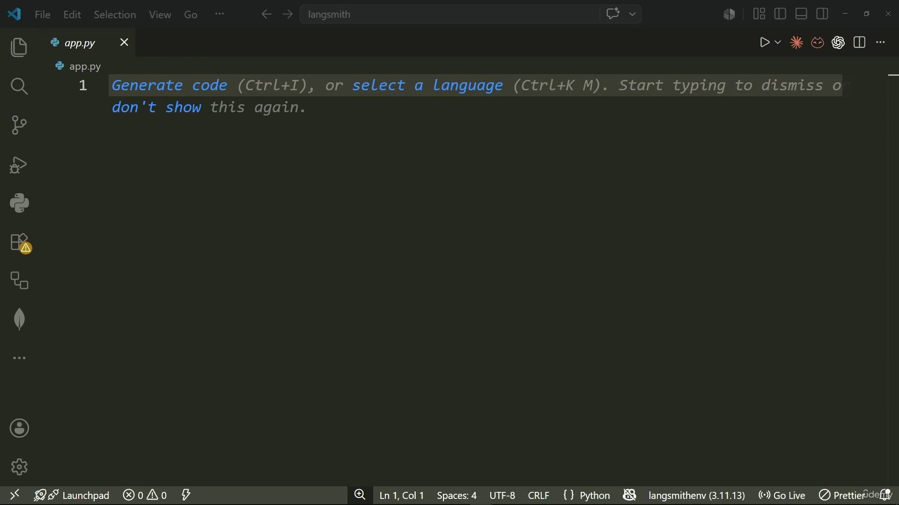
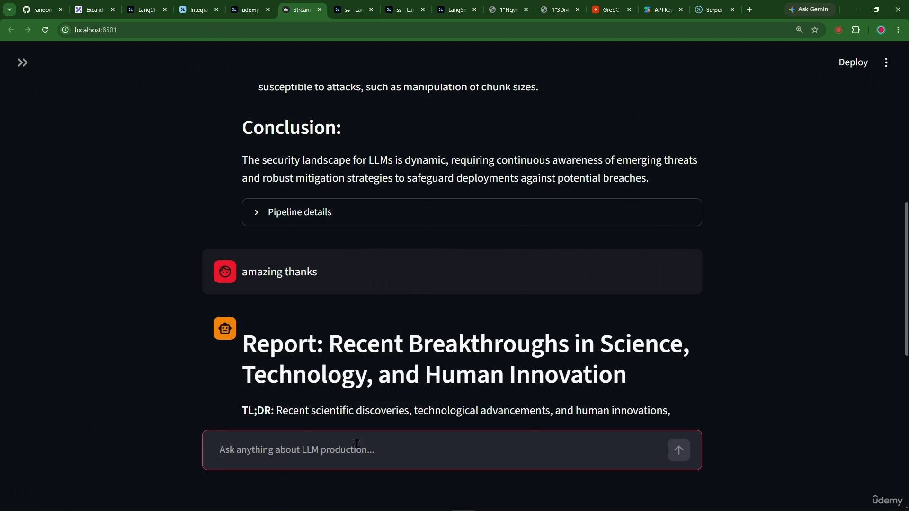
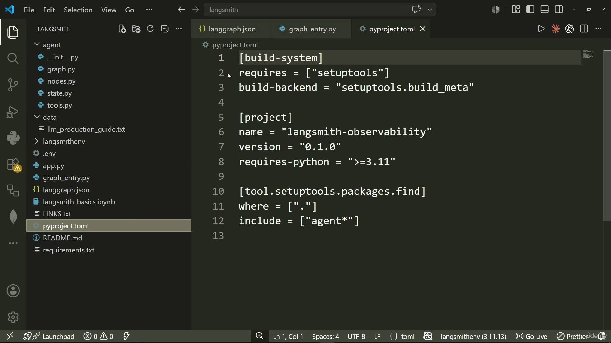
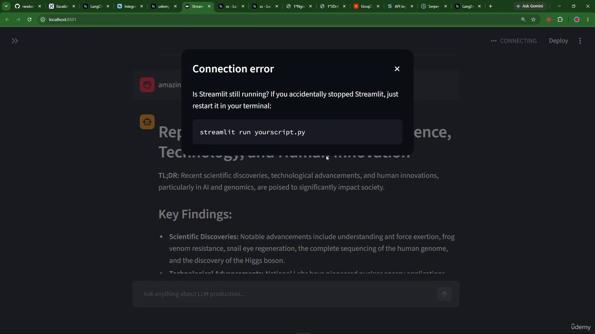
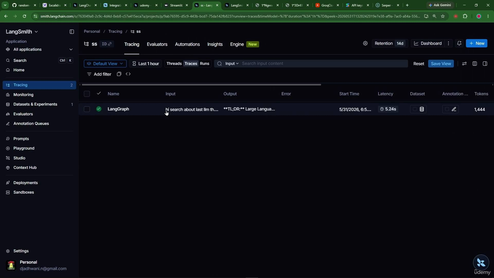
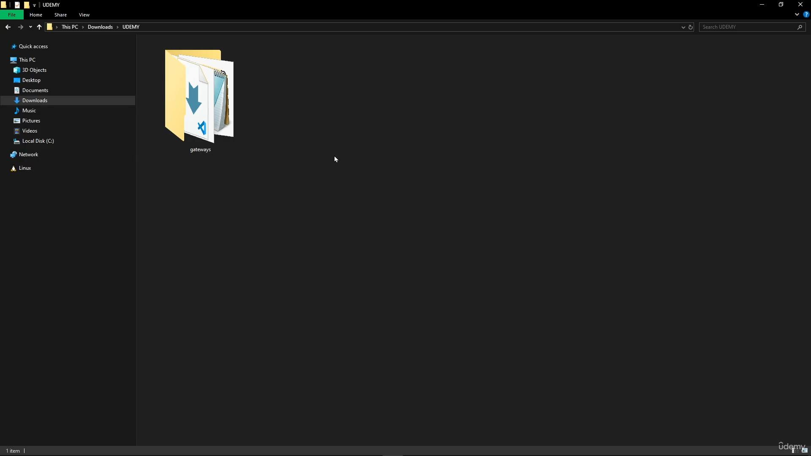
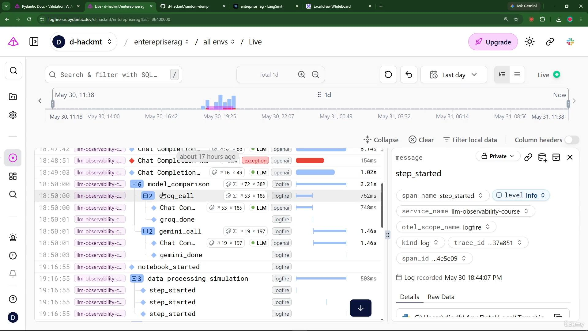
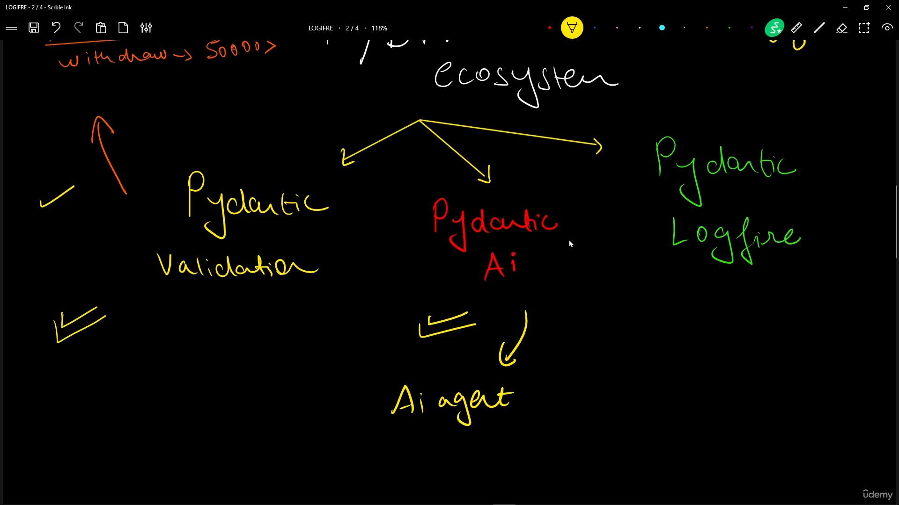
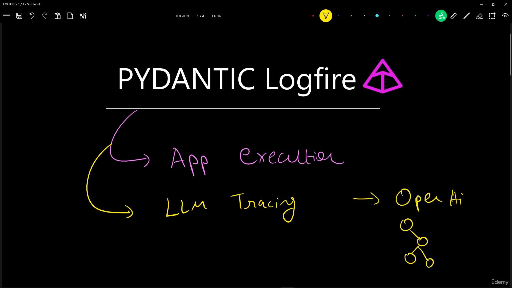
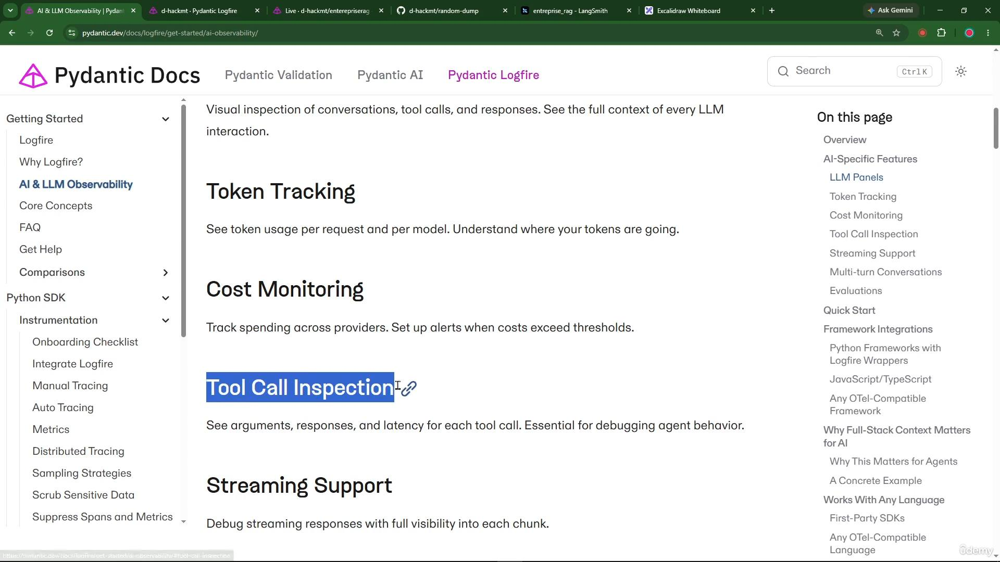

# AI Security Bootcamp part2（护栏/网关/可观测）· P033–P034 复现文档

> 覆盖范围：P033（把上一节写好的 LangGraph 多智能体工作流包装成 Streamlit 应用，并接进 LangGraph Studio）、P034（Pydantic Logfire 可观测性：概念、生态定位、环境搭建）。
>
> 本段两份逐字稿都**没有 OCR 结果**，讲师也没有把源码贴在屏幕上念。因此本文第 4 节的代码分两类，每一类都在文件头明确标注：
> - **【按口述重建】**：讲师逐字描述了文件结构、字段和命令，我按描述补成可运行文件；
> - **【课里没有代码，以下为示意】**：讲师只讲了概念（如 Logfire SDK 调用），代码为最小示意，API 名称以官方文档为准。
>
> 凡是逐字稿没讲、OCR 也没有的内容，正文一律写「课里没讲」，不做补脑。

---

## 1. 这一节做什么

这一节其实干了三件独立但前后咬合的事，最终产物是一个**能跑、能看、能观测**的智能体应用。

### 1.1 P033：把"图"变成"应用"

上一节（P032 及之前）已经把逻辑层写完了：一个基于 LangGraph 的多智能体工作流，包含若干节点、共享的 state、以及若干 tool。P033 开头讲师的第一句话就是在交代这个前提——逻辑写完了，"现在是时候把它变成一个应用了"。

具体要做四步：

1. **写 `app.py`**，用 Streamlit 做 UI 外壳：
   - 每次启动 / 刷新生成新的 `session_id`（UUID）；
   - 用 `st.cache_resource` 把编译好的 LangGraph 图缓存起来，避免每次刷新都重新构建（讲师说构建一次至少约一分钟）；
   - `st.set_page_config` 设置标题；
   - 侧边栏：session_id、内部用了哪些模型/工具的说明、几条可直接点的示例问题、以及查看 trace 的入口；
   - 聊天区：`st.chat_input` + `st.chat_message`，用 `st.session_state` 维护聊天历史；
   - 调用图时把 `session_id` 放进 `config` 的 `metadata` 里，这样 trace 能按会话归组。
2. **写 `langgraph.json`**，让 LangGraph CLI 认识这个工作流：声明依赖、声明入口（graph 名 → 文件:变量）、声明 env 文件。
3. **写 `graph_entry.py`**，作用只有一个：把项目根目录 append 到 `sys.path`，这样从 `graph_entry.py` 里 import `agent/` 目录下的图才不会报 ModuleNotFoundError。
4. **写 `pyproject.toml`**，把 `agent/` 目录变成一个可安装的包，然后 `uv pip install -e .` 装成 editable 模式；之后 `langgraph dev` 起 Studio，`streamlit run app.py` 起应用。

同时，讲师在这一节里**明确指出了一个逻辑漏洞**：当前的流程图是"直线式（straightforward）"的，planner 之后必然走 document_reader → web_researcher → synthesizer → report_writer，不会判断"到底要不要读文档"。所以在问一些不需要文档的问题时，输出里出现了幻觉。这被留成了作业：改成 ReAct 式流程，由 planner 决定是继续读文档还是直接结束回答。

### 1.2 P034 上半：先搞清楚"LLM 追踪"和"应用执行追踪"不是一回事

讲师花了整整一半时间做概念铺垫，核心结论只有一句：**LLM tracing ⊂ application execution tracing**。LangSmith 那类工具主要看的是模型调用链（消息怎么在 agent 之间流动、花了多少 token、成本多少）；而 Pydantic Logfire 看的是**整个应用**的执行流，模型调用只是其中一层。这就是他反复说"double win"的意思。

三个必须记住的术语：

| 术语 | 讲师的定义 |
|---|---|
| **span** | 单条日志 / 单次操作，就是一个 span |
| **trace** | 多个 span 串起来，构成一条 trace |
| **waterfall** | 一条 trace 的执行流（时间轴上的展开），叫 waterfall |

另外还讲清了 Pydantic 生态与 LangChain 生态的对照关系，以及 **instrumentation = 自动追踪**这个关键定义。

### 1.3 P034 下半：搭环境

新建文件夹 `PydanticLogFire` → 开 VS Code → `uv venv` 建虚拟环境 → 写 `requirements.txt` → `uv pip install -r requirements.txt` → 再 `uv pip install logfire`。他在这一节里承诺了后续三件事：用 Logfire 追踪 LLM 调用、在 Jupyter notebook 里做一个 RAG 应用并追踪它、最后做一个多智能体系统（analyst agent、web search agent 等）。

---

## 2. 讲师原话

> "我们为什么需要这个 UUID？因为每次我们启动这个 Streamlit 应用，我们都需要一个新的 session id。"
> —— p033 [00:25]

> "`agent.graph.build_graph` 至少需要花大约一分钟。所以我们不希望每次刷新都让应用重新初始化；我们只用一次 cache resource，它会维护一份缓存，之后每次都跑得非常快。"
> —— p033 [00:54]

> "文档智能体，LangGraph、LangSmith、Groq、Gemini 和 Serper。"
> —— p033 [01:20]

> "为什么我们在这里会看到幻觉？因为我们的工作流是直线式的，它不是反应式的（reactive），它是直线向前的。所以我们需要修好这个工作流：让 planner 来决定，我们到底要不要去读文档，还是直接结束回答。"
> —— p033 [05:57]

> "我现在要在命令提示符里运行 `uv pip install -e .`，它会把我的包构建出来。"
> —— p033 [09:11]

> "`langgraph dev` 对应这个要求……这个 CLI 依赖会帮我们把智能体工作流带进 Studio。"
> —— p033 [09:40]

> "LLM 追踪，就是你有一个大语言模型，比如 OpenAI，我们可以看到它是怎么执行的、花了多少 token、做了哪些调用……LLM 追踪我们主要用 LangSmith。"
> —— p034 [00:26]

> "应用执行追踪是比 LLM 追踪更大的东西，LLM 追踪是被包含在应用执行追踪里面的。"
> —— p034 [00:53]

> "单个日志就是一个 span。多个 span 组成一个 trace。而我们这条 trace 的执行流，就叫做 waterfall。"
> —— p034 [04:42]

> "instrumentation 就是自动追踪。我们不需要每次都去配置它，应用一跑起来它就会自动记录到 Logfire。"
> —— p034 [11:59]

> "这段视频一结束，我强烈建议、强烈要求你至少花一个小时去读这份文档。"
> —— p034 [13:23]

> "attributes 就是我们作为元数据传进日志里的东西。"
> —— p034 [14:22]

---

## 3. 从零复现

### 步骤 0：前置条件

- Python 3.11+、[uv](https://docs.astral.sh/uv/)（讲师全程用 `uv venv` / `uv pip install`，不用 `pip`）。
- 一个 LangSmith 账号（要拿到 API key，用来在 UI 里点开 trace）。
- 模型与搜索的 key。讲师在页面标题里点名了三个 provider：**Groq、Gemini（Google Generative AI）、Serper**。
  - ⚠️ **课里没讲环境变量名**，讲师只说"我们用 `python-dotenv` 来加载 `.env` 变量"。下面 `.env.example` 里的变量名是按各家 SDK 的通行约定补的，**不是讲师念出来的**，按你的实际 SDK 改。
- 本地要有上一节做好的 `agent/` 目录（state、nodes、tools、graph）。

### 步骤 1：项目目录结构

上一节的 agent 目录在 P033 里被当成既有资产，讲师只补了三个"打包/入口"文件和一个 `app.py`。目录长这样：

```text
document-intelligence-agent/
├── .env                     # 真实 key，不进 git
├── .env.example
├── app.py                   # P033 新增：Streamlit UI
├── langgraph.json           # P033 新增：LangGraph CLI 配置
├── graph_entry.py           # P033 新增：sys.path 桥接
├── pyproject.toml           # P033 新增：把 agent/ 变成包
├── requirements.txt
├── docs/                    # document reader 读的本地文档
│   └── llm-security.md
└── agent/
    ├── __init__.py
    ├── state.py
    ├── nodes.py
    ├── tools.py
    └── graph.py
```

> 讲师只说了"agents folder""agents 这个文件夹"，`state.py / nodes.py / tools.py / graph.py` 的**具体文件名课里没讲**。这是我按职责拆的，你可以按上一节的实际文件名替换，只要 `graph_entry.py` 里 import 对得上就行。

### 步骤 2：写 `app.py`

按讲师的顺序，一段一段写：

1. **import 区**：`uuid`（生成 session id）、`streamlit as st`、以及 `agent.graph` 里编译好的 `graph`。
2. **session id**：模块级 `session_id = str(uuid.uuid4())`。注意——讲师演示时是"刷新一下 page，session id 就变了"，所以这里**不能**放进 `st.session_state`（放进去刷新后就固定了）。
3. **缓存图**：`@st.cache_resource` 装饰的 `load_graph()`。讲师原话是"我们只用一次 cache resource，它维护一份缓存，之后每次都跑得很快"。
4. **页面配置**：`st.set_page_config(...)`，标题写 `Document Intelligence Agent | LangGraph · LangSmith · Groq · Gemini · Serper`。
5. **侧边栏**：`st.sidebar` 里依次是 session 区 → `st.divider()` → 内部组件说明 → `st.divider()` → 示例问题 → `st.divider()` → trace 入口。
6. **聊天历史**：`st.session_state["messages"]`，初始化成空 list，每次 rerun 先回放一遍。
7. **chat input**：`prompt = st.chat_input("Ask anything about LLM production...")`，`with st.chat_message("assistant"):` 里跑 `st.spinner`，然后 `graph.invoke(..., config={"metadata": {"session_id": session_id}})`。
8. **展示结果**：把 `report` 用 `st.markdown` 渲染，元数据（trace 链接等）单独展示。



### 步骤 3：写 `langgraph.json` + `graph_entry.py` + `pyproject.toml`

讲师对 `langgraph.json` 的要求是两句：**"取上所有依赖"**、**"给 document intelligence agent 用 graph entry 这个 graph"**。



`graph_entry.py` 的作用，讲师讲得很直白：**"我们在这里只是把 system path 追加进去，这样它才能拿到 agents 这个文件夹"**。

`pyproject.toml` 的作用：**"为了把我们的 agent 文件夹转换成一个包"**。

### 步骤 4：安装成包

```bash
uv pip install -e .
```



讲师原话："它就是会去构建我的包。看，我的包构建好了，现在我可以继续了。"

### 步骤 5：起 LangGraph Studio

```bash
langgraph dev
```

> ⚠️ 逐字稿把这句识别成了 "lang graph def" / "Langrub Dev"，从上下文（会打开新标签页、显示工作流图、在本地起一个 API 目录）判断是 `langgraph dev`，这是 LangGraph CLI 的标准命令。如果你装的是别的版本，用 `langgraph --help` 确认。

讲师说它会**自动打开一个新标签页**，里面能看到和工作流一模一样的图；运行时还会**新建一个 `langgraph_api` 文件夹来维护 state**。



在 Studio 里输入问题（讲师用的是 "Search about latest LLM frameworks"），能看到节点一个个亮起来：web_researcher → synthesizer → report_writer → end，最后出报告。

### 步骤 6：起 Streamlit 应用

新开一个终端：

```bash
streamlit run app.py
```



讲师在应用里问的是 **"what is LLM as a judge evaluation"**，然后：

- trace 里新建了一条记录；
- 点开是完整的树，能看到 **5.78** 的延迟、以及产生的 **cost**；
- 切到 waterfall 视图，能看到整条执行的时序展开；
- pipeline 顺序是：planner → document reader → web researcher → 之后才进 synthesizer / report writer。

> 讲师强调：**"document reader 是从本地拿相关文档，web researcher 是从网上拿信息，synthesizer 把信息综合，最后 report writer 把它写成一份漂亮的报告。"**

### 步骤 7（P034）搭 Logfire 工程

```bash
mkdir PydanticLogFire && cd PydanticLogFire
uv venv
```

Windows 激活：`.venv\Scripts\activate`；macOS/Linux：`source .venv/bin/activate`。

> 讲师说的是"我写 `uv venv`，我们可以给环境起个简单的名字"——`uv venv` 默认建的是 `.venv`，起名字是可选的（`uv venv 名字`）。**具体他敲的名字课里没讲清**（逐字稿识别成 "pi log env"），用默认 `.venv` 最稳。

然后写 `requirements.txt`（内容见第 4 节），再：

```bash
uv pip install -r requirements.txt
uv pip install logfire
```

讲师原话："`logfire` 也可以像这样直接装。以防有什么漏了的，装上 logfire，东西就齐了。"



### 步骤 8：登录 Logfire

讲师说"你要去登录 Logfire，我已经登录过了，我也会演示怎么登录"。**但登录的具体命令/按钮课里没讲**（视频里没敲出来）。按官方文档，SDK 侧认证走 `logfire auth` 这类流程，浏览器侧是网页登录——**以你看到的文档为准，这里不替他编命令**。

---

## 4. 完整代码

> 再次声明：**本段两份逐字稿都没有 OCR，讲师没有贴出完整源码。** 下面 `app.py`、`langgraph.json`、`graph_entry.py`、`pyproject.toml` 是**按 p033 的口述逐条重建**的；`agent/*` 是**为了让文档能跑起来补的等价最小实现**（讲师说这部分上一节已经写完）；`logfire_demo.py` 是**纯示意**。

### 4.1 `requirements.txt`（P033 用）

```text
streamlit
langgraph
langgraph-cli[inmem]
langchain
langchain-core
langchain-community
langchain-groq
langchain-google-genai
python-dotenv
requests
```

### 4.2 `pyproject.toml`【按口述重建】

```toml
[project]
name = "document-intelligence-agent"
version = "0.1.0"
description = "Document Intelligence Agent built with LangGraph + Groq + Gemini + Serper"
requires-python = ">=3.11"
dependencies = [
    "langgraph",
    "langchain",
    "langchain-core",
    "langchain-community",
    "langchain-groq",
    "langchain-google-genai",
    "python-dotenv",
    "requests",
]

[build-system]
requires = ["hatchling"]
build-backend = "hatchling.build"

# 关键：把 agent/ 这个目录打成一个包，uv pip install -e . 之后
# 任何地方都能 import agent.xxx，langgraph dev 也能解析到
[tool.hatch.build.targets.wheel]
packages = ["agent"]
```

> `pyproject.toml` 的**具体内容讲师没念**，他说的是"我把这个 `pyproject.toml` 粘贴过来了"。字段名是标准 TOML 规范，不涉及他的业务逻辑。

### 4.3 `langgraph.json`【按口述重建】

```json
{
  "dependencies": ["."],
  "graphs": {
    "document_intelligence_agent": "./graph_entry.py:graph"
  },
  "env": ".env"
}
```

- `dependencies: ["."]` —— 对应讲师说的"取上所有依赖"，即把当前项目本身作为依赖。
- `graphs` 的 key 就是 Studio 里显示的名字，讲师说的是 "document intelligence agent"。
- `env` 指向 `.env`，让 CLI 起进程时能读到 key。

### 4.4 `graph_entry.py`【按口述重建】

```python
"""LangGraph CLI 的入口文件。

作用只有一个：把项目根目录塞进 sys.path，
这样 langgraph dev 启动时才能 import 到 agent/ 目录下的图。
"""
import sys
from pathlib import Path

# 把本文件所在目录（项目根）追加到模块搜索路径
sys.path.append(str(Path(__file__).resolve().parent))

from agent.graph import graph  # noqa: E402  (必须在 sys.path 操作之后)

__all__ = ["graph"]
```

### 4.5 `agent/__init__.py`【等价最小实现】

```python
"""agent 包。"""
```

### 4.6 `agent/state.py`【等价最小实现】

```python
"""LangGraph 共享状态。"""
from typing import Annotated, TypedDict

from langgraph.graph.message import add_messages


class AgentState(TypedDict, total=False):
    # 对话消息（add_messages 负责按 id 合并，而不是覆盖）
    messages: Annotated[list, add_messages]
    # 用户原始问题
    question: str
    # planner 改写后的问题
    refined_question: str
    # 本地文档命中片段
    documents: list[str]
    # 网络搜索结果：[{"title":..., "link":..., "snippet":...}]
    web_results: list[dict]
    # 综合后的中间结论
    synthesis: str
    # 最终报告（markdown）
    report: str
```

### 4.7 `agent/tools.py`【等价最小实现】

```python
"""工具层：本地文档检索 + Serper 网络搜索。"""
import os
from pathlib import Path

import requests

DOCS_DIR = Path(__file__).resolve().parent.parent / "docs"
SERPER_URL = "https://google.serper.dev/search"


def search_documents(query: str, top_k: int = 3) -> list[str]:
    """极简本地检索：按关键词命中次数排序，返回 top_k 个片段。

    课里没讲 document reader 的具体检索算法，
    这里只保证"能从本地文档拿到相关内容"。
    """
    if not DOCS_DIR.exists():
        return []

    keywords = [w.lower() for w in query.split() if len(w) > 2]
    scored: list[tuple[int, str]] = []

    for path in DOCS_DIR.rglob("*"):
        if path.suffix.lower() not in {".md", ".txt", ".rst"}:
            continue
        text = path.read_text(encoding="utf-8", errors="ignore")
        for chunk in text.split("\n\n"):
            chunk = chunk.strip()
            if not chunk:
                continue
            score = sum(chunk.lower().count(k) for k in keywords)
            if score > 0:
                scored.append((score, f"[{path.name}] {chunk}"))

    scored.sort(key=lambda x: x[0], reverse=True)
    return [chunk for _, chunk in scored[:top_k]]


def search_web(query: str, num: int = 5) -> list[dict]:
    """Serper（google.serper.dev）搜索。需要环境变量 SERPER_API_KEY。"""
    api_key = os.getenv("SERPER_API_KEY")
    if not api_key:
        return [{"title": "SERPER_API_KEY missing", "link": "", "snippet": ""}]

    resp = requests.post(
        SERPER_URL,
        headers={"X-API-KEY": api_key, "Content-Type": "application/json"},
        json={"q": query, "num": num},
        timeout=30,
    )
    resp.raise_for_status()
    data = resp.json()

    results = []
    for item in data.get("organic", [])[:num]:
        results.append(
            {
                "title": item.get("title", ""),
                "link": item.get("link", ""),
                "snippet": item.get("snippet", ""),
            }
        )
    return results
```

### 4.8 `agent/nodes.py`【等价最小实现】

```python
"""五个节点：planner / document_reader / web_researcher / synthesizer / report_writer。

注意：这就是讲师说的"直线式（straightforward）"流程，
也是他留成作业要你改成 ReAct 的那一版。
"""
from langchain_core.messages import AIMessage, HumanMessage, SystemMessage
from langchain_google_genai import ChatGoogleGenerativeAI
from langchain_groq import ChatGroq

from agent.state import AgentState
from agent.tools import search_documents, search_web

# planner / report_writer 用 Groq，synthesizer 用 Gemini —— 对应讲师标题里的 "Groq, Gemini"
groq_llm = ChatGroq(model="llama-3.3-70b-versatile", temperature=0)
gemini_llm = ChatGoogleGenerativeAI(model="gemini-2.0-flash", temperature=0)


def planner(state: AgentState) -> dict:
    """把用户口语化的问题改写成一句精确的检索式提问。"""
    question = state.get("question", "")
    resp = groq_llm.invoke(
        [
            SystemMessage(
                content=(
                    "You are a planner. Rewrite the user's question into one precise, "
                    "search-ready question. Return ONLY the rewritten question."
                )
            ),
            HumanMessage(content=question),
        ]
    )
    refined = resp.content.strip()
    return {
        "refined_question": refined,
        "messages": [AIMessage(content=f"planner → {refined}")],
    }


def document_reader(state: AgentState) -> dict:
    """从本地 docs/ 目录取相关片段。"""
    query = state.get("refined_question") or state.get("question", "")
    docs = search_documents(query)
    return {"documents": docs}


def web_researcher(state: AgentState) -> dict:
    """从网上取信息。"""
    query = state.get("refined_question") or state.get("question", "")
    results = search_web(query)
    return {"web_results": results}


def synthesizer(state: AgentState) -> dict:
    """把本地文档 + 网络结果综合成一段结论。"""
    docs = "\n\n".join(state.get("documents", [])) or "(no local documents)"
    web = "\n\n".join(
        f"- {r['title']}: {r['snippet']} ({r['link']})"
        for r in state.get("web_results", [])
    ) or "(no web results)"

    resp = gemini_llm.invoke(
        [
            SystemMessage(
                content=(
                    "Synthesize the local documents and web results into a concise, "
                    "factual summary. Do not invent facts."
                )
            ),
            HumanMessage(content=f"LOCAL:\n{docs}\n\nWEB:\n{web}"),
        ]
    )
    return {"synthesis": resp.content}


def report_writer(state: AgentState) -> dict:
    """写最终 markdown 报告，并把来源链接带上。"""
    sources = "\n".join(
        f"- [{r['title']}]({r['link']})" for r in state.get("web_results", []) if r.get("link")
    )
    resp = groq_llm.invoke(
        [
            SystemMessage(
                content=(
                    "Write a well-structured markdown report from the synthesis. "
                    "End with a 'Sources' section."
                )
            ),
            HumanMessage(
                content=(
                    f"QUESTION: {state.get('question', '')}\n\n"
                    f"SYNTHESIS:\n{state.get('synthesis', '')}\n\n"
                    f"SOURCES:\n{sources}"
                )
            ),
        ]
    )
    report = resp.content
    return {"report": report, "messages": [AIMessage(content=report)]}
```

### 4.9 `agent/graph.py`【等价最小实现】

```python
"""把节点连成图。这里是直线式流程 —— 讲师留的作业就是把它改成 ReAct。"""
from langgraph.graph import END, START, StateGraph

from agent.nodes import (
    document_reader,
    planner,
    report_writer,
    synthesizer,
    web_researcher,
)
from agent.state import AgentState


def build_graph():
    builder = StateGraph(AgentState)

    builder.add_node("planner", planner)
    builder.add_node("document_reader", document_reader)
    builder.add_node("web_researcher", web_researcher)
    builder.add_node("synthesizer", synthesizer)
    builder.add_node("report_writer", report_writer)

    builder.add_edge(START, "planner")
    builder.add_edge("planner", "document_reader")
    builder.add_edge("document_reader", "web_researcher")
    builder.add_edge("web_researcher", "synthesizer")
    builder.add_edge("synthesizer", "report_writer")
    builder.add_edge("report_writer", END)

    return builder.compile()


# 模块级单例：app.py 和 graph_entry.py 都 import 这一个
graph = build_graph()
```

### 4.10 `app.py`【按口述重建】

```python
"""Streamlit 外壳：把 LangGraph 工作流包装成一个可交互应用。"""
import uuid

import streamlit as st

from agent.graph import graph as agent_graph

# ---------------------------------------------------------------
# 1. 页面配置（讲师：title / document intelligence agent / 那些模型名）
# ---------------------------------------------------------------
st.set_page_config(
    page_title="Document Intelligence Agent | LangGraph · LangSmith · Groq · Gemini · Serper",
    page_icon="🧠",
    layout="wide",
)

# ---------------------------------------------------------------
# 2. 每次启动/刷新都生成新的 session id
#    讲师：刷新页面 session id 会变 —— 所以不能存进 st.session_state
# ---------------------------------------------------------------
session_id = str(uuid.uuid4())


# ---------------------------------------------------------------
# 3. 图只构建一次：build_graph 大约要 1 分钟
# ---------------------------------------------------------------
@st.cache_resource(show_spinner="正在构建 LangGraph 工作流（首次约需 1 分钟）…")
def load_graph():
    return agent_graph


graph = load_graph()

# ---------------------------------------------------------------
# 4. 侧边栏
# ---------------------------------------------------------------
SUGGESTIONS = [
    "What is LLM as a judge evaluation?",
    "Search about latest LLM frameworks",
    "Search about latest LLM threats",
]

with st.sidebar:
    st.header("Session")
    st.code(session_id, language=None)

    st.divider()

    st.subheader("这个应用内部用了什么")
    st.markdown(
        "- **Planner** — Groq\n"
        "- **Document Reader** — 本地文档检索\n"
        "- **Web Researcher** — Serper（Google 搜索）\n"
        "- **Synthesizer** — Gemini\n"
        "- **Report Writer** — Groq\n"
        "- **Tracing** — LangSmith"
    )

    st.divider()

    st.subheader("可以直接点的问题")
    for i, q in enumerate(SUGGESTIONS):
        if st.button(q, key=f"sugg_{i}", use_container_width=True):
            st.session_state["pending_prompt"] = q

    st.divider()

    # 讲师：想看 trace 就去这个 endpoint（具体 URL 他没念，用你的 LangSmith 项目地址）
    st.caption("想看 trace → 打开你的 LangSmith 项目页面（课里没念具体 URL）")

# ---------------------------------------------------------------
# 5. 聊天历史（只用于 UI 展示）
# ---------------------------------------------------------------
if "messages" not in st.session_state:
    st.session_state["messages"] = []

st.title("🧠 Document Intelligence Agent")
st.caption("LangGraph · LangSmith · Groq · Gemini · Serper")

for msg in st.session_state["messages"]:
    with st.chat_message(msg["role"]):
        st.markdown(msg["content"])

# ---------------------------------------------------------------
# 6. 输入 + 执行
# ---------------------------------------------------------------
prompt = st.chat_input("Ask anything about LLM production…")

# 侧边栏点按钮也能触发
if not prompt:
    prompt = st.session_state.pop("pending_prompt", None)

if prompt:
    st.session_state["messages"].append({"role": "user", "content": prompt})
    with st.chat_message("user"):
        st.markdown(prompt)

    with st.chat_message("assistant"):
        with st.spinner("Running the pipeline…"):
            result = graph.invoke(
                {
                    "question": prompt,
                    "messages": [("user", prompt)],
                },
                # 讲师：metadata 会被传进去，trace 里能看到
                config={"metadata": {"session_id": session_id}},
            )

        report = result.get("report", "(no report)")
        st.markdown(report)

        with st.expander("Pipeline metadata"):
            st.write(
                {
                    "session_id": session_id,
                    "refined_question": result.get("refined_question", ""),
                    "documents_hit": len(result.get("documents", []) or []),
                    "web_results": len(result.get("web_results", []) or []),
                }
            )

    st.session_state["messages"].append({"role": "assistant", "content": report})
```

### 4.11 `docs/llm-security.md`（document reader 的输入样例）

```markdown
# LLM Security Notes

Prompt injection 是最常见的 LLM 攻击面之一。攻击者把指令藏在文档或网页里，
让模型把"数据"当成"指令"执行。

LLM as a judge evaluation 指用一个 LLM 给另一个 LLM 的输出打分，
常用于自动化评测，但要注意 judge 本身的偏见。

护栏（guardrails）通常分输入侧和输出侧：输入侧做注入检测、PII 脱敏；
输出侧做毒性过滤、结构化校验。
```

### 4.12 `.env.example`

```dotenv
# 注意：讲师只说了用 python-dotenv 加载 .env，没念变量名。
# 以下按各家 SDK 通行约定补，按你的实际 SDK 改。
GROQ_API_KEY=
GOOGLE_API_KEY=
SERPER_API_KEY=
LANGSMITH_API_KEY=
LANGSMITH_TRACING=true
LANGSMITH_PROJECT=document-intelligence-agent
```

### 4.13 `requirements.txt`（P034 的 Logfire 工程）【按口述重建】

```text
langchain
langchain-text-splitters
langchain-community
langchain-groq
langchain-google-genai
python-dotenv
openai
logfire
google-generativeai
langgraph
faiss-cpu
duckduckgo-search
streamlit
ipykernel
```

说明几个讲师**明确提过**的点：
- `ipykernel` —— 他专门说了 "let me also write ipykernel"，因为是 Jupyter notebook 环境；
- `langchain-groq` —— "我们用的是 Groq provider"；
- `langchain-google-genai` —— "我们还要用 Gemini embedding 和 Gemini 模型"；
- `sentence-transformers` —— **讲师当场删掉了**（"这本来是做 embedding 的，我把它去掉"）；
- `faiss` —— 逐字稿识别成 "fires"，从上下文（"this is for vector DB"）判断是向量库 FAISS；
- ⚠️ 网络搜索那个包，讲师只说 "this is for web search"，**包名课里没念**，这里用 `duckduckgo-search` 占位。

### 4.14 `logfire_demo.py`【课里没有代码，以下为示意】

```python
"""P034 只讲了概念和生态，没有贴出 Logfire 的调用代码。
下面是最小示意：configure → 打一条日志 → 开一个 span → 包住一段 LLM 调用。
具体 API 名称请以你当时看到的 Pydantic Logfire 文档为准。"""
import logfire

# 1. 初始化（认证 token 通常来自环境变量或 `logfire auth` 流程；
#    讲师说"你要去登录 Logfire"，但登录命令课里没讲）
logfire.configure()

# 2. 一条 info 日志 —— 讲师演示里那条 "notebook is started"
logfire.info("notebook is started")

# 3. 手动 span：一个 span 就是一条日志/一次操作
with logfire.span("planner"):
    # 4. attributes 就是"作为元数据传进日志里的东西"
    logfire.info("planner started", session_id="demo-session", node="planner")

# 5. 自动追踪（instrumentation）—— 讲师定义为"自动追踪"，
#    开了之后框架层的调用会自动落进 Logfire，不用一行行手写 span
# logfire.instrument_openai()
```

---

## 5. 逐行解释

### 5.1 `app.py`

**`session_id = str(uuid.uuid4())`（模块级，不在 `st.session_state` 里）**
Streamlit 的模型是：任何交互都会从头 rerun 一遍脚本。如果把 `session_id` 放进 `st.session_state`，它会在整个浏览器会话里保持同一个值——那就和讲师演示的"刷新一下 session id 就变了"不一致了。放在模块级，每次 rerun 都会重新生成。代价是：**这条 trace 的 session_id 每次交互都变，不能靠它把多轮对话聚在一起**，要用 `st.session_state["messages"]` 那条线来串。这是一个真实的取舍，讲师没展开讲。
> 在 JS/Node 里对应什么：`st.session_state` 大致相当于 Express 的 `req.session`（服务端会话，跨请求保持）；模块级变量相当于模块加载时执行一次的顶层变量（类似在 `app.js` 顶部 `const sessionId = crypto.randomUUID()`，但它只在整个进程生命周期执行一次，不像 Streamlit 每次 rerun 都执行）。

**`@st.cache_resource`**
`st.cache_resource` 缓存的是"资源对象"（数据库连接、模型、编译好的图），不随输入参数变化重建。讲师的理由很实际：`agent.graph.build_graph()` 至少要约一分钟，每次刷新都重建，应用就没法用了。
> JS/Node 对应：模块级单例 + `lodash.once()` / 顶层 `const graph = buildGraph()`。区别是 Streamlit 的 `cache_resource` 是**跨会话共享**的，也就是说所有用户共用同一个图实例——这在多用户场景下要小心图内部有没有可变状态。

**`graph.invoke(..., config={"metadata": {"session_id": session_id}})`**
`config` 里的 `metadata` 会被 LangSmith 记录到这条 run 上。讲师原话是"metadata 会被传进去"，这样你在 trace 列表里能按 session 过滤。注意 `messages` 用 `("user", prompt)` 这种元组形式，LangGraph 会自动转成 `HumanMessage`。

**`with st.spinner(...)`**
讲师描述的是："chat message assistant，它会在 state 更新的时候一直转 spinner"。`st.spinner` 就是那个转圈。

**侧边栏的 `st.divider()`**
讲师专门解释了"这个叫 divider"，还专门解释"这个叫 sidebar"。侧边栏的内容顺序是：session → divider → 内部组件说明 → divider → 示例问题 → divider → trace 入口。

### 5.2 `graph_entry.py`

```python
sys.path.append(str(Path(__file__).resolve().parent))
```

这一行的存在理由，讲师说得很清楚：**"我们追加 system path，是为了让它能拿到 agents 这个文件夹"**。因为 `langgraph dev` 启动时，工作目录可能不是项目根，Python 找不到 `agent` 这个包。追加项目根之后，`from agent.graph import graph` 才能解析成功。用 `Path(__file__).resolve().parent` 而不是硬编码路径，是为了跨平台（Windows 的 `\` 和 POSIX 的 `/`）。

**为什么还需要 `pyproject.toml` + `uv pip install -e .`？**
如果只做 `sys.path.append`，`agent` 只是"能被 import 的目录"，不是"被安装的包"。LangGraph CLI 在解析 `langgraph.json` 的 `dependencies` 时，会去读已安装的包。`uv pip install -e .` 把 `agent/` 以 editable 方式装进环境，之后改代码不用重装。

### 5.3 `pyproject.toml`

`[tool.hatch.build.targets.wheel] packages = ["agent"]` 是关键：默认 hatchling 会按项目名去找同名目录（`document_intelligence_agent`），但我们实际的包叫 `agent`，必须显式指定，否则 `uv pip install -e .` 装出来是个空包。

### 5.4 `agent/graph.py`：为什么这就是"直线式"

```python
builder.add_edge("planner", "document_reader")
builder.add_edge("document_reader", "web_researcher")
```

这三条 `add_edge` 是**无条件边**：planner 跑完必然走 document_reader，document_reader 跑完必然走 web_researcher。没有任何分支判断，所以叫"直线式 / 非反应式"。讲师说的幻觉就出在这：当你问"what is LLM as a judge evaluation"这种不需要查本地文档的问题时，document_reader 拿不到东西，pipeline 还是硬着头皮往下走，synthesizer 只能编。

**作业的正确形态（讲师口述的修法）**：把 `add_edge("planner", "document_reader")` 换成 `add_conditional_edges("planner", route_fn, {...})`，`route_fn` 里判断"这个问题需不需要读文档"，需要就走 `document_reader`，不需要就直接 `END`。
> 在 JS/Node 里对应什么：这就是 `if/else`。LangGraph 的 conditional edge 本质是"根据 state 返回下一个节点名"，等价于 `const next = route(state); return handlers[next]()`。

### 5.5 P034 的三个术语，落到观测面板上

- **span**：你在 Logfire 面板里看到的**一行**。讲师演示里那条 "notebook is started" 就是一行 = 一个 span。
- **trace**：讲师说"一、二、三，多个 span 组成一个 trace"，面板上他把三条 span 归成了两条 trace。判定依据是**同一请求链路**（同一个 trace_id）。
- **waterfall**：trace 的时间轴展开。讲师演示时是"我展开它，它看起来就像一个瀑布"。

对照 P033 的 LangSmith 截图：点开一次 run → 看到的是**树**（tree）；切到 waterfall 标签 → 看到的是**时间轴**。两者是同一份数据的两种视图。



### 5.6 P034 的生态对照表

讲师用一张图讲清了两个生态的平行关系：

| 能力 | LangChain 生态 | Pydantic 生态 |
|---|---|---|
| 基础校验 | —（用 pydantic） | **Pydantic Validation** |
| 写 agent | LangGraph | **Pydantic AI** |
| 观测 | LangSmith | **Pydantic Logfire** |

他举的 Validation 例子：银行应用里，用户名必须是 string、存款必须 > 1000 卢比、取款必须 < 50000。这些就是 schema 校验。因为"全世界都在用 pydantic validation"，所以 Pydantic 的人顺势做了 Pydantic AI（"一个 agentic 框架，就像 LangGraph 一样"），再顺势做了 Logfire —— 因为"我们能校验 agent、能写 agent 了，那观测 agent 执行呢？"



### 5.7 为什么 Logfire 比"只有 LLM 追踪"更大

讲师的说法是：LangSmith 里你看到的是"消息怎么在 agent 之间流动"；Logfire 里你看到的是"整个应用怎么流动，LLM 只是其中一环"。他抓了一张自己 RAG 应用的截图举例：`planner → explainer → web_searcher`，web_searcher 运行时 tabular search 在跑、结果被 synthesize、LLM 在跑 —— 这些**都在同一张图上**。



### 5.8 instrumentation = 自动追踪

这是全段最重要的一个定义。讲师原话：**"instrumentation 就是自动追踪"**。区别是：

- **手动追踪**：你自己 `with logfire.span("xxx")` 一行行包；
- **自动追踪（instrumentation）**：你调一下 `instrument_xxx()`，之后框架层的调用自动落进 Logfire，"我们不用每次都去配置它"。

他还提到 Logfire 支持 **distributed tracing**（跨服务）、**SQL 过滤**（在面板上用 SQL 筛日志）、**evaluations**、**prompt management**（测试 prompt、写 prompt、给 prompt 打分），对比对象包括 Langfuse、Phoenix、LangSmith、Braintrust、Datadog、Grafana。集成面覆盖：Pydantic AI、OpenAI、Anthropic、LangChain、LlamaIndex、LiteLLM、MCP，Web 框架有 FastAPI / Flask，还有 HTTP client、logging、loguru、pytest、system metrics。



---

## 6. 复现检查清单

**P033 — 应用化**

- [ ] 目录里有 `agent/`，且 `agent/graph.py` 里导出了模块级 `graph`
- [ ] `.env` 里配好了 Groq / Gemini / Serper / LangSmith 的 key（变量名按你的 SDK 改）
- [ ] `docs/` 目录里至少有一个 `.md` 文件，否则 document_reader 永远返回空
- [ ] `python -c "from agent.graph import graph; print(graph)"` 能打印出图对象
- [ ] `pyproject.toml` 里有 `[tool.hatch.build.targets.wheel] packages = ["agent"]`
- [ ] `uv pip install -e .` 最后一行没有报错（能看到构建成功的输出）
- [ ] `graph_entry.py` 里的 `sys.path.append` 在 `from agent.graph import graph` **之前**
- [ ] `langgraph.json` 的 `graphs` key 与你想在 Studio 里看到的名字一致
- [ ] `langgraph dev` 能自动打开浏览器标签页，且图上能看到 5 个节点
- [ ] 执行一次后，项目根出现 `langgraph_api` 文件夹
- [ ] `streamlit run app.py` 首次加载有 spinner，约 1 分钟内出界面
- [ ] 刷新浏览器，侧边栏的 session id **变了**
- [ ] 刷新浏览器，图的构建**没有**重新跑（说明 `cache_resource` 生效）
- [ ] 提问后 LangSmith 里出现新 trace，能看到 5 个节点、latency、cost
- [ ] 切到 waterfall 视图能看到时序瀑布
- [ ] 完成作业：planner 之后加条件边，能跳过 document_reader 直接 END

**P034 — Logfire**

- [ ] `PydanticLogFire/` 目录已建
- [ ] `uv venv` 成功，环境已激活（命令行前缀有 `(.venv)`）
- [ ] `requirements.txt` 里 `sentence-transformers` **已移除**（讲师当场删的）
- [ ] `uv pip install -r requirements.txt` 无报错
- [ ] `uv pip install logfire`