# AI Security Bootcamp part2：Logfire 可观测性实战（P35–P37）

> 说明：P35–P37 的逐字稿实际落地的是「可观测性」部分：用 Pydantic Logfire 接住 LLM 应用日志、span、trace、结构化日志、自动 instrumentation，以及一个带 trace 的 RAG pipeline。逐字稿没有讲护栏、网关的具体实现，这部分本文会明确写「课里没讲」，不会硬编。逐字稿里 Groq 被转写成 GROC/GROG，本文统一写 Groq；Tably 统一写 Tavily。

## 1. 这一节做什么

这三页要做出一个可以直接跑的 Logfire 实验项目，最终产物包括：

1. 一个 Python 项目目录，里面有 `.env`、`requirements.txt`、`documents.json` 和三个可执行脚本。
2. 在 Logfire 里创建一个项目
Logfire 里创建一个项目；4. 一个能跑通「日志 → 结构化日志 → 自动 instrumentation → 带 trace 的 RAG」四步的实验链路。

具体到每一步的可验证产出：

| 步骤 | 脚本 | 在 Logfire 里能看到什么 |
| --- | --- | --- |
| 第一步 基础日志与 span | `exp1_logging.py` | 一条 `notebook started` 的 info 日志、一个 `data processing simulation` 的 trace，里面嵌套 3 条 step 日志 |
| 第二步 结构化日志 | `exp2_structured.py` | 两个 pydantic 模型的字段变成 Logfire 里可点击、可过滤的列；一个 `LLM call` span 包住 request / response 两条日志 |
| 第三步 自动 instrumentation | `exp3_instrumentation.py` | `Chat completion with llama…` 自动生成的 span，含 token 数、耗时、cost（免费模型显示 unknown）、raw data；以及一条 `model comparison` trace，Groq 和 Gemini 两个子 span 并排 |
| 第四步 带 trace 的 RAG | `exp4_rag.py` | `rag pipeline` trace → `docs retrieved` 日志 + 检索到的两段 context + LLM 调用的 token 与回答 |

关于「护栏 / 网关」：本段逐字稿里没有出现任何 guardrails、gateway、prompt injection 拦截、限流、内容审核的实现或配置。老师在这一段只做 observability，并且在 P37 结尾明确说下一集才做 agentic RAG（ReAct agent）。所以本文不编造护栏部分。真正讲护栏 / 网关的内容不在 P35–P37，这一点请以课程后续页面为准。

整体心智模型，老师在 P37 复述过一次，值得先记住：

> "一个 trace 就是一段请求在分布式系统里端到端旅程的记录。"
> —— p036 [16:36]

> "一个 trace 是一堆 span 组成的。"
> —— p035 [18:09]

## 2. 讲师原话

先把这个项目要用的四个环境变量说清楚。老师在 P35 开头一次性列完：

> "首先我们需要的是 Logfire token，我会告诉你从哪里拿到它。第二我们需要的是 Groq 的 API key，这样我们才能用一个 LLM provider、才能执行我们的 LLM 应用。第三个是 Gemini API key，这样我们可以在两个不同 provider 之间比较 LLM trace。这两个都是免费的，我们也用免费额度，因为我希望这门课对所有学生都是负担得起的。第三，我们还要用 Tavily API key 做网页搜索功能。"
> —— p035 [00:00]–[00:56]

关于为什么必须有 Logfire token、以及 token 应该从哪里来，老师强调得很重：

> "执行 `logfire projects use` 之后，你的用户目录下会出现一个 `.logfire` 文件夹。里面能看到 logfire credentials，还能看到一个 token。永远用项目配置给你的这个 token，不要跑去后台自己建一个 API key。你必须跑这条命令，让它把 `.logfire` 文件夹建出来，然后用这里面的 token。"
> —— p035 [05:43]–[06:13]

关于 configure 到底在做什么：

> "`logfire.configure()` 帮我们把东西发到 Logfire。configure 就是配置、就是设置。做设置的时候我们要传几个东西进去：它可以接收你的 token，可以接收你的 api key，可以传好几样。"
> —— p035 [10:54]、[13:19]

关于 info 和 span 的区别，这是整节课最重要的判断：

> "info 就是一句 print，就是一条简单的日志。而 span 会帮我们搭出一棵树，也就是 trace。"
> —— p035 [16:12]–[16:41]

关于 trace 的构成：

> "这里有三个 step：第一步我们在加载数据，第二步在转换，第三步在保存结果。这是什么？这是应用执行过程。我们还没有走到 LLM，这就是应用执行。"
> —— p035 [17:11]–[17:39]

关于结构化日志为什么要配 pydantic：

> "你会学到如何记录一个 pydantic 模型。每一个字段都会变成一个可搜索的列。"
> —— p036 [00:29]

> "这些模型对我们的 AI agent 非常重要，它能让数据保持一致的结构。我们现在做的是 mock 数据，不是真实数据，但这是我们的起步理解。"
> —— p036 [01:25]

关于哪些指标以后不需要自己算：

> "当 LLM 返回响应时，我们会记录 input token、output token、延迟和使用的模型。这些默认是由我们的大语言模型 provider 帮我们算出来的，我后面会给你看。现在我们只是先把它们搭起来，后面我们会用 instrumentation，那时这些都会自动出现。"
> —— p036 [01:55]–[02:23]

关于为什么用 `ChatOpenAI` 而不是 `ChatGroq`，这是本段最有含金量的一个工程判断：

> "`ChatGroq` 内部已经配好了一个标准 URL，也就是 Groq 的 URL，但那是硬编码在里面的、是死的，我们改不了。而 `ChatOpenAI` 允许我们只改一个 base URL 就去打任何 API。所以我们现在用它来打 Groq，后面还会用它来打 Google Gemini。"
> —— p036 [10:27]–[10:56]

> "虽然我们用的是 `ChatOpenAI` 这个方法，但内部真正被打到的 API 是 Groq，因为 Groq 和 OpenAI 用的是同一种 REST API、同一种响应模型，它们是相似的，我们只要把 base URL 换成 Groq 就行。"
> —— p036 [09:29]–[10:27]

关于 auto instrumentation 省掉了什么：

> "我们用了 `instrument_openai`，意思是：之前我们要手动配置、手动硬编码的那些 request、response、内部传了什么，这一次全部自动被记录。"
> —— p036 [13:48]

关于 RAG 的两阶段，老师画图讲过两遍：

> "RAG 有两个阶段：一个是数据摄入阶段，另一个是数据检索阶段。数据摄入时，我们有一批 JSON 格式的文档，把 JSON 数据加载进来，然后转成向量，转成数字，这一步用 Gemini embeddings 来做，然后把向量存进 FAISS vector store。"
> —— p037 [03:21]–[04:18]

> "检索阶段怎么走：用户给一个 query，这个 query 再被转成一个向量，拿去和 FAISS 里所有向量做比较，取回相关的 chunk，这些 chunk 加上 prompt 一起交给 LLM，最后把回答给到用户。而且最棒的是，所有东西都会记录到 Logfire 上。"
> —— p037 [04:18]–[05:17]

关于 RAG prompt 的核心指令，老师原话是「别自己动脑」：

> "我们内部会传一个提示：基于下面的上下文回答问题。别用你自己的脑子，只以这些文档为参考来回答问题。"
> —— p037 [10:02]

关于可观测性到底解决了什么痛点：

> "光看输出，我们不知道后端到底发生了什么，不知道用了多少 input token，不知道它究竟是怎么跑出来的，我们只看到了一个执行结果。但我们内部想知道更多：哪个工具被调用了？回答真的用了我们的文档，还是 RAG 就那么随口答的？这些全都在 trace 里。"
> —— p037 [11:46]–[12:15]

关于本段代码的局限，老师自己先说了：

> "这里它是硬编码的，prompt 就是直接传在里面的。下一集我们会做一个稍微更 agentic 一点的 RAG，也就是 ReAct agent，我也会讲那个 agent。"
> —— p037 [12:43]–[13:12]

## 3. 从零复现

下面按真实操作顺序走，每一步都给出可以直接跑的命令和文件。

### Step 0：环境准备

需要一个 Python 3.10+ 的环境（课里没讲版本号，3.10–3.12 都能跑通这套依赖；`X | None` 写法需要 3.10+）。装 uv（课里用的是 `uv pip`）：

```bash
# macOS / Linux
curl -LsSf https://astral.sh/uv/install.sh | sh

# Windows PowerShell
powershell -c "irm https://astral.sh/uv/install.ps1 | iex"
```

然后建目录、建虚拟环境：

```bash
mkdir logfire-bootcamp && cd logfire-bootcamp
uv venv
# macOS / Linux
source .venv/bin/activate
# Windows
.venv\Scripts\activate
```

### Step 1：创建 Logfire 项目并拿到 token

1. 浏览器里搜 `pydantic logfire`，进 Logfire 官网，用 Google 账号登录（老师强调「登录方式随意，Google 就行」）。
2. 登录后创建一个新项目，名字课里叫 `Udemy logfire`，visibility 选了 **public**。
3. 项目里会给出安装与配置命令。依次执行：

```bash
uv pip install logfire
logfire auth
```

`logfire auth` 会在浏览器里走一次登录授权，把本机开发环境和 Logfire 绑定。

4. 绑定项目：

```bash
logfire projects use Udemy-logfire
```

老师在这一步强调：命令执行完，**用户目录**下会出现一个 `.logfire` 文件夹（Windows 上是 `C:\Users\<你>\.logfire`）。里面有 credentials 和 token。如果提示有多个匹配项目让你选，就按提示选一个；选错了再重跑一次这条命令即可。

5. 把 `.logfire` 里的 token 复制出来，这就是 `LOGFIRE_TOKEN`。

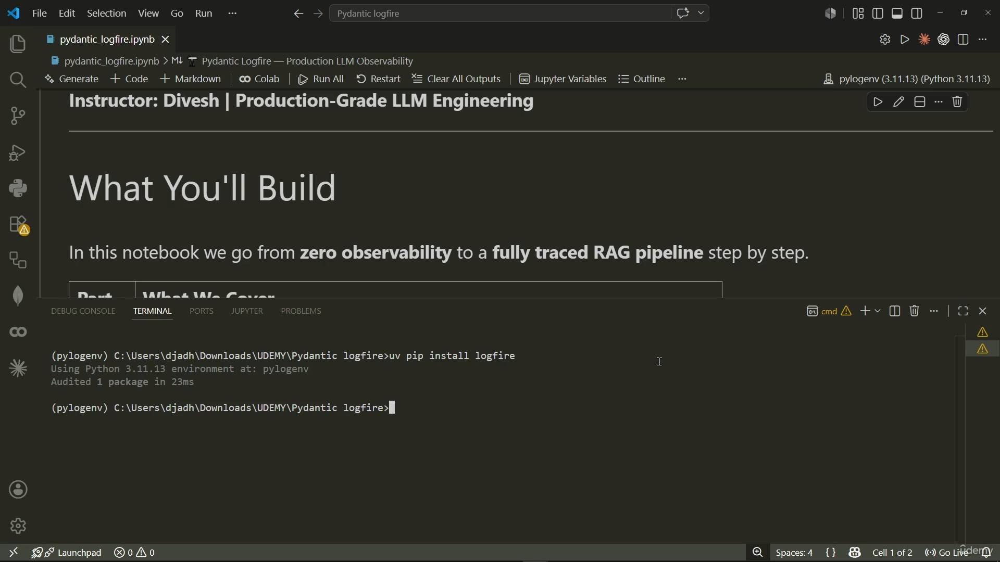

> 注意老师的红线：**不要**去 Logfire 后台自己 Create API Key，要用 `logfire projects use` 生成的这个 token。原因很实际——后台手建的 key 和你本地 `.logfire` 里的项目上下文不一致，后面 `configure()` 容易串项目。

### Step 2：拿 Groq / Gemini / Tavily 三个 key

- **Groq**：去 Groq Cloud，`Create new API key`，名字叫 `Udemy`，复制。Groq 提供很多家模型（课里提到 Alibaba 的 reasoning model、Meta 的、Compound 的），可以在 Playground 里试。
- **Gemini**：搜 `gemini api key` → Google AI Studio → `Get API key` → `Create new API key`，名字 `Udemy`，复制。
- **Tavily**：搜 `tavily api key` → 控制台 → `API Keys` → `Create new API key`，名字 `Udemy`，复制。

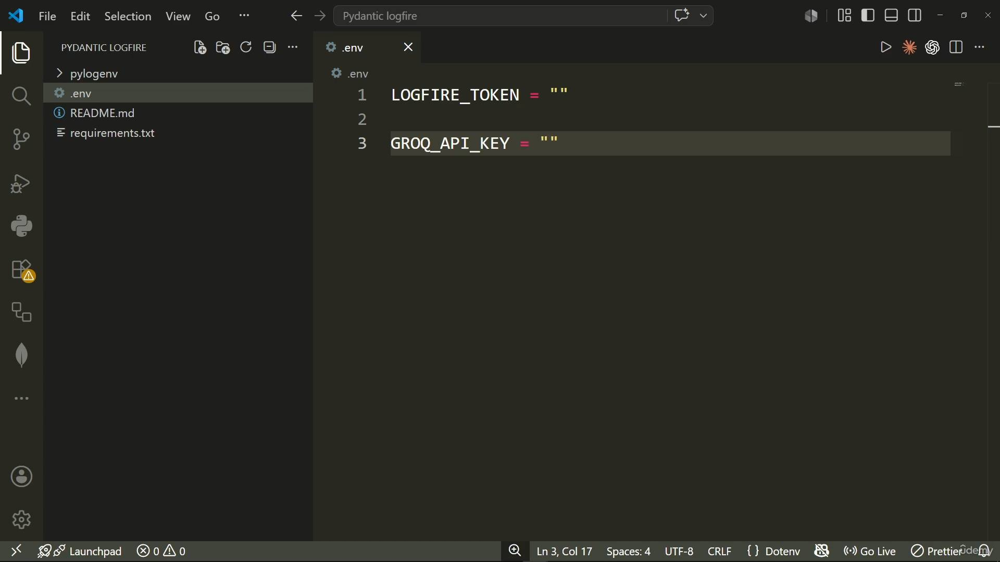

Tavily 这个 key 在本段三页里**没有被任何代码使用**——课里说是为后面的 web search 功能准备的。照抄 `.env` 即可，留着不报错。

### Step 3：写 `.env`

目录结构长这样（后面所有文件路径都以此为准）：

```
logfire-bootcamp/
├── .env
├── .env.example
├── requirements.txt
├── documents.json
├── exp1_logging.py
├── exp2_structured.py
├── exp3_instrumentation.py
└── exp4_rag.py
```

`.env` 里四个变量名必须和代码里 `os.getenv()` 的字符串完全一致，大小写敏感。

### Step 4：装依赖

```bash
uv pip install -r requirements.txt
```

### Step 5：跑 exp1，确认日志与 span 都上去了

```bash
python exp1_logging.py
```

终端会打出 `missing: none`。然后回 Logfire 项目页，**Live** 或 **Dashboard** 里应该出现 `notebook started` 这条日志；点开能看到 `part`、`part_name`、`instructor`、`tool` 四个字段。再点 `data processing simulation`，能看到瀑布图里有 3 个子 step。

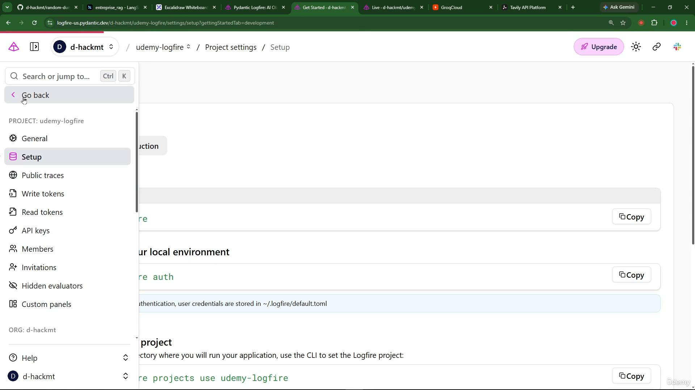

### Step 6：跑 exp2，确认 pydantic 字段变成可过滤列

```bash
python exp2_structured.py
```

Logfire 里点开 `LLM call` span：顶部有 `user_id`、`session_id`、`model` 三个你手传进 span 的属性；往下有 `Request received` 和 `Response sent` 两条日志，它们的 payload 是 `model_dump()` 出来的完整 JSON。

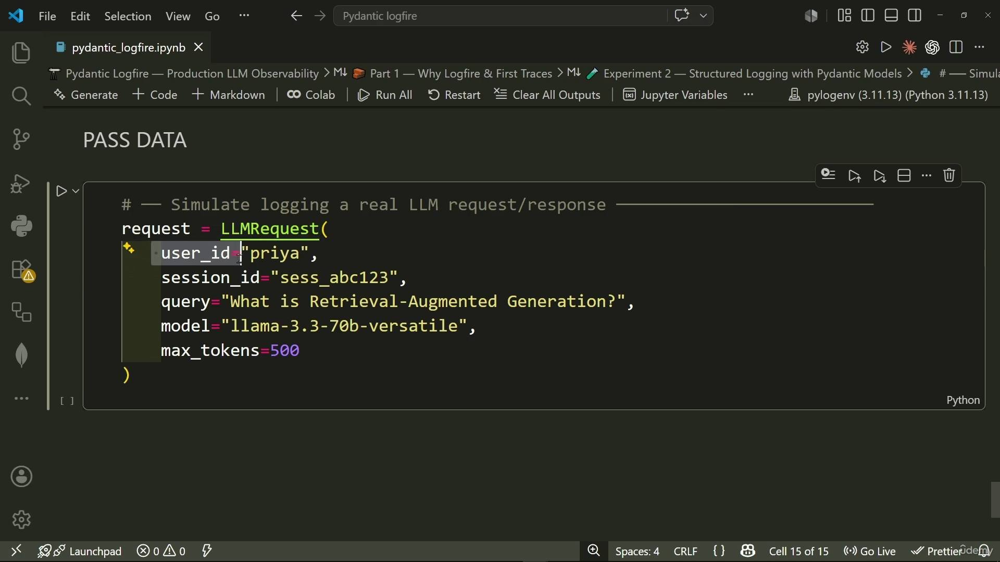

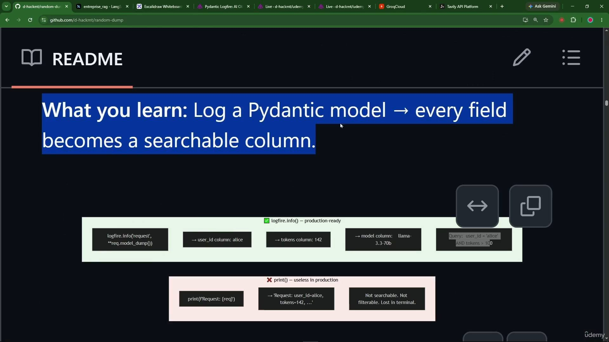

### Step 7：跑 exp3，确认自动 instrumentation 生效

```bash
python exp3_instrumentation.py
```

先只跑 Groq 那一段（把下面代码里 `main()` 的对比部分注释掉也行），确认 Logfire 里出现 `Chat completion with <model>` 这样的 span，里面有 token 数、耗时、cost（Groq 免费模型显示 unknown）。

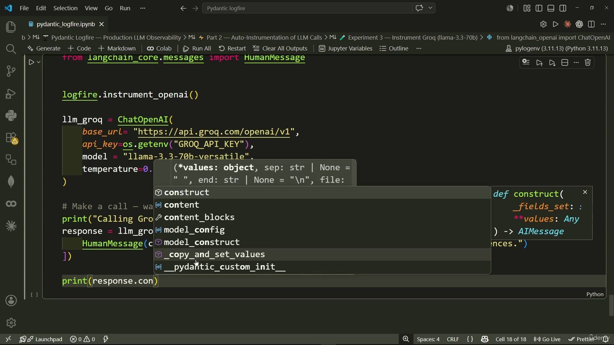

再放开 Gemini 与 `model comparison` 部分，重跑一次，确认出现一条 `model comparison` trace，里面 `groq call` 和 `gemini call` 两个 span 上下并排。

### Step 8：跑 exp4，把 RAG 整条链路追出来

```bash
python exp4_rag.py
```

终端里会打出回答，Logfire 里会出现 `rag pipeline` trace。点进去要能确认三件事：

1. `docs retrieved` 这条日志里带着检索到的 context。
2. context 里命中的是 `documents.json` 里的第 1 篇和第 2 篇（两篇都含 RAG 相关内容）。
3. `Chat completion` 子 span 里有 input/output token 数。

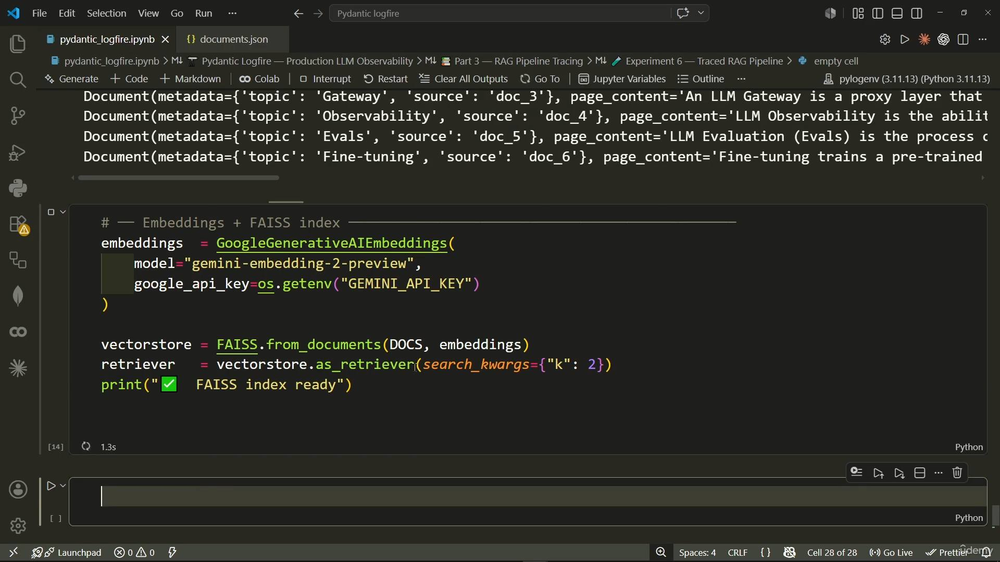

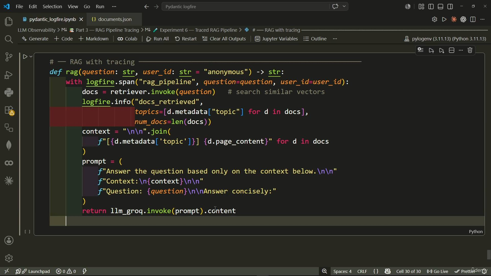

这就是老师说的「输出只告诉你结果，trace 告诉你过程」。

### Step 9（可选）：用 Jupyter Notebook 跑同样的东西

老师在 P35 是在 VS Code 的 notebook 里写的，文件叫 `pydantic_logfire.ipynb`。要用 notebook：

```bash
uv pip install ipykernel
python -m ipykernel install --user --name logfire-bootcamp
```

然后在 VS Code 右上角选这个 kernel。老师说他也遇到过一次「没有自动补全、不是绿色」的情况，重启 notebook 窗口、重新选 kernel 就好了。本文的 `.py` 版本和 notebook 版本内容等价，跑 `.py` 更省事。

## 4. 完整代码

以下文件全部可直接保存运行。

### 4.1 `.env.example`

```dotenv
# 复制成 .env 后填入真实值
# 1) Logfire：必须来自 `logfire projects use <project-id>` 生成的 ~/.logfire 里的 token
LOGFIRE_TOKEN=pylf_v1_xxxxxxxxxxxxxxxxxxxxxxxxxxxxxxxx
# 2) Groq：https://console.groq.com -> API Keys
GROQ_API_KEY=gsk_xxxxxxxxxxxxxxxxxxxxxxxxxxxx
# 3) Gemini：https://aistudio.google.com/apikey
GEMINI_API_KEY=AIzaSyxxxxxxxxxxxxxxxxxxxxxxxxxxxx
# 4) Tavily：本段课程代码未使用，为后续 web search 预留
TAVILY_API_KEY=tvly-xxxxxxxxxxxxxxxxxxxxxxxxxxxx
```

### 4.2 `requirements.txt`

```text
# 课里没有念版本号，以下是本文档写作时可跑通的参考版本；
# 若安装失败，去掉版本号装最新版即可
logfire==3.14.0
logfire[openai]==3.14.0
pydantic==2.11.0
python-dotenv==1.0.1
langchain-core==0.3.72
langchain-openai==0.3.28
langchain-community==0.3.27
langchain-google-genai==2.1.5
faiss-cpu==1.11.0
```

### 4.3 `documents.json`

课里只说了这份 JSON 的**结构**是 `topic` / `source` / `content` 三个字段，屏幕上显示有 3 篇文档，内容是 RAG 相关、其中包含「RAG 结合检索增强」和「hallucination」的描述。**课里没有逐字念出文件全文**，下面按这个结构给出等价示意数据，你可以原样使用：

```json
[
  {
    "topic": "RAG",
    "source": "document_1",
    "content": "RAG (Retrieval Augmented Generation) combines retrieval augmentation with generation. Instead of relying only on the model's parameters, RAG first retrieves relevant chunks from an external knowledge base and then passes them to the LLM as context. This grounding reduces hallucination because the answer is anchored to retrieved documents rather than to the model's memory."
  },
  {
    "topic": "RAG",
    "source": "document_2",
    "content": "Hallucination happens when a language model produces fluent text that is not supported by evidence. RAG reduces hallucination by supplying explicit evidence at inference time. If the retrieved context does not contain the answer, a well designed RAG pipeline should say it does not know instead of inventing an answer."
  },
  {
    "topic": "Fine tuning",
    "source": "document_3",
    "content": "Fine tuning changes the weights of a model using your own labelled examples. It is good for style, format and domain vocabulary, but it does not give the model fresh knowledge and it does not provide citations. Fine tuning and RAG are complementary: fine tuning shapes behaviour, RAG supplies facts."
  }
]
```

### 4.4 `exp1_logging.py`

对应 P35 的「experimentation one」：先检查环境变量，再 `configure`，然后 `info` 一条日志，最后用 `span` 造一个 trace。

```python
"""
exp1_logging.py
对应课程 P35：Logfire 配置 + 基础日志(info) + 手工 span/trace
运行：python exp1_logging.py
"""

import os
import time
import warnings

# 老师说：先屏蔽掉各种 warning，免得刷屏干扰观察
warnings.filterwarnings("ignore")

import logfire
from dotenv import load_dotenv

# 加载 .env 里的环境变量
load_dotenv()

REQUIRED_KEYS = [
    "LOGFIRE_TOKEN",
    "GROQ_API_KEY",
    "GEMINI_API_KEY",
    "TAVILY_API_KEY",
]

missing = [key for key in REQUIRED_KEYS if not os.getenv(key)]
print("missing:", missing if missing else "none")

# configure 就是「把本进程接到 Logfire 上」：传 token + 给这批数据打一个 service 标签
logfire.configure(
    token=os.getenv("LOGFIRE_TOKEN"),
    service_name="LLM observability course",
)


def log_basics() -> None:
    """一条普通 info 日志 + 手写的 metadata。"""
    # 现在这里的 tool/instructor 是手写的，后面会被真实的 AI agent、真实工具名替换
    logfire.info(
        "notebook started",
        part=1,
        part_name="basics",
        instructor="Priya",
        tool="Pydantic Logfire",
    )


def simulate_data_processing() -> None:
    """用一个 span 把三步应用执行包成一条 trace。"""
    # span 的第一个参数是这条 span 的名字，后面的是结构化属性
    with logfire.span("data processing simulation", dataset="LLM course", rows=1000):
        logfire.info("step started", step=1, action="loading data")
        time.sleep(0.1)

        logfire.info("step started", step=2, action="transforming")
        time.sleep(0.1)

        logfire.info("step started", step=3, action="saving results")


if __name__ == "__main__":
    log_basics()
    simulate_data_processing()
    # force_flush 保证短脚本退出前把数据推上去，避免进程结束太快丢日志
    logfire.force_flush()
    print("done: check your logfire project")
```

### 4.5 `exp2_structured.py`

对应 P36 前半段：pydantic 模型 + 结构化日志 + 手工 span。

```python
"""
exp2_structured.py
对应课程 P36 前半：structured logging with pydantic models
运行：python exp2_structured.py
"""

import os
import time
import uuid
import warnings

warnings.filterwarnings("ignore")

import logfire
from dotenv import load_dotenv
from pydantic import BaseModel, Field
from typing import Optional

load_dotenv()

logfire.configure(
    token=os.getenv("LOGFIRE_TOKEN"),
    service_name="LLM observability course",
)


class LLMRequest(BaseModel):
    """一次 LLM 请求进来时携带的字段，用于保证数据流结构一致。"""

    user_id: str
    session_id: str
    query: str
    model: str
    temperature: float = 0.3
    max_tokens: Optional[int] = None


class LLMResponse(BaseModel):
    """一次 LLM 响应出去时携带的字段。"""

    answer: str
    input_tokens: int
    output_tokens: int
    latency_ms: float
    model: str


def fake_llm_answer(query: str) -> str:
    """课里这一段是纯 mock，没有真正调用任何模型。"""
    return (
        "RAG is a technique that retrieves relevant documents and puts them into "
        f"the prompt before generation. (mock answer for: {query})"
    )


def handle_request(request: LLMRequest) -> LLMResponse:
    """把一次「请求 -> 响应」包进一个 span，请求和响应各记一条结构化日志。"""

    # span 属性：这些会显示在 trace 顶部，方便直接筛选
    with logfire.span(
        "LLM call",
        user_id=request.user_id,
        session_id=request.session_id,
        model=request.model,
    ):
        # 注意：model_dump() 把 pydantic 对象变成 dict，每个字段都会成为可搜索列
        logfire.info("Request received", request=request.model_dump())

        started = time.perf_counter()
        time.sleep(0.1)  # 模拟网络/推理耗时

        answer = fake_llm_answer(request.query)
        latency_ms = (time.perf_counter() - started) * 1000

        # 课里强调：input/output tokens、latency 这些以后由 provider / instrumentation 自动给
        response = LLMResponse(
            answer=answer,
            input_tokens=42,
            output_tokens=88,
            latency_ms=round(latency_ms, 2),
            model=request.model,
        )

        logfire.info("Response sent", response=response.model_dump())
        return response


def main() -> None:
    request = LLMRequest(
        user_id="priya",
        session_id=str(uuid.uuid4()),
        query="what is rag",
        model="llama-3.3-70b-versatile",
        temperature=0.3,
        max_tokens=512,
    )

    response = handle_request(request)
    print(response.answer)


if __name__ == "__main__":
    main()
    logfire.force_flush()
```

### 4.6 `exp3_instrumentation.py`

对应 P36 后半段：`instrument_openai` + 用 `ChatOpenAI` 指向 Groq / Gemini + 双模型对比 trace。

```python
"""
exp3_instrumentation.py
对应课程 P36 后半：auto instrumentation，Groq 与 Gemini 对比
运行：python exp3_instrumentation.py

关键点（讲师原话）：ChatGroq 把 URL 写死，ChatOpenAI 可以换 base_url 打任何兼容 API。
"""

import os
import time
import warnings

warnings.filterwarnings("ignore")

import logfire
from dotenv import load_dotenv
from langchain_core.messages import HumanMessage
from langchain_openai import ChatOpenAI

load_dotenv()

logfire.configure(
    token=os.getenv("LOGFIRE_TOKEN"),
    service_name="LLM observability course",
)

# 一行开启自动埋点：之后所有走 openai SDK 形状的调用都会被自动记录
logfire.instrument_openai()

# 课里没念出具体的 model id，只说是从 Groq Playground 里拿的 llama 模型；
# 下面这个请替换成你 Playground 里当前可用的模型名
GROQ_MODEL = "llama-3.3-70b-versatile"
GEMINI_MODEL = "gemini-2.5-flash-lite"

groq_llm = ChatOpenAI(
    base_url="https://api.groq.com/openai/v1",
    api_key=os.getenv("GROQ_API_KEY"),
    model=GROQ_MODEL,
    temperature=0.3,
)

gemini_llm = ChatOpenAI(
    base_url="https://generativelanguage.googleapis.com/v1beta/openai/",
    api_key=os.getenv("GEMINI_API_KEY"),
    model=GEMINI_MODEL,
    temperature=0.3,
)


def single_groq_call() -> str:
    print("calling groq...")
    resp = groq_llm.invoke(
        "Explain what is an observability span in exactly two sentences."
    )
    print(resp.content)
    return resp.content


def single_gemini_call() -> str:
    print("calling gemini...")
    resp = gemini_llm.invoke(
        "What is a trace in two sentences?"
    )
    print(resp.content)
    return resp.content


def compare_models() -> None:
    """把两个 provider 的调用放进同一个 trace，做并排对比。"""
    query = "What is the difference between RAG and fine tuning? Give three bullet points."

    with logfire.span("model comparison", query=query, num_models=2):
        with logfire.span("groq call", model=GROQ_MODEL, provider="groq"):
            t0 = time.perf_counter()
            groq_answer = groq_llm.invoke([HumanMessage(content=query)]).content
            logfire.info("groq done", elapsed_s=round(time.perf_counter() - t0, 3))

        with logfire.span("gemini call", model=GEMINI_MODEL, provider="gemini"):
            t0 = time.perf_counter()
            gemini_answer = gemini_llm.invoke([HumanMessage(content=query)]).content
            logfire.info("gemini done", elapsed_s=round(time.perf_counter() - t0, 3))

    print("\n=== GROQ ===")
    print(groq_answer)
    print("\n=== GEMINI ===")
    print(gemini_answer)


if __name__ == "__main__":
    single_groq_call()
    single_gemini_call()
    compare_models()
    logfire.force_flush()
```

### 4.7 `exp4_rag.py`

对应 P37：数据摄入（JSON → Document → Gemini embeddings → FAISS）＋ 检索（query → vector → top-k → prompt → LLM），全程有 trace。

```python
"""
exp4_rag.py
对应课程 P37：traced RAG pipeline
运行：python exp4_rag.py

依赖 documents.json 与本文件同目录。
"""

import json
import os
import warnings
from pathlib import Path

warnings.filterwarnings("ignore")

import logfire
from dotenv import load_dotenv
from langchain_community.vectorstores import FAISS
from langchain_core.documents import Document
from langchain_google_genai import GoogleGenerativeAIEmbeddings
from langchain_openai import ChatOpenAI

load_dotenv()

logfire.configure(
    token=os.getenv("LOGFIRE_TOKEN"),
    service_name="LLM observability course",
)

# 生成侧：讲师用的是 Groq（走 OpenAI 兼容接口）
logfire.instrument_openai()

GROQ_MODEL = "llama-3.3-70b-versatile"

llm = ChatOpenAI(
    base_url="https://api.groq.com/openai/v1",
    api_key=os.getenv("GROQ_API_KEY"),
    model=GROQ_MODEL,
    temperature=0.3,
)

# 课里只说「pass the model name」，没念出具体 embedding 模型 id。
# 下面是 langchain-google-genai 常用的 embedding 模型，请以 Google 文档当前可用为准
EMBEDDING_MODEL = "models/text-embedding-004"

BASE_DIR = Path(__file__).resolve().parent
DOCS_PATH = BASE_DIR / "documents.json"


# ---------------------------------------------------------------- 数据摄入阶段
def ingest() -> FAISS:
    """JSON -> LangChain Document -> Gemini embeddings -> FAISS(内存)"""

    with logfire.span("data ingestion", source=str(DOCS_PATH)):
        with open(DOCS_PATH, "r", encoding="utf-8") as f:
            raw_docs = json.load(f)

        logfire.info("raw json loaded", num_docs=len(raw_docs))

        # LangChain 只认 Document(page_content=..., metadata=...)
        docs = [
            Document(
                page_content=item["content"],
                metadata={"topic": item["topic"], "source": item["source"]},
            )
            for item in raw_docs
        ]

        logfire.info("documents converted", num_docs=len(docs))

        embeddings = GoogleGenerativeAIEmbeddings(
            model=EMBEDDING_MODEL,
            google_api_key=os.getenv("GEMINI_API_KEY"),
        )

        vectorstore = FAISS.from_documents(docs, embeddings)
        logfire.info("vector store built", vector_count=len(docs))
        return vectorstore


# ---------------------------------------------------------------- 检索生成阶段
RAG_PROMPT = """Answer the question based on the context below.
Do not use your own brain. Only answer the question by taking the documents as the reference.
If the context does not contain the answer, say you don't know.

Context:
{context}

Question: {question}
"""


def rag(question: str, user_id: str = "anonymous", retriever=None) -> str:
    """完整检索生成链路，一条 trace 覆盖。

    :param question: 用户问题
    :param user_id: 用户标识，默认 anonymous
    :param retriever: 必须传入，由 main() 注入，避免重复建索引
    :return: LLM 答案
    """
    with logfire.span("rag pipeline", question=question, user_id=user_id):
        # 检索：在 FAISS 里找相似向量
        retrieved_docs = retriever.invoke(question)
        context = "\n\n---\n\n".join(
            f"[{d.metadata.get('source')}] {d.page_content}" for d in retrieved_docs
        )

        logfire.info(
            "docs retrieved",
            num_docs=len(retrieved_docs),
            sources=[d.metadata.get("source") for d in retrieved_docs],
            context=context,
        )

        prompt = RAG_PROMPT.format(context=context, question=question)
        logfire.info("prompt built", prompt=prompt)

        # 生成：这里 invoke 一次，Logfire 会自动记录 chat completion span
        response = llm.invoke(prompt)
        answer = response.content
        logfire.info("answer generated", answer=answer)
        return answer


def main() -> None:
    vectorstore = ingest()
    retriever = vectorstore.as_retriever(search_kwargs={"k": 2})

    answer = rag(
        "How does RAG reduce hallucination?",
        user_id="student_1",
        retriever=retriever,
    )

    print("\n=== ANSWER ===")
    print(answer)


if __name__ == "__main__":
    main()
    logfire.force_flush()
```

## 5. 逐行解释

### 5.1 为什么必须先 `logfire projects use`

`logfire auth` 只解决「这台机器有权往 Logfire 推数据」，它不解决「推到哪个项目」。`logfire projects use <project-id>` 才把当前目录和具体项目绑定，同时在 `~/.logfire` 落一份 credentials 与 token。老师反复强调「别去后台手建 key」，是因为后台手建的 key 没有项目上下文，你在 `configure()` 里塞进去虽然可能推上去，但项目归属容易对不上，排查问题时你会看到日志落在错的 project 里。

在 Node 里对应什么：这就像 `SENTRY_DSN` / `DD_API_KEY` 加上 `service` 名，只不过 Logfire 把「项目」这一层做成了 CLI 命令，还顺手写了个本地配置文件。

### 5.2 `warnings.filterwarnings("ignore")` 的位置

老师把 `import warnings` + `filterwarnings` 放在**最前面，在 `import logfire` 之前**。这不是随手一放：Python 里 warning 的过滤规则是全局生效的，越早设置，越能覆盖后续 import 阶段（比如某些库 import 时就 deprecation warning）的噪音。你放到文件末尾就等于没设。

### 5.3 环境变量检查写成列表推导

```python
missing = [key for key in REQUIRED_KEYS if not os.getenv(key)]
```

老师的做法是逐个 print，本质是同一个目的：**在进入实验之前先确认 4 个 key 都在**。写成列表推导的好处是缺了哪个一眼看到、脚本里能直接早退。Tavily 的 key 本段虽然用不到，但仍然检查——因为它属于本项目 README 要求填的环境变量清单，早晚要用。

### 5.4 `logfire.configure()` 的参数为什么这样传

老师演示了两个层次：

1. 先只写 `logfire.configure()`，什么也不传——这时它靠 `~/.logfire` 里的本地凭证工作，能跑。
2. 再改成 `logfire.configure(token=os.getenv("LOGFIRE_TOKEN"), service_name="LLM observability course")`——显式传 token，并给数据打一个 `service_name` 标签。

为什么要显式传？因为你可能把代码放到 CI、容器、别人的机器上，那里没有 `~/.logfire`。`service_name` 的作用是：同一条 trace 里所有 span 都会带上这个 service 标签，讲师说「we can particularly tag that service」，也就是后面你可以在 Logfire 里按 service 过滤。

### 5.5 `logfire.info` 的第二个参数开始全是结构化属性

```python
logfire.info("notebook started", part=1, part_name="basics", instructor="Priya", tool="Pydantic Logfire")
```

第一个位置参数是 message，后面所有关键字参数都变成这条日志的**结构化属性**。老师特意解释了为什么不直接用 f-string 拼一句话：因为拼进去的字符串不可搜索、没有时间戳、就是一堆「terminal noise」。而作为属性的 `part=1`、`tool="Pydantic Logfire"` 在 Logfire 里是可点击、可过滤的列。他还点出了这个设计的延伸方向：以后 `tool` 会变成真实工具名（web search tool）、`instructor` 会变成 AI agent、`part` 会变成具体正在执行的应用/功能。

### 5.6 `with logfire.span(...)` 到底改变了什么

```python
with logfire.span("data processing simulation", dataset="LLM course", rows=1000):
    logfire.info("step started", step=1, action="loading data")
    ...
```

- `span` 是**上下文管理器**，`with` 块开始时 span 开始，结束时 span 结束，自动记录时长。
- 块内所有日志都会挂到这个 span 下面，形成父子关系。
- 块内再嵌套 `with logfire.span(...)` 就形成树，一棵树就是一个 trace。
- 第二个参数起的 `dataset="LLM course", rows=1000` 是 span 属性，显示在 trace 详情顶部。

老师的原话对照：「info 就是一句 print，span 会帮我们搭出一棵树」。他还强调这个例子根本没碰 LLM，就是普通应用执行——意思是这套埋点你可以用在任何 Python 代码上，不限于 AI。

在 Node 里对应什么：`with` 块 ≈ 在 Node 里用 `AsyncLocalStorage` + `tracer.startActiveSpan(name, async (span) => { ... span.end() })`。手写 `span.end()`、忘了关是常见 bug，Python 的 `with` 帮你自动关，这一点比手写 JS 省心。

### 5.7 为什么 `warnings.filterwarnings` 加 `time.sleep` 加 `force_flush` 三件套

`force_flush()` 是短脚本的救命稻草。Logfire SDK 是**批量异步上报**的，脚本跑完立刻退出，缓冲区可能还没发出去，你就会遇到「代码明明跑成功、后台什么也没有」。老师用 notebook 时没这个问题（进程一直活着），但你写成 `.py` 就必须 flush。

### 5.8 pydantic 模型：为什么字段要这么切

`LLMRequest` 的 6 个字段对应一次请求进来时会出现的全部信息：

| 字段 | 讲师解释的场景 |
| --- | --- |
| `user_id` | 谁在问 |
| `session_id` | 哪一轮会话 |
| `query` | 问了什么 |
| `model` | 用哪个模型 |
| `temperature` | 「创造力的水平」 |
| `max_tokens` | 输出上限 |

`LLMResponse` 的 5 个字段
<table>
<thead><tr><th>字段</th><th>讲师解释的场景</th></tr></thead>
<tbody>
<tr><td><code>answer</code></td><td>模型返回的正文</td></tr>
<tr><td><code>input_tokens</code></td><td>输入消耗的 token 数</td></tr>
<tr><td><code>output_tokens</code></td><td>输出消耗的 token 数</td></tr>
<tr><td><code>latency_ms</code></td><td>这次调用花了多久</td></tr>
<tr><td><code>model</code></td><td>实际用的模型</td></tr>
</tbody>
</table>

老师特别点明：这五个东西「默认是由我们的大语言模型 provider 帮我们算出来的」，我们现在手写 mock 只是学习阶段。等你走到 exp3 的 `instrument_openai()`，这几个数字就由 instrumentation 自动采集，你一行都不用写。

还有一句很关键的判断，不要漏掉：

> "这些模型对我们的 AI agent 非常重要，它能让数据保持一致的结构。我们现在做的是 mock 数据，不是真实数据，但这是我们的起步理解。"
> —— p036 [01:25]

这句话的工程含义是：LLM 的输出是自由文本，不可靠；但你的**请求对象和响应对象**可以先被 pydantic 约束成固定结构。所有下游的日志、评估、成本统计都建立在这个结构之上。在 Node 里对应什么：这就是 `zod` 的 `z.object({...}).parse(...)`，或者 TypeScript 的 `interface` + 运行时校验。区别是 pydantic 校验失败会抛 `ValidationError`，zod 是 `safeParse` 返回 `{ success: false }`，要不要抛由你决定。

### 5.9 `model_dump()` 为什么必须调

```python
logfire.info("Request received", request=request.model_dump())
```

如果你直接写 `request=request`，把一个 pydantic 对象原样塞给 Logfire，会出现两种情况：要么序列化器认不出这个类型、把它降级成字符串（那你就失去了字段级可搜索性），要么在某些版本直接报序列化错误。`model_dump()` 把它转成纯 `dict`，Logfire 就能把 `user_id`、`session_id`、`query`、`model`、`temperature`、`max_tokens` 全部展开成结构化字段。

老师原话是「this will help us to dump the entire results in this info」——dump 出来的是整个对象，不是一个摘要。这是它比手写 `logfire.info("request received", user_id=..., query=...)` 强的地方：加字段不用改日志代码。

### 5.10 span 属性和日志属性为什么要重复一遍

你会注意到 `user_id` / `session_id` / `model` 在 span 上传了一次，在 `Request received` 日志里又通过 `model_dump()` 传了一次。这不是冗余写错，两者用途不同：

- **span 属性**：显示在 trace 列表和瀑布图的顶栏，用来**在列表层面筛选**（比如「只看 user_id=priya 的调用」）。
- **日志属性**：展开后才看到，用来**看这次调用的完整 payload**。

老师的原话也承认这层设计是「不是硬性规定，是我们自己定的」：

> "这些我们传进去的东西不是硬性规定，是我们自己这样设置的。"
> —— p036 [03:51]

所以他明确说了 `user_id` 也可以叫 `user`、`model` 也可以叫 `model_used`，「什么都不会变，因为这是我配置的」。命名权在你手里，但一旦定了就要在整条链路上保持一致，否则后面做看板、做告警时字段对不上。

### 5.11 `time.sleep(0.1)` 是干什么的

课里在两个地方都插了 `time.sleep`：exp1 里模拟三步处理，exp2 里模拟推理耗时。它的作用只有一个——**让瀑布图上的 span 有宽度**。如果全部瞬间返回，你在 Logfire 里看到的是一堆零宽的竖线，看不出谁先谁后、谁套着谁。真实调用里这个宽度来自网络和推理时间，不需要你加。

对应到 JS/Node：`await new Promise(r => setTimeout(r, 100))`。**千万不要**在真实生产代码里为了「让 trace 好看」而加 sleep，那是纯浪费。

### 5.12 `instrument_openai()` 这一行的代价和收益

```python
logfire.instrument_openai()
```

这一行做的事情是：给 OpenAI Python SDK 打 monkey patch，之后所有经过它的调用（`chat.completions.create` / LangChain 的 `ChatOpenAI.invoke`）都会自动产出 span，里面包含模型名、输入消息、输出消息、token 数、耗时、cost。

收益，老师的原话最直白：

> "我们用了 `instrument_openai`，意思是：之前我们要手动配置、手动硬编码的那些 request、response、内部传了什么，这一次全部自动被记录。"
> —— p036 [13:48]

代价：

1. 它会记录**完整 prompt 和完整输出**。老师在 trace 里明确说「raw data，所有细节都在这里」。如果你的 prompt 里有用户隐私、密钥、内部业务数据，这些都会原样上传到 Logfire。上线前必须想清楚，要么脱敏，要么用 Logfire 的敏感字段策略（课里没讲具体配置）。
2. monkey patch 是全局的，只要这一行执行过，本进程后续所有 OpenAI 形状的调用都会被记录。想只记一部分，就得控制这行的调用时机。
3. 它认的是「OpenAI SDK 形状」，不认具体厂商。这正是老师选它的原因——Groq 和 Gemini 都能吃。

### 5.13 `base_url` 那一行是整段最值得抄走的技巧

```python
groq_llm = ChatOpenAI(
    base_url="https://api.groq.com/openai/v1",
    api_key=os.getenv("GROQ_API_KEY"),
    model=GROQ_MODEL,
    temperature=0.3,
)
```

老师的推理链拆开是三步：

1. **为什么不用 `ChatGroq`**：`ChatGroq` 内部把 URL 写死成 Groq 的地址，「是硬的，我们不能改」。
2. **为什么 `ChatOpenAI` 能打 Groq**：Groq 对外暴露的 REST 接口和 OpenAI 是**同一套形状**，「请求和响应模型是相似的」，所以只要换 `base_url`，请求就能打到 Groq。
3. **为什么这很重要**：同一行代码换个 `base_url` 就能打 Gemini。于是你能**用同一套调用代码横向对比两个 provider**，这才有 P36 最后那个 `model comparison` trace。

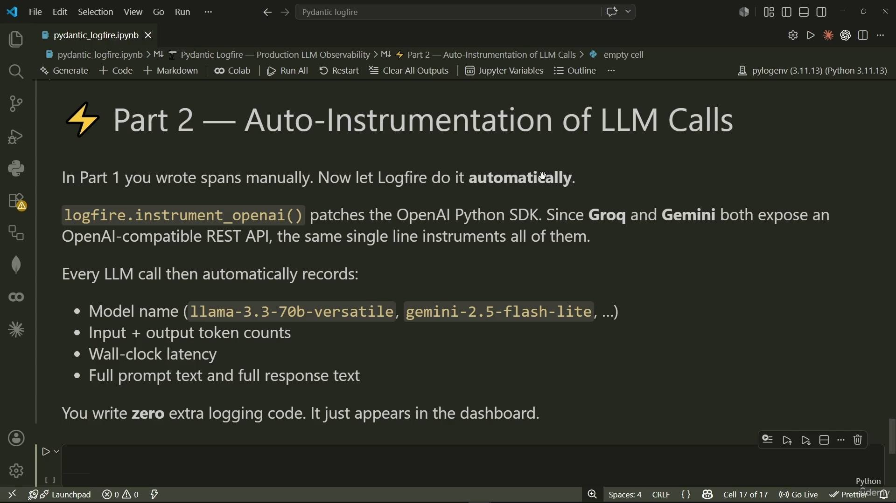

`temperature=0.3` 老师解释了两次，一次在 Groq、一次在 Gemini，都是同一句：「创造性水平」。0 最死板、1 最发散。做对比实验时两个模型必须用**相同的 temperature**，否则你分不清差异来自模型还是来自随机性。

`model` 这个参数从哪来，老师专门停下来回答过这个疑问：

> "大家如果困惑我从哪拿到模型名的？你看，我在 Groq Cloud 上，这里就是所有模型名。如果我要 Gemini 模型，Gemini 模型一直在更新，所以 Gemini 当前有哪些模型，一次 Google 搜索就知道了。"
> —— p036 [14:41]–[15:11]

他还现场说了 Gemini 的模型列表里能看到 `3.5 flash`、`3.1 flash lite`、`flash image`，而他用的是 `gemini 2.5 flash lite`，并强调「这是模型 ID，这就是我们要用的」。**注意**：模型 ID 会随厂商更新失效，你若跑不通，第一件事就是去 Playground / 官方文档确认当前可用的 model id，换掉代码里那两个常量。

### 5.14 `model comparison` 为什么用双层 with 嵌套

```python
with logfire.span("model comparison", query=query, num_models=2):
    with logfire.span("groq call", ...):
        ...
    with logfire.span("gemini call", ...):
        ...
```

外层 span 是这条 trace 的根，带 `query` 和 `num_models=2` 两个属性；内层是两个平级的子 span，分别代表一次 provider 调用。于是瀑布图上你能**在同一行时间轴上左右对比两个模型谁快谁慢**。这就是老师说的：

> "我们会看到一条非常漂亮的 trace，model comparison，我们把这个 query、模型数量传进 span，然后就能看到 trace。看，Groq call、chat completions、Groq done，我们就这样把它们并排看到了。"
> —— p036 [18:31]–[18:57]

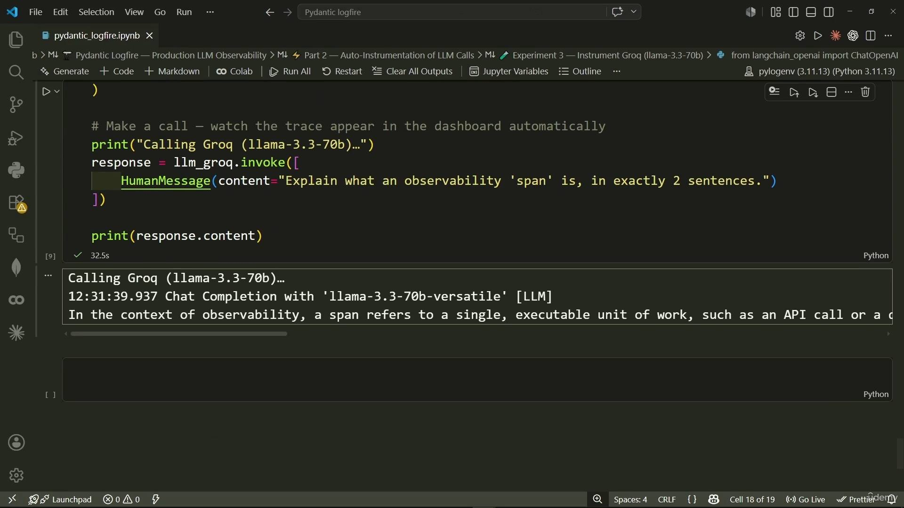

两个内层 span 之所以是**平级**而不是嵌套，是因为它们互不依赖、可以并发（课里写成了顺序执行，你要改成 `asyncio.gather` 也可以，span 关系不变）。如果你把 gemini 的 with 写在 groq 的 with 里面，瀑布图就会变成父子关系，那是错误的语义——会让读图的人以为 Gemini 是 Groq 的子步骤。**span 的嵌套结构必须反映真实的调用依赖关系**，这是这套工具唯一需要你动脑的地方。

关于 cost 为什么是 unknown：

> "成本是 unknown，因为你知道的，Groq 是免费的。LLM 被使用了，用的是 OpenAI instrumentation，所有细节我们都能看到。"
> —— p036 [14:16]–[14:41]

这也说明一件事：自动埋点能采到的字段取决于 provider 是否返回。免费额度下没有计费信息，cost 就是空。不要以为是埋点坏了。

### 5.15 RAG 数据摄入：三个转换步骤一个都不能省

`ingest()` 里做的事情，对应老师画的左半边流程图：

1. **`json.load`** — 读原始 JSON。老师强调过这份数据「就是简单的 JSON 文件，有 topic、source、content 三个字段」。
2. **`Document(page_content=..., metadata=...)`** — 这一步是**必须**的，理由老师说得很明确：「LangChain 或 LangGraph 内部只和 Document 对象交互」。你不转，后面 `FAISS.from_documents` 直接拒收。注意字段映射：JSON 的 `content` 进 `page_content`，`topic` 和 `source` 进 `metadata`。
3. **`GoogleGenerativeAIEmbeddings` + `FAISS.from_documents`** — 文本变向量，存进向量库。老师原话：「我们把它传给 Gemini API 处理 embedding，然后为存储传给 FAISS vector store，它会存在内存里。」

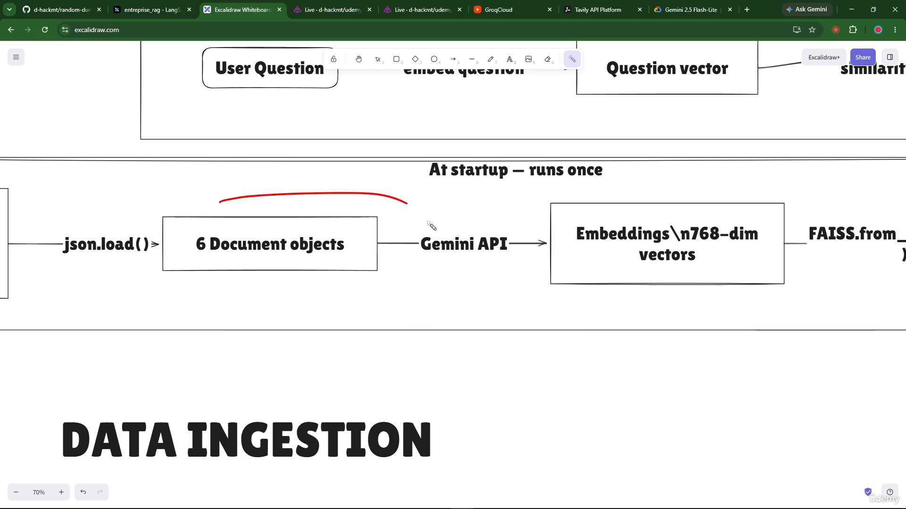

关于 embedding 模型的 id，课里只说「我们会传模型名，这是访问 embedding 模型所必需的」，**没有念出具体是哪个 embedding 模型**。我上面代码里写的 `models/text-embedding-004` 是 langchain-google-genai 生态里的常见选择，**请以 Google 官方文档当前可用为准**，这条属于「课里没讲、你必须自己确认」的内容，我在第 7 节再强调一次。

「存在内存里」这句话很重要：FAISS 的索引在进程内存中，脚本一退出就没了。所以 `exp4_rag.py` 必须每次先 `ingest()` 再 `rag()`，不能像真项目那样「先建索引跑一次、再另起进程查询」。老师自己在代码里就是这么串起来的（`main()` 里先 `vectorstore = ingest()`，再把 `retriever` 传进 `rag()`）。真项目要持久化，得写 `vectorstore.save_local(...)` / `load_local(...)`——**课里没讲这两个方法**。

### 5.16 `as_retriever(search_kwargs={"k": 2})` 的 k 是怎么定的

老师没直接说 `k=2`，但结果对得上：他在 trace 里看到「第一份文档被传进去了，第二份也被检索到了，因为第二份也包含 RAG」。所以 `k=2` 是能复现他那个 trace 的最小值。`k` 的意思是「取最相似的 k 个 chunk」。取多了 prompt 变长、token 变贵、还容易引入噪音；取少了可能漏掉答案。这是 RAG 里最常调的旋钮之一，**课里没有讨论 k 的取值策略**，只演示了 2。

### 5.17 为什么 `retriever` 要从外面传进来，而不是在 `rag()` 里建

这是我这份实现和老师 notebook 写法的一个必要差异，必须说明白。老师的 notebook 是**按单元格顺序执行**的：前面的 cell 建好 `vectorstore` / `retriever`，后面的 cell 里的 `rag()` 直接在同一个内核里引用它。这在 notebook 里天经地义，但搬到 `.py` 文件里就断了——函数作用域里拿不到别的 cell 的变量。

所以我把 `retriever` 做成参数注入。这不是改设计，而是**同一个设计的可执行版本**：`rag()` 依然负责「检索 → 拼 prompt → 生成」这一整条链路，一条 trace 覆盖，和老师讲的完全一致。顺带还有个好处：`retriever` 只建一次，多次提问不用重复 embedding，省钱也省时间。

`user_id: str = "anonymous"` 这个默认值是老师明确要求的：

> "我们定义一个 `rag`，它接收 question、user_id，类型是 string，默认是 anonymous，意思是默认情况下我们把它当成匿名用户。"
> —— p037 [09:03]

然后他在调用时又演示了覆盖：

> "当我看哪个 chunk 被检索到时，我可以说 user_id 是 student one。原本是 anonymous，但我们也可以传一个学生 ID。"
> —— p037 [10:53]

这就是结构化日志的价值：同一个函数，匿名用户和登录用户走的是同一套代码，但 trace 里能区分开。

### 5.18 `docs retrieved` 这条日志为什么把 context 整个打进去

```python
logfire.info(
    "docs retrieved",
    num_docs=len(retrieved_docs),
    sources=[...],
    context=context,
)
```

老师在这一段的用意，是他关于可观测性最核心的那段论述：

> "光看输出，我们不知道后端到底发生了什么，不知道用了多少 input token，不知道它究竟是怎么跑出来的，我们只看到了一个执行结果。但我们内部想知道更多：哪个工具被调用了？回答真的用了我们的文档，还是 RAG 就那么随口答的？这些全都在 trace 里。"
> —— p037 [11:46]–[12:15]

「回答真的用了我的文档吗」这个问题，唯一的验证方式就是**把检索到的原文打出来看**。所以 `context` 必须记录。老师在 trace 里就是这么验的：

> "看这个 context，我们的 RAG 拿到了这段 context。第一份文档被传进去了，第二份也被检索到了，因为它也包含 RAG，所以它被搜出来了。"
> —— p037 [12:43]

`sources` 单独列出来的作用是让你**不展开长文本**就能一眼看出命中了哪几篇，适合放在 trace 顶栏做筛选。

### 5.19 RAG prompt 里那句「别自己动脑」

```python
RAG_PROMPT = """Answer the question based on the context below.
Do not use your own brain. Only answer the question by taking the documents as the reference.
If the context does not contain the answer, say you don't know.
...
"""
```

老师原话：

> "我们内部会传一个提示：基于下面的上下文回答问题。别用你自己的脑子，只以这些文档为参考来回答问题。"
> —— p037 [10:02]

拆开看，这个 prompt 干了三件事：

1. **绑定上下文**：`based on the context below`。
2. **抑制参数化知识**：`Do not use your own brain` —— 这是降低幻觉的核心指令。模型知道的东西可能比你的文档新、也可能错，RAG 要的是「按我的资料答」。
3. **允许说不知道**：`If the context does not contain the answer, say you don't know`。这一句是我按老师「降低幻觉」的意图补的兜底，**课里没有念出这一句**，标注一下以免误记。没有这一句，模型在检索为空时会倾向于硬编一个答案，这恰恰是 RAG 最常见的翻车方式。

模板用 `{context}` / `{question}` 两个占位符，最后 `.format(...)` 填充。这里有个坑：如果你的文档正文里本身含有花括号 `{}`，`str.format` 会把它当占位符解析并抛 `KeyError`。稳妥做法是用 `string.Template` 或者把上下文用消息列表传进去。**课里没讲这个坑**，我在第 7 节列了。

### 5.20 `llm.invoke(prompt)` 和 P37 里那句「为什么我们不直接 invoke RAG」

老师在调用处说过一句容易被忽略的话：

> "为什么我们直接把问题给 RAG 而不 invoke 它？因为我们在里面已经 invoke 了，我们把 prompt、问题全都拼好了，我们的模型会 invoke 它。我们用的是 Groq 模型，它会 invoke。"
> —— p037 [11:19]

意思是：`rag()` 是一个**普通函数**，不是 LangChain 的 Runnable，所以不能 `.invoke()` 它；真正被 invoke 的是里面的 `llm`。别被「RAG 管道」这个词误导成必须继承某个基类。你这个函数可以被 FastAPI 路由直接调用、被脚本调用、被测试调用，没有任何框架约束。

另外注意 `llm.invoke(prompt)` 传的是**裸字符串**，不是 `HumanMessage` 列表。两种都行：裸字符串会被自动包成一条 human message。exp3 里显式用了 `[HumanMessage(content=query)]`，是因为要做多模型对比、需要更明确的控制。这个差异不影响 trace 结构。

### 5.21 一条 trace 里你能看到什么：对照表

跑完 `exp4_rag.py`，Logfire 里应该长成这样（字段名以你在界面上实际看到的为准）：

| 层级 | 节点 | 关键信息 |
| --- | --- | --- |
| 根 span | `data ingestion` | `source` 路径、`num_docs`、`vector_count` |
| 根 span | `rag pipeline` | `question`、`user_id` |
| ├ 日志 | `docs retrieved` | `num_docs`、`sources`、`context`（完整原文） |
| ├ 日志 | `prompt built` | 最终送给模型的完整 prompt |
| ├ 自动 span | `Chat completion ...` | 模型名、input/output token、耗时、raw messages |
| └ 日志 | `answer generated` | 最终答案 |

这张表就是「可观测性」在 RAG 上的全部意义：从用户看到的一句话，能一路倒查到「哪篇文档、哪段原文、哪个模型、花了多少 token」。

## 6. 复现检查清单

按顺序过，每一条都能独立验证。勾不上就停下修，别往下走。

**环境与凭证**

- [ ] `python -V` 输出 3.10 以上。
- [ ] `uv pip list | grep logfire` 能看到 `logfire`。
- [ ] `~/.logfire`（Windows：`C:\Users\<你>\.logfire`）文件夹存在，里面有 credentials 和 token。
- [ ] `logfire projects use <你的项目>` 执行过，且没有留下多个项目歧义。
- [ ] `.env` 里四个变量名**完全等于** `LOGFIRE_TOKEN` / `GROQ_API_KEY` / `GEMINI_API_KEY` / `TAVILY_API_KEY`（大小写敏感）。
- [ ] 你用的是 `~/.logfire` 里的 token，**不是**后台手建的 API key。
- [ ] `.env` 没有提交进 git（`.gitignore` 里加 `.env`）。

**exp1**

- [ ] `python exp1_logging.py` 终端打印 `missing: none`。
- [ ] Logfire 项目里出现 `notebook started`。
- [ ] 该条日志展开后能看到 `part`、`part_name`、`instructor`、`tool` 四个字段。
- [ ] `data processing simulation` 的瀑布图里有 3 个 step，且装饰用的 `dataset`、`rows` 在 span 属性里。
- [ ] 该 trace 的 service 标签是 `LLM observability course`。

**exp2**

- [ ] `python exp2_structured.py` 终端打印一段 mock 答案。
- [ ] Logfire 里有 `LLM call` span，顶栏能看到 `user_id=priya`、`session_id`、`model`。
- [ ] 里面有 `Request received` 和 `Response sent` 两条日志。
- [ ] 展开 `Request received`，能看到 `query`、`temperature`、`max_tokens` 等字段是**独立字段**，不是一整段字符串。
- [ ] 展开 `Response sent`，能看到 `input_tokens`、`output_tokens`、`latency_ms`。

**exp3**

- [ ] 终端先打印 `calling groq...`，再打出两句关于 observability span 的解释。
- [ ] Logfire 里出现 `Chat completion with ...` 的自动 span。
- [ ] 该 span 里有模型名、input/output token、耗时。
- [ ] cost 显示 unknown（免费额度下正常，不是坏了）。
- [ ] 点 `raw data` / messages 能看到完整 prompt 与输出。
- [ ] Gemini 那段跑通，没抛 key 相关异常（老师的说法：key 不可用会直接抛异常）。
- [ ] `model comparison` trace 里 `groq call` 和 `gemini call` 是**平级**两个 span，不是父子。
- [ ] 两个 span 上都带 `provider` 和 `model` 属性。

**exp4**

- [ ] `documents.json` 与本文件同目录，`json.load` 不报错。
- [ ] 终端打印 `=== ANSWER ===` 和一段关于 RAG 降低幻觉的回答。
- [ ] Logfire 里有 `data ingestion` span，`vector_count` 等于文档数。
- [ ] 有 `rag pipeline` span，`user_id=student_1`。
- [ ] `docs retrieved` 里 `num_docs` 是 2，`sources` 含两篇 RAG 相关文档。
- [ ] `context` 里确实是你的原文，不是空字符串。
- [ ] `prompt built` 里的 prompt 包含完整 context。
- [ ] 生成的答案**能对应到 context 里的内容**（不是模型自己编的）。
- [ ] 整条 trace 里 `Chat completion` 的 token 数与模型名都有。

**通用**

- [ ] 每个脚本结尾都调了 `logfire.force_flush()`（或进程常驻）。
- [ ] 换一台机器 / 进容器时，你检查过没有 `~/.logfire` 的情况下 `token=` 是否显式传了。

## 7. 课里没讲但你会撞上的

这一节全部是逐字稿没提、但照做大概率会卡住的地方。明确标注，不冒充课程内容。

1. **embedding 模型 id 课里没讲**。老师只说「我们会传模型名」，屏幕上也没念出具体名字。`models/text-embedding-004` 只是常见可选项，Google 侧模型下线/改名是常态。你遇到 `404 model not found`，就先去 Google 官方文档确认当前 embedding 模型 id，再改 `EMBEDDING_MODEL` 常量。这跟 exp3 里模型 id 会失效是同一类问题。

2. **`documents.json` 的全文课里没给**。老师只展示了 `topic` / `source` / `content` 三个字段的结构和 3 篇文档，没逐字念内容。本文第 4 节给的是同结构等价数据。你要严格复现他 trace 里「两篇都被命中」的现象，就让前两篇都含 RAG 与 hallucination 相关内容。

3. **FAISS 索引不持久化**。老师的原话是「它会存在内存里」。所以脚本每次跑都要重新 embedding 一遍，3 篇文档无所谓，几百篇就会明显变慢、也会重复消耗 Gemini 免费额度。真项目要用 `save_local` / `load_local`，**这两个方法课里没讲**。

4. **`str.format` 与文档里的花括号冲突**。`RAG_PROMPT.format(context=..., question=...)` 在 context 里含有 `{` 或 `}` 时会抛 `KeyError`。**课里没提这个坑**。修法：用 `string.Template` 的 `$context`，或者改用消息列表（`[SystemMessage(...), HumanMessage(...)]`），绕开格式化。

5. **`filterwarnings("ignore")` 会把有用的警告也吞掉**。老师是为了课堂清爽才这么干的。你在自己项目里排查问题时要把它注释掉，否则 pydantic 弃用警告、LangChain 弃用警告都会消失，升级依赖时才突然爆一堆错。

6. **instrumentation 上传完整 prompt = 上传隐私**。老师明确说 trace 里能看到「raw data、所有细节」，这是它的卖点，也是它的风险。真实业务里 prompt 可能含用户 PII、内部文档、密钥。**课里没讲脱敏策略**。上线前要么别开全局 `instrument_openai()`，要么在 Logfire 侧配置字段级处理。这一条在「AI Security」这类课里尤其值得单独确认，但本段逐字稿确实没有展开。

7. **多项目歧义**。老师现场就撞了一次：执行 `logfire projects use` 时被要求选项目，选错后报错，重选才对。你如果建过多个项目就会遇到。处理办法就是重跑这条命令、按编号选，选到对为止。

8. **VS Code / Jupyter 的 kernel 不是绿色、没有自动补全**。老师也撞了一次，他的处理是重启窗口再选 kernel。根因通常是没装 `ipykernel` 或选错了环境。用本文的 `.py` 版本可以完全绕开这类问题。

9. **短脚本丢日志**。这是 `.py` 版本特有的坑（notebook 不会遇到）。根因是 SDK 异步批量上报，进程先退了。解法就是脚本末尾 `logfire.force_flush()`。如果你还看到偶尔丢，可以在 `configure()` 里加 `send_to_logfire="if-token-present"` 之类的策略——**课里没讲这个参数**，属于你自查 SDK 文档的范围。

10. **`base_url` 末尾的斜杠**。写 `https://api.groq.com/openai/v1` 和写 `.../v1/` 在多数情况下都能work，但少数 SDK 版本拼路径时会出现 `//chat/completions`。**课里没讲这个细节**，遇到 404 先检查斜杠。

11. **Groq / Gemini 免费额度的限流**。两人都是免费 tier，连续快速跑对比实验可能撞 429。老师选免费 tier 的初衷是「让所有学生都负担得起」，但代价就是限流。遇到 429 就等一会儿再跑。

12. **本段没有护栏 / 网关 / 注入拦截的任何实现**。逐字稿里没有出现 guardrails、gateway、prompt injection 防护、内容审核、限流的代码或配置。P37 结尾老师说的是下一集做 ReAct agent 形式的 agentic RAG，**也没有说下一集讲护栏**。所以本文第 4 节里没有任何安全拦截代码——不是我省略了，是课里这三页确实没讲。如果你需要那部分，得往课程后面的页面找，或者按第 5.19 节的 prompt 约束先做一个最小版：**把「只依据 context 回答」和「不知道就说不知道」写进 system prompt，并且用 `docs retrieved` 的 `num_docs` 做前置判断——检索为空就直接返回兜底话术，不调模型**。这是从本段已有材料能推出来的最接近「护栏」的做法，但它属于我的推论，不是讲师讲过的内容。

---

**本段小结（三句话）**

P35 解决「怎么把日志和 span 送上云」：`logfire auth` → `logfire projects use` → `configure` → `info` / `span`。
P36 解决「怎么让日志可搜索、怎么让埋点自动化」：pydantic 模型 + `model_dump()` 出门结构化数据，`instrument_openai()` + `base_url` 让 Groq 和 Gemini 共用一套调用代码并在同一条 trace 里对比。
P37 解决「怎么把可观测性装到真实 AI 应用上」：数据摄入（JSON → Document → Gemini embedding → FAISS 内存）+ 检索生成（query 向量化 → top-k → prompt 约束 → LLM），全程一条 trace，且这条 trace 能回答「它到底是照我的文档答的，还是自己编的」。