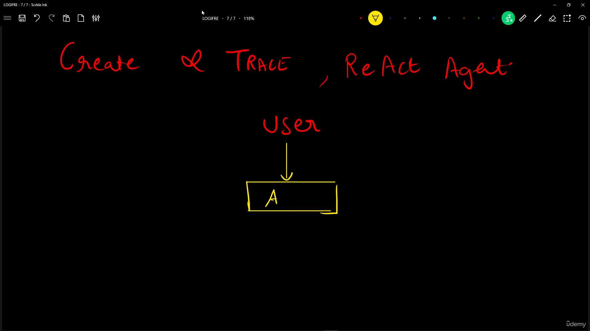
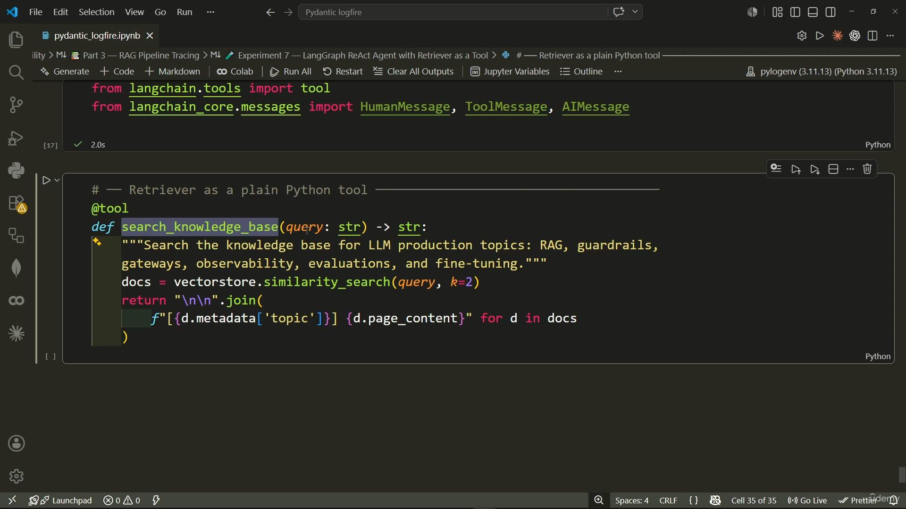
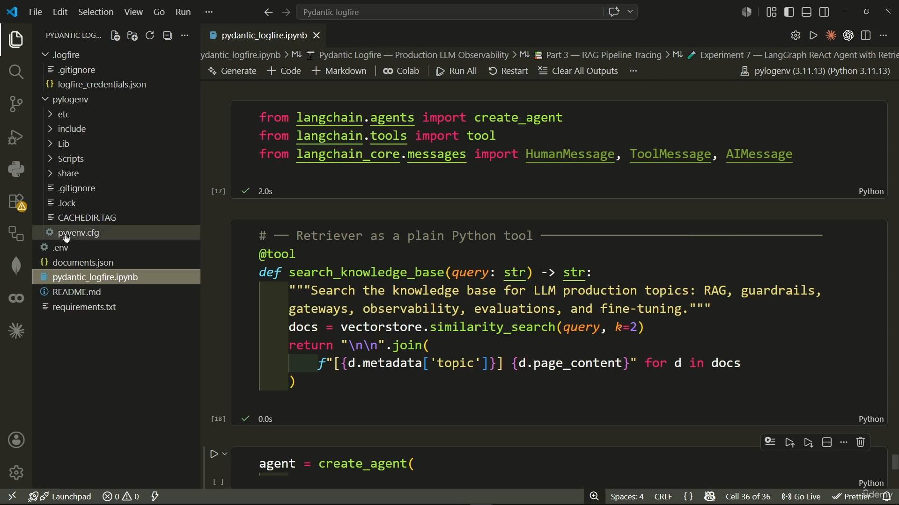
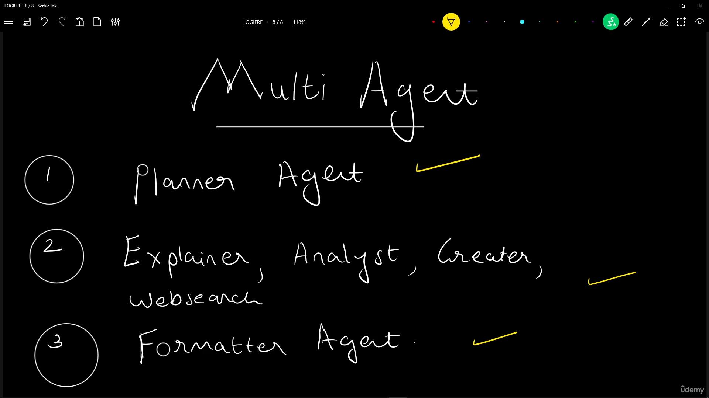
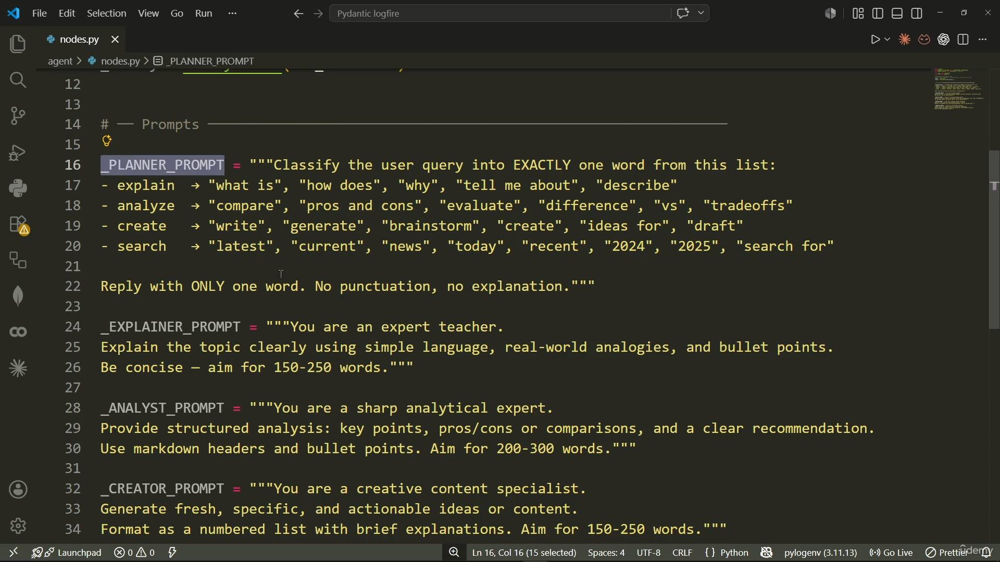
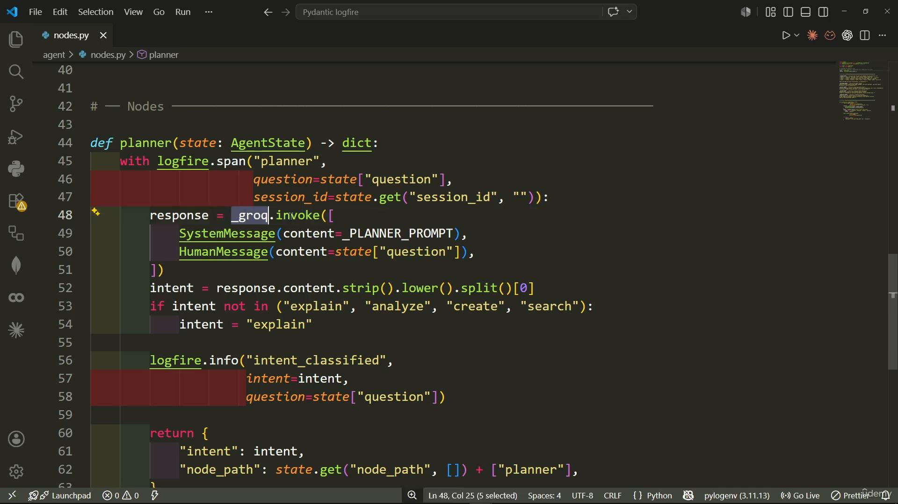
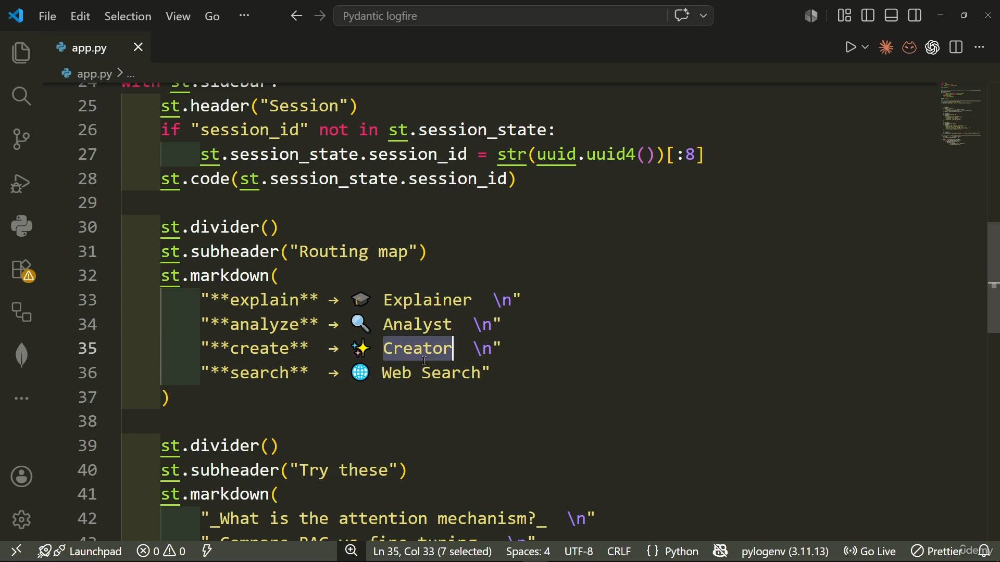
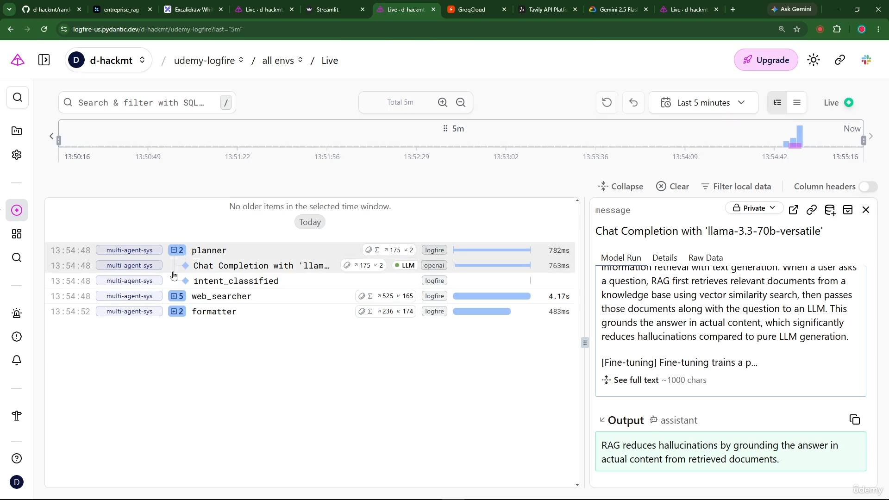

# AI Security Bootcamp Part 2：多智能体工作流 + Logfire 可观测（P38–P40）

> 本文档覆盖 P38–P40 三集：先用 LangGraph 把「检索器当工具」的 ReAct Agent 跑通并接入 Logfire 追踪；再把单 Agent 升级成「规划器 + 解释/分析/创作/联网搜索 + 格式化」的多智能体工作流；最后用 Streamlit 做出可交互界面，并在 Logfire 里看到完整的 trace、成本与工具调用。
>
> 读者定位：前端转 AI 应用工程师。文中 Python 代码可直接保存运行；涉及并发/状态的地方会补一句「在 JS/Node 里对应什么」。

---

## 1. 这一节做什么

这三集是一条完整的「从单 Agent 到多 Agent 产品」的施工路线，按顺序做三件事：

1. **P38：ReAct Agent + 追踪。** 上一集是「直接打向量库」的朴素 RAG。这一集把检索器（Retriever）包装成一个**工具（Tool）**，交给 LangGraph 的 `create_react_agent`。Agent 自己推理：这个问题要不要查知识库？要查就调用 `search_knowledge_base` 工具，不要查就直接用通用知识回答。整个过程用 Logfire 追踪，能看到「LLM 决定是否调工具 → 工具检索到哪些 chunk → 生成最终答案」的完整链路。
2. **P39：多智能体工作流（只写模块，不跑）。** 建一个 `agent/` 包，拆成 `llms.py`（配 Groq 和 Gemini 两个模型）、`tracing.py`（配 Logfire）、`state.py`（定义 AgentState）、`nodes.py`（6 个节点 + 提示词）、`graph.py`（用 StateGraph 把节点连起来）。规划器（planner）先判断用户意图，路由到 explain / analyze / create / search 之一（或组合），最后由 formatter 统一出稿。
3. **P40：Streamlit 应用 + 实跑验证。** 写 `app.py`：缓存资源、页面配置、侧边栏（session id、路由图、示例问题）、聊天输入、执行图、把结果和元数据写回 session 与 Logfire。最后 `streamlit run app.py` 实跑，验证「问 GPT-5 最新新闻 → 走 Tavily 联网搜索」「让它写诗 → 走 creator」等路由是否正确，并在 Logfire 里看到 planner → web_searcher → formatter 的瀑布图、成本与工具用量。

一句话总结产出物：一个能对话、能自动选专家、能联网、每一步都有 trace 和成本可见的多智能体小应用。

---

## 2. 讲师原话

> "上一集我们成功创建了一个 ReAct Agent，用它和向量数据库交互，并且把这一切都在 Logfire 上追踪到了。那是一个很棒的成果。这一集我们要更进一步，做一个多智能体的 agentic workflow。"
> —— p039 [00:00]

> "规划器 agent 会决定哪个 agent 该行动、几个 agent 该行动、以什么组合行动，而格式化 agent 最终给我们最终回复。"
> —— p039 [00:28]

> "当用户查询进来，planner 节点会判断这是哪种类型的查询。比如『给我解释一下什么是可观测性』『解释一下什么是网关』，这类问题就该走 explain。"
> —— p039 [00:57]

> "如果我们说『比较 iPhone 15 和三星 Galaxy S24』『比较苹果和安卓』『比较 Mac 和 Windows』，当我们想在某段查询之上做分析时，就调用 analyze。"
> —— p039 [01:25]

> "当我们说『给我写首诗』『写首好听的歌』或者一些创意类的东西，就走 creator agent；当我们要求联网搜索，比如『搜一下最新的 AI 新闻』，就走 web search。"
> —— p039 [01:25]

> "它也会组合使用。如果我说『分析一下 RAG 和微调，并用简单的话解释给我』，那这两个 agent 都会参与进来。"
> —— p039 [01:52]

> "在 graph 里我们会决定刚才说的流程，这个流程写在 graph 里；在 LLM 文件里配置我们配好的两个 LLM：Groq 和 Gemini。"
> —— p039 [03:47]

> "我们还要做一个 trace，也就是 tracing.py 之类的东西；还要做 state.py，因为我们的工作流必须知道当前处在哪个状态——我是在 planner 节点，还是在 create 节点，它必须知道这些。"
> —— p039 [04:16]

> "planner 提示词会把用户查询分类成列表里恰好一个词……当它检测到『是什么、怎么做、为什么』就归到 explainer；『比较、优缺点、评估、差异』归到 analyze；『写、生成、头脑风暴、创作、起草』归到 create；『最新、当前、今天、最近、搜索』归到 search。"
> —— p039 [10:55]

> "explainer 提示词：你是一位专家级老师，用简单的语言清楚地解释这个主题，150 到 250 词。analyst：你是一位敏锐的分析专家，目标 200 到 300 词。creator 同理，写出新鲜的、具体的。最后 formatter：你是一个格式化助手，轻度润色。"
> —— p039 [11:52]

> "这些提示词很棒，你可以把它扩展到下一个层级，想多复杂就多复杂。"
> —— p039 [12:19]

> "web searcher 会先检查是否调用了 Tavily search，然后把问题跑在 Tavily 上，拿到结果存进列表，搜索完成记到 Logfire，再把这些信息发给 Groq，系统消息是『把搜索结果综合成清晰简洁的答案』。"
> —— p039 [15:07]

> "graph 里我们从 planner 开始，planner 可以走向任意一个节点，最后都送到 formatter，formatter 结束回复。"
> —— p039 [18:02]

> "缓存资源会初始化我们用到的所有东西，这样即使刷新也不会重新加载，它只会在第一次一次性加载。"
> —— p040 [00:29]

> "侧边栏里我们会放 session ID，知道当前是哪个会话；分隔线下面放所有节点——explainer、analyst、creator、web search，我们能在侧边栏直接看到这些路由映射。"
> —— p040 [02:51]

> "我们还会维护历史，也就是维护 session state。"
> —— p040 [04:13]

> "输入提示是 st.chat_input『ask me anything』，我们拿输入……这条 prompt 消息会被追加到 session state，这样我们能在 Streamlit 应用里维护聊天历史。"
> —— p040 [04:43]

> "它会给出 trace 细节：用了哪个模型、路径是 planner → explainer → formatter。我们也能看到日志：multi specialist agent、planner、explainer、formatter。"
> —— p040 [05:10]

> "我们运行 agent：建一个 result 变量，graph 会 invoke agent state。完成后得到最终答案，我们把所有元数据存到 Logfire，并存进 session。"
> —— p040 [06:09]

> "运行方式是 `streamlit run app.py`。"
> —— p040 [07:06]

> "问『GPT-5 的最新新闻是什么』，这次它会用 Tavily search，这里能看到 Tavily search 的用量，如果这个工具被触发，用量就会增加。"
> —— p040 [07:36]

> "去 Logfire 刷新，就能看到 planner、web searcher、formatter。我们拿到的所有回复都来自 Tavily 联网搜索。"
> —— p040 [08:05]

---

## 3. 从零复现

### 3.1 目录结构（最终形态）

```
project/
├── .env
├── requirements.txt
├── app.py                  # P40：Streamlit 入口
└── agent/
    ├── __init__.py         # P39：让 agent 成为可导入的包
    ├── llms.py             # P39：Groq + Gemini 两个 LLM
    ├── tracing.py          # P39：Logfire 配置
    ├── state.py            # P39：AgentState 定义
    ├── nodes.py            # P39：6 个节点 + 提示词
    └── graph.py            # P39：StateGraph 组装
```

讲师在 P39 里明确列了这些文件：`__init__.py`、`graph.py`、`llms.py`、`nodes.py`、`tracing.py`、`state.py`，最后加 `app.py`。P38 的 ReAct Agent 是单独一个脚本（下面 3.2 给完整代码），可以放在项目根目录 `react_agent.py`，跑通后再进入 P39 的模块化重构。

### 3.2 第一步：P38 的 ReAct Agent（单文件，先跑通）

**目标**：把检索器当工具，让 Agent 自己决定查不查库，并用 Logfire 追踪。

**前置**：P38 之前已经做过数据 ingestion（把文档切块、embedding、写进向量库）。讲师原话是「我们还在用同一份数据，数据摄取已经做完了，这次只是换成 ReAct Agent」。所以这一步假设你已有一个可用的向量库和 retriever。课里没讲 ingestion 的具体代码，这里不编造；如果你还没有，先用你上一集的 retriever 对象替换下面代码里的 `retriever`。

**环境变量**（`.env`）：

```
GROQ_API_KEY=你的_groq_key
LOGFIRE_TOKEN=你的_logfire_write_token
```

**依赖**（`requirements.txt`，版本按你安装时为准，课里没锁版本）：

```
langgraph
langchain
langchain-groq
logfire
python-dotenv
streamlit
langchain-tavily
```

**运行**：

```bash
pip install -r requirements.txt
python react_agent.py
```

跑完你会看到三条测试查询分别打印出「是否用了工具」和截断后的答案；然后去 Logfire 面板看 `agent run` 的 trace。

### 3.3 第二步：P39 模块化——先建包和配置

1. 新建 `agent/` 文件夹，放一个空的 `__init__.py`（讲师原话：这样我们才能和这个 agent 文件夹交互/导入）。
2. 写 `agent/llms.py`：用 `ChatOpenAI`（兼容层）分别指向 Groq 和 Gemini 的 base_url、api_key、model。Groq 温度 0.3（讲师说「稍微有点创意」）。
3. 写 `agent/tracing.py`：`setup_tracing()` 里 `logfire.configure(token=os.getenv("LOGFIRE_TOKEN"), service_name="Multi agent workflow")`，再 `logfire.instrument_openai()` 开启自动追踪。
4. 写 `agent/state.py`：`AgentState(TypedDict)`，字段见第 4 节。
5. 写 `agent/nodes.py`：4 段提示词 + 6 个节点函数（planner / explainer / analyst / creator / web_searcher / formatter）。
6. 写 `agent/graph.py`：`StateGraph(AgentState)`，加节点、加边、`compile()`。

### 3.4 第三步：P40 的 Streamlit 应用

1. 写 `app.py`：`@st.cache_resource` 包住「setup_tracing + build_graph」，页面配置、侧边栏、聊天输入、`graph.invoke(...)`、写回 session 与 Logfire。
2. 启动：

```bash
streamlit run app.py
```

3. 首次启动会初始化（讲师说「第一次初始化总要花点时间，但之后刷新 10 次都没事」，因为 `cache_resource` 只跑一次）。
4. 在输入框依次试：
   - `What is the latest news on GPT-5?` → 应走 planner → web_searcher → formatter，Logfire 里能看到 Tavily 用量 +1。
   - `create a nice poem on AI gateways keep it funny` → 应走 planner → creator → formatter。
   - `tell me about pydantic logfire` → 走 web search，返回带链接的答案。
5. 打开 Logfire 面板，刷新，确认能看到 planner / web_searcher / formatter 的瀑布图、模型名、成本。

### 3.5 关键参数与判断（复现时别改错）

| 项 | 值 | 出处 |
|---|---|---|
| Groq 温度 | 0.3 | p039 [05:11] |
| Logfire service_name | `Multi agent workflow` | p039 [07:06] |
| planner 输出 | 恰好一个词（explain/analyze/create/search） | p039 [10:55] |
| explainer 字数 | 150–250 词 | p039 [11:52] |
| analyst 字数 | 200–300 词 | p039 [11:52] |
| 图结构 | START → planner → {explainer/analyst/creator/web_searcher} → formatter → END | p039 [18:02] |
| 启动命令 | `streamlit run app.py` | p040 [07:06] |

---

## 4. 完整代码

> 说明：逐字稿是口述，没有贴出完整源码，OCR 清单也为空。以下代码严格按讲师口述的类名、函数名、参数、提示词要点、图结构还原，能直接保存运行。个别讲师没念全的细节（如 Gemini 的具体 model 字符串）标注为「按你账号可用模型填」。

### 4.1 `.env`

```bash
GROQ_API_KEY=your_groq_api_key
GEMINI_API_KEY=your_gemini_api_key
LOGFIRE_TOKEN=your_logfire_write_token
TAVILY_API_KEY=your_tavily_api_key
```

### 4.2 `requirements.txt`

```
langgraph
langchain
langchain-openai
langchain-groq
langchain-tavily
logfire
python-dotenv
streamlit
```

### 4.3 `react_agent.py`（P38 单文件版）

```python
import os
from dotenv import load_dotenv
import logfire

from langchain_groq import ChatGroq
from langchain_core.tools import tool
from langchain_core.messages import HumanMessage, ToolMessage, AIMessage
from langgraph.prebuilt import create_react_agent

load_dotenv()

logfire.configure(token=os.getenv("LOGFIRE_TOKEN"))
logfire.instrument_openai()

# 课里没讲 ingestion 代码；这里用你上一集已有的 retriever 替换
from your_rag_module import retriever  # noqa: E402


@tool
def search_knowledge_base(query: str) -> str:
    """Search the knowledge base for relevant chunks about LLM production topics."""
    docs = retriever.invoke(query)
    return "\n\n".join(d.page_content for d in docs)


llm = ChatGroq(
    model="llama-3.3-70b-versatile",  # 按你 Groq 账号可用模型填
    temperature=0.3,
    api_key=os.getenv("GROQ_API_KEY"),
)

SYSTEM_PROMPT = (
    "You are a helpful assistant. "
    "Use search_knowledge_base for any question about LLM production topics. "
    "Answer directly from general knowledge for other questions."
)

agent = create_react_agent(
    model=llm,
    tools=[search_knowledge_base],
    prompt=SYSTEM_PROMPT,
)


def run_agent(question: str, user_id: str = "anonymous"):
    with logfire.span("agent run", question=question, user_id=user_id):
        result = agent.invoke({"messages": [HumanMessage(content=question)]})
        messages = result["messages"]

        used_tool = any(isinstance(m, ToolMessage) for m in messages)
        tool_messages = [m.content for m in messages if isinstance(m, ToolMessage)]
        ai_messages = [m.content for m in messages if isinstance(m, AIMessage)]
        last_ai = ai_messages[-1] if ai_messages else ""

        logfire.info(
            "agent done",
            used_tool=used_tool,
            tool_messages=tool_messages,
            last_node_response=last_ai,
        )
        return last_ai, used_tool


if __name__ == "__main__":
    queries = [
        {"question": "What is LLM observability?", "user_id": "Priya"},
        {"question": "How do guardrails work?", "user_id": "Bhavesh"},
        {"question": "What is the capital of France?", "user_id": "Kunal"},
    ]
    for q in queries:
        answer, used_tool = run_agent(q["question"], q["user_id"])
        print(f"[{q['user_id']}] used_tool={used_tool} answer={answer[:200]}")
```

### 4.4 `agent/__init__.py`

```python
# 让 agent 成为可导入的包
```

### 4.5 `agent/llms.py`

```python
import os
from dotenv import load_dotenv
from langchain_openai import ChatOpenAI

load_dotenv()

groq_llm = ChatOpenAI(
    model="llama-3.3-70b-versatile",          # 按 Groq 账号可用模型填
    temperature=0.3,
    base_url="https://api.groq.com/openai/v1",
    api_key=os.getenv("GROQ_API_KEY"),
)

gemini_llm = ChatOpenAI(
    model="gemini-1.5-flash",                  # 按 Gemini 账号可用模型填
    temperature=0.3,
    base_url="https://generativelanguage.googleapis.com/v1beta/openai/",
    api_key=os.getenv("GEMINI_API_KEY"),
)
```

### 4.6 `agent/tracing.py`

```python
import os
import logfire
from dotenv import load_dotenv

load_dotenv()


def setup_tracing():
    """Configure Logfire to trace our Streamlit application."""
    logfire.configure(
        token=os.getenv("LOGFIRE_TOKEN"),
        service_name="Multi agent workflow",
    )
    logfire.instrument_openai()
```

### 4.7 `agent/state.py`

```python
from typing import TypedDict


class AgentState(TypedDict, total=False):
    question: str
    intention: str
    specialized_output: str
    search_results: list
    model_used: str
    session_id: str
    node_path: list
```

### 4.8 `agent/nodes.py`

```python
import os
import logfire
from langchain_core.messages import SystemMessage, HumanMessage
from langchain_tavily import TavilySearch

from .state import AgentState
from .llms import groq_llm

web_search_tool = TavilySearch(api_key=os.getenv("TAVILY_API_KEY"))

PLANNER_PROMPT = """You are a planner. Classify the user query into exactly ONE word from:
- explain: when the query asks what/how/why
- analyze: when the query asks to compare, pros and cons, evaluate, difference
- create: when the query asks to write, generate, brainstorm, create, draft
- search: when the query mentions latest, current, today, recent, search
Reply with only that one word."""

EXPLAINER_PROMPT = (
    "You are an expert teacher. Explain the topic clearly using simple language "
    "in 150 to 250 words."
)

ANALYST_PROMPT = (
    "You are a sharp analytical expert. Provide a rigorous analysis in 200 to 300 words."
)

CREATOR_PROMPT = (
    "You are a creative writer. Write fresh, specific, original content as requested."
)

FORMATTER_PROMPT = (
    "You are a formatting assistant. Lightly polish the given content and present it cleanly."
)


def planner_node(state: AgentState):
    with logfire.span("planner"):
        logfire.info("planner received question", session_id=state.get("session_id"))
        resp = groq_llm.invoke([
            SystemMessage(content=PLANNER_PROMPT),
            HumanMessage(content=state["question"]),
        ])
        intention = resp.content.strip().lower().split()[0]
        node_path = state.get("node_path", []) + ["planner"]
        return {
            "intention": intention,
            "model_used": "groq",
            "node_path": node_path,
        }


def explainer_node(state: AgentState):
    with logfire.span("explainer"):
        resp = groq_llm.invoke([
            SystemMessage(content=EXPLAINER_PROMPT),
            HumanMessage(content=state["question"]),
        ])
        return {
            "specialized_output": resp.content,
            "model_used": "groq",
            "node_path": state.get("node_path", []) + ["explainer"],
        }


def analyst_node(state: AgentState):
    with logfire.span("analyst"):
        resp = groq_llm.invoke([
            SystemMessage(content=ANALYST_PROMPT),
            HumanMessage(content=state["question"]),
        ])
        return {
            "specialized_output": resp.content,
            "model_used": "groq",
            "node_path": state.get("node_path", []) + ["analyst"],
        }


def creator_node(state: AgentState):
    with logfire.span("creator"):
        resp = groq_llm.invoke([
            SystemMessage(content=CREATOR_PROMPT),
            HumanMessage(content=state["question"]),
        ])
        return {
            "specialized_output": resp.content,
            "model_used": "groq",
            "node_path": state.get("node_path", []) + ["creator"],
        }


def web_searcher_node(state: AgentState):
    with logfire.span("web_searcher"):
        results = web_search_tool.invoke({"query": state["question"]})
        logfire.info("search complete")
        resp = groq_llm.invoke([
            SystemMessage(
                content="Synthesize the search results into a clear, concise answer."
            ),
            HumanMessage(
                content=f"Question: {state['question']}\n\nSearch results: {results}"
            ),
        ])
        return {
            "specialized_output": resp.content,
            "search_results": results if isinstance(results, list) else [results],
            "model_used": "groq",
            "node_path": state.get("node_path", []) + ["web_searcher"],
        }


def formatter_node(state: AgentState):
    with logfire.span("formatter"):
        resp = groq_llm.invoke([
            SystemMessage(content=FORMATTER_PROMPT),
            HumanMessage(content=state.get("specialized_output", "")),
        ])
        return {
            "specialized_output": resp.content,
            "node_path": state.get("node_path", []) + ["formatter"],
        }
```

### 4.9 `agent/graph.py`

```python
from langgraph.graph import StateGraph, START, END

from .state import AgentState
from .nodes import (
    planner_node,
    explainer_node,
    analyst_node,
    creator_node,
    web_searcher_node,
    formatter_node,
)


def route_agent(state: AgentState):
    return state["intention"]


def build_graph():
    graph = StateGraph(AgentState)

    graph.add_node("planner", planner_node)
    graph.add_node("explainer", explainer_node)
    graph.add_node("analyst", analyst_node)
    graph.add_node("creator", creator_node)
    graph.add_node("web_searcher", web_searcher_node)
    graph.add_node("formatter", formatter_node)

    graph.add_edge(START, "planner")
    graph.add_conditional_edges(
        "planner",
        route_agent,
        {
            "explain": "explainer",
            "analyze": "analyst",
            "create": "creator",
            "search": "web_searcher",
        },
    )
    graph.add_edge("explainer", "formatter")
    graph.add_edge("analyst", "formatter")
    graph.add_edge("creator", "formatter")
    graph.add_edge("web_searcher", "formatter")
    graph.add_edge("formatter", END)

    return graph.compile()
```

### 4.10 `app.py`（P40）

```python
import uuid
import streamlit as st
from dotenv import load_dotenv

load_dotenv()

from agent.tracing import setup_tracing
from agent.graph import build_graph


@st.cache_resource
def get_resources():
    setup_tracing()
    return build_graph()


graph = get_resources()

st.set_page_config(
    page_title="Multi AI Specialist Agent",
    page_caption="LangGraph · Logfire · Groq · Gemini",
)

with st.sidebar:
    st.header("Session")
    if "session_id" not in st.session_state:
        st.session_state.session_id = str(uuid.uuid4())
    st.code(st.session_state.session_id)

    st.divider()
    st.subheader("Routing map")
    st.markdown(
        "- explain → explainer\n"
        "- analyze → analyst\n"
        "- create → creator\n"
        "- search → web_searcher\n"
        "- all → formatter"
    )

    st.divider()
    st.subheader("Example questions")
    st.markdown(
        "- What is the latest news on GPT-5?\n"
        "- create a nice poem on AI gateways keep it funny\n"
        "- tell me about pydantic logfire"
    )

if "history" not in st.session_state:
    st.session_state.history = []

for msg in st.session_state.history:
    with st.chat_message(msg["role"]):
        st.markdown(msg["content"])

prompt = st.chat_input("ask me anything")
if prompt:
    st.session_state.history.append({"role": "user", "content": prompt})
    with st.chat_message("user"):
        st.markdown(prompt)

    result = graph.invoke({
        "question": prompt,
        "session_id": st.session_state.session_id,
        "node_path": [],
    })

    answer = result.get("specialized_output", "")
    st.session_state.history.append({"role": "assistant", "content": answer})
    with st.chat_message("assistant"):
        st.markdown(answer)
        st.caption(
            f"model={result.get('model_used')} path={' → '.join(result.get('node_path', []))}"
        )
```

---

## 5. 逐行解释

**`react_agent.py`**

- `@tool` 装饰器把普通 Python 函数变成 Agent 能调用的工具。讲师原话：「我们把一个 Python 函数转换成一个工具，交给 agent 使用」。`docstring` 很重要，模型靠它判断何时调用。
- `search_knowledge_base` 里 `retriever.invoke(query)` 就是 P38 之前那套向量检索，只是这次被包进工具，由 Agent 决定调不调。讲师强调「这次用 Retriever 作为工具，而不是直接传 Retriever」。
- `create_react_agent(model, tools, prompt)` 是 LangGraph 预置的 ReAct 构造器。讲师说这是「你在 LangGraph 里学到的第一件、最简单的事」。
- `run_agent` 里 `logfire.span("agent run", ...)` 把整次调用包成一个 span；`used_tool = any(isinstance(m, ToolMessage) ...)` 判断工具是否被调用——这正是讲师在 Logfire 里看到的 `tool called was false` 的来源。
- 三条测试查询对应讲师口述的三个用户：Priya 问可观测性（应调工具）、Bhavesh 问护栏（应调工具）、Kunal 问法国首都（不应调工具，直接答）。

**`llms.py`**

- 用 `ChatOpenAI` 兼容层接两家：Groq 的 `base_url` 是 `https://api.groq.com/openai/v1`，Gemini 走它的 OpenAI 兼容端点。讲师原话：「用 ChatOpenAI，因为它和它们都兼容」。
- Groq 温度 0.3，讲师说「稍微有点创意」。

**`tracing.py`**

- `logfire.configure(token=os.getenv("LOGFIRE_TOKEN"), service_name="Multi agent workflow")`，讲师明确 service name 用 `Multi agent workflow`。
- `logfire.instrument_openai()` 开启自动追踪，讲师说「这个函数会启动自动追踪」。

**`state.py`**

- `AgentState` 是 TypedDict，字段对应讲师口述：`question`、`intention`（用户想 explain/analyze/create/search）、`specialized_output`、`search_results`（Tavily 结果）、`model_used`、`session_id`、`node_path`（记录节点执行路径，用于日志）。
- 在 JS/Node 里，这相当于一个贯穿整条流水线的 `context` 对象，每个节点读它、返回增量更新它。

**`nodes.py`**

- `planner_node` 只让模型回一个词，`resp.content.strip().lower().split()[0]` 取第一个词，防止模型多说。讲师原话：「grok 模型只给一个词的回复，如果它说 explain，我们就送到 explain，否则送到其他」。
- explainer/analyst/creator 三个节点逻辑完全一样，只换 system prompt。讲师原话：「逻辑完全一样，我只是换了词，其余都一样」。
- `web_searcher_node` 是唯一「重」的节点：先 `web_search_tool.invoke` 拿 Tavily 结果，记 `search complete` 日志，再把结果塞进 Groq 让它「综合成清晰简洁的答案」。讲师原话：「把这些信息发给 Groq，系统消息是『把搜索结果综合成清晰简洁的答案』」。
- `formatter_node` 最后统一润色，讲师说「轻度润色」。
- 每个节点都往 `node_path` 追加自己的名字，这就是 P40 界面上 `planner → explainer → formatter` 那行 caption 的来源。

**`graph.py`**

- `StateGraph(AgentState)` 建图；`add_node` 加 6 个节点；`add_edge(START, "planner")` 固定入口。
- `add_conditional_edges("planner", route_agent, {...})` 按 `intention` 路由。讲师原话：「planner 可以走向任意一个节点，最后都送到 formatter」。
- 四个专家节点都 `add_edge(..., "formatter")`，formatter 再 `add_edge(..., END)`。讲师说「formatter 结束回复」。
- 注意：讲师口述里也提到「组合使用」（如 analyze + explain 同时触发），但 P39 的图实现是**单选路由**（planner 只回一个词）。组合路由属于讲师描述的「可以扩展到下一个层级」，课里没给组合路由的实现代码，这里不编造。

**`app.py`**

- `@st.cache_resource` 包住 `setup_tracing + build_graph`，讲师原话：「缓存资源初始化我们用到的所有东西，刷新也不会重新加载，只第一次一次性加载」。
- `st.set_page_config` 的标题是 `Multi AI Specialist Agent`，caption 是 `LangGraph · Logfire · Groq · Gemini`，对应讲师口述。
- 侧边栏：session id（`uuid4`）、路由图、示例问题，对应讲师逐条念的 UI 组件。
- `st.chat_input("ask me anything")` 拿输入，追加到 `st.session_state.history`，再 `st.chat_message` 渲染，对应讲师说的「维护聊天历史」。
- `graph.invoke({...})` 传入初始 state（`question`、`session_id`、空 `node_path`），返回最终 state，取 `specialized_output` 作为答案，`model_used` 和 `node_path` 作为 caption 显示——这就是界面上那行 trace 细节。
- 在 JS/Node 里，`st.session_state` 类似一个按会话隔离的 `Map`，刷新页面不丢（但换浏览器标签会新会话）。

---

## 6. 复现检查清单

- [ ] `.env` 里四个 key 都填了：`GROQ_API_KEY`、`GEMINI_API_KEY`、`LOGFIRE_TOKEN`、`TAVILY_API_KEY`。
- [ ] `pip install -r requirements.txt` 无报错。
- [ ] `python react_agent.py` 跑通，三条查询分别打印 `used_tool=True / True / False`（前两条查库，第三条直接答）。
- [ ] Logfire 面板能看到 `agent run` span，展开后有 `agent done` 日志，`used_tool` 字段正确。
- [ ] `agent/` 下 6 个文件齐全，`__init__.py` 存在。
- [ ] `streamlit run app.py` 能启动，首次初始化稍慢，刷新后秒开（验证 `cache_resource` 生效）。
- [ ] 侧边栏能看到 session id、路由图、示例问题三段。
- [ ] 输入 `What is the latest news on GPT-5?`，回答带联网信息，caption 显示 `planner → web_searcher → formatter`。
- [ ] Logfire 里对应 trace 能看到 Tavily 工具调用，用量 +1。
- [ ] 输入 `create a nice poem on AI gateways keep it funny`，caption 显示 `planner → creator → formatter`。
- [ ] 输入 `tell me about pydantic logfire`，走 web search，回答带链接。
- [ ] 多轮对话后刷新页面，历史仍在（`session_state.history` 生效）。

---

## 7. 课里没讲但你会撞上的

1. **向量库 ingestion 代码没给。** P38 直接说「数据摄取已经做完了，还在用同一份数据」。`react_agent.py` 里 `from your_rag_module import retriever` 需要你换成上一集的真实 retriever。如果你从零开始，得先自己建库。
2. **Groq / Gemini 的具体 model 字符串没念。** 代码里 `llama-3.3-70b-versatile` 和 `gemini-1.5-flash` 是按常见可用模型填的，**以你账号实际可用模型为准**。讲师只说「这是 model」。
3. **组合路由没实现。** 讲师口述「analyze + explain 可以同时触发」，但 P39 的图是单选。要做组合，得把 planner 输出改成多词、`route_agent` 返回列表、用 LangGraph 的并行分支或 `Send` API——课里没讲，属于扩展。
4. **`TavilySearch` 的返回结构。** 不同版本 `langchain-tavily` 返回 dict 或 list 不一致，`web_searcher_node` 里做了 `isinstance(results, list)` 兜底。实际字段名请以你安装版本的输出为准。
5. **Logfire 的 `instrument_openai` 对 Groq 是否生效。** Groq 走 OpenAI 兼容端点，通常能抓到；如果抓不到，检查 base_url 是否被 instrument 覆盖。课里没讲这个坑。
6. **Streamlit 的 `page_caption` 参数。** 新版 Streamlit 才有，老版本会报错，改用 `st.caption` 放正文。
7. **成本追踪。** 讲师在 P40 说「能看到成本」，这依赖 Logfire 对 token 的自动计量；如果模型不在其计价表里，成本可能显示为空，属正常。
8. **并发/会话隔离。** `st.session_state` 按浏览器会话隔离，多用户同时用不会串；但 `@st.cache_resource` 是全局共享的，graph 实例被所有用户复用——LangGraph 的 `invoke` 是无状态的（state 每次传入），所以安全。在 Node 里对应「单例 service + 每请求传 context」，别把用户 state 存到模块级变量里。
9. **`logfire.span` 嵌套。** 节点内的 span 会挂在 `agent run` 下面形成瀑布图；如果你没看到嵌套，检查 `setup_tracing()` 是否在 `build_graph()` 之前调用（`app.py` 里顺序是对的）。

---















