# AI Security Bootcamp part2：护栏 / 网关 / 可观测（P5–P7）复现文档

> 说明：本段课程（P5–P7）实际内容是 **LangChain v1 更新版入门**——用 UV 包管理器建虚拟环境、装依赖、配 API Key，然后用 `create_agent` 写出第一个带工具的 Agent。P5 是课程导览与工具准备，P6 是环境搭建，P7 是 Agent 概念与第一个可运行 Agent。本文档按「照着做就能跑起来」的标准组织，所有命令、文件、代码均来自逐字稿与讲师屏幕内容。

---

## 1. 这一节做什么

这三节课要完成的事情非常具体，可以拆成四个可验收的产物：

1. **一个用 UV 管理的 Python 项目**：目录 `LangchainUpdated`，里面有 `pyproject.toml`、`.python-version`、`main.py`、`.venv/`。
2. **一个装好全部依赖的虚拟环境**：LangChain 1.1.x、langchain-community、langchain-openai、langchain-groq、python-dotenv、langchain-google-genai，外加 Jupyter 用的 `ipykernel`。
3. **一个 `.env` 文件**：装 Google API Key、Groq API Key、OpenAI API Key 三把钥匙。
4. **一个能跑的 Agent Notebook**：`updated langchain/langchain_intro.ipynb`，里面用 `create_agent` 建一个 Agent，挂一个 `get_weather` 工具，用 `agent.invoke` 提问并拿到回答。

讲师在 P5 开头交代了整个系列的定位：LangChain 文档最近改了很多，语法、建 Agent 的方式、接多模型的方式、调工具、结构化输出、消息类型、短期记忆、流式输出、middleware（内置与自定义）、guardrails 都要按新版重讲一遍。P5 还顺带介绍了 UV 包管理器（Rust 写的，极快的 Python 包与项目管理器）和 Google Antigravity 这个 IDE。

> "最近 LangChain 在他们的文档里做了很多更新，在这个模块和整个系列视频里，我们要看 LangChain 具体带来了哪些变化。"
> —— p005 [00:00]

> "我们还会用一个很棒的包，叫 UV 包管理器。如果你听说过 UV，它是一个极快的 Python 包和项目管理器，完全用 Rust 写的。"
> —— p005 [01:21]

P6 全部是环境搭建，P7 全部是 Agent 概念 + 第一个 Agent。注意：**这三节里没有出现任何「护栏 / 网关 / 可观测」的具体实现**，标题里的那三个词是模块名，实际代码要到后续 P 才展开。本文档只写 P5–P7 真实出现过的内容。

---

## 2. 讲师原话

下面按主题把讲师的关键判断翻成中文引用，方便你理解「为什么这么做」。

**关于为什么要用虚拟环境：**

> "不管做任何类型的项目，先创建虚拟环境永远是好的实践。"
> —— p006 [00:00]

**关于 UV 的安装方式：**

> "如果你用 Mac OS 或 Linux，可以用这条命令；如果你用 Windows，可以直接打开 PowerShell 执行这条命令。"
> —— p006 [00:51]

**关于 `uv init` 做了什么：**

> "一旦你初始化了工作仓库，你会拿到一些基本信息。这里有 pyproject.toml，它会告诉你我们用的是哪个版本。这里我们用的是 Python 3.13。"
> —— p006 [02:40]

**关于创建虚拟环境的命令：**

> "创建虚拟环境最简单的命令就是 uv venv。一按回车，它就用 Python 3.13.2 在这个位置创建了虚拟环境，也就是 .venv。"
> —— p006 [04:06]

**关于激活虚拟环境：**

> "创建完虚拟环境后，你要把库装进这个虚拟环境里，所以先要激活它。命令写在这里：activate，路径是 .venv\Scripts\activate。"
> —— p006 [04:36]

**关于 requirements.txt 要放哪：**

> "请务必把这个文件创建在 .venv 文件夹外面。"
> —— p006 [05:30]

**关于装依赖的命令：**

> "你可以写 uv pip install -r requirements.txt，以前是用 pip install -r requirements.txt。但用 uv 的话，你可以直接写 uv add -r requirements.txt。"
> —— p006 [07:21]

**关于版本锁定：**

> "打开 pyproject.toml，你会看到 LangChain 1.1.0 已安装，这是最近的版本；langchain-community 0.4.1 已安装；langchain-google-genai 3.2.0 已安装，所有不同的库都装好了。"
> —— p006 [07:51]

> "我的建议永远是尽量用 LangChain 的最新版本，因为很多功能会被废弃，有些功能可能会被移到别的库里。"
> —— p006 [08:18]

**关于单独装库：**

> "任何时候你想加一个独立的库，就用这个命令：uv add，然后跟库名。如果你想直接从 requirements.txt 装，就写 uv add -r requirements.txt。"
> —— p006 [10:13]

**关于什么是 Agent（这是 P7 的核心）：**

> "LLM 有一个训练截止日期。它已经用之前的数据训练过了，它没有当前的信息、最近的信息。"
> —— p007 [04:38]

> "这就是为什么，如果我的 LLM 要回答这个问题，它必须依赖某个第三方工具。这个工具可以是第三方 API，可以是 Google 搜索，可以是别的什么。"
> —— p007 [05:35]

> "从这个工具拿到的响应，就叫 context（上下文）。然后 LLM 才能生成输出。"
> —— p007 [06:32]

> "这就是一个基础 Agent。它能自主地做简单的决策：什么时候路由、路由哪种查询、怎么解决这个任务。"
> —— p007 [07:01]

**关于旧版建 Agent 有多麻烦：**

> "以前用 LangChain 建 Agent 有点难。我们先用一个 LLM 模型，然后单独建一个工具，再把工具和 LLM 连起来。我们用的是叫 ReAct 架构的东西。"
> —— p007 [07:30]

**关于新版建 Agent 有多简单：**

> "现在用最近的 LangChain 版本，也就是 LangChain v1，建这个 Agent 变简单了。"
> —— p007 [08:00]

**关于 `verbose` 参数报错（讲师当场踩的坑）：**

> "一运行就报 unexpected keyword argument，看来 verbose 在这个版本还不支持，我把它删掉。"
> —— p007 [09:24]

**关于 `invoke` 的入参格式（第二个坑）：**

> "报错说 expected dictionary。原因很简单，我们得用 messages 的形式传。"
> —— p007 [13:13]

> "用 create_agent 这个内置函数建 Agent 的时候，输入必须是一个字典，字典的 key 是 messages。"
> —— p007 [13:41]

**关于 LLM 怎么知道该调哪个工具：**

> "因为我们在定义 get_weather 这个函数时写了 docstring。把这个工具挂给 Agent 时，LLM 会理解这个 docstring——『get the weather for a city』——于是它知道该调这个函数。"
> —— p007 [15:06]

**关于最终版本号：**

> "我 import langchain，然后 print langchain.__version__，结果是 1.1.2。"
> —— p007 [17:27]

---

## 3. 从零复现

下面每一步都可以直接照抄。假设你在 Windows 上（讲师演示的是 Windows + PowerShell / Command Prompt），Mac/Linux 的差异我会单独标出来。

### 3.1 安装 UV 包管理器

打开浏览器搜 "UV package manager"，进第一个链接（astral.sh 的 UV 文档），在 Installation 一节里选你的平台。

- **Windows**：打开 PowerShell，执行文档里给的安装命令（讲师是复制文档里的命令直接粘进 PowerShell 回车）。
- **Mac OS / Linux**：用文档里给的 shell 命令。

讲师原话是「我已经装过了，所以不用再装一遍，但为了演示给你看，我确实做过这一步」。装完之后可以关掉 PowerShell，换回普通终端。

验证安装：

```bash
uv --version
```

课里没讲这条验证命令，但装完 UV 后任何 `uv` 子命令能跑就说明装好了。

### 3.2 建项目目录并初始化

讲师在 Google Antigravity 里建了一个文件夹叫 `LangchainUpdated`（也写作 "Lang chain updated"）。你也可以用 VS Code 或 Cursor，操作一样。

进入这个空文件夹，在终端里执行：

```bash
uv init
```

执行后目录里会出现：

- `pyproject.toml` —— 记录项目元信息和依赖版本
- `.python-version` —— 记录 Python 版本，讲师这里是 `3.13`
- `main.py` —— 默认生成的入口文件

讲师强调：`uv init` 会自动取当前最新的 Python 版本，用最新版是好的实践。

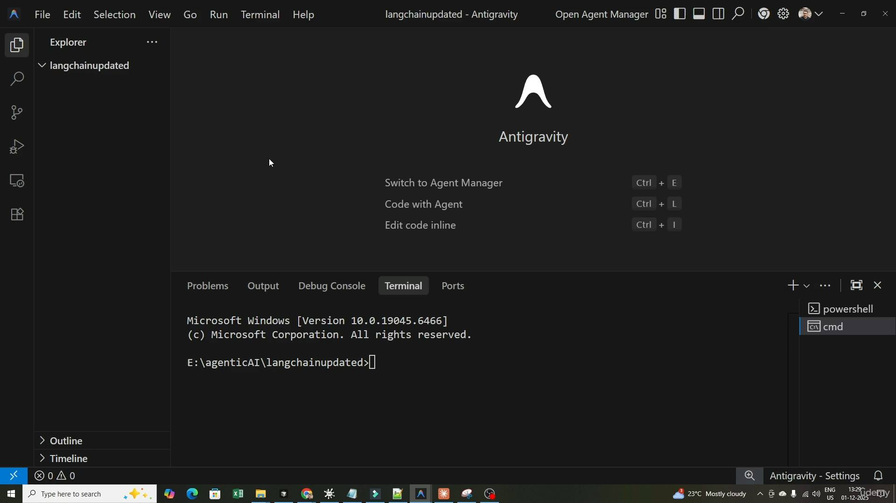

### 3.3 创建虚拟环境

```bash
uv venv
```

讲师特别提醒：**不要**写成 `uv venv/`（他第一次手滑多打了个斜杠，终端报 `unrecognized sub command venv/`）。正确写法就是 `uv venv`，不带斜杠。

执行后终端会显示类似「Using CPython 3.13.2」并在当前目录创建 `.venv` 文件夹。

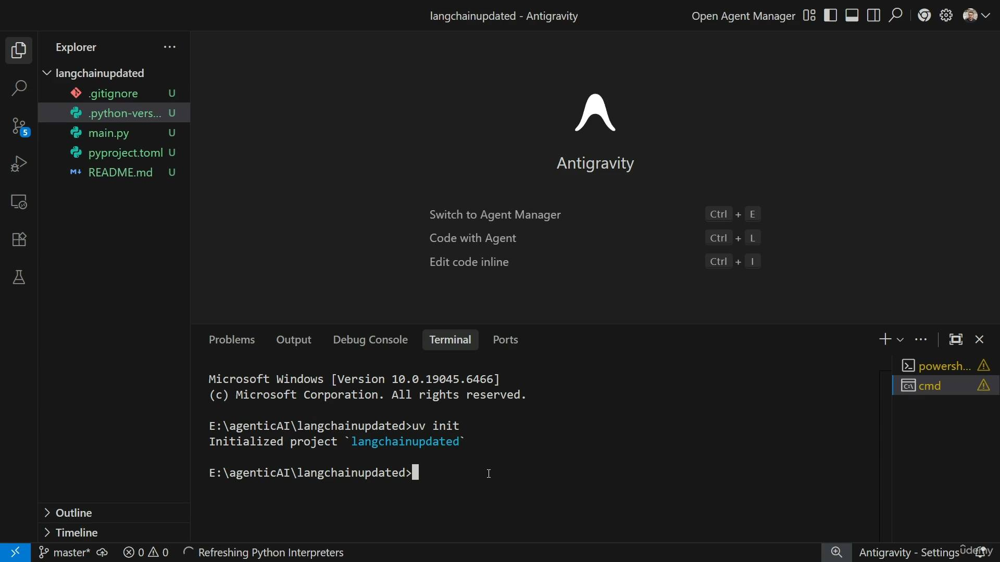

### 3.4 激活虚拟环境

**Windows（Command Prompt / PowerShell）：**

```bash
.venv\Scripts\activate
```

**Mac OS / Linux：**

```bash
source .venv/bin/activate
```

激活成功后，终端提示符前面会出现 `(langchainupdated)` 之类的环境名。讲师屏幕上显示的就是环境名被激活的状态。

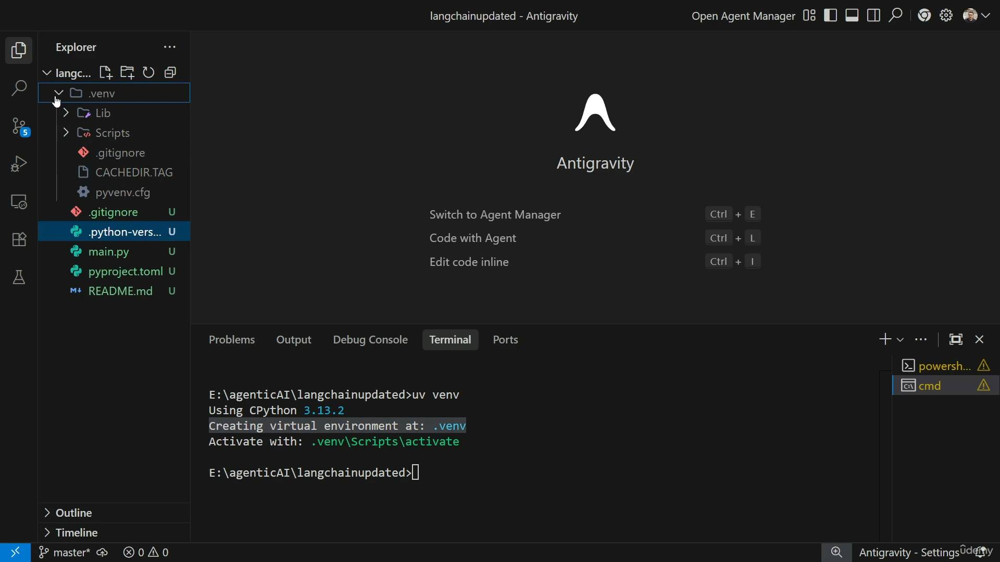

### 3.5 写 requirements.txt

**关键：这个文件必须放在 `.venv` 文件夹外面**，也就是项目根目录。内容如下（讲师逐个手打，没用 IDE 的自动补全建议）：

```text
langchain
langchain-community
langchain-openai
langchain-groq
python-dotenv
langchain-google-genai
```

讲师说明：这里故意不写版本号，就是要用各库的最新版；装完之后去 `pyproject.toml` 里看实际锁定的版本。

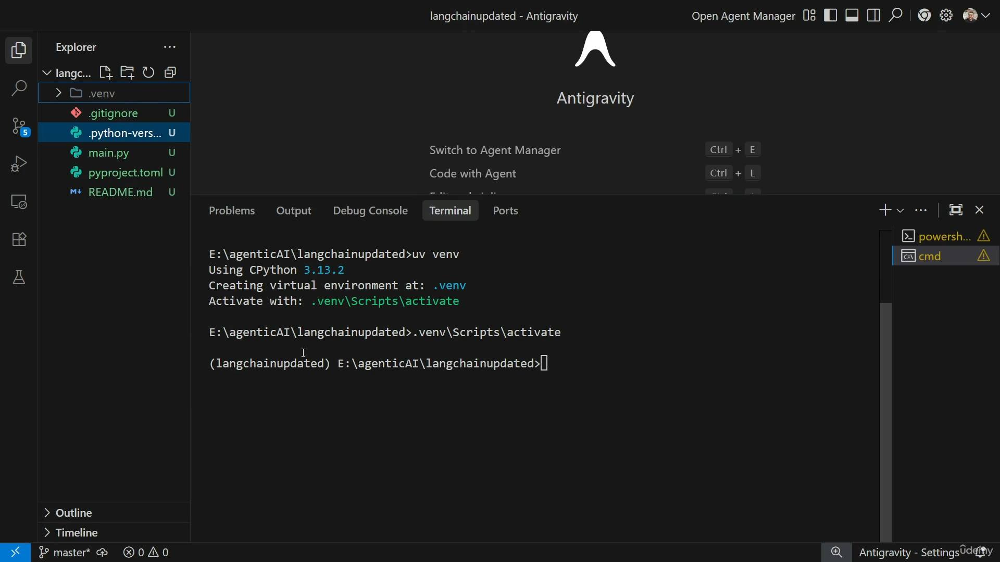

### 3.6 安装依赖

讲师给了两种写法，效果一样：

```bash
uv add -r requirements.txt
```

或者：

```bash
uv pip install -r requirements.txt
```

讲师演示用的是 `uv add -r requirements.txt`。执行过程中会有一些 warning，讲师说可以忽略。装完后终端会列出每个库装到的版本。

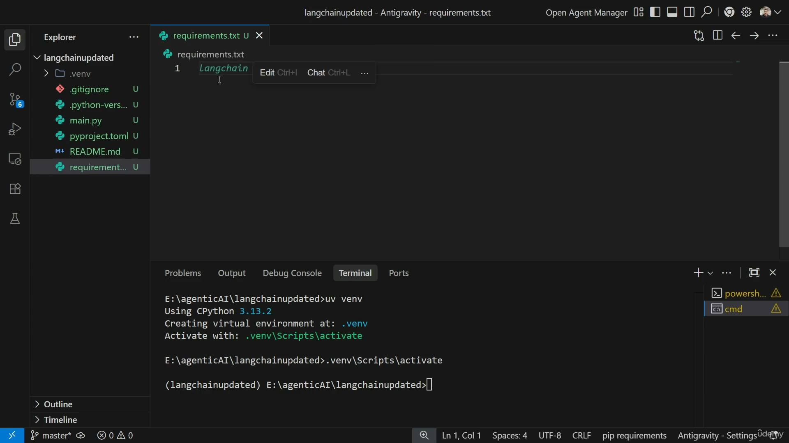

### 3.7 核对 pyproject.toml 里的版本

打开 `pyproject.toml`，讲师屏幕上看到的是：

- `langchain` 1.1.0
- `langchain-community` 0.4.1
- `langchain-google-genai` 3.2.0
- 其余库也都装好了

讲师说这个文件他会发给学员，方便对照「当前基线版本是哪些」。注意：你实际装到的版本可能比这更新，因为没锁版本号——这正是讲师想要的效果。

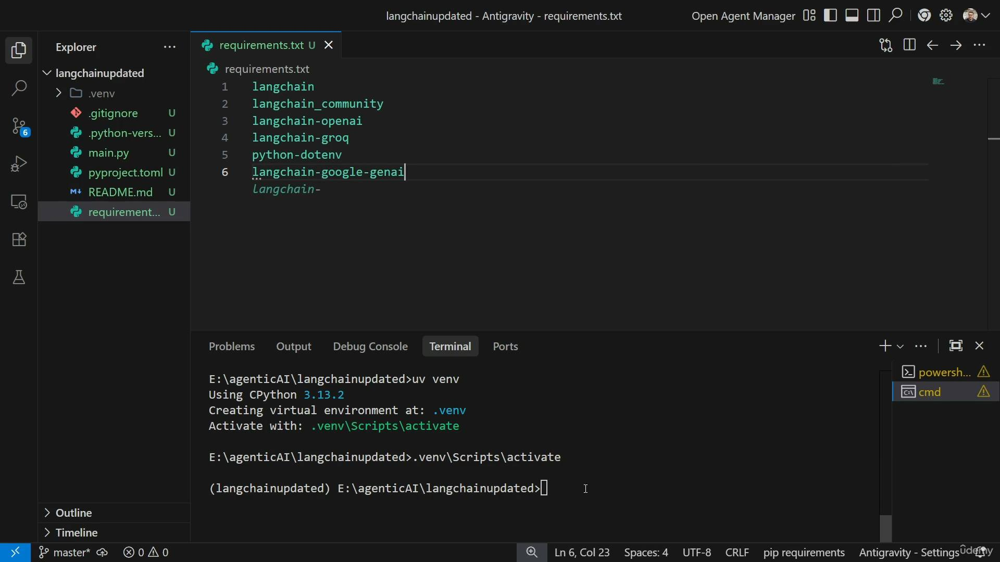

### 3.8 准备三把 API Key

讲师要三把钥匙：

1. **Google API Key**：去 Google AI Studio 的 API key 页面，点 "Create an API key"，选一个项目，命名（讲师命名为 `langchain updated`），创建后复制。
2. **Groq API Key**：去 Groq 的 API keys 页面，点 "Create API key"，创建后复制。
3. **OpenAI API Key**：讲师说「同样地，OpenAI 这边我也建好了」。

然后在项目根目录建一个 `.env` 文件，把三把钥匙写进去。变量名按讲师在 P7 里读取的写法，至少要有 `OPENAI_API_KEY`；Google 和 Groq 的变量名讲师在 P7 里没有念出来，按各家 SDK 的惯例命名即可（课里没讲具体变量名，以你所用 SDK 文档为准）。

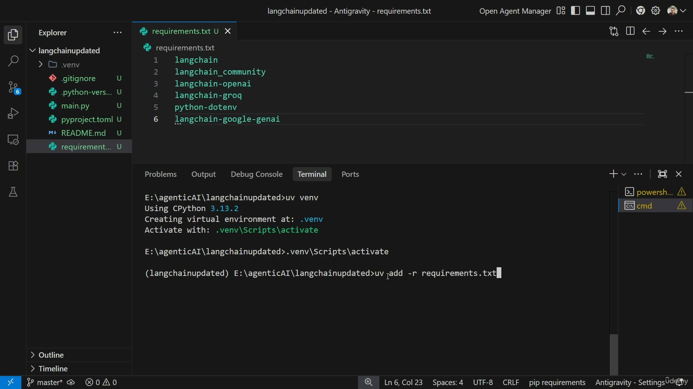

### 3.9 装 Jupyter 内核

```bash
uv add ipykernel
```

讲师解释：`ipykernel` 就是给 Jupyter Notebook 用的内核。装完之后 Notebook 才能选到这个虚拟环境的 kernel。

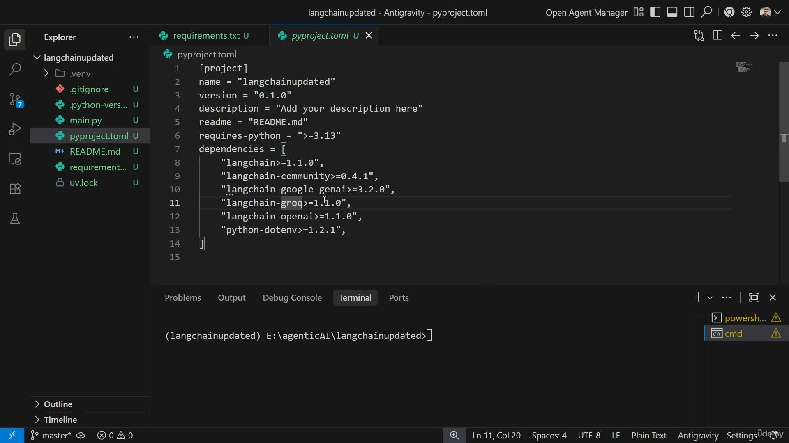

### 3.10 建 Notebook 并选内核

1. 在项目里新建文件夹 `updated langchain`（讲师先删了旧的又重建了一次）。
2. 在里面新建 `langchain_intro.ipynb`。
3. 右上角选 kernel，选 **Python Environments → .venv**。
4. 第一个 cell 写 markdown：`This is the LangChain version V1`，执行。
5. 第二个 cell 写 `1+1` 执行，确认 Python 能跑。

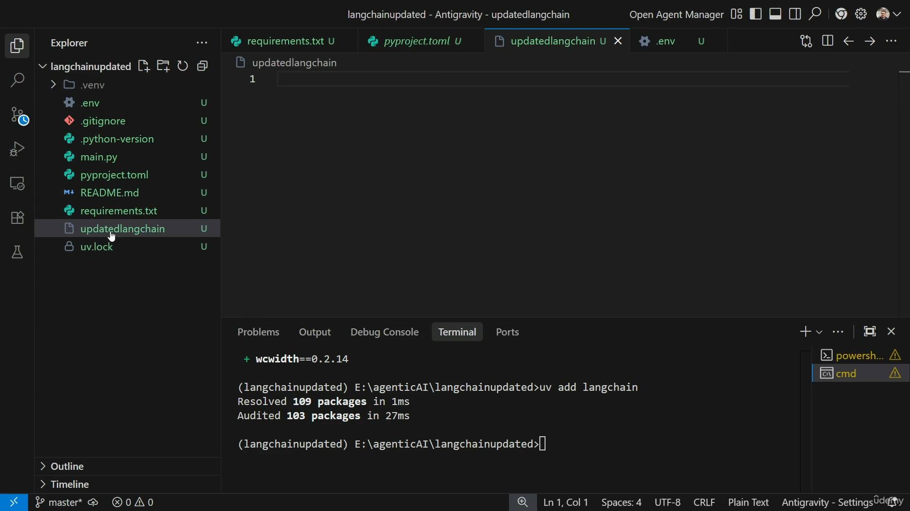

### 3.11 加载 .env

在 Notebook 里：

```python
import os
from dotenv import load_dotenv

load_dotenv()
os.environ["OPENAI_API_KEY"]
```

讲师说 Google Antigravity 的补全会一直弹建议，正常现象。执行后能打印出 key 就说明 `.env` 加载成功。

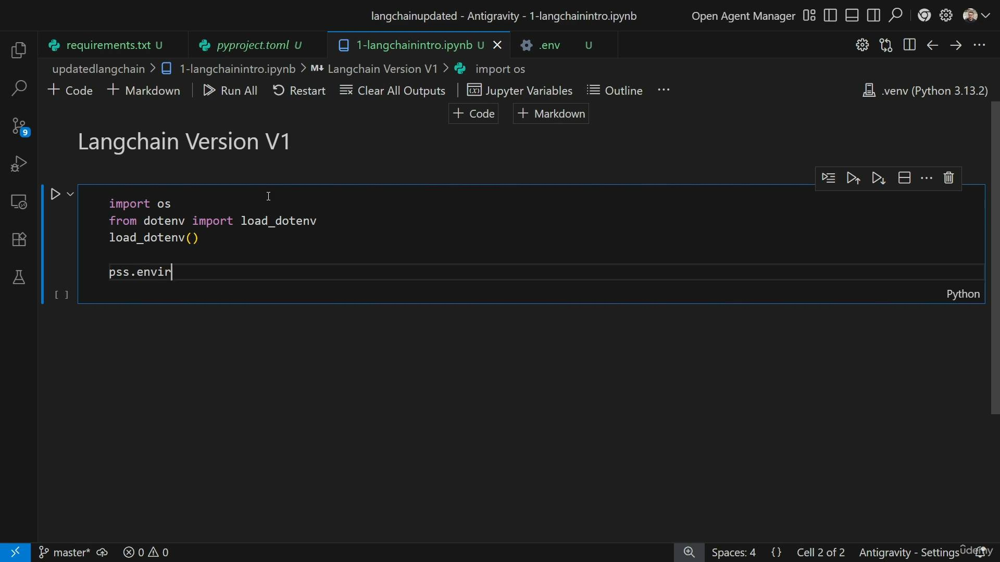

### 3.12 写第一个 Agent

```python
from langchain.agents import create_agent

agent = create_agent(
    model="gpt-5",
    tools=[],
    system_prompt="You are a helpful assistant",
)
```

讲师先加了 `verbose=True`，执行报 `unexpected keyword argument`，于是删掉 `verbose`。删掉后执行，Notebook 里会渲染出一张 Agent 结构图：`start → model → end`，因为 `tools` 还是空的。

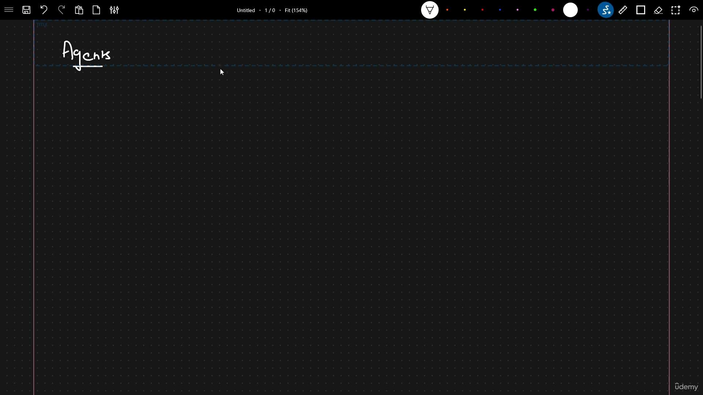

### 3.13 加一个工具

```python
def get_weather(city: str) -> str:
    """Get the weather for a city."""
    return f"The weather in {city} is sunny."

agent = create_agent(
    model="gpt-5",
    tools=[get_weather],
    system_prompt="You are a helpful assistant",
)
```

再执行一次，结构图变成 `start → model → tools → end`，model 和 tools 之间有连线。

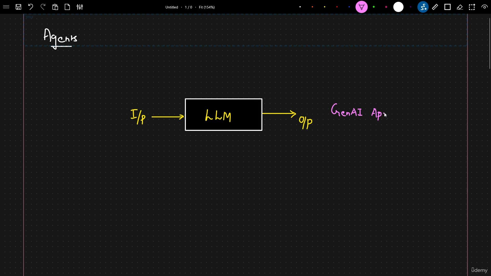

### 3.14 调用 Agent

第一次讲师直接传字符串：

```python
agent.invoke("What is the weather like in New York?")
```

报 `expected dictionary`。改成字典形式：

```python
response = agent.invoke(
    {"messages": [{"role": "user", "content": "What is the weather like in New York?"}]}
)
response["messages"][-1].content
```

执行后能看到完整消息流：HumanMessage → AIMessage（带 tool call，工具名 `get_weather`）→ ToolMessage（内容 `The weather in New York is sunny.`）→ 最终 AIMessage（`It's sunny in New York.`）。

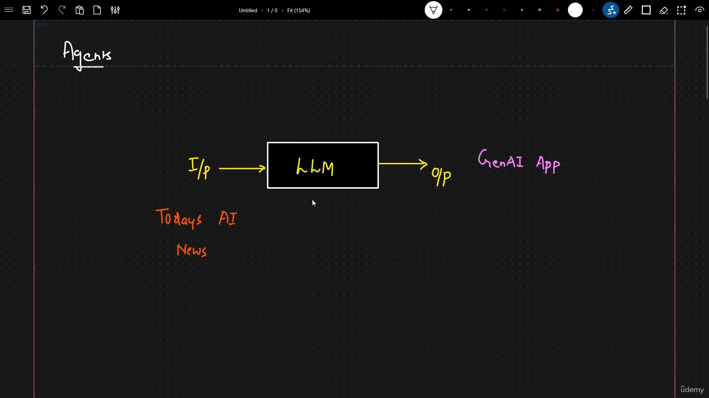

讲师还演示了另一种写法：直接传字符串也能跑（不指定 role，模型自动识别），他甚至故意打错一个拼写，模型仍然给出了正确回答。

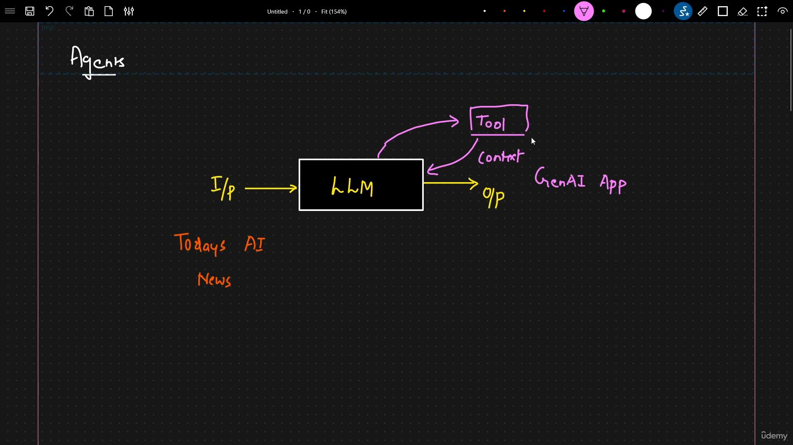

### 3.15 打印 LangChain 版本

```python
import langchain
print(langchain.__version__)
```

输出 `1.1.2`。

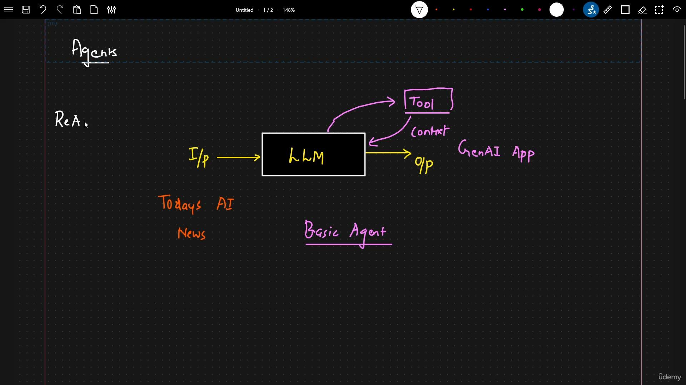

---

## 4. 完整代码

下面每个文件都是完整可保存的。路径以项目根目录 `LangchainUpdated/` 为基准。

### 4.1 目录结构

```text
LangchainUpdated/
├── .venv/                      # uv venv 生成，不要提交
├── .env                        # 三把 API Key，不要提交
├── .python-version             # uv init 生成，内容为 3.13
├── main.py                     # uv init 生成
├── pyproject.toml              # uv init 生成，uv add 会往里写依赖
├── requirements.txt            # 手写
└── updated langchain/
    └── langchain_intro.ipynb   # 手写
```

### 4.2 requirements.txt

```text
langchain
langchain-community
langchain-openai
langchain-groq
python-dotenv
langchain-google-genai
```

### 4.3 .env（变量名示例）

```bash
OPENAI_API_KEY=sk-xxxxxxxxxxxxxxxxxxxxxxxx
GOOGLE_API_KEY=AIzaxxxxxxxxxxxxxxxxxxxxxxxx
GROQ_API_KEY=gsk_xxxxxxxxxxxxxxxxxxxxxxxx
```

> 说明：`OPENAI_API_KEY` 是讲师在 P7 里明确读过的变量名。`GOOGLE_API_KEY` 与 `GROQ_API_KEY` 的具体拼写课里没念出来，这里按各家 SDK 惯例给出，实际以你所用 SDK 文档为准。

### 4.4 pyproject.toml（讲师屏幕上的基线版本，供对照）

```toml
[project]
name = "langchainupdated"
version = "0.1.0"
requires-python = ">=3.13"
dependencies = [
    "langchain==1.1.0",
    "langchain-community==0.4.1",
    "langchain-openai",
    "langchain-groq",
    "python-dotenv",
    "langchain-google-genai==3.2.0",
    "ipykernel",
]
```

> 说明：讲师只念出了 langchain 1.1.0、langchain-community 0.4.1、langchain-google-genai 3.2.0 三个版本号，其余依赖的版本号课里没讲，这里留空由 `uv add` 自动填。你实际生成的 `pyproject.toml` 格式由 uv 决定，字段名以实际文件为准。

### 4.5 updated langchain/langchain_intro.ipynb 的代码 cell

**Cell 1（markdown）**

```markdown
This is the LangChain version V1
```

**Cell 2（验证 Python）**

```python
1 + 1
```

**Cell 3（加载环境变量）**

```python
import os
from dotenv import load_dotenv

load_dotenv()
os.environ["OPENAI_API_KEY"]
```

**Cell 4（第一个 Agent，无工具）**

```python
from langchain.agents import create_agent

agent = create_agent(
    model="gpt-5",
    tools=[],
    system_prompt="You are a helpful assistant",
)
```

**Cell 5（加工具后重建 Agent）**

```python
def get_weather(city: str) -> str:
    """Get the weather for a city."""
    return f"The weather in {city} is sunny."

agent = create_agent(
    model="gpt-5",
    tools=[get_weather],
    system_prompt="You are a helpful assistant",
)
```

**Cell 6（调用并取最后一条消息）**

```python
response = agent.invoke(
    {"messages": [{"role": "user", "content": "What is the weather like in New York?"}]}
)
response["messages"][-1].content
```

**Cell 7（打印版本）**

```python
import langchain
print(langchain.__version__)
```

### 4.6 等价的 .py 版本（方便不用 Notebook 的读者）

课里没有这个文件，以下为按 Notebook 内容整理的等价脚本，标注「课里没有代码，以下为示意」：

```python
# 课里没有这个 .py 文件，以下为按 Notebook cell 整理的等价脚本
import os
from dotenv import load_dotenv
from langchain.agents import create_agent

load_dotenv()
assert os.environ.get("OPENAI_API_KEY"), "OPENAI_API_KEY 未设置"

def get_weather(city: str) -> str:
    """Get the weather for a city."""
    return f"The weather in {city} is sunny."

agent = create_agent(
    model="gpt-5",
    tools=[get_weather],
    system_prompt="You are a helpful assistant",
)

response = agent.invoke(
    {"messages": [{"role": "user", "content": "What is the weather like in New York?"}]}
)
print(response["messages"][-1].content)
```

---

## 5. 逐行解释

### 5.1 `uv init`

在空目录里生成项目骨架。它做的事相当于 `npm init` + 自动选 Python 版本。生成 `pyproject.toml`（依赖清单）、`.python-version`（版本钉死）、`main.py`（入口）。讲师强调它会自动取最新 Python，所以 `.python-version` 里是 3.13。

### 5.2 `uv venv`

创建隔离的 Python 环境到 `.venv/`。为什么必须隔离？讲师的原话是「任何项目先建虚拟环境永远是好的实践」——不同项目的依赖版本会打架，隔离后每个项目有自己的 site-packages。**在 JS/Node 里对应 `node_modules` + `package.json` 的本地依赖**，只不过 Python 的虚拟环境还隔离了解释器本身。

讲师踩的坑：`uv venv/` 会报 `unrecognized sub command`，因为斜杠被当成了子命令的一部分。命令就是 `uv venv`，不带斜杠。

### 5.3 `.venv\Scripts\activate`

把当前 shell 的 `PATH` 指向 `.venv` 里的 Python 和 pip，之后所有 `python` / `pip` 调用都走这个环境。Windows 在 `Scripts\`，Mac/Linux 在 `bin/`。激活后提示符前会出现环境名，这是判断是否激活成功的直观标志。

### 5.4 `requirements.txt` 为什么放 `.venv` 外面

`.venv` 是工具生成的、可随时删除重建的目录；`requirements.txt` 是你要提交到 git 的源文件。放进去会被 `rm -rf .venv` 一起删掉，也会被 gitignore 忽略。讲师专门强调这一点。

### 5.5 `uv add -r requirements.txt` vs `uv pip install -r requirements.txt`

- `uv add` 会把依赖**写进 `pyproject.toml`**，是「项目管理」语义。
- `uv pip install` 只装包、不改 `pyproject.toml`，是「pip 兼容」语义。

讲师说两者都能装，他演示用 `uv add`。区别在于前者会留下版本记录，后者不会——这也是为什么装完要去 `pyproject.toml` 看版本。

### 5.6 为什么不写版本号

讲师明确说「我们就是要用最新版」。好处是拿到最新功能；代价是版本会漂移。他的补救办法是把装完后的 `pyproject.toml` 发给学员当基线。他还提醒：LangChain 迭代快，很多功能会被废弃或搬到别的库，所以「尽量用最新版」比「钉死旧版」更省心。

### 5.7 `uv add ipykernel`

`ipykernel` 是 Jupyter 的 Python 内核。Notebook 本身只是前端，真正执行代码的是内核进程。装进 `.venv` 后，Notebook 的 kernel 选择器里才会出现这个环境。**在 JS 里对应 Jupyter 的 ijavascript 内核**，概念一样。

### 5.8 `load_dotenv()` + `os.environ["OPENAI_API_KEY"]`

`load_dotenv()` 读项目根目录的 `.env`，把里面的键值塞进 `os.environ`。第二行是验证：能打印出 key 就说明加载成功。**在 Node 里对应 `require('dotenv').config()` + `process.env.OPENAI_API_KEY`**。

### 5.9 `create_agent(model=..., tools=..., system_prompt=...)`

LangChain v1 的一站式建 Agent 函数。三个参数：

- `model`：模型名，讲师用 `"gpt-5"`（他说这是 OpenAI 最近的模型）。
- `tools`：工具列表，先空着，后加 `get_weather`。
- `system_prompt`：系统提示，讲师写 `"You are a helpful assistant"`。

讲师试过 `verbose=True`，报 `unexpected keyword argument`，说明这个版本不支持该参数，删掉即可。**这是版本差异导致的，不是你写错了。**

### 5.10 `get_weather` 的 docstring 为什么关键

讲师专门解释：LLM 不知道你的 Python 函数体里写了什么，它只看得到函数名、参数签名和 docstring。`"""Get the weather for a city."""` 这句就是给模型看的「这个工具是干嘛的」。没有 docstring，模型可能不知道该在什么时候调它。**这是 Agent 开发里最容易被忽略的一行。**

### 5.11 `agent.invoke` 的入参格式

- 传字符串 `"What is the weather..."` → 报 `expected dictionary`。
- 传 `{"messages": [{"role": "user", "content": "..."}]}` → 正常。

讲师说这是 `create_agent` 的硬性要求：输入必须是字典，key 是 `messages`，值是消息列表，每条消息有 `role` 和 `content`。`role: "user"` 对应 HumanMessage。他后面也演示了直接传字符串也能跑（模型自动识别），但**推荐用字典形式**，因为可以精确控制消息类型。

### 5.12 返回结构 `response["messages"][-1].content`

`invoke` 返回一个字典，`messages` 是完整对话历史：HumanMessage → AIMessage（含 tool call）→ ToolMessage（工具返回）→ AIMessage（最终回答）。取 `[-1]` 就是最后一条，`.content` 是文本。讲师说去掉 `[-1]` 能看到整段对话，调试时很有用。

### 5.13 Agent 结构图怎么读

- `tools=[]` 时：`start → model → end`，就是「输入进 LLM，LLM 出结果」。
- `tools=[get_weather]` 时：`start → model → tools → end`，model 和 tools 之间有双向连线，表示「模型决定调工具 → 工具返回 context → 模型再生成」。

这张图就是讲师在 P7 开头画的那张「LLM + 第三方工具 + context」示意图的自动可视化版本。

### 5.14 `langchain.__version__` = 1.1.2

讲师最后打印版本，确认用的是 v1.1.2。注意 `pyproject.toml` 里写的是 1.1.0，实际运行是 1.1.2——因为没锁死小版本，`uv` 装了更新的补丁版。这正是「不写版本号」的副作用，也是讲师让你对照 `pyproject.toml` 的原因。

---

## 6. 复现检查清单

按顺序打勾，任何一项不过就别往下走：

- [ ] `uv --version` 有输出
- [ ] 项目根目录有 `pyproject.toml`、`.python-version`、`main.py`
- [ ] `.python-version` 内容是 `3.13`（或你机器上的最新版）
- [ ] `uv venv` 成功，目录里有 `.venv/`
- [ ] 激活后终端提示符前有环境名
- [ ] `requirements.txt` 在项目根目录，**不在** `.venv` 里
- [ ] `uv add -r requirements.txt` 跑完无 error（warning 可忽略）
- [ ] `pyproject.toml` 里能看到 langchain、langchain-community、langchain-google-genai 等条目
- [ ] `.env` 里有 `OPENAI_API_KEY`，Notebook 里 `os.environ["OPENAI_API_KEY"]` 能打印出来
- [ ] `uv add ipykernel` 成功
- [ ] Notebook kernel 选到 `.venv`
- [ ] `1+1` 能执行
- [ ] `create_agent(tools=[])` 能执行，结构图是 `start → model → end`
- [ ] 加 `get_weather` 后结构图出现 `tools` 节点
- [ ] `agent.invoke({"messages": [...]})` 返回的消息流里有 ToolMessage，内容是 `The weather in New York is sunny.`
- [ ] `response["messages"][-1].content` 输出类似 `It's sunny in New York.`
- [ ] `langchain.__version__` 打印出 `1.1.x`

---

## 7. 课里没讲但你会撞上的

1. **`gpt-5` 这个模型名**：讲师直接用 `"gpt-5"`，但你的 OpenAI 账号不一定有权限。如果报模型不存在，换成你账号可用的模型名（课里没讲怎么换，也没讲降级方案）。同理，讲师装了 `langchain-groq` 和 `langchain-google-genai` 但 P7 里**没有演示**怎么用 Groq / Gemini 建 Agent，只装了库。

2. **`GOOGLE_API_KEY` / `GROQ_API_KEY` 的变量名**：讲师在 P6 说建了这三把钥匙，但 P7 只读了 `OPENAI_API_KEY`。另外两把的变量名课里没念，按各家 SDK 文档来。

3. **`.gitignore`**：课里没讲。你至少要把 `.venv/` 和 `.env` 加进去，否则 API Key 会进 git 历史。

4. **`uv add` 和 `uv pip install` 的副作用差异**：课里说「两者都能装」，但没说 `uv pip install` 不会更新 `pyproject.toml`。如果你用后者装完发现 `pyproject.toml` 没变，不是 bug。

5. **`verbose` 参数**：讲师在 1.1.x 上试了报错。如果你在别的版本上试，可能又能用——这是版本差异，不是你的代码问题。

6. **`create_agent` 的 `system_prompt` 参数名**：讲师用的是 `system_prompt`。LangChain 不同小版本里这个参数可能叫 `prompt` 或 `state_modifier`，如果你报 `unexpected keyword argument`，先查你装的版本的签名。

7. **Notebook 里改函数后要重跑 cell**：讲师加 `get_weather` 后重新执行了 `create_agent` 那个 cell，结构图才变。如果你只改了函数没重跑建 Agent 的 cell，图不会更新——这是 Jupyter 的状态问题，不是 LangChain 的问题。

8. **`ipykernel` 装完 kernel 列表里可能不出现**：有时需要重启 IDE 或手动刷新 kernel 列表。课里没讲这个坑。

9. **P5–P7 没有护栏 / 网关 / 可观测的代码**：模块标题里有这三个词，但这三节只到「建出第一个 Agent」。护栏（guardrails）、middleware、短期记忆、流式输出、结构化输出、多模型集成，讲师在 P5 开头列了提纲，说「后面会讲」，但**这三节的逐字稿里没有展开**。如果你冲着「护栏」来，得往后看。

10. **ReAct 架构**：讲师提了一句「以前用 ReAct 架构建 Agent」，但没展开讲 ReAct 是什么、怎么手写。知道即可，v1 的 `create_agent` 已经把这一层封装掉了。

11. **Google Antigravity**：讲师用的 IDE，说「像 Cursor 一样提供 agent 访问，免费额度有限」。课里没讲怎么装、怎么配，只说了去搜 "Google Antigravity" 下载 exe。你用 VS Code / Cursor 完全等价。

12. **`main.py` 的内容**：`uv init` 生成的默认文件，课里没打开看过，也没改过。可以忽略。