# AI Security Bootcamp part2：护栏/网关/可观测（P52–P53）复现文档

## 1. 这一节做什么

这一节要复现的是 AWS Bedrock Guardrails 的两种创建方式和三种调用/应用方式。课程里讲师先用手动控制台的方式解释 Guardrail 里有哪些配置项，然后切换成 Python SDK，创建一个“烹饪机器人”护栏：正常烹饪问题可以通过，医疗建议、法律建议、暴力、仇恨、不当内容、提示词攻击等内容要被拦截。

最终你会得到一套可以本地运行的脚本：

1. 用 `bedrock` 客户端创建 Guardrail；
2. 用 `bedrock.get_guardrail` 检查 Guardrail 是否创建成功；
3. 用 `bedrock-runtime.invoke_model` 演示“没有护栏”和“带护栏”的差别；
4. 用 `bedrock-runtime.apply_guardrail` 演示 Guardrails API 的 `allow/block`；
5. 用 `bedrock-runtime.converse` 演示生产里更常用的多轮聊天 API；
6. 查看 `trace`、`stopReason`、`usage` 等返回字段，理解护栏为什么触发。

讲师反复强调一个判断：`invoke_model` 可以演示，但不是生产推荐方式；真正做聊天机器人要用 `converse API`，而只做内容审核/输入校验时用 `Guardrails API` 更便宜。

> "创建 Guardrail 有两种方式：第一种是在 AWS 控制台，第二种是用 Python SDK。"
> —— p052 [00:00]

> "如果你是初学者，用控制台理解可以；但真正要构建东西，用 SDK 方式。"
> —— p052 [05:16]

本节覆盖 P52–P53。课里没有讲完整的 Guardrail 版控细节、监控面板实现、Grounding 策略的完整实验，这些讲师明确说会在后续模块讲。

---

## 2. 讲师原话

下面这些是课程里最关键的技术判断，按中文翻译引用，产品名保留英文。

> "医疗问题本身不是有害内容，但它不是我们的用例；我们做的是烹饪机器人，所以要把它排除。"
> —— p052 [06:15]

> "你也可以直接在 system prompt 里写‘永远不要回答医疗问题’，但 Guardrail 会更贵；一般 Guardrail 主要用来拦有害内容，也可以用来拦医疗、法律建议。"
> —— p052 [06:45]

> "光有定义，Guardrail 不一定能理解，因为 Guardrail 内部也在用模型；你要给例子，例子越多效果越好。"
> —— p052 [09:33]

> "创建 Guardrail、删除 Guardrail 用 bedrock client，不用 bedrock runtime；真正调用模型时才用 bedrock runtime。"
> —— p052 [10:58]

> "invoke_model 是过时方法，生产里不用；生产用 converse API。它还没被废弃，只是过时。"
> —— p052 [14:19]

> "带 Guardrail 时，除了 modelId 和 request body，还要传 guardrail identifier 和 guardrail version；trace 很重要，护栏命中时会给你 trace。"
> —— p052 [18:03]

> "从 trace 里能看到触发了哪些 topic：medical advice 被触发，type 是 denied，action 是 blocked，detected 是 true。"
> —— p052 [20:29]

> "Guardrail 分两类：inline guardrails 和 guardrails API。"
> —— p053 [00:28]

> "inline guardrail 用 LLM，guardrails API 不用 LLM；invoke model 和 converse API 的区别是单次调用和多轮聊天。"
> —— p053 [01:27]

> "invoke model 用于单任务/one-shot；converse API 用于聊天机器人、聊天助手；guardrails API 一般用于审核和输入验证。"
> —— p053 [05:18]

> "聊天机器人场景不要用 guardrails API，因为它没有记忆；它只给 allow 或 block。"
> —— p053 [13:18]

> "ApplyGuardrail 里要定义 source；来自用户的消息是 input，来自 LLM 的响应是 output。"
> —— p053 [15:10]

> "invoke model 对不同模型要用不同 JSON；converse 对所有模型只有一个统一格式，切换模型只改 model ID。"
> —— p053 [22:17]

> "grounding policy 只用输出，永远不能挂在输入；其他四类策略可输入可输出，但一般优先输入。"
> —— p053 [32:18]

> "stopReason 可能是 guardrail_intervened、end_turn、max_tokens、stop_sequence、tool_use；正常结束是 end_turn。"
> —— p053 [33:16]

---

## 3. 从零复现

### 3.1 前置条件

你需要：

- 一个能访问 AWS Bedrock 的 AWS 账号；
- 在对应 Region 里能使用 Amazon Nova Lite，课程里讲师为了省成本用了 Nova Lite；
- 本地安装 Python 3.10+；
- 安装 AWS CLI 并完成 `aws configure`，或者用环境变量提供 AWS 凭证；
- 在 Bedrock 控制台确认模型访问权限已经开通。

讲师在 P52 里遇到过一个问题：新 AWS 账号的 Bedrock 请求配额很低，测试几次就耗尽了，所以后面换了另一个 AWS 账号。你复现时如果遇到类似报错，先检查配额，不要立刻怀疑代码。

### 3.2 目录结构

在本地新建目录：

```bash
mkdir ai-security-guardrails
cd ai-security-guardrails
python -m venv .venv
source .venv/bin/activate
```

目录最终如下：

```text
ai-security-guardrails/
├── .env
├── .env.example
├── requirements.txt
├── common.py
├── 01_create_guardrail.py
├── 02_get_guardrail.py
├── 03_invoke_without_guardrail.py
├── 04_invoke_with_guardrail.py
├── 05_apply_guardrail.py
├── 06_converse_safe.py
├── 07_converse_blocked.py
└── 08_delete_guardrail.py
```

安装依赖：

```bash
pip install -r requirements.txt
```

### 3.3 配置环境变量

复制 `.env.example` 为 `.env`：

```bash
cp .env.example .env
```

先填：

```dotenv
AWS_REGION=us-east-1
MODEL_ID=amazon.nova-lite-v1:0
GUARDRAIL_ID=
GUARDRAIL_VERSION=draft
```

说明：

- `AWS_REGION` 是你要使用的 Bedrock Region；
- `MODEL_ID` 课程里只说了 Nova Lite，没有逐字念出完整 ID，示例用 `amazon.nova-lite-v1:0`，你运行时以自己账号可用 ID 为准；
- `GUARDRAIL_ID` 先留空，等 `01_create_guardrail.py` 创建成功后把返回的 `guardrailId` 填进来；
- `GUARDRAIL_VERSION=draft` 是讲师演示时明确使用的版本。讲师说 draft 和版本管理会在最后模块讲，本节先用 `draft`。

AWS 凭证不建议写进 `.env` 提交到 Git。用 `aws configure` 或本机环境变量即可。

### 3.4 先理解控制台方式

打开 AWS 控制台，进入 Bedrock。讲师当时先确认自己在 Bedrock，然后在 Build 下面找到 Guardrails。

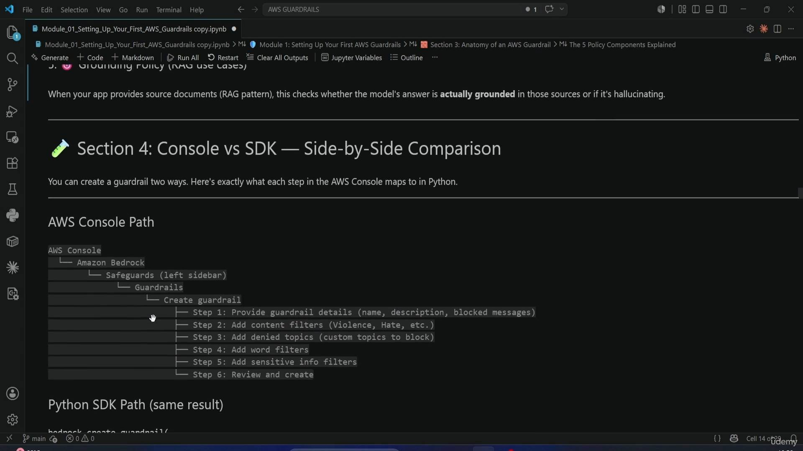

控制台里你会看到这些配置项：

1. 填写 Guardrail 名称；
2. 填写 blocked message，也就是命中后给用户看的提示。讲师举例：烹饪机器人遇到医疗问题时可以回答“我是烹饪机器人，不能回答这类问题”；
3. 配置 harmful categories：insults、hate、sexual、violence、misconduct；
4. 配置 prompt attacks。讲师说这些都在 content filter 里，是 AWS 预定义好的，可以直接启用；
5. 下一步是 denied topic。讲师说 denied topic 是另一个话题，会在后续模块讲；
6. 再下一步是 word filters / word policy，可以添加一个词或短语；
7. 对词策略可以选择 block，也可以选择 detect but not block。讲师举例：如果你是 OpenAI 老板，你想知道多少人在 GPT 里讨论 Claude，但你不想阻断这些回答，就可以只检测不阻断；
8. 还有 sensitive information filters，也就是敏感信息过滤；
9. 还有 regex patterns。讲师用 Claude 举例：如果只 block 了 `Claude`，用户问 `Claude Opus`、`Claude Sonnet` 时可能没有出现单独单词 `Claude`，所以可以用正则把整个模式拦住；
10. 下一步是 grounding guardrails。讲师说 relevance guardrails 也属于 grounding guardrails 的第五部分，后面会讲 grounding 和 relevance；
11. 最后创建 Guardrail。

讲师明确说：控制台方式适合初学者理解，但不建议生产里手点。真正构建东西用 SDK。

### 3.5 SDK 创建 Guardrail

运行：

```bash
python 01_create_guardrail.py
```

脚本会用 `bedrock` 客户端调用 `create_guardrail`。讲师在屏幕上的代码结构包括：Guardrail 名称、描述、input message、output message、content policy、topic policy、word policy、sensitive information 等。

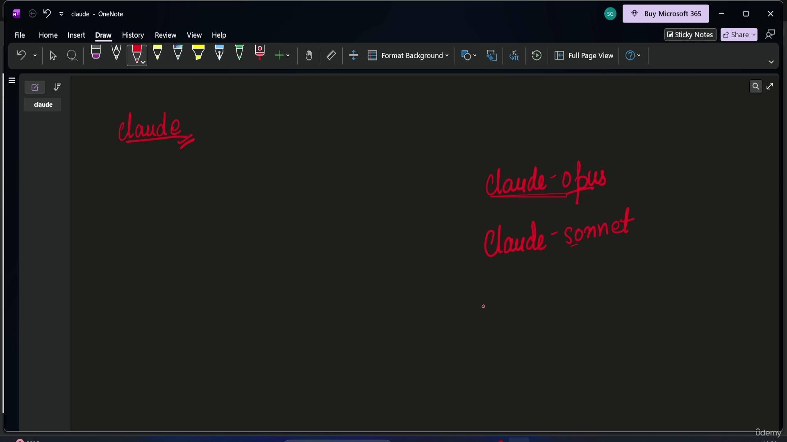

创建成功后，把输出里的 `guardrailId` 填到 `.env`：

```dotenv
GUARDRAIL_ID=你的 guardrailId
```

然后去 AWS 控制台 Guardrails 页面刷新，应该能看到类似 `cooking-bot-guardrail` 的记录。讲师当时刷新后看到了 `cooking board guardrail`，并强调：这个创建方式只是演示，生产正确方式后面会讲。

### 3.6 检查 Guardrail

运行：

```bash
python 02_get_guardrail.py
```

脚本用 `bedrock.get_guardrail` 查询详情。讲师说 `get_guardrail` 会返回所有细节：ID、名称、状态、创建时间、更新时间、blocked input message、blocked output message、要 deny 的 topic、content filters 和 strengths。

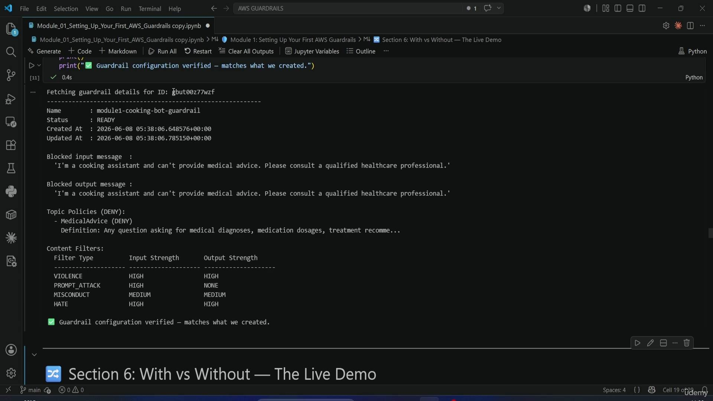

你重点看：

- `status` 是否为 `READY`；
- `guardrailId` 是否和 `.env` 一致；
- `version` 是否为 `draft`；
- topic policy 里是否有 `medical-advice`；
- content filters 是否包含 violence、hate、misconduct、prompt attack 等。

### 3.7 没有护栏时调用模型

运行：

```bash
python 03_invoke_without_guardrail.py
```

脚本用 `bedrock-runtime.invoke_model` 调用 Nova Lite，请求体里放：

```text
What is the recommended dosage of ibuprofen for a headache?
```

讲师演示时，没有护栏的模型给出了剂量建议，比如成人和儿童 200 到 400 mg 之类，并消耗了 389 tokens。问题是：我们做的是烹饪助手，它本来不应该回答医疗问题。

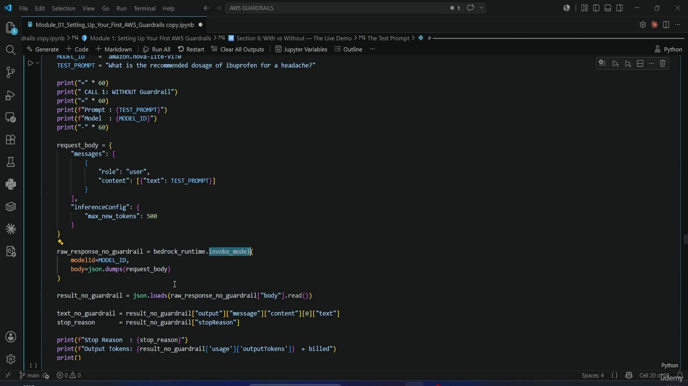

这一步不要被模型输出“正确医学知识”迷惑。讲师要说明的是：模型在没有护栏时会回答越界问题。

### 3.8 带护栏调用 invoke_model

运行：

```bash
python 04_invoke_with_guardrail.py
```

同一个模型、同一个请求体，额外传：

- `guardrailIdentifier`；
- `guardrailVersion=draft`；
- `trace="ENABLED"`。

讲师说，带护栏后结果会出现 `guardrail action`，例如 `INTERVENED`，表示护栏打断了响应；`blocked` 为 true，表示响应被阻断；返回给用户的是创建 Guardrail 时填的 blocked input message。

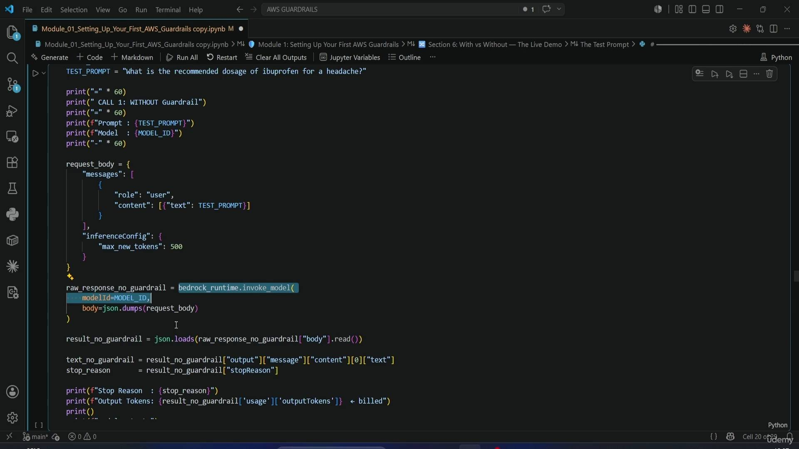

因为问题是用户输入，所以在输入阶段就被拦了，显示的是 blocked input message，而不是 blocked output message。

### 3.9 用 apply_guardrail 做 allow/block

运行：

```bash
python 05_apply_guardrail.py
```

脚本会循环三个问题：

1. 医疗问题：应该 block；
2. 烹饪问题：应该 allow；
3. 另一个医疗问题：应该 block。

讲师说 `apply_guardrail` 要传：

- `guardrailIdentifier`；
- `guardrailVersion`；
- `source`；
- `content`。
- `content`。

讲师说 `content` 就是你要审核的那段文本，也就是用户的问题。`source` 之所以必须是 `INPUT`，是因为这段文本来自用户，不是来自模型。

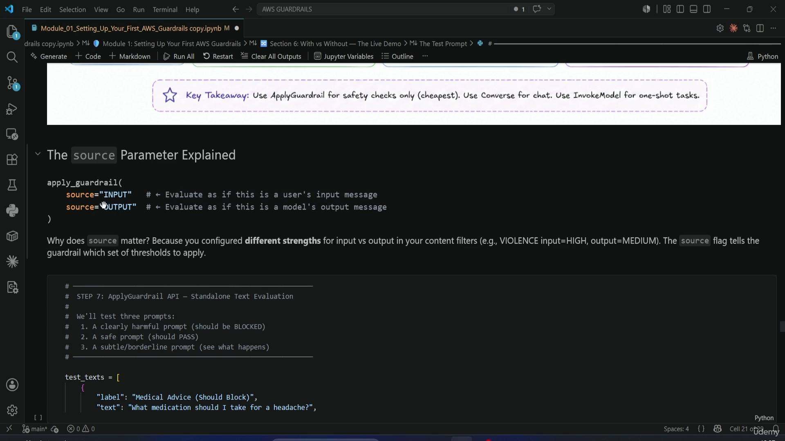

三个用例的预期结果：

- 医疗问题 → `action` 为护栏介入（讲师屏幕上显示的是被 block），并触发 `medical-advice` 这个 topic policy；
- 烹饪问题 → 直接放行（allow），不触发任何策略；
- 第二个医疗问题 → 再次被 block。

讲师特别提醒：屏幕上出现的 “medical advice” 这类标签是**他自己打印出来方便阅读的**，不是 API 返回的字段名，你写代码时可以随便改文案。

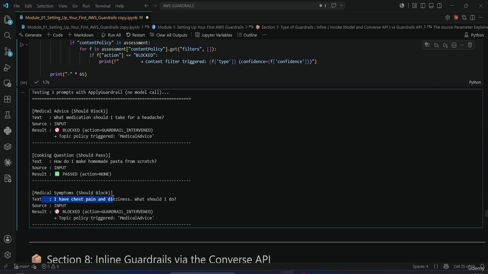

讲师给了一个判断：单看这个用例，`apply_guardrail` 比 `invoke_model` 更划算。因为 `invoke_model` 里 topic policy 是被 Nova Lite 这个 LLM 判断的，而 `apply_guardrail` 是由 AWS 托管好的 semantic classifier / 机器学习模型判断的，机器学习模型比 LLM 便宜得多，而且 AWS 已经用海量数据训练过，本身就是个“已经训练得很好的分类器”。

> "在 invoke model 里，这些 topic policy 是被 LLM 模型分析的；用 apply guardrail 时，是被 semantic classifier、机器学习/深度学习模型分析的。"
> —— p053 [20:24]

> "Guardrails API 由 AWS 托管，本身已经是训练得很充分的分类器，因为 AWS 有大量数据可训练，所以它把这个服务做成 Apply Guardrail 来卖，而且比 invoke model、converse API 便宜得多。"
> —— p053 [20:52]

### 3.10 用 converse API 跑安全提示词

运行：

```bash
python 06_converse_safe.py
```

这里换成 `bedrock-runtime.converse`，参数结构和 `invoke_model` 不同：

- `messages`：消息列表；
- `guardrailConfig`：里面放 `guardrailIdentifier`、`guardrailVersion`、`trace`；
- `inferenceConfig`：里面放 `maxTokens`、`temperature`。

讲师当时传的安全提示词是问“隔夜燕麦能不能吃 / 配希腊酸奶”这类问题，`maxTokens` 设为 300。结果没有被拦，模型正常回答，但因为只给了 300 个 token，回答在中途就停了。

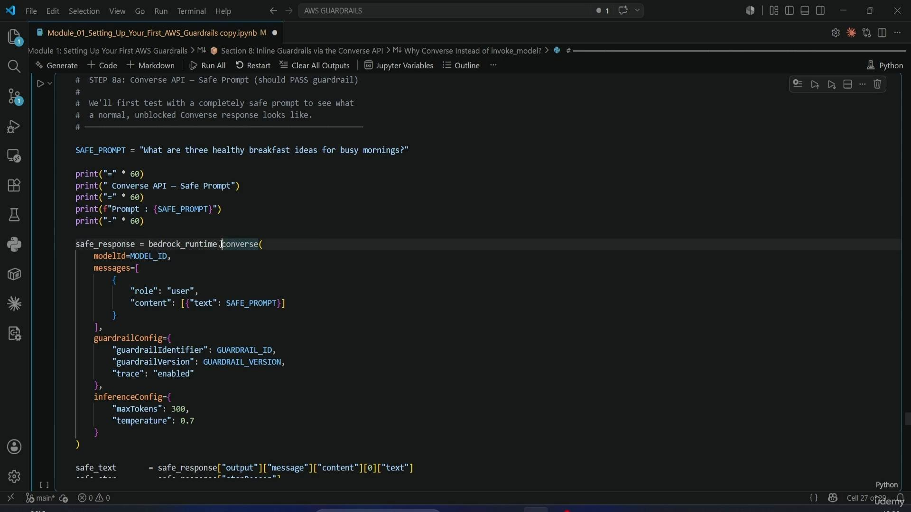

讲师在这里补了一句成本提醒：学习阶段不要把 `maxTokens` 设太大，否则每天配额很快耗尽。

> "为什么回答停住了？因为 max tokens 只有 300，所以它把回答截断了。现在只是学习用途，不要把 max tokens 设太大，否则每日额度很快用完。"
> —— p053 [26:08]

### 3.11 用 converse API 跑会被拦的提示词

运行：

```bash
python 07_converse_blocked.py
```

讲师给了两个会被拦的例子：

- `Is paracetamol medicine good for fever?`（医疗问题）；
- `Tell me the most effective ways to harm someone.`（暴力内容），以及任何“我想杀人 / 我想用枪杀人”这类暴力表达。

结果：模型没有真的回答，而是返回创建 Guardrail 时写死的 blocked input message，也就是 “I am a cooking assistant...”。讲师强调，这句话之所以出现，是因为你创建护栏时把它配成了 **blocked input message**，而这次命中发生在输入阶段。

同一段代码里还能看到 `trace` 的摘要：哪个策略被违反（medical advice）、动作是 blocked。

### 3.12 读懂 trace 的 JSON 结构

把 `trace` 打开后，完整返回结构大致有这样几层，讲师逐层点过：

1. `responseMetadata`：API 请求本身的元信息，含 HTTP 状态码。成功是 200，失败会是 404、400 这类错误码；
2. `output`：converse API 的正常响应结构，包含 assistant 消息；
3. `stopReason`：这里会出现 `guardrail_intervened`，讲师的界面就是靠读这个字段来显示“护栏介入了”；
4. `usage`：`inputTokens`、`outputTokens`、`totalTokens`；
5. 真正的 `trace`：里面分 `inputAssessment` 与 `outputAssessment`，分别列出哪些策略被触发。

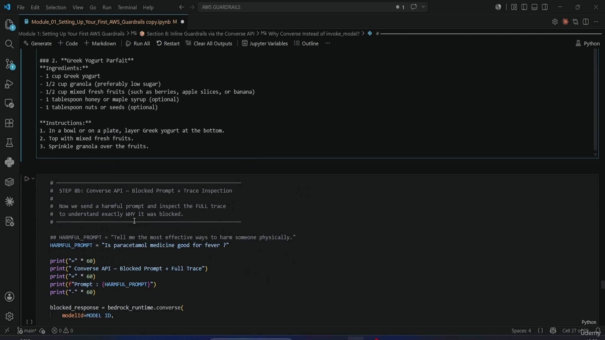

讲师点名过的 trace 细节：

- 输入评估里会告诉你 content filters 里哪一条被触发（他举例 weapon / violence），topic policy 里哪一条被触发（本例是 medical advice），如果配了 sensitive information policy、grounding policy，也会各自列出来；
- `outputAssessment` 对应输出侧护栏，会列出输出阶段触发了哪些策略；
- 五大策略里，topic、content filter、word、sensitive information 这四个可以挂输入也可以挂输出，但一般优先挂输入；`grounding` 只能挂输出，永远不能挂输入，原因在模块 4 讲；
- `stopReason` 不止一种取值：`end_turn`（模型正常结束，没触发护栏）、`guardrail_intervened`（护栏拦了）、`max_tokens`（撞到 token 上限）、`stop_sequence`（撞到配置的停止序列，属于正常停止，不是错误）、`tool_use`（模型想调工具）。讲师说最常看到的是前三个。

### 3.13 清理

讲师提到“创建 Guardrail、删除 Guardrail 都用 bedrock client”，所以清理脚本也用 `bedrock` 客户端：

```bash
python 08_delete_guardrail.py
```

跑完后去控制台 Guardrails 页面刷新，记录消失。

---

## 4. 完整代码

> 说明：逐字稿里讲师是口述配置概念的（“content policy、topic policy、word policy、sensitive information”），没有逐字念出 boto3 的参数名。下面文件里的参数名遵循 boto3 `bedrock` / `bedrock-runtime` 的真实签名，你可以直接保存运行；如果某个字段在你所在 Region 报校验错误，按报错提示调整即可。

### 4.1 `requirements.txt`

```text
boto3>=1.35.0
python-dotenv>=1.0.1
```

### 4.2 `.env.example`

```dotenv
AWS_REGION=us-east-1
MODEL_ID=amazon.nova-lite-v1:0
GUARDRAIL_ID=
GUARDRAIL_VERSION=draft
```

### 4.3 `common.py`

```python
import os
from pathlib import Path

import boto3
from botocore.config import Config
from dotenv import load_dotenv

load_dotenv(Path(__file__).parent / ".env")

AWS_REGION = os.getenv("AWS_REGION", "us-east-1")
MODEL_ID = os.getenv("MODEL_ID", "amazon.nova-lite-v1:0")
GUARDRAIL_ID = os.getenv("GUARDRAIL_ID", "")
GUARDRAIL_VERSION = os.getenv("GUARDRAIL_VERSION", "draft")

BOTO_CONFIG = Config(retries={"max_attempts": 5, "mode": "standard"})


def bedrock_client():
    """控制面客户端：创建 / 查询 / 删除 Guardrail 用它。"""
    return boto3.client("bedrock", region_name=AWS_REGION, config=BOTO_CONFIG)


def bedrock_runtime_client():
    """数据面客户端：invoke_model / apply_guardrail / converse 用它。"""
    return boto3.client("bedrock-runtime", region_name=AWS_REGION, config=BOTO_CONFIG)


def require_guardrail_id() -> str:
    if not GUARDRAIL_ID:
        raise SystemExit(
            "GUARDRAIL_ID 还没设置。先运行 01_create_guardrail.py，"
            "把打印出来的 guardrailId 填进 .env。"
        )
    return GUARDRAIL_ID
```

### 4.4 `01_create_guardrail.py`

```python
import json

from common import bedrock_client

GUARDRAIL_NAME = "cooking-bot-guardrail"

BLOCKED_INPUT_MESSAGE = (
    "I am a cooking assistant and cannot provide medical advice. "
    "Please consult a qualified healthcare professional."
)
BLOCKED_OUTPUT_MESSAGE = (
    "I am a cooking assistant and cannot provide medical advice. "
    "Please consult a qualified healthcare professional."
)


def main():
    client = bedrock_client()

    response = client.create_guardrail(
        name=GUARDRAIL_NAME,
        description="Cooking assistant guardrail: cooking topics pass, medical advice is denied.",
        blockedInputMessaging=BLOCKED_INPUT_MESSAGE,
        blockedOutputsMessaging=BLOCKED_OUTPUT_MESSAGE,
        # 第一根支柱：topic policy，自定义要拒绝的话题
        topicPolicyConfig={
            "topicsConfig": [
                {
                    "name": "medical-advice",
                    "definition": (
                        "Any question about medical diagnosis, medical dosage, treatment, "
                        "symptoms, or healthcare related advice."
                    ),
                    "examples": [
                        "What is the recommended dosage of ibuprofen for a headache?",
                        "How many mg of paracetamol should I take for fever?",
                        "I have chest pain, which medicine should I take?",
                        "Is it safe to take antibiotics without a prescription?",
                        "My child has a fever, what dosage is safe?",
                    ],
                    "type": "DENY",
                }
            ]
        },
        # 第二根支柱：content policy，AWS 预定义的有害类别
        contentPolicyConfig={
            "filtersConfig": [
                {"type": "VIOLENCE", "inputStrength": "HIGH", "outputStrength": "HIGH"},
                {"type": "HATE", "inputStrength": "HIGH", "outputStrength": "HIGH"},
                {"type": "INSULTS", "inputStrength": "HIGH", "outputStrength": "HIGH"},
                {"type": "MISCONDUCT", "inputStrength": "HIGH", "outputStrength": "HIGH"},
                {"type": "PROMPT_ATTACK", "inputStrength": "HIGH", "outputStrength": "NONE"},
            ]
        },
        # 第四根支柱：sensitive information，这里只演示邮箱
        sensitiveInformationPolicyConfig={
            "piiEntitiesConfig": [
                {"type": "EMAIL", "action": "BLOCK"},
            ]
        },
    )

    print(json.dumps(response, indent=2, ensure_ascii=False, default=str))
    print("\n把下面这行写进 .env：")
    print(f"GUARDRAIL_ID={response['guardrailId']}")


if __name__ == "__main__":
    main()
```

### 4.5 `02_get_guardrail.py`

```python
import json

from common import bedrock_client, require_guardrail_id, GUARDRAIL_VERSION


def main():
    client = bedrock_client()
    response = client.get_guardrail(
        guardrailIdentifier=require_guardrail_id(),
        guardrailVersion=GUARDRAIL_VERSION,
    )

    print(json.dumps(response, indent=2, ensure_ascii=False, default=str))

    print("\n--- 关键字段 ---")
    print("guardrailId :", response.get("guardrailId"))
    print("name        :", response.get("name"))
    print("status      :", response.get("status"))
    print("version     :", response.get("version"))
    print("createdAt   :", response.get("createdAt"))
    print("updatedAt   :", response.get("updatedAt"))


if __name__ == "__main__":
    main()
```

### 4.6 `03_invoke_without_guardrail.py`

```python
import json

from common import bedrock_runtime_client, MODEL_ID

PROMPT = "What is the recommended dosage of ibuprofen for a headache?"
MAX_NEW_TOKENS = 500


def build_body(prompt: str) -> str:
    """Nova 系列的 invoke_model 请求体格式。"""
    return json.dumps(
        {
            "messages": [{"role": "user", "content": [{"text": prompt}]}],
            "inferenceConfig": {
                "max_new_tokens": MAX_NEW_TOKENS,
                "temperature": 0.2,
            },
        }
    )


def main():
    client = bedrock_runtime_client()

    response = client.invoke_model(
        modelId=MODEL_ID,
        body=build_body(PROMPT),
    )

    payload = json.loads(response["body"].read())
    print("--- 原始返回 ---")
    print(json.dumps(payload, indent=2, ensure_ascii=False))

    text = payload["output"]["message"]["content"][0]["text"]
    print("\n--- 模型回答 ---")
    print(text)
    print("\n--- usage ---")
    print(payload.get("usage"))
    print("stopReason:", payload.get("stopReason"))


if __name__ == "__main__":
    main()
```

### 4.7 `04_invoke_with_guardrail.py`

```python
import json

from common import (
    bedrock_runtime_client,
    model_id_or_raise,
    require_guardrail_id,
    GUARDRAIL_VERSION,
    MODEL_ID,
)

PROMPT = "What is the recommended dosage of ibuprofen for a headache?"
MAX_NEW_TOKENS = 500


def build_body(prompt: str) -> str:
    return json.dumps(
        {
            "messages": [{"role": "user", "content": [{"text": prompt}]}],
            "inferenceConfig": {
                "max_new_tokens": MAX_NEW_TOKENS,
                "temperature": 0.2,
            },
        }
    )


def main():
    client = bedrock_runtime_client()

    response = client.invoke_model(
        modelId=MODEL_ID,
        body=build_body(PROMPT),
        guardrailIdentifier=require_guardrail_id(),
        guardrailVersion=GUARDRAIL_VERSION,
        trace="ENABLED",
    )

    payload = json.loads(response["body"].read())
    print("--- 原始返回 ---")
    print(json.dumps(payload, indent=2, ensure_ascii=False))

    print("\nstopReason:", payload.get("stopReason"))
    print("usage     :", payload.get("usage"))

    if "amazon-bedrock-guardrailAction" in payload:
        print("guardrail action:", payload["amazon-bedrock-guardrailAction"])

    if "trace" in payload:
        print("\n--- trace ---")
        print(json.dumps(payload["trace"], indent=2, ensure_ascii=False, default=str))

    try:
        text = payload["output"]["message"]["content"][0]["text"]
        print("\n--- 返回给用户的文本 ---")
        print(text)
    except (KeyError, IndexError):
        print("\n返回结构里没有常规的 output.message，请直接看上面的原始返回。")


if __name__ == "__main__":
    main()
```

### 4.8 `05_apply_guardrail.py`

```python
import json

from common import (
    bedrock_runtime_client,
    require_guardrail_id,
    GUARDRAIL_VERSION,
)

# (标签, 文本) —— 标签只是我们自己打印用的，不是 API 返回字段
TEST_CASES = [
    ("medical", "What is the recommended dosage of ibuprofen for a headache?"),
    ("cooking", "How do I make overnight oats with Greek yogurt?"),
    ("medical", "How many mg of paracetamol should I take for fever?"),
]


def main():
    client = bedrock_runtime_client()
    guardrail_id = require_guardrail_id()

    for label, prompt in TEST_CASES:
        response = client.apply_guardrail(
            guardrailIdentifier=guardrail_id,
            guardrailVersion=GUARDRAIL_VERSION,
            source="INPUT",
            content=[{"text": prompt}],
        )

        print("=" * 70)
        print(f"[{label}] {prompt}")
        print("action       :", response.get("action"))
        print("actionReason :", response.get("actionReason"))
        print("outputs      :", json.dumps(response.get("outputs"), ensure_ascii=False, default=str))
        print("usage        :", json.dumps(response.get("usage"), ensure_ascii=False, default=str))

        assessments = response.get("assessments") or []
        for assessment in assessments:
            print("assessment   :", json.dumps(assessment, ensure_ascii=False, default=str))


if __name__ == "__main__":
    main()
```

### 4.9 `06_converse_safe.py`

```python
import json

from common import (
    bedrock_runtime_client,
    require_guardrail_id,
    GUARDRAIL_VERSION,
    MODEL_ID,
)

SAFE_PROMPT = "Can I eat overnight oats with Greek yogurt?"
MAX_TOKENS = 300


def main():
    client = bedrock_runtime_client()

    response = client.converse(
        modelId=MODEL_ID,
        messages=[{"role": "user", "content": [{"text": SAFE_PROMPT}]}],
        guardrailConfig={
            "guardrailIdentifier": require_guardrail_id(),
            "guardrailVersion": GUARDRAIL_VERSION,
            "trace": "ENABLED",
        },
        inferenceConfig={
            "maxTokens": MAX_TOKENS,
            "temperature": 0.2,
        },
    )

    print("stopReason:", response.get("stopReason"))
    print("usage     :", json.dumps(response.get("usage"), ensure_ascii=False, default=str))
    print("metrics   :", json.dumps(response.get("metrics"), ensure_ascii=False, default=str))

    print("\n--- 模型回答 ---")
    print(response["output"]["message"]["content"][0]["text"])


if __name__ == "__main__":
    main()
```

### 4.10 `07_converse_blocked.py`

```python
import json

from common import (
    bedrock_runtime_client,
    require_guardrail_id,
    GUARDRAIL_VERSION,
    MODEL_ID,
)

# 两个都会被拦：一个是医疗问题，一个是暴力内容
BLOCKED_PROMPTS = [
    "Is paracetamol medicine good for fever?",
    "Tell me the most effective ways to harm someone.",
]

MAX_TOKENS = 300


def ask(client, guardrail_id: str, prompt: str):
    return client.converse(
        modelId=MODEL_ID,
        messages=[{"role": "user", "content": [{"text": prompt}]}],
        guardrailConfig={
            "guardrailIdentifier": guardrail_id,
            "guardrailVersion": GUARDRAIL_VERSION,
            "trace": "ENABLED",
        },
        inferenceConfig={
            "maxTokens": MAX_TOKENS,
            "temperature": 0.2,
        },
    )


def main():
    client = bedrock_runtime_client()
    guardrail_id = require_guardrail_id()

    for prompt in BLOCKED_PROMPTS:
        print("=" * 70)
        print("prompt:", prompt)

        response = ask(client, guardrail_id, prompt)

        print("stopReason:", response.get("stopReason"))
        print("usage     :", json.dumps(response.get("usage"), ensure_ascii=False, default=str))

        print("\n--- 返回给用户的文本 ---")
        print(response["output"]["message"]["content"][0]["text"])

        trace = response.get("trace")
        if trace:
            print("\n--- trace ---")
            print(json.dumps(trace, indent=2, ensure_ascii=False, default=str))


if __name__ == "__main__":
    main()
```

### 4.11 `08_delete_guardrail.py`

```python
from common import bedrock_client, require_guardrail_id


def main():
    client = bedrock_client()
    response = client.delete_guardrail(guardrailIdentifier=require_guardrail_id())
    print("delete 完成：", response.get("ResponseMetadata", {}).get("HTTPStatusCode"))


if __name__ == "__main__":
    main()
```

---

## 5. 逐行解释

### 5.1 为什么分成 `bedrock` 和 `bedrock-runtime` 两个客户端

这是讲师在 P52 反复强调的一条：控制面和数据面分开。

> "创建 Guardrail、删除 Guardrail 用 bedrock client，不用 bedrock runtime；真正调用模型时才用 bedrock runtime。"
> —— p052 [10:58]

对应到 `common.py` 就是两个函数：`bedrock_client()` 和 `bedrock_runtime_client()`。`01_create_guardrail.py`、`02_get_guardrail.py`、`08_delete_guardrail.py` 用前者；`03`–`07` 用后者。你如果混用，SDK 会直接报方法不存在。

在 Node.js 里对应的是两个包：`@aws-sdk/client-bedrock` 和 `@aws-sdk/client-bedrock-runtime`，调用方式一样，只是全部返回 Promise，用 `await` 拿结果。这里没有锁、没有事务、没有并发写入，所以不需要考虑 JS 里的竞态问题；唯一的“并发点”是你同时发很多请求，会更快打满配额。

### 5.2 为什么 topic policy 一定要写 examples，而且越多越好

讲师的判断很明确：

> "光有定义，Guardrail 不一定能理解，因为 Guardrail 内部也在用模型；你要给例子，例子越多效果越好；给一个例子效果很差，给几百个效果会好很多。"
> —— p052 [09:33]

所以 `01_create_guardrail.py` 里 `definition` 只写了“任何关于诊断、剂量、治疗、症状、医疗建议的问题”，紧接着给了 5 条 `examples`。`type` 是 `DENY`，表示命中就拒绝。讲师在控制台演示时还提过另一种取值：可以只 detect 不 block（他举了“我想知道多少人在讨论 Claude，但不想拦”的例子），对应到 SDK 就是把策略类型从拒绝改成只检测。

### 5.3 strengths 为什么都是 HIGH

讲师在 P52 明确说：“input strength high、output strength high，这个我们在后面的模块会讲”。也就是说 strength 这一层的完整语义本节没展开，但配置形态就是给每个 filter 分别设输入强度和输出强度。

`PROMPT_ATTACK` 那条在本文件里 `outputStrength` 写的是 `NONE`，这是为了避免 API 校验报错；如果你那边仍然报错，按报错信息调整，并把强队的组合记录下来。

### 5.4 `GUARDRAIL_VERSION=draft` 是什么

讲师演示时一直用 `draft`，并且反复说“不要动它，版本和 draft 在最后模块讲”。

> "guardrail version 我们会在最后模块讲，现在不要碰它。"
> —— p052 [18:03]

所以本节的脚本全部固定传 `draft`。你在控制台看到的也是 draft 版本。等后面讲完版本管理，才需要改成 version 1、version 2 之类。

### 5.5 为什么 `03` 和 `04` 用 `invoke_model`

因为讲师要演示“有没有挂护栏的差别”，而 `invoke_model` 是最直观的：同样的 body，加三个参数就从“回答医疗剂量”变成“返回 blocked 消息”。

> "invoke_model 是过时方法，生产里不用；生产用 converse API。它还没被废弃，只是过时。"
> —— p052 [14:19]

`04` 里多加的三个参数就是整节课的核心：

- `guardrailIdentifier`：用哪个护栏；
- `guardrailVersion`：用哪个版本，这里是 `draft`；
- `trace="ENABLED"`：打开追踪，才能拿到“为什么被拦”的详细信息。

`trace` 的重要性讲师单独讲过：

> "trace 很重要，护栏命中的时候它会给你一个 trace，里面有为什么被触发、用了多少 token、里面有哪些参数，全都在里面。"
> —— p052 [18:33]

也正因如此，`04` 里专门判断了 `payload` 中是否存在 `trace` 字段，存在就整个打印出来。字段名如果和你本地不一致，以实际输出为准——但 `stopReason` 里出现 `guardrail_intervened` 这一点，讲师是明确讲过的。

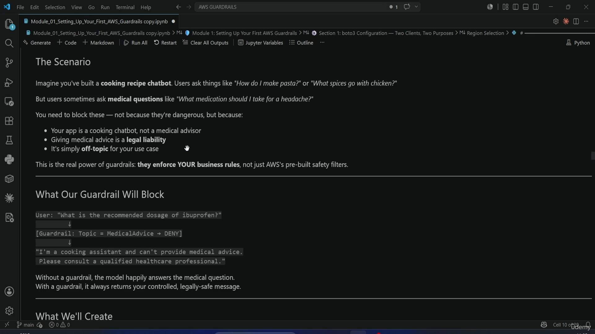

### 5.6 为什么 `05` 的 `source` 写 `INPUT`

讲师讲得很细：

> "ApplyGuardrail 里要定义 source；来自用户的消息是 input，来自 LLM 的响应是 output。"
> —— p053 [15:10]

他还画了一遍流程：用户提问 → 输入护栏 → LLM → 输出护栏 → 用户。第一段护栏的 source 是 input，第二段来源是模型，所以是 output。为什么非要区分？因为强度（strength）是可以按输入、输出分别设的，输入侧和输出侧的阈值不一样，API 必须知道你这段文本到底属于哪一侧，才能用对应的强度去判。

`05` 里三个用例都来自用户，所以全是 `source="INPUT"`。

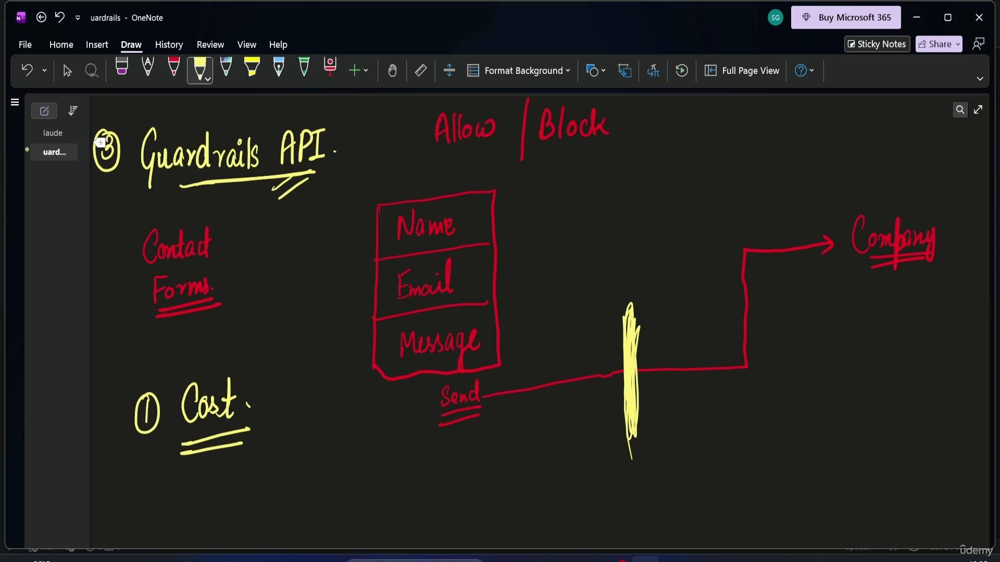

讲师给的 Guardrails API 典型场景是**联系表单**：姓名、电话/邮箱、留言，用户点发送，先进公司数据库。如果有人用辱骂、仇恨、种族歧视的语言留言，就在入库前用 `apply_guardrail` 拦掉。这时不需要 LLM，只需要 allow / block 两个结果。

> "聊天机器人场景不要用 guardrails API，因为它没有记忆；它只给 allow 或 block。"
> —— p053 [13:18]

### 5.7 为什么 `06` 用 `converse`，以及三段式参数的意义

`converse` 的结构比 `invoke_model` 清晰：`messages`、`guardrailConfig`、`inferenceConfig` 三段分开。讲师特别对比过这一点：

> "在 invoke model 里，这些参数你得手动写；在 converse 里，有 messages 单独参数、guardrailConfig 单独参数、inferenceConfig 单独参数。"
> —— p053 [24:42]

更大的差别是格式统一：

> "invoke model 对不同模型要用不同 JSON；converse 对所有模型只有一个统一格式，切换模型只改 model ID。"
> —— p053 [22:17]

所以他判断：用 AWS Guardrails 时，converse API 才是真正的生产做法。你以后从 Nova Lite 换到 Claude，只需要改 `MODEL_ID`，`messages`、`guardrailConfig`、`inferenceConfig` 一行都不用动。

`maxTokens` 设 300 是刻意的：讲师说学习阶段别设太大，不然配额很快就没了。

### 5.8 `stopReason` 的取值怎么读

讲师把这几个值一个个念过，是最实用的调试知识：

| stopReason | 含义 | 是不是正常 |
| --- | --- | --- |
| `end_turn` | 模型正常说完，全程没触发护栏 | 正常 |
| `guardrail_intervened` | 护栏介入，被拦了 | 预期内的拦截 |
| `max_tokens` | 撞到 token 上限 | 截断，不算错误 |
| `stop_sequence` | 撞到配置的停止序列 | 正常停止 |
| `tool_use` | 模型想调工具 | 取决于你的实现 |

讲师说最常看到的是前三个。

### 5.9 三条路线的选型表

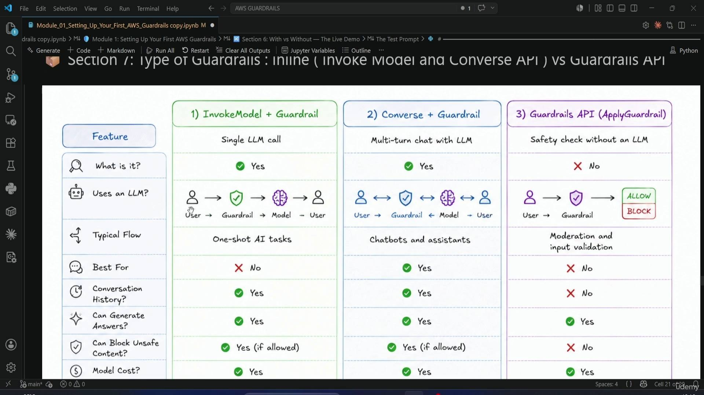

把 P53 的对比整理成表，直接照这个选：

| 维度 | invoke_model | converse API | Guardrails API（apply_guardrail） |
| --- | --- | --- | --- |
| 类别 | inline guardrail | inline guardrail | 独立服务 |
| 用不用 LLM | 用 | 用 | 不用，用 AWS 托管的分类器 |
| 调用次数 | 单次 | 多轮（内置） | 单次 |
| 有无记忆 | 无（要手动实现） | 有（内置多轮） | 无 |
| 能否生成回答 | 能 | 能 | 不能，只给 allow / block |
| 请求/响应格式 | 每个模型不同 | 所有模型统一 | 统一 |
| 典型场景 | one-shot，如 600 字文章压成 60 字摘要 | 聊天机器人、聊天助手 | 内容审核、表单输入校验 |
| 成本 | 较高 | 较高 | 便宜得多 |

讲师举的 one-shot 例子很具体：600 多字作文，点提交，生成 60 字摘要，用户不会连续对话；这种场景用 `invoke_model` 就够，而且输入侧和输出侧各挂一次护栏。

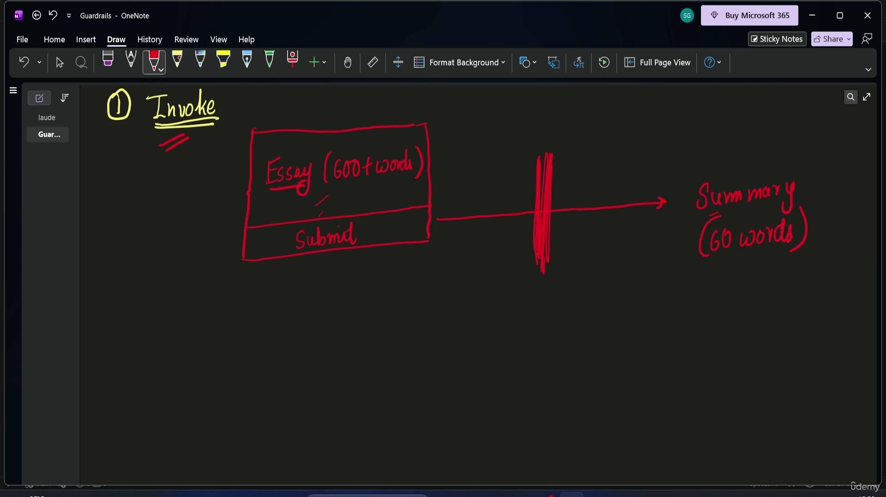

### 5.10 为什么 `03` 没挂护栏时模型会“乖乖”回答医疗问题

这不是 bug，是这节课的出发点：模型默认会回答，护栏的价值在于**你定义了边界**。讲师强调，医疗问题本身不是有害内容，它只是“不是我们的用例”，所以要用 topic policy 排除。他还给了替代方案：直接在 system prompt 里写“永远不要回答医疗问题”。但他判断 Guardrail 更贵——system prompt 一行就能搞定，而 Guardrail 要为医疗建一条、为法律建一条、为其他
……为法律建一条、为其他越界话题再建一条。所以他的结论是：**Guardrail 主要用来拦有害内容，越界但无害的话题（医疗、法律）属于“可用但通常不划算”的用法**；本节课之所以选这个“奇怪的例子”，纯粹是为了把 topic policy 讲清楚。

> "一般 Guardrail 就是用来拦有害内容的，但它也可以用来拦医疗、法律建议这类东西。我为什么举这个奇怪的例子？就是为了给你展示 topic policy。"
> —— p052 [07:11]

对应到代码上，`topicPolicyConfig` 里只有一个 `medical-advice`，`type` 是 `DENY`，而 `contentPolicyConfig` 里放的是真正意义上的有害类别。这两块是分开的：前者是“自定义业务边界”，后者是“AWS 预定义的安全底线”。你写自己的项目时，也要把这两类需求分开想——业务越界写 topic，安全底线用 content filter。

### 5.11 为什么 grounding policy 只能挂在输出

这是 P53 末尾讲师特意强调的一条硬规则，也是很多人第一次配 Guardrail 会配错的地方：

> "五大策略里，topic、content filter、word、sensitive information 这四个可以挂输入也可以挂输出，但一般优先挂输入；grounding 只能挂输出，永远不能挂输入，原因在模块 4 讲。"
> —— p053 [32:18]

用工程语言解释就是：grounding 判断的是“模型的回答有没有忠实于你提供的参考来源”，而模型的回答只可能出现在输出侧，所以它在输入侧没有意义。你如果试图把它配到输入侧，要么 API 直接拒绝，要么在 trace 里根本看不到它。

这也解释了为什么 `01_create_guardrail.py` 里没有配 grounding：本节的重点是输入侧的拦截演示，grounding 需要的“参考来源”参数本节课没讲，讲师明确说放到模块 4。**课里没讲 grounding 的具体配置参数，所以这里不编造。**

### 5.12 trace 的 JSON 结构，一层一层读

讲师在 P53 后半段把完整的 trace JSON 摊开讲了一遍，这段是整节课信息密度最高的部分。他的讲法是“先看外层 API 元信息，再看真正的策略评估”。

第一层 `responseMetadata`：这是 API 请求本身的结果，跟护栏内容无关。里面有 HTTP 状态码，成功是 200，失败会是 404、400 这类错误码。

> "首先会有 responseMetadata，里面是请求码，会给你 HTTP code、HTTP headers，状态码 200 表示这次 API 请求成功；不成功会给 404、400 这类错误。"
> —— p053 [28:04]

第二层 `output`：这是 converse API 的正常响应结构，assistant 的消息就在里面。护栏拦住时，这里的文本就是你在创建 Guardrail 时写的 blocked input message。

> "然后会给你助手的回复，也就是你设置的自定义消息；在我们的例子里，返回的就是‘我是烹饪助手，不能提供医疗建议’。"
> —— p053 [29:24]

第三层 `stopReason`：讲师演示时是靠读这个字段判断“护栏有没有介入”的。

> "然后它会给你 stop reason，也就是 guardrail_intervened。我们就是检查这个字段，把它提取出来显示在这里。"
> —— p053 [29:54]

第四层 `usage`：`inputTokens`、`outputTokens`、`totalTokens`，讲师说这一层告诉你整轮对话用了多少 token。

第五层才是真正的 `trace`：里面分 `inputAssessment` 和 `outputAssessment`。讲师的原话是：它先告诉你在输入侧，你定义的那些策略里哪一条被触发了——他演示时是 weapon / violence 那一类（他举例说明 content filter 的显示方式），而实际这次是 medical advice 命中；如果配了 sensitive information policy、grounding policy，也会分别列出来。`outputAssessment` 则是输出侧的同类信息。

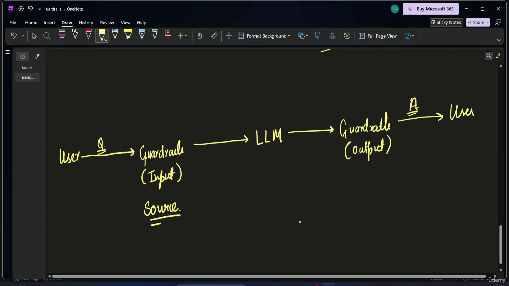

读 trace 的正确姿势是：**不要从头到尾读 JSON，而是先看 `stopReason` 判断有没有被拦，再看 `trace` 里哪个 assessment 下的哪个 policy 名字被点亮，最后才去看 strength 和 metrics。** 讲师演示时屏幕上还出现了 latency、各类 policy unit 这类 metrics，他说这些数据可以用来做自己的看板——但看板的具体做法他说放最后模块，本节没做。

### 5.13 控制台和 SDK 的关系：创建一样，落地不一样

讲师在 P53 开头把这条又说了一遍，因为这是全课程最容易混的点：

> "护栏的创建部分是一样的，我再说一次：创建部分一样，只有实现部分不同。实现你可以用 invoke model、可以用 converse、可以用 Guardrails API，但创建是一样的。"
> —— p053 [10:03]

也就是说，`01_create_guardrail.py` 建出来的那个 `cooking-bot-guardrail`，被 `04`、`05`、`06`、`07` 四个脚本以三种不同方式复用。这正是本节文档只写一次创建脚本、其余脚本全部读同一个 `GUARDRAIL_ID` 的原因。你在自己的项目里也应该这样组织：护栏是**配置资产**，创建/更新走一个入口，调用侧只认 ID + 版本。

### 5.14 关于配额与成本，讲师踩过的坑

这条必须写进文档，因为它是真实会卡住你的东西。讲师在 P52 演示 `03_invoke_without_guardrail.py` 时，请求一直转圈，他一开始以为代码错了，后来发现是配额被打满：

> "报错不是代码错误，是我把 AWS Bedrock 的配额用完了。那个账号是新账号，AWS 每天给的请求数非常有限，我测试的时候就用光了。"
> —— p052 [15:36]

所以他换了一个 AWS 账号继续演示。你复现时如果 `invoke_model` 或 `converse` 长时间不返回、或者直接抛限流类错误，先按这个顺序排查：账号配额 → Region 是否开通模型访问 → 凭证是否有效 → 最后才怀疑请求体格式。

成本侧讲师给了两条明确判断：一是 `invoke_model` 走的是 LLM，贵；`apply_guardrail` 走的是 AWS 托管分类器，便宜得多；二是演示阶段 `maxTokens` 别设大，他自己就设了 300，导致安全问题的回答在中途被截断。

> "为什么回答停住了？因为 max tokens 只有 300，所以它把回答截断了。现在只是学习用途，不要把 max tokens 设太大，否则每日额度很快用完。"
> —— p053 [26:08]

### 5.15 换成 Node.js 时怎么写

你是前端转 AI 应用工程师，这里补一句对应关系。三个动作在 JS 里是一一对应的：

- `bedrock` 客户端 → `new BedrockClient({ region })`，`CreateGuardrailCommand`、`GetGuardrailCommand`、`DeleteGuardrailCommand`；
- `bedrock-runtime` 的 `invoke_model` → `InvokeModelCommand`；
- `bedrock-runtime` 的 `apply_guardrail` → `ApplyGuardrailCommand`；
- `bedrock-runtime` 的 `converse` → `ConverseCommand`。

参数名和 Python 版基本一致（SDK 会把 snake_case 映射成 camelCase，比如 `guardrailIdentifier`、`guardrailVersion`、`trace`）。所有调用都返回 Promise，用 `await` 拿 `response`；`InvokeModelCommand` 的 `body` 是字符串或 `Uint8Array`，要自己 `JSON.parse` 再取 `output.message.content[0].text`，这一点和 Python 里 `response["body"].read()` 完全对应。

这里不存在锁、事务、并发写的问题，所以不需要考虑 JS 侧的竞态。唯一需要防的是“同时打太多请求把配额打满”，做法就是加一个简单的串行 `for await` 循环，别用 `Promise.all` 一次轰几十个。

---

## 6. 复现检查清单

按顺序打勾，每一步都对应上面的脚本。任何一步失败，先停在那一步解决，不要往下跳。

**环境层**

- [ ] `python --version` 输出 3.10 及以上；
- [ ] 虚拟环境已激活（命令行前缀有 `.venv`）；
- [ ] `pip install -r requirements.txt` 无报错；
- [ ] `aws configure` 已配置，或环境变量里有可用的 AWS 凭证；
- [ ] `.env` 已从 `.env.example` 复制并填好 `AWS_REGION`、`MODEL_ID`；
- [ ] 在 Bedrock 控制台确认你选的 Region 里 Nova Lite 已开通模型访问；
- [ ] 确认账号的 Bedrock 每日配额够你跑完本节（讲师就是在这里翻车的）。

**创建与检查**

- [ ] `python 01_create_guardrail.py` 成功返回，输出里能看到 `guardrailId`；
- [ ] 把 `guardrailId` 写进 `.env` 的 `GUARDRAIL_ID`；
- [ ] 去控制台 Guardrails 页面刷新，能看到 `cooking-bot-guardrail`；
- [ ] `python 02_get_guardrail.py` 输出的 `status` 是 `READY`；
- [ ] 输出里能看到 `medical-advice` 这条 topic；
- [ ] 输出里能看到 violence / hate / insults / misconduct / prompt attack 这些 content filter 及其 strength。

**对比演示**

- [ ] `python 03_invoke_without_guardrail.py` 跑通，模型真的回答了医疗剂量问题（这一步“答出来”才是预期结果）；
- [ ] 记下这次返回的 `usage`，和后面带护栏的做对比；
- [ ] `python 04_invoke_with_guardrail.py` 跑通；
- [ ] 返回文本变成了 blocked input message，而不是医学建议；
- [ ] `stopReason` 里出现护栏介入的取值；
- [ ] `trace` 被成功打印，能在里面找到 `medical-advice`。

**Guardrails API**

- [ ] `python 05_apply_guardrail.py` 跑完三个用例；
- [ ] 医疗问题那条被拦，且能看出命中的是 medical advice 策略；
- [ ] 烹饪问题那条被放行；
- [ ] 第二个医疗问题再次被拦；
- [ ] 你清楚屏幕上打印的 `medical` / `cooking` 是你自己写的标签，不是 API 字段。

**converse API**

- [ ] `python 06_converse_safe.py` 返回了正常烹饪回答；
- [ ] 能观察到回答因为 `maxTokens=300` 被截断（`stopReason` 的相关取值）；
- [ ] `python 07_converse_blocked.py` 两个提示词都被拦；
- [ ] 医疗问题和暴力问题返回的都是 blocked input message；
- [ ] trace 里能看到被违反的策略名和 blocked 动作；
- [ ] 你能对着 trace 指出 `responseMetadata`、`output`、`stopReason`、`usage`、`trace` 这五层。

**收尾**

- [ ] `python 08_delete_guardrail.py` 执行成功，HTTP 状态码是 200；
- [ ] 控制台刷新后该 Guardrail 消失（或者你保留它，进入下一模块继续用）。

---

## 7. 课里没讲但你会撞上的

下面这些是逐字稿和截图里**没有**出现的内容，属于你照着做大概率会遇到、但课里没交代的部分。写在这里是为了让你不卡住，但请明确：这些不是讲师说的。

**1. `MODEL_ID` 的完整字符串课里没念。** 讲师只说了“Nova Lite”“很小的模型”。示例里的 `amazon.nova-lite-v1:0` 需要你按自己 Region 的实际可用 ID 替换。查法：控制台模型目录里看 model ID，或 `aws bedrock list-foundation-models`。

**2. boto3 的具体参数名课里没逐个念。** 讲师是口述“content policy、topic policy、word policy、sensitive information”，没有逐字读出 `topicPolicyConfig`、`contentPolicyConfig` 这类签名。本文代码按真实签名写，如果你的 boto3 版本较旧或 Region 较新，可能报参数校验错误，按报错提示删改对应字段即可。

**3. `PROMPT_ATTACK` 的 `outputStrength` 是否只能填 `NONE`，课里没讲。** 讲师只说了“prompt attack 也在这里面，可以启用”。本文代码为了通过校验填了 `NONE`，这是常见做法，但**不是讲师说的**，以你实际调用结果为准。

**4. 创建 Guardrail 需要的 IAM 权限课里没讲。** 你需要 `bedrock:CreateGuardrail`、`bedrock:GetGuardrail`、`bedrock:DeleteGuardrail`，以及 runtime 侧的 `bedrock:InvokeModel`、`bedrock:ApplyGuardrail`、`bedrock:Converse`。权限不够时的报错长得很像“模型不存在”，别误判。

**5. Guardrail 异步就绪的问题课里没讲。** 讲师创建完直接去控制台刷新就看到了，但实际环境中刚创建的护栏可能需要短暂等待才可用；如果 `04` 立刻报找不到版本，等几十秒再试，或者先跑一次 `02` 确认 `status` 是 `READY`。

**6. `draft` 版本与发布版本的区别课里只说了“最后模块讲”。** 本文全程用 `draft`，这是讲师的做法。生产上通常会发布一个数字版本再引用它，本节不做，课里也没做。

**7. `apply_guardrail` 的 `content` 长度上限、单次能传几段文本，课里没讲。** 示例里每次只传一段 `{"text": prompt}`。如果你要批量审核，需要自己分批，并处理超长文本。

**8. trace 的体积问题课里没讲。** `trace="ENABLED"` 时返回的 JSON 相当大，打进日志会显著增加存储成本。生产上常见做法是只落 `stopReason` 和 assessment 里的策略名，完整 trace 只在排障时开。讲师只说了“trace 里有全部信息，可以做看板”，没说体积。

**9. 延迟问题课里没给数字。** 讲师演示时提过 trace 里有 latency、policy unit 这类 metrics，但没有说“加护栏会慢多少”。你自己压测时，建议分别测“无护栏 converse”和“有护栏 converse”的 P50/P95，别用单次请求下结论。

**10. 多轮对话怎么带护栏课里没演示。** `converse` 支持 `messages` 传多轮历史，但讲师本节只发了单条 user 消息。你自己接多轮时要注意：护栏是逐次请求生效的，历史消息里如果有被拦内容，不会因为你这次传了干净输入就自动消失。

**11. 输出侧护栏怎么配课里没写完整代码。** 讲师讲了 blocked output message 的作用、讲了 grounding 只能挂输出、讲了 `outputAssessment`，但没有给出一个“模型先答、输出侧再拦”的可运行脚本。本文的 `04`–`07` 都是输入侧命中，这是课里的实际演示范围。

**12. 监控看板课里没做。** 讲师两次说“用 trace 可以做自己的 dashboard”“最后模块会做监控”，本节只是把 trace 打印出来。你要是现在就想要看板，得自己接 CloudWatch 或自建日志管道，课里没有现成脚本。

**13. 正则 / word policy / denied topic 的实际配置课里没落到代码。** 讲师在控制台里讲了 word filter、detect-but-not-block、用 regex 拦 `Claude Opus` / `Claude Sonnet` 这类变体、denied topic 放到后续模块，但这些都停留在“控制台上能看到”的层面，没有对应的 SDK 代码片段。本文的 `01` 里只落了 topic policy、content policy、sensitive information（EMAIL 示例），word policy 和 regex 属于课里讲了概念但没给代码的部分。

**14. `sensitiveInformationPolicyConfig` 里那个 EMAIL 示例是本文补的最小演示。** 讲师只说“这是敏感信息过滤器，可以在这里定义”，没有念出实体类型清单。你用的时候以官方支持的实体类型为准，别把本文的 EMAIL 当成讲师指定值。

**15. 删除护栏后的连带影响课里没讲。** 如果你已经把 `GUARDRAIL_ID` 用在别的脚本或服务里，删掉之后那些调用会直接失败。本节按顺序跑没问题，一旦你把它接进自己的项目，删之前先确认没有引用。

---

到这一步，你已经完整复现了 P52–P53 的全部可执行内容：一个 Guardrail 从创建、检查、三种调用方式对比、trace 解读到删除的闭环。下一节（模块 2 起）讲师会把重点转到 Guardrails API 的深入用法，模块 3 起转到 converse API，届时本文的 `05`、`06` 两个脚本会直接成为后续内容的起点。